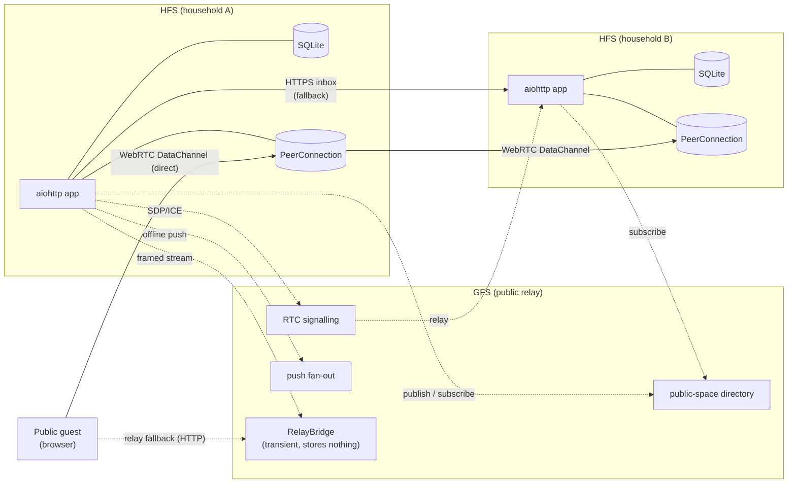
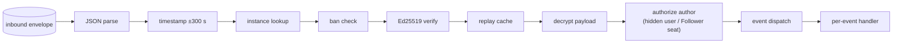
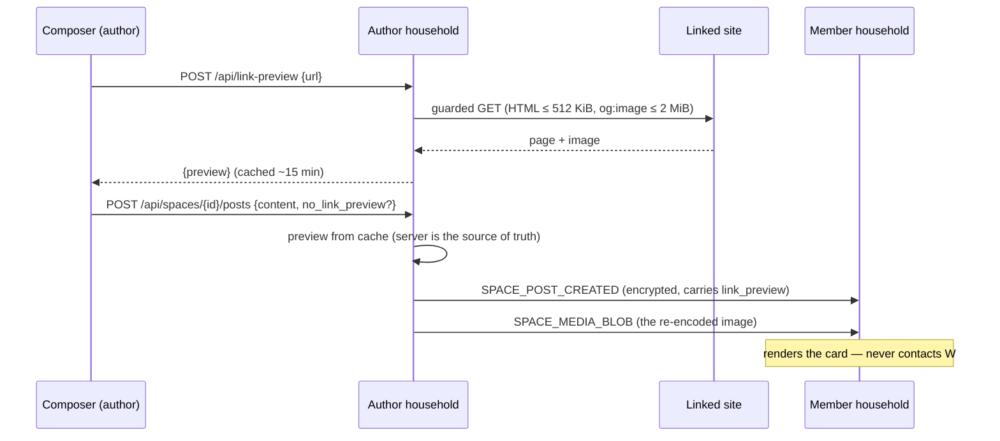

# Architecture

How Social Home fits together. Distilled from §4 of `spec_work.md`
plus the current code under `socialhome/`.

For the wire-level federation protocol — envelopes, validation
pipeline, per-feature flows — see [`protocol/README.md`](./protocol/README.md).
This page covers the **system shape** behind that protocol: who runs
what, how identity works, how peers stay in sync, how spaces stay
encrypted across membership churn, and how the system recovers when
peers go offline.

## Topology

Each household runs one **Household Federation Server (HFS)**.
Households talk to each other directly, peer-to-peer. A central
**Global Federation Server (GFS)** is consulted only for tasks that
genuinely need a meeting point: public-space discovery, push fan-out
to offline peers, and WebRTC signalling bootstrap. The GFS sees
routing metadata only — never plaintext content, and (since the
anonymous relay) not even which household relayed a public/global space
event: `/gfs/publish` is authorized purely by the space-authority
signature inside the opaque payload.

For public-content delivery (public highlights and the public moments
index) the GFS adds a **lazy-relay fallback tier**: a guest browser
always tries a direct WebRTC DataChannel to the author's SH first, and
only when that can't connect does the GFS proxy the framed stream over
HTTP — pushing a `relay_offer` to the still-online author, who streams
the byte-identical frames back through the GFS to the guest. The fallback
is author-online only; an offline author still yields "unavailable". One
framing module and one transient in-memory `RelayBridge` serve both
highlights and moments, and **the GFS stores zero highlight/moment
content bytes** — the bridge is a pure pipe, never an at-rest copy.

A single HFS can run in three platform modes, selected by `SH_MODE`:

| Mode | Adapter | When |
|---|---|---|
| `standalone` | `StandaloneAdapter` | Direct deploy: local users, password auth, no Home Assistant. |
| `ha` | `HaAdapter` | HA Core + REST: SH talks to a Home Assistant install via REST, but is *not* itself an add-on. |
| `haos` | `HaosAdapter` | HA Supervisor add-on: runs inside HAOS with Ingress auth and Supervisor APIs. |

Mode-specific code lives in `socialhome/platform/{standalone,ha,haos}/`.
Route handlers and services consume the adapter through Provider
Protocols (`AuthProvider`, `UserDirectory`, `PushProvider`, …) plus
a `capabilities` set, never by branching on `config.mode`. See
`socialhome/platform/adapter.py`.

Push (§25.3) fans out to every registered surface: Web Push (browsers,
VAPID) and the platform adapter's `PushProvider`. In `ha` / `haos` mode
that provider targets the user's **HA Companion app** via the notify
service they set per-user in Settings → Notifications
(`preferences.ha_notify_service`, e.g. `notify.mobile_app_<device>`).
HA names that service after the *device*, not the username, so there is
no auto-derived default — an unset value skips HA-app push for that user,
and a configured-but-wrong service is logged at WARNING (not silently
dropped).

Wall panels adopted in Home Assistant are found through the optional
`DisplayDirectory` Provider (`adapter.displays`; `None` on standalone).
Adapters that wire one advertise `Capability.HA_DISPLAY_DISCOVERY`
(`ha_display_discovery`), which shows "Found in Home Assistant" in Admin ›
Dashboard › Wall panels. `platform/ha/displays.py:HaDisplayDirectory`
(shared by `HaAdapter` and `HaosAdapter`) reads HA's WS
`config/device_registry/list` for ESPHome devices whose `esphome.project`
is `social-home-io.esphome-dashboard` (HA splits it into manufacturer
`social-home-io` / model `esphome-dashboard`; sub-devices skipped), finds
each one's diagnostic *Social Home node* sensor in
`config/entity_registry/list` and reads its state (`GET /api/states/…`) —
the ESPHome node name, which HA's device registry doesn't carry but the
action name needs: `connect()` calls `esphome.<node, "-" → "_">_connect_social_home`
with `{url, claim}` (REST `POST /api/services/…`). A failed read is
`DisplayDiscoveryFailedError` (502), never an empty list; every HA call
failure is logged at WARNING. This is also how the Home Assistant App —
whose mDNS can't reach the LAN — gets panels connected without a typed
address.

Household zones (§23.8) can follow the platform's own places through
the optional `ZoneSource` Provider (`adapter.zones`; `None` on
standalone). Adapters that wire one also advertise `Capability.ZONE_SYNC`
(`zone_sync` in `/api/instance/config`), which shows the sync switch in
Admin › Zones. In `ha` / `haos` mode `platform/ha/zones.py:HaZoneSource`
reads Home Assistant's `zone.*` entities from `GET /api/states`
(passive zones left out, `zone.home` = the Home zone, `mdi:*` icons
mapped to one emoji, no colour — HA stores none) and raises
`ZoneSourceUnavailableError` when HA can't be read — or answers without
`zone.home`, which HA's zone integration always creates, i.e. HA is
still starting — so a failed call is never mistaken for "no zones". `services/household_zone_sync.py:
HouseholdZoneSync` mirrors them via `HouseholdZoneService.mirror_external`
at startup and every 5 minutes while the household's option is on (the
default; `instance_config` key `household_zones.sync_enabled`); turning
it off removes the synced zones once and the loop idles. The app starts
it after the adapter's `on_startup` and stops it before `on_cleanup`,
for whichever adapter has a zone source — no mode branching.

## Identity (§4.1)

Every identity in Social Home — instance and user — is bound to an
Ed25519 public key. Identifiers are deterministic 32-character base32
strings derived from a SHA-256 of that key, so any party can verify a
claimed `instance_id` or `user_id` by recomputing the digest. No
central registry is involved.

- **`instance_id`** — derived from the HFS's long-term Ed25519 public
  key (`derive_instance_id(public_key_bytes)`). Generated once on first
  startup and never reassigned. Stored in `instance_identity`.
- **`user_id`** — derived from the **home instance's** public key plus
  the user's immutable **`identity_anchor`**, with a null-byte separator
  (`derive_user_id(instance_pk, identity_anchor)`, v_26). The anchor is a
  uuid4 for users created on v_26+ (standalone) and the **frozen username**
  for existing rows, for haos users, and for the first admin of a standalone
  / ha household (all three re-mirror deterministically, so the derivation
  input has to be stable) — so `user_id` is bound to an opaque per-user
  value, **not** the human name. Every local minting path goes through the
  one helper `identity_bootstrap.derive_local_user_id` (username-anchored) or
  `UserService.provision` (uuid4-anchored); a `user_id` is **never**
  synthesised from a string, and migration `0049` repairs the installs where
  it once was. This frees the human name for a later
  mutable login + `@handle` without re-keying the user's federated identity
  (a rename leaves `user_id` stable). Globally unique, cryptographically
  bound to the home instance, and survives across spaces and DMs.
- **`UserIdentityAssertion`** — when an instance refers to one of
  its users in a federation event (`USERS_SYNC`, embedded in space
  events, etc.), it ships a signed assertion binding the `user_id`
  to the username + display name. Receivers verify the signature
  with the home instance's public key on every inbound event.
- **`username`** — a **mutable login label** distinct from the
  cryptographic `user_id`. Standalone users rename it via
  `POST /api/me/username`; HA-mode usernames follow the HA person
  name on every boot. Renames cascade locally (migration `0042`
  adds `ON UPDATE CASCADE` to all referencing foreign keys) and
  federate via `USER_UPDATED` events so peers keep their
  `remote_users.username` in sync. The cryptographic identity
  (`user_id` / `identity_anchor`) is unaffected by a rename.
- **`handle`** — a **public `@handle`** (distinct from both the
  cryptographic `user_id` and the login `username`). A mutable,
  per-household-unique, case-insensitive display name set via
  `POST /api/me/handle` by any local user (including HA-managed).
  Unsigned public display metadata (federated on `USER_UPDATED` /
  `USERS_SYNC` alongside `display_name` and `picture`, never part of
  the signed identity binding). On remote instances cached in
  `remote_users.handle` (per-peer COALESCE-sticky so older peers or
  non-handle edits never null the cached value).

#### Instance identity vs. per-user identity

The two identities above play different roles:

- **Instance identity** (the `instance_id` key) is the **transport +
  trust root**. It signs every federation envelope, anchors pairing, and
  is what `from_instance` is bound to. It belongs to the *household*, not
  to any one member.
- **Per-user identity** (independent user identity, **Phase 1** —
  capability v_25) gives each household member their **own** Ed25519
  keypair, distinct from the instance key. A household publishes a
  user's public key plus a *dual-signed binding* (instance signature
  vouching for the specific key + user self-signature proving
  possession) inside the existing `USERS_SYNC` / `USER_UPDATED` payloads;
  receivers verify it against the sender's pinned instance key and store
  the remote user's public key on `remote_users`.

Phase 1 is **behaviour-neutral and portable-by-design**: the legacy
`user_id` (`derive_user_id(home_instance_pk, username)`) stays the
*canonical* address for every user-scoped surface, and the per-user key
is additive metadata — a peer that ignores it works exactly as before.
**Phase 2** (capability v_26) takes the first portability step: `user_id`
now derives from an immutable `identity_anchor` (uuid for new users, frozen
username for existing/haos) instead of the mutable username, so the human
name can later become a mutable login + `@handle` without re-keying. The
anchor is carried in the binding and committed into **both** signatures;
verify re-derives `user_id` from it (sub-v_26 falls back to username — see
*Migration tail* in the protocol doc). The remaining roadmap intent is
later-phase: resolve / cache the binding on demand, then make a user's
identity fully **portable** so a member can move out of one household and
carry their key. Migrations `0040_user_identity_keys.sql` (key columns) and
`0041_user_identity_anchor.sql` (the `identity_anchor` columns) provision
the storage; `infrastructure/user_identity.py` mints the keys and
`services/user_service.py` mints the anchor. See
[`protocol/user-identity.md`](protocol/user-identity.md).

### Post-quantum migration (§25.8)

Identity is **classical Ed25519 by default**, with optional **ML-DSA-65
hybrid signatures** wired in. When `federation_sig_suite =
'ed25519+mldsa65'` is set, every signed payload carries both an
Ed25519 and an ML-DSA-65 signature; receivers verify both. The
fallback to classical happens automatically per-peer based on what
each side advertised at pairing — see `remote_instances.sig_suite`.

The PQ key material lives alongside the classical key in
`instance_identity` (columns `pq_algorithm`, `pq_private_key`,
`pq_public_key`); peer PQ keys live in `remote_instances.remote_pq_*`.
Key generation is done by `socialhome/federation/pq_signer.py` and
the bootstrap is in `infrastructure/key_manager.py`.

### Implementation pointers

- `socialhome/federation/crypto_suite.py` — derive_instance_id /
  derive_user_id, signature verification, hybrid suite selection.
- `socialhome/infrastructure/key_manager.py` — first-startup keypair
  generation, KEK encryption of private key material at rest.
- `socialhome/repositories/federation_repo.py` — `instance_identity`
  + `remote_instances` reads/writes.
- `socialhome/infrastructure/user_identity.py` +
  `socialhome/services/user_identity_binding.py` — per-user identity key
  minting/backfill and the outbound binding fields (Phase 1).
- See [`protocol/pairing.md`](./protocol/pairing.md) for the
  pairing handshake that bootstraps trust between two instances, and
  [`protocol/user-identity.md`](./protocol/user-identity.md) for the
  per-user identity binding carried on the roster.

## Progressive sync (§4.2)

Federation traffic is split across three transports based on what the
event needs and whether the peer is reachable:

| Tier | Transport | Used for |
|---|---|---|
| 1 — hot | WebRTC DataChannel `fed-v1` | Routine, real-time envelopes once the P2P channel is up. |
| 2 — warm | WebRTC DataChannel `sync-v1` | Bulk content sync (initial sync after pairing, recovery after long offline). |
| 3 — cold | HTTPS inbox `POST /federation/inbox/{id}` | Fallback before/while DataChannel is down, and for peers behind a blocked UDP path. |
| 4 — no address / last resort | Connection-server envelope relay `POST {gfs}/gfs/envelope` | Households seated from an invite link (§D2b): the pair never exchanged an address, so tiers 1-3 have nothing to dial. Also the last-resort fallback for a **paired** household this household opted into the relay with (`remote_instances.gfs_relay` — set by a pairing code with a GFS reach, or later per connection by the admin, v_54), over its confirmed `peer_gfs_routes`. |

**Redirects.** Every outbound POST to a household inbox — tier 3 and outbox
redelivery (a connection server never POSTs to a household: it holds no
household address, and its relay fan-out is WebSocket-only) — goes through
`socialhome/peer_http.post_to_peer`, which never lets aiohttp follow a `3xx`.
At most one hop is followed by hand, and only when it stays on the stored
address: same host, same scheme and port or an `http`→`https` upgrade (a
downgrade is refused), a target that passes `validate_peer_url`, status
301/302/307/308. Anything else is a failed delivery, logged at WARNING with
host names only. Calls to a connection server (and GFS cluster peers) pass
`allow_redirects=False` outright; `tests/test_peer_http.py` guards both.

Tier 4 is a `TransportStrategy` like the others
(`federation/gfs_relay_transport.GfsRelayTransport`). `FederationTransport`
selects it in two cases:

- `source = space_session` — the only tier, to the connection server that
  introduced the pair (`relay_via`).
- `source = manual` with our `gfs_relay` opt-in on — the **fallback**: RTC
  if the DataChannel is open, else the HTTPS inbox, and only when the inbox
  was not reached (network error, timeout, 5xx — never a 4xx, which is the
  peer's own pipeline answering) or the peer has no inbox URL at all, the
  relay. Routes are this household's own `gfs_connections` rows confirmed
  for the peer (`peer_gfs_routes`; only active connections count); sends
  round-robin over them with a per-peer in-memory index, trying each route
  at most once, so one send can still land when one server is down. A
  throttled server moves on to the next route; a too-large frame stops at
  once. As a fallback only an acceptance counts: any relay failure
  reports the original HTTPS failure, so the envelope is queued for
  retry and the peer marked unreachable exactly as without the relay.
  Only where the relay is the sole tier (no inbox URL) does a throttle
  surface as the waitable `relay_throttled` and a too-large frame as
  permanent. With no URL the RTC offer is still kicked — it rides the relay
  like any other envelope, so a DataChannel can come up later. The outbox
  redelivery reaches the same selection point
  (`FederationTransport.send_via_gfs_relay`). Without the opt-in or a
  route, a paired peer is never relayed, and the §24.11 pipeline refuses a
  relayed envelope from it (`make_check_relay_opt_in`). Routes are
  *discovered*, never configured (v_53,
  `services/gfs_route_discovery_service.py`): we probe the peer through
  each of our own connection servers, it acks through the one each probe
  arrived on and probes back, and each side records a server only when
  an ack to ITS OWN probe came back through it (a received probe proves
  nothing — a malicious server can re-post it elsewhere). No server is
  ever named on the wire.
  `infrastructure/gfs_route_discovery_scheduler.py` re-probes every
  24 h ± 1 h and on a GFS reconnect (coalesced, at most one triggered
  round per 10 min), and drops routes not refreshed for 72 h; see [`protocol/gfs-relay.md`](./protocol/gfs-relay.md). Because the connection server is a third party
— not a household — the whole §24.11 envelope (its routing fields are
plaintext by construction) is sealed to the peer's static X25519 key-wrap
key before the relay sees it, so the *wire* carries only `(to_instance,
time, size)` — no sender, no space, no event type, no token. That is a
statement about the request body, not about the socket: the sending
household's IP is still in the connection server's HTTP access log. See
[`protocol/invites.md`](./protocol/invites.md) for the wire shape and
[`principles.md`](./principles.md) for that residual and the rest of the
metadata this tier concedes.

A tier-4 success is an **acceptance, not a delivery**: the relay answers
a uniform `202` whether the recipient is online, offline or not one of
its clients (anything else would be a presence oracle), so
`DeliveryResult.via="gfs_relay"` never calls `mark_reachable`. What the
operator sees instead is `FederationService.last_relay_accepted_at` — an
in-memory, local-only timestamp — surfaced on `/api/connections` and the
diagnostics bundle beside `last_reachable_at`, with a derived
`relay_only` flag when the relay has taken traffic more recently than any
proven delivery. The Manage panel renders it as a "Connection server"
row with a *Relay only* chip.

The Connections page renders the current per-peer transport tier as
an inline glyph (⚡ for WebRTC, ☁ for HTTPS), updated live via the
`peer.transport_changed` WS frame. The Manage detail panel adds a
plain-English explanation of which tier is active and, for peers
that recently received a relayed DM, the relay path. The signal is
strictly diagnostic — federation behaviour is identical at every
tier; only the latency differs.

All tiers run their inbound traffic through the same §24.11
validation pipeline (parse → timestamp → instance lookup → ban check
→ Ed25519 verify → replay cache → decrypt → authorize → dispatch).
Whether an envelope arrives over RTC, HTTPS or the connection-server
relay is invisible to the per-event handlers; every path lands in
`federation/inbound_validator.InboundPipeline`. Relayed frames enter
through `services/gfs_relay_inbound.GfsRelayInbound`, which throttles,
unseals with the household's key-wrap key and routes on the sealed
`kind`: §24.11 envelopes to the pipeline (with `RELAY_DELIVERED_VIA`
naming our own `gfs_connections.id` for the delivering server during the
dispatch), invite-bootstrap bodies to the redeem coordinator.

The authorize steps run **after** the replay-id is persisted, so a
dropped envelope still answers 200 and the sender's outbox stops
redelivering: `check_deprovisioned_author` drops user-scoped events
from a remote user we have hidden, `check_space_archived` drops a
space-content write into a space that is archived here (read-only to peers
as it is locally — see [`protocol/spaces.md`](./protocol/spaces.md#an-archived-space-is-read-only-to-peers-too)),
and `check_space_writer` drops a
space-content write from a household that holds only read-only
Follower seats in that space (`space_remote_members.role =
'subscriber'`) — or only tombstoned ones.

`check_space_writer` is **household-level and keyed on the signed
`from_instance`**, never on a payload author field the sender writes,
and it runs on **every receiving household, not only the space's
host**: space content fans out peer-to-peer from the *originating*
household (`broadcast_to_space_members`), so a member household
receives a follower's writes directly. It covers the whole write
vocabulary (`SPACE_WRITE_EVENT_TYPES` — posts, comments, pages, tasks,
polls, stickies, calendar events, RSVPs, schedules, gallery albums and items,
bazaar listings / bids / offers, zones, location pins, media blobs,
and every `*_UPDATED` / `*_DELETED` sibling), with one opt-in:
`SPACE_COMMENT_CREATED` when the space has `allow_subscriber_comment`
on and the payload's author names a live `subscriber` seat of that
same household. A household the receiver holds **no** roster row for
(the space host excepted) is not a writer: its write is held in a bounded
buffer and replayed through the same gates once a seat for it lands —
roster convergence, not trust — and a removed household is read back
**including its tombstones**, so it is refused, never held. The same gates re-run on the inner event
of a `SPACE_ROUTED` envelope after the mesh unwrap
(`run_post_decrypt_gates`), which would otherwise dispatch without
passing through the pipeline at all.

### Federation map — peer home location

The HA and HAOS adapters fetch `latitude` / `longitude` from HA Core's
`GET /api/config` during `on_startup` and persist them (truncated to 4dp)
to `instance_identity.home_lat` / `home_lon`. Persistence fires a
`LocalHomeLocationUpdated` bus event, which two subscribers consume:

- **`FederationService`** fans out `LOCAL_HOME_LOCATION_CHANGED` to every
  confirmed peer whose `proto_version ≥ 5` (capability v5). The peer stores
  the coordinates on `remote_instances.home_lat` / `home_lon` and publishes
  `PeerHomeChanged`.
- **`RealtimeService`** pushes a `local.home_changed` WS frame to every
  connected client so the SPA's Connections Map tab updates the own-household
  pin without a page reload.

Inbound `LOCAL_HOME_LOCATION_CHANGED` triggers the same `PeerHomeChanged`
event, which `RealtimeService` broadcasts as a `peer.home_changed` WS frame
so the Map tab can move or add the peer's pin. The `PAIRING_PEER_ACCEPT`
bootstrap message also carries `home_lat` / `home_lon` when available, so
the map is populated immediately after pairing without waiting for a
subsequent broadcast.

The Connections page exposes a **List | Map** tab toggle. The Map tab
renders an OpenStreetMap canvas (Leaflet) with one pin per household — own
household marked distinctly, peers marked with transport-indicator badges
(WebRTC / HTTPS). Tapping a pin opens a popup with distance and 8-point
compass bearing. Peers without coordinates appear in a "Not on map" footer
below the canvas. Standalone and third-party instances never have a
home location unless the operator configures one explicitly; the UI
degrades gracefully in that case.

See [`protocol/home-location.md`](./protocol/home-location.md) for the
full wire protocol and sequence diagram.

### Outbox and retries

Outbound envelopes go to `federation_outbox` first
(`socialhome/repositories/outbox_repo.py`). The
`infrastructure/outbox_processor.py` scheduler walks the table on a
fixed cadence, picks the best transport for each peer (RTC if open,
HTTPS otherwise), and retries with exponential backoff. Structural /
security-critical events have `expires_at = NULL` and never age out;
ordinary events have a 7-day TTL (§4.4.7). A delivered envelope's row is
**deleted on success** (`mark_delivered`) — the receiver's 2xx satisfies
at-least-once and nothing reads delivered rows, so the queue never keeps
a tombstone per delivered event. The processor also runs a periodic
retention sweep folded into the same loop with two phases:
`expire_past_retention` flips undelivered ordinary events to `failed` at
7 days (NEVER_DROP events keep retrying indefinitely), and
`purge_terminal` DELETEs terminal (`delivered`/`failed`) rows older than
`TERMINAL_GRACE` (24 h) in bounded batches. Together these bound the
table: failures are kept 24 h for operator diagnostics then purged, and
the pre-change historical `delivered`/`failed` backlog is reclaimed over
successive sweep ticks. A hard **per-peer pending cap**
(`MAX_PENDING_PER_PEER`, default 1000) bounds the table independently of
the TTL: when a peer is at/over the cap, `enqueue` evicts that peer's
oldest *droppable* (non-NEVER_DROP) pending row before inserting the new
one, so a permanently-offline peer plus a busy space can't flood the
outbox. NEVER_DROP rows are never evicted — if the backlog is entirely
NEVER_DROP the new row is still inserted over the cap rather than dropping
a security/structural event.

**What a redelivery response means.** 2xx is delivered. 5xx, a timeout or
a network error is transient (backoff). **429 is transient too** — a rate
limit is back-pressure ("later"), never a refusal: the receiving inbox
answers its per-IP throttle with a delta-seconds `Retry-After`, and the
outbox honours it as a *floor* on the next backoff delay (never sooner than
the peer asked; capped at the 4 h ceiling so a peer cannot park an entry,
then jittered upward by up to 30 % so a throttled burst does not come back on
one tick). A 429 still costs an attempt, so a
peer that throttles forever is bounded exactly like an offline one —
`MAX_ATTEMPTS`, the 7-day TTL and the per-peer pending cap — and a 429 never
paints the household unreachable. Every other 4xx (410 replay / skew, 403
bad signature, 400 malformed) is permanent and dropped; 404 is
retried briefly for the pair-window race (`PAIR_WINDOW_404_ATTEMPTS`).
Treating 429 as permanent once turned a single echo storm into the silent
loss of unrelated envelopes (an `UNPAIR`, a replayed highlight).

**The mesh path has no outbox.** A space broadcast to a mesh-only member
(`broadcast_to_space_members` → `send_with_mesh_fallback` →
`SPACE_ROUTED`) that the mesh cannot reach right now is **deferred, not
lost**. Three misses qualify (`DEFERRABLE_MESH_ERRORS`): `route_cooldown`
(route discovery was inside its 30 s negative cooldown, so the attempt never
reached the wire), `no_route` (a real probe found nothing — a relay may come
back, or the member reconnect, seconds later) and `routed_send_failed` (a
route was found but the relay failed on the cached and on a freshly probed
path). The broadcast then opens a **per-target FIFO** for that member and
reports it as `mesh_retry_scheduled` (not a terminal failure). While the
FIFO exists, every later broadcast to the same member queues behind it
instead of overtaking, so the member sees events in broadcast order. One
task per target sends the queue in order from the head, on a private copy of
the exact payload variant that member was sent (legacy / relay variants
included). A delivered item is popped and the next goes; a deferrable miss
keeps the head first and **backs off**: re-send *n* waits at least
`MESH_DEFERRED_RETRY_BACKOFF_S[n-1]` (0 s, 60 s, 120 s, 240 s), never inside
the target's negative route cooldown, plus a 5 s margin — roughly 35 s,
65 s, 125 s, 245 s after a `no_route`, ~8 minutes in all. Each re-send after
a cooldown is a fresh route discovery. A **route learned** for that member
(`RouteDiscoveryService.add_route_learned_listener` →
`FederationService.on_route_learned`, fired whenever a route is cached,
including a late `SPACE_ROUTE_FOUND`) or the member **coming back online**
(`ConnectionReachable` for that household — it is a direct peer again)
cuts the current wait short, so the queue drains the moment a path exists. Progress resets the budget (it is per
outage); after four re-sends in a row miss, the whole queue is given up with
one WARNING naming each lost event and its space. Before each send it
re-reads membership, so a household that left or was removed meanwhile gets
no space content (the drop logs a WARNING) — except for the two broadcast
events that remove their own recipient (`SPACE_DISSOLVED`,
`SPACE_MEMBER_LEFT`), which go to the members as they were at broadcast time
minus any household banned since: `dissolve_space` purges `space_instances`
right after its broadcast, and a re-read would lose the very event that tells
the member. A re-send that fails for a reason waiting cannot fix
(`not_confirmed`) or raises costs only that item. Concurrent broadcasts that
miss together join the same queue — one queue and one drain task per target,
ever. Bounds: 64 queued sends per target, 256 deferred targets and a 16 MiB
byte budget across all queues (serialized payload size); a single payload
over 256 KiB is never deferred (WARNING). Past any of them the broadcast
reports `mesh_retry_queue_full` as a terminal miss, logged once per target.
A wake raised by the drain's OWN re-send (its re-discovery caches a route and
fires `on_route_learned` for the same target) is ignored — the wake event is
cleared after each pass — so the backoff is never skipped by itself. `FederationService.stop()` cancels pending queues and
refuses new ones; app cleanup runs it before the routed handler and the
transport stop. What the budget does not bridge is healed by §25.6 sync.

**GFS publishes are retried in memory.** `POST /gfs/publish`
(`GfsConnectionService.publish_space_event`, the identity-free relay of a
public/global space event) is not a peer envelope, so the outbox does not
carry it. A *transient* failure — transport error, timeout, 408, 429, 5xx —
goes to `services/gfs_publish_retry.py`'s `GfsPublishRetryQueue`: a
per-connection FIFO retried with backoff (5 s, 30 s, 2 min, 10 min — four
retries, ~13 minutes), honouring a 429's delta-seconds `Retry-After` as the
floor of the next wait (capped at 15 minutes). Any other 4xx, or an
unfollowed redirect, is permanent and not retried. While a connection has
retries pending, a new publish to it queues behind them, so subscribers see
order. A queued item is exactly `{space_id, event_type, payload}` — there is
no slot for `from_instance` or a household signature, so a retry cannot add
identity. **There is no identified body at all any more:** a publish goes
only to a GFS that has proved `anonymous_publish` under its signed capability
block. A cold cache with `/gfs/info` unreachable puts the publish straight
into the retry queue (nothing is sent until the capability is proven); a
reachable GFS without the proof — an older build — **receives no space
publishes until it upgrades**, with one WARNING per connection. Before each
retry the sender re-checks that the space is still published to that
connection and re-checks the capability the same way. **Why in memory:** the outbox
row is keyed by a recipient instance and re-signed on redelivery — a GFS
publish has neither — so carrying it there, or in a new table, would be a
migration for a payload that is already authority-signed public ciphertext,
deduped by post id on the subscriber side, and only worth retrying for
minutes. A restart loses the queue (logged), which costs no more than before
the queue existed. Bounded at 256 pending publishes, at most 64 per
connection so one dead GFS cannot crowd out the others. A GFS already known
to lack the capability stays "unsupported" even if a later `/gfs/info`
refresh fails; only a connection with no answer at all is "unknown". The
publish and its retries ride a **separate cookie-less `aiohttp` session**
(`DummyCookieJar`), so a sticky load-balancer cookie from the household's
authenticated GFS calls can never be replayed on an anonymous publish. The
loop follows the
`_stop: asyncio.Event` scheduler pattern and is started / stopped with the
app.

### Bulk sync

Initial content sync after pairing (and recovery sync after a long
outage) runs over the dedicated `sync-v1` DataChannel label so the
chunky Tier-2 traffic doesn't head-of-line block routine Tier-1
envelopes. The orchestration lives in
`socialhome/federation/sync_manager.py` and the per-feature
chunkers under `socialhome/federation/sync/space/` and
`socialhome/federation/sync/dm_history/`. Wire details are in
[`protocol/sync.md`](./protocol/sync.md).

A sync session is **requester-initiated and pinned end to end**. The
requester records every `SPACE_SYNC_BEGIN` it sends
(`SyncSessionManager.record_sync_request`); a `SPACE_SYNC_OFFER` is only
an answer, so one naming a `sync_id` nobody here issued — or arriving
from a household we did not ask — is dropped. The session then carries
the provider it belongs to, and every chunk is checked against both that
provider and the session's own `space_id`. Without those three pins an
unsolicited offer minted a session with no provider and no space, and its
chunks wrote members (role included), bans and content for any space the
sender named.

**A sync tells the GFS nothing.** The OFFER, ANSWER and every ICE candidate
ride the signed household-to-household path (or `SPACE_ROUTED` over the mesh);
the GFS is not on the sync path at all. Households used to call
`POST /cluster/signaling-session` (and `/release`) on their GFS before and
after every direct sync, with `from_instance` and a household signature, so
the GFS logged which household started a direct sync, when, and how long its
ICE phase ran. The `signaling_node` URL it returned rode in the OFFER but no
receiver ever used it. Households no longer make that call, the OFFER carries
no `signaling_node`, and `FederationService` holds no GFS client at all
(tripwire: `tests/protocol/test_gfs_no_sync_signaling.py`). The GFS still
answers the endpoint so an older household keeps working; a newer requester
ignores the field in an older provider's OFFER.

## Space cryptographic identity (§4.3)

Every space has its own Ed25519 keypair and a per-epoch AES-256
content key. Members who can read the space hold the current epoch's
content key; members who left or were banned cannot — because the
**epoch advances** on member removal, and the new key is delivered
only to remaining members.

- `spaces.identity_public_key` — the space's Ed25519 authority public
  key, minted at creation. It is no longer permanent (v_44): when an admin
  household that held the seed is revoked (or delegation is turned off)
  the owner rotates it, bumping `spaces.authority_key_epoch` and announcing
  the new key with a cert signed by the owner HOUSEHOLD's identity key
  (`authority_cert.py`). Every receiver — member, admin, subscriber, GFS —
  re-pins only from a cert that binds to the space's owner and carries a
  higher epoch (`services/space_authority_pin.py`), and every
  authority-signature verifier then reads the new pin.
- `space_keys(space_id, epoch)` — one row per epoch holding the
  KEK-encrypted AES-256 content key.
- Membership change → rekey: when a member is removed or banned,
  `space_crypto_service.py` derives a new content key, increments
  `epoch`, and ships a `SPACE_KEY_ROTATED` event encrypted to each
  remaining member's identity key.

Detailed flow with diagrams is in
[`protocol/spaces.md`](./protocol/spaces.md). The space-level
`config_sequence` column on `spaces` provides last-writer-wins
ordering for non-key config changes.

### Implementation pointers

- `socialhome/services/space_crypto_service.py` — key derivation,
  rekey orchestration.
- `socialhome/repositories/space_key_repo.py` — `space_keys` reads
  and writes.
- `socialhome/services/space_service.py` — membership churn that
  triggers rekey.
- `socialhome/services/space_authority_rotation_service.py` — the owner's
  authority-key rotation on admin revocation and the member-side
  `SPACE_AUTHORITY_ROTATED` handler (v_44).

## Resilience and outage recovery (§4.4)

Federation is asynchronous: peers go offline, networks partition,
addons get restarted. The system is designed so that none of this
loses data, and every event is processed at most once.

### Disaster recovery (Recovery Kit)

A household's identity *is* its `instance_identity` row (Ed25519 keypair,
KEK-wrapped); peers pin its public key, so total disk loss would otherwise
mean re-pairing with everyone in person. Two recovery paths, selected by
capability (never `config.mode`):

- **haos:** the HA Supervisor backup already captures the add-on's
  `{data_dir}` — both the SQLite DB and `.kek_salt` — so restoring an HA
  backup reconstitutes the same `instance_id` with no SH-specific step.
- **standalone / ha:** a **Recovery Kit** (`.shrk`) — a passphrase-sealed
  export of the *trust layer* (`instance_identity`, `remote_instances`,
  `spaces`, `space_keys`) plus the `.kek_salt`. The shareable data backup
  deliberately excludes all of these (`NEVER_EXPORT`), so the Kit is the only
  artifact that brings identity + peer trust back. Wire format + crypto:
  `docs/crypto.md` "Recovery Kit"; impl: `services/recovery_crypto.py` +
  `services/recovery_kit_service.py`.

Build via admin `POST /api/recovery-kit`. Restore on a fresh box via the
setup wizard (`POST /api/setup/recovery/restore`): the box auto-mints a
throwaway identity at startup, so the endpoint validates the Kit, wipes the
throwaway trust rows, restores the Kit's, marks setup complete, and triggers
a process restart so the restored identity/KEK load cleanly. Because the same
Ed25519 key returns, the first post-restart boot fans a signed `URL_UPDATED`
out to every restored peer (`services/recovery_reconnect_service.py`, triggered
by the `recovery.recovered_at` marker and guarded by a `recovery.reconnected_at`
marker so it fires exactly once) so peers re-point at the possibly-new inbox
URL; the §4.4 sync below then re-pulls content over the re-established
transport.

### Replay cache

Every accepted envelope's `msg_id` lands in `federation_replay_cache`
with a received-at timestamp. Inbound validation rejects any envelope
whose `msg_id` is already cached (idempotency at the federation
boundary). The
`infrastructure/replay_cache_scheduler.py` evicts entries older than
the §24.11 horizon on a slow cadence so the table doesn't grow
unboundedly.

That horizon (`crypto.REPLAY_CACHE_WINDOW`) is **25 h**, and it is set by
the widest timestamp window any transport allows, not by the outbox's
~5.2 h redelivery cadence. A §D2b envelope carried by the connection
server's store-and-forward relay may be drained up to 24 h after it was
signed, so the timestamp step accepts `24 h + 300 s` for that transport
(`RELAY_TIMESTAMP_SKEW_SECONDS`). A timestamp window is only as safe as
the replay memory behind it — anywhere the two diverge a captured
envelope can be replayed into the gap — so the retention is held
strictly above it and a test asserts the inequality.

### Idempotency keys

Mutating HTTP routes accept an `Idempotency-Key` header; the
`infrastructure/idempotency.py` middleware deduplicates by
`(user_id, key)`. Combined with the replay cache, this means
both API callers and federation peers can retry safely.

### Reconnect queue

When a peer flips from `unreachable` → `confirmed`, the
`infrastructure/reconnect_queue.py` flushes any envelopes that
piled up in `federation_outbox` for that peer in dependency order.
This is what makes "long offline → come back online" recover
without operator intervention.

### Schedulers (the `_stop: asyncio.Event` pattern)

Every background loop in `socialhome/infrastructure/` follows the
same lifecycle: `_stop: asyncio.Event` set in `stop()`, drained in
`start()`, body is `while not self._stop.is_set()`. Reference
template: `replay_cache_scheduler.py`. Schedulers cover replay-cache
eviction, shared-GFS relay route discovery and expiry
(`gfs_route_discovery_scheduler.py`), outbox processing, calendar reminders, page-lock expiry,
post-draft GC, pairing-relay flush, post-rotation tasks, space
retention, task deadlines, recurring-task spawning, password-reset-token
GC, auth-audit-log pruning (`auth_audit_cleanup_scheduler.py` drops
`auth_audit_log` rows older than 90 days hourly, so the append-only trail
can't be grown without bound by repeated failed logins), and
notification-feed GC (`notification_cleanup_scheduler.py` drops
`notifications` rows older than 90 days hourly), and the space moderation
queue sweep (`moderation_expiry_scheduler.py`, hourly: pending items past
their 7-day window expire, and decided / expired items lose their content
7 days later).

The GFS runs its own periodic maintenance sweep
(`global_server/maintenance.py`, same `_stop: asyncio.Event` lifecycle as
`global_server/cluster.py`): hourly it purges expired `admin_sessions`,
expired `gfs_highlight_publications`, and aged `gfs_pair_tokens`, each
prune best-effort and independently guarded. Before this loop the GFS had
no recurring cleanup — only a boot-time session purge and the cluster
heartbeat — so those tables grew unbounded on a long-running process.

### Space moderation queue (§4.3 `moderated`)

`services/space_moderation_service.py` — `SpaceModerationService` owns the
review queue for every access-levelled feature: submit, list,
the submitter's own items, approve, reject, expire. It is a **registry**:
each content service registers a `ModerationHandler` per
`(feature, action)` in `app._build_space_moderation` (`validate` the
payload with the live path's codecs, `snapshot` the live row, `apply` the
write, `preview` it for the SPA). Content services stay decoupled from it:
they hold only the narrow `ModerationSubmitter` protocol, and
`ContentAccessMixin._submit_for_review` turns a QUEUE decision into a
stored item plus `ContentQueuedForReview`, which `BaseView` answers 202 —
so no caller can mistake a queued write for a persisted one, and without
an attached queue the write fails closed. Approval replays the write
through the content service's normal persist path with `approved_by` (the
gate then judges the approver), after a conditional claim of the row so
it is applied once. Posts carry their attachments (poll, schedule poll,
Bazaar listing) through the queue (`space_post_moderation.py`) so they are
created with the post.

**Federated moderation (v_43).** The queue is held by every household that
reviews: the submitter's own household, the host, and every household with
a live admin / moderator seat. `services/space_moderation_federation.py`
(`SpaceModerationFederation`, bound to the queue in
`app._build_space_moderation`) sends a new item to those households only —
one targeted sealed `SPACE_MODERATION_SUBMITTED` per household through
`send_with_mesh_fallback` (`SPACE_ROUTED`-sealed on the mesh), never
`broadcast_to_space_members` — and decisions as `SPACE_MODERATION_DECIDED`;
its inbound handlers run the receiver checks and store items through the
queue (`store_received`, `apply_decision` — approve beats reject). Any
reviewer household decides; an approval made off the host is sent to the
host (`send_release_request`), and only the host applies an item, from its
own stored copy (`release_remote`): the apply runs inside
`services/moderation_release.py`'s `release_scope` (a `contextvars` value
the bus carries to every subscriber, since it awaits them in the
publishing task), and each content outbound bridge adds the approval block
via `with_release`. Receivers judge that block with
`SpaceAuthorship.may_author_approved` — from the host only; a household
holding the item checks that the release equals it in every applied field
(`federation/moderation_approval.py`), against its own copy of the row for
an edit.

### GFS cluster membership

A GFS can run as several symmetric nodes (§24.10) — in production several
processes share one `gfs.db` and one identity seed behind a load balancer —
that gossip state over `POST /cluster/sync`. Each node announces
`[cluster] advertise_url` (falling back to `[server] base_url`) as the
address its peers reach it at; behind a shared load balancer every node must
advertise its own address (node IP + port), or frames reach a random node
and are refused `wrong_recipient`. Nodes are told apart by `[cluster]
node_id` (unique — set it; an empty one falls back to `instance_id` and a
duplicate is flagged); `[server] instance_id` is the GFS's public identity
that households pin and sign into requests, so it is the SAME on every node
(HELLO / heartbeat carry it and the aliases; a same-key sibling reporting an
unlinked id is flagged in the admin view, never a `/healthz` failure; see
[`protocol/discovery.md`](protocol/discovery.md) "One public identity per
GFS"). Membership is operator-approved,
never trust-on-first-use: a node is a member **if and only if** its frames
verify under a key the receiving node already holds. That is either the
GFS's own identity key (`gfs_identity.seed`: an operator who gave a node the
seed approved it) or the key an operator approved for the node through
`POST /admin/api/cluster/peers` (`node_id` + `url` + `public_key`), stored in
`cluster_nodes.approved_key` — a column only that admin call writes. The
row's legacy `public_key` column is never a trust anchor: older builds wrote
it by trust-on-first-use, and an old-version node still sharing `gfs.db`
during a rolling upgrade keeps doing so, harmlessly. The decision is one pure function,
`global_server/cluster.py:authorize_frame`, taken before any signature work:
a `NODE_HELLO` under a key the node does not hold is refused
(`unapproved_node`) and writes nothing; any other frame needs a row that is a
member (`is_member`: an approved key, or our own identity key on the row —
which only a HELLO verified under our seed can have written, in this build or
an old one); the same predicate gates every OUTBOUND path too (fan-out,
heartbeats, partition catch-up, the signaling pick and the public
`/cluster/health` list), so a row an old-version node inserted by
trust-on-first-use never receives a fraud report, a relay or a heartbeat. A
sibling row such an old node rewrote to another key is reclaimed by the
sibling's next HELLO under our key (key and URL together); a HELLO for a known node under a
different key is refused (`key_mismatch`, WARNING) — an approval never moves
in-band, and the repo's `approve_node` keeps a non-empty `approved_key` in SQL
as well, so rotation is delete then re-add. Liveness refreshes (a HELLO, a heartbeat, the heartbeat loop's ping) are UPDATE-only (`touch_node`), so an admin removal that lands while a ping or a verify is in flight stays removed and a re-added key is never reverted; only add-peer and a first HELLO under our own key create a row. An approved node's URL does not move in-band either: it is
always reached at `approved_url`, so a member cannot point our heartbeats and
fan-out at another address. A shared-seed sibling's `url` does follow its own
HELLO or heartbeat (`NODE_HEARTBEAT` carries the sender's `url`;
`touch_node(sibling_url=…)`, UPDATE only, never on a row with an approved
key, never the receiver's own URL — a duplicated `advertise_url` is refused
with a WARNING): the frame verified under our own seed, so the sender is this
GFS, and an alloc redeployed on a new port is reached there. Heartbeats always
name their recipient, so even a stale replayed to-less HELLO is corrected
within one heartbeat interval. The public `/cluster/health` lists member
`node_id` / `status` / `last_seen` only — peer URLs (internal addresses) are
admin-only. Every peer URL (admin add-peer, HELLO, `[cluster] peers`) goes through `global_server/peer_url.py:normalized_peer_url`: printable ASCII re-serialised from validated parts (no whitespace, control or bidi characters, an IDNA host, a real port), and never a link-local or cloud-metadata address (`169.254.0.0/16`, `100.100.100.200`, `fe80::/10`, `fd00:ec2::254`, in any IPv6-mapped, SIIT, NAT64 or legacy numeric spelling, the local-use NAT64 range `64:ff9b:1::/48`, or a metadata host name such as `metadata.google.internal`; the IP checks run again on the IDNA-encoded host, so a fullwidth or circled-digit spelling cannot slip an address past them) — private and loopback addresses stay allowed; a DNS name that resolves to a metadata address is not caught (no lookup at validation time). Each frame signs `{type, from, to, ts, nonce,
sig_suite, payload}`: the sender id is the signed `from` only, `to` names the
recipient node (another node refuses it, 409 `wrong_recipient`; absent from
older senders — deprecated, refused once every node runs the release after the first one shipping `to` — and from a HELLO to a not-yet-known configured URL; `[cluster] peers` are normalised at load like stored URLs, so a HELLO to a known peer always names it), `ts` must sit
within ±300 s of the receiver's wall clock and not before the receiving
process started, and an accepted frame's digest is remembered until its own
`ts` + 301 s on the wall clock — the clock the freshness check reads — so a
byte-identical resend is a 409 for as long as it could still be fresh
(`ClusterReplayCache`). Whatever the cache forgets (expired) raises a floor:
a frame with a `ts` at or below it counts as seen, so a wall-clock step back
never reopens a replay. A live digest is never evicted — evicting would have
to raise the floor to its `ts`, and a member dating frames `now + 300` could
then push it past every honest frame — so when the sending node's 660-entry share is full, the NEW frame is
refused (503 `replay_cache_full`, the sender retries). There is no total
cap: only members' verified frames are recorded, so the per-node share
bounds it. A first own-key HELLO creates a row only while fewer than 32
shared-seed siblings (rows with no approval holding our key) are on the
roster (403 `cluster_full`); approved rows and non-member rows do not count.
Every Nomad allocation is a new node id under the shared seed, so the
heartbeat loop drops a sibling row unseen for 10 heartbeat intervals
(`CLUSTER_STALE_SIBLING_S`, 300 s) — never an approved row. Removing a
sibling, by hand or by that cleanup, is therefore temporary: a live sibling
rejoins with its next HELLO. Every refusal is charged to the source
address, never to the node it names. An address that spent its budget is
shed, but not blindly: its frames still take the cheap checks, and one that
names an approved node is verified — accepted if it verifies, so junk from a
member's own address cannot lock the member out; a failed verify spends a
small failed-verify budget keyed on the (node, source address) pair — so
forgeries "from" other addresses cannot spend the one the member's address
uses — under a per-node ceiling across addresses (1200 / min), so forgery CPU
stays bounded. **Cluster listeners should set an explicit
`[server] trusted_proxies`** (only the real proxy, or `[]`): the default
trusts every private range, so any host there can claim any address through
`X-Forwarded-For`. **Upgrade (breaking):** every key
stored before this rule came from first-contact TOFU or from a pre-#677 key
derived from the public instance id, and the old add-peer never stored one,
so GFS migration `0017_cluster_approved_key.sql` adds `approved_key` and
`approved_url` empty for every row (additive `ADD COLUMN`s; nothing is
cleared, because `public_key` is no longer trusted). Outbound traffic to an
approved node goes to `approved_url` — the URL approved with its key — never
to `url`, which an old-version node rewrites on any HELLO it trusts on first
use; a sibling's `url` can only be rewritten together with its `public_key`,
which makes the row no member. A shared-seed sibling stays a member
through our own key; a peer with its own distinct key must be re-added by an
operator. `key_source` in the admin cluster view is `approved` (an
admin-approved key), `own` (our key: approved, or a shared-seed sibling's
HELLO) or `none` (neither — re-add it if it has its own key).
**Rolling upgrades:** the guarantee holds for nodes on this version. While a
node on an older version still serves the same `gfs.db`, that old node keeps
its old behaviour — it accepts first-contact HELLOs, sends cluster traffic to
the rows they create and accepts replays of old frames — and a captured
seed-signed HELLO replayed through it can bring back a decommissioned
sibling's row at that sibling's former address. New nodes never send to or
accept from rows that are not members, but finish a rolling upgrade promptly
and do not reuse a decommissioned node's address while old nodes run.
**Residual risks:** an attacker who can send from a member's own
address and forge more than 30 frames a minute naming it — or forge 1200 a
minute naming it from many shed addresses while the member's own address is
shed — delays that member (keep `trusted_proxies` to the real proxy); a frame without `to` (older
sender, or a HELLO to a configured URL not yet known) can be replayed once to
each other node inside its 300 s window (the replay cache is per process); clock skew above 300 s partitions
the cluster (run NTP); two nodes sharing a `node_id` are indistinguishable;
and a seed holder can churn sibling node ids, holding up to 32 sibling rows at a time,
each with its own 660-digest replay share (it holds our identity, so this
is no escalation).

**Cross-node envelope drain.** Nodes share `gfs.db`, so the store-and-forward
`gfs_envelope_queue` is shared, but each node's `/gfs/ws` registry is its own
memory. A node that queues an envelope (`POST /gfs/envelope`) or a member
item for a household gives `ClusterService.hint_drain` the recipient id; ids
are coalesced for up to 0.5 s and sent as one fire-and-forget
`NODE_DRAIN_HINT {instances:[…]}` (≤ 256 ids a frame) to every member peer.
The receiver validates each id against the instance-id shape and drains,
through `GfsEnvelopeRelay.drain`, every one it holds a socket for — so a
household connected to node B gets an envelope posted to node A now, not on
its next reconnect. The relay and the cluster are wired by setters
(`relay.attach_cluster`, `cluster.attach_drain`) because each calls the
other. `drain` holds a per-household lock, so a hello drain and a hint drain
never send the same row twice; repeated hints for a household whose hinted
drain is still running coalesce into one more drain. The lock is per
process: during a reconnect that moves a household between nodes, a stale
socket on the old node can in rare cases take a frame another node also
delivers. Receivers tolerate it — a relayed §24.11 envelope is dropped by the
pipeline's replay step (`msg_id`), an invite-bootstrap body by its
`redeem_nonce` replay guard, a member item by its item-id dedupe. Every push
to a `/gfs/ws` socket is bounded by `WS_SEND_TIMEOUT_S` (10 s,
`global_server/ws_registry.py`): a socket whose peer stopped reading is
evicted and closed (1013) rather than holding an accept, a drain or a fan-out
worker until the heartbeat notices; the envelope falls back to the queue.

### Database writer (write coalescing)

Every process (household or GFS node) owns one `AsyncDatabase`
(`socialhome/db/database.py`): WAL-mode SQLite, reads straight on the
connection, writes through `enqueue()` into a queue drained by a single
sentinel-driven writer task (`_writer_loop`, the documented exception to the
`_stop` scheduler pattern). The writer takes the first queued statement,
then waits up to the **write-batch window** for companions (or until
`batch_max`, 50, are queued), and only then opens `BEGIN IMMEDIATE`, runs
each statement under its own `SAVEPOINT` (one bad statement fails only its
own caller) and commits. No transaction or file lock is held while the
window runs, so on a GFS cluster (several nodes sharing one `gfs.db`, with
`busy_timeout` = 5 s) the window never blocks another node — a node only
waits for another node's short flush.

The window *is* a floor on every write that arrives alone, and each
sequential `enqueue` a request makes pays it again. It defaults to 5 ms
(`DEFAULT_WRITE_BATCH_WINDOW_MS`); it was 500 ms, which made creating a post
take ~2 s and every GFS write half a second. A burst still coalesces at 5 ms
(the drain takes whatever is queued, up to `batch_max`). Knobs: household
`db_write_batch_timeout_ms` / `SH_DB_WRITE_BATCH_TIMEOUT_MS`; GFS
`[server] write_batch_window_ms` / `GFS_WRITE_BATCH_WINDOW_MS`. `0` commits
each statement alone (slower under a burst). Multi-statement atomic steps
use `transact()` / `UnitOfWork`, which bypass the window.

### Async media transcoding

Video uploads transcode in the background instead of blocking the
request. `POST /api/media/upload` (and gallery video upload) stashes
the raw source bytes in a temp file, enqueues one `media_transcode_jobs`
row keyed by the eventual output filename, and returns immediately with
`media_status:"processing"` so the SPA renders a "Processing…"
placeholder. `MediaTranscodeService`
(`socialhome/services/media_transcode_service.py`) drains the queue —
mirroring the DM media-sync outbox/scheduler pattern: it claims each due
job, transcodes the source to a VP9/Opus `.webm` plus a WebP poster,
writes both under the media root, deletes the row (readiness == absent
row), and publishes `MediaTranscodeReady`. The realtime service turns
that event into a `media.ready` WS frame pushed to the uploader so its
SPA swaps the placeholder for the player; other viewers pick up
readiness via the `media_status` field on their next list fetch
(`'processing'` / `'failed'` / `'ready'`, absent ⇒ ready). It uses the
same `_stop`/`_wake` `asyncio.Event` scheduler family as the other
background services, with jittered exponential backoff that flips a job
to `status='failed'` after its retry budget.

### Host-sequenced documents (space pages, v_48)

A space page is shared by every member household, and any writer may
edit it while others are offline. A decentralised merge, where each
household merges what it receives, cannot guarantee convergence: merges
are not associative, an undo looks like an old version, history caps
create spurious conflicts, and households end up holding different
conflict sets. Space pages therefore have **one sequencer, the space's
host**, which is already the roster and moderation authority:

- **Members propose.** A local edit is an optimistic draft
  (`space_pages.pending_base_seq`). `PageProposalForwarder` sends it to
  the host alone, stop and wait: one outstanding proposal per page,
  nothing while the host is unreachable, a flush on `ConnectionReachable`,
  at startup and every 30 min.
- **The host decides.** `PageConflictService.sequence` gates the
  proposal and either fast-forwards it, merges it three-way against its
  base (a bounded Myers diff with an ops budget, run in a thread under
  the page lock) or keeps it as a conflict side (one per user, capped,
  overflow to history; conflicts never block edits). Each commit bumps
  `space_pages.seq` and is broadcast with the conflict list.
- **Members mirror by `seq`** (`PageConflictService.mirror`). A newer
  version applies (over a draft only when it answers that draft), an
  older one is ignored, and versions from anyone but the host never touch
  a held page. Sync and resume carry `seq` the same way.

A host below v_48 keeps last write wins. Lives in
`socialhome/services/page_conflict_service.py` and
`socialhome/services/page_proposal_forwarder.py`. The space wiki's own
writes (create / update with the stale-update check / delete /
resolve-conflict / versions, each by mode) live in
`socialhome/services/space_page_service.py` (`SpacePageService`). That
covers path-space scoping, the writer seat, the `pages` access level and
the `PageCreated` / `PageUpdated` / `PageDeleted` events with their actor,
so `routes/pages.py` stays thin. Protocol:
[`protocol/pages.md`](./protocol/pages.md).

### Implementation pointers

- `socialhome/infrastructure/replay_cache_scheduler.py` (template).
- `socialhome/infrastructure/outbox_processor.py`.
- `socialhome/infrastructure/idempotency.py`.
- `socialhome/infrastructure/reconnect_queue.py`.
- `socialhome/services/page_conflict_service.py`,
  `socialhome/services/page_proposal_forwarder.py`.

## Social Home Apps

Social Home supports admin-installed embedded JS apps sourced from the
separate `socialhome-apps` GitHub repository. The catalog and bundles
are **release-fetched**: `AppService` downloads `catalog.json` from the
configured release URL (`apps_catalog_url` / `SH_APPS_CATALOG_URL`),
and on install downloads the bundle tarball, verifies its `sha256`
against the catalog entry, and unpacks it with a path-traversal guard
under `apps_path/<app_id>/<version>/` (`apps_path` / `SH_APPS_PATH`,
default `<data_dir>/apps` — a dedicated app directory separate from user
media, so on HAOS it persists at `/data/apps`). A mismatch aborts the
install — a bundle is never unpacked until its digest is confirmed.

The registry lives in `installed_apps` (see `database.md` → **Apps**)
with the service/repo pair `AppService` / `SqliteAppRepo`
(`socialhome/services/app_service.py`,
`socialhome/repositories/app_repo.py`). Routes are under
`socialhome/routes/apps.py`.

**PR2** adds `app_kv` (per-user key-value storage per app).

### Sandbox runtime (PR3)

Two routes power the sandbox execution path:

- `GET /api/apps/{app_id}/runtime` — bearer-authed member endpoint.
  Returns `{app_id, name, entry_url, self_user_id, capabilities}` where
  `entry_url` is a short-lived signed bundle URL. 404 when not installed;
  403 when disabled.
- `GET /api/apps/{app_id}/bundle/{tail}` — serves the bundle's static
  files. Authorization uses the media-signer signature baked into the
  `entry_url` (`?exp=&sig=`); on first access those query parameters are
  exchanged for a short-lived HttpOnly path-scoped cookie so relative
  sub-resources load without carrying credentials. No bearer token is
  required or accepted. Every response carries a strict Content-Security-Policy
  (`connect-src 'none'`, `worker-src 'none'`, `frame-ancestors 'self'`, etc.)
  and `X-Frame-Options: SAMEORIGIN`. Path traversal is guarded and the route
  re-checks that the app is still enabled on every request.

The `secure_cookies` config key (`SH_SECURE_COOKIES`, default `false`) adds
the `Secure` attribute to the bundle cookie — set it true whenever the server
is behind TLS.

The SPA loads the app bundle inside `<iframe sandbox="allow-scripts">`. The
absence of `allow-same-origin` gives the iframe an opaque origin so it cannot
read the parent's DOM, localStorage, or cookies. App code can't reach the
network because of the `connect-src 'none'` CSP, and the bearer token is never
passed into the iframe. The only host interface is a postMessage bridge: the
SPA host validates `event.source === iframe.contentWindow` before relaying
messages (origin checking is unreliable — sandboxed iframes expose an opaque
`"null"` origin, so only the source reference identifies our iframe), and the
bridge exposes only the documented per-user store API — never the raw bearer
token.

Real-time events are delivered via the existing `/api/ws` WebSocket: the server
routes `app.message` frames to the SPA connection that has the matching app
launched.  The host bridge forwards qualifying frames into the iframe as
`MessageEvent`s.

### App-to-app federation (PR4, capability v_17; person-to-person v_18)

`AppFederationService` (`socialhome/services/app_federation_service.py`)
bridges between the federation layer and the SPA:

- **Session control** (`APP_SESSION`, verb `"open"/"accept"/"close"`) always
  rides the JSON federation event path over `fed-v1` or the HTTPS inbox, so
  sessions open and close correctly even against pre-v17 peers.
- **App messages** take the fast path when the peer is v_17+ CONFIRMED with an
  open `fed-app-v1` DataChannel: AES-256-GCM-sealed binary frames with a
  `payload_sha256` binding (same security model as the v_14 media channel).
  Otherwise `FederationService.send_app_message` falls back transparently to
  an `APP_MESSAGE` JSON event.
- **Person-to-person sessions (v_18):** `open_session` and `send_message`
  target a specific person (local or remote) via a `target` dict
  (`{instance_id, user_ref, is_local}`). Local-loopback sessions deliver a
  frame straight to the target and initiator over WebSocket — no federation
  send. Remote sessions include `to_user`/`from_user` in the JSON event when
  the peer is v_18+, so the receiver can route to the addressed person instead
  of fanning out to all local users. An `AppChallengeReceived` domain event
  fires for the addressed user (→ bell row + title-only push per §25.3).
- **Contact roster** (`GET /api/apps/{app_id}/contacts`): the same
  block-aware, pairing-scoped person set as `/api/friends` and DMs. Both
  `open_session` and `send_message` gate on `_assert_target_allowed` (→
  `AppContactNotFoundError`, HTTP 403) — the send cannot address anyone
  outside this roster.
- **Inbound delivery** (both paths): after §24.11 validation and decryption,
  `_deliver` routes to the addressed user (v_18+ JSON path) or fans the
  `app.message` WS frame to every local user (legacy / binary path). The
  binary `fed-app-v1` frame format (v1) carries no routing slot.
- **REST:** `GET /api/apps/{app_id}/peers`, `GET /api/apps/{app_id}/contacts`,
  `POST /api/apps/{app_id}/sessions`, `POST /api/apps/{app_id}/messages`.

See [`protocol/apps.md`](./protocol/apps.md) for the wire protocol and
sequence diagram, and [`docs/crypto.md`](./crypto.md) for the `fed-app-v1`
AEAD suite details.

## System chats on group-DM storage

The household chat and each space's chat are not a new chat
system: it is a `group_dm` conversation the household creates itself,
marked by `conversations.system_scope` (`household` / `space`, migration
0082). Messages, edit / delete, reactions, mentions, unread, mute and the
per-member notification level are the group-DM machinery unchanged, served
by the existing `/api/conversations/{id}/...` routes.

- **Access is computed, seats are state.** `SystemChatPolicy`
  (`services/system_chat_policy.py`) answers read / write live with one
  access strategy per scope — household: an active local user while
  `feat_household_chat` is on; space (`SpaceChatAccess`): a local
  `space_members` seat with a writer role (never a follower), not banned,
  `features.chat` on, the space not dissolved — posting also needs it not
  archived, and its owner / admins / moderators may delete anyone's
  message; a scope without registered rules is refused.
  `DmService._require_membership` defers to it whenever `system_scope` is
  set. Seat rows only hold per-user state; `HouseholdChatService`
  reconciles them on `UserProvisioned` / `UserDeprovisioned` and lazily on
  `GET /api/household/chat`, and a caller the policy allows without a seat
  yet is seated on first use.
- **Out of every DM path.** `list_for_user` filters `system_scope IS NULL`
  (inbox, DM badge, the guardian's DM view), the DM GC sweep skips system
  chats, `GET /api/conversations/{id}` and the group-management calls
  (rename, add / remove, leave) answer 404, calls are refused (409
  `calls_unavailable`; an inbound `CALL_OFFER` never rings), the HA bridge
  fires no `socialhome.dm_received` (`DmMessageCreated.system_scope`),
  `DmService._fan_to_remote` never federates them, and `DmScope` plus the
  inbound `DM_*` / roster handlers refuse any id that resolves to one.
  `dm.*` WS frames carry `system_scope` / `space_id` so the SPA can route
  them to the feed / space Chat tab.
- **Child protection.** Being in the household is the consent, so guardian
  blocks never refuse a send or make the chat unusable for a protected
  account; the blocked person's messages are withheld from it (recipients,
  `list_messages`, unread, notifications) instead.
- **Notifications** link the household chat to `/?tab=chat` and read
  "{sender} in Household chat"; a space chat links to
  `/spaces/{id}?view=chat` and reads "{sender} in {space}" (title only,
  §25.3). New space-chat seats start at notification level `mentions`.
- **Space chats federate, as their own events.** A space chat never
  rides the DM path. `SpaceChatService` keeps its seats in step with the
  live policy (on member join / leave, role change, ban, feature toggle,
  and lazily on `GET /api/spaces/{id}/chat`). Each local fan-out also
  asks the policy, so a seat the reconciler has not caught up on yet
  never receives anything. `SpaceChatOutbound` ships
  `SPACE_CHAT_*` (v_55) to the households holding a writer seat
  (`broadcast_to_space_members(..., only_instances=…)`); a follower-only
  household gets nothing. Every field but `space_id` is encrypted and no
  conversation id travels, because each household keeps its own chat for
  the space. Message ids are owner-bound (`space-chat-message`). The
  inbound handlers (`federation_inbound/space_chat.py`) re-check
  authorship on the space roster. The `chat_messages` catch-up resource
  carries the messages inside the space's retention window (the whole
  chat without retention) to a v_55 writer household, and the space's
  retention prunes every household's copy. See
  [`protocol/space-chat.md`](./protocol/space-chat.md).

## Map tiles

Every map surface (location pins, space zones, the Federation map) renders
raster tiles through the backend, never straight from the browser.

The reason is a hard constraint, not a preference. The OpenStreetMap
Foundation's tile usage policy requires each request to identify itself via
`User-Agent` or `Referer`, and a browser can supply neither — both are
forbidden header names, so a page cannot set them, and OSM rejects
referer-less browser requests with HTTP 403. Pointing `L.tileLayer` at
`tile.openstreetmap.org` therefore produces a grey map. Home Assistant Core
reached the same conclusion and added its own tile proxy for the same reason.

How it works:

- `MapTileService` (`socialhome/services/map_tile_service.py`) fetches
  upstream with an identifying `User-Agent`, validates the coordinates,
  bounds the response size and the number of concurrent fetches, and keeps a
  byte-capped in-memory LRU cache. The cache is memory-only on purpose —
  hosts commonly run from SD cards. A stale entry is never dropped for age:
  while upstream is unreachable an old tile is what keeps the map readable.
- `GET /api/map/config` hands the SPA a **relative**, already-signed tile
  template (`api/map/tiles?z={z}&x={x}&y={y}&exp=…&sig=…`). Relative because
  the document base under HA Supervisor ingress is
  `/api/hassio_ingress/<token>/`; an origin-anchored URL breaks haos.
- `GET /api/map/tiles` is authorised by the existing `MediaUrlSigner`
  (`SignedMediaStrategy`). Leaflet loads tiles with an ``, which cannot
  carry `Authorization: Bearer`, and under ingress the SPA holds no token at
  all — a signed URL is the only mechanism that works in all three modes.
  The coordinates ride in the unsigned query string, so one signature
  authorises the whole tile endpoint; unlike the per-resource media
  signatures this capability is deliberately broad, and it exposes no user
  data.
- `map_tile_url` / `SH_MAP_TILE_URL` lets an operator point at their own
  tile server. Its query string is treated as a secret (third-party
  providers put API keys there) and is scrubbed from logs and error text.

Do not "simplify" this back into a direct tile URL in the SPA — that is the
bug this replaced.

## Link previews and the outbound fetch guard

A `text` post whose content contains a web link shows a preview card
(title, description, site name, image). The card is built **once, on the
author's household**, and then travels inside the post:

- `LinkPreviewService` (`socialhome/services/link_preview_service.py`)
  owns the cache (per normalised URL, negative results too), in-flight
  dedupe, a per-member and per-household fetch budget, and the admin switch
  (`preferences.allow_link_preview`). The client never supplies card
  fields; it can only opt a post out (`no_link_preview`).
- The page's `og:image` is decoded under a pixel cap and re-encoded to a
  fresh WebP with no metadata (`ImageProcessor.link_preview`, in
  `asyncio.to_thread`), stored as ordinary local media and referenced as
  `api/media/<name>` — the card never hot-links the site.
- Receivers (`FederationInboundService._post_from_payload`, the space-sync
  receiver, `SpacePublicInbound`) re-validate every field
  (`wire_link_preview`: lengths, `http(s)`-only URL, image kept only as a
  local media ref) and never fetch. On the GFS public relay the card rides
  inside the encrypted inner under its own suite-tagged author signature
  (`space_public_author.verified_link_preview`), so subscribers that predate
  it still verify the post.

**`socialhome/outbound_fetch.py`** is the SSRF guard every user-supplied URL
goes through (today only link previews; use it for any future "fetch what a
user typed"):

- `http` / `https` only, ports 80 / 443 only, no user-info;
- the host is resolved by the guard and **every** answer must be globally
  routable (`is_public_address`: `is_global`, plus explicit refusal of
  loopback, RFC 1918, link-local incl. cloud metadata, CGNAT, multicast,
  unspecified, reserved, IPv6 ULA / site-local, and IPv4 embedded in IPv6 —
  mapped, 6to4, Teredo); legacy numeric IPv4 spellings (`2130706433`,
  `0x7f.1`, `0177.0.0.1`) are parsed as the address they name;
- the connection is **pinned** to the vetted addresses by a resolver that
  answers only that host, so DNS rebinding between check and connect is
  impossible; TLS still verifies against the host name;
- redirects are followed by hand (≤ 3), each hop re-vetted from scratch;
- one 5 s deadline for the whole fetch (DNS included), 3 s connect and
  per-read timeouts, bodies read in chunks and never past the cap
  (`LinkPreviewService` shares one 5 s budget between the page and its
  image, so a post create waits at most that long on the network);
- the host that is vetted is the one aiohttp connects to (`yarl`'s
  IDNA/UTS46 `raw_host`), and a host aiohttp would treat as an IP literal
  must parse as one — Unicode digit look-alikes cannot turn a "name" into
  an unvetted literal;
- NAT64 / DNS64 answers (`64:ff9b::/96`) count as non-global and are
  refused, so a v6-only network behind NAT64 gets no previews (fails
  safe);
- no cookies, no `Authorization`, no proxy from the environment, a generic
  `User-Agent`.

## Security headers and Content-Security-Policy

The SPA's bearer token lives in `localStorage`, so a single injected script
is an account takeover. DOMPurify and Preact's escaping are the first line;
the Content-Security-Policy on the SPA shell is the second — even if markup
lands in the DOM unsanitised, the browser refuses to run inline or foreign
script.

- **Where it is built:** `socialhome/csp.py`. `SPA_CSP_DIRECTIVES` is the
  directive table; `build_spa_csp()` renders it once (cached) — the policy
  is the same in every platform mode.
  `SpaIndexView` / `SpaCatchallView` (`routes/spa.py`) serve it, enforced
  (not report-only), on every response that carries the shell.
- **The policy:** `default-src 'self'`, `script-src 'self'` (no
  `'unsafe-inline'`, no `'unsafe-eval'`, no hashes), `object-src 'none'`,
  `base-uri 'self'`, `form-action 'self'`, `connect-src 'self'` (fetch +
  same-host WebSocket), `worker-src 'self'` (push service worker),
  `frame-src 'self'` (sandboxed app bundles, which carry their own stricter
  CSP from `routes/app_bundle.py`), `media-src 'self' blob:`. Relaxations,
  each for one reason: `img-src` adds `data:` (QR codes, Leaflet sprites,
  app catalog icons) and `blob:` (local upload previews) — **no `https:`
  and no host**: an external picture in user content would be a tracking
  pixel for every viewer (owner decision 2026-10-05, see
  `docs/principles.md` → "No third-party fetches from user content");
  `style-src-attr 'unsafe-inline'` for the `style="…"`
  attributes in Leaflet pin / popup HTML (`<style>` elements stay blocked);
  `fonts.googleapis.com` / `fonts.gstatic.com` for the Google Fonts
  stylesheet. Map tiles and link-preview images are proxied/stored locally,
  so no tile host is ever needed, whatever `map_tile_url` says.
- **Same-origin framing in every mode:** the shell is
  `frame-ancestors 'self'`, and the global `X-Frame-Options: SAMEORIGIN`
  from `hardening.py` agrees with it (the SPA sets no override). HA's
  add-on panel frames `/api/hassio_ingress/<token>/` on HA's own origin
  (`haos`), and an `ha` install may sit behind a same-origin path-prefix
  proxy framed by an HA `panel_iframe`; a same-origin framer gives an
  attacker nothing, and every other origin is refused. All responses keep
  the global headers from `hardening.py` (`X-Frame-Options: SAMEORIGIN`,
  `Permissions-Policy`, `nosniff`, `Referrer-Policy`). Those go on in an
  `on_response_prepare` hook (`install_security_headers`), not a
  middleware, so streamed responses that `prepare()` themselves
  (`/api/media/*`, app bundles) carry them too; a header a handler sets
  explicitly wins. The GFS app (`global_server/server.py`) installs the
  same hook, so its JSON APIs, public pages and picture proxy send
  `nosniff` and friends too. The GFS picture proxy keeps its own
  `MEDIA_CSP`.
- **GFS public pages have their own strict policy:** the anonymous,
  server-rendered pages — landing `/`, `/spaces/{id}`, `/join/{token}`
  (live and dead), the highlight viewer `/highlight/…` (one shell for every
  URL), and the Momentum directory `/moments` + `/moments/{user}` — all
  go out through `global_server/html_page.py:html_response`, which sets
  `csp.build_public_page_csp()`:
  `default-src 'self'; script-src 'self'; style-src 'self'
  https://fonts.googleapis.com 'sha256-…'; font-src
  https://fonts.gstatic.com; img-src 'self' data: blob:; media-src 'self'
  blob:; connect-src 'self'; object-src 'none'; base-uri 'self';
  form-action 'self'; frame-ancestors 'none'`. No `'unsafe-inline'`
  anywhere: the copy-code button is the file
  `global_server/static/copy_button.js` (it wires every
  `button[data-copy-target]`), each page's one inline `<style>` is
  admitted by the sha256 of its exact text (computed per response — the
  space / invite pages theme it with the owner's colours), and the
  landing's per-space accent stripe is a class + rule in that `<style>`
  rather than a `style=` attribute. Owner colours pass `css_color()`
  (plain hex only) before they reach the stylesheet, so a hash never
  admits attacker CSS. `img-src` names no third-party host: space cover /
  icon are `data:` URIs the household publishes, the operator header image
  is a root-relative `/media/…`, and the viewers render WebRTC bytes as
  `blob:`. `<script type="application/json">` boot blocks are inert data.
  `tests/global_server/conftest.py:assert_strict_public_page` checks every
  page and status for the header, no inline executable script, no
  `on*=` / `style=` attributes, and a hash for every `<style>`. Core
  serves no public HTML besides the SPA shell.
- **`<base href>` from `X-Ingress-Path` only behind ingress:** the shell's
  `<base href>` is rewritten from `X-Ingress-Path` only when the adapter
  advertises `Capability.INGRESS` (`haos`, where Supervisor sets the
  header), and only when the value is HA Core's exact shape
  `/api/hassio_ingress/<token>` (`^/api/hassio_ingress/[A-Za-z0-9_-]+/?$`;
  Supervisor mints the token with `secrets.token_urlsafe()`). Anything
  else — every standalone / `ha` request, `//evil`, `javascript:`, other
  paths — leaves the base at `/`. The shell carries
  `Vary: X-Ingress-Path` so a shared cache never serves one prefix's
  shell for another. The app-bundle cookie `Path`
  (`routes/app_bundle.py`) follows the same rule; both call
  `routes/ingress_path.py:trusted_ingress_path`.
- **No third-party fetches or Referer from markdown:** Pages /
  space-about markdown (`client/src/utils/markdown.ts`) renders a picture
  only from this household's own `api/…` paths (uploads). An external
  `http(s)` image becomes a plain `target=_blank` link labelled with its
  alt text (or its host), so viewing never contacts the image host; any
  other source (`data:`, `javascript:`, a non-upload relative path) is
  dropped, keeping the alt text. A DOMPurify `afterSanitizeAttributes`
  hook gives every link that is not an in-app path
  `rel="noopener noreferrer"`, and the surviving local ``s
  `referrerpolicy="no-referrer"` + `loading="lazy"` (moot for a
  same-origin fetch; kept as a backstop), after the attribute allow-list,
  so an author can't override them. The post renderer
  (`client/src/components/markdown.ts`) has no image grammar and marks its
  `target=_blank` links `noreferrer`. App icons render only as
  `data:image/…` (`client/src/utils/appIcon.ts`; the published catalog
  ships `data:` SVGs) — a remote `icon_url` shows the placeholder.
- **Stored media is sandboxed:** a stored `.svg` / `.html` opened directly
  would otherwise run as a document on our origin.
  `csp.media_response_headers()` shapes every stored-file response
  (`/api/media/{filename}`, which serves feed / DM / gallery / link-preview
  files; the GFS picture proxy `/api/gfs/{gfs_id}/moments/users/{user_id}/picture`;
  the GFS's own `/gfs/moments/users/{user_id}/picture`). Only
  `image/jpeg|png|webp|gif|avif`, `application/pdf`, `text/plain`,
  `text/csv` and the audio / video the server writes itself
  (`PLAYABLE_MEDIA_TYPES`: `video/webm` from the transcoder, voice notes
  as `audio/ogg` / `.webm` / `audio/mp4` (`.m4a`), and `audio/webm`) are
  served inline. Anything else (SVG, HTML, XML, JS, `.mp3` / `.mov` /
  playlists stored through the file passthrough, unknown) becomes
  `Content-Type: application/octet-stream` +
  `Content-Disposition: attachment`, so it downloads. Every response
  carries `default-src 'none'; img-src 'self' data:; media-src 'self';
  style-src 'unsafe-inline'; form-action 'none'; sandbox` (`MEDIA_CSP`;
  `form-action` is spelled out because it does not fall back to
  `default-src`). The exception is `PLAYABLE_MEDIA_TYPES`, which drop
  `sandbox` (`PLAYABLE_MEDIA_CSP`):
  Chromium's sandboxed (opaque-origin) media document re-fetches its own
  `src` cross-origin and fails CORS, so the file would not play. A media
  document runs no page script, and `default-src 'none'` still refuses
  any. PDFs preview under `sandbox` in Chromium's PDF viewer. Profile /
  space pictures (always re-encoded `image/webp`) carry `MEDIA_CSP` as
  well. App bundles (`routes/app_bundle.py`) keep their own policy.

Rules:

- **No inline scripts.** `client/index.html` loads the pre-paint theme
  bootstrap from `public/assets/theme-boot.js`; the STT AudioWorklet is a
  Vite-emitted file, not a Blob URL (and `vite.config.ts` never inlines a
  script asset as `data:`). `tests/routes/test_spa.py` fails on any inline
  `<script>` in the template or the built shell. Don't add `eval` /
  `new Function` either.
- **New external hosts go through the builder.** A new CDN, font host,
  embed or API origin is a reviewed edit to `SPA_CSP_DIRECTIVES` with a
  one-line reason in the `csp.py` docstring — never a header string in a
  route, never a meta tag. Prefer proxying through the backend (like map
  tiles) over adding a host.
- **GFS pages are separate:** the GFS (`global_server/`) serves its own
  public HTML under `build_public_page_csp()`, not this policy. No inline
  `<script>` there either (ship a file in `global_server/static/`), no
  `style=` attributes, and an inline `<style>` only via
  `html_response(..., inline_styles=[css])`.

## Household dashboard (own port)

A wall tablet in the hallway shows the household at a glance. It is not a
household member and has no account: it signs in once with a
household-wide **dashboard password** the admin sets
(`/api/admin/dashboard*`, see [api.md](./api.md#hfs--household-dashboard);
the SPA's **Admin › Dashboard** tab, `client/src/features/admin/DashboardTab.tsx`,
drives it) and is then served by a **separate aiohttp application on its own port**
(`socialhome/dashboard/`, default `8100`).

- **Separate app + runner.** `DashboardServer` (`dashboard/server.py`) owns
  one `web.AppRunner` and moves it between "off" and "listening on port N";
  a port change binds the new port before releasing the old one, so a
  taken port (409 `DASHBOARD_PORT_IN_USE`) leaves the old one serving.
  `DashboardController` (`dashboard/controller.py`) is what the admin API
  and startup talk to: an edit touching `enabled` / `port` is saved,
  applied and — on any listener error — rolled back to the stored
  snapshot from before it, all under one lock, so concurrent admin edits
  can't interleave; other edits never touch the listener. `create_app`
  wires it in `_build_household_dashboard`, starts it last in
  `_on_startup` when the stored settings say `enabled` (a taken port is
  logged at WARNING and never stops the main app), and stops it first in
  `_on_cleanup`. `DashboardSettingsService` caches the stored settings in
  memory (every write path replaces or drops the cache), so per-request
  reads (locale, `Host` allow-list) don't hit the database. The
  `DashboardAuth` (throttle state) and `DashboardRenderer` (Jinja templates
  + preloaded static files, read from disk once at wiring time) are built
  once per process and survive a listener restart.
- **None of the main pipeline.** No `auth_middleware`, no main-app bearer
  tokens and no HA ingress: on this port `X-Hass-Source` /
  `X-Remote-User-Name` come straight from the network and would be
  spoofable, so the dashboard never looks at them. The only credentials
  are its own cookie and, under `/api/display/v1/`, a paired wall panel's
  device token (below).
- **Stateless signed cookie.** `sh_dash` = `b64url(payload).b64url(HMAC-SHA256)`
  over `{v, epoch, issued_at, keep, locked, n}`. `n` is a random
  **session id**: minted at sign-in, `/lock` and `/unlock`, carried
  unchanged by renewal (an older cookie without it gets one derived from
  its signature, which renewal then carries). The 32-byte HMAC key is stored in
  `instance_config` wrapped under the instance KEK (`KeyManager`, attached
  at startup) and cached unwrapped in memory. 12 h session, 365 d when the
  tablet ticks "keep me signed in" (and for setup links), renewed after a
  day of use. It is `HttpOnly`, `SameSite=Strict`, and `Secure` over TLS or
  for a request to the admin-set `https://` address (a TLS-terminating
  proxy that keeps `Host` hands us plain HTTP); a direct plain-HTTP LAN
  request never gets `Secure`, which the browser would drop. Bumping the stored **epoch** — "Sign out all tablets" or a
  new password — invalidates every cookie at once.
- **Throttles.** Failed attempts are counted up front, per client address
  (socket peer only, never `X-Forwarded-For`): 5 per 15 min. `/login`
  also feeds a global brake — over 30 failures in 15 min hold every
  client back (logged once). The 256-bit setup token on `/enter` uses only
  the per-client limit. scrypt checks run one at a time (a semaphore) in a
  worker thread. The throttle table is bounded; a full table of locked-out
  clients fails closed. Privacy-lock PIN guesses (per locked tablet
  session, per paired panel) live in a bounded table of their own that
  never evicts a bucket with a live failure — a full one asks new locks
  to wait — so flooding the login table from many addresses can't hand a
  PIN guesser a fresh budget.
- **Wall panels (displays) + device tokens.** Small always-on screens
  (an ESPHome panel) aren't browsers, so they don't use the cookie: they
  pair with a code and then send `Authorization: Bearer <token>` to a JSON
  API under `/api/display/v1/` on the same port
  (`dashboard/display_api.py`). Pairing runs the other way round from a
  tablet: the panel calls `POST /api/display/v1/pair` (anonymous,
  10 / 10 min per client address) and shows a 6-character code (no
  look-alikes); an admin types it with a name into **Admin › Dashboard ›
  Wall panels**; `DashboardDisplayService`
  (`services/dashboard_display_service.py`) compares every pending code in
  constant time (wrong codes: one global 5 / 15 min bucket of their own,
  `DashboardAuth.begin_pair_code` — fixed size and fully separate from the
  login / PIN failure table and the login brake, so failed tablet logins
  can't hold pairing back), mints a 256-bit
  token, stores only its SHA-256 and parks the token on the pending entry,
  which the panel collects exactly once by polling its random 128-bit
  `pair_id`. Pending pairings live in memory (≤32, 10 min); the paired
  panels (`DashboardDisplay`, ≤20) are a JSON list in `instance_config`
  under `dashboard.displays`, written by `DashboardSettingsService` under
  the same lock as the epoch — so every epoch bump ("Sign out all
  tablets", a new password, a reseed of a corrupt stored epoch — checked
  before the list is first loaded) empties the list in the same write, and no
  in-flight write can bring a panel back.
  **Connect from Home Assistant** (ha / haos, `DisplayDirectory` above) is
  a second way to pair: the admin presses Connect on a panel found in HA;
  `DashboardDisplayService.connect_platform_panel` mints a single-use
  **claim** (256 bits, SHA-256 in memory, ≤20 — one per panel — 10 min,
  bound to the panel's HA id, its MAC and the session epoch) and has HA
  call the panel's `connect_social_home` ESPHome action with `{url, claim}`;
  the panel spends it at `POST /api/display/v1/pair/claim` (header
  `X-Display-Mac`, compared against the MAC in HA's device registry) and
  gets its token in that answer. HA's recorder stores the claim, so it is
  treated as visible to HA admins (who can reflash the panel anyway); the
  long-lived token never crosses HA. A display records the panel's
  self-reported MAC (write-once) so the HA list can show it as connected;
  a claim spend stores a new display that *takes over* the older ones
  with the same MAC (`DashboardDisplay.replaces`): they keep working until
  the new token's first authenticated request, which removes them in the
  same write (`DashboardSettingsService.take_over`) — so a claim spent by
  someone else in HA can't break the panel's working pairing unless that
  token is actually used. A later Connect drops a still-unused one, and
  so does removing (or a PIN sign-out of) the display it would take over;
  a taken-over privacy lock carries over. The 20-panel cap counts what
  stays once every pending takeover is done.
  The session guard keeps the two
  credentials apart: under the prefix only the bearer token is read
  (cookies are ignored, so the same-origin `POST` check is skipped — no
  ambient credential), everywhere else only the cookie. A panel's
  `last_seen_at` / firmware / model (`X-Display-Firmware` /
  `X-Display-Model`, printable ASCII, ≤64 chars) are written at most once a
  minute. Tokens are never logged.
- **Wall-panel privacy lock + "Got it".** A panel has no cookie, so its
  lock is the `locked` flag on its stored `DashboardDisplay` record
  (`POST /api/display/v1/lock`, only while a PIN is set) — a reboot or a
  restart keeps it. The session guard answers a locked panel with the 423
  lock screen on everything but `POST /unlock`, and treats a flag with no
  PIN as unlocked (like a tablet's locked cookie); removing the PIN clears
  every flag in the same critical section, the first new PIN clears any
  left behind. `DashboardDisplayService.unlock` mirrors the tablet's
  `UnlockView`: the guess is counted before the scrypt check in the shared
  failure table, keyed on the panel id
  (`DashboardAuth.display_pin_throttle_key`, never the global brake); once
  five wrong PINs in 15 min are spent the next try unpairs the panel (the
  tablet's sign-out), so a new bucket takes an admin pairing it again.
  `POST /api/display/v1/ack` calls the same
  `HouseholdDashboardService.acknowledge` as the tablet (every eligibility
  rule re-derived) under the same 30 / 5 min budget, per panel. Admins can
  lift a panel's lock (`PATCH …/displays/{id}` `{"locked": false}`).
- **Wall-panel JSON (API v1).** A panel renders the same boards as the
  tablet, from JSON: `GET /api/display/v1/home` · `messages` · `notes` ·
  `map` · `person/{id}` · `theme`. There is one source for what a board
  shows — `dashboard/boards.py` builds the view models (tabs, banners,
  Overview, timeline, person page, picture view, map) once, and both the
  Jinja templates and `dashboard/display_json.py` spell them, so the panel
  can't drift from the wall. Every string a person reads is pre-formatted
  on the server (household-zone times, "in 20 min", the dashboard i18n
  catalog), so the firmware is locale-free and layout-only. Responses carry
  an `ETag` (`If-None-Match` → 304, so the 30 s poll is cheap; the clock is
  truncated to the minute for that reason). Images: WebP avatars are
  transcoded to PNG (`dashboard/avatars.py`) and emoji are served from a
  bundled Twemoji subset (`dashboard/emoji.py`, CC-BY 4.0) — Pillow runs in
  `asyncio.to_thread`, nothing is fetched from a third party. A panel whose
  record is `locked` gets `423` with only the lock-screen data. The contract
  is the JSON Schemas in `docs/display-api/v1/`; see
  [display-api/README.md](./display-api/README.md) for versioning.
- **Wall-panel map picture.** A panel can't run `map.js`, so
  `GET /api/display/v1/map.png` paints the Map tab server-side: the same
  view model (`map_view.py` → `dashboard/map_scene.py`), the same framing
  (`dashboard/map_frame.py` is a line-by-line port of `map.js`'s geometry,
  held to it by shared test vectors that both pytest and Vitest check),
  tiles from the shared `MapTileService` (no new upstream), Pillow in
  `asyncio.to_thread` (`dashboard/map_render.py`, Roboto bundled under
  SIL OFL — the firmware's font). `dashboard/map_png.py` bounds tile
  fetches (4 at once, 10 s per picture), paints one picture at a time and
  keeps the last eight. The `ETag` hashes everything that decides the
  pixels (scene, both schemes' colours, the tile source tag, a render
  version) plus size and scheme, so a panel's 30 s poll is a 304 that
  paints nothing; `/map` announces the default picture's. Missing tiles
  or photos leave the board colour / initials and a separate ETag
  (redrawn after a minute); a per-panel budget caps fresh paintings.
- **Discovery over mDNS.** `DisplayAdvertiser` (`dashboard/advertiser.py`,
  python-zeroconf) announces the dashboard as `_socialhome-dash._tcp`
  so panels find it without a typed address. `DashboardServer` drives it:
  announce after every successful bind, re-announce on a port change,
  withdraw (goodbye packets) on stop — the TXT contract is in
  [api.md](./api.md#hfs--household-dashboard). The name and `id` are 6
  hex characters of a domain-separated hash of the secret identity seed
  (attached at identity bootstrap, before the listener starts) — not of
  the instance id, which paired households and the GFS know and could
  match against; no household name or member data. A port change
  re-publishes the SRV record in place (`async_update_service`: no
  goodbye, no second probe). Addresses are the
  host's routable LAN addresses for the bind (`listen_host`): loopback,
  link-local and container / VM / VPN interfaces (`docker*`, `br-*`,
  `veth*`, `hassio`, `wg*`, …) are skipped, and the responder joins
  multicast only on those addresses. A loopback bind announces nothing.
  Gated on `Capability.MDNS_ADVERTISE` (standalone and `ha`; not `haos` —
  the Home Assistant App has no `host_network`, so multicast from its
  bridge network never reaches the LAN; panels there use a typed address
  or Home Assistant). Fail-soft: any error (no multicast, socket refused,
  a 10 s probe timeout) logs one WARNING until the next success and never
  touches the listener. The announcement runs in a task of its own:
  `advertise` only records the wanted port and returns, so the listener
  lock (`DashboardServer.apply`, e.g. enabling from the admin API) never
  waits for the ~1.2 s name probe; the task always converges on the last
  request, and `withdraw` waits for it (goodbye sent, sockets closed), so
  a stop or rebind straight after an enable can't be overtaken by the
  probe. Every 60 s (`RESCAN_INTERVAL_S`; not for a loopback bind) it
  rescans the LAN addresses and follows a change (DHCP renumbering, an
  interface coming up or going away) in place: the record is re-announced
  with the new set (`async_update_service`, cache-flush records so panels
  drop the old addresses) and the responder's sockets move onto it
  (`async_update_interfaces`) — no goodbye, no new probe. Losing every
  address withdraws until one is back, under the name already won. A
  failed or address-less announcement is retried on the same beat. If an
  address vanishes between the scan and the responder start (an expiring
  IPv6 privacy address on a `::` bind), the start is retried once on a
  fresh scan, or its IPv4 part; later rescans compare against the scan,
  so a persistent IPv4-only fallback doesn't flap.
- **Privacy lock.** When a guest is around, someone taps 🔒 and the
  tablet shows a neutral lock screen (household name, clock and date in
  the household time zone — no person, picture, presence, event or
  chore) until a 4–6 digit **PIN** is typed. The PIN is admin-set and
  separate from the dashboard password (`dashboard.pin_hash`, scrypt).
  The lock is a claim in the tablet's own cookie (`l`), not server
  state: it is per tablet, survives reloads and browser restarts, and
  needs no table — cookie renewal carries it over. Cookies minted
  before the claim existed (exactly `{v,e,i,k}`) still verify, as
  unlocked; only `{v,e,i,k}`, `{v,e,i,k,l}` and `{v,e,i,k,l,n}` are
  accepted. For a locked session the session guard answers every
  content route itself (lock page / `X-Dashboard-Locked` fragment
  marker / 423), so no view has to remember to check. Deleting the PIN
  makes locked cookies count as unlocked (nothing could unlock them
  otherwise).
  - **Races.** Only page loads renew the cookie — an allow-list of `GET` /
    `HEAD` `/`, `/messages`, `/notes`, `/map` and `/p/{id}` (with a 200); never `/fragment/…`, `/avatar/…`, `/tiles/…`, static files or
    a `POST` — and `POST /lock` revokes the incoming unlocked cookie as
    *locked* — by session id, so every renewed copy of it too: if a
    slow response still lands one, it shows the lock screen (not a
    sign-out). Renewal re-checks revocation just before
    issuing, so a request in flight across a `/lock` renews into a
    locked cookie. `dashboard.js` reloads pages restored from the
    back/forward cache.
  - **PIN throttle.** Per lock: the bucket is the locked session's id
    alone. Not the client address — tablets behind one TLS proxy share
    it, and a guesser rotating addresses (an IPv6 /64 each) would get a
    fresh bucket per address. Not the cookie value — renewal keeps the
    id, so it doesn't reset the bucket either. A locked session can't
    mint a new id: `/lock` on it changes nothing (no cookie, no
    revocation) and `/unlock` needs the PIN. Never the global brake.
    Once this lock's 5 wrong PINs / 15 min are spent the next try
    **signs the tablet out** and revokes the session as *signed out*,
    so neither a copied nor a renewed cookie of it can keep guessing;
    only the household password helps then. Any other hold-back (a
    full throttle table) only asks the tablet to wait. `/unlock`
    answers with redirects only (Post/Redirect/Get).
  - **Revocation is in memory.** A bounded map of session ids (10k;
    an entry lasts a full cookie lifetime from the revocation, so no
    copy issued before it outlives it; when full, expired entries go
    first, then the oldest *locked* one). Entries are added only by a
    `/lock` from an unlocked session (a password holder) or by a
    lock's own sign-out — one per session — so someone holding only a
    locked cookie can't flood it and evict other sign-outs. A restart
    forgets it: a revoked cookie then counts as what its claims say
    again. The durable revocation is the session epoch — "Sign out
    all tablets" or a new password.
- **Host allow-list (DNS rebinding).** The first middleware answers 421 to
  any `Host` that is not an IP literal, `localhost`, `homeassistant`, the
  machine's own host names, a home-network suffix (`.local`, `.lan`,
  `.home`, `.internal`, `.home.arpa`) or the host of the admin-set
  dashboard address — so a public name rebound to the tablet's LAN address
  can't reach the dashboard with the victim browser's cookie.
- **Headers.** A same-origin-only CSP (`default-src 'self'`, no inline
  script, inline `<style>` only by hash, `frame-ancestors 'none'`,
  `form-action 'self'`), `X-Frame-Options: DENY`,
  `Referrer-Policy: same-origin` (not `no-referrer`, which makes browsers
  send `Origin: null` on the dashboard's own form posts), a narrow
  `Permissions-Policy` (wake lock only) and `Cache-Control: no-store` on
  every page. `POST`s must be same-origin (`Origin` / `Referer` against
  `Host`); bodies are capped at 16 KiB.
- **Fixed port on the Home Assistant App.** HA Supervisor owns the host
  port mapping, so `PlatformAdapter.fixed_dashboard_port` returns `8100`
  there and the port can't be changed (422 `DASHBOARD_PORT_FIXED`);
  standalone and `ha` installs return `None` and let the admin choose.
  The tablet URL uses the *host* port instead:
  `PlatformAdapter.dashboard_host_port()` reads it from Supervisor's
  `GET /addons/self/info` `network["8100/tcp"]` (cached for the process —
  a new mapping only applies after the App restarts), and the admin API
  reports `host_port_mapped: false` when the App declares the port but the
  user hasn't turned it on (`null` when the App release doesn't declare it
  — an expected state, logged once at INFO).

Settings, password hash, PIN hash, cookie key, epoch and the pending setup token live
under `dashboard.*` keys of `instance_config` (no table of their own —
[database.md](./database.md)). Operator guidance (LAN only, TLS, port
mapping): [operations/household-dashboard.md](./operations/household-dashboard.md).

**What the tablet shows.** `HouseholdDashboardService`
(`services/household_dashboard_service.py`) builds the read model the
views render: a `HomeSnapshot` (people, today's events, next up, chores,
shopping, household stickies, today's school timetables, night-mode
"tomorrow") and a per-member `PersonSnapshot` — frozen types in
`domain/household_dashboard.py`. It only reads the owning services, never
anything with side effects — the one write is a "Got it" on a mention
(below) — and is *household-safe*: presence is home /
away / a zone name — plus, on Home only, each shown member's shared 4-dp
point and when it last changed, and the household's own zones, for the
Map tab (below; a person page never carries a location) — events come from members' personal
calendars (recurring ones as occurrences, a shared household event once),
and DMs, notifications, space chats and polls never appear (the
household chat only as the opt-in glance below). School is only the
timetables a member is *assigned* to: space timetables pinned to someone's
Home are deliberately ignored (unlike My Corner), because a pin is a
personal Home choice — a parent pinning a child's class plan — and on the
shared screen it would show that parent as being at school. A member the admin
hid is removed from every slice (an event or chore left with only hidden
people is dropped, and a shared event never takes its id or colour from a
hidden member's copy); a section whose household `feat_*` toggle is off is
empty and its service isn't called (person colours follow members'
calendar colours only while the calendar is on, else a fixed palette);
status text shows only with
`show_status_text`. "Today" and every time in a snapshot are in the
household zone (`HouseholdPreferences.tz`). Each slice fails soft — logged
at WARNING, empty — so one broken service never blanks the tablet. The
picture-view default (on for child-protected minors) is one shared rule,
`picture_effective`, used by the admin API too.

**Home › Map: who is where** (`dashboard/map_view.py`, `static/map.js`).
The owner reversed the earlier "no map on the wall" rule: the Map tab
shows live photo markers in Home Assistant 2026.10's people/zone style.
`HouseholdDashboardService.home` adds each shown member's GPS point (4 dp,
as stored — no extra rounding), `located_at` (the presence row's
`updated_at` in the household zone) and the household zones
(`HouseholdZoneService.list_zones`, Home first; colour via
`domain.household_zone.zone_color`, the SPA's `zoneColor` hash on
`external_id || id`) — only while the presence section is on, and never
on a person page. `map_view` puts a member a presence row places in a
zone (`home` → the Home zone, `zone` → the zone of that name) in that
zone's bubble at the zone centre — their own point is never drawn —
and everyone else at their own point (a zone name the household has no
zone for is such a point, named after it); a location over an hour old
is stale (faded, "last seen 2 h ago", never red), over a day gone;
someone sharing neither a point nor a known zone is not shown, nor is a
point whose presence is unknown (HA `unavailable` — it would read
"Away"). Visibility is the dashboard's: shown members only (minors
included, by the owner's decision) and the presence toggle; per-viewer
blocks don't apply on a wall with no viewer. The tab
exists while anyone is located; otherwise `/map` (and its fragment) 303
to Overview, as at night. The privacy lock answers `/map` with the lock
screen and `/tiles/…` with 423 like every other route (the guard, not
the view); unlock lands on Overview. Person frames are `--kf` in the
page style (`contrast.frame_color`: the person colour nudged toward
black / white until 3:1 on the light / lifted-dark bubble). The browser
draws it without Leaflet: `map.js` fits everyone at an integer Web
Mercator zoom (insets for bubbles and names, at most zoom 16; beyond
regional zoom 9 the household keeps the frame and far people get an edge
chip), keeps the frame across 30 s refreshes unless someone leaves it,
merges overlapping bubbles (screen-pixel rule) with a place caption,
places markers through the CSSOM (no style attributes — the CSP holds)
and handles selection (ring, callout, "Show everyone", 60 s reset). Tiles
come from the dashboard's own `/tiles/{z}/{x}/{y}`, which reuses the main
app's `MapTileService` (one upstream, one cache, one identifying
`User-Agent`) behind the dashboard session — the tablet never fetches
from a third party. The "Who's where" list is the accessible equivalent
of the map (`role="img"` with a spoken summary; bubbles are
`aria-hidden`).

**Household messages (opt-in glance).** With the admin's
`show_household_messages` (default off) and `feat_household_chat` on,
Home carries the household-chat messages of the last 24 hours (at most
30, newest first — one read, `CHAT_MAX_AGE` / `CHAT_SHOWN`) and
picture-view pages the newest three of the last six hours (wall-clock
age) — nothing at night, and a reader person page never reads them.
Home's Overview card shows the newest three of the last six hours of
that list (`messages.card_rows`); the Messages tab shows all of it. The source is the household group
chat only, through `HouseholdChatService.recent_messages`: a plain read
(`ConversationRepo.list_recent_messages`) that finds the chat with
`get_household_chat` and never creates it, never reconciles seats and
never moves anyone's read watermark — the tablet can't mark anything read
(never the `summary` path, which reconciles). Only what a person writes or
records counts: text (typed or dictated), photo, video, file and voice
notes; location pins (no coordinates on the wall), call entries, deleted
or blank messages, anything stamped more than two minutes ahead (shown
only once it isn't in the future) and anything from a hidden person stay
out (filtered in SQL, then again in the snapshot; a coarse `created_at`
bound lets the `(conversation_id, created_at)` index narrow the scan
before the exact `julianday` compare). Guardian blocks (§CP.F2) hold on
the shared screen and fail closed: for every protected member (hidden
ones too) the people a block separates them from never appear, and
neither does the protected member while one of those people is shown —
the chat already hides them from each other, and either could be the
one standing at the wall; if the blocks can't be read, no message shows.
An edit shows its latest text; captions of media aren't shown;
reactions, mentions and links are plain text. `dashboard/messages.py` turns each into a row —
media as "📷 Photo" / "🎬 Video" / "📎 File", a voice note as its
transcript or "🎤 Voice message", "new" + "4 min ago" for one under 15
minutes, else its clock time — and the sentence tap-to-speak reads
("Anna says: …", "Anna sent a photo."), rendered into a `data-say`
attribute (Jinja-escaped); the picture view shows the sender's face, a
💬 and one short caption line (`MessageRow.caption`, cut to 40
characters by `clip`), and a tap reads the whole message. Every sender is a shown
person whose colour is already in the page style, so a new or deleted
message just swaps in with the next fragment (no view-key change).

**Home tabs: Overview · Messages · Notes · Map** (`dashboard/tabs.py`).
Home is three views behind one rail entry (Home stays current on all
three): `/` (Overview — the glance above), `/messages` (the household
chat of the last day, grouped Today / Yesterday by the household's day,
each row one `aria-pressed` toggle that reads the whole message aloud,
text cut at 220 characters on a word) and `/notes` (every sticky on a
flat board, up to a hard bound of 100 — `MAX_STICKIES`; the "Notes · N"
label and a "+ N more" line use the true count, `stickies_total`). Overview always shows; Messages while the messages opt-in
and the household chat are on (`HomeSnapshot.messages_on` — even with
nothing to show: an empty state); Notes while the stickies section is
on. With only Overview there is no tab bar; a tab that doesn't show is
404. Every tab has the bar (with a badge counting messages under 15
minutes old that the tab lists — time-based, a shared board has no read
state; a bannered `@here` is not counted — never on
the Messages tab itself) and one alert slot under it: the offline
banner, then the `@here` banners, so "Got it" is in reach from any tab.
While an `@here` is on a banner its message is left out of the Overview
card (not backfilled) and the Messages list. Each tab has its own
fragment (`/fragment/home/messages`, `/fragment/home/notes`) and view
key (the tab is part of it, so a swap never crosses tabs); Messages and
Notes return to Overview after `idle_return_minutes`, and at night they
303 to `/` — night starting on a tab changes the fragment's view key, so
the page reloads into that redirect. The banners hide
with the day view at night; the tab bar and "See all" links stay hidden
all night, even on a woken board (they would only bounce back). Note cards (Overview's three and the Notes
board) are the household colour softened toward the page — mixed in
Oklab on the server (`contrast.note_colors`: 82 % light, 75 % dark and
at night) and emitted as `--kb` — with an ink picked against that fill
(`--kn`: the board's warm `#1f1d1a` where black would win and it still
reaches 4.5:1, else black or white); faces and lanes keep `--kt`.

**Mentions (same opt-in).** Household-chat `@here` and `@name`
mentions of the last hour that nobody has acknowledged ride along on
every page: `@here` as a banner at the top of Home, `@name` as a dot on
that person's face in the rail (and the phone face strip) plus a card at
the top of their page — a text card with "Got it" on a reader page, a
face + 💬 tile (tap to hear, on-device voices only) with a big ✓ in
picture view. `HouseholdChatService.recent_mentions` reads the newest
100 member-written messages (`MENTIONABLE_TYPES`) of the hour from the
same senders as the messages (shown, guardian blocks fail closed),
parses them with `DmMentionResolver.parse_with_here` — a dashboard-only
parse that keeps `@here`, which chat notifications still drop — and
reads every ✅ on them in one query
(`ConversationRepo.list_reactions_with_emoji`). **No new state: the ✅
reaction in `message_reactions` is the acknowledgement** — an `@here` is
seen once anyone but its sender reacted ✅, an `@name` once that person
did. A mention of a hidden person, or of the sender themself, is
skipped. "Got it" (`POST /ack`, the dashboard's one data write) is
re-derived from scratch by `HouseholdDashboardService.acknowledge`
(nothing the tablet sends is trusted; 404 for anything the wall doesn't
show), then `DmService.acknowledge_on_dashboard` adds the ✅ — as
`DASHBOARD_AUTHOR` (`household-dashboard`, no user row; the chat shows a
count) for `@here`, as the person for their own mention — and publishes
the usual `DmMessageReactionChanged` so open chats update live. The
household chat is never federated, so neither is this. Every tablet
sees it on its next refresh. The fragment carries a hidden marker (rail
badges, mention keys, the `mention_sound` switch): the rail sits outside
the swapped `<main>`, so `dashboard.js` re-badges it after each swap,
and plays one short two-note WebAudio tone (made on the device, peak gain
0.1, softer than the app ringtone's 0.12) per new mention per tablet (keys remembered in `sessionStorage`) —
never at night, never when locked (nothing is rendered), silent where
autoplay is blocked; the first tap anywhere unlocks audio.

**How it is rendered.** The views (`dashboard/views.py`) fetch a snapshot
per request and render Jinja templates (`dashboard/templates/`); the pure
`dashboard/presenter.py` decides the look — swim-lane geometry, the
night-mode item, time phrases (`dashboard/clock.py`: 24-hour times in the
household zone, localised "in 28 min" / "2 days late"). The CSP has no
`'unsafe-inline'` and pages carry no `style=` attribute, so every colour
(person, calendar, timetable, sticky, household theme) is validated as a
plain hex (`dashboard/contrast.py`) and lands only as a class (`.kN` sets
`--kc` / `--kt`, the ink picked for WCAG contrast) in **one** inline
`<style>` admitted by its sha256 in that response's CSP
(`dashboard/policy.py`). The household theme colour becomes the accent
only per colour scheme where it reaches 4.5:1 on the page backgrounds;
otherwise the built-in high-contrast accent stays. Timeline positions are
whole-percent classes (`.x-N` / `.w-N`) in the static stylesheet; a bar
too narrow for its title shows an icon (`dashboard/icons.py`: its leading
emoji or a keyword guess, else 🔹; forced below 10 % of the day, else
by a container query on its real width). Home also renders the day as a
chronological list, which a media query swaps in for the lanes under
600 px (the server can't know the width). On a person page events are
painted in that person's colour, not the colour of whichever calendar copy
of a shared event won the merge.

**Live refresh, offline, idle, night.** `dashboard.js` (CSP
`script-src 'self'`) ticks the clock every second from the server's time
(`data-now`; the tablet's own clock is never trusted) and reloads at the
household's midnight. Every 30 s it fetches the page's `/fragment/…`
(the `<main>` content only) and swaps it in; a fragment carries a *view
key* — a digest of everything outside `<main>`: the inline style, night
mode, the rail (names, pictures), the page, locale, PIN, idle and wake
settings —
and a different key reloads the whole page, because a fragment can't add
CSS the page's CSP never admitted. The lock marker reloads into the lock
screen, 401 goes to `/login?next=…`, 404 (person hidden) goes Home. Two
failed refreshes in a row show the offline banner (rendered hidden in
every fragment, with that snapshot's time), hide relative times
(`data-rel`) and grey "now" / presence (`data-live`) until a refresh works.
A person page, and Home's Messages / Notes tab, returns to Overview after
`idle_return_minutes` without a touch. A Messages-tab row keeps
`aria-pressed` in step with what is read, and a polite live region
(`[data-say-status]`, outside `<main>` so a refresh never cuts it off)
says "Reading Anna's message aloud".
A household message is a `<button>`: a tap reads its `data-say` with the
browser's `speechSynthesis` in the page language — only on a tap, one
utterance at a time, a second tap stops it, a swap that drops the message
(deleted, pushed out or aged out) stops it too, and so does leaving the
page; a static 🔊 badge shows while it speaks (on a picture tile only
then — the tile itself is the affordance). Speech never leaves the
tablet: only an on-device voice (`localService`) for the page language
is used — never a remote one such as Chrome's "Google …" voices — and an
utterance whose voice can't be pinned isn't spoken (the engine could
fall back to a remote default). Only where such a voice exists (checked
again when voices load late) does the script add the "Read aloud"
description and the 🔊 affordance; elsewhere the message is still shown
and a tap does nothing.
That return and the midnight reload first probe the server and, while it
can't be reached, keep the last page and the ticking clock (retrying).
With `keep_screen_on` the Screen Wake Lock is requested and re-acquired
when the page becomes visible again. Every 10 minutes the content drifts
1–2 px against burn-in (not under `prefers-reduced-motion`). Night mode is
decided on the server (`is_night`, the household's night window): the
page shows only a dim clock, the date and the first item of the morning
(today's next before noon, tomorrow's first from noon on); the day view is
rendered too but hidden, and a tap shows it — rail and lock button
included — for 60 s. Without JS the page reloads every two minutes
(`<noscript>` refresh).

**Picture view.** A person with `picture_view` (the admin's per-person
choice; default on for child-protected minors, `picture_effective`) gets
`_person_picture.html.j2` instead of the reader page — pictures first,
every tile's real title and time in its `aria-label`. Each tile also
carries a small muted helper caption (`PictureTile.caption`: the title;
NOW / NEXT add the start time, "All day" for an all-day event) and each
section a small-caps label, for a grown-up explaining the picture; both
are `aria-hidden` (the label already says it) and use `--dash-muted`,
which clears 4.5:1 on the tile and card surfaces in both themes and at
night (`tests/dashboard/test_contrast.py`).
`dashboard/picture.py` builds it from the same `PersonSnapshot`: hand
angles from the household wall time; the NEXT *wedge*, a time-timer
sector of the clock face from the minute hand clockwise to where it will
be when NEXT starts (real minutes, computed in UTC so a DST switch can't
stretch it; capped at a full disc from 60 minutes out, repeated as a pie
on the NEXT card); the day's items bucketed into four day parts (🌅 < 12,
☀️ < 17, 🌇 < 20, 🌙) with past / running / cancelled states; tomorrow as
"sleeps"; today's jobs and who's home vs away. The clock is inline SVG
drawn only with presentation attributes (the CSP forbids `style=`);
`dashboard.js` re-checks every second, writes the hands when they
change (`setAttribute("transform", …)`, the same formula), and the wedge — like a relative time — is
`data-rel`, hidden while the data is stale. Icons come from
`dashboard/icons.py`: a lesson's own timetable icon, a title's leading
emoji, else a keyword guess over normalised words (casefolded, diacritics
stripped) in en / de / es / fr / nl that mirrors the SPA's `suggestIcon`
— whole words for short keywords, word starts for 4 letters, anywhere in
a word from 5 letters so German compounds match, with explicit
word-start / whole-word markers where a stem hides in common words or
surnames ("Kerstin", "Müller", "zwischen", "Preise") — else a neutral
🔹. The subject table (kept equal to the SPA's by a test) is used only
for lessons; a title's leading emoji counts only when it is a picture,
not a letterlike or enclosed letter / digit (©, Ⓜ️, 🅰️, 🔟).
Home's narrow lane bars use the same guess. Picture mode is part of the
view key (it changes the rail and the night view), so toggling it reloads
the tablet; night mode for a picture person is the analog clock, 🌙 / 🌅
and the morning's first icon.

## Where things live

| Concern | Path |
|---|---|
| Domain types (frozen dataclasses) | `socialhome/domain/` |
| Repositories (the only place SQL lives) | `socialhome/repositories/` |
| Services (business logic) | `socialhome/services/` |
| Federation (envelope, signing, transport, sync) | `socialhome/federation/` |
| Routes (`BaseView` subclasses) | `socialhome/routes/` |
| Background schedulers | `socialhome/infrastructure/` |
| Platform adapters (HA / HAOS / standalone) | `socialhome/platform/` |
| Household dashboard (own-port app, cookie auth) | `socialhome/dashboard/` |
| DB layer + Unit of Work | `socialhome/db/` |
| Schema | `socialhome/migrations/0001_initial.sql` |

The repository layer never imports from services; services depend on
`Abstract*Repo` Protocols, never on `Sqlite*Repo` concretes. `BaseView`
maps domain exceptions to HTTP responses centrally
(`socialhome/routes/base.py`). See `CLAUDE.md` for the full set of
architectural rules.

**Space-content repositories carry the space boundary.** Every mutator on
a space-content table (`space_posts`, `space_post_comments`, `space_tasks`,
`space_task_lists`, `space_pages`, `stickies`, `space_calendar_events`,
`space_calendar_rsvps`, the `space_poll_*` / `space_schedule_*` family,
`gallery_albums`, `gallery_items`, `space_zones`, `bazaar_listings`, `bazaar_bids`) takes a
`space_id` and scopes its statement with it — `AND space_id = ?`, an
`ON CONFLICT` clause that never rewrites `space_id` and refuses a row of
another space, or, for a child row, a parent check inside the same
statement or transaction. The mutator reports whether a row was affected
so the caller can refuse and log. Authorisation for a federated write is
checked against one space id (see
[`docs/protocol/spaces.md`](protocol/spaces.md)); putting the predicate in
the repository is what makes the write land in that same space. Tables
whose rows can also be household-owned take `space_id: str | None`
(`None` = the household's own row, never passed by a federation handler);
repositories shared with a household surface (polls, gallery) expose the
scoped federation writes as separate `*_in_space` methods.

**Federated writes are bound to the sending household's members.** Inside
the gated space, every inbound content handler resolves the users a
payload names (author, creator, voter, seller …) — or, for an edit or
delete, the stored row's owner — and requires a live seat for that user on
the envelope's signed `from_instance` in `space_remote_members`
(`socialhome/federation/space_authorship.py`). Moderators (the host, or a
household holding a live `admin` seat) may edit and delete owned rows;
collaborative rows (tasks, pages, stickies, calendar events) accept any
writer household; the host may relay a remote member's create. The §25.6
catch-up stream is held to the same rules unless it comes from the host —
its tombstone resources (`posts_deleted`, `comments_deleted`,
`pages_deleted`, `task_lists_deleted`, `tasks_deleted`,
`stickies_deleted`, `calendar_deleted`, `gallery_albums_deleted`,
`gallery_items_deleted`, `space_zones_deleted`,
`chat_messages_deleted`) to the live delete rule. What it streams is the
space's retention window for live posts and chat (everything without
retention; gallery items and every tombstone resource always in full),
read page by page in bounded memory — never a fixed count. The 30-minute
periodic re-sync is `incremental`: no media re-ship, and — for the
content resources (posts and their polls / schedules / listings,
comments, chat, gallery, calendar, stickies, zones, task lists, tasks,
pages, timetables and every tombstone resource) — only the rows changed
since the stream the household last confirmed; only the roster (bans,
members, member pictures), which every record is admitted against, is
streamed whole every time. Each covered row
carries a trigger-maintained change stamp from one monotonic per-household
counter (migrations 0086, 0088), and the provider keeps, on the household's
`space_instances` row, the counter snapshot of its last confirmed stream.
The requester echoes, from its own `space_instances` row (migration 0087),
the snapshot of the last stream it applied cleanly (`have_seq`), and the
provider streams since the lower of the two — so a household restored from
an older file snapshot re-streams the gap on its next periodic session;
no watermark, no echo, a changed session shape (record shape, the
household's version, retention, its resource set) or a last full stream
older than a day falls back to the whole window. A session is reaped only when idle,
never mid-stream; see
[`protocol/sync.md`](./protocol/sync.md#what-a-sync-streams) and
[incremental sessions](./protocol/sync.md#incremental-sessions-change-stamps--per-household-watermark).
Because every author is bound to the roster mirror, the mirror must heal on
its own: the host sends a v_32 roster snapshot on seat, on a member's
upgrade and on the periodic sync tick, and a write that beat the gossip
seating its author or household waits in a bounded in-memory buffer until
the seat lands. The per-family table is in
[`docs/protocol/spaces.md`](protocol/spaces.md).

**Per-feature access levels are enforced on every household (v_42).** A
space's `posts` / `pages` / `tasks` / `stickies` / `calendar` access level
(`open` / `moderated` / `admin_only`) is decided by the pure
`SpaceFeatures.access_decision` and asked twice: by each local write path
through the behaviour-only `ContentAccessMixin`
(`socialhome/services/content_access.py`, composed into `SpaceService`,
`SpaceTaskService`, `StickyService`, `SpaceCalendarService`,
`SpacePageService` and the bot bridge) against the household's own copy of
the features, and by every receiver — inbound handlers and non-host sync
records — through `SpaceAuthorship.access_admits`, which binds the
payload's `actor_user_id` to the sending household before checking its
seat. See [`docs/protocol/spaces.md`](protocol/spaces.md#feature-access-levels-v_42).

## Spec references

- §2 — design principles (mirrored in [`principles.md`](./principles.md))
- §4 — architecture overview (this page)
- §4.1 — identity system
- §4.2 — progressive sync and DataChannel
- §4.3 — space cryptographic identity
- §4.4 — resilience and outage recovery
- §11 — instance pairing
- §13 — spaces
- §24.11 — inbound validation pipeline
- §25.8 — post-quantum signature migration
