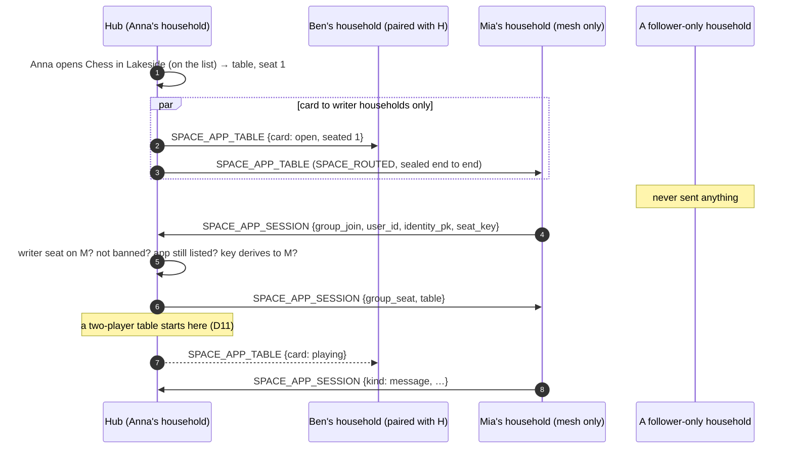
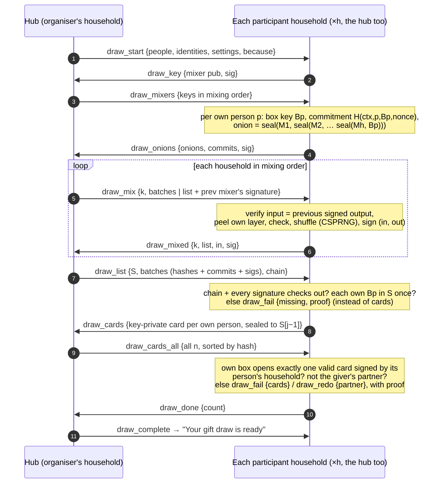

# Social Home Apps — group games (tables)

A **table** is an app session with 2–30 seats (when opened by picking
people, up to the app's own `players.max` — owner decision D2, so a big
family fits one game). Its **host household** — the *hub*, the household of the
person who opened it — keeps the roster and is the only household the
others talk to about it. The *host person* can change (hand-over); the hub
never does. Every other household with a player keeps a copy of the table
as the hub last sent it. Households never talk to each other because of a
table: each talks only to the hub, over the pairing it already has.

This page covers **the roster** and **messages at a table** (capability
v_76): opening a table from the invite sheet, invites, join / decline /
leave / remove, Start, the host hand-over, closing and expiry; then
messages to everyone or to chosen seats (sealed to the target household's
*seat key*, so the hub that passes them on can't read them), the hub's
numbering (`seq`), the per-sender mailbox, "your turn" and the hub's send
budget; and the app bridge (`sh.group.*`). [**Space tables**](#space-tables-v_77)
(capability v_77) open a table *in a space* for its members; the 1:1
sessions are in [`apps.md`](./apps.md).

## Scope

- **HFS**: the hub runs the roster (`AppGroupService`); each player's
  household keeps a copy and applies its own people's rules (blocks,
  children). Same §24.11 pipeline and sealing as every app event.
- **GFS**: uninvolved. A table opened by picking people only reaches
  households the host's household is paired with; a space table only the
  space's member households, over the space's own transport — never a
  GFS channel.

## Event types

No new event type: new `verb`s of `APP_SESSION`, all inside the sealed
payload, sent only to and taken only from households at v_76 or later
(`FederationCapability.MIN_FOR_APP_GROUPS`).

| Verb | From → to | Sealed fields |
|---|---|---|
| `group_invite` | hub → an invitee's household (one person) | `app_id, session_id, to_user, from_user` (the host person), `others` (how many more were invited — never who), `table` |
| `group_join` | a player's household → hub | `app_id, session_id, from_user` |
| `group_seat` | hub → the joiner's household | `app_id, session_id, to_user, table` |
| `group_roster` | hub → households with someone seated or invited | `app_id, session_id, table` — at most one per 5 s per table (coalesced) |
| `group_start` | hub → seated households | `app_id, session_id, table` |
| `group_start` | host person's household → hub (host lives elsewhere after a hand-over) | `app_id, session_id, from_user` |
| `group_leave` | a player's household → hub | `app_id, session_id, from_user, reason` (`left`, or `declined` before joining) |
| `group_remove` | host person's household → hub | `app_id, session_id, from_user, seat` |
| `group_close` | hub → every household at the table | `app_id, session_id, table` — the table ended |
| `group_close` | hub → one household | `app_id, session_id, to_user, reason` (`removed`, `withdrawn`, `full`), `table` — that one person's place is over |
| `group_close` | host person's household → hub | `app_id, session_id, from_user` — "close this game" |

**The table snapshot** (`table`), the one shape the hub sends:

```json
{ "rev": 7, "state": "lobby", "end_reason": null, "host_seat": 1,
  "min": 3, "max": 8, "late_join": false, "note": "Bring snacks",
  "created_at": "…", "expires_at": "…", "started_at": null,
  "roster": [{"seat": 1, "instance": "<hub>", "user": "anna", "name": "Anna",
              "household": null, "state": "seated"}, …] }
```

`state` is `lobby` → `playing` → `ended` (`end_reason`: `finished`,
`cancelled`, `expired`, `host_gone`, `app_removed`,
`closed_by_moderator`). Roster entries are `seated`, `left` or `removed`:
**who was invited and hasn't joined never travels.**

## Life of a table

```mermaid
sequenceDiagram
    autonumber
    participant B as Ben's household
    participant H as Hub (Anna's household)
    participant C as Cleo's household
    H->>H: Anna picks Ben + Cleo in the invite sheet → table (lobby), Anna seat 1
    H->>B: group_invite {to_user: ben, from_user: anna, others: 1, table}
    H->>C: group_invite {to_user: cleo, from_user: anna, others: 1, table}
    Note over B,C: each household checks its own rules → Needs you "Anna invited you…"
    B->>H: group_join {from_user: ben}
    H->>H: invited? from Ben's own household? open, not full? → seat 2, rev+1
    H->>B: group_seat {to_user: ben, table}
    H-->>C: group_roster {table} (≤ 1 per 5 s)
    C->>C: anyone seated Cleo can't play with? → hide the invite (nothing goes back)
    C->>H: group_join {from_user: cleo}
    H->>C: group_seat
    H-->>B: group_roster
    H->>H: Anna presses Start (≥ min seated)
    par one envelope per household
        H->>B: group_start {table}
        H->>C: group_start {table}
    end
    Note over H: Anna leaves → host passes to the player seated longest; the hub keeps relaying
    H-->>B: group_roster {host_seat: 2}
```

| Step | Rule |
|---|---|
| **Open** | Only through Social Home's invite sheet (D3): people of `GET /invitable` with `groups: true` (households at v_76); the sheet can tick everyone of a space at once (`spaces`, writing seats only). Host + picked people within the app's `players` range — up to the app's `players.max`, at most 30 (owner decision D2). Caps: ≤ 5 tables waiting per person per app, ≤ 10 new a day; a table counts as **one** invite against the 1:1 invite caps (10 open, 30 a day) — one open while someone hasn't answered, one that day — however many people it asks (see [Invite caps](#invite-caps)). Waits 1, 3 (default), 7 or 14 days. |
| **Invite** | A household below v_76 is refused (409 `APP_GROUP_HOUSEHOLD_TOO_OLD`). A person on the hub's own household gets no envelope. |
| **Join** | The joiner's household checks first (app here and on, age, blocks, children); the hub seats only an invited person, from their own household, while the table is open and not full. A refusal is `group_close {to_user, reason: full / withdrawn}`; a stranger's join is ignored. |
| **Start** | Host person only, once `min` are seated. Unanswered invites are withdrawn (`group_close {to_user, reason: withdrawn}`) unless the app takes late joiners. A table of two (`max: 2`) starts by itself when the second seat fills. |
| **Leave** | Before Start the seat is free again; the host person leaving a lobby closes it (`cancelled`); after Start the host passes to the player seated longest. A decline is a leave before joining (the hub marks it; the players aren't told). |
| **Remove** | Host person only; the removed person's household gets `group_close {to_user, reason: removed}`, they can't come back. |
| **Close / expire** | Host person closes (`cancelled`); a lobby past its time ends `expired` (the hub's hourly sweep; a copy ends on its own an hour later if the hub is gone). The app uninstalled at the hub ends its tables (`host_gone`); at a player's household its people leave. |

### Invite caps

Counted per person picked, a family table of 29 would need 29 of the 10
open 1:1 invites and could never be sent. So a table counts as ONE
invite there (`AppGroupService.invite_usage`): one open while it waits
for players with someone who hasn't answered, one in the last 24 hours.
What bounds a person's group invites instead: ≤ 5 tables waiting and ≤ 10
new a day per app (so ≤ 290 people asked a day per app, only people the
sheet lists — this household's and paired households' people), and every
receiver keeps at most 50 open tables from one hub. The `others` count
an invite carries is the hub's word: a receiver takes it only as a whole
number below 30, anything else reads as 0.

### Needs you and the bell (design 3.7)

| Row | For | What it says, where it opens |
|---|---|---|
| `app_challenge` (Needs you) with flag `group`, `params.others` | each invitee | "Anna invited you and 3 others to play Quiz" ("… and 1 other", or the 1:1 words for nobody else) — **Join** / Decline; opens `/apps/{app}/tables/{session}` |
| `app_challenge_waiting` (Needs you) with flags `app_missing` / `app_off` and `group`, `params.others` | an invitee whose household doesn't have the app or turned it off | the same sentence, "Ask an admin" (D10); a row of its own, never joined to the sender's 1:1 row |
| `app_table_joined` (Games) | the person who started the game, on its hub | ONE row per game, moved on by each joiner (newest first in `params.actors`): "Ben joined your Quiz game" / "Ben and 2 others joined your Quiz game" (`params.others`: how many more are in, the starter not counted); flag `can_start` once enough players are in ("You can start now"); opens `/apps/{app}/tables/{session}` |
| `app_table_started` (Games) | each player seated when it went from waiting to playing, but the person who started it — on the hub when Start is pressed, on another household when the hub's `group_start` arrives (a two-player game that starts by itself raises none) | "Your Quiz game with Anna and 3 others started" (`params.others`); opens `/apps/{app}?session={session}` |

Games rows push only for someone who set Games to Push (as "Your turn");
a repeat on a row still unread is silent. Nothing new travels: every row
is made by the household of the person it is for, from what the roster
already carries.

## Each household's own rules (design 2.11, D8, D12)

The hub is never told why someone isn't at a table:

- An invite from a table whose host or a seated player the invitee blocked
  — or who blocked them here, or a guardian block separates them from — is
  **hidden**: it never reaches Needs you, and an invite already waiting
  stops waiting when such a person sits down. **Nothing goes back** (not
  even a decline); the hub's invite just runs out.
- Someone like that sitting down at a table one is seated at takes one
  out: an **ordinary leave** to the hub; only that person is told why
  (`app.group` frame, `reason: "cant_play"`).
- A **protected account** sits only where every player is someone it may
  already message — its own household, or a household it paired with
  directly (§CP.F3). Checked at the invite, at Join and on every roster.
- The app's age rating applies as for 1:1 invites.

**Residuals.** A leave a household makes for its person right after
someone sits down shows up at the same time as that join — the players
see "Ben left" next to "Dev joined", as the design accepts (a block means
"keep us apart"). A player who knows a table's id could send another
household an invite for that id first, which then drops the real one
(nuisance only: nothing is learned or seated).

## Receiver rules

- A copy takes a snapshot only from the household that invited it (the
  hub, the signature-proven sender) and only a newer `rev`; a table's app
  and hub never change. A snapshot out of shape — over 30 seats, a seat or
  person twice, a host without a seat, an expiry past 14 days, a note over
  80 characters or across lines, a name over 80 — is dropped.
- An invite is kept only for a table still open (at most 30 seats, as
  any snapshot), whose host is the sending household's `from_user`, for an
  app allowed to reach other households and marked `tables`; for a session
  id the person has no row for; and at most 50 open tables from one hub.
  For an app this household doesn't have, or turned off, it waits (D10,
  [below](#an-invite-for-an-app-not-here)).
- A space table's verbs and messages are taken only over its space
  (`SPACE_APP_SESSION`); one arriving as a bare `APP_SESSION` /
  `APP_MESSAGE` is dropped, and a picked table's never ride a space.
- The hub acts on `group_start` / `group_remove` / `group_close` only from
  the host person's own household, on `group_join` / `group_leave` only for
  the person of the sending household.

## Older households

| Case | Behaviour |
|---|---|
| A picked person's household is below v_76 | The sheet marks them (`groups: false`); an open naming them answers 409 `APP_GROUP_HOUSEHOLD_TOO_OLD`. Nothing is sent. Their 1:1 games are untouched. |
| An app without `tables: true` in its manifest | 409 `APP_GROUPS_NOT_SUPPORTED`; 1:1 invites only. |
| An invite for an app not here or turned off | Waits for its person (D10, below). |

## An invite for an app not here

A group invite for an app this household doesn't have — or turned off —
reaches its person anyway, as a 1:1 invite does (D10,
`AppFederationService.keep_group_waiting`): after the same receiver rules
(the person here and active, the host a known person of the hub, no block
either way or guardian block, a protected account only with households it
may message, the app's age gate — the catalog's rating for an app not
here — and nobody at the table the person can't play with), it waits as
their Needs-you row with "Ask an admin" (`app_challenge_waiting`, flags
`app_missing` / `app_off` and `group`). The household keeps its copy of
the table (bounded like any: ≤ 50 open from one hub); it holds no seat
row yet. **Nothing goes back to the hub** — it can't tell "doesn't have
the app" from "hasn't looked".

- **The app arrives / is turned on** while the table still takes people:
  the row becomes a normal group invite (a seat row, `app_challenge` with
  flag `group`, Join) — after the rules again (a block since, the age gate
  of the installed app, its `federation` permission and `tables`). A table
  that ended, started without the person, or whose lobby ran out ends the
  row (`expired` / `done`); so does an invite past the 14-day TTL.
- **The table ends** (closed, expired, the hub's app gone) or the hub
  **withdraws** the invite (Start without late joiners): the row ends
  (`withdrawn` / `expired`).
- **Decline**: the row reads as declined; nothing is sent (D10) — the
  hub's invite just runs out.

## Cost

Invites are one envelope per person invited (`group_invite` names one
person; ≤ 29), the hub's own people none. Everything after is one
envelope per household, never per person. A join: one envelope
to the hub, one seat answer, and at most one coalesced roster per 5 s to
the other households at the table (≤ 0.6 KB each sealed). Filling 10 seats
over 10 households one by one: ≈ 10 × 2 + ~10 × 9 rosters × 0.6 KB ≈ 60 KB,
once; 30 seats over 30 households ≈ 30 × 2 + ~30 × 15 rosters × 0.6 KB ≈
300 KB, once (design 2.12). Opening such a table: 29 invites of ≈ 1 KB
sealed (the snapshot holds only the host). Start / close: *h − 1*
envelopes. The rows above cost nothing on the wire.

## Messages at a table

Every message goes to the hub, which numbers it (`seq`) and passes it on
— one envelope per household that has someone it is for, never per
person. **To everyone** (`to: "all"`) the hub reads it (the hub is a
player's household; a group key it hands out would add nothing). **To
chosen seats** (`to: [seats]`) the sender's household seals the data to
each target seat's household *seat key*: the hub, and every other
household, sees only ciphertext.

```mermaid
sequenceDiagram
    autonumber
    participant B as Ben's household (seat 2)
    participant H as Hub (Anna's household, seat 1)
    participant C as Cleo's household (seat 3)
    participant D as Dev's household (seat 4)
    B->>H: APP_MESSAGE {from_user: ben, group: {to: "all", msg_id}, data}
    H->>H: Ben seated? table open? under the send budget? → seq 41
    par one envelope per household (coalesced 200 ms, ≤ 64 KiB)
        H->>C: APP_MESSAGE {group: {msgs: [{seq: 41, from_seat: 2, to: "all", data}]}}
        H->>D: APP_MESSAGE {group: {msgs: [{seq: 41, from_seat: 2, to: "all", data}]}}
    end
    H->>H: Anna (seat 1) gets it here: live + held
    B->>B: seal data to Dev's household seat key (seat 4)
    B->>H: APP_MESSAGE {group: {to: [4], msg_id, sealed: [{to_seat: 4, …}]}}
    H->>D: APP_MESSAGE {group: {msgs: [{seq: 42, from_seat: 2, to: [4], sealed}]}}
    Note over H: the hub sees only ciphertext; Cleo's household gets nothing
    D->>D: open with its seat key → Dev's app (direct: true)
```

### Seat keys

When a household first takes a seat at a table it makes a fresh X25519
key pair for that table — **one per household, not per person** (the
household server is the trust boundary, as for DMs). The private half is
kept KEK-wrapped on its own table row (`app_group_sessions.seat_key_json`,
bound to the table id); the public half rides its `group_join`, **signed
with the household's Ed25519 identity key**, and the hub hands it on in
every roster entry of that household:

```json
"seat_key": { "seat_kem_suite": "x25519", "pub": "<b64url 32 B>",
              "sig_suite": "ed25519", "sig": "<b64url 64 B>" }
```

The signature covers `socialhome/app_group/seat_key/v1` followed by
`session_id`, `instance`, `seat_kem_suite` and `pub`, each with a 4-byte
big-endian length prefix (no two field lists encode the same).
The hub verifies it against the joiner's identity key (the hub is paired
with every household it invites) and seats the joiner only then; the first
key a household brings to a table stays. A receiver checks every roster
key against a key it **already stores** for that household (its pairing),
its own entries against its own seat key, and drops a snapshot whose key
doesn't verify, whose suite it doesn't know, or that names two keys for
one household. For a household it holds no key for (people picked by the
host whose households aren't paired with each other) it takes the hub's
word — **residual**: a lying hub household could then read directed
messages between those two players. **Space tables don't have it**: there
every roster entry carries its household's Ed25519 identity key
(`identity_pk`), and a household id is that key's fingerprint, so any
receiver checks every seat key against the household's own key — paired
with it or not — and drops a snapshot with a seat key it can't check that
way. A household this one reaches only over the mesh is checked by the
same key (also known from its mesh claim, `space_instances.identity_pk`).

### Sealing a directed message

`seat_kem_suite: "x25519"` (`SUPPORTED_SEAT_KEM_SUITES`; anything else is
refused — `UnsupportedSeatKemSuite`, never a fallback):

- *shared* = X25519(sender household's seat private key, target
  household's seat public key) — static–static, so only those two
  households can derive it, and the receiver knows which household sent
  it;
- *key* = HKDF-SHA256(*shared*, salt = `msg_id`, info =
  `socialhome/app_group/seat_seal/v1` + `session_id`, `from_seat`,
  `to_seat`, length-prefixed as above) — one key per message and
  direction;
- AES-256-GCM, random 12-byte nonce, AAD = the same info + `|` +
  `msg_id`.

`msg_id` is 16 random bytes the sender picks (b64url); the hub can't
seal one itself (it holds neither private half), can't move one to
another seat or table (the AAD binds both) and can't pass it off as from
another seat (the receiver derives with that seat's household key, and
the tag fails). One sealed entry per target seat: `{to_seat,
seat_kem_suite, nonce, ct}`. The hub forwards to each household only the
entries for its seats.

### On the wire

`APP_MESSAGE`, all inside the sealed payload, v_76 households only. Group
messages ride the JSON `APP_MESSAGE` (outbox, retries) — not the binary
`fed-app-v1` channel, so a message never arrives twice by two paths.

| From → to | Sealed fields |
|---|---|
| a player's household → hub | `app_id, session_id, from_user, group: {to: "all" \| [seat…], msg_id, turn?, final?}, data` (to all) — or `group: {to: [seat…], msg_id, turn?, final?, sealed: [{to_seat, seat_kem_suite, nonce, ct}]}` and no `data` (directed) |
| hub → a household with someone it is for | `app_id, session_id, group: {msgs: [{seq, from_seat, to, msg_id, turn?, final?, data \| sealed}]}` — no `to_user` / `from_user`: seats only |

- `to`: `"all"`, or 1–29 distinct seats seated now, never the sender's own.
- `turn`: a seat seated now (the next player). Only that seat's household
  raises "Your turn" — one row per game, as for 1:1 (`app_turn`).
- `final`: `true` on the game's last message (below); absent otherwise.
- `data`: any JSON, ≤ 64 KiB encoded (the 1:1 limit); a sealed entry's
  `ct` ≤ 64 KiB + the tag; a directed message's data × its seats ≤ 128
  KiB (it is sealed once per seat — the envelope stays inside a peer's
  inbox limit).
- A hub batch (`msgs`) holds ≤ 64 messages and ≤ 64 KiB of data unless a
  single message is bigger (then it rides alone).

### Order and repeats

The hub stamps every message it takes with `seq` (per table, + 1 each,
directed ones too — a player can see a gap and know it wasn't for them)
and hands batches on in `seq` order. A receiving household passes on a
`seq` once: it drops one it saw already, and one more than 256 below the
highest it has seen, and one whose `(from_seat, msg_id)` it passed on
already — `seq` is not sealed, so this is what stops a hub replaying a
sealed message under a new number. The SDK hands messages to the app in
`seq` order. Before a message, the hub sends a roster change that still
waits for its 5-s slot, so every household knows a newly seated player
(and their seat key) before their first message. (**Residual:** the
"saw already" sets are kept in memory, the last 512 `msg_id`s per table;
after a restart the hub could repeat a message from before — only the
hub, which can say anything to everyone anyway.) The sender's own message is
not echoed back to it (the `strict_order` echo + skipped-`seq` stubs of
the design are left for an app that asks for them).

### Who may send, the hub's checks

The hub takes a message only from a person **seated** now, from their own
household (the signature-proven sender), at a table in `lobby` or
`playing`; with every `to` / `turn` seat seated now and the `sealed`
entries exactly the `to` seats. A refusal from another household is
dropped (logged); on the hub itself it is an error (below). Each receiver
takes `msgs` only from the table's hub and delivers to its own people
seated at the table — never someone who blocked the sender, or whom a
guardian block separates from them (the household's own rules, as for
1:1).

### The game's last message (`final`)

A game that ends — a win, a draw, a resignation, a claimed timeout — says
so on its last message (`final: true`), so its table ends at once instead
of staying "being played" until the hub's prune:

- **Who.** Only at a table being played (`playing`; else 409
  `APP_GROUP_CLOSED`). In a duel (two seated) either player — the move
  that wins, or the resignation, is the loser's or the winner's; at a
  bigger table only the host person (403 `APP_GROUP_NOT_HOST`) — the
  host sends the result, the rest send answers to the host seat. The
  sender's household checks first; the hub checks again and drops a
  final from anyone else (logged).
- **The hub** numbers it like any message, gives it to its own people
  (live + mailbox), ends the table `finished` (`rev` + 1) under the same
  lock, then sends the message's batches at once and the `group_close`
  after them.
- **Crossing moves.** Two players can end a game at once (both resign, a
  resignation against the mating move): the second final left its
  household before the close arrived. For 5 minutes after a `finished`
  end (`GROUP_FINISH_GRACE_SECONDS`, kept in the hub's memory — a restart
  ends it early) the hub still takes its seated players' messages and
  passes them on like any other (a `final` among them ends nothing more),
  so each app sees both and settles the same way. After that, 409
  `APP_GROUP_CLOSED` / dropped.
- **The receivers.** Batches and the close may arrive in either order (the
  outbox retries each on its own), so a household's copy that ended
  `finished` still takes the hub's messages above its stored `seq` —
  delivered live and to the mailbox, each once: the stored `seq` rises
  with it, so a repeat, even after a restart, is dropped. A copy that
  ended any other way takes nothing more. (Only the hub can send these,
  and the hub can say anything to everyone anyway.)
- **The app.** The mailbox keeps the last message (the seat row stays
  until the prune), so a closed app gets it with the table already
  `ended` / `finished` — SDK contract: *take held messages before you
  conclude a table ended unfinished*. A space table's card turns `closed`
  with `end_reason: finished` — "Played to the end" under Finished.

No new envelope: the close that would come anyway, now when the game
ends instead of at the prune (h − 1 closes, ≈ 1 KB each, once per game).

### The send budget (per table)

The hub passes on at most **600 envelopes a minute per table** (one per
message per household it goes to): 20 messages a minute to everyone at a
table of 30 households, 200 at a table of 4. One player gets at most
three times a fair share of it (`3 × 600 / households`, never less than
two messages to everyone), so nobody can use up the table for the rest. Above it a message is
refused — `429 APP_GROUP_BUSY` (`params.retry_after`, seconds) when the
sender is on the hub's household; dropped (logged) from another household.
A sender's household applies the same budget to what its own people send
to one table, so they get the 429 too. The per-person `POST …/messages`
bucket (300 a minute) holds as well. Apps should send answers to the host
seat and let the host send one result to everyone (SDK docs).

### The mailbox (closed apps)

A closed app gets **each player's latest message** of a table, ≤ 16 KiB
each (bigger ones go out live only): `app_group_held` keeps, per (app,
person, table, sender seat), the newest by `seq`. `POST /api/apps/{id}/held`
hands them over (oldest `seq` first) as `group_messages` and clears them
(`?only=group` / `?only=messages` takes one half and leaves the other).
The table's own state (roster, `seq`, host, `lobby/playing/ended`) is on the
table row, never in a held message. **SDK contract for groups:** *a closed
app gets each player's latest message; send state, not deltas.*

### Cost

A message to everyone at a table of *h* households: 1 envelope to the hub
+ *h* − 2 out (none back to the sender's household unless another of its
people sits there) ≈ (*h* − 1) × (size + 400 B). A directed message to *k*
seats: 1 + the households of those seats. Coalescing makes a burst of
answers one envelope per household per 200 ms.

- Typical: 8 households, 1 KB full-state message, 200 moves → 7 × 1.4 KB ×
  200 ≈ **2 MB per game**, ≈ 280 KB received per household.
- Worst realistic: a 30-household quiz, 20 rounds, written "answers to the
  host": 29 directed + 29 results per round = 58 envelopes; 20 rounds ≈
  **1,160 envelopes ≈ 3 MB**, ≈ 100 KB per household. The naive version
  (everyone answers everyone: 600 × 29 ≈ 17,400 envelopes ≈ 42 MB) runs
  into the 600/min budget — the backstop, not the design.
- Seat keys: ≈ 180 B per roster entry in each snapshot (≤ 30 × 180 B ≈
  5.4 KB for a full table).

## HTTP, WebSocket and the app bridge

**HTTP** (all need the app's `people` permission; `federation` once
another household is at the table):

| Route | Body → answer |
|---|---|
| `POST /api/apps/{id}/groups/{sid}/messages` | `{data, to?: [seat…], turn?: seat, final?: true}` → `{seq}` (`seq` is the number when this household is the hub, `null` when it went to the hub's household). 413 `PAYLOAD_TOO_LARGE` past 64 KiB; 429 `APP_GROUP_BUSY`; 409 `APP_GROUP_SEAT` (a `to` / `turn` seat not seated, your own seat, or no seat key for it); 409 `APP_GROUP_CLOSED` (ended, or you aren't seated, or `final` before the game started); 403 `APP_GROUP_NOT_HOST` (`final` at a table of more than two from someone other than the host); 404 `APP_GROUP_NOT_FOUND`. Rate limit 300 / min per person. |
| `POST /api/apps/{id}/held` | as for 1:1, plus `group_messages: [{session_id, seq, from_seat, direct, data}]`, oldest `seq` first. `?only=messages` / `?only=group` takes one half (the bridge's `app.held` / `group.held` each take their own, so pulling one never loses the other). |

**WebSocket** (to the person's own sockets):
`{type: "app.group.message", app_id, session_id, seq, from_seat, direct, data}`
for each message delivered live (as well as held); the existing
`app.group` frame for every roster change (`group` = the person's view of
the table, or `change` when their place is over).

**Bridge** (`client/src/features/apps/bridge.ts`; SDK 1.9's `sh.group.*`).
RPC from the app frame is `{id, method, params}` → `{id, ok, result}` or
`{id, ok: false, error: {code, message, retryAfterMs?}}`. Every `group.*`
method needs `people` (else `permission_denied`).

| Method | Params → result |
|---|---|
| `group.list` | — → `GroupSession[]` (the person's tables in this app) |
| `group.get` | `{id}` → `GroupSession` |
| `group.start` | `{id}` → `GroupSession` (host only; ≥ `min` seated) |
| `group.send` | `{id, data, to?: number[], turn?: number, final?: boolean}` → `{seq: number \| null}` — resolves once this household took it (sent on to the hub, or numbered here when this is the hub); `final: true` on the game's last message ends the table `finished` ([above](#the-games-last-message-final)) |
| `group.leave` | `{id}` → `{ok: true}` |
| `group.remove` | `{id, seat}` → `GroupSession` (host only) |
| `group.close` | `{id}` → `{ok: true}` (host only: ends the table for everyone, `cancelled`) |
| `group.held` | — → `GroupEvent[]` (the held `message` events, oldest `seq` first) — for an app that pulls (`app.context` params `{held: 'pull'}`); otherwise they are posted as events right after the `app.context` reply |
| `group.open` | `{suggest?: PersonRef[]}` (the same `{instance_id, user_ref, is_local}` shape as `people.pick`; malformed ones dropped, at most 29) → `GroupSession` or `null` (cancelled). Social Home draws its own group sheet outside the frame (D3: an app opens a table only through it): the person picks up to the app's `players.max` − 1 people (hard ceiling 30 players; search, and "Everyone in …" a space, from `GET /invitable`'s `spaces`), says how long it stays open (`lobby_days`) and may add a note, then taps Send (`POST /groups`). Suggested people start ticked. Same guards as `people.pick`: one sheet at a time across frames (`busy`), 5 s per app after a sheet closes (`too_soon`, `retryAfterMs`), Send ignores taps for its first 600 ms. `unavailable` from a host without the sheet; `groups_not_supported` for an app without `tables` |

Error codes: every server `APP_GROUP_*` / `APP_GROUPS_*` code lower-cased
without `app_` — `group_not_found`, `group_not_host`, `group_closed`,
`group_full`, `group_too_few`, `group_seat`, `group_busy` (with
`retryAfterMs`), `group_size`, `group_open_limit` / `group_daily_limit`,
`group_household_too_old`, `group_session`, `groups_not_supported` —
and `cant_join` (`APP_GROUP_CANT_JOIN`), `too_large` (413, past 64 KiB, or
a directed message's data × its seats past 128 KiB), `invalid` (a call
without a well-formed table id / seat / `to` / `turn`, refused before the
server), `busy` / `too_soon` / `unavailable` (`group.open`, as for
`people.pick`), `unknown_method`, plus
`permission_denied` / `error`.

```ts
interface GroupSession {
  id: string; appId: string
  state: 'lobby' | 'playing' | 'ended'; endReason?: string; spaceId?: string
  me: number | null      // my seat (null: invited / joining)
  myState: 'invited' | 'joining' | 'seated' | 'left' | 'removed'
  host: number | null; isHost: boolean
  min: number; max: number; lateJoin: boolean; seq: number; note?: string
  players: { seat: number; name: string; household: string | null;
             isLocal: boolean; state: 'seated' | 'left' | 'removed' }[]
}
```

Events — posted to the frame as `{type: 'group:event', event}`:

```ts
type GroupEvent =
  | { type: 'message'; id: string; seq: number; from: number; data: unknown;
      direct: boolean; held?: true }
  | { type: 'joined' | 'left' | 'removed'; id: string; seat: number; session: GroupSession }
  | { type: 'started' | 'host-changed' | 'ended'; id: string; session: GroupSession }
```

The bridge derives `joined` / `left` / `removed` / `started` /
`host-changed` / `ended` by comparing each `app.group` frame with the last
view it saw of that table (a seat newly `seated`, a seat that turned
`left` / `removed`, `lobby` → `playing`, a new host seat, → `ended`);
your own place ending (`change`: `left` / `removed`) is a `left` /
`removed` event for your seat (`session.me`); an invite withdrawn before
you sat (`withdrawn`) has no seat and posts nothing. `session` is the table after
the change (an addition to design 2.9).

`app.context` gains `groups: true` (this host speaks `group.*`) and, when
the app was opened from a table (`?session=<table id>`, Join / Play),
`launch: {sessionId, group: GroupSession}` instead of `invite`.

## Space tables (v_77)

A member opens a table **in a space**, and any member with a writing seat
(owner, admin, moderator, member) may take a seat — up to 30. The host
person presses Start once the app's fewest players sit; a two-player table
starts when the second seat fills (D11). It is an ordinary group table: the
hub is the opener's household, the roster, messages, seat keys, mailbox and
budget are exactly as above. What the space adds:

- **The games list** — "Games allowed here", `SpaceFeatures.allowed_apps`
  (≤ 20 app ids, migration 0137). Empty by default: no games. The owner,
  admins **and moderators** choose (owner decision D9 — the one setting a
  moderator changes; an edit that also changes anything else needs settings
  authority). It rides the authority-signed `SPACE_CONFIG_CHANGED` /
  `_CATCH_UP` features; a remote admin's or moderator's edit is forwarded to
  the host as `update_config {features: {allowed_apps}}` (held for the
  owner's approval like any forwarded edit when delegation is off; a
  moderator's forward carrying anything else is dropped). A snapshot from an
  older household without the key leaves the list as it is.
- **Who sees a table** — member households with a writer seat only. Never a
  follower-only household, never a household outside the space, never a
  GFS, never a **global** space (its members reach each other only
  anonymously through GFSs); an **archived** space takes no new table.
  Private and public spaces (local communities included), D6.
- **Who may sit** — anyone with a live writer seat on the joining household
  in the hub's own copy of the space roster, not banned, while the app is on
  the list — one place per person (the same user id under another name is
  refused), and nobody new once the roster holds 60 entries. Being in the space and pressing Join is the consent (D7):
  households that aren't paired with the hub or each other play, and what
  travels between them is the game and the roster's names. Each household's
  own rules (blocks, guardian blocks, age) hold as above; a protected
  account sits at a private space's table with the people it already chats
  with there (D8).
- **Closing** — the host person closes their table; the owner, an admin or
  a moderator closes any table of the space (`closed_by_moderator`; their
  household sends `group_close {by_role: true, user_id}` to the hub, which
  checks their content-authority seat). An app taken off the list closes
  its waiting tables (`app_removed`), as does the space turning global or
  being archived; games being played finish but take nobody more (D10).
  Leaving the space — or being removed, banned or made a follower — leaves
  its tables: the hub takes such a player out (the host person as if they
  left: a waiting table closes, a game passes on) and, until then, drops
  any verb or message by someone without a live writer seat. Everyone seated at a table a moderator or the list
  closed gets one About-you row ("A moderator closed the Chess game in
  Lakeside" / "Chess is no longer allowed in Lakeside"), no push.
- **Let everyone know** — the opener may tick it (D5): each member household
  makes one in-app Games row per member with a writer seat ("Anna started a
  game of Chess in Lakeside"), no push, at most one such table per person
  per space per day (the hub refuses a second, 429
  `SPACE_TABLE_ANNOUNCE_LIMIT`; receivers hold a hub that doesn't to it).
  Zero extra envelopes: the first card carries `announce: true`. The row
  opens the space's Games section (`/spaces/{id}/games`).
- **No app here** — the card still shows; Join answers the app's own error
  (404 `NOT_FOUND` / `APP_NOT_ENABLED` / too young); the SPA re-reads the
  list (the card then knows the app is missing) and offers the
  existing "Ask an admin" request. Nothing goes back to the hub.

### Event types

| Event | From → to | Plaintext | Sealed |
|---|---|---|---|
| `SPACE_APP_TABLE` | hub → every member household with a writer seat (`broadcast_to_space_members(only_instances=writer households, min_proto_version=77)`) | `space_id` | the **card**: `table_id, rev, app_id, host_user, host_user_id, host_name, note, players {min, max}, seated` (a count), `state` (`open` / `full` / `playing` / `closed`), `end_reason, late_join, created_at, started_at, expires_at, announce` — never the roster |
| `SPACE_APP_SESSION` | hub ↔ ONE player's household (`broadcast_to_space_members(only_instances={it})`: direct, `SPACE_ROUTED` sealed end to end across a relay, or the link-joined relay seat) | `space_id` | `kind` (`session` / `message`) and `body` — the `APP_SESSION` group verb or group `APP_MESSAGE` payload as above; a space join adds `user_id`, `name` and `identity_pk` |

Both are `SPACE_WRITE_EVENT_TYPES` (the §24.11 writer gate refuses them
from a follower-only household; an archived space takes none) and
`SPACE_SESSION_ALLOWED_EVENT_TYPES` (a link-joined member plays).

The card is an **upsert by `rev`** (the hub's roster numbering), sent on
open, on Start / close, when the table turns full or not full, and with a
new seat count at most once per 10 minutes — not on every join.



### Receiver rules

- A card is taken only for a space held here (not dissolved, not global),
  by a household with a writer seat here, whose named host
  (`host_user_id`) holds a live writer seat on the **sending** household
  and isn't banned, for an app on this household's copy of the list, and
  newer than the copy held; a known table only from its hub, for the same
  space and app. At most **3 new tables per person per space per day** and
  one "let everyone know" — counted by the host's seat-checked user id and
  this household's own clock — and 50 open tables per hub. The strip
  orders tables by when this household heard of them. A
  household with someone at the table follows the roster, not the card.
- A space session is taken only for a table of that space this household
  knows, from its hub or a household with a writer seat; a join only at the
  hub, as above; a moderator's close only from a content-authority seat
  (`SpaceAuthorship.moderates_as`).
- A table opened in the space shows to the members of this household
  (`GET /api/spaces/{id}/games`) only while its app is on the list — the
  newest 10 open ones, plus every table they have a place at — and never
  one whose host they blocked or who blocked them, nor an app their age
  doesn't allow.

**Not in the space sync stream.** Tables live days; the outbox covers a
household that was offline. A household that joins the space later hears
of a table with its next card (Start, close, full / not full, or the seat
count), not before — no `SYNC_RECORD_LINES` entry.

**Residual — the roster's user ids.** A player's `user_id` on the roster
is the hub's word (a receiver checks the seat keys, not who holds a
seat); a hostile hub could relabel a player so a household's block check
misses them. It could as well leave anyone off the roster: blocks are
kept by each household's own view, and a hub is a member household of
the space.

**Residual — households the hub doesn't know.** A card and a seat answer
go only to member households whose version the hub knows
(`space_member_supports`: a pairing, a link-joined seat, or a mesh claim).
A mesh-only member announces its claim to the space's **host**; a table
hosted by another member household doesn't reach a member it has neither
a pairing nor a claim for (that member's people don't see the card).

### Cost

Card ≈ 0.6 KB sealed + 0.4 KB envelope ≈ 1 KB per writer household per
card. A 25-household private space, a table a day with ~4 cards → 25 × 4 ×
1 KB = **100 KB per table**. Worst realistic, a 200-household local
community at the caps (50 people opening 3 tables a day): 150 tables × ~4
cards × 200 × 1 KB ≈ **120 MB a day across the space, ≈ 600 KB per
household per day** — bounded by the receivers' caps (3 per person per
day, 50 open per hub) and the 7-day prune. Every session envelope goes to
ONE household (h − 1 per message, as above). "Let everyone know" costs no
envelope.

## The gift draw (v_78)

*Gift draw / Wichteln / Lootjes trekken / Père Noël secret / Amigo
invisible.* An app at a table (3–30 people — the Gift draw app) asks Social
Home to draw names. Every person is drawn one other person to give a gift
to, in **one circle** (nobody draws themselves; everyone gives and gets
once); couples listed by the organiser don't draw each other. Each
participant's **own household** does its part by itself (no app needs to be
open), and the result is shown only in **Social Home's own sheet**
("You're giving a gift to Ben (Familie Okafor)", Ben's wish list, the
budget and the day — `GET …/draw/result`, the route
`/apps/{app}/draw/{table}`): the app gets the state, never a result.

### What holds, and against whom

Threat model: honest-but-curious organiser, participants and host
household (the hub, which passes every message on); a tampering app; a
cheating household that deviates (it must be *detected*, which aborts the
round; it can't get a secret result out of it).

| Party | Learns |
|---|---|
| A participant (incl. the organiser) | the people, the round's box keys `S` (random), their own position, **their own recipient's card** |
| Their household | the same for each of its own people (it holds their keys, as it holds their DMs) |
| The hub (as relay) | the above for its own people, plus which household sent which sealed card — cards are key-private and all 1 KiB, so not whom a card is for. `tests/protocol/test_app_draw.py` pins that everything the hub stores and sees, with the random bytes blanked, is identical whoever draws whom |
| A mixing household | its own shuffle's input and output only; linking a person to a position needs **every** household's shuffle, and the person's own household is one of them |
| A non-member relay household, the GFS | ciphertext, sizes, timing (the table's transport) |
| The app | the people, the state, the person's own wish list — never a result |
| A recipient | nothing about their giver |

### The protocol (one round)



1. **Start.** The hub sends the people (seat, household, username), each
   household's identity key and the settings (name, budget, day, pairs).
   Every signature and seal of the round is bound to the **round context**
   `SHA-256(suite ‖ table ‖ gen ‖ round ‖ people ‖ identity keys ‖
   settings)`, so the hub can't show two households two rounds. Identity
   keys are the paired household's stored key or one that **derives to the
   household's id** (an id is its key's fingerprint). The mixing order is
   `sorted by SHA-256(table ‖ gen ‖ round ‖ household)` — nobody picks it.
2. **Keys, onions.** A fresh X25519 mixer key per household per round
   (signed); a fresh X25519 box key per person (the private half never
   leaves the household) wrapped in one layer per mixer, and a hiding
   commitment to which box is whose. Onions are `32 + 48·h` bytes, all the
   same.
3. **The mix (signed chain).** Mixer k takes only exactly the previous
   mixer's signed output (the first: exactly every household's signed onion
   batch, its own unchanged), peels its layer, checks every entry opened and
   all are distinct, shuffles, and signs `(k, in-digest, out-digest)`. A
   mixer mixes **once per round** (a second, different list is refused) —
   so the relay can't feed a mixer one real onion among fakes.
4. **Check.** Each household checks the whole chain from hashes (every
   batch and link signature, the digests linking up to `S`) and that each of
   its people's box keys is in `S` exactly once. A key missing is told
   **instead of** sending cards — never after the cards went out.
5. **The circle and cards.** Box at position `j` gives to `j + 1`. Each
   person's **card** (their name and household as their own household knows
   them, their wish list, signed by that household for this round) is padded
   to exactly **1 KiB** and sealed key-private to `S[j − 1]` — their giver.
6. **Open.** Each household tries its people's boxes on all n cards: exactly
   one opens per person, signed by the household of a person of the round
   who isn't the giver. If it is the giver's partner → `draw_redo`.

**No re-rolls on demand.** A household accepts a new round only when it is
the table's first draw (or a fresh one after a draw gave up), the
organiser's **Draw again** after a reveal (everyone is told, with the
count; at most 10, only until the exchange day), a round with **fewer**
people (someone left or was removed — never new ones), or a **complaint it
verifies itself**: the complainer's box private key and commitment nonce,
signed by its household, checked against the round's `S` and cards **as
this household received them**. A complaint without proof is named to the
organiser ("…'s home stopped the draw without reason") and changes nothing.
At most **12 rounds** per draw ((2/3)^12 ≈ 0.8 % for the worst allowed
pairs), then "The names couldn't be drawn with these rules".

**Exclusions** (couples, decision D14): non-overlapping pairs of seats, at
most ⌊n/3⌋, at least four people when there is any. Checked privately by
each giver's household; a hit is redrawn with proof (it reveals only that
the thrown-away round had that pair).

### Event types

All sealed `APP_SESSION` verbs between the hub and each participant
household (a picked table over the pairing, a space table over
`SPACE_APP_SESSION`), all carrying `draw_suite:
"x25519-hkdf-aesgcm256"`, `gen` (1, +1 per Draw again) and `round`; sent
only to households at v_78 (`FederationCapability.MIN_FOR_APP_DRAW`):

| Verb | From → to | Fields |
|---|---|---|
| `draw_start` | hub → participants | `people [{seat, instance, user, name}]`, `identities {instance: hex}`, `settings {name, budget, day, pairs}`, `because {kind: first \| again \| changed \| complaint, complaint?, list?, cards?}` |
| `draw_key` | participant → hub | `pub`, `sig` |
| `draw_mixers` | hub → participants | `keys [{instance, pub, sig}]` in mixing order |
| `draw_onions` | participant → hub | `onions`, `commits [[user, c]]`, `sig` |
| `draw_mix` / `draw_mixed` | hub ↔ mixer k | `k`, `batches` (k = 0) or `list` + `prev {instance, in, sig}`; back `list`, `in`, `sig` |
| `draw_list` | hub → participants | `S`, `batches [{instance, hashes, commits, sig}]`, `chain [{k, instance, in, out, sig}]` |
| `draw_cards` / `draw_cards_all` | participant → hub / hub → participants | `cards` (sealed, 1 072 bytes each) |
| `draw_fail` / `draw_redo` | participant → hub | `complaint {kind: missing \| cards \| partner, instance, user, box_priv, nonce, sig}` |
| `draw_done` / `draw_complete` / `draw_end` | participant → hub / hub → participants | `count` / — / `reason: rules \| too_few` |
| `draw_handover` / `draw_wish` | participant → hub → participants (`relayed: true`) | `sealed` |

**Receivers enforce:** the suite; `gen` ≤ 11, `round` ≤ 12; 3 ≤ n ≤ 30,
unique seats and people; exact sizes (box 32 B, onion `32 + 48·(h − k)`,
sealed card 1 072 B, hand-over 1 328 B, digests 32 B, signatures 64 B);
lists of exactly n distinct entries; one draw per table; hub-to-participant
verbs only from the table's hub, participant-to-hub verbs only from a
household with people in the round; nothing from a household below v_78.

### After the reveal, people leaving, offline homes (design 5.6)

- **Leave after the reveal:** the leaver's household seals the card its
  person drew (the original, signed card) to the leaver's giver's box
  (`draw_handover`) — the giver now gives to the leaver's recipient ("Ben
  left the draw — you're now giving to Cleo"). The giver's household takes
  it only once its own copy of the table shows the leaver gone. Fewer than
  three left → the draw ends.
- **Wish list after the reveal:** sealed again to the same giver box
  (`draw_wish`, `rev` + 1, ≤ 5 per person); a household whose person left
  passes it on to their giver.
- **Someone leaves mid-round:** a fresh round without them, automatically.
- **A household doesn't answer:** messages wait in outboxes. After an hour
  the organiser's status names the seats of the homes the draw waits for
  (`waiting_for`); removing them ("Draw without them",
  `sh.group.remove`) starts a fresh round without them. Nobody is removed
  automatically.

### Cost (once per round)

`n` people in `h` households. Mixer key 32 B; onion `32 + 48h` B; sealed card
1 072 B; base64 +33 %; envelope ≈ 400 B. Envelopes per round ≈ 11(h − 1).

| | n = 12 in 5 homes | n = 30 in 30 homes (worst) |
|---|---|---|
| start + keys + mixer list | 12 × ~1 KB | 87 × ~1.5 KB ≈ 130 KB |
| onions to the hub | 4 × ~1 KB | 29 × ~2.4 KB ≈ 70 KB |
| the mix (out + back per household) | 8 × ~3 KB ≈ 25 KB | 58 × ~30 KB ≈ 1.7 MB |
| `S` + chain to everyone | 4 × ~3 KB | 29 × ~6 KB ≈ 170 KB |
| cards in + all cards out | ≈ 80 KB | 29 × 2 KB + 29 × 44 KB ≈ 1.3 MB |
| done + complete | ~4 KB | ~20 KB |
| **one round** | **≈ 44 envelopes, ≈ 150 KB** | **≈ 320 envelopes, ≈ 3.4 MB** |

Worst realistic draw: 30 homes, ~3 rounds with pairs ≈ 10 MB once a year,
≈ 340 KB per household. A redo's `draw_start` carries its proof (the list
body ≈ 6 KB, the cards ≤ 44 KB) to each household once. After the reveal:
a hand-over or wish update is 1 envelope in + h out (≈ 2 KB each), ≤ 6 per
person. CPU: a mixer peels n onions, a household tries its boxes on n cards
(≤ 900 X25519 operations for one household with all 30 people) — in a worker
thread.

### Storage and the app

`app_group_sessions.draw_json` (migration 0138): one KEK-wrapped blob per
table and household (settings, wish lists, this household's mixer and box
keys, the round's public data it checks proofs against, its people's
results; on the hub the relay state — ciphertext and signatures). The app
bridge (`client/src/features/apps/draw/drawBridge.ts`): `draw.configure`,
`draw.setWishes`, `draw.start ({again?})`, `draw.status` →
`{state: gathering | drawing | ready | failed, reason?, round, again, of,
done?, waitingFor?, falseComplaints?, settings, wish, hasResult, isHost}`,
`draw.reveal` (opens Social Home's sheet, resolves `null`), and
`{type: 'draw:event', event: {type: 'status', id, status}}` posts. No call
returns a result. Notifications: one row per person "Your gift draw is
ready — see who you're giving to" (pushed, title only), drawn again, a
hand-over, a wish-list change — never naming whom they give to.

### Residual risks

- **One-household draws:** when every participant lives in one household,
  its server holds every box key; its admin could rebuild the draw from the
  database. Stated in the app's About text.
- **A malicious (not just curious) hub** in a picked group whose households
  aren't paired with each other could impersonate a participant household
  with a key of its own (a self-certifying id it controls) and run two
  rounds; space tables and paired households don't have it. It can also
  leave a seated person out of the draw (that person sees no name) or stall
  it.
- **A cheating household** can stall a draw (refuse to mix, or commit to one
  box and onion another — a valid "missing" proof, but only before any card
  is opened), up to the 12-round cap; who did it isn't proven (no blame
  phase in v1). It can't learn another pair or steer its own people's
  recipients.
- **A household's own people:** a household can hand its own people's cards
  to whichever of its people's givers it likes (it holds their keys anyway).
- **Hand-over to a partner:** a hand-over can give a giver their partner;
  the organiser can draw again.
- v1 runs the draw from the host household only: after a host hand-over to
  another household's person, Draw names / Draw again answer
  `APP_DRAW_HOST_ELSEWHERE`.

## Storage

`app_group_sessions` (one row per table a household knows, migration
0136; `seq` the hub's last number or a copy's highest seen,
`seat_key_json` this household's seat key) and the people's own
`app_pending_sessions` rows (marked `group`), which keep Needs you, the
TTLs and the uninstall cascade; `app_group_held` (per person, table and
sender seat, the latest message, ≤ 16 KiB), which goes with the
person's row. No new migration for messages. Space tables (migration
0137): `spaces.allowed_apps` (the games list) and
`app_group_sessions.card_json` (a table known only from its card: seats
taken, announce, first seen here). See
[`../database.md`](../database.md).

## Implementation

- `socialhome/domain/app_group.py` — the table, the snapshot and its
  bound check, the bounds and the coded errors.
- `socialhome/services/app_group_service.py` — the hub, the copies, each
  household's rules; `AppFederationService` routes the `group_*` verbs to
  it and keeps group rows out of every 1:1 path.
- `socialhome/federation/seat_crypto.py` — seat keys and the seat seal;
  `socialhome/services/app_group_budget.py` — the per-table send budget.
- `socialhome/services/space_app_table_service.py`,
  `socialhome/domain/space_app_table.py` — space tables: cards, the space's
  transport and rules; `socialhome/routes/space_games.py`.
- `socialhome/repositories/app_group_repo.py`, `socialhome/routes/app_groups.py`.
- `client/src/features/apps/groupBridge.ts` — the bridge's `group.*`.
- The gift draw (v_78): `socialhome/federation/draw_crypto.py` (pure
  functions: seals, onions, the mix, cards), `socialhome/domain/app_draw.py`,
  `socialhome/services/app_draw_service.py` (the hub's rounds and each
  household's steps), `socialhome/routes/app_draw.py`,
  `client/src/features/apps/draw/` (bridge `draw.*`, the result sheet);
  tests `tests/federation/test_draw_crypto.py`,
  `tests/services/test_app_draw_service.py`,
  `tests/protocol/test_app_draw.py` (security).
- Tests: `tests/services/test_app_group_service.py`,
  `tests/services/test_app_group_messages.py`,
  `tests/protocol/test_app_group_federation.py`,
  `tests/protocol/test_app_group_messages.py` (security),
  `tests/federation/test_seat_crypto.py`,
  `tests/services/test_space_app_table_service.py`,
  `tests/protocol/test_space_app_table_federation.py` (security).

## Spec references

Group-play design §2 (roster, topology, life of a table, who can send
to whom, order, mailbox, wire, storage, SDK, older households, blocks and
children, bounds), §3 (space tables), §4 (the games list), §5 (the gift
draw), decisions D1–D14; [`capabilities.md`](./capabilities.md) v_76, v_77,
v_78; [`../crypto.md`](../crypto.md) (seat seal, gift draw).
