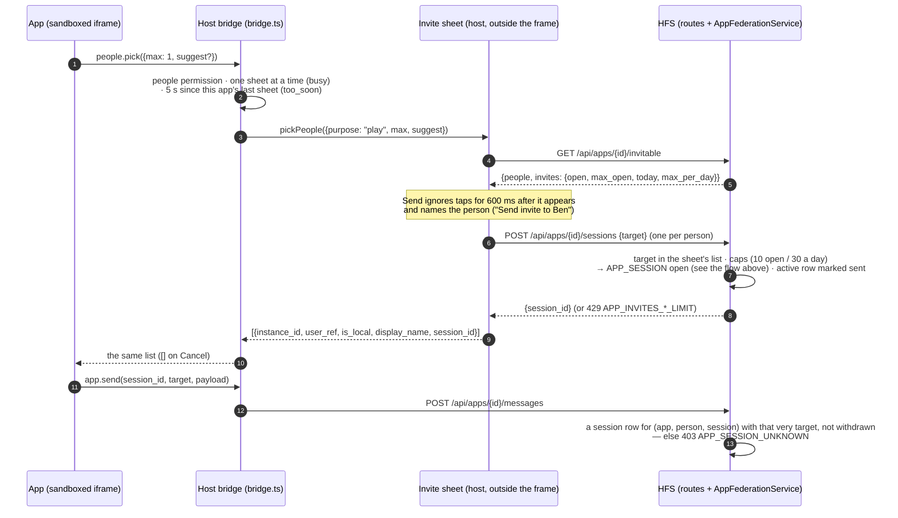

# Social Home Apps — cross-household federation

Federated app-to-app messaging that lets an installed Social Home App exchange
state with the same app running in a paired household.  A chess game, shared
whiteboard operation, or custom mini-app payload sent by Alice's household
arrives at Bob's household as an `app.message` WebSocket frame that the
host bridge relays into the running iframe — all without the app or the frame
content ever appearing in plaintext on the network.

## Scope

- **HFS**: full participant.  The `AppFederationService` drives session
  lifecycle (`APP_SESSION`) and message delivery (`APP_MESSAGE` / binary
  frames).  The `FederationService` handles encryption, signing, and the
  §24.11 inbound validation pipeline identically to every other event type.
- **GFS**: uninvolved.  App federation is strictly peer-to-peer between
  directly confirmed households.

## Event types

`APP_SESSION`, `APP_MESSAGE`.

## Transport selection

Two transport paths carry app messages; the same `session_id` scopes both:

| Path | Condition | Notes |
|---|---|---|
| **`fed-app-v1` binary DataChannel** | peer is CONFIRMED **and** channel is open **and** `peer_supports(MIN_FOR_APP_CHANNEL)` (v_17) | Fast path — no base64 overhead; high-frequency app traffic does not head-of-line-block control envelopes on `fed-v1`. The frame layout has no routing slot: `to_user` / `from_user` ride the frame's sealed envelope metadata instead (see *Binary path routing* below), routed like the JSON path. A frame without them (older sender) falls back to the household fan-out; the receiver disambiguates by `session_id`. |
| **`APP_MESSAGE` JSON event over `fed-v1` / HTTPS** | anything else | Fallback — identical encryption and §24.11 validation; lower throughput. Carries `to_user`/`from_user` when the peer is v_18+ (see capability v_18). |

Session control (`APP_SESSION`) always uses the JSON event path regardless of
peer version, so sessions open and close correctly even against pre-v17 peers.

## Flow — open session and send a message

```mermaid
sequenceDiagram
    autonumber
    participant A as HFS A<br/>(initiator)
    participant B as HFS B<br/>(receiver)
    participant WS_B_user as B target user<br/>(WebSocket)
    participant WS_B_all as B all users<br/>(WebSocket, legacy fallback)

    A->>A: invite sheet Send → POST /sessions → open_session(app_id, target={instance_id:B, user_ref:"bob", is_local:false})<br/>→ _assert_target_allowed (the sheet's list) → invite caps<br/>→ allocate session_id, _require_enabled check

    alt peer B is v_18+ (MIN_FOR_APP_USER_ROUTING)
        A->>B: APP_SESSION event<br/>{app_id, session_id, verb:"open",<br/>to_user:"bob", from_user:"alice"}<br/>encrypted + Ed25519-signed
        B->>B: §24.11 pipeline → on_inbound_event()<br/>→ _deliver(to_user="bob") → resolve to local user
        B->>WS_B_user: app.message WS frame<br/>{type:"app.message", app_id, session_id,<br/>from_instance, from_user:"alice", kind:"session", payload}
        B->>B: AppChallengeReceived → bell row + title-only push (§25.3) for bob only
    else peer B is sub-v_18 (legacy household-addressed)
        A->>B: APP_SESSION event<br/>{app_id, session_id, verb:"open"}<br/>(no to_user / from_user)<br/>encrypted + Ed25519-signed
        B->>B: §24.11 pipeline → on_inbound_event()<br/>→ _deliver(to_user=None) → household fan-out
        B->>WS_B_all: app.message WS frame (all users with app enabled)
    end

    Note over A,B: session open; moves/ops follow

    alt fed-app-v1 binary path (v_17+ CONFIRMED direct peer)
        A->>A: FederationService.send_app_message()<br/>→ encrypt payload (AES-256-GCM)<br/>→ seal metadata (+ to_user/from_user when peer is v_18+)<br/>→ sign envelope<br/>→ build binary frame [u8 type][u32 hlen][header][u32 plen][payload]
        A->>B: binary frame on fed-app-v1 DataChannel
        B->>B: iter_complete_frames → §24.11 header re-validation<br/>→ decrypt payload → verify payload_sha256
        B->>B: on_inbound_message(to_user, from_user from the sealed metadata)
        B->>WS_B_user: app.message WS frame (routed to to_user, from_user named; else all users)
    else JSON path (sub-v17 or channel unavailable) — carries to_user for v_18+
        A->>A: FederationService.send_app_message()<br/>→ APP_MESSAGE JSON event (+ to_user/from_user when peer is v_18+)<br/>encrypted + Ed25519-signed
        A->>B: APP_MESSAGE event over fed-v1 / HTTPS inbox
        B->>B: §24.11 pipeline → on_inbound_event()
        B->>WS_B_user: app.message WS frame (routed to to_user if v_18+, else all users)
    end

    A->>B: APP_SESSION event {verb:"close"}<br/>(always JSON, always encrypted)
    B->>WS_B_all: app.message WS frame {verb:"close"}
```

## Payload field tables

### `APP_SESSION`

| Field | Required | Notes |
|---|---|---|
| `app_id` | yes | Installed app identifier. Must match a locally-enabled app on the receiver or the inbound is silently dropped. |
| `session_id` | yes | Hex UUID allocated by the initiator.  Scopes all subsequent `APP_MESSAGE` frames for this session. |
| `verb` | yes | `"open"` / `"accept"` / `"close"`. |
| `reason` | no | On a `close` this household sends: `"declined"` (the invitee said no) or `"withdrawn"` (the challenger took the invite back). Passed through to the app. |
| `to_user` | no (v_18+) | The target user's username on the receiving household.  When present and non-empty, the receiver delivers the frame only to that user (instead of fanning out to all local users).  Omitted for sub-v_18 peers — gated on `FederationCapability.MIN_FOR_APP_USER_ROUTING`. |
| `from_user` | no (v_18+) | The initiator's username on the sending household.  Used by the receiver to show who sent the challenge.  Omitted for sub-v_18 peers. |

**v1 session lifecycle note:** the host initiates `open`; other verbs (`accept`, `close`) are passed through to the app layer — the iframe app owns the game. The server keeps only the open invite (below).

**Game invite lifecycle.** An open addressed to one person — from another household or from this one — is kept for them in `app_pending_sessions` and is a "Needs you" row (`app_challenge`, `app_session:<app_id>/<session_id>`) until it ends:

| End | How | Row outcome | The other side hears |
|---|---|---|---|
| Played | The invitee taps **Play** in Needs you: `POST /api/apps/{id}/sessions/{sid}/accept` takes in that one invite (the app gets it as its [launch context](#launch-context)). Only Play: opening the app accepts nothing, and a message the app sends in a waiting invite is refused (`APP_SESSION_UNKNOWN`, D3). The row stays, now `active`: it is the game's [mailbox](#mailbox) | `accepted` | — (the game goes on) |
| Declined | `POST /api/apps/{id}/sessions/{sid}/decline` (Needs you's Decline, after its 5-s undo) | `declined` | `APP_SESSION {verb: "close", reason: "declined"}` to the challenger (v_18+, best effort). Their household keeps it in the challenger's [mailbox](#mailbox) and gives them a bell row, "Ben declined your Chess game" (`app_challenge_declined`, no push) |
| Withdrawn | The challenger's `POST …/sessions/{sid}/cancel` sends `APP_SESSION {verb: "close", reason: "withdrawn"}`; the invitee's household drops the invite only when the close comes from the household **and** person that opened it. If the invitee already pressed Play, the close waits in their [mailbox](#mailbox) instead, so their app clears the game when it opens | `withdrawn` | — |
| Expired | 14 days (`PENDING_SESSION_TTL_SECONDS`): no longer replayed, pruned hourly; "Needs you" reads it as expired on the next look | `expired` | — |

No new event type or field the older side can't ignore: a household before this change passes the `close` through to the app as before and keeps its invite until it is played or expires. One decline or withdrawal is one `APP_SESSION` (≈ 200 bytes) to one household — never a fan-out.

### Launch context

**"Play" opens the game you were invited to (D12).** Needs you's Play links to `/apps/<id>?session=<sid>` (through `appHref`, so it keeps the HA ingress prefix). The SPA's app host passes the session to the bridge, which takes in that one invite (`POST …/sessions/<sid>/accept`) the first time the app asks for its context — once per page, so Try again or a fresh frame reuses it — and answers `app.context` with a `launch` field:

| `launch` | When |
|---|---|
| `{}` | Opened without `?session=` (Apps page, a bell row, a push): nothing is accepted; invites wait in Needs you. |
| `{sessionId, invite: {sessionId, fromInstance, fromUser, payload}}` | Opened by Play: the invite was taken in now — start that game. |
| `{sessionId}` | Opened by Play, but the invite no longer waits (played on another device, declined, withdrawn, expired): open that game if the app knows it, else say the invite is gone. |

A new Play while the app is open starts a fresh frame for that game. **Backward compatibility:** the presence of `launch` tells an app that the host works this way; a host from before this change leaves it out and the app keeps its old behaviour (drain `app.pendingSessions`, seat live invites). An app from before this change never reads `launch`: its `app.pendingSessions` call is answered with the launch invite alone (`[]` without Play) — the host never hands out every waiting invite — and a live invite it seats itself is accepted by the invitee's first message in that session. Live `open` frames still reach an open app as news, but accept nothing.

The SDK (`@socialhome/app-sdk` ≥ 1.2) types this as `AppContext.launch?: LaunchContext`. A local open is delivered to the invitee only — never echoed to the challenger, whose app has the session id from `people.pick` (the echo raced that reply and read as an invite from themselves).

### Mailbox

**Moves and declines wait for you when the app is closed or turned off (D11).**
An app message only ever went out as a live `app.message` WebSocket frame: if
the person's app wasn't open, or the household had turned the app off, the
move, decline or withdrawal was lost and the game fell out of sync for good.
Now the receiving household keeps, per person and per game it knows, the
**latest** message from the other side that their app hasn't taken yet — in
`app_pending_sessions.held_json` (migration 0131) — and hands it over when the
app next opens.

- **Which sessions are known.** One row per (app, person, session):
  `invited` while an invite waits in Needs you, `active` once it is played
  (Play), and for the challenger from the
  moment the [invite sheet](#invite-sheet) opens the session. A game from
  before this table had rows is not known and takes no new moves (D3).
  `from_instance` / `from_user` name the other side.
- **What is kept.** An inbound `APP_MESSAGE` / binary frame (`kind:
  "message"`) or `APP_SESSION {verb: "close"}` (`kind: "session"`) addressed to
  one person, after every receiver rule below has passed (signature, addressee,
  named initiator, personal and guardian blocks, age gate) — and only when the
  session is known for that person **and** its other side is exactly the
  sending household and person. One primary-key update, replacing what was
  held. A message for any other session (or from anyone else) is never kept;
  it still goes out live as before when the app is on. Held messages are
  ≤ 64 KiB (a larger one goes out live only) — live messages stay ≤ 256 KiB.
- **Closed or turned off.** The server can't see whether a tab has the app
  mounted, so it keeps the latest message whether or not it also went out
  live; an app may receive on open a message it already saw live and dedupes
  (chess by move-history length). While the app is turned off nothing goes out
  live and the message is still kept; an invite to a turned-off app is still
  dropped, and so is anything for the whole household (older senders).
  Uninstalling drops the mailbox with the rows (FK cascade).
- **Handing over.** `POST /api/apps/{id}/held` returns
  `{messages: [{session_id, from_instance, from_user, kind, payload}]}`,
  oldest change first, and clears them (a message held again meanwhile stays
  for the next open). One from someone the person blocked, or a guardian
  block now separates them from, is dropped. The SPA bridge takes it once per
  frame, after the app's first `app.context`, and posts each one into the
  iframe as an ordinary `app:event` — so apps on SDK ≤ 1.2 get them through
  their existing `onMessage` / `onSession` handlers. An app on SDK ≥ 1.3 can
  instead call `app.context` with params `{held: "pull"}` and fetch them with
  `app.held` (`sh.federation.held()`) once its own state is loaded; nothing is
  pushed then.
- **Decline bell row.** A held decline (`{verb: "close", reason:
  "declined"}`) also publishes `AppChallengeDeclined`: the challenger gets a
  bell row "Ben declined your Chess game" (`app_challenge_declined`, About you,
  no push), so they learn it even if they never open the app.
- **SDK contract.** *A closed app receives only the latest message of each
  session.* Send state, not deltas (chess sends the whole game with every
  move), or resync from your own store on open.
- **Bounds.** 1 held message per (app, person, session), ≤ 64 KiB; ≤ 50
  sessions per (app, person) (the oldest go). Rows quiet for 14 days are
  pruned hourly. Worst case 50 × 64 KiB = 3.2 MB per person per app; chess in
  practice ~3 KB × a handful of games.
- **Per move.** Sending is only allowed in a known game (D3) and costs one
  primary-key read of the sender's session row plus the block checks — no
  scan of every contact
  (it was one `list_contacts` per move: every local and remote user plus the
  block list) — and `POST /api/apps/{id}/messages` has its own rate-limit
  bucket (300 / min / user). The sender's row's TTL moves on at most hourly.

**Traffic math: zero new federation messages.** The mailbox only keeps what
was already sent: a move is still 1 `APP_MESSAGE` (or binary frame) to 1
household, a decline / withdrawal still 1 `APP_SESSION` ≈ 200 B to 1
household. Nothing is re-sent on open, on re-enable, or to say "the app is
off" (the rejected R2 design answered every move to a turned-off app — up to
1,440 per game a day — and resent the full state of every game on re-enable).
Worst realistic case, a household of 6 people with 15 games each
and the app off for a week: 0 extra envelopes; on the receiving side ≤ 90 rows
× ≤ 64 KiB on disk. No new event type or field, no capability bump: an older
household sends and receives exactly what it did, it just doesn't hold.

**Challenge notification (v_18+):** when an inbound `APP_SESSION {verb:"open"}` resolves to a single local recipient via `to_user`, an `AppChallengeReceived` domain event is published. The `NotificationService` subscriber seats a bell row and fires a title-only push notification (§25.3) for the addressed user. Idempotent on `session_id` — a double federation delivery (WebRTC + HTTPS fallback) does not produce two notifications.

**Privacy note (§FIX-I2 relaxed for v_18):** `to_user`/`from_user` are permitted
because the challengeable roster is gated to the consensual pairing-scoped
DM/friends set — the same set as `/api/friends` and DMs.  This is not covert
tracking; it is addressed messaging to people who already share a household
relationship.  Sub-v_18 peers still receive no per-user identity on the wire
(legacy household fan-out). See `docs/principles.md` for the formal sign-off.

All fields above are inside the **encrypted payload** (AES-256-GCM).  Only
`event_type`, `from_instance`, `to_instance`, `msg_id`, and `timestamp` are
in plaintext for routing.

### `APP_MESSAGE` (JSON fallback)

| Field | Required | Notes |
|---|---|---|
| `app_id` | yes | Identifies which app the data belongs to. |
| `session_id` | yes | Matches the `APP_SESSION` that opened the channel. |
| `data` | yes | Application-defined dict.  The receiver's `_deliver` passes it as-is to the `app.message` WS frame's `payload` field. |
| `to_user` | no (v_18+) | Per-user routing: the target user's username on the receiving household.  When present and non-empty, the receiver delivers the frame only to that user.  Omitted for sub-v_18 peers. |
| `from_user` | no (v_18+) | The sender's username on the initiating household.  Omitted for sub-v_18 peers. |

On the binary path `to_user` / `from_user` sit in the sealed envelope metadata beside the two binary-only fields below.

| Field | Required | Notes |
|---|---|---|
| `app_aead_suite` | yes | Suite used for the binary payload seal (`"aesgcm-256"` today).  **Binary path only** — carried inside the envelope's encrypted metadata.  Receivers reject unknown suites via `UnsupportedAppAeadSuite`; no default fallback. |
| `payload_sha256` | yes | Base64url SHA-256 of the **plaintext** application payload.  **Binary path only** — carried inside the encrypted envelope metadata.  Binds the binary payload to the signed header; the receiver verifies `sha256(plaintext) == payload_sha256` after decryption. |

All fields are inside the encrypted payload.

**Binary path routing:** the `fed-app-v1` frame layout has no routing slot,
so `to_user` / `from_user` ride the frame's **sealed envelope metadata**
(beside `app_id`, `session_id`, `app_aead_suite`, `payload_sha256`) — signed and
encrypted like the JSON path. A binary frame that carries them is routed and
checked exactly like a JSON `APP_MESSAGE` (only to the addressed person; an
unknown sender is refused). A frame without them (an older sender) falls back
to the household fan-out and the receiver disambiguates by `session_id`. A
receiver that predates the fields reads the metadata with `.get` and ignores
them — it keeps the fan-out it always did, so this needs no capability bump.

## Binary frame format (`fed-app-v1`)

```
[u8 frame_type][u32 header_len BE][header_bytes][u32 payload_len BE][payload_bytes]
```

- `frame_type` — `1` (`FRAME_TYPE_APP_MSG`).  Unknown types are skipped for
  forward compatibility.
- `header_bytes` — the signed federation envelope JSON verbatim (the exact
  bytes that were signed).  The §24.11 pipeline re-parses this unchanged.
- `payload_bytes` — `nonce(12) ‖ AES-256-GCM(ct+tag)`.  Bound to the header
  by `payload_sha256` inside the encrypted metadata.

Payload ceiling: **1 MiB** (tighter than the media channel's 4 MiB — app
messages are chess moves and whiteboard deltas, not media blobs).  Bulk data
belongs on `fed-media-v1`.

## Encryption-first

Every application field (`app_id`, `session_id`, `verb`, `data`,
`app_aead_suite`, `payload_sha256`) is inside the AES-256-GCM encrypted
envelope payload — signed by Ed25519 and **never** in plaintext on the wire.
Only the routing envelope fields (`event_type`, `from_instance`,
`to_instance`, `msg_id`, `timestamp`) are cleartext.

For the binary path the `app_aead_suite` and `payload_sha256` binding mirror
the media channel's `media_aead_suite` / `chunk_sha256` pattern
(`federation/media_framing.py`) — tampering with the binary payload fails the
hash check; tampering with the hash fails the GCM tag or the Ed25519
signature.

## `app.message` WebSocket frame

The `AppFederationService._deliver` method delivers a frame to addressed local
WebSocket connections when an inbound app event passes the §24.11 pipeline.
For v_18+ person-routed events the frame goes only to the addressed user; for
legacy events (an older sender naming nobody) it is broadcast to all local users with the app enabled:

| Field | Type | Notes |
|---|---|---|
| `type` | `"app.message"` | Constant WS frame type identifier. |
| `app_id` | `string` | Identifies the installed app. |
| `session_id` | `string` | Hex UUID that scopes the session — route messages to the correct in-page component using this. |
| `from_instance` | `string` | Instance ID of the sending household — lets the app show who sent a move or issued an invite. |
| `from_user` | `string` \| absent | Who sent it — the same `user_ref` the app's contact for that person carries, so the app can match and answer them: the local `user_id` for someone in this household, the username on the sending household for someone in another. Present on every same-household frame and on every v_18+ person-routed frame from another household (`APP_SESSION` and `APP_MESSAGE` alike); on the older household fan-out only when the named sender is a known user of `from_instance`; absent when the sender named nobody (an older household). **What is proven:** `from_instance` is the signature-verified sending household (§24.11); `from_user` is that household's own claim about which of its people sent it — the receiver only checks it names a user it knows of that household (a per-user frame with an unknown sender is refused). A household can speak for its own people, never for another household's. |
| `kind` | `"session"` \| `"message"` | `"session"` for `APP_SESSION` control events (open/close); `"message"` for `APP_MESSAGE` JSON events and binary `fed-app-v1` data frames. |
| `payload` | `object` | Application-defined dict. For `APP_SESSION` events this is the full decrypted payload (includes `verb`); for `APP_MESSAGE` events it is the `data` sub-field. |

### Bridge relay into the iframe

The host (`client/src/features/apps/AppHost.tsx`) mounts the bridge's
`message` listener in the same render commit that puts the iframe in the page
(a layout effect), so an app whose cached bundle starts at once still has its
first request answered — the SDK sends each request once and does not resend.

The SPA host bridge (`client/src/features/apps/bridge.ts`) listens on
`app.message` WS frames and, after filtering by `app_id`, relays the full
identity into the sandboxed iframe as a `MessageEvent`:

```ts
{
  type: 'app:event',
  kind: 'session' | 'message',   // forwarded from the WS frame
  sessionId: string,              // WS frame's session_id
  fromInstance: string,           // WS frame's from_instance
  fromUser?: string,              // WS frame's from_user (absent when an older sender named nobody)
  payload: object,                // WS frame's payload
}
```

This lets apps:
- **Route by session** — use `sessionId` to dispatch a message to the correct
  game or whiteboard component when multiple sessions are open simultaneously.
- **Show sender identity** — `fromInstance` names the peer household; `fromUser`
  names the individual who sent the invite or move (every same-household
  frame and every v_18+ person-routed frame from another household).
- **Distinguish invites from moves** — `kind === "session"` signals a
  lifecycle event (open/close); `kind === "message"` is in-game data.

## Invite sheet

**Invites go through Social Home, never straight from an app (owner decisions
D3 and D5).** An app can't open a session: the bridge offers no
`app.openSession`. It asks with `people.pick({max, suggest})` and Social Home
draws its own invite sheet *outside* the app's frame, from its own read of
whom the person may invite (`GET /invitable` — the bridge never offers it).
The person picks and taps Send; Social Home opens the game(s)
(`POST /sessions`) and the app gets back only who was picked and their
session ids.



The rules, each enforced where it can't be bypassed:

- **No session without the sheet.** The bridge is the sandbox's only way out
  (`connect-src 'none'`, no token, an opaque origin), and it has no call that
  reaches `POST /sessions`; `app.openSession` is answered
  `{code: "use_people_pick"}`. The route itself stays member-authenticated: an
  app has no member credentials to call it with. No one-time ticket: the
  bridge is host code, so a ticket would add moving parts but no protection.
- **Tap-jacking.** The app decides *when* the sheet opens, so it could open it
  under the person's double tap. Send ignores activation for 600 ms after the
  sheet appears (the browser-permission-prompt pattern), only one sheet is
  open at a time, and the same app waits 5 s after one closes
  (`retryAfterMs`). An app may *suggest* one person (a rematch): they start
  selected, and Send names them. Every word in the sheet is Social Home's:
  `purpose` is a fixed word (`"play"`), never the app's text.
- **What an app learns (`contacts.list` → `GET /contacts`).** Only the people
  on the other side of the sessions this household knows for the person in
  **this** app — invites they sent through the sheet and games they took in
  with Play — within the 14-day TTL, minus blocks and guardian blocks, and
  people of other households only with `federation`. An invite that still
  waits in Needs you is not listed: the app learns about an inviter only once
  the person plays it. The same holds live: an open never reaches the app
  (the server sends no frame for it and the bridge drops one), a move or a
  close reaches it live only in a session the person plays (`active`) with
  that very sender, and what came for an invite still waiting is held and
  handed over only after Play. Never the household roster, the friends list,
  presence, pictures or anyone's location.
- **What an app can message (`app.send` → `POST /messages`,
  `app.cancelSession` → `POST /sessions/{sid}/cancel`).** Only a session the
  household knows for (app, person, session) **with that very person**, and
  `is_local` must match where they live; a withdrawn invite takes no more
  messages, and an invite still waiting (`invited`) is never taken in by a
  message — only Play takes it in. A made-up session id — or an old opponent on a new one — is
  `403 APP_SESSION_UNKNOWN` (the SDK's `unknown_session`) before anything is
  sent. A household-addressed body (`peer_instance_id`, from before
  per-person addressing) names nobody and is `400`; people of a household
  too old to address one person (pre-v_18) are not in the sheet and take
  no game, and a v_18+ household's binary frame without `to_user` is
  refused like its JSON one.
- **Blocks stay unseen.** Someone here who blocked the person isn't in the
  sheet (a Send that then failed would reveal it).
- **Protected accounts (D5).** The sheet lists only people the child can
  already message — the DM rule (§CP.F3: households its own household paired
  with directly), plus personal and guardian blocks. The same rule refuses
  their opens and moves, keeps others out of their contacts, drops an
  invite or move from a household they can't message on receipt (per
  person and on an older household's fan-out), and — for an invite or a
  held move kept from before the account was protected — never plays or
  hands it over.
- **Caps** (backstops, per person per app, from the session rows — no new
  table): at most **10 open invites** (sent, not yet answered by a move or a
  decline, not withdrawn, within the TTL) — `429 APP_INVITES_OPEN_LIMIT` —
  and **30 new invites in any 24 hours** (withdrawn and answered ones count)
  — `429 APP_INVITES_DAILY_LIMIT`; both carry `params.limit`. `GET
  /invitable` reports `invites: {open, max_open, today, max_per_day}` so the
  sheet says so in plain words before Send. Opens are serialized per (app,
  person), so parallel requests can't slip past the count. The 50-row
  bound per (app, person) evicts only waiting invites — never a game being
  played or an invite the person sent — so a flood of invites can't wipe
  games or reset the caps.

Session marks: the challenger's row carries `sent` (written by the sheet's
open), `answered` (the first message the other side's household keeps for
them) and `withdrawn` in its `payload_json`. An inbound open is stored
without those keys, and an open reusing the id of a game already sent or
played (`active`) never rewrites it — another household can't pose an
invite as one this person sent, eat their caps, or stop their game.

Traffic: the sheet adds **no federation events** — Send is the same one
`APP_SESSION` open per picked person it always was, and the caps bound it at
30 opens per person per app per day. The sheet's own reads stay on the
household.

Older apps: an app built on SDK < 1.4 keeps its games (moves, Play, the
mailbox, cancel) but its own "New game" picker fails: `contacts.list` now
lists only past opponents and `app.openSession` is refused. Chess ≥
2026.10.29.3 uses `people.pick`. A game started before the mailbox (no
session row) can't take new moves; it ends and a new one starts through the
sheet.

## Permissions

An app gets only the permissions the household agreed to when an admin
installed it. There are three, in plain words (owner decision D2):

| Permission | In plain words | What it allows |
|---|---|---|
| `storage` | Saves its own data | The per-app, per-person key-value store. |
| `people` | Lets you pick people to play with | Social Home's [invite sheet](#invite-sheet) (`people.pick`), the people picked and played with in this app, and games (sessions) with people in this household: moves, the mailbox, Play. |
| `federation` | Sends to other households | Anything that leaves this household — an invite, a move, a withdrawal or a decline to someone in another household — and anything another household's copy of the app sends here. Implies `people`. |

The installed version's `manifest.json` `capabilities` are the agreement
(`installed_apps.manifest_json`; no separate grant column): an update that
asks for more waits for an admin, so the installed manifest is always what the
household said yes to. `domain/apps.py` `app_permissions()` is the one place
that maps capabilities to permissions; `federation` implies `people`, so an
install from before `people` existed (Chess: `storage` + `federation`) keeps
everything it had. A manifest that names a capability this Social Home doesn't
know is refused at install and update with `409 APP_NEEDS_NEWER_SOCIAL_HOME`
(`params.capabilities`), never granted blindly or dropped silently.

Checked twice:

1. **The bridge** (`client/src/features/apps/bridge.ts`) — the sandbox's only
   way out — offers only calls inside the permissions `/runtime` lists. Any
   other is answered `{ok: false, error: {code: "permission_denied",
   permission}}` without reaching the server, so an app can degrade (leave out
   "Play someone in another household", say why). `app.context` lists
   `permissions` up front. Without `people` nothing is accepted on a Play
   launch, no held messages are pushed and no live `app:event` is relayed.
2. **The server** — every `/api/apps/{app_id}/…` route checks again and is
   authoritative: `403 APP_PERMISSION_DENIED` with `params.permission`, which
   the bridge hands to the app as the same typed error.

| Bridge call | Route | Permission |
|---|---|---|
| `store.get` / `store.set` / `store.delete` / `store.list` | `GET/PUT/DELETE /store/{key}`, `GET /store` | `storage` |
| `contacts.list` | `GET /contacts` (picked + played with, D3) | `people` |
| `people.pick` | the host's invite sheet: `GET /invitable`, then `POST /sessions` per picked person on Send | `people` (the sheet lists other households only with `federation`; the service checks each target) |
| `peers.list` | `GET /peers` | `federation` |
| `app.send` / `app.cancelSession` | `POST /messages`, `POST /sessions/{sid}/cancel` (known sessions only) | `people` for someone in this household (`target.is_local`); `federation` for anyone in another one |
| `app.openSession` | — refused: `use_people_pick` | — |
| `app.held`, `app.pendingSessions`, `app.context`'s Play launch | `POST /held`, `POST /sessions/{sid}/accept` | `people` |
| — (Needs you, the SPA) | `POST /sessions/{sid}/decline` | `people` (the decline's close to another household is skipped without `federation`) |
| `app.context`, `app.ready` | `GET /runtime`, `/bundle/…` | none |

Inbound: an `APP_SESSION` / `APP_MESSAGE` / binary app frame for an app
installed here without `federation` is dropped like one for an app that isn't
installed — another household's copy of the app can't reach it either.

Accepted risk: an app with `federation` can send anything it stored to the
person you picked. That is what the permission is for, and the consent says
"sends … to other households". Apps can't reach the internet
(`connect-src 'none'`), so correlating a person across apps needs the other
household's copy of the same app.

## Inbound delivery

`AppFederationService._deliver` routes inbound app messages:

- **Person-routed (v_18+, JSON or binary):** when the inbound JSON event or
  binary frame carries a non-empty `to_user` that resolves to a local user (by username), the frame
  is delivered **only to that user**.  For an `APP_SESSION {verb:"open"}`, an
  `AppChallengeReceived` event is also published (→ bell row + §25.3 push).
- **Legacy household fan-out:** when `to_user` is absent or empty (an older
  sender, JSON or binary), the frame is broadcast to **every local user** whose
  WebSocket is open and who passes the app's age gate.  The `session_id`
  scopes the semantics so the SPA can dispatch to the correct component.

If the app is not installed or not enabled on the receiving household — or
was installed without the `federation` permission (see
[Permissions](#permissions)) — the event is silently dropped with a debug log;
the peer does not receive an error.

## Receiver rules

- A per-user delivery (`to_user` resolves to a local user) must name its
  initiator: `from_user` has to be a user of the sending household
  (v_18+ senders always ship both fields), so the recipient's block list
  always applies. Otherwise nothing is delivered, stored or notified
  (WARNING).
- A pending invite (`app_pending_sessions`) is only refreshed by the
  household that opened it; another household reusing the session id
  changes nothing.
- Re-delivered opens are de-duplicated per `(from_instance, session_id)`,
  so one household can never suppress another's invite.
- A `to_user` that resolves to no local user reaches nobody — it is
  never widened to the whole household.
- A JSON `APP_SESSION` / `APP_MESSAGE` without `to_user` from a v_18+
  household is refused: those senders always address a person. The
  whole-household fan-out remains only for older households and for
  binary `fed-app-v1` frames from senders that predate binary routing; it
  skips every local user who blocked the named initiator. A frame that names
  no initiator can't have blocks applied to it.
- Locally, a session can't be opened with — or a message sent to — a
  household member who blocked the initiator (403 `FORBIDDEN`, the
  same answer as a non-contact), matching what a remote receiver does.
- Guardian blocks (§CP.F2) hold like they do for calls and DMs, both
  ways: the two people are missing from each other's contacts, an open,
  move or withdrawal between them is refused on the way out (403, the
  non-contact answer), a per-person delivery from a guardian-blocked
  initiator is dropped on receipt (no frame, no pending invite, no
  notification), and the whole-household fan-out skips the protected
  account — for an unnamed sender, whenever its guardian blocked someone
  on that household. A protected account's household-addressed (pre-v_18)
  send to a household its guardian blocked someone on is refused. An
  invite that waited from before the block can't be played (Play
  answers 409 and its row resolves `done`).
- A `close` withdraws a pending invite only when it comes from the
  household and person that opened it; anyone else naming the session
  changes nothing.
- The [mailbox](#mailbox) keeps a message only for a session this
  household knows for the addressee and only from that session's other
  side (household and person); a "declined" close rings the challenger's
  bell only from the person they invited. Nothing for a guardian-blocked or
  blocked sender is kept or handed over.
- User-visible effect: an invite from a household user this household
  hasn't synced (or one hidden from it) is not shown.

`tests/protocol/test_app_session_scope.py`.

## Catalog schema v2

Not a federation message: each household fetches `catalog.json` itself
(`apps_catalog_url`, by default Social Home's own app list on the
`socialhome-apps` releases) and nothing about it crosses to another
household. Schema 2 (`"schema": 2`, socialhome-apps 2026.10.29.1) is
additive — every v1 field keeps its meaning and a v1 catalog still reads.
Per app it adds `i18n` (`{locale: {name, description}}`), `bundle_size`,
`permissions` (`storage` / `people` / `federation`), `min_age`,
`languages`, `publisher`, `homepage`, `min_core_version` and `changelog`
(`[{version, date, notes: {locale: text}}]`).

Receiver rules (`AppCatalogEntry.from_dict`, `AppCatalogService`) — a
publisher can't inflate what every household holds, and one bad field
never drops the entry:

| What | Bound | A bad value |
|---|---|---|
| Whole `catalog.json` | ≤ 256 KiB (a declared `Content-Length` past it is refused before reading) | The fetch counts as failed: the held copy is served `stale` |
| `name` / `i18n.*.name` | ≤ 40 characters | Cut, with "…" |
| `description` / `i18n.*.description` | ≤ 300 characters | Cut, with "…" |
| `i18n`, changelog `notes` | ≤ 12 locales; keys are locale tags (`de`, `pt-BR`) | Bad keys or values skipped |
| `languages` | ≤ 12 distinct locale tags | Bad items skipped |
| `changelog` | ≤ 5 entries, each with a version that parses (`YYYY.M.D[.N]`); `date` `YYYY-MM-DD`; each note ≤ 500 characters | Bad entries skipped, a bad date dropped |
| `bundle_size` | integer, 1 byte … the 8 MiB download cap | Unknown |
| `min_age` | one of 0 / 13 / 16 / 18 | Unknown (the bundle manifest's still applies) |
| `publisher` | string ≤ 60 characters | Cut / unknown |
| `homepage` | `https://` URL ≤ 300 characters, no spaces — shown as text, never fetched | Unknown |
| `min_core_version` | a version that parses | Unknown |
| `icon_url` | ≤ 16 KiB | The placeholder icon |
| `permissions` | strings | A non-list falls back to `capabilities` |

- **Permissions** are shown in Social Home's own words — never text from
  the catalog, so a publisher can't soften "sends invites and moves to
  other households". `people` is implied by `federation` (an entry or an
  install from before `people` existed). A permission this Social Home
  doesn't know is never granted: the entry reads "Needs a newer Social
  Home" and install answers 409 `APP_NEEDS_NEWER_SOCIAL_HOME`.
- **`min_core_version`** past this Social Home's release: the same answer,
  for install and update. A development build (a version that isn't a
  plain release, such as `2026.10.30.dev3`) is never held back.
- **`min_age`** is the install's default age gate (the stricter of it and
  the bundle manifest's); an admin can change it afterwards, and an update
  never lowers it. A protected account doesn't see catalog apps rated
  above its age.
- **Source label** (D6): apps from Social Home's own list say "From Social
  Home"; with `apps_catalog_url` pointed elsewhere, every app says "From
  <host>, set by your server operator". Nothing says "verified" — the
  catalog isn't signed yet (that comes with the first third-party
  publisher or mirror); `bundle_sha256` over HTTPS and the bundle size
  caps stay the integrity check.

## Implementation

- `socialhome/services/app_federation_service.py` — `AppFederationService`:
  `list_invitable` (the invite sheet), `list_contacts` (picked + played
  with), `invite_counts` / `_check_invite_caps`, `open_session`,
  `send_message`, `on_inbound_event`, `on_inbound_message`, `_deliver`,
  `_assert_target_allowed`, `_known_session` + `_assert_person_allowed` (the
  per-move check in a known game), `_hold` / `take_held` (the mailbox),
  `_seen_open_session` (idempotency guard).
- `socialhome/repositories/app_repo.py` — `hold_message` (marks a sent
  invite answered), `take_held`, `list_sessions`, `withdraw_session`,
  `activate_pending_session`, `add_active_session` on `app_pending_sessions`.
- `client/src/features/apps/bridge.ts` (`people.pick`, cooldown, one sheet
  at a time) and `client/src/features/apps/InviteSheet.tsx` (the sheet, the
  600 ms Send guard).
- `socialhome/federation/app_framing.py` — binary frame encode/decode,
  `APP_AEAD_SUITE_AESGCM_256`, `SUPPORTED_APP_AEAD_SUITES`,
  `UnsupportedAppAeadSuite`, `CHANNEL_LABEL = "fed-app-v1"`.
- `socialhome/federation/federation_service.py` — `FederationService.send_app_message`:
  selects binary or JSON path; passes `to_user`/`from_user` on both paths (sealed)
  when `peer_supports(MIN_FOR_APP_USER_ROUTING)`;
  `_app_inbound_handler` for binary frame dispatch.
- `socialhome/domain/federation_capabilities.py` — `MIN_FOR_APP_CHANNEL = 17`,
  `MIN_FOR_APP_USER_ROUTING = 18`, `OURS = 18`.
- `socialhome/domain/events.py` — `AppChallengeReceived(app_id, session_id,
  to_user_id, from_display)`.
- `socialhome/domain/apps.py` — `AppContactNotFoundError`,
  `AppSessionUnknownError`, `AppInviteLimitError`, `INVITES_OPEN_MAX`,
  `INVITES_PER_DAY_MAX`, `SESSION_MARKS`.
- `socialhome/routes/apps.py` — REST endpoints: `GET /api/apps/{app_id}/peers`,
  `GET /api/apps/{app_id}/contacts`, `GET /api/apps/{app_id}/invitable`,
  `POST /api/apps/{app_id}/sessions` (a `target` body),
  `POST /api/apps/{app_id}/messages` (same `target` shape),
  `POST /api/apps/{app_id}/held` (the mailbox).
- `attach_apps` in `socialhome/app.py` — registers `APP_SESSION` /
  `APP_MESSAGE` handlers in the event registry and opens the `fed-app-v1`
  DataChannel on the `PeerConnection`.

## Spec references

§25 (Social Home Apps),
§24.11 (inbound federation validation pipeline),
§25.8.21 (encryption-first rule).
