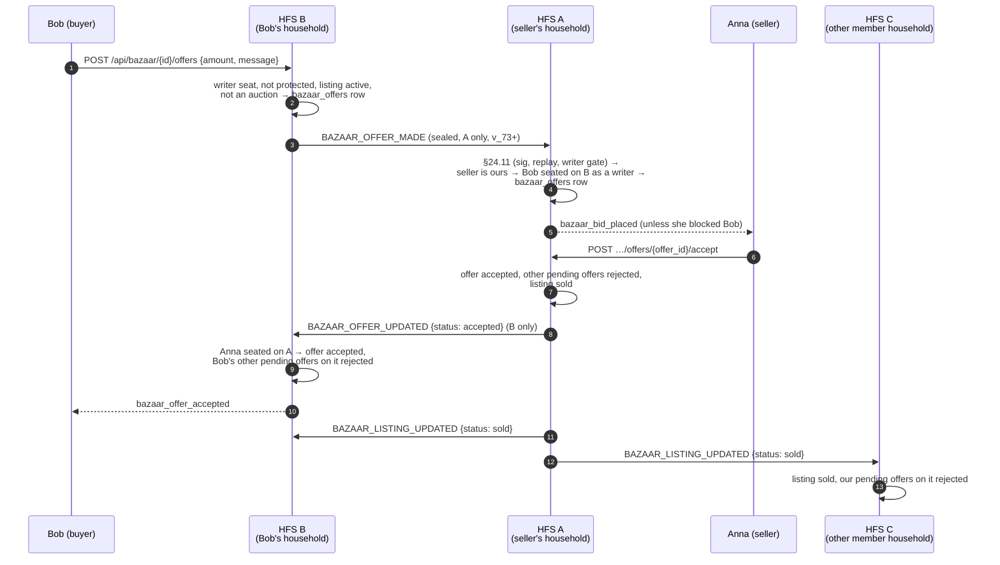
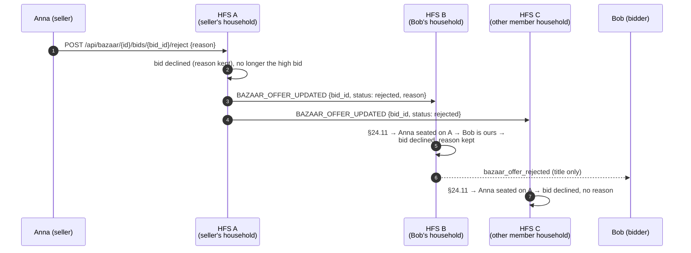
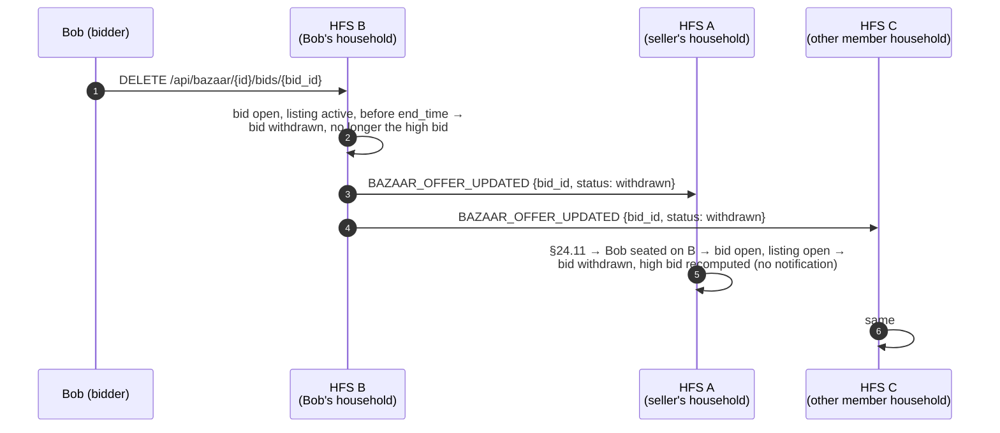
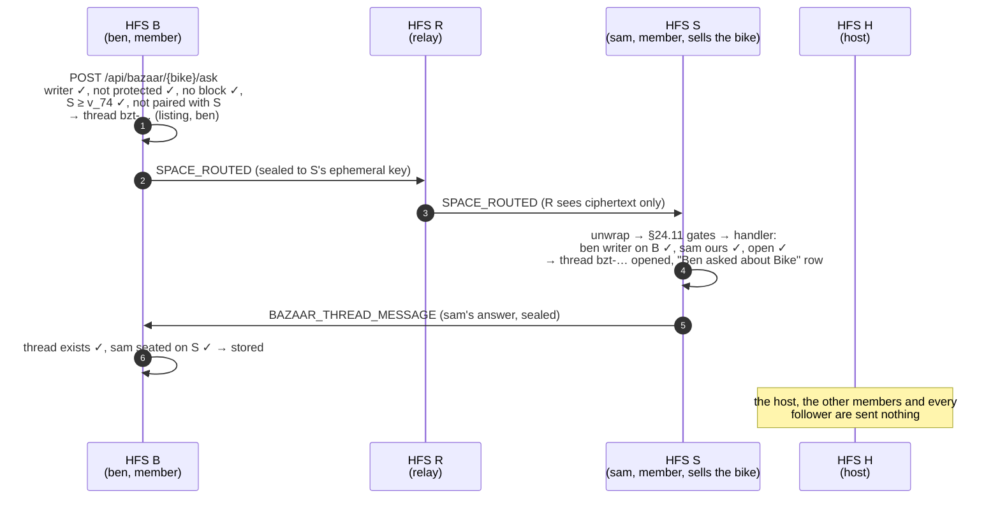

# Bazaar

A space's **Bazaar** tab is a small marketplace: a member lists something
for a fixed price, as negotiable, "make an offer", "bids from" or as an
auction. Listings, the bids on them and the sale reach every member
household. An **offer** on a fixed-price / negotiable listing is private to
the seller and the person who made it, so it travels between those two
households only.

## Scope

- **HFS**: the household where something happened sends it — the seller's
  household its listing, its status and its answers to offers; the buyer's
  household a bid, its withdrawal, an offer and an offer's withdrawal.
  Every receiving household re-checks who may say it before storing it.
- **GFS**: uninvolved, except that the listing's wrapper post (`🛍 Title`)
  rides the public-space relay of a publicly readable space like any post.
  The listing itself, bids, offers and their answers never go to a GFS. A
  household on the mesh that is not a member of the space only ever relays
  ciphertext (`SPACE_ROUTED`).

| What | Goes to | Why |
|---|---|---|
| A listing, its status (sold / expired / cancelled) | every member household | everyone in the space sees the Bazaar tab |
| A bid | every member household | everyone sees the current high bid |
| An offer | **the seller's household only** | `GET …/offers` shows an offer to its seller and its offerer, nobody else |
| An offer's answer (accepted / rejected), the seller's reason with it | **the offerer's household only** | same |
| An offer's withdrawal | **the seller's household only** | so it can no longer be accepted there |
| A declined bid | every member household | everyone mirrors the bid, so the high bid reads the same everywhere |
| …the seller's reason for it | **the bidder's household only** | the words are for the bidder |
| A withdrawn bid | every member household | everyone mirrors the bid: it must stop setting the floor, and can't win, everywhere |
| A question and answer on the listing (its FAQ), an edit, a removal | every member household | everyone who sees the listing reads them ([v_75](#questions-and-answers-v_75)) |

## Event types

`BAZAAR_LISTING_CREATED` (v_10), `BAZAAR_LISTING_UPDATED` (v_11),
`BAZAAR_BID_PLACED`, `BAZAAR_OFFER_ACCEPTED` (v_12), `BAZAAR_OFFER_MADE`,
`BAZAAR_OFFER_UPDATED` (v_73), `BAZAAR_THREAD_MESSAGE` (v_74, see [Ask the seller](#ask-the-seller-v_74)),
`BAZAAR_LISTING_FAQ_UPDATED` (v_75, see [Questions and answers](#questions-and-answers-v_75)),
plus the `bazaar` resource of the §25.6 space sync (listings and, since
v_75, their questions and answers).

| Event | Sealed payload | Sent by → to |
|---|---|---|
| `BAZAAR_LISTING_CREATED` | the full listing: `post_id`, `space_id`, `seller_user_id`, `mode`, `title`, `description`, `image_urls`, `end_time`, `currency`, `status`, prices, `created_at` | seller's household → every member household |
| `BAZAAR_LISTING_UPDATED` | `post_id`, `space_id`, `status`, `winner_user_id`, `winning_price`, `sold_at`, `end_time` (a withdrawal pulls it in to the moment of withdrawal) | seller's household → every member household |
| `BAZAAR_BID_PLACED` | `bid_id`, `listing_post_id`, `space_id`, `seller_user_id`, `bidder_user_id`, `amount`, `new_end_time`, `message` | bidder's household → every member household |
| `BAZAAR_OFFER_ACCEPTED` | `bid_id`, `listing_post_id`, `space_id`, `seller_user_id`, `buyer_user_id`, `price` (an accepted *bid* in "make an offer" mode) | seller's household → every member household |
| `BAZAAR_OFFER_MADE` | `offer_id`, `listing_post_id`, `space_id`, `offerer_user_id`, `amount`, `message` (≤ 280 characters) | offerer's household → the seller's household |
| `BAZAAR_OFFER_UPDATED` | `offer_id`, `listing_post_id`, `space_id`, `status` (`accepted` / `rejected` / `withdrawn`), for `rejected` the seller's `reason` (≤ 280 characters, when given) | seller's household → the offerer's (accepted / rejected); offerer's → the seller's (withdrawn) |
| `BAZAAR_OFFER_UPDATED` (a bid) | `bid_id`, `listing_post_id`, `space_id`, `status: rejected`; `reason` only in the bidder's household's copy | seller's household → every member household |
| `BAZAAR_OFFER_UPDATED` (a withdrawn bid) | `bid_id`, `listing_post_id`, `space_id`, `status: withdrawn` | bidder's household → every member household |

Everything but the routing fields (`event_type`, `from_instance`,
`to_instance`, `space_id`) is inside the per-peer sealed payload. The
reason rides only the one household's envelope it is for: an offer's
answer goes to the offerer's household alone; a declined bid's envelope to
every other member household carries no `reason` at all
(`broadcast_to_space_members(per_peer=…)` adds it to the bidder's
household's copy only). Both ends cap it at 280 characters; a receiver
drops an answer whose reason is longer or not text.

All six are classified in `SPACE_WRITE_EVENT_TYPES` (a follower-only
household may not send them) and `SPACE_SESSION_ALLOWED_EVENT_TYPES` (a
member household seated through an invite link receives them).

**Who may say what** (`SpaceContentInboundHandlers`, `SpaceAuthorship`):

- a listing, its status and an offer's answer — the seller, seated on the
  sending household;
- a bid, an offer and an offer's withdrawal — the bidder / offerer, holding
  a live **writer** seat on the sending household (a follower, a removed
  member and a name from another household are refused);
- an offer is taken only by the household whose own person sells the
  listing, for an active, non-auction listing in the envelope's space; an
  answer only by the household whose own person made the offer (a
  withdrawal: whose own person sells). Offer ids are idempotent and the
  offer status machine (`pending` → one terminal state) makes a replay a
  no-op; the §24.11 replay cache refuses the same envelope twice anyway;
- a bid's decline only from the household seating the listing's seller
  (`acts_for(any_role=True)`, as for an offer's answer), for a bid this
  household holds in the envelope's space. The first answer stands: a bid
  already accepted, declined or withdrawn is left as it is, so neither a
  replay nor a second decline swaps the reason. The reason is kept only
  where the bidder is one of the household's own people;
- a bid's withdrawal only from the household seating the bidder
  (`acts_for(any_role=True)`), and only as the bidder's own household
  allows it (`BazaarListing.is_open`): a bid neither accepted, declined
  nor withdrawn yet, on a listing still `active` and before its
  `end_time` — past it the high bid is the winner, even before the expiry
  sweep closes the listing, so nobody backs out of a win. A replay or a
  second withdrawal is a no-op. The high bid recomputes everywhere
  (`highest_bid` skips a withdrawn bid); nobody is notified, open
  listings refresh (`bazaar.bid_withdrawn` WebSocket frame).

A protected account (§CP.R) can't bid or make an offer: its own household
refuses before anything is sent. A block or guardian block between the
seller and the offerer withholds the notification on the seller's side, as
it does for an offer made in the same household.

**Notifications** fire on the household of the person they are for: the
seller's household tells the seller of a bid or an offer
(`bazaar_bid_placed`), the offerer's household tells the offerer that the
offer was accepted (`bazaar_offer_accepted`) or declined
(`bazaar_offer_rejected`); the bidder's household tells the bidder that a
bid was declined (`bazaar_offer_rejected` too). The notification and its
push carry the title only (§25.3); the seller's reason shows in the
listing — under the bidder's declined bid, under the offerer's declined
offer. Offers that close because another one was accepted are rejected
silently, on both sides.

**Known limits.** An answer or a withdrawal is sent once. If the
`BAZAAR_OFFER_UPDATED` accept is lost, the sale still arrives
(`BAZAAR_LISTING_UPDATED`) but the winner's offer stays `pending` on their
household. If the buyer withdraws while the seller accepts, each side
refuses the other's change (the status machine allows one end state), so
the seller's household shows the sale and the buyer's shows the
withdrawal. An answer or withdrawal from a seat demoted to follower since
the offer is still taken (`acts_for(any_role=True)`) when that household
holds another writer seat. A follower-only household can't send it,
because the §24.11 writer gate refuses it first.

**Older households (v_73 fallback).** A seller's household below v_73 is
sent no offer: the offer stays on the buyer's household, as before v_73.
A declined bid and an answer's `reason` need no version of their own:
`reason` is an extra field a v_73 receiver ignores (the offer is still
declined, without the words), and a v_73 receiver that knows only
`offer_id` drops the `bid_id` form as malformed — the bid stays open there,
as before. Below v_73 nothing is sent. A withdrawn bid is the same: a
v_73 receiver without the `bid_id` withdrawal drops it and keeps the bid
open, as before; below v_73 nothing is sent. No version bump.

## Flow — an offer from another household



A rejection is step 8 with `status: rejected` and, when Anna gave one,
her `reason` (the listing stays active and nothing else is sent); a
withdrawal goes the other way, B → A, with `status: withdrawn`.

## Flow — a declined auction bid



## Flow — a withdrawn auction bid



## Cost

Per offer: **one** envelope (~0.5 KiB sealed, the note ≤ 280 characters),
to one household. Per answer: one envelope to one household (+ ≤ 280
characters of reason). Per declined bid: one envelope per member
household — exactly what the bid itself cost, once, on a decision by the
seller (never on a timer); the reason adds ≤ 280 characters to one of
them. 200 member households and 30 declined bids on a busy auction: 6 000
small envelopes over its life, against 6 000 for the bids themselves. A
withdrawn bid costs the same as a declined one (one envelope per member
household, no reason), once, on the bidder's decision; a bid can be
withdrawn once, so withdrawals never outnumber bids. An accepted
offer adds the sale, one `BAZAAR_LISTING_UPDATED` per member household —
the same envelope every other sale already sends. A space with 200 member
households and 50 offers on one listing: 50 offer envelopes to the seller,
at most 50 answers, 200 sale envelopes once. No offer is ever fanned out
to the space.

## Ask the seller (v_74)

A buyer with a writer seat in a listing's space asks its seller about the
listing in a private 1:1 text thread tied to that one listing. After a sale
the same thread is where the two arrange the handover. Federation
capability **v_74** (`FederationCapability.MIN_FOR_BAZAAR_THREAD`).

### Scope

- **One button, the right path.** `POST /api/bazaar/{id}/ask` picks:
  - the seller lives in the buyer's own household, or in a household it
    paired with directly → the **normal 1:1 DM** (no new wire;
    [`dm.md`](./dm.md));
  - anyone else in the space (a mesh-only member, a link-joined member) →
    the **listing thread**, below.
- **HFS**: both ends. The buyer's household opens the thread and sends
  the questions; the seller's household opens its copy on the first
  question it accepts and sends the answers.
- **Who**: writers only. A follower (`SpaceRole.SUBSCRIBER`) can't ask
  and is never asked. A protected account (`ProtectedCapability.BAZAAR`)
  can neither ask nor be asked. Personal blocks and guardian blocks apply
  both ways; the seller can block from the thread.
- **GFS**: never sees a thread. It forwards a thread message in exactly
  one case: to or from a link-joined member household
  (`InstanceSource.SPACE_SESSION`), through its relay seat, as a sealed
  per-pair envelope it can't read. Households that met through a GFS still
  never talk directly: the thread uses only the space's existing delivery
  path.
- **Not a contact.** A thread creates no pairing, no `remote_users` row and
  no DM. It is text only (no media, no location, no edits, deletes or
  reactions in v1).
- **Read-only after the listing ends.** Writable while the listing is
  active and for 14 days after it ended; after that both sides read only.
  It ended at `sold_at` when sold, at `end_time` when it expired or was
  withdrawn — withdrawing pulls `end_time` in to the moment of withdrawal
  (never out), so no new column is needed. Both stamps reach every member
  household in `BAZAAR_LISTING_UPDATED` (`sold_at`, `end_time`), and the
  receiver stores the seller's stamp — never later than its own clock, the
  arrival time when an older seller's household sends none — so both sides
  close a thread at the same moment. (The space sync carries both columns
  as well.) A listing withdrawn before this change keeps its scheduled end.
- **Rate cap.** One person may write at most **30 messages an hour and
  100 a day** in one thread (so one buyer about one listing, and the
  seller to that buyer; `LISTING_THREAD_RATE_CAPS`). The sender's household
  refuses the 31st before sending (`429 LISTING_THREAD_RATE_LIMITED`, the
  SPA says so in plain words); the receiver's household refuses it before
  storing, counting both the messages it holds (survives a restart) and,
  in memory, what arrived in each window — so a household that backdates
  `created_at` gains nothing. A backstop against flooding a seller's
  inbox; the seller can still block.

### Storage

A listing thread is an ordinary `dm` conversation with
`conversations.bazaar_listing_id` set (migration 0134). It seats the local
person (`conversation_members`) and the other person as one
`conversation_remote_members` seat named by `user_id` and the roster's
display name. Both households derive the same conversation id from the
listing and the buyer (`listing_thread_id`: `bzt-` + 28 hex of a SHA-256),
so **no conversation id travels** and one buyer has exactly one thread per
listing. The DM inbound refuses any `DM_*` event for a listing thread and
refuses to open a DM under a `bzt-` id, so a paired household can't squat
on a thread.

The inbox lists the thread like any conversation, with its listing card
(`bazaar_listing` on the `GET /api/conversations` row).

### Event types

`BAZAAR_THREAD_MESSAGE` — one message, from the buyer to the seller or
back.

| Field | Where |
|---|---|
| `space_id` | plaintext envelope routing field (and in the payload) |
| `listing_post_id`, `buyer_user_id`, `author_user_id`, `message_id` (32 hex), `content` (≤ 1000 characters), `reply_to_id` (a message of the same thread, or `null`), `created_at` | encrypted payload |

It is a space-content **write** (`SPACE_WRITE_EVENT_TYPES`: the §24.11
writer gate drops it from a follower-only household, the archive gate
from an archived space) and allowed from a link-joined household
(`SPACE_SESSION_ALLOWED_EVENT_TYPES`).

### Delivery

`BazaarThreadOutbound` sends each message a local person writes in a
thread to **the other person's household only**:
`broadcast_to_space_members(space_id, …, only_instances={that household})`.
That never adds a target: the household must be a member household of the
listing's space and not banned. Each send rides `send_with_mesh_fallback`:

- a directly paired member household gets it directly;
- a non-paired one gets it inside `SPACE_ROUTED`, sealed end to end to its
  ephemeral X25519 key, so a relay household (never a party, possibly not
  even a member) sees only ciphertext;
- a link-joined one gets it through its `space_session` relay seat.

A household below v_74 (by `space_member_supports`) is sent nothing; the
buyer's ask answers `409 SELLER_HOUSEHOLD_TOO_OLD` before any thread
exists. An inbound message carries `origin_instance_id` and is never sent
on.

**Cost.** One recipient × one envelope per message: about 0.5–1.5 KB
(ids plus at most 1000 characters, sealed). No fan-out, no catch-up
stream. Worst realistic case, a popular listing in a global space with
10 000 followers: followers can't ask, so only writers do; 50 askers × 5
messages = 250 sealed ~1 KB sends to the one seller household (and up to
250 answers back, each to one household), spread over days. Nothing grows
with the size of the space. The rate cap bounds the worst case per thread:
100 messages a day each way, ~100 KB.

### Who may do what (on receipt)

The handler (`BazaarThreadInboundHandlers`) re-decides everything on the
receiver's own facts:

| Direction | Rule |
|---|---|
| buyer → seller | The listing is held here and belongs to the envelope's space (held, not dissolved, Bazaar on). The seller is a local user with a seat here. The author is the payload's `buyer_user_id`, holds a live **writer** seat on the **sending** household (strict: no host relay — nobody speaks for another household's people), is not banned and is not the seller. The first accepted question opens the thread here. |
| seller → buyer | The buyer is a local user with a writer seat here; the author is the listing's seller, seated on the sending household; **the thread already exists here** — a seller never cold-opens a thread. |
| both | The thread is still writable; the local person is not a protected account; no personal block either way and no guardian block between the two; the message id is fresh (an id held anywhere is dropped — no overwrite, no replay into another conversation); text ≤ 1000 characters; a future `created_at` is clamped to now; the author is under the rate cap in this thread. |

Each side judges only its own people: a protected account, a block or a
guardian block on the other household is enforced there before it sends.

### Flow



### Notifications

The seller gets one Messages row per thread, "Ben asked about Bike",
bumped by every new question (D7). Its push names who and where only:
"Ben asked about your listing in Street" — never the listing's title or
the text (D11). The buyer hears an answer like any 1:1 message (a push,
no row).

### Implementation pointers

- `socialhome/domain/bazaar_thread.py` — id derivation, closing rule,
  coded refusals.
- `socialhome/services/bazaar_thread_service.py` — `ask`, `list_threads`,
  the live write gate `require_write` (`DmService` asks it on every send).
- `socialhome/services/bazaar_thread_outbound.py` — `BazaarThreadOutbound`.
- `socialhome/services/federation_inbound/bazaar_thread.py` — the handler.
- `socialhome/repositories/conversation_repo.py` — `open_listing_thread`,
  `list_listing_threads`.
- Migration `0134_conversation_bazaar_listing.sql`.

### Spec references

- §24.11 inbound pipeline (writer gate, archive gate)
- CLAUDE.md "Encryption-First Rule", "non-member households MUST NOT see
  space content", "Keep the protocol efficient"
- Tests: `tests/protocol/test_bazaar_thread_federation.py` (six real
  households: only the other household hears a message, refusals before
  sending and on receipt, `SPACE_ROUTED` for an unpaired seller), the
  space-content scope, authorship and archived matrices.

## Questions and answers (v_75)

The seller can show short questions with their answers on a listing — its
public FAQ, "Questions and answers" in the SPA. They are often taken from
an [Ask the seller](#ask-the-seller-v_74) thread: under a buyer's message
the seller gets **Add to FAQ**, which opens the editor with the buyer's
text as the question and the seller's next reply (if any) as the answer;
the seller rewords both before anything is published. The seller can also
add entries directly on the listing. Federation capability **v_75**
(`FederationCapability.MIN_FOR_BAZAAR_FAQ`).

### Scope

- **Who writes**: the seller only, on their own **active** listing, as an
  edit of their own post under the space's `posts` access level (the same
  gate as editing the listing's title). Never a protected account
  (`ProtectedCapability.BAZAAR`). Nothing links an entry to a thread or a
  person: **an entry never names who asked**, and the seller can reword the
  question.
- **Who reads**: everyone who can see the listing — the same audience as
  the listing (a seat in its space, any role, a follower and a protected
  account included: reading a listing is not trading).
- **Bounds** (sender and receiver): at most **10** live entries per
  listing; a question is one line of at most **200** characters, an answer
  at most **500**; plain text only — the SPA renders text nodes, no
  markdown or HTML; control characters are refused; a tab becomes a space,
  runs of blank lines collapse. At most 30 changes per listing an hour
  (`429 BAZAAR_FAQ_RATE_LIMITED`); a receiver drops more than 60.
- **Lifetime**: the FAQ ends with the listing. A sold, expired or withdrawn
  listing keeps showing it read-only (no more changes); a deleted listing,
  a purged space or a household leaving the space drops it with the
  listing (`ON DELETE CASCADE`).
- **GFS**: never. The FAQ travels like the listing itself — member
  households only; the GFS relays neither (the public-space relay carries
  only the wrapper post). A household on the mesh that is not a member
  only ever relays ciphertext (`SPACE_ROUTED`).
- **Notifications**: none. It is public information on the listing, read
  where the listing is read; the buyer who asked already has the answer in
  their thread, and a notification per edit would fan a bell out to every
  member for every keystroke-level change. Open listings refresh through
  the existing `bazaar.listing_updated` WebSocket frame (ids only).

### Event

`BAZAAR_LISTING_FAQ_UPDATED` — ONE entry per event: the delta, never the
whole list.

| Field | Where |
|---|---|
| `space_id` | plaintext envelope routing field (and in the payload) |
| `listing_post_id`, `entry_id` (32 hex, minted by the seller's household), `rev`, `position`, `removed`, `question`, `answer` (both absent on a removal) | encrypted payload |

`rev` is the seller's household's revision of **this listing's** FAQ
(one counter per listing, bumped by every add, edit and removal). A
receiver stores a change only when its `rev` is higher than the one it
holds for that entry, so a late or replayed envelope never undoes a newer
edit. **A removal is final**: the receiver keeps a blank marker
(`removed = 1`) so a late edit of a removed entry can never bring it back;
at most 20 markers per listing are kept, the oldest go first.

It is a space-content **write** (`SPACE_WRITE_EVENT_TYPES`: the §24.11
writer gate drops it from a follower-only household, the archive gate from
an archived space) and allowed from a link-joined household
(`SPACE_SESSION_ALLOWED_EVENT_TYPES`).

### Delivery

`BazaarOutbound` sends each change made by one of this household's own
sellers to **every member household** of the listing's space —
`broadcast_to_space_members`, exactly like the listing (direct to a paired
member household, sealed end to end inside `SPACE_ROUTED` across a relay,
through the relay seat to a link-joined one). Never a change it took from
a peer (`origin_instance_id`). A member household below v_75 is sent
nothing: its people see the listing without questions and answers.

**Late joiners.** The §25.6 `bazaar` record carries `faq`: the listing's
live entries and its removal markers, in the event's shape. A change to the
FAQ touches the wrapper post (migration 0135's triggers), so an incremental
sync carries it too. The receiver applies the entries under the same rules
(removals first; malformed ones skipped; a record with more than 30 items
is refused). v_75 is a sync line (`SYNC_RECORD_LINES`): a household that
crosses it gets one full stream, and `SYNC_SHAPE_VERSION` 6 streams every
household in full once.

### Who may do what (on receipt)

`BazaarFaqInboundHandlers` re-decides everything on the receiver's facts:

| Rule | |
|---|---|
| Space | the envelope's space, held here, not dissolved |
| Listing | held here, in that space, still **active** (a change to an ended listing is dropped) |
| Author | the listing's **seller** holds a live **writer** seat on the **sending** household (strict: no host relay, nobody speaks for another household's people), is not banned, and is **not one of ours** — only our own household writes our sellers' FAQs |
| Entry | `entry_from_wire`: a 32-hex id, `rev` ≥ 1, a sane `position`, and text the sender's own cleaning leaves unchanged (≤ 200 / ≤ 500, one-line question, no control characters) |
| Store | newer `rev` wins, a removal is final, at most 10 live entries (`apply_faq_entry`) |
| Flood | at most 60 changes per listing an hour |

### Flow

```mermaid
sequenceDiagram
    autonumber
    participant Ben as Ben (buyer)
    participant Sam as Sam (seller)
    participant S as HFS S<br/>(Sam's household)
    participant R as HFS R<br/>(relay, no member)
    participant B as HFS B<br/>(Ben's household)
    participant C as HFS C<br/>(follower's household)

    Ben-->>Sam: "Does it fold flat?" (Ask the seller thread, v_74)
    Sam->>S: "Add to FAQ" → editor pre-filled, reworded →<br/>POST /api/bazaar/{id}/faq {question, answer}
    S->>S: seller ✓, active ✓, posts access ✓, not protected ✓,<br/>plain text ≤ 200 / ≤ 500 ✓, ≤ 10 ✓ → entry, rev n
    S->>R: SPACE_ROUTED (sealed to B's ephemeral key)
    R->>B: SPACE_ROUTED (R sees ciphertext only)
    S->>C: BAZAAR_LISTING_FAQ_UPDATED (sealed)
    B->>B: §24.11 → Sam seated on S as a writer ✓ →<br/>listing active ✓ → newer rev ✓ → stored
    C->>C: same → stored; the follower reads it on the listing
    Note over B,C: no notification — open listings refresh
```

An edit is the same event with the entry's new text and a higher `rev`; a
removal carries `removed: true` and no text.

### Cost

One sealed envelope per member household per change: ids plus at most 200
+ 500 characters, ~0.5–1.5 KB sealed — the delta, never the list. Changes
are a seller's deliberate edits (never a timer), at most 30 per listing an
hour. Worst realistic case, a popular listing in a space with 200 member
households: the seller writes 10 entries and edits each twice = 30 changes
× 200 households × ~1.5 KB ≈ 9 MB in total, once, spread over the time the
seller types; a typical FAQ (3 entries, no edits) ≈ 600 envelopes ≈ 0.6 MB.
A follower-heavy *global* space costs nothing extra: followers on a GFS
never receive the FAQ, only member households do. The sync record grows by
at most 10 entries + 20 markers (≤ ~8 KB) per listing.

### Implementation pointers

- `socialhome/domain/bazaar_faq.py` — the bounds, the text rule
  (`clean_question` / `clean_answer`), `entry_from_wire` / `entry_to_wire`.
- `socialhome/services/bazaar_faq_service.py` — `BazaarFaqService`
  (`add`, `edit`, `remove`, `list_entries`).
- `socialhome/services/bazaar_outbound.py` — `_on_faq_changed`.
- `socialhome/services/federation_inbound/bazaar_faq.py` —
  `BazaarFaqInboundHandlers`.
- `socialhome/repositories/bazaar_repo.py` — `add_faq_entry`,
  `edit_faq_entry`, `remove_faq_entry`, `apply_faq_entry`.
- `socialhome/federation/sync/space/exporters/bazaar.py` /
  `receiver.py` — the `faq` field of the `bazaar` record.
- Migration `0135_bazaar_listing_faq.sql`.
- Tests: `tests/protocol/test_bazaar_faq_federation.py` (six real
  households: every member household at v_75 gets it, the older one and
  the non-member nothing; forged sellers, a host relaying, a follower-only
  household and a peer writing our own seller refused; bounds and plain
  text on receipt; a late edit never resurrects a removal; a late joiner
  gets it over sync; `SPACE_ROUTED` for an unpaired member household),
  `test_federation_payload_minimization.py` (only `space_id` in the clear),
  the space-content scope, authorship and archived matrices.

## Implementation

- `socialhome/services/bazaar_service.py` — the local rules (`make_offer`,
  `accept_fixed_offer`, `reject_fixed_offer`, `withdraw_fixed_offer`,
  `place_bid`, …).
- `socialhome/services/bazaar_outbound.py` — bus → federation;
  `_send_to_household_of` targets the one household seating the seller /
  offerer (`broadcast_to_space_members(only_instances=…)`, mesh-routed and
  version-gated like any space event).
- `socialhome/services/federation_inbound/space_content.py` —
  `_on_bazaar_*` handlers.
- `socialhome/domain/federation_capabilities.py` —
  `MIN_FOR_BAZAAR_LISTING` (10), `MIN_FOR_BAZAAR_STATUS` (11),
  `MIN_FOR_BAZAAR_BIDS` (12), `MIN_FOR_BAZAAR_OFFERS` (73),
  `MIN_FOR_BAZAAR_THREAD` (74), `MIN_FOR_BAZAAR_FAQ` (75).
- Tests: `tests/protocol/test_bazaar_offer_federation.py`,
  `test_bazaar_reject_federation.py` and `test_bazaar_bid_withdraw_federation.py`
  (five households, real crypto and pipeline), `tests/protocol/test_space_content_scope.py`
  and `test_space_content_authorship.py` (the per-event rules).

## Spec refs

§5.6 (Bazaar), §23.23 (offers and saved listings), §24.11 (inbound
pipeline), §CP.R (protected accounts), §25.8.21 (encryption first).
See also [Spaces](./spaces.md) and the HTTP API in
[`../api.md`](../api.md#bazaar-offers--saved-listings-2323).
