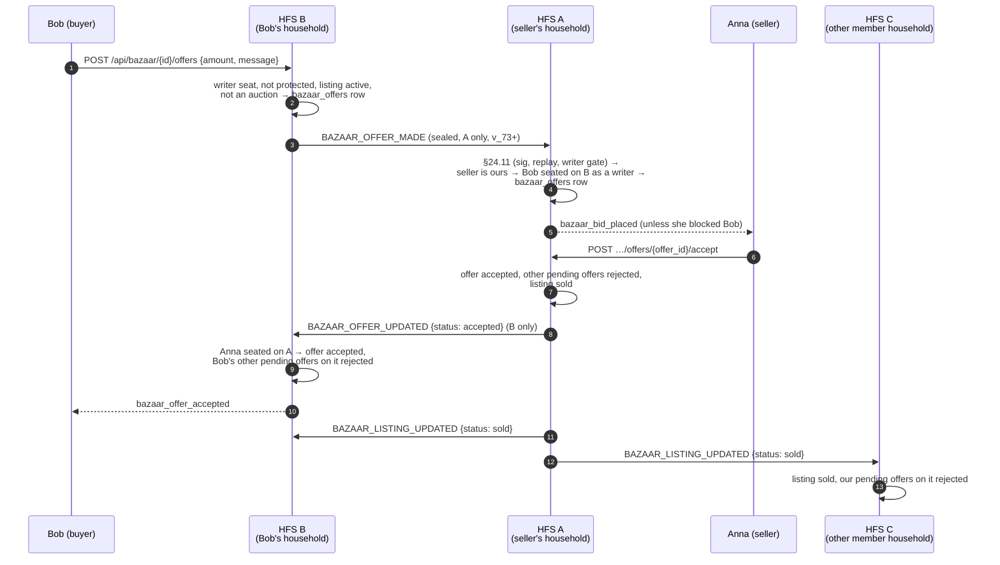
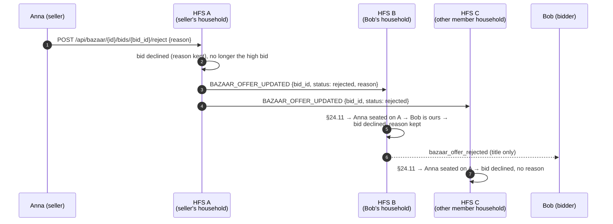

# Bazaar

A space's **Bazaar** tab is a small marketplace: a member lists something
for a fixed price, as negotiable, "make an offer", "bids from" or as an
auction. Listings, the bids on them and the sale reach every member
household. An **offer** on a fixed-price / negotiable listing is private to
the seller and the person who made it, so it travels between those two
households only.

## Scope

- **HFS**: the household where something happened sends it — the seller's
  household its listing, its status and its answers to offers; the buyer's
  household a bid, an offer and an offer's withdrawal. Every receiving
  household re-checks who may say it before storing it.
- **GFS**: uninvolved, except that the listing's wrapper post (`🛍 Title`)
  rides the public-space relay of a publicly readable space like any post.
  The listing itself, bids, offers and their answers never go to a GFS. A
  household on the mesh that is not a member of the space only ever relays
  ciphertext (`SPACE_ROUTED`).

| What | Goes to | Why |
|---|---|---|
| A listing, its status (sold / expired / cancelled) | every member household | everyone in the space sees the Bazaar tab |
| A bid | every member household | everyone sees the current high bid |
| An offer | **the seller's household only** | `GET …/offers` shows an offer to its seller and its offerer, nobody else |
| An offer's answer (accepted / rejected), the seller's reason with it | **the offerer's household only** | same |
| An offer's withdrawal | **the seller's household only** | so it can no longer be accepted there |
| A declined bid | every member household | everyone mirrors the bid, so the high bid reads the same everywhere |
| …the seller's reason for it | **the bidder's household only** | the words are for the bidder |

## Event types

`BAZAAR_LISTING_CREATED` (v_10), `BAZAAR_LISTING_UPDATED` (v_11),
`BAZAAR_BID_PLACED`, `BAZAAR_OFFER_ACCEPTED` (v_12), `BAZAAR_OFFER_MADE`,
`BAZAAR_OFFER_UPDATED` (v_73), plus the `bazaar` resource of the §25.6
space sync (listings only).

| Event | Sealed payload | Sent by → to |
|---|---|---|
| `BAZAAR_LISTING_CREATED` | the full listing: `post_id`, `space_id`, `seller_user_id`, `mode`, `title`, `description`, `image_urls`, `end_time`, `currency`, `status`, prices, `created_at` | seller's household → every member household |
| `BAZAAR_LISTING_UPDATED` | `post_id`, `space_id`, `status`, `winner_user_id`, `winning_price`, `sold_at` | seller's household → every member household |
| `BAZAAR_BID_PLACED` | `bid_id`, `listing_post_id`, `space_id`, `seller_user_id`, `bidder_user_id`, `amount`, `new_end_time`, `message` | bidder's household → every member household |
| `BAZAAR_OFFER_ACCEPTED` | `bid_id`, `listing_post_id`, `space_id`, `seller_user_id`, `buyer_user_id`, `price` (an accepted *bid* in "make an offer" mode) | seller's household → every member household |
| `BAZAAR_OFFER_MADE` | `offer_id`, `listing_post_id`, `space_id`, `offerer_user_id`, `amount`, `message` (≤ 280 characters) | offerer's household → the seller's household |
| `BAZAAR_OFFER_UPDATED` | `offer_id`, `listing_post_id`, `space_id`, `status` (`accepted` / `rejected` / `withdrawn`), for `rejected` the seller's `reason` (≤ 280 characters, when given) | seller's household → the offerer's (accepted / rejected); offerer's → the seller's (withdrawn) |
| `BAZAAR_OFFER_UPDATED` (a bid) | `bid_id`, `listing_post_id`, `space_id`, `status: rejected`; `reason` only in the bidder's household's copy | seller's household → every member household |

Everything but the routing fields (`event_type`, `from_instance`,
`to_instance`, `space_id`) is inside the per-peer sealed payload. The
reason rides only the one household's envelope it is for: an offer's
answer goes to the offerer's household alone; a declined bid's envelope to
every other member household carries no `reason` at all
(`broadcast_to_space_members(per_peer=…)` adds it to the bidder's
household's copy only). Both ends cap it at 280 characters; a receiver
drops an answer whose reason is longer or not text.

All six are classified in `SPACE_WRITE_EVENT_TYPES` (a follower-only
household may not send them) and `SPACE_SESSION_ALLOWED_EVENT_TYPES` (a
member household seated through an invite link receives them).

**Who may say what** (`SpaceContentInboundHandlers`, `SpaceAuthorship`):

- a listing, its status and an offer's answer — the seller, seated on the
  sending household;
- a bid, an offer and an offer's withdrawal — the bidder / offerer, holding
  a live **writer** seat on the sending household (a follower, a removed
  member and a name from another household are refused);
- an offer is taken only by the household whose own person sells the
  listing, for an active, non-auction listing in the envelope's space; an
  answer only by the household whose own person made the offer (a
  withdrawal: whose own person sells). Offer ids are idempotent and the
  offer status machine (`pending` → one terminal state) makes a replay a
  no-op; the §24.11 replay cache refuses the same envelope twice anyway;
- a bid's decline only from the household seating the listing's seller
  (`acts_for(any_role=True)`, as for an offer's answer), for a bid this
  household holds in the envelope's space. The first answer stands: a bid
  already accepted, declined or withdrawn is left as it is, so neither a
  replay nor a second decline swaps the reason. The reason is kept only
  where the bidder is one of the household's own people.

A protected account (§CP.R) can't bid or make an offer: its own household
refuses before anything is sent. A block or guardian block between the
seller and the offerer withholds the notification on the seller's side, as
it does for an offer made in the same household.

**Notifications** fire on the household of the person they are for: the
seller's household tells the seller of a bid or an offer
(`bazaar_bid_placed`), the offerer's household tells the offerer that the
offer was accepted (`bazaar_offer_accepted`) or declined
(`bazaar_offer_rejected`); the bidder's household tells the bidder that a
bid was declined (`bazaar_offer_rejected` too). The notification and its
push carry the title only (§25.3); the seller's reason shows in the
listing — under the bidder's declined bid, under the offerer's declined
offer. Offers that close because another one was accepted are rejected
silently, on both sides.

**Known limits.** An answer or a withdrawal is sent once. If the
`BAZAAR_OFFER_UPDATED` accept is lost, the sale still arrives
(`BAZAAR_LISTING_UPDATED`) but the winner's offer stays `pending` on their
household. If the buyer withdraws while the seller accepts, each side
refuses the other's change (the status machine allows one end state), so
the seller's household shows the sale and the buyer's shows the
withdrawal. An answer or withdrawal from a seat demoted to follower since
the offer is still taken (`acts_for(any_role=True)`) when that household
holds another writer seat. A follower-only household can't send it,
because the §24.11 writer gate refuses it first.

**Older households (v_73 fallback).** A seller's household below v_73 is
sent no offer: the offer stays on the buyer's household, as before v_73.
A declined bid and an answer's `reason` need no version of their own:
`reason` is an extra field a v_73 receiver ignores (the offer is still
declined, without the words), and a v_73 receiver that knows only
`offer_id` drops the `bid_id` form as malformed — the bid stays open there,
as before. Below v_73 nothing is sent.

## Flow — an offer from another household

A rejection is step 8 with `status: rejected` and, when Anna gave one,
her `reason` (the listing stays active and nothing else is sent); a
withdrawal goes the other way, B → A, with `status: withdrawn`.

## Flow — a declined auction bid

## Cost

Per offer: **one** envelope (~0.5 KiB sealed, the note ≤ 280 characters),
to one household. Per answer: one envelope to one household (+ ≤ 280
characters of reason). Per declined bid: one envelope per member
household — exactly what the bid itself cost, once, on a decision by the
seller (never on a timer); the reason adds ≤ 280 characters to one of
them. 200 member households and 30 declined bids on a busy auction: 6 000
small envelopes over its life, against 6 000 for the bids themselves. An accepted
offer adds the sale, one `BAZAAR_LISTING_UPDATED` per member household —
the same envelope every other sale already sends. A space with 200 member
households and 50 offers on one listing: 50 offer envelopes to the seller,
at most 50 answers, 200 sale envelopes once. No offer is ever fanned out
to the space.

## Implementation

- `socialhome/services/bazaar_service.py` — the local rules (`make_offer`,
  `accept_fixed_offer`, `reject_fixed_offer`, `withdraw_fixed_offer`,
  `place_bid`, …).
- `socialhome/services/bazaar_outbound.py` — bus → federation;
  `_send_to_household_of` targets the one household seating the seller /
  offerer (`broadcast_to_space_members(only_instances=…)`, mesh-routed and
  version-gated like any space event).
- `socialhome/services/federation_inbound/space_content.py` —
  `_on_bazaar_*` handlers.
- `socialhome/domain/federation_capabilities.py` —
  `MIN_FOR_BAZAAR_LISTING` (10), `MIN_FOR_BAZAAR_STATUS` (11),
  `MIN_FOR_BAZAAR_BIDS` (12), `MIN_FOR_BAZAAR_OFFERS` (73).
- Tests: `tests/protocol/test_bazaar_offer_federation.py` (five
  households, real crypto and pipeline), `tests/protocol/test_space_content_scope.py`
  and `test_space_content_authorship.py` (the per-event rules).

## Spec refs

§5.6 (Bazaar), §23.23 (offers and saved listings), §24.11 (inbound
pipeline), §CP.R (protected accounts), §25.8.21 (encryption first).
See also [Spaces](./spaces.md) and the HTTP API in
[`../api.md`](../api.md#bazaar-offers--saved-listings-2323).
