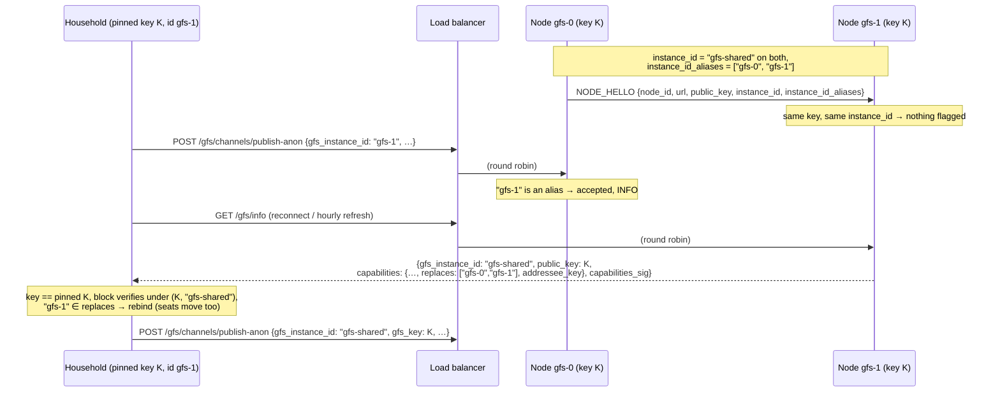
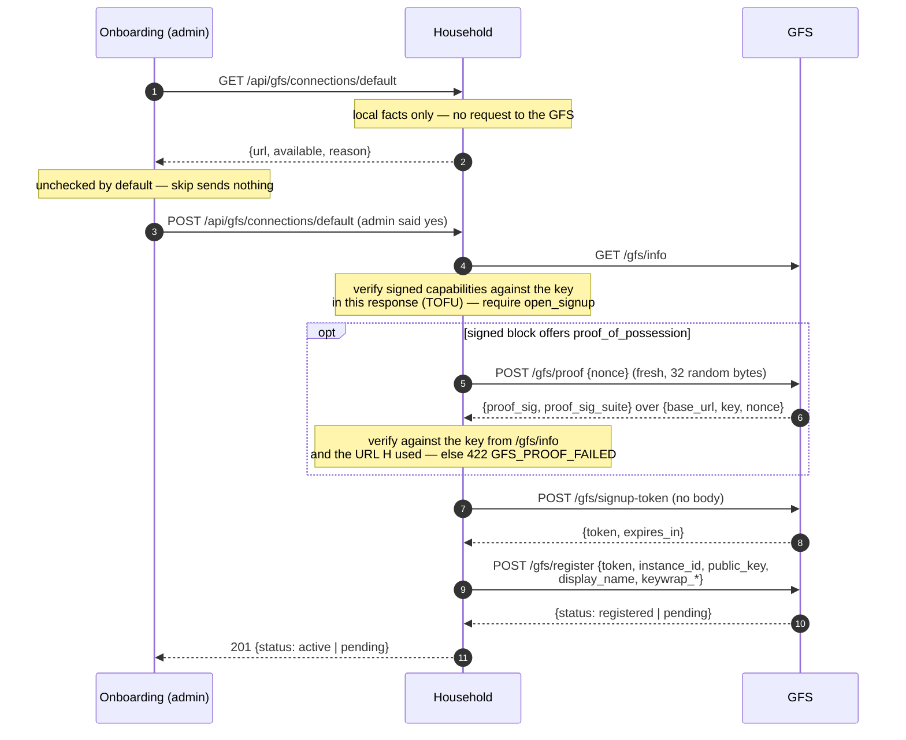
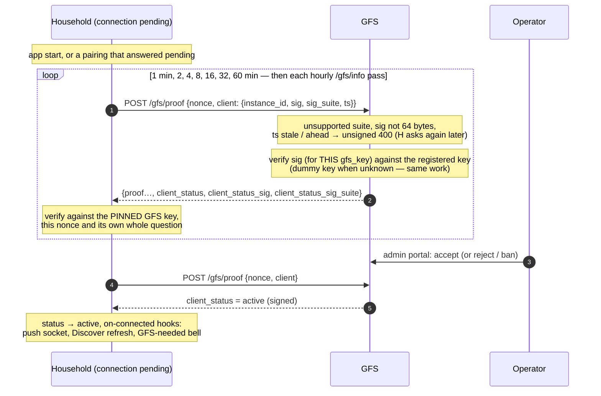
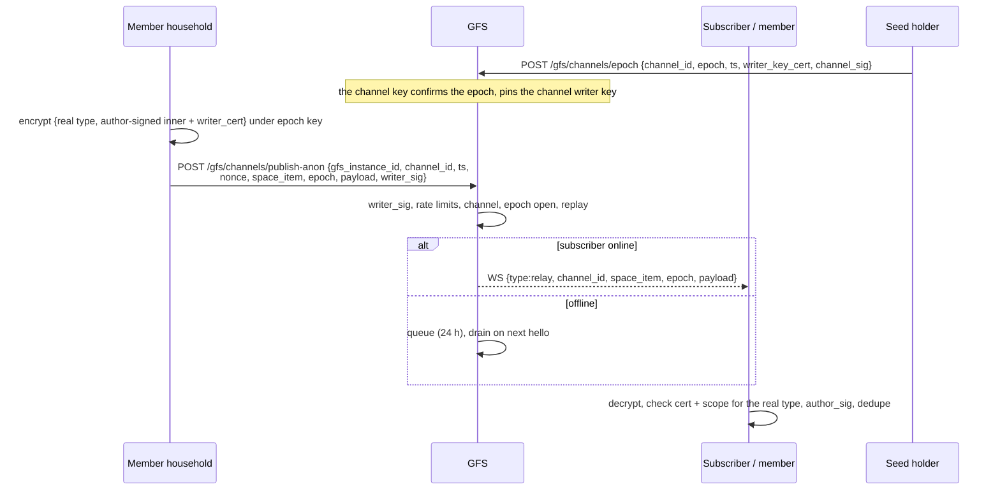
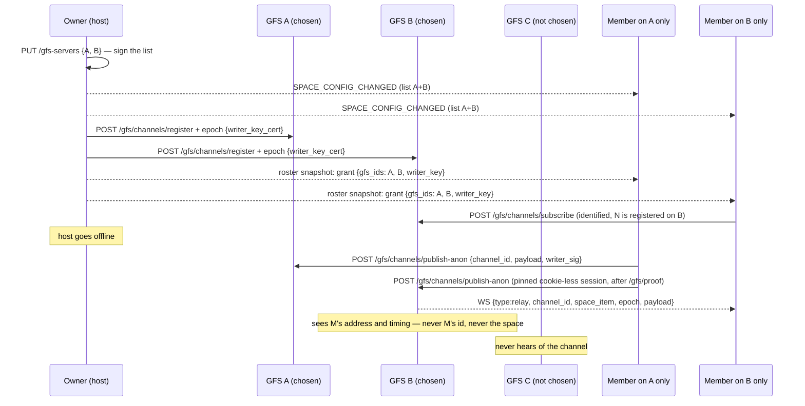
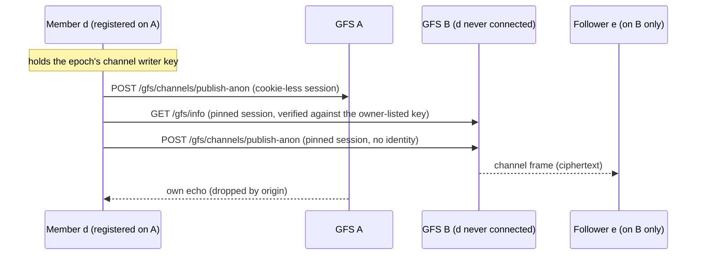
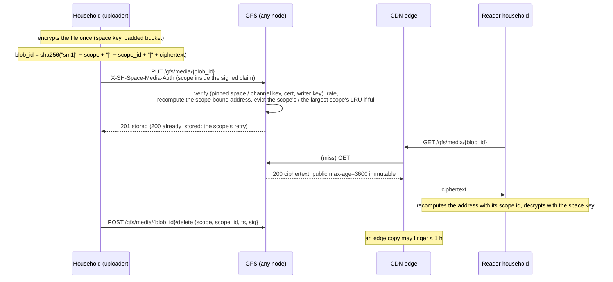
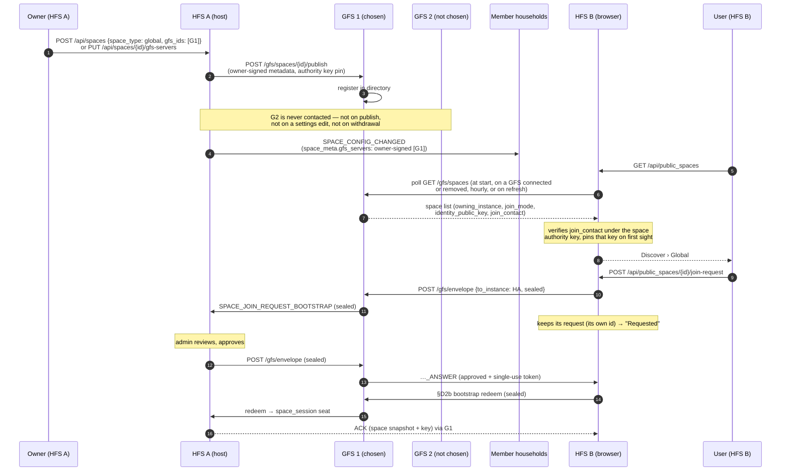

# Public-Space Discovery

How a user on one household finds a public space hosted on a
household they've never heard of. GFS is the directory; it holds
metadata, not content.

## Scope

- **HFS**: lists a **global** space on the GFSs its owner picks (a
  **public** space is never on a GFS — paired peers find it through
  `SPACE_DIRECTORY_SYNC`); subscribes to the GFS directory to browse
  others; asks to join a global space through the GFS that lists it when
  its host is not paired (v_84, "Ask to join through the GFS" below).
- **GFS**: maintains the global registry of published spaces,
  serves `GET /gfs/spaces` (for a global space that takes requests, with
  the owner's authority-signed join contact on the listing), and relays
  sealed blobs between unpaired instances (`POST /gfs/envelope`). It also keeps a short-lived, bounded cache
  of encrypted space media (see "Space media cache on a GFS").

## Since v_96: space content reaches a GFS only through a channel

A follower is a member with the read-only role (v_96, see
[spaces.md › Followers](./spaces.md#followers-v_96)). Neither side keeps a
space-id-keyed path any more — the household since P6, the GFS since P7:

- no follow-only mirror and no identity-bound `POST /gfs/subscribe` seat
  (household: `gfs_space_seats` dropped by migration 0156, after 0155
  deleted the provable mirror spaces; GFS: `space_subscribers` dropped by
  GFS migration 0033), no `GET /gfs/spaces/{id}/subscribers` roster read and
  no `new_subscriber` push;
- no content-key handoff to a GFS subscriber
  (`space_subscriber_key_handoff`), no key pull
  (`POST /gfs/spaces/{id}/key_request`) and no v_61 author-profiles bundle —
  a follower gets the key by federation like any member and reads names
  from the roster;
- no host relay (`POST /gfs/publish`, `space_post_public`, targeted `to`)
  and no space-keyed member publish (`POST /gfs/member-publish-anon`,
  `POST /gfs/spaces/{id}/epoch`), no compressed (`zlib1`, `zlib1+dict1`)
  items, and no `space` scope in the space media cache (owner decision Q5:
  only `channel`).

Each removed route answers `404` (`tests/protocol/test_gfs_space_keyed_routes_gone.py`),
and the signed `/gfs/info` block no longer names `anonymous_publish`,
`member_publish_strict`, `targeted_publish`, `space_key_pull`,
`space_item_followers` or `payload_zlib1*`; it names `subscriber_seats`
and `private_channels`, the two a household needs before it uses a server
for a global space's channel. GFS migration 0033 dropped the follow graph
(`space_subscribers`, with 0023's `reads_space_item`), the queued
space-keyed relay frames no household takes, and the `space`-scope media
rows.

What a GFS carries for a space is its **opaque channel**
([Opaque channels](#opaque-channels-private-and-global)): every member's own
items (the owner's included), the host's authority items (a remote author's
post it did not put there, approved posts, removals — the inner signed by
the space authority inside the ciphertext), and the epoch notices. A global
space with no channel here gets no GFS content path at all: its members are
reached by federation (paired, mesh, the mailbox) and catch up from the host
by sync. Sections below that describe the removed paths are marked
"Removed in v_96" and kept only where they explain a rule the channel
inherited; the rest are listed under
[Removed in v_96](#removed-in-v_96-the-space-keyed-relay).

## Event types

`SPACE_DIRECTORY_SYNC` (peer-to-peer snapshot, distinct from GFS). The
full public-space snapshot goes to a paired household on pair confirm, when
it first reaches v_59, and after a space config or local-area change —
but after a change **only when what that household would get differs
from what it was last sent** (`PeerDirectoryService` keeps a per-peer
digest in memory; a restart re-sends once on the next change). Most config
changes — a private space's, a remote space's config applied here — leave
every peer's copy as it was and send nothing. Cost: a household with 20
paired peers and ~30 config changes a day used to send 600 snapshots
(~2–5 KB each, ≈ 1.5–3 MB); now only the changes to its public spaces go
out.
`PUBLIC_SPACE_ADVERTISE` / `PUBLIC_SPACE_WITHDRAWN` remain in the enum but
nothing sends them: a GFS listing is the owner's signed HTTPS
`POST /gfs/spaces/{id}/publish` / `…/unpublish` (below), not a federation
event.

Join-request events belong to the [invites](./invites.md) flow. From a
household not paired with the host, an "ask to join" on a global space rides
the sealed GFS relay: `SPACE_JOIN_REQUEST_BOOTSTRAP` and
`SPACE_JOIN_REQUEST_BOOTSTRAP_ANSWER`
(v_84, inner `kind`s of a sealed blob, never a §24.11 envelope; see "Ask to
join through the GFS" below).

GFS fan-out event types (connection-server wire, not
`FederationEventType`): a channel frame (`channel_id`, `event_type`
`space_item`, `epoch`, `payload` — the real item type, or an authority item,
inside the ciphertext). The space-keyed types (`space_post_public`,
`space_subscriber_key_handoff`, `space_author_profiles_bundle`, a
space-keyed `space_item`) are gone on both sides since v_96. GFS → one
household socket: `space_media_request`
(v_83, [space media on demand](#space-media-on-demand-v_83) — only to a
socket whose hello listed `space_media_serve`).

## Transport (SH ↔ GFS)

The Social Home ↔ GFS link is split by direction:

- **SH → GFS** is plain HTTPS REST under `/gfs/*` (`register`,
  `spaces`, `channels`, `media`, `envelope`, `report`, `appeal`). Synchronous
  request / response with explicit status codes; no shared session
  state. **Every mutating call that names a household is Ed25519-signed by
  that household and verified against its registered public key** — there is
  no unsigned path. The deliberate exceptions name no household at all:
  the anonymous channel publish (`channels/publish-anon`, signed with the
  channel writer key — see [Opaque channels](#opaque-channels-private-and-global))
  and the anonymous mailbox routes:
  - `spaces/{id}/publish` (space metadata) requires a mandatory household
    signature over its canonical body; an empty / malformed / invalid
    signature is rejected with `403`, so a registered peer can never
    overwrite another household's listing.
  - `spaces/{id}/unpublish` is the **owner's withdrawal** of a listing and is
    signed the same way (`{action: "unpublish", owning_instance, space_id, ts}`,
    ±300 s replay guard). The signature proves *which* household is calling, so
    the GFS additionally checks that the caller **is** the space's
    `owning_instance` — a registered peer that learned a space id (they travel
    in discovery links) cannot delist someone else's space. Withdrawal is a
    **distinct, reversible state** from a moderator ban: it sets `withdrawn` and
    never touches `status`, so the owner's next signed publish restores the
    listing, while a GFS admin's `status='banned'` stays sticky against
    re-publish. The restoring publish must be **fresh**: `publish` carries an
    optional `ts` inside its signed canonical body, replay-guarded ±300 s, and
    only a publish carrying one clears `withdrawn`. A publish without `ts` (an
    older household, kept working on purpose so an upgraded GFS doesn't 403
    the whole fleet) still refreshes metadata but leaves `withdrawn` as-is —
    otherwise one captured publish body would re-list a delisted space forever.
    Once every household ships `ts` it becomes mandatory. A publish answers
    `{status, space_id, identity_public_key}` — the authority key the GFS
    pins after the request, which is how the owner checks that a re-pin
    took. A publish or a withdrawal names the server it is for —
    `gfs_key`, that server's identity key, inside the signed bytes; one
    naming another server is refused, so a body sent to one GFS cannot be
    replayed to another (a listing publish replayed there would LIST the
    space on a server its owner did not choose). A household binds it on
    every listing publish and withdrawal to a server that proved
    `withdrawn_repin` (cached from the `/gfs/info` each connect fetches);
    an older server gets the body without it, and a body without the
    field (an older household) is judged as before. A server that does not
    advertise the capability — or a publish sent before the first verified
    `/gfs/info` after a restart — therefore still gets a body it could
    replay elsewhere; the gate goes, and the field becomes mandatory, once
    no GFS older than `withdrawn_repin` is in use. All nodes of one
    cluster must run that revision before any advertises it (an older node
    refuses a signed field it does not know). The
    binding is per server, not per request: the same body sent again to
    the SAME server inside the `ts` window is taken again (a withdrawal
    replayed after a re-list withdraws once more, a listing replayed after
    a withdrawal lists once more). That needs the owner's TLS session or
    the server itself, which can hide or show a listing anyway; the owner's
    next publish or withdrawal puts it right. A publish carrying `withdrawn: true` (inside the
    signed bytes, `ts` and `gfs_key` mandatory; capability
    `withdrawn_repin`) is a **pin-only** publish
    for a listing the owner withdrew: the pin moves under the usual cert
    rule, no metadata is stored, `status` is untouched, the listing stays
    withdrawn (the flag is set if it was not), and no row is ever created —
    an unknown space answers `404`, only after the signature verified. The
    owner sends it after a key rotation so a withdrawn listing does not keep
    the retired key ([spaces.md](./spaces.md), "Durable re-pin"). Withdrawal affects **discoverability only** — the space drops
    off `GET /gfs/spaces`, `GET /gfs/spaces/{id}` and the public pages, while
    the space's channels and their seats are untouched. Withdrawal
    also **deletes every invite link** minted for the space
    (`gfs_invite_tokens`): those are standing public URLs already sitting in
    other people's chats, so leaving them live would keep a working side door
    into a delisted listing. Re-publishing restores the listing, not the old
    links — the owner mints fresh ones.
  - `spaces/{id}/publish` also carries **two independent dials**, both inside
    the same signed canonical body — so no on-path party can flip either:

    | Field | What it governs | Values |
    |---|---|---|
    | `join_mode` | how a person becomes a **member who can post** | `invite_only` / `open` / `request` |
    | `allow_subscribers` | whether **strangers may follow read-only** — i.e. whether the listing is publicly **readable** | `true` / `false` |

    Readability is `allow_subscribers`, and *only* `allow_subscribers`. All
    four combinations are meaningful: `invite_only` + `true` is a broadcast
    space (invited people write, anyone may read), `open` + `false` is
    joinable but not publicly readable.

    | `allow_subscribers` | Listed in the directory | Publicly readable |
    |---|---|---|
    | `true` | yes | yes — a follow is an auto-approved join for the read-only role (v_96, [Following through the GFS](#following-through-the-gfs-v_96)); the follower reads over the space's channel like a member |
    | `false` | **yes** | **no** — the host approves no follow; only members read |

    A space with followers off is therefore an *advert* to strangers: people
    can find it and ask to be let in, but nobody reads it without being
    let in. The GFS enforces nothing here since v_96 — it holds no
    space-keyed seat to refuse; the host decides every seat.

    Both fields are **optional on the wire** for the mixed-version window and
    each is folded into the signed bytes only when present (an older household
    signs a body without the key; stripping either in transit only moves the value
    towards the *more* restrictive one). A missing or unknown `join_mode`
    stores the fail-closed `invite_only` and a missing `allow_subscribers`
    stores the fail-closed `false`; so do the `0009` / `0010` migrations'
    column defaults for rows published before each field existed. That is a
    deliberate choice over a backfill: an unreadable-but-listed space is the
    safe error, and the truth arrives by itself one reconnect later, because
    every GFS-WS (re)connect re-publishes the metadata of every space this
    household published to that server (the NULL-pin self-heal below).
    When a publish carries an **explicit** `allow_subscribers: false`, the
    GFS also **drops that space's subscriber rows** (logged at INFO with the
    count): the owner has withdrawn readability, and seats taken while the
    space was readable would otherwise linger forever on a space that relays
    nothing. An **absent** key does *not* purge. It gates (the stored `0`
    refuses every new subscribe) but keeps the existing seats: absent means
    "this household does not know the field", not "the owner withdrew
    readability", and evicting on it would mass-evict every reader on a
    mixed-version server the moment one un-upgraded household re-published.
    The gate reverses itself on the owner's next publish; a purge does not.
  - `spaces/{id}/invite` (+ `invite/{gfs_token}`) mint and revoke those links,
    owner-signed with an `action` discriminator inside the signed bytes. The
    public half is `GET /join/{gfs_token}`, which renders the space's
    already-public directory metadata next to a `socialhome://invite#<blob>`
    code the visitor pastes into their own Social Home. The blob is opaque to
    the server and the page **writes nothing** — see
    [invites.md](invites.md#the-mint--landing-leg--where-the-blob-comes-from).
  - `spaces/{id}/publish` carries the space's **listing counts**
    (owner decision 2026-11-23): `member_count` (members — local seats and
    live remote seats, never a follower; `space_repo.MEMBER_COUNT_SQL`) and
    `follower_count` (live follower seats, local plus remote non-tombstoned;
    `FOLLOWER_COUNT_SQL`), both from one builder,
    `space_repo.listing_counts`. **A space that takes no followers
    (`allow_subscribers` off) declares no `follower_count` at all** (owner
    request 2026-11-24): the builder leaves it `NULL`
    (`LISTED_FOLLOWER_COUNT_SQL`) and the key is left out of the publish
    and the snapshot, so every surface — GFS pages, Discover, the space page
    — shows only "N members", never "0 followers"; a space that takes
    followers always declares one, `0` included, and every renderer shows a
    follower count exactly when one is present. A publish that declares
    `member_count` without `follower_count` clears the stored follower
    count, so flipping the switch (a config change, re-published at once)
    updates every surface. Receivers hold the same line whatever a sender
    declares: the GFS stores no follower count for a row whose
    `allow_subscribers` is false (a count-less publish from a household
    that has not yet seen `listing_counts`, a cluster peer's row), and a
    household's Discover cache drops one from a GFS listing that does not
    take followers. They ride inside the signed body, so no
    relay or other household can change them on the way to the GFS (the
    signature is not served onward: a GFS can misreport them to its readers,
    as it could the name), and go only to a server whose
    **signed** `/gfs/info` block proves `listing_counts` (read from the
    cache each connect warms — no probe per publish): an older GFS folds
    only the fields it knows into the bytes it verifies, so the fields
    would 403 the whole publish. The GFS re-checks each count
    (`parse_listing_count`: an `int`, `0..10 000 000`; anything else is
    stored as no number), stores it with the publish's signed `ts`
    (last writer wins; only a publish with a signed `ts` that declares
    counts changes them — a publish without counts, e.g. one sent before the
    household had seen this server's `/gfs/info`, or a replayable no-`ts`
    body, leaves them as they are — except the follower count of a space
    that takes no followers, which is never kept) and serves it as `member_count` / `follower_count` on
    `GET /gfs/spaces`, `GET /gfs/spaces/{id}`, its HTML pages and the viewer
    JSON. It no longer serves its own `subscriber_count` (its relay seats,
    which it showed as members — almost always 0); that stays operator
    bookkeeping. A space whose owner never declared counts (an older
    household) shows **no number**, never 0. A household that polls
    several GFSs keeps a declared number when another, older, GFS lists the
    same space without one. Cluster gossip takes a peer node's counts only
    with a stamp no more than 300 s ahead of the node's clock. A follower reached only through a GFS is not a
    roster seat yet, so it is not counted (the subscriber-seats work makes
    it one). The paired-household `SPACE_DIRECTORY_SYNC` snapshot carries
    the same two numbers from the same builder (`member_count` always did;
    `follower_count` is additive — an older peer ignores it, an older host
    sends none and shows no number; left out for a space that takes no
    followers).

    **Re-shared on change, coalesced.** A join, leave, follow, unfollow,
    kick, ban or role change in a global or public space this household
    hosts (`SpaceMemberJoined` / `Left`, `SpaceRemoteSeatLive` / `Ended`,
    `SpaceConfigChanged`) starts one trailing 5-minute timer per space
    (`SpaceListingCountsService`); when it fires the counts are read once
    and, only if they differ from what was last shared, the GFS listing is
    re-published to the servers already listing it (`republish_space`,
    without re-announcing the members' GFS list) or the paired directory is
    refreshed (per peer, only if that peer's copy changed; a config change still re-sends the paired snapshot at once, as before, with the counts of that moment). A quiet space
    sends nothing. **Cost per trigger:** G listing servers × one publish
    body (metadata plus the embedded cover and icon — typically tens to a
    few hundred KB, at most ~2 × 2 MiB base64) for a global space; P paired
    peers × one snapshot (~300 B per public space) for a public one.
    Followers and members receive nothing — readers pick the counts up on
    their next directory poll. **Worst case:** a global space with 200
    authors and 10 000 followers whose seats change constantly re-publishes
    at most 288 times a day per listing server (one per 5-minute window),
    ~86 MB/day per server at a 300 KB body; one join or follow can never
    make more than one publish per server per window.

  - `spaces/{id}/publish` additionally carries the space's Ed25519
    **authority** verify key (`identity_public_key`, hex). The GFS
    **TOFU-pins** it on the first publish. After that the pin moves **only on
    an owner-certified rotation** (v_44): when the owner revokes an admin
    household it rotates the key and its publish carries `authority_cert`
    (inside the signed body, which must then carry a fresh signed `ts`). The
    GFS re-pins only when the cert verifies against the owner's REGISTERED
    key (`client_instances.public_key`, which must derive to
    `owning_instance`), names exactly the offered key, and has a higher
    `key_epoch` than the cert it stored (`global_spaces.authority_cert`,
    migration `0013`; none = epoch 0). Anything else keeps the pin and logs a
    warning. The cert names no member and no reason: the GFS learns that a
    rotation happened, and when. It stays inside the GFS (ordering and
    cluster sync); the public directory serves only the key and the GFS's own
    re-pin counter (`authority_rotation_seq`, migration `0013`). An ordinary upsert — including a cluster
    `NODE_SYNC_SPACE` — never moves a set pin; a peer node's sync re-pins only
    through the same cert check, and max-merges the peer's
    `authority_rotation_seq` for the pin it now holds, so a node never serves
    a lower seq than its peer did. The seq is capped at 2^63−1; a node that
    reaches the cap stops advancing it, so a hostile cluster peer that gossips
    the cap freezes follower re-pins on that GFS (mirrors need a strictly
    higher seq). Cluster peers are trusted operator nodes, so this is a
    documented residual, not a gate. A GFS advertises the feature as
    `authority_rotation: true` in its signed `/gfs/info` capability block; a
    household sends a GFS without it no cert (an older GFS would fail the
    signature over a field it doesn't know) and warns that the old key keeps
    authorizing relays there.
  - **Capability discovery — signed.** The GFS↔HFS leg has no `proto_version`
    negotiation, so capabilities ride `GET /gfs/info`. That endpoint is
    unauthenticated, so the capability block is **signed**: the response
    carries

    ```json
    {"capabilities": {"private_channels": true, "subscriber_seats": true, …},
     "capabilities_sig": "<b64url Ed25519>",
     "capabilities_sig_suite": "ed25519"}
    ```

    signed with the GFS's **own identity key** — the one already published in
    the same response as `public_key` and pinned (TOFU) by every paired
    household. That key is random per deployment: the GFS mints a 32-byte seed
    on first boot and persists it as `<data_dir>/gfs_identity.seed` (0600), or
    takes `[server] signing_seed_hex` / `GFS_SIGNING_SEED` when an operator
    manages the secret externally. It used to be *derived* from
    `gfs_instance_id`, which `/gfs/info` serves in the clear — anyone could
    recompute the private key and sign their own capability block, so the
    signature proved nothing. Signing bytes are `b"gfs-capabilities:v1:"` + canonical JSON
    (`sort_keys`, compact separators) of
    `{"gfs_instance_id": …, "capabilities": {…}}`, so a block can't be lifted
    onto another server or another statement that key signs
    (`socialhome/capabilities_sig.py`; suite tag per the
    crypto-suite rule, unknown suite → rejected, never defaulted).

    The household caches the verified answer per connection (RAM only — it is
    a property of the remote server's build, so a column would go stale the
    moment an operator upgrades), refreshing it at pair time, on every GFS-WS
    reconnect, and once on demand. **Only a verified block counts**: a
    missing block, a bad signature or an unknown suite proves nothing, plus
    **one** WARNING per connection worded so an operator can tell "older GFS
    / stripped in transit" from "block FAILED verification against the
    pinned key". A household uses a server for a global space's channel only
    when its verified block proves `private_channels` and
    `subscriber_seats` (v_96); stripping the block in transit buys an
    attacker a server the household does not use, never an identity. (The
    `anonymous_publish` flag and its in-RAM ratchet went with the
    space-keyed `/gfs/publish` relay in v_96.)
  - **`https://` at pair time.** A GFS URL (from the QR or pasted) must be
    `https://` unless the host is loopback, `localhost`, RFC1918, `fc00::/7`
    or `fe80::/10` — a LAN or demo-harness GFS on `http://127.0.0.1:<port>`
    stays allowed, a public one must be TLS. Enforced before the first byte
    leaves (`GfsConnectionService.pair`); DNS is never resolved, so the
    check can't be turned into a rebinding oracle. Without it the very fetch
    that pins the key and reads the signed block is rewritable on-path. The
    household's own address is not part of the exchange — registration
    carries no `inbox_url`.
  - **NULL-pin self-heal.** A space whose GFS row pinned no authority key
    cannot prove its join contact or its listing re-pins, and nothing else
    re-publishes its metadata. So on
    every GFS-WS (re)connect the household re-publishes the metadata of each
    space it has published to that server. This is idempotent (the pin only
    moves on an owner-certified rotation, which the re-publish also carries),
    sequential, and fail-soft per space.
- **GFS → SH** is a persistent WebSocket the SH opens to
  `wss://<gfs>/gfs/ws`. The first frame is a signed hello
  `{type:"hello", instance_id, ts, sig}`; once accepted the GFS pushes
  `{type:"relay", channel_id, event_type, epoch, payload}` frames as
  channel fan-out happens — no `from_instance`, no space id and no
  GFS-added target id. The frame goes to **every** seat of the channel:
  the publish was anonymous, so the GFS cannot exclude the publisher, and
  a household that gets its own item back drops it on the self-echo guard.
  That socket is the **only** delivery path: the GFS holds no household
  address (GFS migration `0018` dropped the `inbox_url` it once registered),
  so a frame for a seat whose socket is down is queued (bounded, only for a
  seat seen within the queue TTL) and drained on its next hello; a missed
  item past that is recovered by
  sync from the host, never by the GFS. (The `new_subscriber` push to a
  space owner went with the space-keyed seats in v_96.)
- **A rejected hello names no reason that leaks registration.** An unknown
  or inactive `instance_id` and a bad (or undecodable) signature for a
  registered one both close `4401` with the single reason `auth-failed`, and
  the unknown branch still runs one Ed25519 verify (against a fixed dummy key
  nothing signs with), so neither the close reason nor the time to it tells a
  prober whether an id is registered. Older GFS builds sent `unknown-instance`
  / `bad-signature`; households treat all three as "re-pair needed".
  Freshness and shape failures (`ts-skew`, `hello-timeout`, `missing-fields`
  …) keep their own reasons — they are about the caller's bytes, not the id.
- **Queued frames reach a household on any cluster node.** Cluster nodes
  share one database — so one `gfs_envelope_queue` — but each knows only its
  own sockets. A node that queues an envelope or member item for a household
  it holds no socket for sends one coalesced, fire-and-forget
  `NODE_DRAIN_HINT {instances:[…]}` (ids only; 0.5 s of batching and at most one frame per 1.5 s, ≤ 256 ids
  a frame) to its member peers; the node that does hold the household's
  socket drains its queue right away instead of on the next reconnect.
  Drains are serialised per household, so a hello drain and a hint drain
  never deliver a row twice.
- **Channel items reach seats on every cluster node.** A channel item is
  pushed by the node that accepted it to the sockets IT holds, then forwarded ONCE
  per peer node — not once per subscriber — as `relays:[{aud, skip, q,
  frame}]` in the next coalesced `NODE_DRAIN_HINT` (≤ 64 items / 768 KiB a
  frame, ≤ 2048 items / 32 MiB waiting; past that an item is not forwarded,
  with a WARNING). The frame names the audience (`channel` + channel id;
  the `space` audience went with the space-keyed relay in v_96), not the
  recipients: each receiving node resolves
  it from the shared database and pushes to the members whose socket it
  holds, skipping the publisher. A node remembers every frame it pushed or
  forwarded (its own BLAKE2b digest, 10 min), so no node pushes one item
  twice, and a receiver never forwards again — no loops. Member and channel
  items also need an offline copy for a recently-seen subscriber with no
  socket anywhere: for those (`q`) the receiver answers with `held` — the
  audience members it holds a socket for — and the accepting node queues
  only for the recently-seen subscribers no node holds (one queue row each,
  as before for an offline subscriber; before this change every subscriber
  on another node also got a row, and one not "seen" got nothing). A
  receiver whose push to a held socket fails queues that one itself.
  **Rolling upgrade:** an older node ignores `relays` and answers without
  `held`, so the accepting node queues for its subscribers exactly as before
  and that node drains them on the hint; an older accepting node never
  forwards. **What the GFS learns:** nothing new — the forwarded frame is the
  same identity-free frame the sockets get, the audience is an id the shared
  database already holds, `skip` is the publisher the accepting node already
  authenticated (empty for an anonymous publish) and `held` lists the
  cluster's own sockets.
- **Public moments reach followers on any cluster node.** The same
  `relays` path carries a public moment and its tombstone (audience
  `followers` + the author's user id; the frame is `{event_type:
  "incoming_public_moment" | "incoming_public_moment_delete", payload}` and
  goes out as `{type: <event_type>, payload}`), and the two pushes for an
  author's household that found no socket on the node that built them
  (audience `instance` + its instance id: `follow_changed`,
  `moment_key_request`). A receiver pushes a typed item only as one of its
  audience's allowed frame types; an `instance` item is not deduped (it is
  forwarded only after the origin found no socket, and a repeat a minute
  later must arrive). A sealed moment key whose household has no socket on
  the node that took `POST /gfs/moments/keys` stays undelivered in the
  shared mailbox and the household id rides the drain hint; the node holding
  its socket pushes its undelivered keys (a key request answered from the
  mailbox marks the kept key undelivered first). See
  [momentum_public.md](momentum_public.md#cluster-delivery).
- **A rename reaches households on every cluster node.** The node that
  took the admin rename pushes `server_info_updated` to its own sockets and
  forwards it once per peer node on the same `relays` path (audience `all`,
  key `*`; the only frame type allowed for it is `server_info_updated`, and
  it is not deduped, so renaming back within ten minutes arrives too). Each
  node pushes it to every socket it holds. An older node drops the unknown
  audience; its households refresh on their next reconnect, as before.
- **A public-highlight session stays on the node that started it.** Its
  signalling state and relay pipe live in that node's memory only — no
  shared session state, no highlight byte between nodes. The node names
  itself in every session and relay id it mints (`<route_tag>.<random>`,
  `[cluster] route_tag`), and the load balancer sends every later request
  of the session there by that tag (path segment or JSON `session_id`; see
  [operations/gfs-cluster.md](../operations/gfs-cluster.md)). The pushes to
  the author (`highlight_signal`: `offer`, viewer `ice`, `relay_offer`)
  ride the `relays` path as `instance` items when the author's socket is on
  another node; the offer and the relay request ask for `held`, so the
  accepting node knows whether any node delivered it (no node → the uniform
  503, and no session is kept). A highlight signal is never queued as an
  offline copy. A request for a session the node does not hold answers 404
  (WARNING once a minute when its tag names another node). An older node
  drops a `highlight_signal` item (not in its allow-list) and reports
  nothing held — during a rolling upgrade such an offer is refused, as it
  was before. See [highlights_public.md](highlights_public.md#in-a-gfs-cluster).
- **One public identity per GFS, however many nodes.** `[server] instance_id`
  is the GFS's PUBLIC identity: `/gfs/info` serves it, the capability block
  is signed over it, and households pin it at pairing and sign it as the
  addressee into every member publish, epoch notice and channel request. The
  nodes of a cluster share one identity key and one `base_url` behind a load
  balancer, so a household's `/gfs/info` and its next request usually reach
  DIFFERENT nodes — `instance_id` MUST be identical on every node. Nodes are
  told apart by `[cluster] node_id`, which MUST be unique: set it explicitly.
  An empty one still falls back to `instance_id` (no breaking change), which
  gives every node of a shared-id cluster the same `node_id` — logged at
  ERROR at startup when `instance_id_aliases` is set, and at runtime when a
  node under our key announces our `node_id` from another address
  (`duplicate_node_id_urls` in `GET /admin/api/cluster`). Guards and the
  migration path:
  - **Sibling check (flag, never an outage).** `NODE_HELLO` /
    `NODE_HEARTBEAT` carry the sender's `instance_id` and
    `instance_id_aliases` (additive; a missing field is unknown, never a
    mismatch). A sibling under this node's own key whose id differs but is
    linked through either side's aliases is a **rolling id change** —
    WARNING, `instance_id_transitional`. Any other difference is a
    **mismatch** — ERROR, `instance_id_mismatches`. Neither fails
    `/healthz`: pulling every node of a misconfigured cluster out of the
    balancer is worse than the misconfiguration. **Operator action:** give
    every node the same `instance_id`, list the old per-node ids in
    `instance_id_aliases` on every node, and set a unique `node_id` on each.
  - **Aliases (server side).** `[server] instance_id_aliases`
    (`GFS_INSTANCE_ID_ALIASES`) lists former ids still accepted as the
    addressee of a signed request, and is served ONLY inside the signed
    capability block, as `replaces: [...]`. Requests addressed to an alias
    are logged at INFO with a count and the node's `node_id` — at most once
    per alias per 10 minutes, with the remaining count flushed every 10
    minutes and at shutdown — so the operator can drop the aliases once
    those lines stop on every node.
  - **Rebind (household side).** The pinned KEY is the trust anchor, the id a
    label — but a household moves its pin only when the server says so: the
    served `public_key` is the pinned key, the capability block verifies
    under (pinned key, served id), AND that block's `replaces` names the
    pinned id. Then the household adopts the served id (INFO log). A node
    that merely serves another id under the same key (a cluster still on
    per-node ids, or an old node mid-rollout) never moves it — no lateral
    moves, no flipping back. A different key is refused with a WARNING (a
    new key means re-pairing); an id another connection already holds (the
    same server paired twice) leaves both connections untouched, with a
    WARNING. Households re-read `/gfs/info` on every reconnect, at startup
    and about hourly (jittered, `GfsInfoRefreshScheduler`), so even a
    household whose socket stays up converges. The owner of a private space
    re-registers its channel and re-issues grants naming the new id; until
    they arrive, a grant naming a former id still matches when the server's
    signed `replaces` lists it (re-derived on every verified fetch, so it
    survives a restart). The other way round — a grant already naming the
    new id while this member has not rebound — re-reads that server's
    `/gfs/info` at once (at most once a minute per connection) before the
    server is skipped. The household's follow seats (`gfs_space_seats`,
    bound to server id + pinned key + address) move to the new id in the
    same step — only seats bound to the connection's pinned key AND address
    — and the reconnect reconcile repeats the move before reading seats, so
    a crash in between heals.
  - **Key binding (`gfs_key`).** An alias such as `gfs-0` may be ANOTHER
    operator's real id, so the id alone no longer rules out replaying a
    request captured there. Every household- or channel-signed request
    (member publish, anonymous member publish, owner epoch notice, channel
    register / epoch / unregister / subscribe / unsubscribe / publish /
    publish-anon) takes an optional `gfs_key` — the addressed server's
    pinned key, lowercase hex — inside the signed bytes; the GFS refuses a
    request whose `gfs_key` is not its own key. A household sends it only to
    a server whose signed block proves `addressee_key: true` (an older
    server refuses unknown fields); without it the id alone decides, as
    before. **Mixed-version cluster:** a newer node may advertise
    `addressee_key` while the balancer routes the next request to an older
    node of the same id. That node refuses the field — a 400 "unexpected or
    missing fields", or a 403 for the owner epoch notice, whose signature it
    re-builds without the field. The household then drops `gfs_key` for that
    connection, sends the request once more without it, and binds the key
    again only after its next verified `/gfs/info` says `addressee_key`. A
    connection left on an old id (the same server paired twice: the UNIQUE
    new id belongs to the other row) keeps working — its old id is an alias
    and its key is the server's own.
  - **Upgrade note (owner decision).** Older household builds verify the
    capability block under the id they pinned and never rebind. Once a
    cluster switches to one shared id, such a household keeps working while
    its process holds a capability it already verified (its requests name
    an old id, which the aliases accept); after a restart it cannot verify
    the block any more and stops relaying through that GFS until it
    upgrades. Accepted: before the switch those households succeeded only
    when the load balancer happened to hit the node they pinned.



### Connecting a household: QR code or open sign-up

A household pairs with a GFS by registering with a **single-use pairing
token** (10-minute TTL). Every landing-page view and every sign-up request
gets a fresh one — a room of people behind one NAT each get their own. The
GFS bounds them by LIVE tokens (unexpired, unused): 50 per client address
(IPv6 by /64) and 2 000 per server, cluster-wide in the shared database; an
address holding fewer than 3 always gets one, so a few heavy sources filling
the server cap can't lock everyone else out. At a cap the landing page says
so — "Too many pairing codes from your network right now", or "This GFS is
handing out too many pairing codes right now" — instead of showing a code,
and `POST /gfs/signup-token` answers 429 + `Retry-After: 120` (codes hold
their place for 10 minutes, so the one-click connect reports "busy" at
once). The one-click connect waits out a shorter `Retry-After` (the sign-up
windows' 60 s) once and asks again before it reports "busy". A token that expired or
was already used fails `/gfs/register` with 401, which the household
reports as "this pairing code expired or was already used"
(`422 GFS_CODE_EXPIRED`), not as a refusal. There are two ways to get one:

- **QR code / pairing code** — scanned or pasted from the GFS landing page
  (`socialhome://gfs-pair/{base_url}?token=…`, see
  [pairing](./pairing.md)); an admin adds it in Settings → Connections.
- **Open sign-up** — the GFS operator turns on `[policy] open_signup`
  (`GFS_OPEN_SIGNUP`, **off by default**) and the GFS hands out tokens over
  `POST /gfs/signup-token`. This is what the one-click **"Connect to the
  GFS"** step in household onboarding uses, against the household's
  `[gfs] default_url` (`SH_GFS_DEFAULT_URL`, default
  `https://gfs.social-home.io`; empty hides the step).

The onboarding step is **opt-out and pre-ticked** (owner decision
2026-10-08): the box is ticked by default, but nothing is sent to any GFS
until an admin reaches the step and presses Connect — unticking it, or
skipping the tour, connects nothing (`tests/protocol/
test_gfs_onboarding_opt_in.py` pins that the household never contacts the
GFS on its own). It needs no External URL: the GFS relays
over the WebSocket the household opens, so registration carries no household
address — which is what lets the Home Assistant App connect during first-run
onboarding, before it has any public URL. The household learns whether to
offer the step from local facts only (`GET /api/gfs/connections/default`:
`reason` is `disabled` or `already_connected`, else the step is available)
— it never probes the GFS to decide.



What the household checks and sends:

- **Identity pin for the default GFS.** The household refuses a server
  whose `/gfs/info` presents another public key ("This doesn't look like the
  Social Home GFS. Check the address in settings.", `422
  GFS_IDENTITY_MISMATCH`) before anything else is sent; the key is compared
  in constant time, hex, lowercase-normalized. With the shipped
  `default_url` (`https://gfs.social-home.io`) the project GFS's key
  `33cf798c8c8a7ae04d06a5978242b189c421fb66b2faf61749154070aa12ab0e` is
  pinned — it changes only with an app update or an operator override. The
  instance id is not pinned by default (on the project GFS it is a label,
  `gfs-2`, not derived from the key). An operator who overrides
  `default_url` gets no pin unless they set their own `[gfs]
  default_public_key` (`SH_GFS_DEFAULT_PUBLIC_KEY`; optionally
  `default_instance_id`).
- **Same trust as a QR scan.** `/gfs/info` is fetched **once**; the signed
  capability block is verified against the `public_key` in that same
  response — the key the household then pins (TOFU, https unless loopback /
  LAN). A bare, unsigned or wrongly-signed `open_signup` counts as "closed",
  and the household never asks for a token. The pinned key is the verified
  one: there is no second descriptor fetch to swap.
- **Proof of possession before anything is sent.** `/gfs/info` is static —
  its signed block proves what the key once signed, not that the server
  answering holds it, so a host could replay a real GFS's descriptor from
  another address and be pinned as that GFS. When the signed block offers
  `proof_of_possession`, the household (QR and open sign-up alike) first sends
  `POST /gfs/proof {nonce}` — a fresh random 32-byte challenge, nothing about
  the household — and verifies the returned signature against the key it is
  about to pin and **the URL it used**. The proof binds the KEY, not the
  instance id: the key is the cluster-wide identity (every node of a
  load-balanced GFS shares the seed and `base_url`), while the id may differ
  per node or move to a shared one (`replaces`), so `/gfs/info` and
  `/gfs/proof` may land on different nodes. The GFS signs its OWN configured
  `base_url`, never one the requester names, so an impostor relaying the
  challenge to the real server still fails at its own address. A failure is
  `422 GFS_PROOF_FAILED`; no answer, a 5xx, or a 404 / 405 from a node that
  does not know the route yet (rolling deploy) is `502 GFS_UNREACHABLE`; a
  429 is `503 GFS_BUSY` — all raised before `/gfs/register`: no token is
  spent and no identity is sent. Hosts compare in their IDNA (punycode)
  form. Signature shape and suite: [crypto](../crypto.md).
  Consequence for operators: the address a household pairs with must be the
  GFS's `base_url` (the QR code already carries exactly that; an open-sign-up
  `[gfs] default_url` must match it up to case, default port and trailing
  slash).
- **The ratchet: once proven, always required.** The first successful proof
  stamps `gfs_connections.proof_required_at` (migration 0094; also exposed on
  `GET /api/gfs/connections`). From then on, on every GFS-WebSocket
  (re)connect, the BULK reconcile the household sends on its own — pin heal,
  seat re-subscribe (and seat rebind), member epoch notices, the name push,
  the content-key reconcile — runs only after a fresh proof at that address
  (one proof is reused for 5 minutes). What this does not cover: the
  socket's signed hello is already out by then, and user-driven traffic (a
  publish, a follow, a report) is not gated. Outcomes:
  - **verified failure** (a 200 whose signature does not verify for the
    pinned key at this address, a malformed proof, an unknown suite) → the
    reconcile is skipped with a WARNING until a later connect proves the key
    again;
  - **retryable** (no answer, 5xx, 404 / 405 from a node without the route,
    429, any other unexpected status such as a redirect, a WAF's 403 or a
    400) → the reconcile is held, not dropped: gate + reconcile are retried
    after 15 s, 1 min and 5 min, then on every hourly `/gfs/info` pass while
    it is still pending;
  - a server that no longer advertises the capability (a rollback, a
    replayed pre-proof descriptor) is warned about and challenged anyway.
  Pairing another connection under a key this household holds a proven
  connection for requires the proof too, and an un-ratcheted connection
  pinning such a key is held to it on reconnect. A connection paired before
  its GFS learnt the proof gets the ratchet on its first successful proof at
  a reconnect; until then a failed proof only logs a WARNING and the
  reconcile runs (the ratchet protects only connections that once proved —
  a self-hosted GFS paired at a LAN address or alias other than its
  `base_url` keeps working, unproven).
- **Older GFS: paired, unproven, not enforced.** A GFS whose signed block
  does not offer `proof_of_possession` (and whose key has no ratchet here)
  pairs and reconnects as before, logged at INFO; `possession_proven` reads
  `false`. **What is not enforced:** an impostor that replays a descriptor
  signed before the GFS learnt the proof, for a key this household never saw
  proven, still pairs as such an "older GFS" — the proof cannot help before
  it has been seen once.
- **Rollout.** Upgrade every node of a GFS before relying on the proof:
  while a load-balanced cluster is mixed, `/gfs/info` may advertise the
  capability on one node and `/gfs/proof` may 404 on the next. Households
  read that as retryable — pairing answers `502 GFS_UNREACHABLE` (try
  again), a ratcheted reconnect holds its reconcile for the retry above —
  never as an impostor. Every node must share the seed and serve the same
  `base_url`, and that `base_url` must be the address households pair with;
  a household paired at another address (a LAN IP, an alias) never gets the
  ratchet there.
- **A follow seat moves only with a proof.** A seat whose server comes back
  under the same id and pinned key at a NEW address is re-bound to it (and
  the v_44 pin anchor follows) only when the server there passes a fresh
  proof bound to the new address (`GfsConnectionService.verify_gfs_possession`,
  called by `GfsSpaceMirrorService.rebind_mirrors`); otherwise the
  "needs re-follow" WARNING stands.
- **Nothing new reaches the GFS.** The token request has no body. The
  registration body is built by the same code as QR pairing: instance id,
  public key, display name, and the key-wrap public key + its
  self-signature — what any paired household already sends. No household
  address: the GFS keeps none (an `inbox_url` an older household still
  sends is ignored — never validated, stored or echoed).
- **Approval still applies.** With `auto_accept_clients = false` the
  registration lands `pending` and onboarding says "waiting for the GFS to
  approve"; the connection turns active on its own once the operator
  approves — see "Waiting for the operator's approval" below.
- **Plain errors.** Unreachable, sign-up closed, busy (rate-limited) and
  refused map to fixed household-side sentences; the GFS's own error text
  never reaches the screen.

The household↔GFS leg has no `proto_version`: `open_signup` and
`proof_of_possession` are signed capabilities, not an `OURS` bump.

#### Waiting for the operator's approval

A `pending` connection is inert: the push socket, the Discover poll and the
metadata refresh all skip it, and the GFS refuses its WebSocket hello
(`auth-failed`). The GFS holds no household address, so it cannot announce
an approval. The household therefore **asks**, on the challenge it already
sends (`POST /gfs/proof`, no new endpoint), with an optional `client`
question signed by its identity key — the key it registered:



- **The question** is `client: {instance_id, sig, sig_suite, ts}`; `sig` is
  Ed25519 over `b"gfs-client-status-request:v1:"` + canonical JSON of
  `{gfs_key, instance_id, nonce, suite, ts}`
  (`socialhome/gfs_client_status.py`), where `gfs_key` is the key the
  household pinned for that GFS and `ts` its clock in unix seconds floored to
  the minute (no finer reading leaves the house). A GFS answers
  a question naming another key with `unknown`, so a GFS that saw the question
  can't replay it at another GFS to learn whether — or how — the household is
  registered there. Only a pending (or suspended) household sends it, and only
  to the GFS it registered with: the one place this request identifies it.
- **What the GFS refuses unsigned.** A question whose suite it does not
  support, whose `sig` is not exactly 64 bytes, or whose `ts` is more than
  10 min old or more than 5 min ahead of its clock gets a plain `400` — no
  status, nothing signed. So a signed `unknown` only ever means "no such
  registration" or "the signature did not verify", and a question captured
  on the path stops working after 10 min instead of telling its holder the
  household's status forever. No random delay is added anywhere.
- **The answer** adds `client_status` — `active`, `pending` or `banned` for a
  question that verifies against the key the instance registered, and
  `unknown` for an unknown instance and a bad signature alike (the GFS
  verifies an unknown instance against the fixed dummy key, as for the
  WebSocket hello, so the endpoint is no oracle for who is registered) — with
  `client_status_sig`, Ed25519 over `b"gfs-client-status:v1:"` + canonical
  JSON of `{gfs_key, instance_id, nonce, request_sig, request_suite,
  request_ts, status, suite}` under the GFS identity key (the `request_*`
  fields are the question as the GFS received it — the whole question is
  bound), and `client_status_sig_suite` (`ed25519`; an unknown suite is
  refused, never defaulted).
- **What the household trusts.** Only an answer whose signature verifies
  against the key it pinned for that connection, over this question's fresh
  nonce and its own question exactly as sent (id, signature, suite, time) —
  a forged, unsigned, relabelled or replayed status is ignored with a WARNING
  and nothing changes. Someone on the path who alters any part of the
  question gets at most a signed `unknown` for the altered question, which
  does not verify for the household's — so it can't get a household
  suspended. No URL is bound: a relay that forwards the question unchanged
  gets back that GFS's genuine answer. The household reads every non-200
  (the unsigned `400` for a stale question included) as "ask again later",
  so a skewed clock never reads as a rejection.
- **Outcomes.** `active` → the row turns `active` and the normal
  on-connected hooks run (the push socket opens, Discover refreshes — its
  spaces appear without a restart — and the GFS's `/gfs/info` refresh
  follows on the socket's connect). `unknown` (the operator rejected it, which
  deletes the row, or removed it) or `banned` → the row turns `suspended` and
  the connections list shows "Suspended"; remove it and connect again with a
  new code. A suspended row is still asked (same backoff, then hourly) for
  **7 days** from when it became suspended, so an unban (the GFS row goes
  back to `pending`, then the operator accepts) or a GFS whose database was
  restored brings it back without a new code. After 7 days it stops asking:
  an hourly question forever would tell that GFS every hour that the
  household is still around. The 7 days are counted in memory — a restart
  counts them from the start again — and removing the connection and
  connecting again starts over. A `pending` row keeps asking on the backoff
  until the operator decides. `pending`, no answer, a 4xx / 5xx or an older
  GFS that answers only the plain proof → ask again later.
- **One transition, once.** Every status change is a compare-and-set on the
  stored row (`UPDATE … SET status=? WHERE id=? AND status IN (…)`): only
  the check that moved the row runs the on-connected hooks, so two checks
  answering together open one push socket, and a connection removed — or
  turned active by its registration — while a question was out is never
  revived or announced twice. Removing a connection stops its approval check
  before anything else.
- **Cost.** Only a `pending` or `suspended` connection asks — none, no
  request.
  One ~260-byte request per question: seven in the first ~2 h, then one per
  hour (the jittered hourly `/gfs/info` pass) until the operator decides —
  for a suspended row at most 7 days, so at most ~170 questions.
  `/gfs/proof` stays rate-limited 20 / min / IP.
- **When it flips.** The SPA's connections list reads the new status on its
  next load (no live frame); onboarding's "waiting for approval" note says to
  check Settings → Connections.

### Removed in v_96: the space-keyed relay

These paths keyed a GFS's state by a listed space's id. v_96 removed them on
both sides (household P6, GFS P7; the routes answer `404`); a space's
content reaches a GFS only through its
[opaque channel](#opaque-channels-private-and-global):

- **Subscriber-side on-ramp (local space mirror)** — a follow-only mirror
  space and an identity-bound `POST /gfs/subscribe` seat. A follow is now an
  auto-approved join for the read-only role
  ([Following through the GFS](#following-through-the-gfs-v_96)).
- **The host relay (Phase 5a2)** — `POST /gfs/publish` carrying
  `space_post_public` under the space-authority signature, fanned out to
  every `space_subscribers` seat. The host's authority items now ride the
  channel with the authority signature inside the ciphertext.
- **Subscriber content-key handoff, owner-offline reconcile, reconnect
  re-notify (Phase 5b-b/c/d)** and **key pull on a miss**
  (`space_key_pull`, `POST /gfs/spaces/{id}/key_request`, the
  `new_subscriber` push, `GET /gfs/spaces/{id}/subscribers`) — a follower
  gets the content key by federation like any member.
- **The owner's copy of a member's post (step 12)** — on a channel the
  owner adds a remote author's post only when the author did not put it
  there itself (`channel_sent`).
- **Compressed items** (`payload_suite: "zlib1"`, `zlib1+dict1`, the
  hello labels `payload_zlib1*`) — a channel carries JSON only.
- **A new follower's author names (v_61)** — the profiles bundle; a
  follower reads names from the roster.
- **`allow_subscribers: false` — listed, never relayed** — the GFS no
  longer enforces readability (it holds no space-keyed seat to refuse); the
  host approves no follow while the switch is off.
- **What the GFS does and does not learn on `/gfs/publish`** — the
  identity-free host relay is gone; what a GFS learns from a channel is in
  [Opaque channels](#opaque-channels-private-and-global).

### Member publish (v_49; one anonymous mode since v_90)

> **Removed in v_96 (household P6, GFS P7).** The space-keyed
> `POST /gfs/member-publish-anon` and `POST /gfs/spaces/{id}/epoch` answer
> `404`.

Since v_49 a member household — not only a seed holder — puts its own items
on the GFS, so a member's post reaches GFS readers while no seed holder is
online. Since v_96 it does so only into the space's
[opaque channel](#opaque-channels-private-and-global):
`POST /gfs/channels/publish-anon`, signed with the channel writer key from
its grant, no household identity in the body or the session
(`GfsMemberPublishService`, a thin layer over `GfsChannelService`). The
authorship rules the space-keyed publish introduced stay inside the
ciphertext: the author's own signature over the item inner
(`services/space_item_author.py`) and its household's writer cert, which a
reader checks against the pinned space key
([Comments, reactions and own edits / deletes](#comments-reactions-and-own-edits--deletes-v_49)).

### A delegated admin is a writer to the GFS

A GFS must not learn which household holds a space's signing seed. On a
space's channel it knows neither the space nor its owner: the owner holds no
seat and publishes into its own channel with a publish-only grant derived
from the seed, and a **delegated admin** — a household the owner handed the
seed (`SPACE_ADMIN_KEY_SHARE`), paired, over the mesh or reached only
through the GFS — holds a member's grant and seat like any member and
publishes its items anonymously like any writer
(`GfsMemberPublishService`). What it sends with the seed — the channel
epoch notice of a rotation it runs, and the authority items (a removal made
on its own household) — carries the channel key or the space authority
signature **inside** the ciphertext, never a household identity. (Until
v_96 this section described the space-keyed relay's per-role table:
identified seats, `new_subscriber` frames, authority-signed
`space_post_public` removals; all of that is gone.)

A GFS that logs addresses can still link an anonymous request to the
household behind that address — the stated IP limit
([`principles.md`](../principles.md#no-random-delays-for-gfs-unlinkability)),
the same for every anonymous publish.

**Open follow-up: a delegated admin's own seat after its rotation.** It
issues no grant to itself, so after a rotation it runs itself its seat is
the one that is not renewed for the new epoch until the owner's next grant.
On a channel the GFS knows neither the space nor its owner, but it can tell
that seat apart. To be fixed, not accepted.

### What one post costs a follower

After step 12, a post reaches each follower once. Bytes per post are then
the only lever left. `tests/federation/test_frame_size_budget.py` builds the
real follower frames for both paths and pins their size:

- **relay**: a seed holder's `space_post_public` copy (gone since v_96 —
  the column is history; the host's authority items are channel items).
- **member**: the author's own `space_item` (since v_96 a channel frame).

Each frame contains the production author signature, writer cert, item
padding (`ITEM_SIZE_BUCKETS`), encryption and GFS fan-out shape. Measured
2026-10-23 (frame = the JSON text frame a follower's socket receives):

| Item | Padding bucket | Relay frame | Member frame |
|---|---|---|---|
| Post, 300 characters (English, German or Chinese) | 4 KiB | 5 823 B | 5 905 B |
| Post, 600 Chinese characters, stdlib `ensure_ascii` padding (before #1146) | 16 KiB | 22 207 B | 22 289 B |
| Post, 600 Chinese characters, compact UTF-8 padding (#1146) | 4 KiB | 5 823 B | 5 905 B |
| Post with a link preview | 4 KiB | 5 823 B | 5 905 B |
| Comment | 4 KiB | — | 5 907 B |

**Why ~5.8 KB.** Every item carries about 1.2 KB of fixed JSON: ids, two
hex public keys, three signatures and the writer cert. That pushes even a
short post past the 1 KiB bucket into 4 KiB. The 4 KiB plaintext travels
as base64 (×4/3) inside a JSON text frame, so roughly 2.7 KB of each frame
is padding.

**Planning case.** 10 000 followers × 400 posts a day × 5.8 KB = **~23 GB a
day** from one GFS.

**Counters.** Each GFS node counts what it actually pushes to household
sockets: frames and bytes per frame kind (`relay:space_item`, `envelope`,
…) and per size class (named after the
padding bucket a frame of that size carries). These counters appear under
`fanout` in `GET /admin/api/overview` (`global_server/fanout_stats.py`).
They are per node and in memory, and they only count what the GFS already
reads to route a frame. A household logs each received frame's size at
DEBUG (`gfs.ws.client: frame type=… event=… chars=…`).

### Binary frames to followers (`ws_binary1`)

Every follower frame carries its ciphertext as base64url text inside a JSON
text frame, a third more bytes than the ciphertext itself. A household that
lists `ws_binary1` in its WS hello `accepts` gets, **on that socket only**,
a binary frame instead (`domain/ws_binary_frame.py`):

```
version (1 byte, 1) | header length (u16, big-endian) | header | body
```

- **header** is the frame's JSON, encoded exactly like the text frame. The
  ciphertext field is cut to its prefix: the `b64url(nonce):` part of a
  `nonce:ciphertext` string. One key is added, `bin_path`, which names that
  field.
- **body** is the base64url-decoded rest of the field.
- The household rebuilds the exact string **before** anything verifies a
  signature over it. Unpadded base64url is deterministic, and the GFS only
  cuts a field whose decode re-encodes to the same text. So the authority
  signature, the author signature and the moment signature all verify
  unchanged, and publishers are untouched.
- Which field is the ciphertext is an explicit list per frame type
  (`BINARY_CIPHERTEXT_PATHS`, pinned by a test):
  - `relay`: `payload.encrypted_payload`, `payload.sealed.ciphertext`, or
    `payload` itself for a `space_item`;
  - `envelope`: `sealed.ciphertext`;
  - `incoming_public_moment`: `payload.ciphertext`.
- A frame type that is not listed, or a field that is short (under 256
  characters) or not canonical base64url, goes as text.
- The choice is per connection. Other sockets keep text frames, nobody falls
  back, and fan-out costs nothing extra. Each frame keeps today's size cap.
- A malformed binary frame (unknown version, bad length or path) is dropped
  with one WARNING line.

**Measured** (`test_frame_size_budget.py`, `BUDGET_BINARY`):

| Frame | Text | Binary |
|---|---|---|
| Compressed post or comment, 1 KiB bucket | 1 751 / 1 833 B | 1 450 / 1 512 B (−17 %) |
| 4 KiB-bucket item (relay / member) | 5 823 / 5 905 B | 4 522 / 4 584 B (−22 %) |

The rest of each frame is the JSON header: the writer cert, signatures and
ids.

**Planning case.** 10 000 followers × 400 posts a day: ~7 GB → **~5.8 GB a
day**.

The same saving applies to every listed relay (`envelope` up to 191 KiB,
public moments). The household → GFS publish leg is unchanged: it is one
copy per post.

### No frame cert on member items

A member item's frame never carries a writer cert: the cert rides inside
the ciphertext only (the one with the user binding), and the follower
verifies it there. (Until v_90 an identified publish forwarded a plaintext
v1 copy that a follower could opt out of with the hello label
`space_item_no_cert`; both are gone.)

**Why not move the inner cert to a reference.** Measured on the same
fixtures: a 300-character post compresses to 865 B with its inner cert and
592 B without, and both pad to the smallest (1 KiB) bucket — the wire size
does not move. Only items between buckets gain (Latin posts of ~550–1 050
characters, posts with a link preview). Resolving a reference on a miss
through the GFS would let it link one author's posts by timing, which the
anonymous publish exists to hide; the preset zlib dictionary reaches the
same items without new state.

### Author profiles for followers (v_60)

> **v_96:** members still publish their `author_profile` (into the channel); a follower never publishes one (names come from the roster) and a `reader` writer cert no longer admits it under either switch.

A GFS follower holds no roster, so every post in a space it follows read
"Someone". A member household now publishes each of its authors' public
profile into the space as the `author_profile` item, over the same member
relay as every other item:

- **Content.** The generic inner's signed `content` is compact JSON:
  `display_name` (the per-space name, else the household name; ≤ 64),
  `bio` (the household bio; ≤ 300), `picture_hash` (the **full SHA-256** of
  the picture, hex — a 64-bit prefix would let an author make two pictures
  with the same signed hash and show different ones through different
  servers), `profile_rev`. Covered
  by the existing generic author signature — no new signing domain. A
  **protected** account (§CP.R) sends its name only: `bio` and
  `picture_hash` are `null`.
- **Opt-out.** A person's picture and bio are shown to followers by
  default. Turning off "Show my picture and bio to followers of global
  spaces" (`hide_profile_from_followers` on `PATCH /api/me/preferences`,
  migration 0117) makes their items name only, like a protected account's.
  Flipping the switch republishes the profile — name only, or full again
  with the picture bytes — in every space it was published in, as a newer
  item that replaces the follower's copy (and the host's bundle copy). A
  name-only profile is an existing valid shape, so there is no wire change
  and no version bump. The public highlight page is not affected: that
  page is shared on purpose, through a link the person hands out, not to a
  space's followers.
- **Picture sidecar.** The picture itself (base64 WebP, ≤ 256 px and
  ≤ 24 KB, re-encoded by the sender — once per source picture, cached; the
  per-space picture, else the household one) rides beside the signed
  content as the inner's unsigned `picture` field. A receiver keeps it only
  when it is a WebP within the cap whose hash IS the signed `picture_hash`,
  so the author's signature still covers it. It is sent only when the
  picture changed: a name or bio change is a small item and the follower
  keeps the picture it holds for the same signed hash.
- **The GFS sees ciphertext only** — the generic `space_item`, padded to a
  size bucket like any item (`tests/protocol/test_gfs_member_publish_blind.py`).
  Padded, a profile without picture bytes lands in the 1 KiB or 4 KiB
  bucket; one with a picture lands in the **64 KiB** bucket (a 24 KB WebP is
  ~32 KB as base64), not ~25 KB. The bucket still tells the GFS that
  *someone's picture changed* (or that an author published a first profile
  after a post), never whose or what.
- **When.** On the author's first post in the space, then only on a real
  profile change (`UserProfileUpdated` / `SpaceMemberProfileUpdated`). The
  dedupe is the persisted cache row's `profile_rev`, so a content-key
  rotation or a restart sends **nothing**. Never inlined in a post, never
  re-sent because time passed: a follower who subscribes later gets the
  names from the host's bundle (below), each item under the epoch it was
  published at. Only for a public / global space with `allow_subscribers`
  on. A profile is recorded as published only once a server took it
  (no cert yet after a rotation, or every server down → the next post
  sends it), and only by a current member of the space; when a member
  leaves or is removed, their cached profile is forgotten.
- **Receiver.** Every check of a generic item (decrypt, author signature +
  self-cert, origin, writer cert with the v2 binding naming the author,
  epoch), then: the item must be about its own author; the content must
  decode (a name; capped sizes; a well-formed hash); a sidecar that is the
  signed picture is **re-encoded** (never stored as sent — the same rule as
  household pictures; skipped when that signed picture is already held);
  it is kept per `(space, author)` in `space_author_profiles` (migration
  0113) only when its signed `ts` is newer than the held one. At most 200
  other households' authors per space are kept (the least recently stamped
  are pruned — in a space with more authors, one whose profile is older than
  the newest 200 is named again only on its next profile change); our own
  authors' rows are never pruned (they are the record of what we
  published). The author-signed item itself is kept only by a household
  that holds the space seed (only a host builds bundles), and only its
  signed fields, signature, writer cert and picture — never unsigned
  padding; an item over 4 KiB without its picture is not kept at all. It never creates a seat, a user
  or a member.
- **Naming.** `PersonSummaryService` (space scope) names anyone still
  unnamed from it, and `GET /api/spaces/{id}/authors` hands the SPA the
  list (signed `picture_url` via
  `GET /api/spaces/{id}/authors/{user_id}/picture`), so post cards,
  comments and highlight share cards name the author with no special case.
  A household-known name always wins; a guardian block (§CP.F2) shows the
  name only.
- **Older receivers.** A receiver below v_60 drops the unknown item type at
  WARNING ("unsupported space_item"). Followers are anonymous, so their
  versions are unknown: the sender publishes only while every member
  household whose version it knows is at least v_60
  (`FederationCapability.MIN_FOR_SPACE_AUTHOR_PROFILE`, space-scoped, so
  the space banner names a lagging household).

```mermaid
sequenceDiagram
  autonumber
  participant A as Author household (member)
  participant G as GFS
  participant F as Follower household (no roster)

  A->>A: local post in a global space (allow_subscribers on)
  A->>A: first post here, or a real change? (persisted profile_rev) — all known members ≥ v_60?
  A->>A: build generic inner item_type=author_profile, content={name, bio, picture_hash…}, author_sig
  A->>A: + unsigned picture sidecar only when the picture changed
  A->>A: encrypt under the space content key (padded)
  A->>G: POST /gfs/channels/publish-anon {channel_id, space_item, epoch, payload=ciphertext, writer_sig}
  G->>F: relay {channel_id, space_item, epoch, payload}
  F->>F: decrypt → author_sig + self-cert → writer cert binds author → about itself?
  F->>F: decode + cap content; sidecar hash = signed picture_hash? → keep in space_author_profiles if ts newer
  F->>F: GET /api/spaces/{id}/authors → post cards show name, picture, bio
```

### Comments, reactions and own edits / deletes (v_49)

The member relay carries more than posts. Every item rides the same generic
`space_item` (the GFS sees no difference), with the real type and the id it
acts on bound inside the author signature:

| Item type | Inner | Cert scope | Who may | Member household also checks |
|---|---|---|---|---|
| `post` | post (`space_public_author`) | `write` | the author | `posts` access level (`item_access_admits`) |
| `post_edit` | post — full snapshot + signed `edited_at` | `write` | the post's author only | `posts` access level |
| `post_delete` | generic (`space_item_author`) | `write` | the post's author only | `posts` access level |
| `comment` | generic | `comment` (`write` implies it) | anyone whose cert binds them; id owner-bound to them | live writer seat on the origin, or a follower seat while `allow_subscriber_comment` is on |
| `comment_edit` | generic — full snapshot | `comment` | the comment's author only | as for `comment` (own row) |
| `comment_delete` | generic | `comment` (a follower's `reader` cert carries it whatever the switches, v_96) | the comment's author only | the author's live seat of any role — a follower's too, whatever `allow_subscriber_comment` says (owner decision F6, v_96) |
| `reaction_add` / `reaction_remove` | generic | `comment` | the reactor | live writer seat, or a follower seat while `allow_subscriber_react` is on |
| `author_profile` (v_60) | generic — the profile in the signed `content` | `comment` | the author, about themself only (`item_target == post_id == author_user_id`) | — (kept, never a seat; see [Author profiles for followers](#author-profiles-for-followers-v_60)) |

- **Never more permissive than the host path.** The rules mirror the
  federated `SPACE_COMMENT_*`, `SPACE_POST_UPDATED` / `DELETED` handlers and
  the local service. A post edit or delete needs the post's own right
  (`write`), so a comment-only household — a follower, or a plain member
  under a `MODERATED` / `ADMIN_ONLY` posts level — edits or deletes its post
  on the host path. Moderators and admins acting on someone else's item
  stay on the host path too (`SPACE_*` events); the relay carries only an
  author's own changes. Comments have no access level of their own (they
  follow the seat and `allow_subscriber_comment`), so the cert entitlement
  is unchanged: the `write`-scope binding names the users who may post, and
  a comment-only user of a `write` household is not bound — their comment
  takes the host path.
- **Author-only, target in this space.** For an edit or delete, the stored
  row's author must be the signed author and the row must live in this
  space. For a row not held yet, the id must be owner-bound (v_36) to the
  signed author — else a household could pre-empt someone else's row.
  New comment ids must be owner-bound to their author.
- **Followers rely on the cert.** They hold no roster: the scope plus the v2
  user binding is the whole check. `comment` is every commenter's scope (a
  comment-only member, a follower who may comment) and carries reactions.

**Ordering independence.**

- **Item before its post → held, then replayed.** A comment, reaction,
  early comment delete or authority comment removal whose post is **not
  held here at all** — and a reply whose parent comment is not — waits in a
  bounded, expiring in-memory buffer
  (`socialhome/federation/pending_parent_buffer.py`: 512 entries, at most
  128 and 512 KiB from one origin household, 64 per parent, 64 KiB per
  frame, 4 MiB, 10 min) and its whole frame is re-run — decrypt, writer
  cert, epoch freshness, author signature, roster — when the post lands
  (`SpacePostCreated` / `SpacePostSynced`) or the parent comment does
  (`CommentAdded` / `SpaceCommentSynced`). Replays drain iteratively, so a
  long reply chain cannot overflow the stack. A copy of the same frame from
  a second GFS takes no second slot (deduped by a SHA-256 digest of the
  ciphertext). A frame that cannot be held (a cap hit) is dropped, as before
  — a reply is never stored without its parent comment. A post held here deleted (a tombstone) or
  in another space is still a refusal, never held; a post that never arrives
  drops the item when its entry expires (logged at DEBUG). The federated
  `SPACE_COMMENT_*` / `SPACE_POST_UPDATED` / `SPACE_POST_DELETED` handlers
  hold the same way (see [`spaces.md`](./spaces.md)), so a member's comment
  that reaches the host before the post comes back over a GFS is no longer
  lost there.
- **Delete before create → tombstone.** A delete for a row not held yet
  leaves a soft-deleted row under the id — the same `deleted=1` row a normal
  delete leaves, no new state or table. The later create is a duplicate on
  every path: this relay and the host relay dedupe by id, the federated post
  create keeps a deleted row deleted, the federated comment create refuses
  an id it holds, and space sync now skips a post deleted here (before, a
  sync from a provider that missed a delete resurrected it).
- **Edits → last writer wins.** An edit is the author's full signed snapshot
  plus its signed time stamp (`edited_at` for a post, `ts` for a comment,
  at most 5 minutes ahead of the receiver's clock). It lands only over an
  older stored `edited_at` (stored as naive UTC with microseconds, the
  column's shape), never on a deleted row. An edit that overtakes its create
  IS the create, at its newest content, under the create's own rules; the
  later create is a duplicate. Member households also apply the federated
  `SPACE_*_UPDATED` copy under the same last-writer-wins rule, by the
  sender's `edited_at` in its payload (the same stamp the author's
  `post_edit` signs; an older sender's copy by its envelope `timestamp`) —
  never the receiver's clock, so both paths converge on the author's last
  edit even when one copy is replayed late.
- **Reactions** are ordered per `(post, user, emoji)` by their signed `ts`,
  persisted next to the reactions in the same transaction
  (`space_posts.reaction_stamps_json`, migration `0075`; local writes stamp
  now). A duplicate `reaction_add` from a second connection server, a
  queued copy drained later, or one arriving after a restart cannot undo a
  later remove. A removal's tombstone is kept 30 days — past the GFS's 24 h
  queue plus retries — then dropped; a per-user cap keeps one user from
  pushing out another's. (Since v_93 member households also get each
  reaction as the federated `SPACE_POST_REACTION`, carrying the SAME
  stamp — a household that gets both applies one; followers still have
  only the relay. A §25.6 sync carries each
  post's reactions to a joiner, but never overwrites the reactions of a
  post already held, which the stamps order.) **Clock edge:** stamps come
  from the reactor's clock; if it steps backwards (an NTP correction), that
  user's next change to the same reaction looks stale and is dropped until
  a later change passes the old stamp.
- **Size padding.** The item plaintext is padded to 1 / 4 / 16 / 64 /
  128 KiB (`ITEM_SIZE_BUCKETS`) before encryption, in a `_pad` JSON field —
  inside the AEAD, ignored by every receiver, including those from before
  padding (they read `item_type` / `inner` and skip other keys). Items
  above 128 KiB go unpadded, so their size is their own — a residual for
  the rare very large post.
- A comment, reaction or edit whose post is not held here yet is dropped;
  the federated copy (members) or a later sync carries it.

**Outbound.** The member publisher (`plan_item` / `schedule_item`) runs
for a local user's comment, comment edit / delete, own post edit / delete
and reaction in a PUBLIC/GLOBAL space with `allow_subscribers`, when the
household's cert for the current epoch grants the type's scope and binds
the user. Unlike posts, the owner publishes these too: it relays its
posts with the authority signature, but nothing else reached followers. (A
delegated admin publishes all its items here, posts included.)
Otherwise the write takes the host path silently.

**Followers before this release** received only posts (`space_post_public`);
comments, reactions, edits and deletes never reached a GFS follower. The
member relay is the only path that carries them, so followers on an older
build simply don't see them (a v_49 receiver from before this release drops
the unknown item types — logged, never misapplied). No protocol bump:
nothing an older receiver could silently mishandle reaches it, and members
keep the federated copy.

**Residuals, stated plainly** (listed for sign-off in
[`principles.md`](../principles.md)). The publish names no household and
carries no cert in the clear (the writer key is shared by `write` and
`comment` scopes alike), so the connection server cannot tell a post from a
comment. The size bucket separates long items from short ones.

**Moderators' removals** of someone else's item stay on the host path
toward members (`SPACE_POST_DELETED` / `SPACE_COMMENT_DELETED`); they reach
followers through the host relay as authority-signed removal notices — see
[Moderation outcomes on the host relay](#moderation-outcomes-on-the-host-relay).



### Moderation outcomes on the host relay

> **v_96:** removals and approved posts ride the space's channel as authority items (the inner signed by the space authority, binding the epoch) — no space-keyed relay.

Two things a follower needs never travel on the author-only member relay:
the **removal** of a post or comment on the host path (a moderator's, an
admin's, the owner's, or the author's own when it could not use the member
relay), and a post **approved** from the review queue of a `MODERATED`
space (its author's household holds only a `comment`-scope cert there). The
space authority already vouches for content to followers, so both ride the
host relay (`services/space_public_authority.py`).

**Same wire shape as a post.** Both ride the space's channel as an
authority item: `{"item_type": "authority", "inner": …}` sealed under the
epoch content key, the space authority signing `{"epoch", "inner"}` inside
the ciphertext (`space_channel_authority`,
`space_public_authority.channel_authority_plaintext`). The GFS sees a
channel frame like any other — the same `space_item` event type, the same
cleartext keys and a ciphertext in the same size bucket — so it cannot tell
a removal or an approval from a post, and never sees the item id, the
author, the moderator or the content. (Until v_96 both were authority-signed
`space_post_public` relays on the space-keyed `/gfs/publish`.)

**Size padding, both relays.** Every host-relay plaintext — posts,
removals, approved posts — is now padded to the `ITEM_SIZE_BUCKETS` of the
member relay (1 / 4 / 16 / 64 / 128 KiB, `_pad` inside the AEAD). The pad
sits outside the fixed field list of every author signature, so a follower
from before padding still verifies and shows the post.

**The inner (inside the ciphertext only).**

| Kind | Inner | Who sends it | Follower checks |
|---|---|---|---|
| removal | `{authority_kind: "removal", space_id, target: "post" \| "comment", item_id, post_id, author_user_id?}` — never who removed it or why | the owner, for every space post / comment delete it applies to an item it holds — local, or a federated delete from a moderator household; a delegated admin, only for a delete made on its own household | authority signature; inner `space_id` = envelope's |
| approved post | the **author-signed** post inner the submitter's household made when it submitted the item, plus — outside the author signature — `authority_kind: "approved_post"` and the author household's `writer_cert` | the host (owner), which alone applies an approved item (a delegated admin's approval reaches the owner first, like any other admin's) | every check of a relayed post (authority signature, author signature and self-cert, owner-bound post id, origin = the author key's household, inner `space_id`); the writer cert REQUIRED — pinned space key, this space, the envelope's epoch, `author_pk` — at `comment` scope at least |

**Approved posts keep the author's signature.** When a plain member's
household submits a post to the queue of a public / global space with
followers, it signs the post inner (`build_signed_author_inner`, with
`created_at` = the submission time) and sends it **next to** the queue
payload as `public_relay` in `SPACE_MODERATION_SUBMITTED`. The host keeps
it in its queue row only when it verifies for that space, post id and
submitter; anything under that key inside the payload itself is dropped.
When the host applies the approved item, it relays that copy only if every
content field equals the post it publishes — followers see exactly what
the reviewers approved — drops the link card, re-stamps the household's
cert for the relay epoch (its live seat; none → not relayed) and adds the
mark. The mark is the authority's statement that the post was approved;
it is what lets a follower accept a `comment`-scope cert for a post. A seed
holder refuses to relay a member's own `public_relay` that already names an
authority kind, so only a seed holder sets it. No signed copy (a submitter
from before this release) → nothing is relayed: a seed holder never
attributes a post on its own word. The follower's copy shows the
submission time; the members' copy the approval time.

**Removals have no author signature.** That absence is what receivers key
on: an inner WITHOUT `author_sig` can only be a removal (anything else
unsigned is dropped), and an inner WITH one is always verified as an
author-signed post. A member's pre-signed inner therefore can never pass as
a removal; the member relay (`space_item`) names only member item types;
and a household without the space seed can't sign the envelope — the GFS
refuses it, and so does every follower.

**Applying a removal** (`SpaceItemInbound.apply_authority_removal`). Not
author-bound — the space authority may remove anyone's item, as a moderator
may on the host path — but ordered like a member delete:

- held in this space → soft-deleted (a comment's count goes down, and it
  must be on the named post), and `PostDeleted` / `CommentDeleted`
  published with the space's owner household as origin, so it is never
  fanned back out and never credited to anyone;
- not held yet → the soft-deleted tombstone under the id, but **only when
  the id is owner-bound to the notice's `author_user_id` in this space**
  (and, for a comment, its post is held here — a comment removal whose post
  has not landed yet waits for it in the parent-wait buffer above, then
  leaves the tombstone) — so a removal that overtakes
  its create keeps the item gone, and a seed holder of one space can never
  pre-empt another space's row on a household that follows both;
- already deleted → nothing (duplicates from several seed holders or
  connection servers are harmless).

**The owner relays every delete it applies** to an item it holds, the
author's own included, so a follower also loses a post whose author could
not use the member relay (a plain member of a `MODERATED` space). A
delegated admin relays only a delete made on its own household; one that
merely reached it (over federation, by sync or through its fan-out seat)
gets no answer and reaches followers through the owner — see
[A delegated admin is a writer to the GFS](#a-delegated-admin-is-a-writer-to-the-gfs).
Nothing is
relayed for an item the seed holder never held, a calendar-derived post, or
an archived space. A follower may get the same removal more than once (the
author's `post_delete`, the owner's notice, a delegated admin's); the repeat
changes nothing. A comment removal that arrives before its post is held is
dropped; if the comment then arrives over the member relay it shows until
the next sync. Media a removed post referenced stays on a follower's disk
until it is pruned, as for every other remote delete path.

**Versions.** No OURS bump and no GFS capability: the GFS leg has no proto
negotiation. A follower from before this release drops a removal (its
author check fails closed) and keeps the item; it drops an approved post's
`comment`-scope cert (it requires `write` on a relayed post), so it never
shows it — exactly as before, nothing is misapplied. A submitter from
before this release attaches no signed copy; its approved posts still reach
members only. A host from before this release keeps ignoring the copy
(older peers ignore unknown payload fields).

### The writer group key (v_50; every publicly readable space since v_90)

> **Retired in v_96 (P7).** Nothing signs with the space writer group key
> any more: no GFS pins it (the space-keyed epoch notice is gone) and no
> household stores it (`space_keys.writer_key`, migration 0076, is inert).

It authorized the space-keyed member publish: one Ed25519 key per (space,
content epoch), derived from the space authority seed and handed to every
publishing household next to its writer cert. Its role passed to the
**channel writer key** (`socialhome/gfs_channel.py`,
`derive_channel_writer_seed`): one key per (space, channel, epoch), pinned on
the GFS by the channel key's `writer_key_cert` in the channel epoch notice
and handed to each writer household in its channel grant — see
[Opaque channels](#opaque-channels-private-and-global).

### Opaque channels (private and global)

Everything above keys the connection server's state by the `space_id` of a
PUBLIC/GLOBAL space it lists. A **private** space is never listed — yet a
private space whose members include households seated through an invite link
(`InstanceSource.SPACE_SESSION`, which reach the host only over
[`/gfs/envelope`](./invites.md#the-relay-leg--post-gfsenvelope)) had the
same single point of failure: a link-joined member's post reached the other
members only once the host was online to relay it. v_51 gives such spaces
member publishing through an **opaque channel** that tells the server
nothing about the space: not its id, not its name, not its authority key,
not its owner.

**The owner's option: "use the connection server for this space"
(`SpaceFeatures.private_gfs`, owner decision 2026-10-04).** A private space
touches a connection server only when its owner turned this on. It is
owner-only (a host-local admin, a remote admin's forwarded edit and a
delegated admin's authority-signed config all leave it alone — pinned on
host inbound and taken only from the owner household everywhere else,
exactly like `allow_subscribers`), federated in `SPACE_CONFIG_CHANGED`, and
OFF for every new private space. Migration 0079 turned it ON only for the
existing private spaces that already have a link-joined household (or, on
a member, a stored channel); a space with only live invite links starts OFF
and its links are grandfathered — the first household that joins through
one over the relay turns the option ON (see
[`invites.md`](./invites.md#the-link-type-gfs-or-internal)). Older peers
that omit the field read OFF.

- **OFF:** the space never touches a GFS — no channel, no grant, no seat, no
  publish, and no invite link that redeems through the relay (an invite
  link of type `gfs` is refused with `409 PRIVATE_GFS_OFF`; the default
  type is `internal`, see [`invites.md`](./invites.md#the-link-type-gfs-or-internal)).
- **ON:** `gfs`-type invite links are allowed, the owner registers the
  channel below, and **every member household connected to the channel's
  server takes a seat — link-joined, paired and mesh-only alike** — so all
  of them receive each other's posts, comments and reactions while the host
  is offline. This reverses v_51's "only link-joined households take a
  seat" for spaces whose owner opted in.
- **Turning it OFF** is refused (`409 PRIVATE_GFS_LINK_MEMBERS`, naming the
  households) while households that joined through an invite link are still
  members — they have no other route to the host; the owner removes them
  first. Otherwise the host deletes every `gfs`-type link (taking a parked
  blob down), unregisters the channel at every server (which drops its
  seats), and rotates the content key: the new epoch carries no grant, so
  members stop using the channel and every channel credential of the old
  epoch dies at the server's epoch tiers.

**Which spaces get a channel — automatically, and only these.** A PRIVATE
space with `private_gfs` ON, whose owner household holds the seed (matching
the pin), that has at least one live remote member household, while at
least one of the connection servers **the owner chose for it** proves
`private_channels` in its signed `/gfs/info` block (v_57 — see
[Owner-chosen channel servers](#owner-chosen-channel-servers-v_57) below). The owner checks this (`GfsChannelService.reconcile`)
when the owner turns the option on (`GfsChannelService.enable`: reconcile,
announce, hand every member its grant by roster snapshot), when a remote
seat goes live (`SpaceRemoteSeatLive`), at every content-key rotation
(before the member rekey, so the rekey carries the grants) and on every GFS
(re)connect. A space that stops qualifying — the option turned off, its last
remote member left (a leave or kick rotates the key, and the rotation
reconciles), or it is no longer private — has its channel unregistered at
every server and forgotten; members get no grant for the next epoch, which
ends their use of it.

**Global spaces (v_96).** A GLOBAL space gets the same channel, for its
members **and followers alike** (a follower is a member with the read-only
role, [spaces.md](./spaces.md#followers-v_96)). It needs no option: it
qualifies when its owner household holds the seed, it has at least one live
remote member or follower household, and at least one server on its signed
`gfs_servers` list (its listings) proves **both** `private_channels` and
`subscriber_seats` (`GfsChannelService.reconcile`; checked on the same
triggers as above, and on every change of the listing list —
`GfsServerSelectionService.sync_snapshot` runs the channel hook for a global
space too, and a server the list drops is recorded for withdrawal first). A
global space that leaves the tier (to public or household) has its channel
unregistered and forgotten; a private space that becomes global keeps its
channel, re-registered on the global list's capable servers. What differs
from a private channel:

- **Grants** go to every member and follower household at v_96
  (`FederationCapability.MIN_FOR_SUBSCRIBER_SEATS`), paired, mesh-only and
  link-joined alike, through the same per-peer payloads: always a seat
  pass, plus the channel writer key for a household with a writer scope (a
  follower only while it may comment or react). A household below v_96 gets
  none and keeps the federation path. The pass stays per household (bound
  to its key, as for every seat): a shared reader pass would need a new
  server-side pass type, so Q2's shared pass is not built. A grant that is
  not part of a rekey (a new channel, a changed server list, a seated
  card) goes in a **credentials-only** roster snapshot — the household's
  own grant, cert and key, never the whole roster again.
- **One path, no double delivery.** Once a global space stores a channel on
  a household (the owner's registration, or a member's grant), that
  household sends the space's items ONLY into the channel: no
  `/gfs/member-publish-anon`, no space-keyed `/gfs/publish`, no space-keyed
  member subscribe, no space-keyed epoch notice (all removed in v_96). A
  global space without a channel (no server proving `subscriber_seats`)
  has no GFS content path: its members are reached by federation and catch
  up from the host.
- **The owner publishes into its own channel** (it takes no seat): its own
  items with a publish-only grant derived from the seed
  (`GfsChannelService._publisher_grant` — the channel writer key and the
  registered servers, never stored, never a pass), and the **authority
  items** below.
- **Authority items.** A removal, an approved post, and a member's post the
  author did not put on the channel travel as `{"item_type": "authority",
  "epoch": E, "inner": …}` inside the channel ciphertext, the space
  authority signing `{"epoch": E, "inner": …}` (E = the content epoch it is
  sealed under, checked against the frame's; `authority_sig` /
  `authority_sig_suite` in the inner, event type `space_channel_authority`,
  `space_public_authority.channel_authority_plaintext`):
  the channel frame has no authority signature of its own, and every
  writer holds the channel writer key the server checks. The receiver
  (`SpacePublicInbound.handle_channel_item`) verifies it against the pinned
  key of the space the channel id maps to and then runs exactly the checks
  of the space-keyed host relay (removal, approved post with its required
  cert, a member's post with its re-stamped cert). An authority item on
  the space-keyed relay is refused.
- **The host's copy of a member's post.** The author's federated post hint
  (`public_relay`, inside the encrypted member payload, outside the author
  signature) carries `channel_sent: true` when the author's own member
  publisher puts the post on the channel. The host then adds no copy; it
  adds one (an authority item) for an unmarked post — an author below
  v_96, without a grant, or whose cert does not let it publish there. The
  mark can only ever stop the copy of the author's OWN post (it lives in
  that author's own hint). The hint is built for every global space now,
  whatever `allow_subscribers` says, because the channel carries the
  members' content too.

**Pictures and files** of a global space with a channel are uploaded to the
GFS media cache under the channel scope, like a private channel's (the
space-keyed writer-key pin is no longer announced once the space runs a
channel): the owner with the channel key, a member with its grant's writer
key; a follower without a writer key uploads nothing and reads with its
grant. Accepted for P3: a blob past the cache TTL is re-filled on demand
only by the seats the GFS asks (3 of them), never the owner (it holds no
seat), and the owner uploads large videos eagerly rather than lazily; the
space scope and its owner refill go in P7 (Q5).

**Seats are taken once.** A config change of a global space reaches every
follower household; one that already took its seat for the current grant
in this process sends no new subscribe (a grant that came before the config
made the space global takes its seat then).

**Exactly once over the channel.** A seat gets one frame per publish per
server; the author publishes once to each listed server, the host adds a
copy only for an unmarked post, and receivers dedupe by item id (a post by
its id, comments and reactions by theirs), so a household seated on two
servers or also reached over federation still applies an item once. Two duplicates remain, both
deduped on receipt and accepted for P3: a GFS-reached MEMBER (it has a
mailbox card in the directory) still gets the federation copy through the
v_91 multi upload next to its channel frame — a GFS-reached FOLLOWER has no
card and is reached only through its seat; and a household that held a
space-keyed seat before the space got a channel keeps it (and still applies
a space-keyed item from a member below v_96) until P6/P7 remove that path.
A third: the host's OWN items also reach a GFS-reached follower over
federation (it holds the follower's space-session row) — one multi upload
per GFS per host item; the same deferred lever. A non-host household does
not try a GFS-reached follower at all in a space with a channel
(`FederationService.channel_reached_followers`: no peer row, no mesh claim,
no writer seat — never for the content key or the roster), nor queues it
pictures it did not ask for, nor tries it in the mesh-announce sweep. A
delegated admin's rotation reaches such a follower through the owner, which
re-sends the admin's signed rekey to the follower-only households it holds
a space-session row for (`SpaceService.relay_admin_rekey_to_followers`,
see [spaces.md](./spaces.md#keys-and-rotation)). The `channel_sent` mark is set when the author's publisher plans the send,
not when a server confirmed it: a permanently refused publish leaves
channel-only readers to the host's catch-up.

**Cost (global, 200 author households, 10 000 follower households, one
channel server; item 4 KiB bucket, wrap 0.1 KiB).** A member post: one
4 KiB upload per listed server + the unchanged federation copy (paired and
mesh members directly, GFS-reached members' mailbox cards in one v_91 multi
≈ 4 KiB + n × 0.1 KiB); GFS egress (200 + 10 000) × 4 KiB ≈ 40 MiB; the
host adds nothing for a marked post (today it re-sent the post on the
space-keyed relay: another ≈ 40 MiB). The federation copy to GFS-reached
members adds their egress again (m × 4 KiB for m such members — bounded by
the member count, never the follower count; skipping channel-seated
households in that multi is the deferred lever). Channel creation or a list change:
one credentials-only snapshot per household (≈ 2 KiB × 10 200 ≈ 20 MiB,
rare). The household's own grant also rides every rekey as before.

**The channel** (keys and statements: [`crypto.md`](../crypto.md)):

- `channel_id` — 128 random bits (32 hex), minted by the owner. Never
  derived from the `space_id`. It reaches member households only inside the
  encrypted per-peer payloads that already carry the content key.
- the **channel key** — HKDF of the space authority seed with its own salt
  (`socialhome-gfs-channel-key:v1`, info `space_id:channel_id`), so every
  seed holder derives it and nobody stores it; the server pins its public
  half. The space public key never reaches a server for a private space
  (invite links are minted only for listed spaces — `POST
  /gfs/spaces/{id}/invite` requires an active listing — and a pasted private
  code is never parked), and even where a server learned it (a space that
  was public once), HKDF makes the two unlinkable.
- **Not rotated with the content epoch.** A per-epoch channel id would buy
  nothing against the server — the same household set unsubscribes from one
  id and subscribes to the next a moment later, trivially linkable — and
  would make every member re-subscribe and leave stragglers on the old id.
  What a rotation must cut off is cut off without it: the removed writer's
  cert dies at the GFS epoch tiers, and its seat dies with its pass epoch
  (below). The id **is** replaced when the seed changes (a v_44 authority
  rotation): the owner unregisters the old channel while it can still sign
  for it, right before the seed is swapped, and starts a fresh one — there
  is no re-pin (the revoked seed holder still derives the old channel key
  and could race any re-pin chained to it; a future suite migration also
  starts a fresh channel).

**Registration and pins** — `POST /gfs/channels/register`, anonymous over
the cookie-less publish session, signed by the channel key itself (proof of
possession): `{channel_suite, channel_id, channel_pk, gfs_instance_id, ts,
nonce, channel_sig}`. A new id pins `channel_pk` (trust on first use); the
same key refreshes; another key is a `409`, always — there is no re-pin
(a body carrying a `repin_cert` is a `400`). **No household identity** is
needed or sent. What anonymous registrations can cost is bounded by a
per-address limit (10 / min), a server-wide cap on live channel rows
(`MAX_CHANNELS`, `503` past it), a 24 h sweep of channels that never got a
notice or a seat, and a 30-day idle sweep of used ones. The `nonce` only
makes each signature unique: a replay inside the ±300 s `ts` window is a
harmless no-op, so it is not cached.

**Epoch notices — one tier, channel-key-signed, time-bounded.** The public
path tells the owner's household-signed notice apart from a delegated
admin's; a channel cannot without telling the server which household owns
it. So channel notices (`POST /gfs/channels/epoch`, `{channel_suite,
channel_id, gfs_instance_id, ts, nonce, epoch, writer_key_cert?,
channel_sig}`) are all channel-key-signed and equal, and
inflation is bounded by **time** instead of identity: the first notice after
registration sets any epoch up to 2^62 (channel epochs carry a secret offset,
see below); after that the epoch
rises by at most one per 60 s since the last raise (a notice ahead of that
allowance gets `429` + `Retry-After`, and the household's retry queue lands
it). A seed holder — the only party with the channel key — can therefore
inflate by at most 1 440 epochs a day, and only until an authority rotation
starts a fresh channel; anything it gains it already had (it can derive
every writer key). Passes and anonymous publishes are admitted at the
current epoch, the next one (a rotation whose notice is still on its retry),
or the previous one for 600 s after the raise. (A pre-v_90 notice that still
carries `publish_mode` is malformed.) `writer_key_cert` (`{writer_key_suite, channel_suite, channel_id, epoch,
writer_pk, cert_sig}`, channel-key-signed) pins the channel writer key of the
current epoch, first pin per epoch wins (the key is deterministic, so an
honest retry repeats it). Notices are still sent at **every rotation, before
the member rekey**, after every fresh channel, and on every GFS (re)connect.

**Channel epochs, not content epochs, on the wire.** Every pass, writer
key, notice, request and frame carries `content epoch +
epoch_offset`, a 40-bit offset HKDF-derived from the seed per channel (and
bound into the grant). A server that saw the space's content epochs
elsewhere — the space was public once, or a post-restore epoch in unix
seconds — cannot match them to the channel; members shift a frame's epoch
back before decrypting.

**Self-heal against a take-over.** The server answers a notice with what
it holds (`{epoch, writer_pk}`) — only a channel-key holder ever sees that.
Every seed holder holds the channel key, so one of them (a delegated admin,
or a revoked one before its rotation landed) can step the epoch +1 a minute
past the members' real epoch, or pin a bogus writer key first, and lock the
members out. When the owner's own notice finds the server's epoch above its
**current** one (re-read when the answer arrives, so a rotation that landed
since a notice was queued counts), or the writer key pinned for exactly its
epoch is not the one it derives, the owner starts a fresh channel
automatically and re-grants its members by roster snapshot. The answer is
untrusted server output, so the heal is bounded:

- **No heal while catching up.** An answer counts only once the owner has
  been running, and connected to that server, for `HEAL_GRACE_S` (5 min):
  a delegated admin's rotation that happened while the owner was offline
  lands (rekey, sync) first, after which the server is no longer ahead.
  The reconnect path itself never heals.
- **A missing or malformed field is no information** — an epoch that is
  not an integer in `[0, 2^62]`, or a `writer_pk` that is not a non-empty
  string, is never evidence of a take-over.
- **At most one replacement per space per 24 h** (`HEAL_COOLDOWN_S`),
  shared with the squatted-id (`409`) path and persisted on the space row
  (`spaces.gfs_channel_healed_at`), so a restart does not reset it. A
  suppressed heal is logged at WARNING; the channel is kept.

**Residual:** the lock-out lasts until the owner's next notice past the
grace (every rotation and every GFS reconnect), at most one fresh channel
a day; a seed holder that keeps holding the seed can repeat it on the fresh
channel — the remedy is revoking that admin (an authority rotation retires
its seed). A lying server costs at most one needless fresh channel a day —
churn, never a leak.

**Grants — what a member household is handed.** Per member household and
epoch, a seed holder whose seed matches the pin issues `gfs_channel:
{channel_suite, space_id, channel_id, channel_pk, epoch, gfs_ids,
epoch_offset, binding_sig_suite, binding_sig, channel_pass?,
writer_key?}` — the channel writer key for a v_90 household with a writer
scope (whatever the space did before: one mode), and a `channel_pass` for
**every member household** of a space with `private_gfs` ON (a reader gets
a pass-only grant). Since v_90 a grant carries no `channel_cert` (one that
does is malformed); an older household gets no writer key and publishes
nothing over the channel. (A v_51 owner — no
option — still hands a pass only to link-joined households; their paired
members' grants are publish-only, as before.)
`binding_sig` is the space AUTHORITY key over the routing fields, so a member
verifies the grant against the space key it already pins and no other member
can hand it a channel of its choosing. It rides inside the per-peer payloads
of the four writer-cert channels (rekey `per_peer`, roster snapshot, redeem
ACK `space_meta`, v_44 rotation bundle), only to v_51 households — the
first link-joined member's arrives in the roster snapshots the owner sends
right after creating the channel. The owner itself holds no grant and
never subscribes (it receives everything over federation), so no seat
names it — no seed holder issues the owner household a grant (a delegated
admin's rekey reaches the owner too), and an owner refuses to hold one.
Since v_96 it does **publish** into its own channel (owner decision Q4, one
rule for every channel): anonymously, with a publish-only grant it derives
from the seed and never stores (see "Global spaces (v_96)" above).

**Squatting.** A grant names only the servers that confirmed the owner's
registration. Should a server answer `409` for the owner's own channel id
(a member that learned the id pre-registered it there — after a failed
first registration, on a server the owner connects to later, or after the
30-day idle sweep), the owner never fights over it: it starts a fresh
channel, which the next grants carry.

**Subscription** — `POST /gfs/channels/subscribe`, household-signed like a
follower's subscribe, with the household's `channel_pass` for an open epoch,
on every server the grant names that the household is connected to. The
seat remembers the pass epoch; a seat whose epoch is no longer open gets
nothing. The seats are therefore **the member households connected to the
channel's server** — the owner's opt-in — and a household removed at a
rotation (no new pass) drops out after the grace even though its row
remains. They re-subscribe when a new grant arrives and on every GFS
(re)connect. The server needs no change for this: a pass is a pass.

**Members follow the owner's option, defensively.** A member never takes a
seat on, or publishes into, the channel of a private space whose stored
`private_gfs` is OFF, whatever grant it holds (a grant that arrives before
the owner's config is kept, and the seat is taken once the config says ON).
When the owner's `SPACE_CONFIG_CHANGED` turns it OFF, or a rekey arrives
without a grant while an earlier epoch's grant seated it, the member
unsubscribes at the servers the last grant named and forgets the channel
(`GfsChannelService.drop_stale`; a second `SPACE_CONFIG_CHANGED` handler
that runs after the inbound one and reads only the stored, already-pinned
config).

**Members without a usable seat catch up from the host.** A member household
that holds no seat on a server it is connected to — it is not connected to
the channel's server, or its grant came from a v_51 seed holder and is
publish-only — gets the others' items from the host: their envelopes reach
the host (queued at the server while it is away), and the member catches up
by §25.6 sync. When the host is back — it re-advertises its capabilities to
every peer on startup (`PeerCapabilitiesAdvertised`), or its DataChannel
reopens after a blip — such a member asks it for a catch-up sync 15 s later
(`HOST_RETURN_SYNC_DELAY_S`, time for the host to drain its relay queue);
the periodic sync (30 min) is the backstop. A seated member skips it.

**Publishing** — a member household with a grant for the current epoch
whose space writer cert lets this author publish this item type:

- `POST /gfs/channels/publish-anon` (the only channel publish since v_90;
  the identified `POST /gfs/channels/publish` with a `channel_cert` is
  gone): no identity, `writer_sig` under the channel writer key pinned for
  that epoch; fanned out to every open seat (the publisher drops its own
  echo), to **every** channel server on the owner's list the grant names,
  including the ones its household never connected to (below). Without the
  channel writer key a member sends nothing — never an identified request.

It carries the same `payload` as a public-space item: the real type and the
author-signed inner with the **space** writer cert inside the AES-GCM
ciphertext under the epoch content key. The fan-out frame is
`{type:"relay", channel_id, event_type:"space_item", epoch, payload}`, and
offline seats are queued 24 h on the member-publish queue. The member broadcast to the host still runs first, always.

**Publish limits** (all cluster-wide: every node admits its `node_share`,
`ceil(L / N)` over the live nodes, so a round-robin balancer does not
multiply them): 120 items a minute per channel, 120 per channel writer key
and epoch, and **15 per (channel, client address)** — an eighth of the
channel's, so one writer-key holder needs eight addresses (IPv6 per /64)
to spend a channel's minute, and with seven an honest writer still gets
its 15 on one node (on a cluster the per-address share is per node, so a
household meets `429` sooner — see gfs-relay.md). There is no per-channel seat cap: a global space's channel with
10 000 seats takes one publish in ~0.1 s (offline copies are written in
batches of 500). The receiving household drops channel frames past 960 a
minute per channel (120 × at most 8 servers) or 3 000 in all, before any
decrypt. Numbers and the whole cap list:
[`gfs-relay.md`](./gfs-relay.md#channel-limits-at-scale-v_51-channels-for-global-spaces).

**Receiving.** The household maps `channel_id` to its local space
(`spaces.gfs_channel_id`) — several spaces may name one id (no first-come
claim: the owner of another space we belong to must not be able to block
this space's grant by binding its own to our id), so each candidate whose
current grant names the channel is tried, and the item decrypts and matches
its signed `space_id` only in its own space. It drops a frame for an unknown
channel or a non-private space, and runs exactly the `space_item` checks
(`SpacePublicInbound.handle_channel_item`): decrypt, the real type, the
author signature, the space writer cert from inside the ciphertext against
the pinned space key, the inner's signed `space_id` equal to the mapped
space, epoch freshness, the user binding and the roster. A channel frame can
never land in another space. A late grant for an older epoch never moves a
member back to a channel the owner has since replaced.

**Fallback.** A member household below v_51 gets no grant, so its items keep
the host path and it receives the others' items from the host. A member
household the host reaches only over the mesh (no peer row) is judged by the
version it claimed over the mesh, exactly like writer certs (see
[`spaces.md`](spaces.md#writer-certificates-v_49), "Mesh-only member
households"): at v_51 it gets the same grant a paired member gets (with a
pass, the option being ON), sealed to it end to end over `SPACE_ROUTED`;
one that never claimed, or claimed below v_51, gets none and keeps the host
path. A v_51 member handles a pass in a paired grant correctly (it
subscribes and receives, exactly like a link-joined member), so the
option needs no protocol version bump. A server
without `private_channels` gets no channel.

```mermaid
sequenceDiagram
    participant O as Owner (host, seed)
    participant G as GFS
    participant E as Link-joined member
    participant D as Paired member
    Note over O: owner turns private_gfs ON (space has remote members)
    O->>G: POST /gfs/channels/register {channel_id, channel_pk, channel_sig}
    O->>G: POST /gfs/channels/epoch {channel_id, epoch, writer_key_cert, channel_sig}
    O-->>E: roster snapshot / rekey (sealed): grant with channel_pass
    O-->>D: roster snapshot / rekey (sealed): grant with channel_pass
    E->>G: POST /gfs/channels/subscribe {instance_id, channel_pass, signature}
    D->>G: POST /gfs/channels/subscribe {instance_id, channel_pass, signature}
    Note over O: host goes offline
    D->>D: seal {real type, author-signed inner + space writer cert}
    D->>G: POST /gfs/channels/publish-anon {channel_id, payload, writer_sig}
    G-->>E: WS {type:relay, channel_id, space_item, epoch, payload}
    E->>E: channel_id → local space; space_item checks; apply
    E->>G: POST /gfs/channels/publish-anon {…} — E's own post
    G-->>D: WS {type:relay, channel_id, space_item, epoch, payload}
    E->>G: POST /gfs/envelope {to_instance: O, sealed post} (queued for O)
    Note over O: host back online — catches both posts up
    Note over D: a member with no usable seat asks O for a §25.6 catch-up instead
    Note over G: never sees space id, name, space key or owner id
```

**What the GFS learns for a private channel**, stated plainly (signed off
in [`principles.md`](../principles.md)):

- that a channel exists, its key and when its epoch moves;
- **its member households connected to it** — link-joined, paired and
  mesh-only alike, the owner's `private_gfs` opt-in — the set's size and
  changes, and the timing and size bucket of every item;
- only that some publisher posted each item — never which household;
- for the channel's pictures and files in the space media cache
  (`PUT /gfs/media/{blob_id}`, the channel only inside the signed claim, see "Space media cache
  on a GFS"): the opaque channel id each blob was uploaded for, its size
  bucket, the upload time and fetch times at one-hour resolution — the
  ciphertext it can't open; never which household uploaded (the channel key
  and the channel writer key name nobody). Fetches (`GET /gfs/media/{blob_id}`) carry no channel and no
  credential;
- **never** the space id, its name, its authority key or its content.

**Residuals.** The owner is not named by any channel request, but the
server already sees its instance id as the recipient of every link-joined
member's `/gfs/envelope`, it registers and announces from the IP of its own
authenticated WebSocket, and a member's channel publish leaves at the same
moment as its envelope to the host — IP and timing correlation can tie the
owner to the channel (the accepted limit of every anonymous GFS path). A
member's subscribe and its WS share an IP, like everywhere else. The take-over lock-out above
lasts until the owner's next notice, and replacements are capped at one per
space per day. There is no per-address cap on live channel rows: the server
would have to store the registering address beside each row, which links a
household's IP to its channels at rest; the per-address registration rate
(10 / min), the server-wide row cap and the 24 h sweep of unused channels
bound what one address can hold instead (at most ~14 400 unused rows a day,
under the server-wide cap).

**Hard requirements on households** (as for public spaces, adapted):

1. **A channel notice at every rotation, before the member rekey**, to every
   server the channel lives on, through the retry queue (`429` → retried).
2. **A fresh channel after every authority rotation**: the old one is
   unregistered before the seed is swapped, and the new one announced before
   the bundles that carry its grants go out (`SpaceAuthorityRotationService
   ._distribute` reconciles first).
3. **`gfs_instance_id` in every signed request**, the id pinned from that
   server's `/gfs/info`.
4. **No space id in any channel request** — the space writer cert stays
   inside the ciphertext in both modes, and every request has an exact key
   set (a `space_id` field is a 400).
5. **The owner never subscribes to its own channel** (since v_96 it may
   publish into it, anonymously — principles sign-off, item 3), and
   no private space whose owner left `private_gfs` OFF ever gets a channel,
   a grant, a seat or a `gfs`-type invite link.
6. **The owner replaces a channel another key holder moved past it**
   (self-heal above).

### Owner-chosen channel servers (v_57)

**The owner picks.** A private space with `private_gfs` ON lives on the
connection servers its OWNER chooses (at most 8), among its own active
connections that prove `private_channels` — never "every active GFS". The
choice is the space's owner-signed GFS list (`spaces.gfs_servers`, the same
column and wire shape as a global space's listings, see
[below](#the-owners-gfs-list-in-space-metadata)); for a private space the list
**is** the owner's choice rather than something derived from listings, and a
private space is never LISTED anywhere — its servers carry an opaque channel,
nothing else. `PUT /api/spaces/{id}/gfs-servers {gfs_ids}` (space owner, on
the owner household) stores and signs it, then the channel follows
(`GfsChannelService.on_servers_changed`): unregistered on every server
dropped from the choice, registered on the chosen ones, the epoch announced
there, every member household re-granted (the grants' `gfs_ids` name the
chosen servers that confirmed the registration). A server the channel could
not be registered on is reported (`failed: [{gfs_id, reason:
"channel_failed"}]`) and retried on its next reconnect. A NEWLY added server
that does not prove `private_channels` (or is not active) is refused (`422
GFS_SELECTION_INVALID`, reason `unsupported` / `unknown`); one already chosen
stays choosable whatever its state, so the owner can always keep or drop it
(the picker shows it with a note).

**A missing choice never means "every server".** The channel lives only on
servers the owner's list names; no list (or an empty one) means no channel.

- **Default:** when the owner turns `private_gfs` on with no choice yet, its
  single capable connection is chosen; with several (or none) an explicit
  EMPTY list is signed and the channel stays off until the owner picks (the
  SPA pre-ticks the single one, requires at least one and saves the pick
  right after the option, so no unchosen server is ever used in between). A
  grandfathered invite link that turns the option on prefers the GFS the
  link was parked on.
- **Upgrade:** a household whose private space already ran a channel
  records, once at startup, the servers that channel lived on (an older
  build registered it on every connection proving `private_channels`). One
  whose capability can't be read at startup is adopted provisionally and
  settled on its first reconnect: kept if it carries channels, else dropped
  from the list without a withdrawal (it never held the channel). A space
  without a channel gets the turn-on default
  (`GfsServerSelectionService.reconcile_on_startup` / `capability_known`).
- **Disconnect:** the owner unregisters the channel on a GFS it disconnects
  — in the background, from the connection it was handed, before the row
  goes — and that GFS leaves every channel list (the members are told and
  re-granted in the background; the DELETE route waits on no server). This
  unregister is **best effort**: up to three tries ten seconds apart, then
  nothing retries it (the connection and its pending rows are gone); the
  GFS's idle sweep of unused channels is the backstop. A suspended
  connection stays chosen.
- **Leaving the private tier** (to household / public / global): the stored
  channel's withdrawals are recorded from the old channel list, the channel
  is retired from those servers and this process's registrations — never
  from the new tier's list — and forgotten.
- **Re-choosing** a server that still had a pending withdrawal drops that
  row: no unregister / re-register churn.
- **Option off:** the list is re-signed empty and the channel retires as
  before.
- **Withdrawal survives a restart or crash:** the servers to unregister the
  channel from are read from the stored signed list as it is replaced (old
  list minus new, or every listed server when the option goes off) and
  recorded in `gfs_channel_withdrawals` (migration 0095) BEFORE the new
  list is stored; each row goes once the server confirmed (or can never
  confirm), and is retried on every reconnect of that server — a
  suspended connection when it comes back — and by the retry pass
  (`GfsChannelService.withdraw_pending`; after a failed attempt the next
  one waits, 4 minutes doubling to 6 hours). A refusal is not a
  confirmation and the row is never given up: while it stands, a retired
  channel's row blocks new signing-key shares for the space. A channel retired because the
  space key rotated (or the option went off) is recorded the same way
  first, each row with the channel's signing seed wrapped under the
  household KEK (migration 0147), so the unregister can still be signed
  after the key it derived from is gone.

**Members send to every chosen server.** The members get the list in the
encrypted `space_meta` like any owner list. A member holding the channel
writer key — a v_90 writer — sends each item with `POST /gfs/channels/publish-anon` to **every**
server on the list that its current grant names: its own connections over
the cookie-less publish session, and the servers it never connected to as
in-memory listing targets over a cookie-less session pinned to the listed
address, only after that server proved possession of the listed key (the
same machinery as [members publishing to every listed
GFS](#members-publish-to-every-listed-gfs-v_57)). So a member who uses only
server B receives an item a member published through A while the host is
offline. The seat subscribe goes only to servers the household is
registered on. A retry to a listing target is re-resolved first: a server
the owner dropped, or the grant no longer names, gets nothing more.

**Delegated admins announce everywhere too.** A delegated admin's channel
epoch notice is channel-key signed and names no household, so (v_57) it goes
to every chosen channel server its grant names — its own connections and,
over the same proof-checked pinned session, the ones it never connected to —
so a rotation it makes while the owner is offline reaches a server it never
joined. Right after its own rotation it holds no grant for the new epoch
yet: it announces with its newest stored grant. Its own grant for the new
epoch (same channel and servers; a seat pass and writer key only if it
held them) it takes once its rekey went out, through the same
`accept_grant` a member applies the rekey's grant with — so its seat is
renewed when the members renew theirs, never right after the notice, where
it would be the first seat on the new epoch
(`GfsChannelService.on_rekey_sent`; what a GFS still sees is in
[gfs-relay.md](./gfs-relay.md#residuals)). The
owner's notices stay on its own registered connections.

**Liveness limit.** A delegated admin knows the channel's servers only from
its own newest grant. A server the owner added AFTER that grant's epoch is
not in it, so the admin's notices miss it until the owner is back online
and re-grants (or announces itself); members' items still reach that server
only from members holding a newer grant.

**The writer key is pinned on every notice.** The owner's channel notice
always carries `writer_key_cert`, and the channel writer key goes to every
v_90 writer (`FederationCapability.MIN_FOR_ANON_MEMBER_PUBLISH_ONLY`); an
older member publishes nothing over the channel (its items take the host
path).

**What a channel server learns.** A server the owner did NOT choose never
hears of the channel — no register, notice, unregister, grant or seat. A
chosen server a member never connected to sees that member's address and
publish timing, never its household identity and never the space (the
request names only the opaque channel id). See
[`principles.md`](../principles.md#sign-off-private-channels-on-owner-chosen-gfss-v_57).



### The owner's GFS list in space metadata

A space's config snapshot (`space_meta`, carried by `SPACE_CONFIG_CHANGED`,
the §D1b invite / redeem-ACK snapshots and the authority-rotation bundle)
includes `gfs_servers`: the GFSs the owner lists the space on, **signed by
the owner household's identity key** —

```json
{"servers": [{"gfs_instance_id": "gfs-node-0",
              "inbox_url": "https://gfs.example",
              "public_key": "<GFS ed25519 hex>", "gfs_key_suite": "ed25519",
              "display_name": "Example GFS"}],
 "issued_at": 1760000000000,
 "owner_pk": "<owner household ed25519 hex>",
 "gfs_servers_sig_suite": "ed25519",
 "gfs_servers_sig": "<b64url>"}
```

The signature covers `b"space-gfs-servers:v1:"` + canonical JSON of
`{space_id, owner_instance_id, servers, issued_at, owner_pk,
gfs_servers_sig_suite}` (`socialhome/gfs_server_list_sig.py`).

- **Members only, encrypted.** It rides inside the per-peer encrypted
  `space_meta`; it is never part of a GFS publish body, so no GFS learns
  which other servers list the space.
- **Owner-signed, so owner-only on every household.** A receiver takes it
  only when `derive_instance_id(owner_pk)` is the space's owner and the
  signature verifies, and only when `issued_at` is above the stored list's —
  whoever relays it. A delegated admin can therefore carry the owner's list
  (its join snapshots do) but cannot write, change or replay one; a list it
  signs itself is ignored. A forwarded config edit cannot carry it, `save`
  never writes it, and a snapshot without the key leaves the stored list
  alone.
- **The owner keeps it current**: `GfsServerSelectionService.sync_snapshot`
  derives it from its active listings after every publish / unpublish /
  disconnect / GFS rename and every config change of a space it owns, signs
  it with `issued_at = max(now_ms, stored + 1)`, raises `config_sequence` and
  sends it as a `gfs_servers_changed` config change. A space that leaves the
  global tier gets a signed **empty** list at once, even if a GFS could not
  be reached to withdraw the listing; a public space never has a list. An
  owner change of several servers (`PUT /api/spaces/{id}/gfs-servers`) is
  signed and sent **once**, after every publish landed.
- **Receivers check entries when they use them**: an entry with an unknown or
  missing `gfs_key_suite`, a bad key, or an `inbox_url` that is not https
  (unless private) is dropped; a loopback / RFC 1918 / link-local / ULA host
  is dropped unless the receiver holds an active connection to the same
  `gfs_instance_id` at the same URL; duplicates by id, URL or key and
  anything past 8 entries are dropped, with one log line. The stored list
  stays exactly as signed, so it can be relayed. A server we are not
  registered on is reached only through the SSRF-guarded pinned session
  (v_57, below) — a DNS name is not resolved here.
- **Join stubs are seated under the real owner — only with proof.** Space
  ids are random, not key-derived, so a snapshot's `owner_instance_id` is
  just a claim. A §D1b stub issued by a household other than the claimed
  owner is seated under that owner ONLY when the snapshot carries the
  owner's signed **owner statement** (`socialhome/space_owner_statement.py`:
  the owner household's identity key over `{space_id, owner_instance_id,
  owner_pk, authority_pk, authority_key_epoch, issued_at,
  owner_statement_sig_suite}`, binding the exact authority key the snapshot
  pins) AND the issuer's **inviter proof** (its own id signed with the space
  authority seed — only the owner and delegated admins hold it). Otherwise
  the stub names the issuer itself, as before 0093, with no inviting-admin
  trust. A claimed owner that is the receiving household or not a derived
  instance id is refused outright. The owner signs a fresh statement into
  every snapshot and config it sends; members keep the latest verified one
  (`spaces.owner_statement`) and relay it.
- **An invitation seats nothing until the user accepts it.** Receipt of a
  §D1b private invite stores only the invitation row, with the issuer's
  snapshot (`space_invitations.join_snapshot`, its content key KEK-wrapped
  for that invitation) — no space row, household rows, seats, pinned key,
  cover or icon. The accept seats the stub from THAT invitation's snapshot,
  checking the owner statement, inviter proof and epoch then. So several
  pending invitations for one space id from different households coexist,
  each listed for the user, and none can block or alter another's: a
  stranger's invitation naming the real owner's space plants nothing. After
  an accept (or an invite-link redeem, which is the user's accept and seats
  directly), the pending invitations for that space from any household but
  its owner and the issuer are expired. Declining only answers the issuer.
  Invitations do not expire for the user: the invitee-side `expires_at` is
  informational (the listing, the accept and the issuer's answer check all
  ignore it). The accept holds a per-space seating lock (shared with the
  invite-link redeem and the GFS-mirror subscribe) and seats the stub before
  the ACCEPT goes out, rolling a fresh stub back only if the send
  definitively fails (an ACCEPT parked for redelivery keeps the seat). The owner
  statement's freshness is judged at the invitation's receipt time, and an
  accept never degrades: when the owner no longer resolves as it did on
  receipt the accept is refused, never seated under the issuer. Receive-side
  caps: 50 pending invitations per issuing household, 20 per space id and
  issuing household (a re-invite of the same user supersedes the older one;
  rows pending over 90 days stop counting). An invitation received before
  0093 was pre-seated on receipt; a startup sweep drops such stubs nobody
  here joined (with their snapshot-less pending invitations, never a
  GFS-mirror stub) so they cannot block the real owner.
- **The first accepted join stays.** Once this household joined a space, a
  later join snapshot (an invite, an accept, a link redeem) is taken only
  from its owner or its trusted inviting admin; one naming another owner is
  refused (trust on first use), and an invitation that could only ever be
  refused is dropped on receipt.
- **Statements expire and follow the key.** A statement is taken only while
  younger than 30 days and only for the key AND epoch the snapshot pins; the
  inviter proof binds the epoch too. The owner signs a fresh statement into
  every config, invite, rotation bundle and §25.6 stream sentinel it sends
  (the sentinel carries it with no config edit — no sequence or HLC bump),
  and members keep and relay the newest. A trusted inviter stays trusted
  only while the statement held here is current for the pinned key and
  epoch, and only for the epoch the inviter PROVED: after a rotation it
  resumes only on the inviter's fresh proof with the new seed (its §25.6
  sentinel carries one); a moved pin, a fresh statement or the inviter's own
  roster never resume it. So an
  admin revoked by a rotation — still holding the old seed and the owner's
  old statement — loses a household it seated on the old key once the
  statement ages out, or sooner: the owner answers a catch-up from a
  household it never seated with a non-terminal `SPACE_SYNC_REJECTED`
  (`reason: "not_seated"`) carrying its CURRENT statement, and when that
  names another key / epoch than the inviter pinned, the owner wins
  (re-pin to the newer epoch, inviter mark cleared; the owner's cert for the
  new key arrives with its next config). A household with any
  record of membership on the owner (a seat row or tombstone, an accepted
  invitation) still gets the terminal `removed`. The inviter's identity key is recorded as the
  host key only when the inviter is the owner. An inviting admin's key is kept on its own
  `space_instances` row for that space instead, so the §25.6 catch-up it
  streams to a joiner it reached over the mesh still verifies. That inviting
  admin household (`spaces.invited_by_instance`) is host-equivalent for
  content and admin actions while delegation is on and its admin seat lives
  — never for owner-only settings such as this list (see
  [spaces.md](spaces.md#membership-ops-offline-of-owner-delegated-invite--seat)).
- **Residuals:** (1) a household that invites us claiming to own a space
  itself (no statement needed for that) gets a stub naming itself — the
  pre-0093 result; it can never name somebody else without that household's
  signature, and such an unproven stub can be replaced by the proven owner's
  invite. (2) Since space ids are not key-derived, two households can both
  claim one id with statements of their own; then the first one seated
  stays (unless never accepted and unproven) — at worst a denial of
  service, as before, never a takeover of an accepted or proven stub.
  (3) Main-era stubs that already name an admin as owner are not re-seated
  automatically: a seed-holding admin could sign "I own it" exactly like the
  owner, so nothing on such a stub can tell them apart.
- An older receiver ignores the key; no protocol version gates it. Members
  store it (`spaces.gfs_servers`, migration 0093) and, from v_57 on, publish
  to every server on it (below).

### Members publish to every listed GFS (v_57)

> **v_96:** the household's targets are the channel servers on the owner's list (`GfsChannelService`); the space-keyed member publish is gone.

Every GFS the owner lists a space on must get every item, so a follower who
uses only one of them sees what a member published through another — even
while the host is offline. A member therefore sends each item to **every**
server on the owner's list, including servers its own household never
connected to (`FederationCapability.MIN_FOR_MULTI_GFS_PUBLISH`).

**Targets** (`GfsConnectionService.server_targets`,
`services/gfs_server_targets.py`). For each usable list entry: our own
active connection to that server (same pinned key, an id that connection
knows — its current one or one its server signed it `replaces`) — else an
in-memory **listing target**: `registered=False`, the key and URL the owner
signed, and an id `listing:<sha256(id, key, normalized URL)>` — every RAM
cache and the retry queue are keyed by it, so one space's stale entry never
affects another space's delivery; targets no list has named for a day are
evicted. A listing target is never stored and gets only anonymous requests,
each over its own cookie-less session pinned to the vetted public address
its URL resolves to (`outbound_fetch.open_pinned_session`: refused when any
address is private, no redirects, no cookie jar, no proxy, `User-Agent:
SocialHome`). Its `/gfs/info` capability block is verified against the key
on the owner's list, and when the block offers `proof_of_possession` the
server must first sign a fresh nonce bound to the LISTED URL (`POST
/gfs/proof`, same session; reused for an hour, then proven again before the
next answer). A failed proof is a sticky verdict for that target (it is
unsupported, the relay included, until the hour passes); a busy or
unreachable proof is no verdict — the previous answers stay and retries
wait instead of dropping. A key one of our own connections already
ratcheted must prove here too: a block that stopped offering the proof is
refused. Nothing about a listing target touches `proof_required_at`. The
URL in the target id is normalized as the proof binds it (lower case, IDNA,
default port dropped), so one server is one target. Accepted cost of the
isolation: when the owner moves a server to a new URL or key, items still
queued for the old entry are dropped (its target is no longer on the list);
the new entry gets everything published after the list change. On the
OWNER household sends also follow its live listing rows, so a server it
just withdrew from gets nothing in the moment before the re-signed list. Every identified sender
refuses it (`GfsConnectionService.require_registered`). Without a list (an
older owner), every path keeps its pre-v_57 targets: our own connections.

| Request | Where it goes |
|---|---|
| item, channel writer key held — `POST /gfs/channels/publish-anon` | every channel server on the list (one ciphertext, anonymous everywhere) |
| item, no channel grant (a member below v_96) | nowhere — federation and the host's sync carry it |
| channel epoch notice (channel-key signed, anonymous) | every channel server on the list |
| seat — `POST /gfs/channels/subscribe` (household-signed, with its pass) | our own registered connections only |

**The writer key.** Publishing to a server it is not registered on needs
the anonymous path: the channel writer key from the household's grant. The
channel epoch notice pins that key's `writer_key_cert` (signed by the
channel key); the GFS takes `channels/publish-anon` for a channel with a
writer key pinned for the epoch. (Until v_96 the space-keyed
`member-publish-anon` used the space writer group key, pinned by the
space-keyed epoch notice — both gone.)

**Ordering.** The channel is registered and its epoch notice (pinning the
writer key) sent on a server before the grants naming it go to members — so
a member's first anonymous publish there is accepted.

**Retries** re-resolve the list on every attempt: an item queued for a
server the owner has since delisted is dropped, an anonymous item whose key
is gone is dropped (never downgraded to identified), and a listing target
whose address check fails is retried only for a DNS / network failure.

**Receivers** subscribed on several of the space's servers get each item
once per server and drop the copies by id (posts, comments, edits, deletes;
reactions by their signed stamp) — pinned per type in
`tests/protocol/test_gfs_member_publish_items.py`.



What a server the member never connected to learns, and why the owner
accepted it: [principles.md](../principles.md#sign-off-a-member-publishes-to-gfss-it-never-connected-to-v_57).
Pinned by `tests/protocol/test_gfs_multi_listing_blind.py`.

### Space media cache on a GFS (capability `space_media`)

**Purpose.** Every space member is equal however their household is reached,
so a member seated from an invite link (`InstanceSource.SPACE_SESSION`,
envelope relay only, 191 KiB sealed cap) — and a follower of a public /
global space — must see the space's pictures, though it can't fetch them from
the household that posted them. So a household encrypts each space file
**once** (under the space content key, padded to a size bucket — the
household side is a separate change) and uploads the same ciphertext **once
per GFS**; every reader fetches it from its GFS by address. The GFS keeps it
as a **cache, not storage**: a short life, byte caps that evict the least
recently fetched, an upload rate per scope. A reader that misses it
(evicted, expired) falls back to whatever the household side does without
it — the GFS never promises to keep a file.

**One blob, one scope.** A blob is uploaded for one scope — the key of its
caps, its upload rate, its delete and its ban:

- `space` — a space listed on this GFS (public / global, or private but
  listed for invite links);
- `channel` — a PRIVATE space reached through its opaque v_51 channel (see
  "Private spaces: opaque channels (v_51)"): the GFS knows only the random
  channel id and the keys pinned for it — never the space id, name, key or
  owner. Its invite-link members get the space's pictures this way too.

**The address is bound to the scope** (address suite `sm1`, the claim's
`addr_suite`):

```
blob_id = lowercase hex of SHA-256( b"sm1|" + scope_kind + b"|" + scope_id + b"|" + ciphertext )
```

(`domain/gfs_space_media.space_media_address`; a scope id never contains
`|`, so the input parses one way only; test vectors in
`tests/domain/test_gfs_space_media.py`). The GFS recomputes it on upload from
the claim's scope and refuses a mismatch (`422 blob_id_mismatch`); a reader
checks it with the scope id it knows. **Why:** with a bare content hash, a
follower who saw a blob's address (it rides in the item, before the
household's uploads reach every GFS) could fetch the ciphertext from one GFS
and store it first on another under its own channel — owning it there,
capping the space's copy, deleting it and blocking the space's re-upload
(security review v2, N1). With the scope bound in, the same ciphertext has
another address in every scope: nothing another scope uploads, deletes or
gets banned for reaches a space's blob, so the cache needs no cross-scope
claims, owners or tombstones. The scope's own retries coalesce (`200
already_stored`, never a fresher expiry); its seed holder deletes it; a
moderator's ban of a space hides its blobs at once and drops them. A deleted
blob needs no tombstone: only the scope's own upload authorization can store
it again — the same parties who may upload any of its content.

**Scope of this change.** GFS side only: storage (GFS migration `0025`:
`gfs_space_media` — one row per blob with its scope — the trigger-kept
`gfs_space_media_scope_bytes` and `gfs_space_media_totals`, the hourly upload
counts `gfs_space_media_uploads`, the per-address byte budget
`gfs_space_media_ip_bytes` and the sweep lease; the bytes are files under
`data_dir/space_media/` — never under the public `/media/` branding route,
which serves only the configured branding file — named by their address),
the routes below, the capability, the sweep and the admin counts.

**Routes.**

| Method | Path | |
|---|---|---|
| `PUT` | `/gfs/media/{blob_id}` | One encrypted blob, the raw body, for the scope the signed claim names — a space's opaque channel (`channel_id` = 32 hex; the only scope since v_96). The scope never rides in the URL (security review F3: a channel id must not land in an access log or a proxy). `blob_id` = the scope-bound address of the body (above; `422 blob_id_mismatch` otherwise), size = a padded bucket + 28 bytes (`moment_public_media.PAD_BUCKETS`, ≤ 8 MiB + overhead). `201 {stored: true}`; the scope's retry is `200 {stored: false, status: "already_stored"}`, never an error. **`already_stored` does not extend the blob's expiry** (it keeps the expiry of the scope's first upload): a household must not assume a fresh TTL from it. `503 space_media_disabled` while the operator has the cache off. |
| `GET` | `/gfs/media/{blob_id}` | Anyone, no credentials: the ciphertext, `application/octet-stream`, `nosniff`, `Access-Control-Allow-Origin: *`, `Cache-Control: public, max-age=3600, immutable`; `404` with `no-store` for unknown, expired, evicted or a banned space's blob. |
| `POST` | `/gfs/media/{blob_id}/delete` | The scope's seed holder deletes one of the scope's blobs: `{scope, scope_id, ts, sig, sig_suite}` (the signature covers scope, scope id, blob and `ts`); `{deleted}` (`false` for another scope's blob). Taken once: an exact replay is the uniform 403. |

**A channel takes media only while in use.** A v_51 channel registers
anonymously (10 / min / address), so an upload under a channel scope — any
kind, the channel key's included — needs at least one active member
household's seat whose pass is for an open epoch (the seats a channel
publish fans out to; nothing new is recorded). One seat is enough: the owner
household never subscribes to its own channel, so the typical invite-link
private space has exactly one (third review A4). A channel nobody holds a
seat in gets the uniform `403` at the same verification cost (security
review F1). A household that seats itself in channels of its own gains
nothing past its share: the cache's fairness is per household (below).

**Fairness is per owner, not per scope.** Every blob records the
fairness owner it counts against:

- a **space** blob — the space's owning household (`owning_instance` as
  listed here), so publishing more spaces buys a household nothing beyond
  its share (third review A3);
- a **channel** blob — the **uploader's network prefix** (IPv6 /48, IPv4
  /24, as a keyed hash: identity-free), never a seated member and never a
  /64 (one /48 holds 65 536 of them — final check N4). A hostile
  private-space owner whose only seated member is an invited victim can't
  make the victim's household "the largest" and evict the victim's own
  space's blobs: the channel's flood counts against whoever uploads it
  (fourth review G1).

The eviction under `max_bytes` takes the owner holding the most bytes
(counting the uploader's owner with the blob it stores; a tie takes the
uploader's own), down to the next largest: with N owners competing for a
full cache, each keeps at least ~1/N of it. Only an **active** listed space
takes uploads — a pending space a household published (not yet accepted)
gets the uniform `403` (A3); a moderator's acceptance survives the owner's
re-publish (fourth review G2).

No path names a **scope** — not the fetch, not the upload, not the delete:
neither an access log, a proxy, a CDN cache key nor a path tells which
space or channel a blob belongs to — and a channel's blob is never marked
"space". The writes' per-address limit (120 / min, cluster-wide: each node
its share over the live nodes) matches the routed request, not the raw
path, so no spelling of the path slips past it.

**Authorization (identity-free).** The raw blob is the body, so the
authorization rides in one header, `X-SH-Space-Media-Auth`: base64url of a
canonical JSON object carrying the claim `{scope, scope_id, blob_id,
addr_suite, size, expires_at, ts}` (unix seconds; `ts` within ±300 s), `auth`, `sig`,
`sig_suite` (`domain/gfs_space_media.py`). Each scope takes only its own
kinds, each reusing a check the GFS already makes — no new key, roster or
registration:

| Scope | `auth` | Signed by, verified as |
|---|---|---|
| `channel` | `channel` | The channel key pinned at registration (what registration, epoch notices and unregister prove) over `b"gfs-channel-media-put:v1:" + canonical(claim)` (`GfsChannelService.verify_channel_key`). Names nobody. |
| `channel` | `writer_key` | The channel writer key pinned for `epoch` (`verify_writer_key`). Names nobody. |

The `space` scope (the space authority or the space writer group key over
a claim naming the space id) is gone since v_96 (owner decision Q5): the
codec refuses it (`MEDIA_SCOPES = {"channel"}`) and GFS migration 0033
deleted its rows. The identified kinds `writer_cert` and `channel_cert` are gone since v_90
(a header naming one is a 400): no upload names a household.

A `channel` must be registered and in use.
**Every outcome of a kind costs the same Ed25519 verifications** as a
success of that kind (channel key and writer key: 1; a delete: 1): a refusal at
any step is topped up with verifications against a fixed dummy key, so its
timing doesn't tell which channels exist or which writer keys are pinned. Every
failure is one `403 {"error": "not authorized for this scope"}` (reason at
DEBUG); a malformed header is `400`. The header is checked **before** the
body is read, and so are the signed `size` (a padded bucket, `422`
otherwise; within the caps, `413`) and the scope's upload slot (`429`,
reserved atomically) — a scope that already holds the blob is answered
`already_stored` without reading anything. Only then is the body read, up
to exactly the signed `size` (`413` past it, `422 size_mismatch` short of
it), making **progress**: at least 64 KiB (or the rest) in every 5-second
window, else `408 body_timeout` — a trickle can't hold a read open. One
client address bucket (IPv6 /64) has at most 3 bodies in flight per node,
one coarser network prefix (IPv6 /48, IPv4 /24) at most 6, and a node at
most 32 bodies whose signed sizes together stay within 256 MiB — each body
counted from admission until its upload is stored (a stalled body holds its
slot whatever it has sent; a finished one still waits for the node's lock
and the hash). `503 busy` + `Retry-After` past any, at once, never queued:
a client stalling header-only uploads holds its own 3, a whole /48 its 6,
and the node can't be made to hold more than 256 MiB of bodies (third
review A5, fourth review A5-residual, final check N2). Residual: about six
/48s each holding six slow 8 MiB bodies (≥ 64 KiB per 5 s keeps them alive,
so ~11 minutes each) can occupy a node's body slots; others get `503 busy`
+ `Retry-After` meanwhile, and the other nodes of a cluster are not
affected. The slot is given back
on any of these —
so neither an unauthorized caller nor a scope over its rate makes the server
buffer a byte. A captured upload replayed within the ±300 s
window is harmless: it is the same blob of the same scope (a no-op), or
lands on another GFS serving the same scope, inside that scope's caps there.
A delete is the scope's seed holder's alone: the channel key over
`{scope, scope_id, blob_id, ts}` after `b"gfs-channel-media-delete:v1:"`.

**Caps, eviction, TTL** (`[space_media]` in the GFS config, env
`GFS_SPACE_MEDIA_*`, `global_server/space_media.py`). The cache favours new
pictures over old ones:

| Setting | Default | Effect |
|---|---|---|
| `max_bytes` | 5 GiB | All blobs together. Before a blob is stored, expired blobs go, then — **fair per household, never one global order and never per scope** — the least recently fetched (then oldest) blobs of the **fairness owner holding the most bytes** — a space's owning household across all its spaces, a channel blob's uploader address bucket (counting the uploader's owner with the blob it stores; a tie takes the uploader's own) — until it is down to the next largest, then again — just enough to fit (security review F1, third review A3, fourth review G1; per-owner bytes are a trigger-kept table); the backlog of expired blobs is the sweep's, never the upload's. `0` turns the cache off: uploads answer `503 space_media_disabled` and the capability is not advertised. |
| `space_max_bytes` | 256 MiB | Bytes one scope (space or channel) holds. Past it, that scope's **own** least recently fetched (then oldest) blobs are evicted until the new one fits; never a refusal. |
| `ttl_seconds` | 3 days (600 s – 7 days) | A blob's longest life; the uploader's `expires_at` is clamped to it (an expiry in the past is `422`). |
| `space_uploads_per_hour` | 300 | Accepted uploads (new blobs) of one scope in a sliding hour — this hour's count plus the last hour's, weighted by its overlap — kept in `gfs_space_media_uploads`, apart from the blob rows, so neither eviction nor delete can reset it. Past it: `429 space_media_quota` + `Retry-After`. A retry of a blob the scope holds is not counted. |
| `ip_bytes_per_hour` | 1 GiB | The backstop: bytes one client **network prefix** (an IPv6 /48, an IPv4 /24 — never a /64, which a /48 has 65 536 of) uploads in a sliding hour across every scope, kept in `gfs_space_media_ip_bytes` under a keyed hash of the address (never the address; the key derives from the cluster's shared signing seed) — cluster-wide. Past it: `429 ip_media_quota` + `Retry-After`. A retry stores no bytes and costs none; a failed upload gives its bytes back. |

A blob larger than the whole cache or one scope's budget is `413
too_large_for_cache`. The hourly maintenance sweep drops expired blobs,
upload counts and address budgets on every node (it is all in the shared database);
on ONE node at a time — the holder of a ~50-minute lease row — it also walks
the next 100 000 entries of the shared directory in name order (a persisted
cursor — the last name listed, so a file that vanishes mid-walk can't send
it back to the start — that wraps, so a directory of any size is covered
over successive runs) and removes files with no row and stale `.part` temporary files older
than 10 minutes (an upload may still be writing a younger one), each stat'ed
and looked up again right before the unlink so a file an upload rewrote
meanwhile is kept. A fetch moves the blob's `last_fetched_at` at most once
an hour (an upload counts as one, so a new blob is not the first to go): a
popular blob costs one DB write an hour, not one per fetch. Uploads and
deletes are also shed at 120 / min per client address before any signature
work.

**Cluster.** Every node shares the data dir and the database, so whichever
node took an upload, any node serves it (pinned by the federation-demo
`gfs-cluster` step: a space blob and a channel blob uploaded via node 0 are
fetched byte-identical via node 1; a re-upload via node 1 coalesces; the same
ciphertext under the channel is another blob at another address, and the
space's delete or a ban touches only its own).

- **Upload rate:** a slot is reserved atomically in the shared database
  before any work (an upsert that only counts while under the cap) and
  refunded if the upload fails, so it holds exactly across nodes and
  concurrent uploads.
- **Byte caps:** making room, writing and recording run one upload at a
  time per node (an `asyncio.Lock`), so on one node `max_bytes` and
  `space_max_bytes` hold exactly; across a cluster the total — or a scope's
  bytes — may exceed its cap by the uploads other nodes have in flight, **at
  most (nodes − 1) × the largest blob** (3 × 8 MiB on a 4-node cluster),
  until the next upload's room making brings it back under. Leave that much
  disk headroom.
- **Sybil households (accepted residual).** Fairness is per owner, so a
  party that registers many households gets that many shares — inherent
  to free, auto-accepted registration. The operator's lever is
  `auto_accept_clients = false` (approve households in the admin portal);
  a moderator's acceptance of a space now survives the owner's re-publish
  (fourth review G2), so that setting is usable.
- **Shared addresses (accepted residual).** The per-client and per-prefix
  body limits key on the address: households behind one CGNAT address or
  sharing one /64 share its 3 concurrent bodies per node (one /48 its 6) —
  a soft limit, `503 busy` + `Retry-After`. A household on an uplink slower
  than ~105 kbit/s (64 KiB per 5 s) gets `408` and retries (the household
  side tries an upload 4×), falling back to "not cached" past that.
- **Rows before files:** a delete, an eviction or the expiry sweep drops
  rows first, then the files of the rows that went (a crash leaves an orphan
  file, the sweep's); a row whose file went missing gets it back from the
  scope's next upload of it.
- **Residual windows (cross-node, narrow, self-healing — the household side
  re-uploads on a `404`):** (1) node A drops a row, node B stores the same
  blob again (row + file), then A's file removal lands — B answered `201`,
  the row has no file until the scope's next upload of it; (2) node B
  answers a retry `already_stored` while node A evicts or expires that blob;
  (3) the orphan sweep re-checks a file's mtime and row and unlinks it under
  its node's lock, but an upload on another node could store that blob
  between the re-check and the unlink.

The totals check and a scope's bytes are trigger-kept rows (primary-key
reads); a scope's eviction reads its blobs in last-fetch order off the
`(scope_kind, scope_id, last_fetched_at, created_at)` index, at most what it
drops. The bytes go through a
small storage interface (`blob_store.BlobFiles`), so an object store can
replace the filesystem later.

**CDN caching.** A `200` may sit in a CDN edge (Cloudflare) for up to an
hour, `immutable` because the address is a hash of the scope and the content. That is short
on purpose: a deleted or banned post's picture, or an evicted / expired blob, can stay
fetchable from an edge for **at most an hour** after the GFS dropped it —
ciphertext, readable only by holders of the space content key. A `404` is
`no-store`, so a blob uploaded a moment later is never hidden behind a cached
miss. The CDN, not the GFS, absorbs repeated reads.

**Capability.** The signed `/gfs/info` block carries `space_media:
{max_blob_bytes, ttl_s, space_max_bytes, space_uploads_per_hour, scopes:
["channel", "space"]}` (largest blob it takes, how long it keeps one, one
scope's byte budget and upload rate, which upload scopes it serves) while the
cache is on. A household uploads space media only to a server whose signed block
proves it, and channel media only where `scopes` lists `channel`; an older
household ignores the entry. A server that answers missed blobs on request
(v_83, below) adds `on_demand: {wait_s}` inside the same signed entry —
`wait_s` is how long a `wanted` request may wait (`[space_media]
stream_wait_seconds`, 25 s); absent while `on_demand = false`. A household
asks only a server whose signed entry carries it (a `wait_s` outside
1–60 reads as absent).

**Cost.** One upload per file per GFS (one household encrypts once — not one
per reader, not one per member). Storage is bounded by `max_bytes`, the TTL
and eviction, whatever the traffic; reads are served by the CDN after the
first fetch per edge (10 000 followers fetching one picture cost the GFS one
read per edge, not 10 000). Worst realistic case — a global space with 200
authors posting 10 pictures a day, ~300 KiB padded each: 2 000 uploads
(~83 / hour, under the 300 / hour cap) and ~600 MiB a day per GFS. Past
256 MiB (after ~10 hours) the space evicts its own least recently fetched
pictures for each new one, so it always serves its newest ~10 hours of
pictures plus whatever readers keep fetching; it never pushes other scopes
out of the 5 GiB cache, and no upload is refused for bytes. Per upload
the database does primary-key reads of the totals and the scope's bytes, two
of the upload counts and two of the address budget, and a handful of writes;
eviction reads at most what it drops.

**What the GFS learns.** The ciphertext (it can't open it), the scope a blob
was uploaded for — a listed `space_id`, or for a private space only an
opaque `channel_id` it can't link to any space — its size **bucket** (not
its size), the upload time, and fetch times at one-hour resolution
(`last_fetched_at`) — plus, at the network level, the source address of each
upload and fetch. No upload kind (`authority`, `channel`, `writer_key`) names
a household. It does not learn who fetched: a fetch carries no
credential and no scope.



Implementation: `socialhome/global_server/space_media.py` (store, limits,
eviction), `space_media_auth.py` (who may write), `blob_store.py` (shared with
the moment media store), `routes/space_media.py`, the reused checks in
`federation.py`, `member_publish.py` and `channels.py`,
`socialhome/domain/gfs_space_media.py` (wire shape),
`repositories.SqliteGfsSpaceMediaRepo`, GFS migration `0025`.

### Space media on demand (v_83)

**Purpose.** The cache keeps a blob for its TTL at most and evicts the least
recently fetched first; after that every reader missed it for good. Now a
reader that misses a blob **when a person views it** asks the GFS, and the
GFS asks one household that holds the file to send the same deterministic
ciphertext again — **streamed** straight to the waiting reader(s) with
nothing stored, or **re-uploaded** into the cache. A prefetch never asks.
Paired and mesh members never use this (they get the bytes from the
household). Since v_92 it is for **followers** only: a household holding a
member seat (link-joined included) asks its host or a helper with
`SPACE_MEDIA_WANTED` instead
([`media.md`](./media.md#older-files-on-view--space_media_wanted-v_92)). The
household side, both flow diagrams and the cost are in
[`media.md`](./media.md#space-media-on-demand-v_83).

**Routes** (`global_server/routes/space_media_on_demand.py`).

| Method | Path | |
|---|---|---|
| `POST` | `/gfs/media/{blob_id}/wanted` | Anonymous (the reader's cookie-less session). Body ≤ 4 KiB: `{scope, scope_id, hint}` — the scope the reader knows the blob under and a locator sealed for space key holders (`socialhome/space_media_hint.py`: suite `smh1-aesgcm-256`, a key derived from the epoch's space media key, random nonce, AAD binding suite, scope, scope id, blob and epoch; it also seals when the reader sealed it, and a holder refuses a hint older than 600 s; an unknown suite is refused). The scope never rides in the URL. Every answer is `no-store`: `200` the blob (from the cache, or piped from a holder — `Content-Length` is the blob's; the connection is cut short if the bytes don't end at the asked address), `404` a clean miss (no holder, nobody answered within the wait, a repeat right after a failed session, a scope not listed or not in use, `on_demand` off), `422 bad_request`, `429 rate_limited` (the prefix budget, `Retry-After: 600`; the per-IP limiter, `Retry-After: 60`), `503 busy` (`Retry-After: 5`). |
| `PUT` | `/gfs/media/serve/{ticket}` | The holder household the GFS asked sends the blob as the raw body. Signed by its household key: `X-SH-Instance`, `X-SH-Timestamp` (±300 s), `X-SH-Signature` over canonical `{instance_id, media_ticket, op, ts}` with `op: "serve"` (the relay-stream scheme, its own field names; `op` keeps a serve signature from being replayed as a decline, or back). `Content-Length` must be a padded bucket (`422 bad_size`); the body must make progress (64 KiB per 5 s, else `408 body_timeout`) and arrive whole within 120 s. With a `cache` ticket and the normal upload authorization (`X-SH-Space-Media-Auth`, as on `PUT /gfs/media/{blob_id}`) the blob is also stored, under the cache's usual caps. `200 {stored}`; `401` bad signature or stale `ts`; `403` not the household asked; `404 unknown_ticket` (or another node's ticket); `409 already_streaming`; `422 blob_id_mismatch` (not at the asked address — nothing released, nothing stored); `429 scope_stream_quota`. |
| `POST` | `/gfs/media/serve/{ticket}/decline` | The asked holder can't serve it. Same headers (signed with `op: "decline"`) and refusals; body `{"reason": "bad_hint" \| "not_held"}` (anything else reads as `not_held`); `{declined: true}`. `bad_hint` — the hint did not open, was stale, or named no file at this address: the GFS asks the same holder again with the next waiting reader's hint. `not_held` — no such file, not a household that may be asked, its budget: the GFS moves to the next holder. |

**The frame.** `{type: "space_media_request", ticket, scope, scope_id,
blob_id, mode, hint}` — `mode` is `stream` or `cache`; the hint is the
reader's, verbatim. It names no reader. A household that answers lists
**`space_media_serve`** in its WS hello `accepts` (a hello-only label, per
socket — `GfsWebSocketRegistry`); a socket without it is never sent one (an
older household would drop the unknown frame and leave the reader waiting).
On a cluster the frame reaches the node holding the household's socket as
the typed `instance` frame of `NODE_DRAIN_HINT`
(`ClusterRelayFanOut.deliver_to_household`); it is ephemeral — never queued
for an offline household.

**Ticket.** `<route_tag>.<32 hex>` (`node_route.scoped_id`): the load
balancer sends `PUT /gfs/media/serve/<tag>.<rand>` and its `/decline` to the
node that took the `wanted` request, exactly like a highlight relay stream
([`gfs-cluster.md`](../operations/gfs-cluster.md#haproxy)). The `wanted`
request itself may land on any node.

**Who is asked.** A listed space: its owner household — the owning
household this GFS already knows. A private space's channel: its seated
member households (key holders the GFS already knows as seats), those
connected to this node first. At most 3, one after another; each gets 10 s
to start sending (a decline moves on at once), all within
`stream_wait_seconds`. Other members of a listed space are never asked: the
GFS does not know them, and asking would tell it who they are.

**Who answers.** The holder side mirrors that: a household answers only for
a space it **owns** AND listed on the asking GFS, or a private channel it
holds a seat for on that GFS. Every other request (a space it doesn't own or
didn't list there, a private space) is declined `not_held` on the same path,
before any key or crypto is touched, so a GFS can't probe who is a member or
which spaces a household owns. (Member fallback for listed spaces is
planned as a follow-up.) Serves and declines ride the household's
AUTHENTICATED session, never the cookie-less one its anonymous requests
use; its budget is charged before the bytes go. A cached answer is written
under a reader deadline too (10 s + size at 64 KiB/s), and readers waiting
for another node's re-upload share one poll of the shared cache, which ends
as soon as that node's claim ends. And a hint sealed more than 600 s ago is refused (`bad_hint`), which
bounds replay. It sends only a file that a **live** row of the space shows
(`MediaReferenceRepo.live_in_space`: a post, comment, listing, event, page
or album item not deleted — never one only a moderation queue or an edit history
still names), so a deleted item's picture never comes back.

**Hints.** A session keeps up to 4 distinct reader hints (the opener's
first, then those of readers who joined). On `bad_hint` the GFS retries the
same holder with the next hint, so a reader without the key can't make a
blob go dark for the others. A session that failed only on bad hints does
not mark the blob missing on the node and gives the re-upload claim back.

**Cache or stream** (`GfsSpaceMediaOnDemand.decide`):

- asked `cache_after_requests` times within `request_window_seconds` →
  cache (popular content earns its room even in a full cache — the LRU then
  evicts something fetched less recently);
- stored here at most `fresh_seconds` ago, while the cache is below
  `full_percent` of `max_bytes` → cache;
- anything else — old or never-seen content, a one-off view, a cache that
  full — streams, and nothing is stored.

**Coalescing.** One live session per (blob, scope) per node: every reader of
that blob joins it, and readers arriving while the first one's request is
still being decided share that ONE decision (no duplicate sessions). A
session that delivered stays joinable in memory for `coalesce_seconds`
(giving way early when the node is short of room and nobody is reading it).
A session where a holder said `not_held` or nobody answered blocks repeats
on that node for `coalesce_seconds` (a clean miss, nobody asked). A
re-upload is **claimed cluster-wide** in the shared database — one per blob
per `coalesce_seconds`, taken only after the node found room for the
session; a node that loses the claim waits for the blob to land in the
shared cache. The holder attaches its upload authorization at most
once per (GFS, blob) per 10 minutes, so a burst of `cache` tickets stores
the blob once.

**Released only at the address.** Chunks go to every waiting reader as they
arrive, holding back the last byte until the whole body hashes to the
scope-bound address the readers asked for; otherwise their connections are
cut short and nothing is stored. A forged hint can only make the holder
decline: it re-seals the file and sends it only when that gives exactly the
asked address, and only a file referenced by this space's content alone
(`confined_to_space`) and shown by a live row of it (`live_in_space`).

**Bounds.**

- Per node: `max_streams` sessions (16), `scope_max_streams` per scope (4),
  each holding at most one blob (≤ 8 MiB) in memory, never on disk. A
  closed session a reader is still being written from counts too.
- Cluster-wide, in the shared database (the keyed hourly table
  `gfs_space_media_ip_bytes`, under their own key prefixes):
  `scope_stream_bytes_per_hour` (512 MiB) one scope may stream; the reader
  network prefix (IPv6 /48, IPv4 /24) that opened a session may spend at
  most 1/8 of that (64 MiB an hour at the defaults, every scope
  together), so one prefix can't
  use up a scope's budget for everyone — both are checked BEFORE any holder
  is asked (past either, `429`: no holder seals or sends bytes that would be
  refused, nothing is marked missing; a refusal that still races in at the
  serve ends the session at once); and
  `prefix_wanted_per_hour` (240) holder requests one reader prefix may
  trigger.
- A holder must deliver the whole body within 120 s, and a session never
  outlives its wait + that deadline. A reader whose copy is not written
  within the wait left + 10 s + size at 64 KiB/s is cut off, and one reader
  network prefix may hold at most 2 sessions open by reading slowly
  (`503 busy` past it), so slow readers pin neither memory nor every slot.
- A session keeps at most one reader hint per reader network prefix (4 in
  all), so one prefix's junk can't crowd out another reader's hint.
- Per IP: 60 `wanted` / min (each node its share over the live nodes), shed
  before any work.
- Waiting readers: 4 per client address bucket, 8 per network prefix, 512
  per node (`503 busy`).
- A reader waits at most `stream_wait_seconds`, then `404` (its own 5-minute
  miss cache applies).
- A holder household answers at most 2 at once per GFS and 4 in all (past
  either the frame is dropped before any work, and the GFS moves on after
  10 s), and sends at most 512 MiB an hour per GFS and 1 GiB in all (past
  either: decline `not_held`) — one GFS, or a reader flooding one, can't
  spend the household's budget for the others. It keeps a sealed blob 30 s
  so tickets for it from several nodes seal it once.

**Settings** (`[space_media]`, env `GFS_SPACE_MEDIA_<KEY>`,
`config.SpaceMediaOnDemandConfig`):

| Setting | Default | Effect |
|---|---|---|
| `on_demand` | `true` | Answer `wanted` requests at all (and advertise `on_demand`). Off: every `wanted` is a `404`. |
| `fresh_seconds` | 7 days | Content this cache stored at most this long ago goes back into the cache (while below `full_percent`). |
| `cache_after_requests` | 3 | Requests within `request_window_seconds` that earn a re-upload. |
| `request_window_seconds` | 3600 | The request-count window. |
| `coalesce_seconds` | 60 | One re-upload per blob per window, cluster-wide; a delivered session stays joinable, and a failed one blocks repeats on its node, this long. |
| `full_percent` | 95 | Above it only repeatedly asked content is cached. |
| `stream_wait_seconds` | 25 | The longest a reader waits (advertised as `wait_s`). |
| `max_streams` | 16 | Sessions open at once per node. |
| `scope_max_streams` | 4 | Sessions open at once per scope per node. |
| `scope_stream_bytes_per_hour` | 512 MiB | Bytes one scope streams an hour, cluster-wide. |
| `prefix_wanted_per_hour` | 240 | Holder requests one reader prefix triggers an hour, cluster-wide. |

**State.** GFS migration `0026`: `gfs_space_media_demand` — per (blob,
scope): when the cache stored the copy that left (noted on expiry or
eviction, never on a delete or a ban), the request window and count, and
the re-upload claim. No reader. The hourly sweep drops rows untouched for
30 days.

**Admin.** The overview's `space_media` block gains this node's
`on_demand`, `holder_requests`, `streams_served`, `streamed_bytes`,
`reuploads`, `declined`, `on_demand_misses` and `live_sessions`.

**What anyone learns.** The GFS already knew the blob, its scope and the
space's owner or the channel's seats; it learns that someone wanted the
blob (by address, as for any fetch) and which household answered — one it
asked by name over its own socket. Asking anyone else teaches it nothing:
a non-owner declines the same way whether or not it is a member, and a
replayed hint goes stale after 600 s. The holder learns that some reader wanted the
file, never who. Readers never learn which household answered. The bytes
stay ciphertext under the space content key.

Implementation: `socialhome/global_server/space_media_on_demand.py`,
`routes/space_media_on_demand.py`, `config.SpaceMediaOnDemandConfig`,
`repositories.SqliteGfsSpaceMediaDemandRepo`, GFS migration `0026`,
`socialhome/domain/gfs_space_media_on_demand.py` (wire shapes),
`socialhome/space_media_hint.py`.

## Flow — publish + browse + join

Only a **global** space is listed, and only on the GFSs its **owner** picks
(at most 8): at create (`POST /api/spaces {space_type: "global", gfs_ids}`),
on the approved tier proposal that makes it global (`gfs_ids` from the
space's owner), or later with `PUT /api/spaces/{id}/gfs-servers` /
`POST|DELETE /api/spaces/{id}/publish/{gfs_id}` (owner only;
`GfsServerSelectionService`). Each chosen GFS gets the owner-signed metadata
publish; members get the new signed GFS list once, after every publish
landed. A **public** space never reaches this flow — a publish of one is
refused with 409 `TIER_CHANGE_REQUIRED` before anything is sent, because
listing it on a GFS *is* making it global.

Withdrawal (`POST /gfs/spaces/{id}/unpublish`, owner-signed) goes to the GFSs
that list the space and to no other: when the owner removes a server, when
the space leaves the global tier, and when it is dissolved. A directory
setting change (`join_mode`, `allow_subscribers`) re-publishes to the GFSs
that list the space — never to one that doesn't, so neither a settings edit
nor a withdrawal is how a GFS first learns a space exists. A withdrawal that
could not reach its GFS is retried at every start and every reconnect to that
GFS; until it lands, the leftover listing gets no relayed content and no
epoch notice, and the reconnect heal never re-publishes it.



**What Discover › Global lists.** The household keeps the directories of
its ACTIVE GFS connections in `public_space_cache`
(`PublicSpaceDiscoveryService`). It polls `GET /gfs/spaces` on every active
connection at start, hourly, on an admin's `POST /api/public_spaces/refresh`
— and at once when a connection becomes active or is removed (the
`GfsConnectionService` connected / removed hooks; the hook only wakes the
poll, so connecting or disconnecting never waits on a download). A tick in
which every directory answered is a full snapshot: a space no GFS lists any
more, or one listed only by a GFS the household left, drops out right away
(with no GFS left the cache empties). If any directory didn't answer,
nothing is dropped early: unlisted spaces go after the 24 h TTL. (A GFS
that answers 200 with a partial list is taken at its word until the next
tick.) A pending connection (awaiting the GFS
operator) lists nothing. There is no realtime frame for a directory change:
Discover reads `GET /api/public_spaces` each time it opens.

A paired household's request (`SPACE_JOIN_REQUEST`) goes straight to the
host over the pairing; the GFS path below is for a host we never paired
with.

### Ask to join through the GFS (v_84)

A global space is listed with its owner's instance id (`owning_instance`)
and, until v_84, nothing that reaches it. A household connected to the same
GFS but not paired with the host saw the space in Discover › Global with no
way in: `POST /api/public_spaces/{id}/join-request` answered `403
NOT_PAIRED`, and the SPA offered no button ("members can invite you with a
link"). Only an invite link reached such a host.

Now an **"ask to join"** global space is asked through the GFS that lists
it:

1. **The contact is on the listing.** The owner publishes, inside its
   signed `POST /gfs/spaces/{id}/publish`, a `join_contact` — its instance
   id, identity key, key-wrap key (`kem_suite: "x25519"`) and the key-wrap
   key's self-signature — signed with the **space authority key**
   (`authority_sig_suite: "ed25519"`, event type `space_join_contact`,
   `socialhome/space_join_contact.py`), the key the GFS already pins for the
   space and serves as `identity_public_key`. Only for a space in `request`
   / `open` mode, only to a GFS whose signed capabilities prove
   `join_contact` (GFS migration 0027) — and, since v_96, also for a space
   that takes followers (`allow_subscribers` on) whatever its join mode,
   which for a space that takes followers but no requests goes only to a
   GFS that also proves `subscriber_seats` (see "Following through the
   GFS" below). The GFS serves it only when it
   verifies against its pin and names the owning instance — the pin this
   publish LEAVES: a publish that re-pins the space (the owner's cert for a
   new key) carries a contact signed with that new key, and is judged
   against it. (It used to be judged against the key pinned before the
   re-pin and dropped, so after every rotation the listing lost its contact
   and the cert with it, and households that had pinned the space refused
   the GFS route for good.) The cert of the key already pinned, sent again
   by the owner's routine re-publish, moves nothing and is not logged as a
   refusal. **Nobody looks
   anything up**: the household reads the contact from the directory it
   already polls, so the GFS keeps no record of who wants which space.
2. **Checked and pinned on the reader's side**
   (`federation/join_contact_pin.py`, table `public_space_join_pins`,
   migration 0143). The household verifies the contact under the listing's
   authority key, checks it names the listed owner and that the key-wrap
   key is bound to the identity key (`verify_keywrap_binding`), and **pins
   on first sight** two keys: the space authority key and — through the
   contact it signed — the **owner household's identity key**. A listing
   without a contact (an invite-only space) pins the authority key and the
   **owner's instance id** the listing names; an instance id is the hash of
   the identity key, so it binds every later cert and contact to that one
   household. After that:
   - the authority key moves **only along the owner's v_44 chain**: with a
     contact the listing also carries the owner's `authority_cert` for the
     current key, and the household accepts a new key only when that cert
     is signed by the **pinned owner key** for exactly that key at a higher
     `key_epoch` (`verify_authority_cert`). The GFS's own
     `authority_rotation_seq` moves nothing — a GFS, even the one that gave
     the pin, cannot swap the key;
   - a listing **without a contact** carries no cert, so an invite-only
     space's own rotation shows up as a bare other key. A pin that names
     its owner by id and holds no owner key yet takes nothing from it and
     records no conflict (nothing
     is offered to ask through, nothing was vouched for); the first contact
     the space lists must come with the pinned owner's cert for the key
     that signed it, or it is a conflict. (Such a rotation used to be
     logged as a conflict on every household that had seen the listing, and
     closed the GFS route to the space for good. A pin stored before the
     owner id was pinned names no owner and still latches a conflict on any
     other key.)
   - under the same key a contact must name the same owner key, and only a
     **newer** one is taken: the pin keeps the newest signed `issued_at`
     it ever took as a high-water mark that never goes down (also across a
     listing that carries no contact), so an older key-wrap key cannot be
     replayed; a contact dated more than 5 minutes in the future is no
     contact (a seed-holding demoted admin or a clock jump cannot freeze a
     binding);
   - anything else — another authority without that chain, another owner,
     two GFSs that disagree — is a lasting **conflict**: the contact is
     dropped and the space is not asked through the GFS (its people use an
     invite link).
   The pin lives in **its own table**, not in the display cache: a listing
   not seen for a day is purged from the cache, but its pin (and a
   conflict) stays, so a GFS that withholds a listing and relists it under
   its own key meets the old pin. The SPA offers "Ask to join" only for a
   listing with a usable contact (`gfs_askable`).
3. **The request, sealed.** `SPACE_JOIN_REQUEST_BOOTSTRAP` (`kind` inside
   the sealed body) carries the person (`user_id`, name, public key), the
   household's name, the optional message, the household's identity +
   key-wrap keys, the `request_id` the applicant picked (as on the paired
   path) and a `request_nonce`; signed with the household identity key
   (`sig_suite: "ed25519"`), sealed to the host's key-wrap key, sent over
   `POST /gfs/envelope` through the pinning GFS (outer shape: the recipient
   only). The applicant keeps a pending row ("Requested") once the relay
   took the blob; the GFS queues it while the host is offline.
4. **What may wait in the queue.** A request (and an answer) can sit in the
   relay's queue for its TTL (24 h). Its `ts` is therefore accepted up to
   that TTL + 300 s old (future: ±300 s), and the `request_nonce` replay
   entry lives at least as long (`REPLAY_CACHE_WINDOW`, 25 h, durable).
5. **Filed like any request, within bounds.** Anyone on a GFS can make
   keypairs, so the host budgets **per space** (120 / hour) on top of per
   sender (10 / hour — the sender is signature-verified), and keeps at most
   **200** pending requests from the GFS per space — past either, a new
   request is **refused** (logged; the earlier applicants and the admins'
   queue stay as they are, nothing is evicted) and **answered "busy"**
   (step 7). Both are sized for a room: a local-community meetup where 40
   households ask within minutes, edge-of-area joins included (they always
   come here as a request). The per-space budget is spent only by a request that passed
   every cheap check (the space takes requests, the person is not banned,
   not a repeat, id unused), so junk cannot use it up. A request nobody
   answers **expires** after 7 days (`JoinRequestExpiryScheduler`, hourly),
   freeing its slot. Admins can **decline every request from the GFS at
   once** (`POST /api/spaces/{id}/gfs-join-requests/decline`; each
   applicant is told). Ids are checked (`[A-Za-z0-9_-]{1,64}`). A live global space it hosts that
   takes requests files an ordinary pending request under the applicant's
   id, keeping the applicant's relay contact and the names it sent
   (`space_join_requests.gfs_relay`). A banned person, a repeat, a space
   that takes no requests: dropped without a word, as on the paired path.
   The admins get **one grouped bell per space** ("3 people asked to join X
   through the GFS"), not one per request. The review page shows the
   applicant's name and household **marked "via the GFS · not verified"**;
   such a request carries the `gfs` flag, so the "Needs you" list offers
   Review (with that reason) rather than one tap.
6. **The answer.** Approve or decline as for any remote request.
   `SPACE_JOIN_REQUEST_BOOTSTRAP_ANSWER` goes back sealed. An approval
   carries a single-use invite token **bound to the applicant household and
   person** (`space_invite_tokens.bound_instance_id` / `bound_user_id`:
   anyone else consuming it reads it as dead) and its expiry — 48 h, the
   queue's TTL to deliver it plus as long again to redeem. The applicant
   stores the approval with its request and redeems it over the §D2b
   bootstrap leg ([invites](./invites.md)); a redeem that fails (host
   offline) is retried at the next start and every GFS reconnect until it
   seats the person or the token expires (then the request reads
   `expired`). Meanwhile Discover says "Approved, joining…"
   (`GET /api/me/join-requests` `joining_space_ids`). Seated, the person
   is a `space_session` member: the same seat, content and rights as any
   member reached through the relay. Because the redeem runs over the same
   sealed bootstrap leg, it carries the member cards too
   (v_89): the applicant's card in the sealed redeem, the host's in the
   sealed ACK, so the GFS later sees each household's one mailbox id
   instead of its instance id ([gfs-relay.md](./gfs-relay.md#one-mailbox-per-household-reachable-by-every-member-v_89)).
7. **"Busy" — refused for capacity, and said so.** A request refused by the
   pending cap or the per-space budget is not dropped in silence any more
   (the applicant used to read "Requested" until the 7-day TTL): the host
   seals `SPACE_JOIN_REQUEST_BOOTSTRAP_ANSWER` with `answer: "busy"` back to
   the keys the verified request carried, through the GFS it came on.
   Nothing is filed or stored on the host. The applicant ends its request
   (`expired`, `gfs_relay.busy`), the person gets a bell ("X is busy — try
   again later", `space_join_busy`) and Discover shows "Busy — try again
   later" next to an enabled **Ask to join** for 24 h
   (`GET /api/me/join-requests` `busy_space_ids`; asking again clears it).
   Only capacity refusals are answered: a banned person, a repeat and a
   space that takes no requests are still dropped without a word (an answer
   there would tell a banned person, or a prober, something). Capacity is
   checked **before** anything about the person, so at a full space every
   request hears "busy" alike — banned, repeat or new — and the answer can
   never be used to read the ban list. A "busy" never ends a request whose
   approval is still being seated, and a later request for the same space
   (whatever its answer) replaces the note. An answer to a made-up
   applicant id waits in the GFS queue for its TTL like any undelivered
   envelope (bounded by the budget below). The answers
   have their **own** per-space budget (120 / hour), so a flood of fresh
   keypairs at a full space gets at most that many replies; the rest stay
   silent. **No `proto_version` gate:** an applicant from before this
   answer reads `busy` as an unknown answer and drops it (`ValueError`,
   logged) — exactly the silence it got before; an existing `denied` was
   not reused, since that would tell older applicants the admins said no.

**What the GFS learns.** Nothing beyond what it relays: the size and time
of each sealed blob and its recipient. It is not asked for anyone's keys,
so it cannot record who looked up which space; it could still try to
correlate a blob's sender by network address and timing, as for any relayed
envelope (`docs/principles.md`). **First-contact trust:** the space
authority key and the owner key a household pins come from the first GFS
that listed the space to it — the same trust-on-first-use a follower
places in that GFS. A GFS that lies on first contact could list its own
authority and contact; the request would then be sealed to that GFS's key.
Once pinned it cannot swap the keys: a new authority key needs a cert from
the pinned owner key, a new contact needs the pinned authority key, an
older contact is refused, and a purged listing keeps its pin.

**Known levers, accepted.** Fail-closed has a cost: any one GFS a
household uses can stop it asking a space through the GFS — by listing it
under another authority (a **lasting** conflict, not cleared by a purge:
that would re-open the TOFU it guards) or by dropping its contact (nothing
to ask through while it is missing; the pin and its `issued_at` mark stay,
and the owner's next, newer contact is taken again). It cannot read or
redirect a request, only stop one. **The way out:** pair with the space's
owner household — a confirmed pairing is asked over the pairing and the pin
is not consulted — or join with an invite link.

**Limits.** The owner household key is the root of the pin. The protocol
has no owner-household change today — an ownership transfer moves a space
between people of the owner household (`SpaceService.transfer_ownership`)
and a household identity key is permanent — so a contact naming another
owner key is a conflict. If such a change is ever added, it needs a chain
signed by the old owner here first.

**Cost.** Per request: zero lookups, two sealed envelopes (request,
answer, ~1–2 KB each), then the §D2b redeem (the space snapshot, bounded
by the relay cap), once per person — no fan-out. The listing grows by one
contact (~0.5 KB) per global space that takes requests. Worst case for a
host (a flood): 120 filed requests per space per hour and at most 200
waiting, one bell per admin. A capacity refusal costs one sealed "busy"
answer (~1–2 KB) to the one household that asked — targeted, never a
fan-out: at most 10 per applicant household per hour (its per-sender
budget) and at most 120 per space per hour whoever asks (≈ 240 KB/h of
relay traffic for a space under a sustained flood). The meetup case — 40
households asking within minutes — files all 40 under the new budgets and
sends no "busy" at all.

### Following through the GFS (v_96)

A follow is a join for the read-only `subscriber` role, auto-approved while
the space has `allow_subscribers` on
([spaces.md › Followers](./spaces.md#followers-v_96)). A household that
reaches the host only through a GFS follows over the same sealed leg as
"Ask to join" above — no new event type, no new GFS route:

1. **The contact.** The owner's listing carries the `join_contact` while the
   space takes requests **or** followers. A space that takes only followers
   (invite-only, `allow_subscribers` on) lists it only on a GFS whose signed
   capabilities prove `subscriber_seats` (v_96: it relays the v_96 follow
   bootstrap, serves the contact on an invite-only listing with followers
   on, and seats a global space's members and followers on one channel —
   see [Opaque channels](#opaque-channels-private-and-global)); elsewhere it
   lists without one, as before.
2. **The request.** `POST /api/spaces/{id}/subscribe` on a space only a GFS
   lists seals `SPACE_JOIN_REQUEST_BOOTSTRAP` exactly as step 3 above, with
   one more field **inside the sealed body**: `requested_role:
   "subscriber"` (the same field name the paired `SPACE_JOIN_REQUEST`
   carries in its encrypted payload; `kind` stays `join_request`). The GFS
   sees nothing new.
3. **The host.** Every gate of step 5 runs unchanged and in the same order
   — the 200-pending cap and the per-space budget (120 / hour; "busy"
   past either), per sender (10 / hour), ban, repeat, request-id reuse —
   except that a follow needs a live global space this household hosts with
   `allow_subscribers` on, and ignores the join mode. Then, instead of
   filing a request for the admins (no bell), it approves on its own
   (`SpaceService.approve_remote_follow`, which re-checks everything and
   fails closed) and answers as an admin's approval does (step 6): a
   single-use `subscriber` token bound to the applicant household and
   person, 48 h. The request row is kept, `approved`, so it never counts
   against the pending cap.
4. **The seat.** The applicant redeems it over §D2b automatically (the
   approval's retry on start and GFS reconnect included) and is seated as
   a `space_session` subscriber — a member with the read-only role: it is
   on the roster, gets the content key in the ACK and the space's events
   the way a link-joined member does.

A host below v_96 reads the extra field as nothing and files an ordinary
request for its admins (accepted, breaking, D10). Cost per follow: one
request (≈ 4 KiB) and one answer (≈ 4 KiB) through the GFS relay, one
redeem + ACK (≤ 256 KiB, as any §D2b redeem), sent to the one household
that asked — nothing to members or other followers beyond the roster
gossip of the new seat.

## Peer directory sync (§D1a)

In parallel with the GFS directory, paired peers exchange their own
lists of public spaces via `SPACE_DIRECTORY_SYNC`. This builds a
decentralised directory — a user browsing on HFS B sees both spaces
their GFS knows about and spaces their directly-paired peers know
about. The peer directory is authoritative for the households that
publish it; GFS is authoritative only for the spaces that explicitly
advertised to that specific GFS.

Only a **paired** household gets a snapshot — on every trigger, a version
raise included: never a household we only share a space with (a §D2b
invite-link `space_session` seat, or a mesh member with no row here).

An entry for a [local community](./local-communities.md) carries
`local_community: true` and its `radius_km` to peers at v_59+ — never the
centre and no verdict: whether a home is inside is the host's decision when a
join arrives (the join carries the joiner's home rounded to ~1 km, with
consent). Older peers get the entry without the fields. The receiver
re-validates the radius and drops a malformed one. Each entry is
`{space_id, name, description, emoji, member_count, join_mode, category[, local_community, radius_km]}`.

## Place pin (global spaces)

A global space's owner may pin it to a place — sorting metadata, never a
household's location. The owner's signed publish body carries
`place: {lat, lon, radius_km?}` (4 dp; `radius_km` the owner's optional
**radius hint**, 0.5–50 km — "best for people within 10 km") **only** to a
GFS whose signed `/gfs/info`
capability block says `place_pin: true` (it folds the field into the
canonical bytes it verifies; an older GFS would 403 the whole publish, so it
gets the body without it). The hint rides inside the same signed `place`
object under the same `place_pin` capability — no GFS release ever shipped
`place_pin` without it, and a GFS signs `place` as sent, so nobody but the
owner can add or change a hint. The GFS stores the pin
(`global_spaces.place_lat` / `place_lon`, GFS migration `0019`; malformed ⇒
none) and the hint (`place_radius_km`, `0020`; a malformed hint alone is
dropped, the pin kept), gossips both to cluster peers as `place`, and serves
`place: {lat, lon, radius_km?} | null` on `GET /gfs/spaces` and
`GET /gfs/spaces/{id}`. A publish without the field clears it. The household
re-validates it into `public_space_cache.lat` / `lon` / `radius_km`, and the
SPA sorts Discover › Global by the distance from its own home — computed in
the browser, sent nowhere — and, with a hint, says "Within the area" or
"about 12 km away · outside the suggested 10 km" and offers a **Near me**
filter (spaces whose suggested area that home is in); the About page draws
the pin and the suggested circle on a small map. Joining and following never
check the pin or the hint ("You're expected to follow this space's rules").
Setting or moving either re-publishes to every GFS that already lists the
space.

## Withdrawal

The owner's signed `POST /gfs/spaces/{id}/unpublish` removes a space from a
GFS directory — sent only to the GFSs that list it (see above). A space that
stops being public or global drops out of peer directories on the next
`SPACE_DIRECTORY_SYNC`. Members already in the space keep their membership —
withdrawal only affects discoverability, not existing peering.

## Blocking

A local admin can block a specific GFS instance:
`POST /api/public_spaces/blocked_instances/{instance_id}`. Blocked
GFS instances are not polled; any space listed only there becomes
invisible. Useful for refusing a GFS whose moderation policy you
disagree with.

## Moderation path

GFS operators can accept / reject / ban both spaces (bad listings)
and instances (bad actors) via the admin portal
(`/admin/api/spaces`, `/admin/api/clients`). Banned spaces stop
federating advertisements; banned instances are dropped from the
relay. `POST /api/gfs/connections/{gfs_id}/appeal` lets an HFS admin
contest a ban.

## Implementation

- `socialhome/services/public_space_discovery_service.py` — client side:
  the directory poll behind Discover › Global.
- `socialhome/global_server/public.py`,
  `socialhome/global_server/federation.py` — GFS directory. A listed
  space's public page (`/spaces/{id}`) is a hand-off page to the pinned
  viewer when `[server] public_viewer_base_url` is set (default) — carrying
  the space's name, description and cover as link-preview tags
  (`global_server/link_preview.py`, cover at
  `GET /gfs/pages/spaces/{id}/image`) — rendered there from
  `GET /gfs/pages/spaces/{id}` in the visitor's language
  (`global_server/public_viewer.py`, `page_models.py`,
  `routes/viewer_pages.py`; see
  [the public pages](highlights_public.md#the-public-pages-one-viewer-for-the-outside-world)).
  The owner's GFS listing (space settings, `GET /api/spaces/{id}/gfs-servers`
  `listings[].public_url`) links straight to that viewer page —
  `{viewer}/v/<hash>/#v=space&g=<GFS>&s=<space id>`, built by the household
  from its own `[highlights] public_viewer_base_url` like its public
  highlight and moment links (`pinned_viewer.viewer_space_link`,
  `GfsServerSelectionService._public_url`) — for a GFS whose signed
  `subscriber_seats` proves it serves `/gfs/pages` (every such build
  does; `space_key_pull` proved it until v_96); an older GFS, or no
  usable viewer, keeps the GFS's own `/spaces/{id}`.
- `socialhome/federation/peer_directory_handler.py` — peer
  directory sync on HFS.
- `socialhome/services/space_public_outbound.py` — the host's authority
  items in a global space's channel (v_96);
  `socialhome/services/space_public_inbound.py` — the consumer of every
  channel item (member and authority).
- `socialhome/services/space_public_authority.py` — the authority kinds of
  that relay (the approved-post mark; removal notices are
  `domain/space_item.AuthorityRemoval`, applied by
  `SpaceItemInbound.apply_authority_removal`); the submitter's signed copy
  is attached in `services/space_moderation_federation.py`.
- `socialhome/services/gfs_member_publish_service.py` — the household's
  own items into a space's channel (the space-keyed codec
  `domain/gfs_member_publish.py` went in v_96).
- `socialhome/domain/space_item.py` — member item types, the scope each
  needs, signed stamps; `socialhome/services/space_item_author.py` — the
  generic author-signed inner; `socialhome/services/space_item_inbound.py`
  — applying comments, deletes and reactions (authorship, tombstones,
  last writer wins).
- `socialhome/global_server/space_media.py`,
  `socialhome/global_server/space_media_auth.py`,
  `socialhome/global_server/routes/space_media.py`,
  `socialhome/domain/gfs_space_media.py` — the space media cache (store,
  eviction, upload authorization for the channel scope, routes, wire
  shape); GFS migrations `0025`, `0033` (the `space` scope's rows deleted).
- `socialhome/global_server/fan_out_workers.py` — the channel fan-out
  workers; queued delivery via `GfsEnvelopeRelay.fan_out_relay`
  (`envelope_relay.py`). (`member_publish.py` and its routes went in v_96.)
- `socialhome/writer_key.py`, `socialhome/domain/writer_key.py` — the
  writer-key signature and its suite, used by the channel writer key (the
  space writer group key it once also served is retired since v_96).
- `socialhome/domain/gfs_channel.py`, `socialhome/gfs_channel.py` — v_51
  private-space channel wire shapes and keys (derivation, certs, passes,
  grants, request signatures); `socialhome/services/gfs_channel_service.py`
  — household side (create / retire, notices, grants, seats, publish,
  inbound routing); `socialhome/global_server/channels.py`,
  `socialhome/global_server/routes/channels.py` — GFS side (pins, the
  one-tier epoch, seats, relay), GFS migration `0016`.
- `socialhome/domain/gfs_server.py` — the owner's GFS list shapes
  (`GfsServer`, `SignedGfsServerList`, both suite tags, list / column codec,
  the private-host filter); `socialhome/gfs_server_list_sig.py` — the owner
  household's signature over it;
  `socialhome/services/gfs_server_selection_service.py` — the owner's
  `spaces.gfs_servers` snapshot and the member read side
  (`member_servers`); `space_service.apply_gfs_servers_from_metadata` /
  `seated_owner_instance` — the receive side.
- `socialhome/federation/keywrap_seal.py` — `seal_to_keywrap` /
  `open_keywrap` / `verify_keywrap_binding` (static-recipient sealed box).
- `socialhome/global_server/routes/public.py`,
  `socialhome/global_server/routes/admin/*.py` — GFS REST +
  admin API.

## Spec references

§24 (GFS protocol),
§D1a (peer directory sync),
§24.6 (moderation & appeals).
