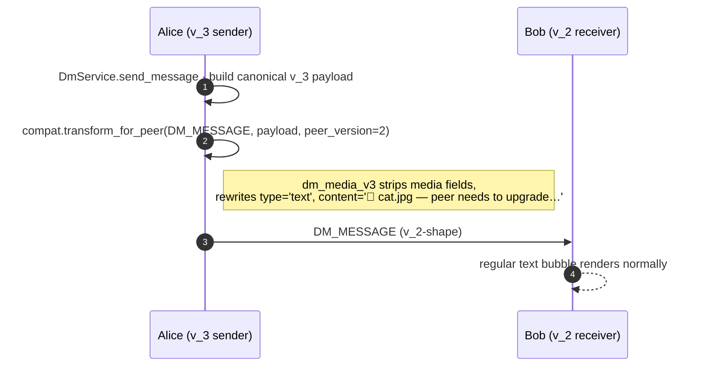

# DM media — pictures, videos, files

## Summary

`MESSAGE_TYPES` carries the canonical scope of a Social Home DM:

```
text · image · video · file · transcript · location
```

The first three of those — **image**, **video**, and **file** — share
one wire shape (a `media_url` plus the new `file_name` / `mime_type`
/ `file_size_bytes` metadata triple) and a two-tier delivery path
that lets cross-household attachments render *immediately* via a
small preview embedded in the encrypted envelope while the full
bytes follow on a separate
[`DM_MEDIA_BLOB`](../../socialhome/domain/federation.py) event.

## Scope

- **Federated-only.** Media attachments are allowed when the
  conversation's remote participants are all reachable through a
  *direct confirmed pairing* with the sender's household. A DM whose
  path requires the multi-hop `DM_RELAY` route (the bazaar-style
  "contact a seller through a mutual friend" flow) **rejects** media
  with `HTTP 422 MEDIA_REQUIRES_DIRECT_PAIRING`. Operator decision:
  relays are explicitly the lower-trust path and shouldn't shuttle
  picture / video / file bytes through third-party households.
- **Bytes ride encrypted.** Both the preview embedded in
  `DM_MESSAGE` and the full bytes ridden by `DM_MEDIA_BLOB` sit
  inside the §25.8.21 encryption envelope. Routing fields stay
  plaintext; everything else (filename, MIME, sizes, preview pixels)
  is encrypted under the conversation key.
- **Same processing as feed media.** Uploads ride through
  `POST /api/media/upload` (the existing endpoint posts use). Size
  caps + transcoding (`ImageProcessor`, `VideoProcessor`) come from
  [`socialhome/domain/media_constraints.py`](../../socialhome/domain/media_constraints.py).
  Image ≤ 20 MiB, longest side 2560 px → WebP @ Q82. Video ≤ 200 MiB,
  1080p, 60 sec max, CRF 25 → WebM. Files (`type='file'`) pass
  through bytes unchanged.

## Event types

| Event | When | Carries |
|---|---|---|
| `DM_MESSAGE` (v_3-shape) | Always — same envelope as a text DM | `type` ∈ {`image`, `video`, `file`}, `media_url` (local-signed for same-household, embedded preview ref for cross-household), `file_name`, `mime_type`, `file_size_bytes`, `media_blob_id` |
| `DM_MEDIA_BLOB` | Cross-household only, fired by sender's outbox after a successful `DM_MESSAGE`. May ship as one or N sequenced events — see chunking below. | `media_blob_id` (matches the `DM_MESSAGE` it follows), `message_id`, `conversation_id`, `file_name`, `mime_type`, `file_size_bytes`, `bytes_b64` (the chunk's bytes, base64), `chunk_index` (0-based), `chunk_count` (total), `final` (last chunk flag). Single-chunk legacy payloads (`chunk_count=1`) and missing-field back-compat both supported on the receiver. |

## Flow

### Same-household DM with an attachment

```mermaid
sequenceDiagram
  autonumber
  participant Alice as Alice (SPA)
  participant Backend as SocialHome backend
  participant Bob as Bob (SPA)

  Alice->>Backend: POST /api/media/upload (multipart)
  Backend->>Backend: ImageProcessor / VideoProcessor
  Backend-->>Alice: { url, signed_url, filename }
  Alice->>Backend: POST /api/conversations/{id}/messages<br/>{ type, media_url, file_name, … }
  Backend->>Backend: DmService.send_message · save row · publish DmMessageCreated
  Backend-->>Bob: WS frame dm.message (with media_url signed for Bob)
  Bob-->>Bob: bubble renders &lt;img&gt; / &lt;video&gt; / file pill inline
```

### Cross-household DM with an attachment — preview-now, sync-later

```mermaid
sequenceDiagram
  autonumber
  participant Alice as Alice (sender's HFS)
  participant Bob as Bob (receiver's HFS)

  Note over Alice: SPA upload via /api/media/upload<br/>then POST to /messages

  Alice->>Alice: Build small preview (320 px WebP @ Q60 for image; first frame extracted via PyAV for video; null for file → receiver renders glyph)
  Alice->>Bob: DM_MESSAGE (v_3, encrypted)<br/>{ media_blob_id, file_name, mime_type, preview_bytes_b64 }
  Bob-->>Bob: Save preview to local cache;<br/>bubble renders immediately with media_sync_status='pending'
  Note over Alice,Bob: ─── background ───
  alt fed-media-v1 channel open
    Alice->>Bob: DM_MEDIA_BLOB chunks as binary frames on the channel
  else v_81 peer, no channel
    Alice->>Bob: POST its inbox URL, one binary body per chunk<br/>(magic + suite byte + signed header + sealed chunk, no base64)
  else older peer, or a POST that failed
    Alice->>Bob: DM_MEDIA_BLOB chunks as JSON (bytes_b64)
  end
  Bob-->>Bob: Each chunk → part file under media_dir;<br/>once all N landed (any order), concat in order + rename to dm-<sha256(from_instance, msg_id)>.<ext>;<br/>update conversation_messages.media_url +<br/>media_sync_status=NULL
  Bob-->>Bob: WS push dm.media_ready → SPA<br/>swaps preview src for full media
```

### Sub-v_3 peer (§319 ¶5 `fallback`)



## Chunking

Every chunk must fit every transport tier that may carry it, and within
that be as large as possible — few messages per file. The size is chosen
**per receiving household** (`domain/media_chunking.py`,
`FederationService.media_chunk_bytes`), for `DM_MEDIA_BLOB` and
`SPACE_MEDIA_BLOB` alike:

- **WebRTC data channel** — a binary frame is limited by the channel's
  negotiated message size: the *smaller* of both households'
  `a=max-message-size`. A household advertises **1 MiB**
  (`ADVERTISED_MAX_MESSAGE_BYTES`); libdatachannel's default, which an
  older one keeps, is 256 KiB. Chunk = negotiated limit − 16 KiB frame
  overhead, at most 512 KiB: **512 KiB** between two upgraded
  households, **240 KiB** with an older one.
- **HTTPS inbox** (no open channel) — **512 KiB**. To a v_81 household
  the chunk is one binary body on the inbox ([below](#binary-media-on-the-https-inbox-v_81)):
  **525 323 B** on the wire for a 512 KiB chunk (1.002×). To an older one
  — and when that POST fails — it is base64'ed into the JSON payload,
  then encrypted and base64'ed again (1.78×, **932 911 B**), under the
  inbox's 1 MiB body cap. Never more than 512 KiB on any tier, so a chunk
  built for the channel still fits the inbox (either shape) if the
  channel drops mid-transfer.
- **Floor** — a channel is used for media only when its chunk is at
  least **64 KiB** (`MIN_CHANNEL_CHUNK_BYTES`, i.e. a negotiated limit
  of ≥ 80 KiB) *and* large enough to send the file in at most 4096
  chunks (`ceil(size / MAX_MEDIA_CHUNKS)`). Otherwise the household gets
  512 KiB HTTPS-sized chunks, and `send_media_chunk` sends a chunk its
  channel can't carry (`fits_channel`) over the JSON path, never as a
  frame. Without the floor a household advertising
  `a=max-message-size:1` got 1-byte chunks: a 200 MiB video became
  ~210 million chunks (the sender ran out of memory) and, past 4096, the
  receiver refused the file.
- **Mesh route** (`SPACE_MEDIA_BLOB` to a space member that is not a
  CONFIRMED direct peer) — the JSON chunk travels inside `SPACE_ROUTED`:
  sealed under the target's ephemeral key and base64'ed once more, then
  encrypted and base64'ed by the outer envelope (~2.4×), under the
  *first hop's* 1 MiB inbox. Such a target gets **384 KiB** chunks
  (`ROUTED_CHUNK_BYTES`, ≈ 934 KB on the wire; 512 KiB would be
  ≈ 1.24 MB and every hop refused it, so mesh-only members never got a
  picture bigger than one chunk). The space outbox asks
  `FederationService.mesh_media_chunk_bytes`, which checks the target's
  pairing status like `send_with_mesh_fallback` does. 4096 × 384 KiB =
  1.5 GiB, above every space and DM media max. `DM_MEDIA_BLOB` is never
  mesh-routed (it goes through `send_event`), so DM chunks keep the
  direct size.

A file that fits one chunk ships as one event with `chunk_count=1` and
`final=true` — a typical photo is one message between upgraded
households. A larger file splits into `ceil(size / chunk)` chunks, each
with its `chunk_index`, the shared `chunk_count`, and `final` on the
last; a 100 MB video is ~200. Receivers accept up to 4096 chunks
(`MAX_MEDIA_CHUNKS`); with the floor no sender splits past that (a
200 MiB video is at most 3200 chunks, at the 64 KiB floor). Chunks are
built lazily and sent by at most 4 workers (`PIPELINE_WINDOW`,
`services/media_chunk_pipeline.py`), so a sender holds only the chunks
in flight; the first failed chunk stops the rest, and the outbox resends
the whole file later.

### Binary media on the HTTPS inbox (v_81)

`FederationService.send_media_chunk` tries three legs per chunk, each
falling through to the next: the `fed-media-v1` channel (v_14, open and
big enough), then **one binary body POSTed to the peer's own inbox URL**
(v_81: a CONFIRMED direct peer with an inbox URL — not a household
seated from an invite link — and a chunk of at most 512 KiB), then the
JSON chunk. Mesh-routed (`SPACE_ROUTED`) and GFS-relay targets stay
JSON: the sealed inner event rides inside a JSON routing envelope, so
there is no frame to send.

```
[ "\0SHM" ][ u8 suite = 0x01 ][ fed-media-v1 frame:
    u8 frame_type = 1 | u32 header_len | header | u32 payload_len | payload ]
```

- **header** — the signed federation envelope JSON, byte for byte what
  was signed: the field set and canonical order of `send_event`. Only
  routing fields are cleartext (`msg_id`, `event_type`, `from_instance`,
  `to_instance`, `timestamp`, `space_id`, `proto_version`, `sig_suite`,
  `signatures`); `encrypted_payload` holds everything else — the
  correlation ids, filename, mime, sizes, chunk sequencing — plus
  `chunk_sha256` (b64url SHA-256 of the plaintext chunk),
  `media_aead_suite` (`aesgcm-256`) and `media_frame_suite`
  (`fed-media-v1`).
- **payload** — the chunk sealed with AES-256-GCM under the directional
  session key, raw `nonce ‖ ciphertext ‖ tag`. No base64 anywhere.
- **The signature covers the body** through `chunk_sha256`: it sits in
  the signed, encrypted metadata, and the receiver checks it against the
  decrypted chunk (constant time). Swap the chunk → hash mismatch; touch
  the hash → signature and GCM fail. The suite byte is not signed; the
  signed `media_frame_suite` must equal it.
- **Same URL as JSON.** `"\0"` never starts a JSON text, so the inbox
  tells the two shapes apart from the body alone — never from
  `Content-Type` or a header. In ha / haos a household advertises Home
  Assistant's `/api/socialhome/inbox/{inbox_id}`, whose relay (the
  companion integration through socialhome-client
  `forward_inbox_envelope`) forwards the raw body to the app's
  `POST /federation/inbox/{inbox_id}` as `application/octet-stream` and
  drops custom headers; the binary body passes through unchanged, so
  neither needs a change, and the peer's `proto_version` is all the
  sender has to know.
- **Same §24.11 chain.** The header runs the JSON inbox pipeline
  (`_build_media_https_pipeline` = the shared steps + an event-type gate
  that admits only `SPACE_MEDIA_BLOB` / `DM_MEDIA_BLOB`): parse →
  event type → instance lookup by inbox id → peer class → relay opt-in →
  timestamp → signature → unpair tombstone → replay → decrypt →
  idempotency → ban → persist replay → post-decrypt gates. The chunk
  then takes the channel's tail (`_finish_media_frame`: frame suite,
  AEAD suite, decrypt, `chunk_sha256`) and dispatches to the same
  handlers with `media_bytes` set. One replay cache across all three
  legs.
- **Refusals** — the inbox's generic bodies: a body without the magic
  is read as JSON; an unknown suite byte, trailing bytes, another frame
  type, a non-media event, a bad tag or hash → 400; bad signature → 403;
  unknown inbox → 404; replay / stale timestamp → 410; a body over
  `HTTPS_MEDIA_MAX_BODY_BYTES` (512 KiB + 16 KiB) → 413, from
  `Content-Length` once the 4 magic bytes are read, else while streaming;
  its own per-IP bucket (600 / min) → 429. A sender that gets anything
  but 2xx sends the JSON chunk instead, which the outbox redelivers.
- **Per-peer backoff** (`federation/media_https_backoff.py`, in memory,
  ≤ 1024 peers) — so an inbox that keeps refusing binary bodies (a proxy
  that blocks them, a bug, the shared bucket behind Home Assistant's relay)
  doesn't cost a wasted POST before every JSON chunk: a 429 skips the leg
  for its `Retry-After` (else 30 s, at most 5 min); any other 4xx (413,
  415, …) for 10 min at once; 5xx / no answer for 10 min after 3 in a
  row. Then one chunk probes again; a failed probe means another 10 min.
  A 2xx clears it. A peer already marked unreachable skips the leg too.
- **Cost** — per chunk, per receiving household: 932 911 B → 525 323 B
  for 512 KiB (−44 %). A 200 MiB video is 400 chunks: 373.2 MB →
  210.1 MB per receiving household; the recipient set and chunk count
  are unchanged (still one send per member household). **Worst case** —
  an inbox that refuses every binary body: at most 3 wasted bodies
  (≤ 1.58 MB) and then one probe per 10 minutes on top of the JSON
  chunks, ≈ 374.7 MB for the 200 MiB video (+0.4 % over JSON alone),
  instead of ~1.55× (583.3 MB) without the backoff.

**Size cap.** The receiver refuses a file bigger than the sender's own
upload limits allow (`inbound_media_store.dm_media_max_bytes`, from
`domain/media_constraints.py`): a declared `image/*` or `audio/*`
attachment at most 25 MiB (the largest of the picture, voice-note and
plain-file caps — a picker can label a plain file `image/*`), anything
else (video, `application/octet-stream` from a picker that names no
type) at most `VIDEO_MAX_UPLOAD_BYTES` (200 MiB). Every chunk checks the
declared `file_size_bytes`, so the first one to land already refuses an
oversized file, and a chunk must fit its share of that size (senders
split into equal chunks with a shorter last one, so `(chunk_count − 1) ×
len(chunk) < file_size_bytes`) — the parts on disk stay under twice the
declared size, and the assembly must come to it exactly. A refused chunk
is dropped with a WARNING; nothing is written. Before 2026-11-06 only
the chunk count was bounded (4096 × 512 KiB ≈ 2 GiB).

Before 2026-11-06 the sizes were fixed (a 1 MiB single chunk, 512 KiB
pieces): no binary frame fit a 256 KiB channel, and a 0.7–1 MiB file sent
whole was refused by the inbox too (413), so it never arrived.

**Receiver side**: each chunk is written (to a temp name, then renamed
into place) as part `<idx>` under
`media_dir/.partial/<sha256(from_instance, "dm:" + msg_id, chunk_count)>/`
— bound to the sending household and the chunk count, because a retry
is re-chunked for the tier it goes out on (240 KiB over an older
channel, 512 KiB over HTTPS) and two attempts' parts must never mix.
The sender sends up to four chunks at once (`PIPELINE_WINDOW`), so they
land in any order — the `final` chunk can arrive before chunk 0.
Whichever chunk completes the set 0…N−1 (one directory listing per
chunk) assembles: it concatenates the parts in index order into a temp
file of its own, checks the result is exactly `file_size_bytes` (a
multiple-chunk blob without a positive `file_size_bytes` is dropped; a
mismatch discards the parts and publishes nothing), moves it to
its sender-bound name (see below) write-once, deletes the part directory,
then swaps `media_url` and broadcasts `dm.media_ready` as in the
single-chunk case — once: when two chunks complete the set at the same
moment, only the one whose file lands adopts it. A chunk that lands
after the file exists — any chunk, final or not — drops the transfer's
leftover parts and re-adopts the file only while the row still awaits
it (`media_sync_status='pending'` or another `media_url`) — one
conditional `UPDATE`, and only the delivery whose update changed the row
pushes, so neither a duplicate nor two racing deliveries push
`dm.media_ready` twice. A single-chunk file takes the same path (its
temp files in its own `.partial/<key>/` folder). Before 2026-11-06 the
receiver assembled only when `final=true` arrived, so a final chunk that
overtook an earlier one left the file unassembled for good.

**Scope + write-once.** The receiver only lands bytes a household was
entitled to send:

- `message_id` must be a single safe file-name component and
  `chunk_index` / `chunk_count` must be in range, else the chunk is
  dropped. The same rule applies to the `DM_MESSAGE` itself: its
  `message_id` names the `<msg_id>.preview.webp` file, so a
  `DM_MESSAGE` whose id is absolute, contains a separator or
  starts with `.` is dropped with a WARNING before anything is stored.
  Every media path built from a peer id is also checked to sit directly
  in the media root (`inbound_media_store.media_file_path`).
- If the `conversation_messages` row is already here, the blob must
  carry the `media_blob_id` that message announced and come from the
  household the message was sent from (the sender's
  `remote_users.instance_id` equals `from_instance`). A blob for a local
  member's message, or from another household in the same group DM, is
  refused with a WARNING.
- If the row isn't here yet (the blob overtook its `DM_MESSAGE`), the
  bytes are accepted — under the sending household's **own name**: the
  received attachment is stored as
  `dm-<first 40 hex of sha256("dm-media", from_instance, msg_id)>.<ext>`
  (`inbound_media_store.dm_media_name`). Only that household's chunks
  can assemble that name, and the `DM_MESSAGE` adopts only the name of
  the household it came from, so bytes another household sent for the
  same id land under another name and are never shown (the media sweep
  removes them).
- **One media directory, two namespaces.** Space files and DM
  attachments share `media_dir`, and a `SPACE_MEDIA_BLOB` for a row not
  seen yet is accepted by name. A space blob never writes a reserved
  name (`inbound_media_store.is_reserved_media_name`: the `dm-` and
  `gm-` prefixes and the DM transients `*.preview.webp` / `*.part<N>` /
  `*.assembled`), so no household can plant a DM's file through a space
  — before the DM arrives or while it waits for its bytes. Before
  2026-11-06 the DM file was `<msg_id>.<ext>`: anyone who knew a message
  id (a group-DM member) could plant it as a space file, and the DM then
  adopted the planted file.
- The final file is **write-once**: it is moved into place with a hard
  link that fails on an existing name
  (`services/inbound_media_store.py:publish_once`), so an existing file
  is never replaced. A re-delivery of an attachment that already landed
  just re-adopts the file on disk — safe because that name only ever
  holds the sender's own assembly. A soft-deleted message never adopts
  media (`adopt_media_file` updates only `deleted=0` rows).
- **Adoption is bound to the sender in one statement.** The blob's scope
  check can run before the row exists (an overtaking blob is accepted),
  so the row could land while another household's chunk is assembling.
  `adopt_media_file` therefore re-checks atomically, in its `UPDATE`:
  the row must have announced this `media_blob_id` and its sender must
  be a user of the delivering household (`remote_users.instance_id =
  from_instance`). Bytes from anyone else stay on disk under their own
  `dm-` name, never shown, and the media sweep removes them.
- **The row decides its type.** Once the message is here, its own
  `mime_type` — not the blob's — picks the size cap and the file
  extension, so a picture message can't take a 200 MiB `.mp4`.

**Backwards compatibility**: payloads without the `chunk_*` /
`final` fields (older builds, or any caller that doesn't emit
them) read as a single-chunk transfer — the fast path takes over.

Single envelope is the only path active for files smaller than 1
MiB; chunks above that. Chunked encryption is the same as the
non-chunked case — every envelope rides through the federation
transport's encryption layer.

## Resilience

A handful of paths beyond the happy flow above:

- **In-flight reaper on startup.** `DmMediaSyncService.start()` calls
  `reclaim_in_flight()` first thing — any row stuck in
  `status='in_flight'` from a sender crash gets flipped back to
  `pending` with a 10 s delay. Otherwise `list_due` would silently
  skip the row forever.
- **DM_MEDIA_BLOB-before-DM_MESSAGE reordering.** Federation
  envelopes can race. If the full file lands before the
  `conversation_messages` row exists, the blob handler still writes
  the bytes to the sender-bound `dm-…<ext>` name; when the matching
  `DM_MESSAGE` arrives later from the same household,
  `_receive_media_preview` adopts the pre-arrived file directly
  (clearing `media_sync_status`) instead of overwriting it with a
  preview.
- **MIME magic-byte sniff.** `_on_dm_media_blob` checks the leading
  bytes of the assembled file against the declared `mime_type`.
  Only `image/webp` and `video/webm` have signatures we'd ever
  produce upstream; anything else in `image/*` or `video/*` is
  treated as suspicious and the row flips to
  `media_sync_status='failed'` (the file still stores so the user
  can inspect manually). Direct-trust between paired households is
  the primary safety net; this is hardening for the
  "sender's instance got compromised" scenario.
- **Failed-delivery footnote.** When the outbox retry budget for any
  paired peer is exhausted, the matching row flips to
  `media_sync_status='failed'` and the sender's bubble renders an
  inline warning ("Couldn't deliver this media to one or more
  paired households — the file is still on your device."). The
  recipient sees nothing — there's nothing to act on for them.
- **Media-orphan janitor.** `DmGcScheduler._sweep_media_orphans`
  runs on the hourly conversation-GC tick: enumerates
  `<msg_id>.preview.webp` files (and `<msg_id>.part<idx>` parts
  from builds before 2026-11-06), groups by message id, drops anything
  without a backing live `conversation_messages` row.
- **Abandoned chunk sets.** Parts now live in `.partial/<key>/`, which
  the media orphan sweep (`MediaOrphanSweepService.sweep_partial_once`,
  each tick of the media sweep) covers for DMs and spaces alike: a
  folder nothing in it changed for 3 days is removed (at most 200 per
  pass) — a retracted DM, a sender that gave up after its 6 attempts,
  an earlier attempt chunked for another tier, a crash's temp files.
  3 days is far past the senders' retry horizon (6 attempts, backoff
  capped at 30 min) and every chunk that lands refreshes the folder, so
  a transfer in progress is never hit. The sweep never follows a
  symlink: a symlinked `.partial` is left alone, an entry is aged by its
  own `lstat` and a link is unlinked without touching its target, and a
  folder's contents are never descended into (`drop_parts`; a folder
  holding a planted sub-directory stays and is logged, not counted as
  removed). Before
  2026-11-06 a symlink in `.partial` pointing outside made the sweep
  delete what was behind it.

## Server-side validation

- `DmService.send_message` rejects media on a relay-only conversation
  via `MediaRequiresDirectPairingError` → HTTP 422 with code
  `MEDIA_REQUIRES_DIRECT_PAIRING`. The SPA surfaces a clear copy
  ("only paired households can receive media") and keeps the
  staged attachment around so the user can drop it and resend as
  text.
- Size + MIME caps are enforced inside `MediaUploadView` before
  `media_url` ever reaches the DM POST. Three branches:
  `image/*` → `ImageProcessor`, `video/*` → `VideoProcessor`,
  everything else → passthrough (25 MiB cap,
  `FILE_DENIED_EXTENSIONS` deny-list of execute-on-default-handler
  extensions, UUID filename + sanitised extension). The DM route
  trusts the uploaded blob's signed URL.
- The receiver's `_on_dm_message` upserts on
  `conversation_messages.id` so a v_3 message arriving twice (the
  envelope + a redelivery) produces a single row.
- A peer-supplied `media_url` (on `DM_MESSAGE` without a
  `media_blob_id`, and on every `DM_HISTORY_CHUNK` row) is kept only in
  the local upload shape `api/media/<name>` (`local_media_ref` in
  `services/inbound_media_store.py`; a leading `/` and `?query` are
  dropped). Anything else — a remote URL, `javascript:` / `data:`, a
  path escape — is stored as `null` with a WARNING log. The SPA puts
  `media_url` in the file pill's `href`, so a raw value would be a
  click-to-run script.

## SPA render

[`DmThreadPage.tsx`](../../client/src/features/dms/DmThreadPage.tsx)
renders three message-bubble shapes based on `mime_type` (or the
explicit `type` when `mime_type` is `null`):

- `image/*` → ``
- `video/*` → `<video class="sh-message-media sh-message-media--video" controls preload="metadata">`
- everything else → file pill (`a.sh-message-file`) with a `📎`
  glyph + filename + size, the anchor's `href` is the signed media
  URL with `download={file_name}` so the user gets a real save
  prompt. The `href` passes `safeHref` (`client/src/utils/safeHref.ts`)
  — anything but http(s), an app path, `api/…` or `mailto:` renders
  no link.

When `media_sync_status === 'pending'`, the media gets a `--pending`
modifier class that adds a subtle brightness pulse — the visual cue
for the cross-household "preview now, full bytes coming" state.
Once the matching `DM_MEDIA_BLOB` lands, the backend's
`dm.media_ready` WS frame swaps `media_url` to the local full-bytes
URL and the modifier is removed.

## Implementation pointers

- `socialhome/domain/conversation.py` — `MESSAGE_TYPES`, the
  `ConversationMessage` dataclass with the new media columns.
- `socialhome/migrations/0003_dm_media.sql` — schema delta + the
  `dm_media_outbox` table for the cross-household scheduler.
- `socialhome/services/dm_service.py` — `send_message` accepts the
  new fields; `_reject_media_on_relay_only_conversation` enforces
  the federated-only gate; `_fan_to_remote` runs every outbound
  through `compat.transform_for_peer`.
- `socialhome/federation/compat/` — version-aware payload
  transforms. New compat tree introduced in this feature; see the
  package docstring + `dm_media_v3.py` for the canonical shape.
- `socialhome/domain/federation.py` — `DM_MEDIA_BLOB` enum entry.
- `socialhome/federation/media_envelope.py` — the signed header + sealed
  chunk both binary legs send; `media_framing.encode_body` /
  `decode_body` / `is_media_body` — the HTTPS body (magic + suite byte).
- `socialhome/federation/federation_service.py` — `send_media_chunk`
  (the three legs), `handle_inbound_media_https`, `_finish_media_frame`.
- `socialhome/routes/federation.py` — `FederationInboxView` sniffs the
  body and hands a binary one to `handle_inbound_media_https`.
- `socialhome/services/dm_media_sync_service.py` — preview
  builder, ``dm_media_outbox`` enqueue, and scheduler loop
  (asyncio.Event lifecycle per CLAUDE.md template).
- `socialhome/repositories/dm_media_outbox_repo.py` — outbox CRUD
  with exp-backoff reschedule + retry-budget exhaustion.
- `socialhome/services/federation_inbound_service.py` —
  `_receive_media_preview` decodes the inline preview at
  `DM_MESSAGE` time; `_on_dm_media_blob` writes the full bytes,
  updates `media_url`, and fans `dm.media_ready` via the realtime
  service.
- `client/src/features/dms/DmThreadPage.tsx` — paperclip attach
  button, pre-send preview tile, bubble renderers.
- `client/src/components/UploadProgress.tsx` — shared
  `uploadWithProgress` used by both feed posts and DM attachments.

## Spec refs

- §5.2 — DM scope and `MESSAGE_TYPES` definition.
- §25.8.21 — encryption-first rule: every field that isn't a routing
  primitive sits inside the encrypted payload, including the
  preview bytes and `DM_MEDIA_BLOB`'s full bytes.
- [Issue #319](https://github.com/social-home-io/socialhome/issues/319),
  paragraph 5 — per-feature degraded-shape policy. DM media: `fallback`.
