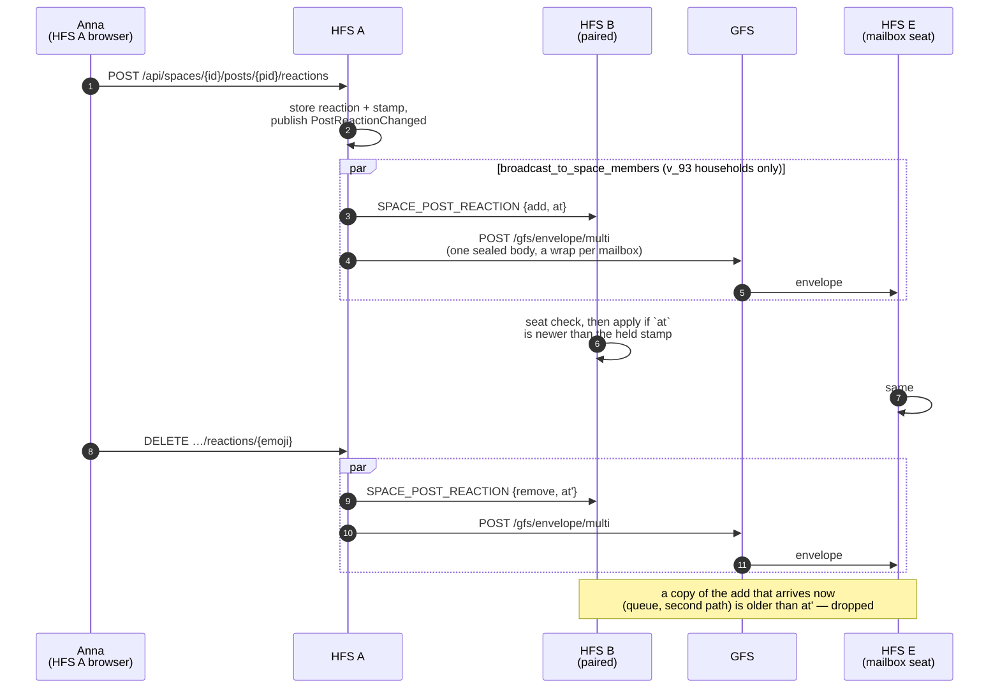
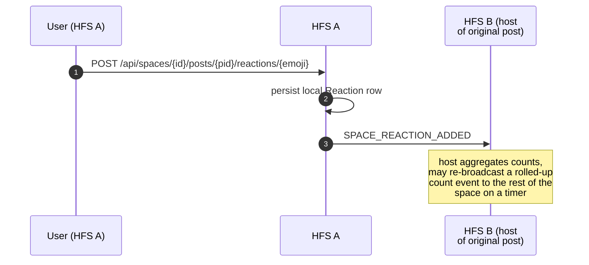

# Feeds — Posts, Comments, Reactions

Once a space is live and synced, every new post, comment, and reaction
is broadcast to every member instance. These are the highest-volume
federation events.

## Scope

- **HFS**: origin broadcasts; every peer member instance applies.
- **GFS**: only involved when a peer is offline and opted into push
  fan-out — see [push-relay](./push-relay.md). Never for spaces marked
  private.

## Event types

**Household feed (same HFS only; not federated but included here for
symmetry with UI)** — not a federation event type.

**Space feed**

`SPACE_POST_CREATED`, `SPACE_POST_UPDATED`, `SPACE_POST_DELETED`,
`SPACE_COMMENT_CREATED`, `SPACE_COMMENT_UPDATED`,
`SPACE_COMMENT_DELETED`, `SPACE_POST_REACTION` (v_93 — see
[Reactions on space posts](#reactions-on-space-posts-v_93)).

**Space-wide poll + schedule-poll (carried inside posts)**

`SPACE_POLL_CREATED`, `SPACE_POLL_VOTE_CAST`, `SPACE_POLL_CLOSED`.

## Reactions on space posts (v_93)

A reaction on a space post is shared by every member household of the
space, whichever way that household is reached (paired, mesh, or a GFS
mailbox seat). Before v_93 it stayed in the household that made it.

`SPACE_POST_REACTION` is a delta, sent by the reactor's household on the
add and on the remove. Everything but the routing fields is inside the
encrypted payload:

| Field | Meaning |
|---|---|
| `space_id` | the space (also the envelope's routing field) |
| `post_id` | the post |
| `user_id` | the reactor — a person of the sending household |
| `emoji` | NFC, trimmed, 1–32 characters |
| `action` | `"add"` or `"remove"` |
| `at` | the reactor's action time, tz-aware ISO 8601 |



**Receiver rules** (`FederationInboundService._on_space_post_reaction`),
after the §24.11 pipeline:

- **Who.** `user_id` must hold a live seat **on the sending household**:
  a writer seat (`member` / `moderator` / `admin`), or a `subscriber` seat
  while the space has `allow_subscriber_react` on — the same toggle a local
  follower is held to (`SpaceAuthorship.item_seat_admits`). Never a local
  user of the receiver, never a banned user, and the host relays nobody's
  reaction. A follower-only household passes the §24.11 writer gate only
  under the same opt-in, with the reactor bound to its live follower seat
  ([spaces.md](./spaces.md#two-kinds-of-follower-v_30)). A user whose seat
  has not reached the receiver yet is held and replayed with the seat.
- **Order-independent, idempotent.** The receiver applies the event only
  when `at` is newer than the stamp it holds for that `(post, user,
  emoji)` — `space_posts.reaction_stamps_json`, written in the same
  transaction as the reaction (migration `0075`, the v_49 member-relay
  stamps; no new storage). The newest stamp wins in any arrival order, a
  re-delivery is a no-op, and a late add never brings back a removed
  reaction (a removal's stamp is kept 48 h). `at` more than 300 s ahead of
  the receiver's clock is refused.
- **Where.** The post must live in the event's space; a reaction that
  overtakes its post is held and applied when the post lands; an add on a
  deleted post is dropped. An archived space takes none (it is a write, not
  a removal) — and the local API refuses both the add and the remove
  there, so the copies stay equal.
- **One apply across paths.** In a space that is also read through a GFS,
  the reactor's household still publishes the v_49 `space_item`
  (`reaction_add` / `reaction_remove`,
  [discovery.md](./discovery.md#comments-reactions-and-own-edits--deletes-v_49))
  with the **same** stamp, so a member household that gets both applies the
  first and drops the second as not newer.
- **Missed while offline.** The outbox queues the event for an unreachable
  household as for any other; one lost for good heals from the host's
  §25.6 stream, which carries each post's reaction sets and stamps
  ([sync.md](./sync.md), v_92 `reaction_stamps`). A receiver follows the
  host's *sets* (for reactions no stamp orders any more) only when the
  host is at v_93 — an older host never hears other households' reactions.

**Followers** get what they got before: reactions through the GFS member
relay in a public / global space, nothing new. **Older households** (below
v_93) are skipped by the fan-out and keep showing their own people's
reactions.

**Not covered:** comments have no reactions (there is no such row), and
space **chat** reactions already federate (`SPACE_CHAT_REACTION`,
[space-chat.md](./space-chat.md)). An open space view does not update
live for a reaction (as for a local one); it shows on the next load.

**Cost** — one reaction (or removal) in a space of 200 member households;
the payload is 214 B of JSON (measured, a `remove` with a one-glyph emoji):

| Path | Per trigger |
|---|---|
| Paired / mesh member households | 1 envelope each, ~1 KB sealed (estimate: 214 B payload + envelope fields and signature, base64) → 200 × ~1 KB ≈ 200 KB uplink |
| Mailbox seats behind one GFS (v_91 multi) | ONE upload: one body in the smallest size bucket (≤ 5.5 KB, the figure measured for a ~1 KiB event) + 229 B per mailbox → ≤ 51.4 KB for 200; the GFS pushes body + wrap to each |
| Receiver work | one seat read, one row update; no reply, no re-broadcast |
| Followers | 0 new |

One actor triggers 1 × N sends, never N × M: a receiver answers nothing
and forwards nothing. Nothing is sent on a timer, and only the delta
travels — never the post's whole reaction set.

## Flow — new post fan-out

```mermaid
sequenceDiagram
    autonumber
    participant U as User<br/>(HFS A browser)
    participant A as HFS A
    participant B as HFS B
    participant C as HFS C
    U->>A: POST /api/spaces/{id}/posts
    opt text post with a web link (no_link_preview unset)
        A->>A: build link_preview<br/>(cached; guarded fetch<br/>of the linked page)
    end
    A->>A: persist locally,<br/>publish SpacePostCreated
    par broadcast to every member HFS
        A->>B: SPACE_POST_CREATED<br/>(link_preview inside the<br/>encrypted payload)
        A->>C: SPACE_POST_CREATED
    end
    B->>B: persist + publish<br/>RemoteSpacePostCreated
    C->>C: persist + publish<br/>RemoteSpacePostCreated
    Note over B,C: each HFS pushes the post<br/>to its connected clients<br/>via WebSocket.<br/>Neither fetches the linked URL.
```

A `text` post's optional `link_preview` card is built only by the
author's household and never re-fetched by a receiver — see
[spaces.md § Link previews](./spaces.md#link-previews-author-built-receiver-never-fetches).

A post's pictures reach paired and mesh members as `SPACE_MEDIA_BLOB`
chunks. A member seated from an invite link (v_80) and a follower of a
global space instead get a `media_refs` descriptor inside the encrypted
post (the follower: in the relayed inner) and fetch the files from their
GFS media cache — see [`media.md`](./media.md#space-media-via-the-gfs-cache-v_80).

## Flow — reaction



## Edit & delete

`_UPDATED` carries the new content and a fresh `updated_at`. `_DELETED`
carries the `post_id` or `comment_id` only — content is already gone
on the sender side. The receiver idempotently updates or removes by
ID; if the receiver has never seen the ID (e.g. missed the create
event during a network partition), the `_UPDATED` / `_DELETED` is
dropped silently.

A delete keeps the row (`deleted = 1`, content cleared) as the post's or
comment's **tombstone**. A household that missed the `_DELETED` (offline
past the outbox, a mesh drop) learns of it from the §25.6
`posts_deleted` / `comments_deleted` sync resources — `{id, author}`
(plus `post_id` for a comment), never content — judged by the same rule
as the live delete: the author's household or content authority (host,
admin, moderator), then the space's `posts` level. From the host, an id
never held gets the soft-deleted row, so a stale copy streamed later
cannot create it. See [`sync.md`](./sync.md#post-and-comment-tombstones).

## Polls

A poll lives inside a post. `SPACE_POLL_CREATED` announces the poll
options when a post of type `poll` is federated;
`SPACE_POLL_VOTE_CAST` carries one vote; `SPACE_POLL_CLOSED` ends the
voting window.

Only the author's household closes a poll — by hand, or when its
`closes_at` passes: `PollDeadlineScheduler`
(`infrastructure/poll_deadline_scheduler.py`, every 60 s) closes that
household's due polls with an atomic `closed=0 → 1` update, so each poll
sends exactly one `SPACE_POLL_CLOSED` to its member households and a
restart re-finds only polls still open. Member households never close a
copy themselves (a peer's close is accepted only from the author's
household), but read a poll past its deadline as closed and refuse votes
on it. Nothing new on the wire: a member household tells a deadline close
from a hand close by the poll's own `closes_at`. A redelivered close or
finalise tells nobody twice.

`SPACE_SCHEDULE_FINALIZED` (a date poll's time picked) tells this
household's people who answered (`poll_scheduled`) through a local-only
`RemoteSchedulePollFinalized` event — not `SchedulePollFinalized`, whose
calendar bridge would add a second entry next to the one the organiser's
household already created and federated.

**Catch-up (v_92).** The host's §25.6 stream converges a member household
on the host's polls: the `polls` record creates a poll and its options it
lacks, carries the votes (`votes`, ≤ 1000, `votes_partial` when cut) and
the closure; the `schedules` record carries the answers (`responses`,
≤ 1000, last writer wins on `responded_at`) and the pick
(`finalized_slot_id`). Taken from the host only, never over this
household's own people's votes and answers; a cut list deletes nothing. See [sync.md](./sync.md#coverage--every-space-item-type).

Votes are encrypted: the envelope payload includes only the vote's
`option_id` and the voter's `user_id`, which stay inside the space's
encrypted payload. GFS cannot tally votes even on public spaces.

## Implementation

- `socialhome/services/post_service.py` — space and household post CRUD.
- `socialhome/services/comment_service.py` — comment CRUD.
- `socialhome/services/reaction_service.py` — reaction toggling.
- `socialhome/services/poll_service.py`,
  `schedule_poll_service.py` — polls;
  `socialhome/infrastructure/poll_deadline_scheduler.py` — closing at
  `closes_at`.
- `socialhome/services/federation_inbound/space_content.py` —
  inbound handlers for all of the above.
- `socialhome/routes/post_routes.py`, `comment_routes.py`,
  `reaction_routes.py` — REST endpoints.

## Spec references

§13.4 (space feed semantics),
§25.8.21 (poll-vote encryption),
§27.5 (integration tests for fan-out).
