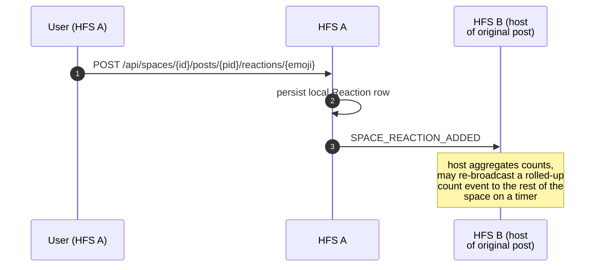

# Feeds — Posts, Comments, Reactions

Once a space is live and synced, every new post, comment, and reaction
is broadcast to every member instance. These are the highest-volume
federation events.

## Scope

- **HFS**: origin broadcasts; every peer member instance applies.
- **GFS**: only involved when a peer is offline and opted into push
  fan-out — see [push-relay](./push-relay.md). Never for spaces marked
  private.

## Event types

**Household feed (same HFS only; not federated but included here for
symmetry with UI)** — not a federation event type.

**Space feed**

`SPACE_POST_CREATED`, `SPACE_POST_UPDATED`, `SPACE_POST_DELETED`,
`SPACE_COMMENT_CREATED`, `SPACE_COMMENT_UPDATED`,
`SPACE_COMMENT_DELETED`, `SPACE_REACTION_ADDED`,
`SPACE_REACTION_REMOVED`.

**Space-wide poll + schedule-poll (carried inside posts)**

`SPACE_POLL_CREATED`, `SPACE_POLL_VOTE_CAST`, `SPACE_POLL_CLOSED`.

## Flow — new post fan-out

```mermaid
sequenceDiagram
    autonumber
    participant U as User<br/>(HFS A browser)
    participant A as HFS A
    participant B as HFS B
    participant C as HFS C
    U->>A: POST /api/spaces/{id}/posts
    opt text post with a web link (no_link_preview unset)
        A->>A: build link_preview<br/>(cached; guarded fetch<br/>of the linked page)
    end
    A->>A: persist locally,<br/>publish SpacePostCreated
    par broadcast to every member HFS
        A->>B: SPACE_POST_CREATED<br/>(link_preview inside the<br/>encrypted payload)
        A->>C: SPACE_POST_CREATED
    end
    B->>B: persist + publish<br/>RemoteSpacePostCreated
    C->>C: persist + publish<br/>RemoteSpacePostCreated
    Note over B,C: each HFS pushes the post<br/>to its connected clients<br/>via WebSocket.<br/>Neither fetches the linked URL.
```

A `text` post's optional `link_preview` card is built only by the
author's household and never re-fetched by a receiver — see
[spaces.md § Link previews](./spaces.md#link-previews-author-built-receiver-never-fetches).

## Flow — reaction



## Edit & delete

`_UPDATED` carries the new content and a fresh `updated_at`. `_DELETED`
carries the `post_id` or `comment_id` only — content is already gone
on the sender side. The receiver idempotently updates or removes by
ID; if the receiver has never seen the ID (e.g. missed the create
event during a network partition), the `_UPDATED` / `_DELETED` is
dropped silently.

A delete keeps the row (`deleted = 1`, content cleared) as the post's or
comment's **tombstone**. A household that missed the `_DELETED` (offline
past the outbox, a mesh drop) learns of it from the §25.6
`posts_deleted` / `comments_deleted` sync resources — `{id, author}`
(plus `post_id` for a comment), never content — judged by the same rule
as the live delete: the author's household or content authority (host,
admin, moderator), then the space's `posts` level. From the host, an id
never held gets the soft-deleted row, so a stale copy streamed later
cannot create it. See [`sync.md`](./sync.md#post-and-comment-tombstones).

## Polls

A poll lives inside a post. `SPACE_POLL_CREATED` announces the poll
options when a post of type `poll` is federated;
`SPACE_POLL_VOTE_CAST` carries one vote; `SPACE_POLL_CLOSED` ends the
voting window.

Only the author's household closes a poll — by hand, or when its
`closes_at` passes: `PollDeadlineScheduler`
(`infrastructure/poll_deadline_scheduler.py`, every 60 s) closes that
household's due polls with an atomic `closed=0 → 1` update, so each poll
sends exactly one `SPACE_POLL_CLOSED` to its member households and a
restart re-finds only polls still open. Member households never close a
copy themselves (a peer's close is accepted only from the author's
household), but read a poll past its deadline as closed and refuse votes
on it. Nothing new on the wire: a member household tells a deadline close
from a hand close by the poll's own `closes_at`. A redelivered close or
finalise tells nobody twice.

`SPACE_SCHEDULE_FINALIZED` (a date poll's time picked) tells this
household's people who answered (`poll_scheduled`) through a local-only
`RemoteSchedulePollFinalized` event — not `SchedulePollFinalized`, whose
calendar bridge would add a second entry next to the one the organiser's
household already created and federated.

Votes are encrypted: the envelope payload includes only the vote's
`option_id` and the voter's `user_id`, which stay inside the space's
encrypted payload. GFS cannot tally votes even on public spaces.

## Implementation

- `socialhome/services/post_service.py` — space and household post CRUD.
- `socialhome/services/comment_service.py` — comment CRUD.
- `socialhome/services/reaction_service.py` — reaction toggling.
- `socialhome/services/poll_service.py`,
  `schedule_poll_service.py` — polls;
  `socialhome/infrastructure/poll_deadline_scheduler.py` — closing at
  `closes_at`.
- `socialhome/services/federation_inbound/space_content.py` —
  inbound handlers for all of the above.
- `socialhome/routes/post_routes.py`, `comment_routes.py`,
  `reaction_routes.py` — REST endpoints.

## Spec references

§13.4 (space feed semantics),
§25.8.21 (poll-vote encryption),
§27.5 (integration tests for fan-out).
