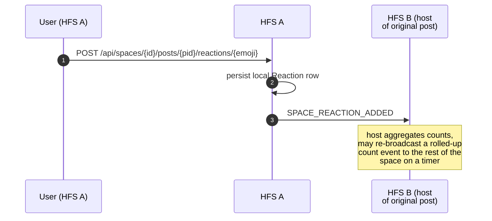

# Feeds — Posts, Comments, Reactions

Once a space is live and synced, every new post, comment, and reaction
is broadcast to every member instance. These are the highest-volume
federation events.

## Scope

- **HFS**: origin broadcasts; every peer member instance applies.
- **GFS**: only involved when a peer is offline and opted into push
  fan-out — see [push-relay](./push-relay.md). Never for spaces marked
  private.

## Event types

**Household feed (same HFS only; not federated but included here for
symmetry with UI)** — not a federation event type.

**Space feed**

`SPACE_POST_CREATED`, `SPACE_POST_UPDATED`, `SPACE_POST_DELETED`,
`SPACE_COMMENT_CREATED`, `SPACE_COMMENT_UPDATED`,
`SPACE_COMMENT_DELETED`, `SPACE_REACTION_ADDED`,
`SPACE_REACTION_REMOVED`.

**Space-wide poll + schedule-poll (carried inside posts)**

`SPACE_POLL_CREATED`, `SPACE_POLL_VOTE_CAST`, `SPACE_POLL_CLOSED`.

## Flow — new post fan-out

```mermaid
sequenceDiagram
    autonumber
    participant U as User<br/>(HFS A browser)
    participant A as HFS A
    participant B as HFS B
    participant C as HFS C
    U->>A: POST /api/spaces/{id}/posts
    opt text post with a web link (no_link_preview unset)
        A->>A: build link_preview<br/>(cached; guarded fetch<br/>of the linked page)
    end
    A->>A: persist locally,<br/>publish SpacePostCreated
    par broadcast to every member HFS
        A->>B: SPACE_POST_CREATED<br/>(link_preview inside the<br/>encrypted payload)
        A->>C: SPACE_POST_CREATED
    end
    B->>B: persist + publish<br/>RemoteSpacePostCreated
    C->>C: persist + publish<br/>RemoteSpacePostCreated
    Note over B,C: each HFS pushes the post<br/>to its connected clients<br/>via WebSocket.<br/>Neither fetches the linked URL.
```

A `text` post's optional `link_preview` card is built only by the
author's household and never re-fetched by a receiver — see
[spaces.md § Link previews](./spaces.md#link-previews-author-built-receiver-never-fetches).

A post's pictures reach paired and mesh members as `SPACE_MEDIA_BLOB`
chunks. A member seated from an invite link (v_80) and a follower of a
global space instead get a `media_refs` descriptor inside the encrypted
post (the follower: in the relayed inner) and fetch the files from their
GFS media cache — see [`media.md`](./media.md#space-media-via-the-gfs-cache-v_80).

## Flow — reaction



## Edit & delete

`_UPDATED` carries the new content and a fresh `updated_at`. `_DELETED`
carries the `post_id` or `comment_id` only — content is already gone
on the sender side. The receiver idempotently updates or removes by
ID; if the receiver has never seen the ID (e.g. missed the create
event during a network partition), the `_UPDATED` / `_DELETED` is
dropped silently.

A delete keeps the row (`deleted = 1`, content cleared) as the post's or
comment's **tombstone**. A household that missed the `_DELETED` (offline
past the outbox, a mesh drop) learns of it from the §25.6
`posts_deleted` / `comments_deleted` sync resources — `{id, author}`
(plus `post_id` for a comment), never content — judged by the same rule
as the live delete: the author's household or content authority (host,
admin, moderator), then the space's `posts` level. From the host, an id
never held gets the soft-deleted row, so a stale copy streamed later
cannot create it. See [`sync.md`](./sync.md#post-and-comment-tombstones).

## Polls

A poll hangs off a post. The post travels as `SPACE_POST_CREATED`; the
poll follows as `SPACE_POLL_CREATED`, which carries the whole definition
inside the sealed payload:

```json
{"post_id": "…", "space_id": "…", "question": "…", "allow_multiple": false,
 "closes_at": null, "options": [{"id": "<32 hex>", "text": "…"}, …]}
```

The option ids are the ids every household stores and every vote names —
so tallies agree everywhere. They are **bound to the post**:
`poll_option_id(post_id, index)` = `"po"` + the first 30 hex characters of
`SHA-256("poll-option\0" + post_id + "\0" + index)`. A receiver recomputes
every id of that shape, so a poll can only carry its own post's option ids
and no other poll (on any post, in any space) can take them first and
block it. A poll made before ids were post-bound has random uuid ids
(never starting with `po`): they are taken as stored — the definition is
bound to the post's author's household (or the host) by the create rule
below, so such a poll still reaches every household live and on resume.
Only for those older polls can another poll still claim an id first.
The poll has its own event (rather than a field of `SPACE_POST_CREATED`)
because it is created *after* its post on every path: in the same request,
attached later (`POST …/posts/{pid}/poll`), or when a moderation approval
that published the post finishes its poll.

`SPACE_POLL_VOTE_CAST` carries one voter's **whole selection** —
`{post_id, voter_user_id, option_ids: [...]}`; an empty list is a
retraction — and replaces that voter's earlier votes on the poll.
`SPACE_POLL_CLOSED` ends the voting window.

A member household applies them like this (`SpaceContentInboundHandlers`):

- **Create** — never on a system (bot) post, which has no author's
  household (any household may relay one); otherwise only from the
  household of the wrapper post's author (or
  the host relaying it, or the host's release of a reviewed post, whose
  approval block is compared with the queued poll), and then the space's
  `posts` access level for the payload's actor (§4.3, `access_admits`): a
  plain member's household cannot attach a poll by itself where posts are
  reviewed or admin-only — as the local route refuses it. 2–20 options
  carrying the post's option ids in order, question and option text ≤ 500
  characters, `allow_multiple` a boolean, `closes_at` absent or a
  parseable ISO 8601 stamp of at most 40 characters; anything else is
  dropped. It is **created once**: a post that already holds a poll
  keeps it, so a re-send, a resume replay or the §25.6 stream never
  rewrites a poll people voted in. One transaction proves the post is a
  live post of the routed space (`create_poll_in_space`).
- **Vote** — only from the household seating the voter, and only while
  the poll is open: a closed poll, or one past its `closes_at`, takes no
  vote and no retraction (the local `PollService.cast_vote` rule — a
  closed poll's result stands). Every option must belong to that poll and
  a single-choice poll takes at most one (`set_votes_in_space`, one
  transaction); a refused vote leaves the earlier one. A vote that raced
  the close stays on the voter's own household only.
- **Arrival order.** With several delivery paths per space a vote from one
  household routinely reaches a third before the author's definition, and
  the definition can overtake its post. Nothing resends an event that was
  answered `ok`, so they are **held**, not dropped: the definition until
  its post lands, a vote or a close until the poll does
  (`PendingParentBuffer`, kinds `post` / `poll` — in memory, bounded,
  10 min), then replayed through the §24.11 gates and the handler again.
  A poll the host's stream creates releases them the same way. What a
  household misses anyway (offline past the outbox) heals from the host's
  stream, below.
- **Known limit — no vote ordering.** A vote carries no stamp, so the
  last *arrival* wins: an older selection delivered late (an outbox retry
  after a newer one went through another path) replaces the newer one on
  that household until the host's stream converges it. Ordering needs a
  per-voter stamp that survives a retraction — new persistent state and a
  sync record field — and is left for a follow-up.
- **Edit / delete.** A poll cannot be edited — locally either: only the
  post's author attaches one, and a post that has a poll takes no second
  (`409 POLL_EXISTS`), so no household ever rewrites option text under
  live votes. Editing the post leaves the poll alone; deleting the post drops the poll, its options and votes on
  every household (migration 0085 trigger), and a deleted post takes no
  new poll.

**Who gets it.** `broadcast_to_space_members`, so every member household on
every path (paired, mesh, GFS mailbox — one upload for all mailbox
households since v_91) gets the same three events. A **follower household**
(a `subscriber` invite link) is in that fan-out too: followers see the
poll and its live tallies but cannot vote — the SPA's vote is refused
locally (`403 SUBSCRIBER_READ_ONLY`; `GET …/poll` says `can_vote: false`
and the SPA shows the options as results only) and every household drops a follower
household's `SPACE_POLL_VOTE_CAST` at the §24.11 writer gate. **GFS
subscribers** of a public / global space (no seat) do not get polls: the
poll events are not relayed to a GFS, so they see the post without its
poll.

**Cost.** One poll = one `SPACE_POLL_CREATED` (≤ ~11 KB at the caps,
typically < 1 KB) per member household; one vote = one
`SPACE_POLL_VOTE_CAST` (~200 B) per member household — unchanged from
before, when both were already sent but could not be applied. No new
event type, no version bump: an older household ignores the definition
(it had no handler) and heals from the host's v_92 stream as before.

Only the author's household closes a poll — by hand, or when its
`closes_at` passes: `PollDeadlineScheduler`
(`infrastructure/poll_deadline_scheduler.py`, every 60 s) closes that
household's due polls with an atomic `closed=0 → 1` update, so each poll
sends exactly one `SPACE_POLL_CLOSED` to its member households and a
restart re-finds only polls still open. Member households never close a
copy themselves (a peer's close is accepted only from the author's
household), but read a poll past its deadline as closed and refuse votes
on it. Nothing new on the wire: a member household tells a deadline close
from a hand close by the poll's own `closes_at`. A redelivered close or
finalise tells nobody twice.

`SPACE_SCHEDULE_FINALIZED` (a date poll's time picked) tells this
household's people who answered (`poll_scheduled`) through a local-only
`RemoteSchedulePollFinalized` event — not `SchedulePollFinalized`, whose
calendar bridge would add a second entry next to the one the organiser's
household already created and federated.

**Catch-up (v_92).** The host's §25.6 stream converges a member household
on the host's polls: the `polls` record creates a poll and its options it
lacks, carries the votes (`votes`, ≤ 1000, `votes_partial` when cut) and
the closure; the `schedules` record carries the answers (`responses`,
≤ 1000, last writer wins on `responded_at`) and the pick
(`finalized_slot_id`). Taken from the host only, never over this
household's own people's votes and answers; a cut list deletes nothing. See [sync.md](./sync.md#coverage--every-space-item-type).

Votes are encrypted: the vote's `option_ids` and the voter's `user_id`
stay inside the space's encrypted payload. GFS cannot tally votes even on public spaces.

## Implementation

- `socialhome/services/post_service.py` — space and household post CRUD.
- `socialhome/services/comment_service.py` — comment CRUD.
- `socialhome/services/reaction_service.py` — reaction toggling.
- `socialhome/services/poll_service.py`,
  `schedule_poll_service.py` — polls;
  `socialhome/infrastructure/poll_deadline_scheduler.py` — closing at
  `closes_at`.
- `socialhome/services/federation_inbound/space_content.py` —
  inbound handlers for all of the above.
- `socialhome/routes/post_routes.py`, `comment_routes.py`,
  `reaction_routes.py` — REST endpoints.

## Spec references

§13.4 (space feed semantics),
§25.8.21 (poll-vote encryption),
§27.5 (integration tests for fan-out).
