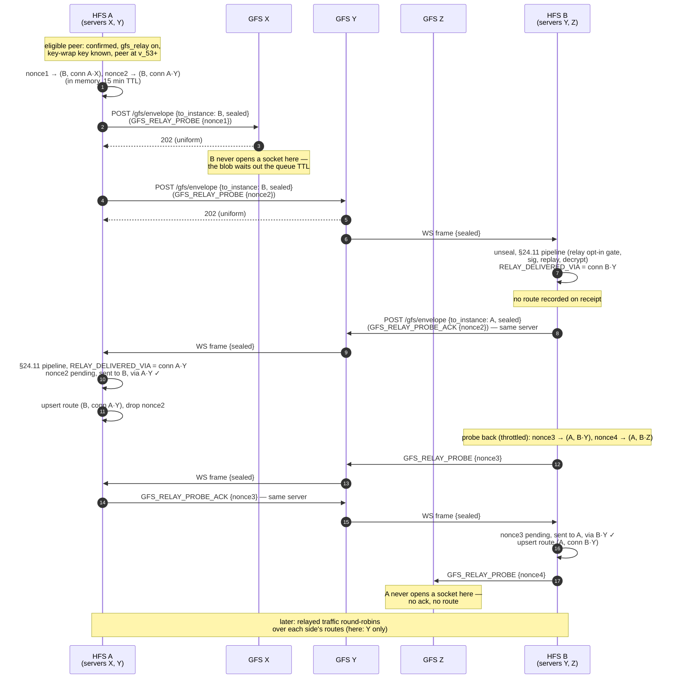
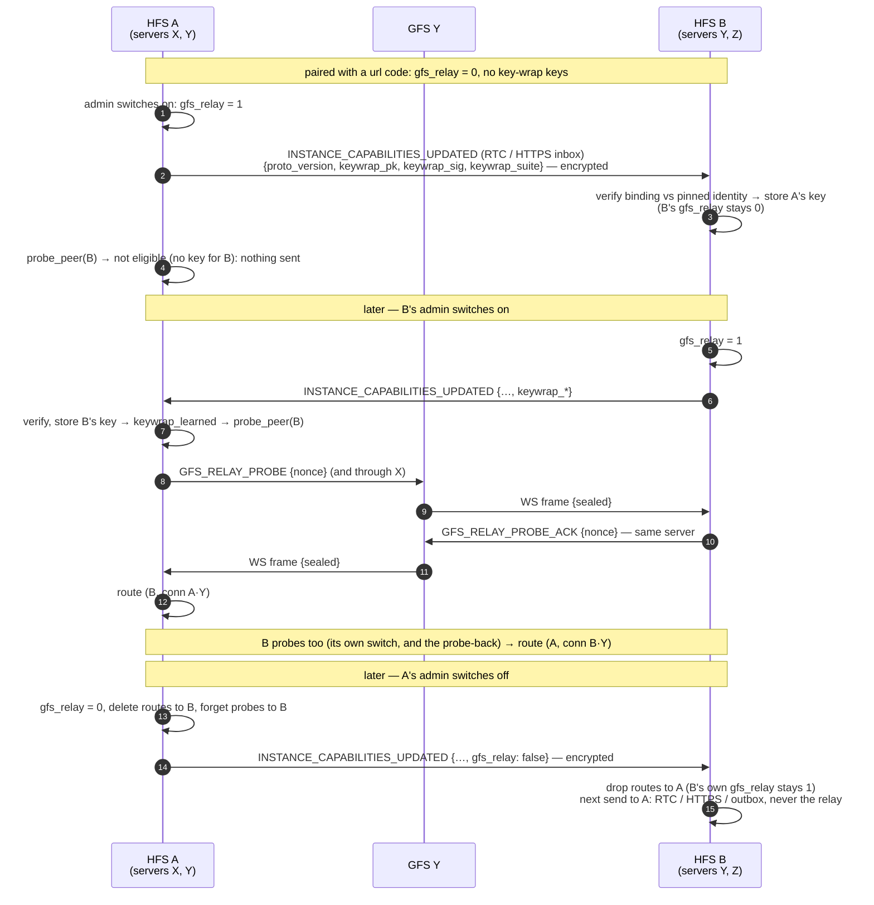
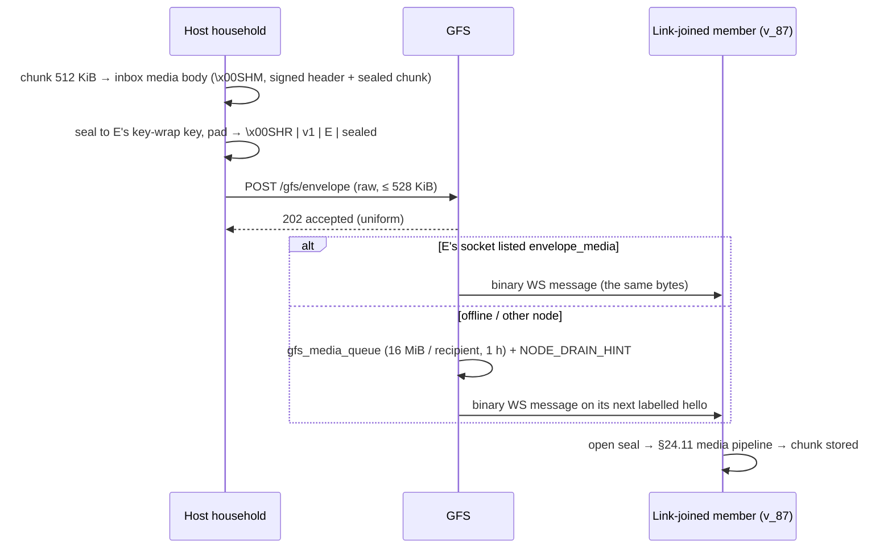

# GFS relay for paired households

The last-resort transport between two **paired** households: when neither
the WebRTC DataChannel nor the HTTPS inbox reaches the peer, an ordinary
§24.11 envelope is sealed to the peer's static key-wrap key and handed to a
connection server (GFS) that **both** households use, which pushes it down
the peer's WebSocket. This page covers how the two households find those
shared servers (v_53) without either one ever naming a server to the
other. The relay wire shape itself (`{to_instance, sealed}`, size buckets)
is documented in [`invites.md`](./invites.md); the transport tiers are in
[`architecture.md`](../architecture.md#progressive-sync-42).

## Scope

- **HFS**: full participant. Per peer, the admin opts into the relay
  (`remote_instances.gfs_relay`, local-only, never federated). Each
  household probes the peer through each of its own servers, answers
  probes, and keeps its own list of confirmed routes
  (`peer_gfs_routes` — each route is THIS household's own
  `gfs_connections.id`).
- **GFS**: content-blind relay. It sees two more identity-free relay
  bodies per probe round and answers `202` to all of them, exactly as for
  any other relayed blob. It takes no part in discovery and cannot tell a
  probe from any other envelope.
- **Paired peers only** (`source = manual`). A household seated from an
  invite link (`space_session`) already rides the one server that
  introduced it; the probe and ack types are not in its allow-list, so the
  §24.11 peer-class gate refuses them.

## Event types

`GFS_RELAY_PROBE`, `GFS_RELAY_PROBE_ACK`.

Both carry exactly `{nonce}` — 128 random bits, `secrets.token_urlsafe(16)`
— inside the AES-256-GCM federation payload. The plaintext envelope fields
are the usual routing set (`from_instance`, `to_instance`, `event_type`,
`msg_id`, `timestamp`, `space_id = null`); no server URL, server id,
connection id or inbox id appears anywhere, in the clear or encrypted
(pinned by `tests/protocol/test_gfs_relay_route_discovery.py`).

Gated on `FederationCapability.MIN_FOR_GFS_RELAY_ROUTES` (v_53): a peer
below it is never probed, holds no routes, and so never gets the relay
fallback.

## Flow — probe and ack

Household A uses servers X and Y; household B uses Y and Z. Only Y is
shared.



### Rules

- **Probe only through our own servers.** A probes through each of its own
  active `gfs_connections` whose server proved the `envelope_relay`
  capability on its signed `/gfs/info` block — never through a server it is
  not registered with. The relay sender enforces the same (it resolves
  the URL against our own connections).
- **A route comes only from an ack to one of OUR OWN probes**, through the
  server that probe was sent on — or, once, from a pairing code that
  named the server ([Bootstrap route](#bootstrap-route-from-a-pairing-code)). Receiving a probe records nothing: the
  relay body is identity-free, so a malicious server the prober uses can
  re-post the sealed probe onto another server the receiver uses but the
  prober never reads. Had the receiver recorded that server, its relayed
  traffic would go where the relay answers `202` and nobody collects it —
  a silent loss the attacker could keep alive every round. Instead the
  receiver acks and **probes back** (throttled per peer), so both sides
  confirm their own direction.
- **A probe is answered only if it arrived over the relay.** The relay
  inbound leg (`services/gfs_relay_inbound.py`) binds
  `RELAY_DELIVERED_VIA` to B's own connection id for the duration of the
  dispatch; the handler reads it synchronously. A probe that arrived over
  RTC or the HTTPS inbox (or through a server that is not one of B's
  active connections) is ignored.
- **The ack goes back through the same server.** B answers through the
  connection that carried the probe, explicitly — not round-robin — so
  the ack tests the same server in the other direction.
- **The prober accepts an ack only if** the nonce is pending (not
  expired), was sent to the sender of the ack, and the ack arrived over
  the very connection the probe was sent through. Anything else is ignored
  at DEBUG and the nonce stays pending (a wrong-peer or wrong-server ack
  cannot burn the genuine one).
- **Both payloads are `{nonce}` only.** Each side stores only its own
  connection ids; the intersection is learnt by what arrived where, never
  by what was said.
- **A peer we did not opt in with cannot probe us.** The §24.11 relay
  opt-in gate (`make_check_relay_opt_in`) drops a relayed envelope from a
  paired peer whose `gfs_relay` is off before any handler runs — so no
  ack is sent.

### Round-robin

Once routes exist, `FederationTransport` reaches the paired peer
RTC → HTTPS inbox → relay, and the relay tier round-robins over the
peer's routes (resolved to the base URLs of our currently active
connections), trying each at most once per send. Probes and acks
themselves never round-robin: they use
`FederationService.send_event_via_gfs`, which seals exactly like
`send_event` but delivers through one named server, best-effort (no
outbox, no reachability change; a `202` is acceptance, not delivery). Nor
is a probe's `202` recorded as a relay acceptance: every server answers
`202` to every probe, so it would mark a healthy direct peer "relay only"
after each round.

### Refresh, triggers and expiry

- **Every 24 h ± 1 h** (`GfsRouteDiscoveryScheduler`) every eligible peer
  is re-probed. Only an accepted ack refreshes a route (`last_ack_at`);
  a received probe makes the receiver probe back, which refreshes its
  side.
- **On our own GFS (re)connect** an early round is requested. Triggers
  within 30 s coalesce into one round, a triggered round never starts
  within 10 min of the previous round, and each peer is probed at most
  once a minute — so a reconnect storm or a flapping socket costs one
  round per 10 min. A scheduler stop lands between peers, never mid-POST.
- **On demand:** `probe_peer(instance_id)` probes one peer at once (for
  a fresh pairing or a newly enabled opt-in; same per-peer cap). The
  admin switching the fallback from off to on (v_54) probes past that
  window — even right after another probe — and opens none: its probe
  usually goes unanswered (the other side has not switched on yet), and
  our probe-back when the other side does must not be swallowed by it. A
  repeated "on" is an ordinary, throttled probe. Either side switching
  off clears the probe and answer windows for that peer, so the next
  switch-on starts fresh.
- **Expiry:** a route whose `last_ack_at` is older than 72 h (three
  intervals) is deleted, so one missed round never costs a working route
  but a peer that left a server stops being relayed there. Until then —
  up to 72 h, on either side, since both sides keep routes — a relayed
  send through that server is answered `202` and lost (the relay cannot
  say the recipient is gone without becoming a presence oracle). Removing
  one of OUR connection servers deletes its routes at once (FK cascade).
  A peer switching its fallback **off** does not wait for expiry: it tells
  us (`gfs_relay: false`, below) and we drop our routes to it at once.
- **Caps:** at most 1024 outstanding probes (oldest forgotten first, with
  a WARNING — its ack will be ignored), a
  15 min ack window, and at most one ack per peer per server every 30 s —
  a paired peer cannot make us spend unbounded relay posts.

### Bootstrap route from a pairing code

A pair made from a pairing code with a GFS reach
([`pairing.md`](./pairing.md#reach--pairing-through-a-gfs)) needs a
route before discovery can run: when one side has no URL, the pairing
confirm and the first §24.11 envelopes (capabilities, profiles) can only
ride the relay. So whoever writes the peer's row during the handshake —
the scanner on scan, the code owner on the accept — sets `gfs_relay`,
stores the peer's verified key-wrap key and **seeds one route**: its own
connection to the server the code named (`last_ack_at` = now) — only
when the peer provably reads that server. The scanner always does (the
code owner is on it). The code owner does when the accept arrived
through that server or the scanner has no URL (such a scanner refuses a
code whose server it is not on); a scanner that answered at the inbox
with its own URL gets no seeded route, since a route through a server
it never reads turns every fallback into a silent `202` — discovery
finds the servers the two really share.

This does not reopen the hole the ack rule closes. The rule exists
because a received relay frame proves nothing about which server the
SENDER reads; a seeded route never comes from where a frame arrived.
It comes from the code — exchanged out of band, verified against the
code owner's identity key — and from our own registration with that
same server (matched by its pinned `gfs_instance_id`). After the pair
confirms, each side calls `probe_peer`, so discovery confirms or adds
routes; a seeded route that no ack ever refreshes expires after 72 h
like any other. The code and the signed peer-accept carry each side's
`proto_version`, so the v_53 gate on probing already holds at confirm
time.

## Turning the fallback on for an existing pair

A pair made with a plain `url` code — or before the relay existed — has
`gfs_relay = 0` on both sides and neither holds the other's key-wrap
key, so neither can seal anything to the other. Each admin can switch
the fallback on later, per connection
(`PATCH /api/pairing/connections/{id}` `{gfs_relay: true}`, see
[`api.md`](../api.md); the Connections → Manage panel's "Use the GFS as
a fallback" switch). Since v_54
(`FederationCapability.MIN_FOR_GFS_RELAY_KEY_EXCHANGE`).

- **The key rides the capabilities announcement.** No new event: to a
  directly paired peer we opted in with, `INSTANCE_CAPABILITIES_UPDATED`
  also carries `keywrap_pk` / `keywrap_sig` / `keywrap_suite` — our
  static key-wrap key (the one `/gfs/info` and a GFS-reach code carry),
  its identity binding signature and the `"x25519"` suite tag — inside
  the AES-256-GCM payload, next to `gfs_relay: true`. Switching on sends
  it to that one peer at once; the startup fan-out repeats it while the
  switch stays on. A peer we did not opt in with never gets the key — its
  announcement says `gfs_relay: false` instead.
- **The receiver checks it against the pinned identity.** The suite must
  be known (unknown or missing → refused, never defaulted) and the key
  self-signed by the identity key pinned for that household at pairing
  (`verified_peer_keywrap`); anything else is dropped at WARNING and the
  stored key stays. Only `source = manual` rows take a key this way. A
  stored key does **not** opt the receiver in — that stays its own
  admin's switch.
- **Both sides must switch on.** Probing needs the peer's key, and the
  §24.11 relay opt-in gate refuses relayed envelopes from a household we
  did not opt in with — so with only one side on, no relay body is ever
  posted. When the second side switches on, its key reaches the first
  side, which probes at once (a newly learned key triggers `probe_peer`);
  the second side probes too. Discovery then runs exactly as above. A
  probe that overtakes the announcement carrying its sender's key (the
  probe rides the GFS, the key the direct link) cannot be acked — we have
  nothing to seal to — so it is ignored without opening the 30 s answer
  window; the sender's next probe, triggered by ours, is answered.
- **Off** clears our opt-in, deletes that peer's routes and our probes in
  flight to it (a late ack re-creates nothing — the ack handler re-reads
  the opt-in), and re-sends our capabilities with `gfs_relay: false`. The
  receiver (directly paired peers only; an explicit `false`, never a
  missing field) drops **its** routes to us and its probe state for us,
  without touching its own opt-in. Without that it would keep relaying to
  us for up to 72 h: the relay answers `202`, so those envelopes count as
  delivered and are never queued, while our gate refuses every one. Now
  its next send takes RTC / the HTTPS inbox and, failing those, its
  outbox. The keys stay (public, bound to the identity key, needed if the
  switch comes back on); switching on again runs the key / probe flow and
  restores the routes on both sides.
- **Older peers.** A v_53 peer never sends its key, so the switch cannot
  complete with it unless we already hold its key from a GFS-reach
  pairing; the connections API says so (`gfs_relay_available: false`)
  and the SPA tells the admin the other household needs a newer Social
  Home. The status line otherwise reads "reachable through N GFS"
  (`gfs_routes`), "waiting for the other household" (on, peer key
  unknown) or "no GFS you both use found yet" (on, keys known, no route).
  Which GFS the two share is never shown — only counted.



## Binary media frames (v_87)

The JSON relay body tops out at ~191 KiB of sealed plaintext, so a 512 KiB
media chunk (base64'ed twice inside an envelope, ~1 MiB) never fit. Since
v_87 the same `POST /gfs/envelope` also takes a **binary** body that carries
one chunk at mesh size:

```
outer  = "\x00SHR" | u8 version 1 | to_instance (32 ASCII) | sealed
sealed = u8 kem-suite id (0x01 = x25519) | eph_pk (32) | nonce (12) | AES-256-GCM(ct || tag)
plain  = u32 BE length | media body | zero padding to a size bucket
```

The **media body** is the chunk's binary inbox body from v_81
(`\x00SHM`, the frame-suite byte, the signed §24.11 header, the AES-GCM
sealed chunk — `federation/media_framing.py`). The seal hides the header's
`from_instance`, `event_type` and `space_id` from the GFS; the AEAD's
associated data binds the outer prefix (recipient id included), the
kem-suite byte and `eph_pk`, so a re-addressed or re-suited frame does not
open. Padding buckets are 64, 128, 256, 516 KiB and the cap; a full 512 KiB
chunk lands in 516 KiB (~517 KiB on the wire, cap 528 KiB). The GFS and the
household both refuse a `sealed` part whose length is not exactly one
bucket plus the 61-byte seal overhead (`VALID_SEALED_LENGTHS`).

- **Scope:** a household seated from an invite link (`space_session`) at
  v_87, whose `relay_via` GFS proved the signed `envelope_media` capability.
  Today this carries `SPACE_MEDIA_BLOB` to a link-joined member whose GFS
  keeps **no** space media cache (its signed block carries no
  `space_media`); live pictures otherwise keep using the cache. The
  generic relay for files no longer in the cache comes with the wanted /
  catch-up work after the GFS redesign.
- **Fallback:** a peer below v_87, or a GFS without `envelope_media`, gets
  JSON chunks of at most 96 KiB (`RELAY_JSON_CHUNK_BYTES`), which fit the
  JSON relay. A binary frame that the relay throttles (429) is waited out;
  it never falls back to JSON (the chunk is too large for it). When the
  path changes under a transfer (the GFS stops proving `envelope_media`), a
  512 KiB chunk is not sent at all: the send answers
  `relay_chunk_resize` and the media outbox's next attempt re-cuts the
  file at the size the path takes then (a new `chunk_count`, so a fresh
  partial set on the receiver) — a transfer never sticks on a size.
- **Loss after a 202:** the relay answers before it delivers, so a frame it
  drops later (saturation, a full media queue, the 1 h TTL) or the
  receiver refuses (its media budget) is gone while the sender's outbox
  counts it sent. The receiver heals it on the next VIEW: a missed
  content-addressed file (`sc-…`) shown by a live row created within the
  last 3 days makes `RelayMediaRefill` ask the space's relay-seated host for
  `SPACE_SYNC_RESUME` with `refill: "posts" | "calendar" | "gallery"` — the
  one resource whose row shows it (`MediaReferenceRepo.space_rows_of`) —
  since a minute before that row. A v_87 host replays at most 20 rows of
  that resource (deduped by id on arrival) and re-ships at most 16 files /
  16 MiB of theirs, under its own (household, space, resource) window, so a
  refill never uses up the reconnect resume's window. One request per
  (space, resource) per 30 min on each side. Comment and listing pictures
  are not refilled (their replay ships no files). **Cost per trigger:** 1
  recipient × ≤ 20 rows (~2–10 KiB each through the relay) + ≤ 16 files ≤
  16 MiB; worst case a reader viewing missing files in S spaces ≤ 3 S
  refills per 30 min, ≤ 48 S MiB. A bridge: the generic one-file
  `SPACE_MEDIA_WANTED` of the GFS redesign replaces it. Since timestamps
  are compared as times on the host (`datetime()` on both sides in every
  `list_since` the replay uses), a same-day row stamped naive is found.
- **GFS:** identity-free and content-blind as for every relayed body — it
  reads the magic, the version and the recipient id, never a sender, and
  pushes the body unchanged as a BINARY WebSocket message to a socket whose
  hello listed `envelope_media`. Its budgets are separate from the JSON
  envelopes' (per-IP bytes, in-flight bytes, its own queue table with
  per-recipient and server-wide byte caps and a 1 h TTL, expired rows swept
  on every insert — see
  [`docs/operations/gfs-cluster.md`](../operations/gfs-cluster.md#envelope-relay-media-frames-v_87)),
  so media can never crowd a household's control envelopes out. On a
  drain the control envelopes go first, under their lock; the media frames
  follow in one background task per recipient, under their own, so a
  household's control link never waits behind up to 16 MiB of media. A
  media frame is pushed only while the socket's transport holds at most
  1 MiB unsent (`WS_MEDIA_MAX_BUFFERED_BYTES`), so control frames never
  queue behind media bytes. A media push that stalls
  (`WS_MEDIA_SEND_TIMEOUT_S`, 30 s) or finds the socket backed up is
  dropped — never the socket — and the drain backs off (2 s doubling to
  30 s, five tries; the rows stay queued for the next hello / hint) instead
  of re-pushing at once. On a very slow link (< ~1 Mbit/s) one frame can
  still delay a control frame by seconds and the 30 s WebSocket heartbeat
  may close the socket for a missed pong; the household reconnects and the
  queue drains again. Across a cluster the frame
  rides the shared queue and the `NODE_DRAIN_HINT` like any queued
  envelope.
- **Receiver:** the WebSocket client hands the bytes to
  `GfsRelayInbound`. Media has its own budget (`RELAY_MEDIA_INBOUND_LIMIT`,
  1200 / min — about ten senders at their GFS cap), checked before and never
  charged to the process-wide bucket the relayed control, pairing and
  invite envelopes share, and charged only for a frame that went through.
  Frames that fail to open or fail their checks are charged to a junk bucket
  (`RELAY_MEDIA_JUNK_LIMIT`, 120 / min); while it is full, media frames are
  dropped before any AES-GCM open. Refusals are logged as one WARNING a
  minute with a count, never a traceback.
  It checks the recipient id and the kem-suite byte
  (unknown → refused, no default), opens the seal and runs
  `FederationService.handle_inbound_media_relay`: the §24.11 chain on the
  signed header (lookup by its `from_instance`, a media-only event-type
  gate, peer-class and relay-opt-in gates, the relay's timestamp window,
  signature, replay, decrypt, idempotency, ban), then the same tail as the
  inbox and the DataChannel (`_finish_media_frame`: frame and AEAD suites,
  chunk decrypt, `chunk_sha256` binding).



**Cost:** one frame per chunk per relay-seated member household — a
512 KiB chunk is ~517 KiB on the wire to the GFS and the same again from the
GFS to the member (JSON chunks of 96 KiB cost ~1.8× their size each way, plus
an envelope per 96 KiB). A 200 MiB file to 50 relay-seated members is
400 chunks × 50 = 20 000 frames, ~10.1 GiB up and ~10.1 GiB down through the
GFS; at the default 64 MiB / min per sending address that is ~2.7 h from one
household (the sender waits out each 429). That is why live pictures stay on
the cache (one upload per GFS, not per member) and the relay carries only
what the cache cannot.

## Anonymous per-space mailboxes (GFS redesign PR 1)

Every relay above addresses a household by its **instance id**, so the GFS
sees one household id across all the spaces it reaches that household for.
The redesign addresses a member reached through a GFS by a **mailbox** per
(household, space, generation) instead. PR 1 ships the GFS side and the
household library only — no household sends to or claims a mailbox until
redesign PR 2 (v_88); there is no `OURS` bump. The GFS advertises it in its
signed `/gfs/info` as `envelope_mailbox: {"sig_suites": ["ed25519"],
"idle_days": 30}`.

**Keys and id.** The household derives the mailbox's X25519 sealing key and
Ed25519 claim key with HKDF-SHA256 from its **mailbox root** — a dedicated
32-byte secret generated once and stored under the household KEK (wired in
PR 2), not the key-wrap seed (salt `sh-mbx-v1`, info
`sh-mbx-kem:v1|<gfs id>|<space>|<gen>` / `sh-mbx-sign:v1|<gfs id>|<space>|<gen>`),
so beside the root only `gen` (and the GFS id pinned at mint time) needs
storing. With the GFS id in the derivation, two GFSs serving the same
global space get unrelated mailbox ids for the same household. `mailbox_id = base32(SHA-256("sh-mbx-v1" ‖
sign_pk))[:32]` — the shape of an instance id, so a JSON envelope's
`to_instance` and a binary `\x00SHR` frame's recipient field carry it
unchanged, and the prefix keeps it apart from the instance id of the same
key.

**Register** — `POST /gfs/mailbox/register`, anonymous, `{sig_suite:
"ed25519", sign_pk, mailbox_id, gfs_instance_id, ts, nonce, sig}`. `sig` is the proof of
possession over `"sh-mbx-register:v1" \n gfs_instance_id \n mailbox_id \n ts
\n nonce` — bound to the GFS id the household pinned, so a registration made
for one GFS proves nothing at another. A server accepts its own id, its
`instance_id_aliases` and the ids its shared-key cluster siblings serve (a
cluster whose allocs still serve per-node ids: register on one, claim on
another). The GFS rejects an unknown `sig_suite` (no
default), recomputes the id from the key, checks `ts` (±300 s) and the
signature, spends the nonce (a replay is `409`), refuses an id an instance
holds (`409 id_in_use`, atomically with the insert — and `/gfs/register`
in turn only takes an instance id derived from its key, never a mailbox's,
never moving a row to another key) and pins the key on first use;
registering again is a no-op and needs no ticket. A NEW mailbox spends one
anonymous registration ticket (`ticket_suite` + `ticket`, below). Limits:
30 / min per address, then a backstop of `mailbox_max_per_ip` (200) new
mailboxes per UTC day per /64 (×16 per /56, ×256 per /48) in salted
count-min sketches (no address kept, nothing to evict). There is no
server-wide daily cap any more: ~100 addresses could burn the old 20 000
and block every new space join for the rest of the day.

**Claim** — `GET /gfs/mailbox/ws`, a socket of its own, never the identified
`/gfs/ws`, and **one mailbox per socket** (owner decision: a shared socket
would link a household's spaces live). The GFS sends a random challenge; the
client signs `"sh-mbx-claim:v1" \n gfs_instance_id \n mailbox_id \n challenge`
with the mailbox key. Unknown mailbox and wrong key close alike (`4401
auth-failed`, after the same dummy-key verify). Then the GFS delivers the
mailbox's queued frames in order and its live ones: JSON envelopes as text,
binary `\x00SHR` media frames unchanged when the claim's `accepts` lists
`envelope_media`. aiohttp pings every 30 s (inside Cloudflare's 100 s idle
timeout); a claim updates `last_claim_at`.

**Routing.** `POST /gfs/envelope` (JSON and binary) to a mailbox id is
pushed or queued exactly as to an instance id — the same
`gfs_envelope_queue` / `gfs_media_queue` rows keyed by the id, the same
per-recipient caps, TTLs and in-flight bounds — and answers the same uniform
`202` before the recipient is even looked up, so a known mailbox, an unknown
one and a household are indistinguishable. In a cluster the enqueue hints
the sibling nodes (`NODE_DRAIN_HINT` carries the mailbox id like an instance
id) and the node holding the claim socket drains it.

**Idle sweep.** Both stored timestamps are rounded down to the UTC day — a
household reclaiming all its mailboxes at once would otherwise stamp them
with the same second. A mailbox whose last claim (or, never claimed, its
registration) is `mailbox_idle_days` (30) days old is dropped with its
queued frames by the maintenance loop; a claim socket held open re-stamps
its day once a day, so it is never swept while connected.

**Queues: a pool of their own.** Mailbox ids are free to mint, so their
frames never share room with households' (each queued row carries its
`pool`). Per mailbox: 200 envelopes / 4 MiB and 8 MiB of media
(households: 2 000 / 64 MiB and 16 MiB). Both envelope pools follow ONE
model — **tail-drop plus a per-recipient reserve, nothing is ever
evicted**:

- past the pool's total (households 1 GiB, mailboxes 256 MiB) a new
  envelope is dropped — anyone can post to any id, so evicting someone's
  envelopes to make room would be an anonymous delete primitive;
- except for a recipient still under its **reserve** (fewer than 20 queued
  envelopes and less than 64 KiB): it is admitted up to the pool's
  **ceiling** (households 2 GiB, mailboxes 1 GiB), so a flood of other ids
  can fill the pool but never block anybody's first envelopes. Headroom
  math: a reserve holds < 64 KiB plus one envelope (≤ 320 KiB), so the
  1 GiB / 768 MiB headroom fits ≥ 2 700 / 2 000 recipients at a worst-case
  reserve, ~16 000 / 12 000 at a typical few-KiB envelope;
- media: households 1 GiB, mailboxes 256 MiB, tail-drop.

Worst-case disk for queued relay frames is therefore 2 + 1 GiB of
envelopes + 1 + 0.25 GiB of media + 256 MiB of member relay items ≈ 4.5 GiB,
whatever the number of ids. The pool totals are running counters
(`gfs_queue_totals`, kept by triggers on every insert and delete, recomputed
hourly by maintenance as drift repair), so a cap check reads one row;
expired rows of a pool are swept (an index range) before an insert is
refused, so they never hold room. (Round 3's ranked mailbox eviction was
removed in favour of this: one model, no scans, nothing to game.)

```mermaid
sequenceDiagram
    participant H as Household (member over the GFS)
    participant A as GFS node A
    participant B as GFS node B
    participant S as Sender household
    H->>H: keys = HKDF(mailbox root, gfs id, space, gen); id = b32(SHA-256("sh-mbx-v1"‖sign_pk))[:32]
    H->>A: POST /gfs/mailbox/register {sign_pk, id, gfs_instance_id, ts, nonce, sig, ticket_suite, ticket}
    A->>A: verify PoP, nonce, id ≠ instance, ticket → spend it, pin key (gfs_mailboxes)
    A-->>H: 200 registered
    S->>A: POST /gfs/envelope {to_instance: id, sealed}
    A-->>S: 202 accepted (uniform)
    A->>A: no claim socket here → gfs_envelope_queue + NODE_DRAIN_HINT [id]
    H->>B: GET /gfs/mailbox/ws
    B->>H: mailbox_challenge {challenge, gfs_instance_id, sig_suites}
    H->>B: mailbox_claim {id, gfs_instance_id, sig_suite, sig, accepts}
    B->>B: verify under the pinned key, last_claim_at = now
    B->>H: mailbox_claimed, then queued frames in order
    S->>A: POST /gfs/envelope (binary \x00SHR to id)
    A->>A: queue + NODE_DRAIN_HINT [id]
    A->>B: NODE_DRAIN_HINT
    B->>H: binary WS message (the same bytes)
```

**What the GFS stores and learns.** `gfs_mailboxes` holds the id, the
pinned key and two day-granular timestamps — no instance id, no address,
no space id. No log line names a mailbox id on any path (the claim-socket
registry prints `<mailbox>`, the relay and the cluster drain print a
recipient id only for a household socket on the same node), so no application log sits next to an access-log
address for it. The GFS still sees, per envelope, the mailbox, the time,
the size and the sender's address, and per claim socket its address and
online time; within one space it can cluster mailboxes that the same
fan-out bursts hit. Across spaces nothing is stored or cryptographically
linked — only IP / timing correlation with the household's identified
socket, the residual named above.

Implementation: `socialhome/domain/gfs_mailbox.py` (id, signed bytes, suite
tag), `socialhome/federation/gfs_mailbox.py` (key derivation, register,
`MailboxClaim`), `socialhome/global_server/mailboxes.py`
(`GfsMailboxService`), `socialhome/global_server/routes/mailbox.py`,
`GfsEnvelopeRelay._recipient` / `_sockets` / `holds`,
`ClusterService.attach_drain(holds=…)`, GFS migration 0029.

## Mailbox registration tickets

Registration is anonymous, so per-address limits alone can't stop a botnet
from minting mailboxes — and sybil mailboxes could fill the mailbox pool's
per-recipient reserve up to its ceiling. Every NEW mailbox therefore spends
one **ticket**: a standard Privacy Pass token (RFC 9576 architecture, RFC
9577 token format, RFC 9578 §6 publicly verifiable issuance — token type
0x0002, blind RSA RFC 9474 `RSABSSA-SHA384-PSS-Deterministic`, 2048-bit).
Tickets are issued per **registered household**, so `mailbox_tickets_per_day`
(50) × the registered households is the real bound on mailboxes; who may
register a household is the operator's gate. No `OURS` bump — nothing
changes between households.

**Issuer key.** The signed `/gfs/info` capability `mailbox_tickets` is
`{suite: "privacypass-blindrsa2048-sha384-pss", issuer_key_id, public_key,
per_day, epoch_days}` — `issuer_key_id` the b64url SHA-256 of the RSASSA-PSS SPKI,
`public_key` that SPKI. A household rejects an unknown suite (no fallback)
and a key whose id does not match. One RSA-2048 key per epoch
(`mailbox_ticket_epoch_days`, 30), made by the first node that needs it and
stored in the shared DB, accepted for redemption until two epochs after it
was made. Because the key sits in the signed capability every household
reads, a GFS serving different keys to different households (to partition
their tickets) is detectable by comparing.

**Issuance** — `POST /gfs/mailbox/tickets`, signed by the household's
identity key over `{action: "mailbox_tickets", instance_id, suite,
issuer_key_id, requests, ts}` (±300 s; the `action` keeps any other signed
GFS request from being replayed here), only for a household `active` on
this GFS. `requests` are up to 64 blinded RFC 9578 `TokenRequest`s for the
fixed `TokenChallenge` (issuer `gfs.social-home.io`, origin_info
`mailbox-register`, empty redemption context — tickets are fetched ahead
of use). The GFS grants up to `per_day` per household per UTC day (one row:
instance id, day, count) and blind-signs; it sees only blinded messages and
stores none. Blinded under an older key → `409 stale_issuer_key` (nothing
counted, re-read `/gfs/info`); over the quota → `429 ticket_quota`. The
household finalizes each response (checking the unblinded signature) into
an RFC 9577 `Token` and keeps them in memory.

**Redemption** — the register body carries `ticket_suite` + `ticket` (one
`Token`, b64url). The GFS checks the challenge digest, finds the key by
`token_key_id` among the accepted keys (`403 stale_ticket_key` otherwise),
verifies RSASSA-PSS (`403 invalid_ticket`), lets the per-address backstop
count it, then records the token nonce in `gfs_spent_tickets` — a primary
key in the shared DB, so a second spend on any node is `409 ticket_spent`.
No ticket on a new mailbox is `403 ticket_required`. Spent nonces live until
their key retires; the maintenance loop prunes them, past days' counts and
retired keys.

```mermaid
sequenceDiagram
    participant H as Household (registered, active)
    participant A as GFS node A
    participant B as GFS node B
    H->>A: GET /gfs/info
    A-->>H: capabilities (signed) incl. mailbox_tickets {suite, issuer_key_id, public_key, per_day, epoch_days}
    H->>H: check suite + key id; blind N TokenRequests (RFC 9474)
    H->>A: POST /gfs/mailbox/tickets {action, instance_id, suite, issuer_key_id, requests, ts, signature}
    A->>A: verify identity signature, active, quota (gfs_ticket_issuance)
    A-->>H: 200 {suite, issuer_key_id, responses} (blind signatures)
    H->>H: finalize → RFC 9577 Tokens (cached, unlinkable)
    Note over H,B: later, anonymously, for a NEW mailbox
    H->>B: POST /gfs/mailbox/register {…, ticket_suite, ticket}
    B->>B: challenge digest, key by token_key_id, RSASSA-PSS verify, backstop
    B->>B: INSERT nonce → gfs_spent_tickets (shared DB)
    B-->>H: 200 registered
    H->>A: POST /gfs/mailbox/register {…, same ticket}
    A-->>H: 409 ticket_spent
```

**Residuals.** The issuer learns "household H took N tickets today", never
which mailbox spent one. A fetch right before a register lets the GFS line
the two up by time, so a household fetches ahead (e.g. on connect, once a
day) and spends from its cache (`MailboxTicketCache`). The cache never
fetches on its own: an empty cache fails a register with `no_ticket`, and a
`stale_ticket_key` refusal drops that key's tickets and fails — so a GFS
that refuses a register on purpose cannot make the household fetch right
next to it. Only `ticket_spent` is retried, once, from the cache. The
capability's `epoch_days` lets a household notice a key that changes faster
than an epoch (pinning one key per epoch is wired with redesign PR 2). IP / timing
correlation with the household's identified `/gfs/ws` stays the accepted,
stated limit (as for claims above). Household side:
`TicketIssuer.from_capability`, `build_ticket_request`, `fetch_tickets`,
`register_mailbox(tickets=…)` in `socialhome/federation/gfs_mailbox.py` —
not wired into space flows until redesign PR 2. GFS side:
`socialhome/privacy_pass.py`, `socialhome/global_server/mailbox_tickets.py`,
GFS migration 0030.

## Privacy — who learns what

| Party | Learns |
|---|---|
| A (prober) | Which of ITS OWN servers B also uses (the intersection) — nothing about B's other servers. |
| B (receiver) | The same intersection, from which of its own sockets the probe arrived on — nothing about A's other servers. |
| A server both use (Y) | Relay bodies `{to_instance, sealed}` both ways, padded to a size bucket like any relayed envelope: recipient, time, size bucket. The content is opaque, but a probe followed within seconds by a small blob in the other direction — and a probe back — may be recognisable as a probe / ack exchange by timing and size alone; that reveals only that the two households exchange relayed envelopes through it, which the relay fallback concedes anyway (below). |
| A server only A uses (X) | One relay body addressed to B's instance id, which it queues and never delivers (B is not its client). It learns that *someone* addressed B — the same as any relayed envelope. |
| A server only B uses (Z) | The same, mirrored: B's probe back, addressed to A, queued and never delivered. |

### Residuals

- **A malicious server cannot plant a route.** A server one household
  uses (X) may re-post that household's sealed probe onto another server
  the peer uses (Z). The peer then acks through Z, where the prober never
  reads, and records nothing — at most it is made to spend one ack (and
  its throttled probe back) on a server that leads nowhere. Pinned by
  `test_a_malicious_gfs_replaying_a_probe_elsewhere_creates_no_route`.

- **A paired peer can test a server it is not on.** A malicious paired
  peer could `POST /gfs/envelope` a probe through an arbitrary server it is
  *not* registered with (the relay body is identity-free, so nothing stops
  it) — our ack, queued there for it, tells it that we use that server
  once it connects to collect it. We also record that server as a route
  to the peer until it expires. This is inherent to any intersection
  scheme that lets two parties confirm a shared server, and is limited to
  households we paired with and opted into the relay with (anyone else's
  probe is refused by the §24.11 pipeline before the handler runs). Our
  own sender never does this.
- **A server can correlate the posting IP.** The relay body is
  identity-free, but the HTTP request that carries it still comes from the
  sender's address, and the sender holds its own WebSocket to the same
  server — so the server can link a `POST /gfs/envelope` to the household
  that owns that socket. Accepted as a documented limit (owner decision
  2026-10-08); see [`principles.md`](../principles.md) for the relay's
  metadata concessions.

## Implementation

- `socialhome/services/peer_gfs_relay_service.py` — `PeerGfsRelayService`:
  the per-connection switch (on: opt in, send our key, probe; off: opt
  out, drop routes) and the probe on a newly learned peer key (v_54).
- `socialhome/services/capabilities_outbound.py` — our key-wrap fields
  in `INSTANCE_CAPABILITIES_UPDATED` for opted-in paired peers;
  `socialhome/services/federation_inbound/pairing.py` —
  `_apply_peer_keywrap` on the receiving side.
- `socialhome/services/gfs_route_discovery_service.py` —
  `GfsRouteDiscoveryService`: `probe_peer` / `probe_all`, the probe and
  ack handlers (registered in `attach_to`), pending-nonce map, throttles,
  `expire_stale_routes`.
- `socialhome/infrastructure/gfs_route_discovery_scheduler.py` —
  `GfsRouteDiscoveryScheduler`: 24 h ± 1 h timer, coalesced `trigger()`,
  `_stop: asyncio.Event` lifecycle.
- `socialhome/federation/federation_service.py` —
  `send_event_via_gfs` (seal like `send_event`, deliver via one server).
- `socialhome/federation/transport.py` — `FederationTransport
  .send_via_gfs_url` (one named server) and the round-robin relay tier.
- `socialhome/services/gfs_relay_inbound.py` — `RELAY_DELIVERED_VIA`;
  relayed pairing bodies (`pairing_peer_accept` / `_confirm`).
- `socialhome/federation/pairing_coordinator.py` /
  `socialhome/federation/pairing_gfs_reach.py` — the bootstrap route
  seeded from a pairing code (`_seat_relay`).
- `socialhome/federation/inbound_validator.py` —
  `make_check_relay_opt_in`.
- `socialhome/repositories/federation_repo.py` — `upsert_gfs_route`,
  `list_gfs_routes`, `delete_gfs_routes_older_than`
  (`peer_gfs_routes`, migration 0081).
- `socialhome/app.py` — `_build_gfs_route_discovery`; the GFS
  `on_connected` hook calls `trigger()`.
- v_87 binary media frames: `socialhome/domain/relay_media_frame.py`
  (outer shape), `socialhome/federation/gfs_relay_media.py` (seal / open),
  `GfsRelayTransport.send_media`, `FederationService._send_media_relay` /
  `handle_inbound_media_relay`, `GfsRelayInbound._handle_media`; GFS side
  `global_server/envelope_relay.py` (`submit_media`, `accept_media`,
  `SlidingByteBudget`), `global_server/routes/envelope.py`,
  `gfs_media_queue` (GFS migration 0028).

## Spec references

§24.11 (inbound pipeline), §24.12 (transport tiers), §D2b (connection-server
envelope relay), §25.8.21 (encryption-first).
