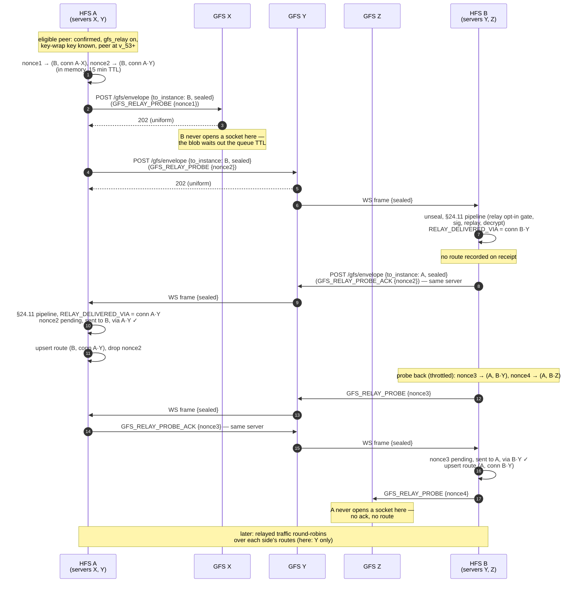
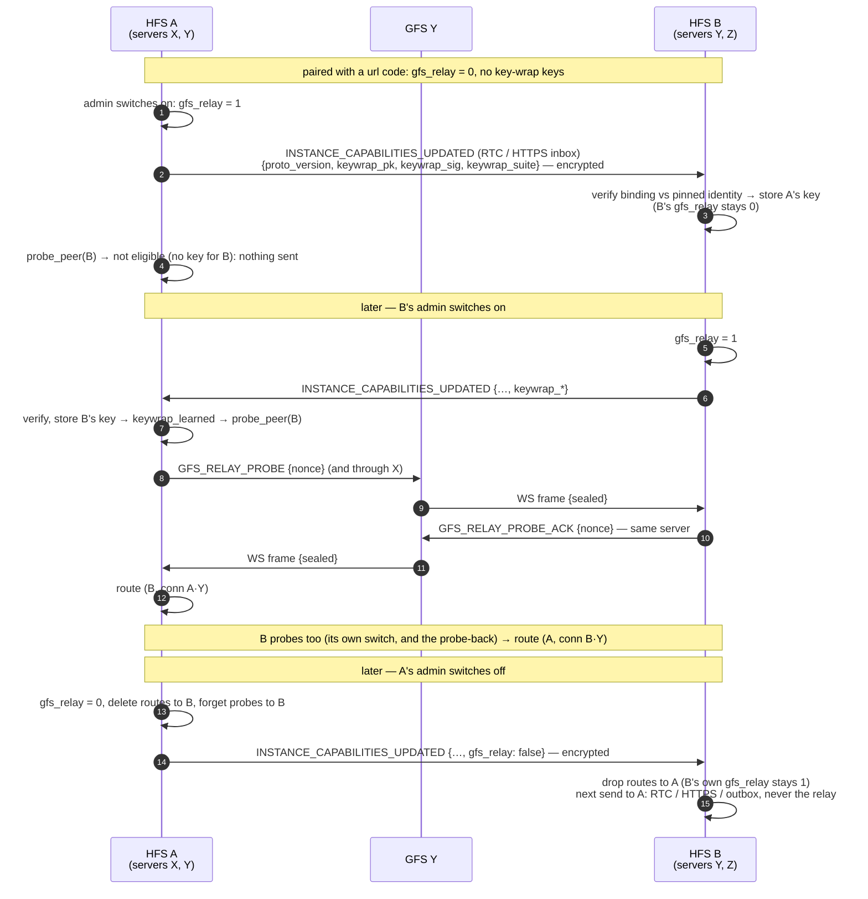
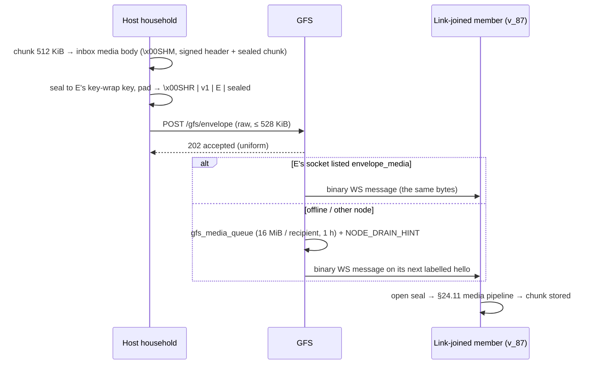
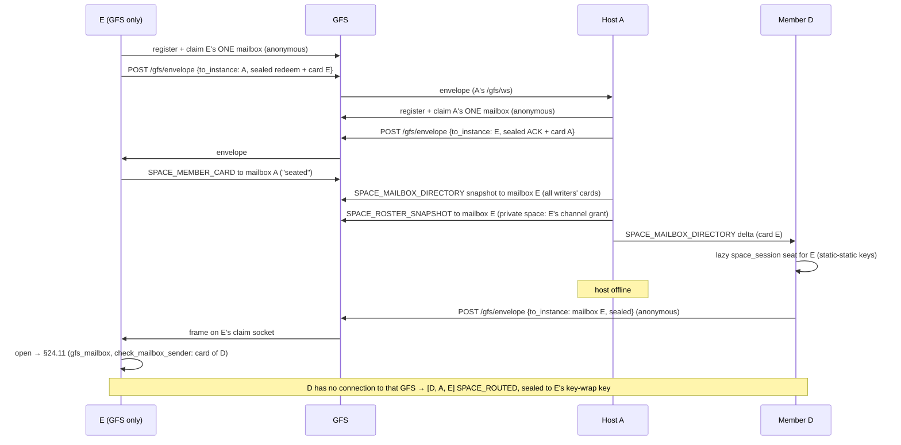

# GFS relay for paired households

The last-resort transport between two **paired** households: when neither
the WebRTC DataChannel nor the HTTPS inbox reaches the peer, an ordinary
§24.11 envelope is sealed to the peer's static key-wrap key and handed to a
connection server (GFS) that **both** households use, which pushes it down
the peer's WebSocket. This page covers how the two households find those
shared servers (v_53) without either one ever naming a server to the
other. The relay wire shape itself (`{to_instance, sealed}`, size buckets)
is documented in [`invites.md`](./invites.md); the transport tiers are in
[`architecture.md`](../architecture.md#progressive-sync-42).

## Scope

- **HFS**: full participant. Per peer, the admin opts into the relay
  (`remote_instances.gfs_relay`, local-only, never federated). Each
  household probes the peer through each of its own servers, answers
  probes, and keeps its own list of confirmed routes
  (`peer_gfs_routes` — each route is THIS household's own
  `gfs_connections.id`).
- **GFS**: content-blind relay. It sees two more identity-free relay
  bodies per probe round and answers `202` to all of them, exactly as for
  any other relayed blob. It takes no part in discovery and cannot tell a
  probe from any other envelope.
- **Paired peers only** (`source = manual`). A household seated from an
  invite link (`space_session`) already rides the one server that
  introduced it; the probe and ack types are not in its allow-list, so the
  §24.11 peer-class gate refuses them.

## Event types

`GFS_RELAY_PROBE`, `GFS_RELAY_PROBE_ACK`; `SPACE_MEMBER_CARD`,
`SPACE_MAILBOX_DIRECTORY` (v_89, see
[One mailbox per household](#one-mailbox-per-household-reachable-by-every-member-v_89)).

Both carry exactly `{nonce}` — 128 random bits, `secrets.token_urlsafe(16)`
— inside the AES-256-GCM federation payload. The plaintext envelope fields
are the usual routing set (`from_instance`, `to_instance`, `event_type`,
`msg_id`, `timestamp`, `space_id = null`); no server URL, server id,
connection id or inbox id appears anywhere, in the clear or encrypted
(pinned by `tests/protocol/test_gfs_relay_route_discovery.py`).

Gated on `FederationCapability.MIN_FOR_GFS_RELAY_ROUTES` (v_53): a peer
below it is never probed, holds no routes, and so never gets the relay
fallback.

## Flow — probe and ack

Household A uses servers X and Y; household B uses Y and Z. Only Y is
shared.



### Rules

- **Probe only through our own servers.** A probes through each of its own
  active `gfs_connections` whose server proved the `envelope_relay`
  capability on its signed `/gfs/info` block — never through a server it is
  not registered with. The relay sender enforces the same (it resolves
  the URL against our own connections).
- **A route comes only from an ack to one of OUR OWN probes**, through the
  server that probe was sent on — or, once, from a pairing code that
  named the server ([Bootstrap route](#bootstrap-route-from-a-pairing-code)). Receiving a probe records nothing: the
  relay body is identity-free, so a malicious server the prober uses can
  re-post the sealed probe onto another server the receiver uses but the
  prober never reads. Had the receiver recorded that server, its relayed
  traffic would go where the relay answers `202` and nobody collects it —
  a silent loss the attacker could keep alive every round. Instead the
  receiver acks and **probes back** (throttled per peer), so both sides
  confirm their own direction.
- **A probe is answered only if it arrived over the relay.** The relay
  inbound leg (`services/gfs_relay_inbound.py`) binds
  `RELAY_DELIVERED_VIA` to B's own connection id for the duration of the
  dispatch; the handler reads it synchronously. A probe that arrived over
  RTC or the HTTPS inbox (or through a server that is not one of B's
  active connections) is ignored.
- **The ack goes back through the same server.** B answers through the
  connection that carried the probe, explicitly — not round-robin — so
  the ack tests the same server in the other direction.
- **The prober accepts an ack only if** the nonce is pending (not
  expired), was sent to the sender of the ack, and the ack arrived over
  the very connection the probe was sent through. Anything else is ignored
  at DEBUG and the nonce stays pending (a wrong-peer or wrong-server ack
  cannot burn the genuine one).
- **Both payloads are `{nonce}` only.** Each side stores only its own
  connection ids; the intersection is learnt by what arrived where, never
  by what was said.
- **A peer we did not opt in with cannot probe us.** The §24.11 relay
  opt-in gate (`make_check_relay_opt_in`) drops a relayed envelope from a
  paired peer whose `gfs_relay` is off before any handler runs — so no
  ack is sent.

### Round-robin

Once routes exist, `FederationTransport` reaches the paired peer
RTC → HTTPS inbox → relay, and the relay tier round-robins over the
peer's routes (resolved to the base URLs of our currently active
connections), trying each at most once per send. Probes and acks
themselves never round-robin: they use
`FederationService.send_event_via_gfs`, which seals exactly like
`send_event` but delivers through one named server, best-effort (no
outbox, no reachability change; a `202` is acceptance, not delivery). Nor
is a probe's `202` recorded as a relay acceptance: every server answers
`202` to every probe, so it would mark a healthy direct peer "relay only"
after each round.

### Refresh, triggers and expiry

- **Every 24 h ± 1 h** (`GfsRouteDiscoveryScheduler`) every eligible peer
  is re-probed. Only an accepted ack refreshes a route (`last_ack_at`);
  a received probe makes the receiver probe back, which refreshes its
  side.
- **On our own GFS (re)connect** an early round is requested. Triggers
  within 30 s coalesce into one round, a triggered round never starts
  within 10 min of the previous round, and each peer is probed at most
  once a minute — so a reconnect storm or a flapping socket costs one
  round per 10 min. A scheduler stop lands between peers, never mid-POST.
- **On demand:** `probe_peer(instance_id)` probes one peer at once (for
  a fresh pairing or a newly enabled opt-in; same per-peer cap). The
  admin switching the fallback from off to on (v_54) probes past that
  window — even right after another probe — and opens none: its probe
  usually goes unanswered (the other side has not switched on yet), and
  our probe-back when the other side does must not be swallowed by it. A
  repeated "on" is an ordinary, throttled probe. Either side switching
  off clears the probe and answer windows for that peer, so the next
  switch-on starts fresh.
- **Expiry:** a route whose `last_ack_at` is older than 72 h (three
  intervals) is deleted, so one missed round never costs a working route
  but a peer that left a server stops being relayed there. Until then —
  up to 72 h, on either side, since both sides keep routes — a relayed
  send through that server is answered `202` and lost (the relay cannot
  say the recipient is gone without becoming a presence oracle). Removing
  one of OUR connection servers deletes its routes at once (FK cascade).
  A peer switching its fallback **off** does not wait for expiry: it tells
  us (`gfs_relay: false`, below) and we drop our routes to it at once.
- **Caps:** at most 1024 outstanding probes (oldest forgotten first, with
  a WARNING — its ack will be ignored), a
  15 min ack window, and at most one ack per peer per server every 30 s —
  a paired peer cannot make us spend unbounded relay posts.

### Bootstrap route from a pairing code

A pair made from a pairing code with a GFS reach
([`pairing.md`](./pairing.md#reach--pairing-through-a-gfs)) needs a
route before discovery can run: when one side has no URL, the pairing
confirm and the first §24.11 envelopes (capabilities, profiles) can only
ride the relay. So whoever writes the peer's row during the handshake —
the scanner on scan, the code owner on the accept — sets `gfs_relay`,
stores the peer's verified key-wrap key and **seeds one route**: its own
connection to the server the code named (`last_ack_at` = now) — only
when the peer provably reads that server. The scanner always does (the
code owner is on it). The code owner does when the accept arrived
through that server or the scanner has no URL (such a scanner refuses a
code whose server it is not on); a scanner that answered at the inbox
with its own URL gets no seeded route, since a route through a server
it never reads turns every fallback into a silent `202` — discovery
finds the servers the two really share.

This does not reopen the hole the ack rule closes. The rule exists
because a received relay frame proves nothing about which server the
SENDER reads; a seeded route never comes from where a frame arrived.
It comes from the code — exchanged out of band, verified against the
code owner's identity key — and from our own registration with that
same server (matched by its pinned `gfs_instance_id`). After the pair
confirms, each side calls `probe_peer`, so discovery confirms or adds
routes; a seeded route that no ack ever refreshes expires after 72 h
like any other. The code and the signed peer-accept carry each side's
`proto_version`, so the v_53 gate on probing already holds at confirm
time.

## Turning the fallback on for an existing pair

A pair made with a plain `url` code — or before the relay existed — has
`gfs_relay = 0` on both sides and neither holds the other's key-wrap
key, so neither can seal anything to the other. Each admin can switch
the fallback on later, per connection
(`PATCH /api/pairing/connections/{id}` `{gfs_relay: true}`, see
[`api.md`](../api.md); the Connections → Manage panel's "Use the GFS as
a fallback" switch). Since v_54
(`FederationCapability.MIN_FOR_GFS_RELAY_KEY_EXCHANGE`).

- **The key rides the capabilities announcement.** No new event: to a
  directly paired peer we opted in with, `INSTANCE_CAPABILITIES_UPDATED`
  also carries `keywrap_pk` / `keywrap_sig` / `keywrap_suite` — our
  static key-wrap key (the one `/gfs/info` and a GFS-reach code carry),
  its identity binding signature and the `"x25519"` suite tag — inside
  the AES-256-GCM payload, next to `gfs_relay: true`. Switching on sends
  it to that one peer at once; the startup fan-out repeats it while the
  switch stays on. A peer we did not opt in with never gets the key — its
  announcement says `gfs_relay: false` instead.
- **The receiver checks it against the pinned identity.** The suite must
  be known (unknown or missing → refused, never defaulted) and the key
  self-signed by the identity key pinned for that household at pairing
  (`verified_peer_keywrap`); anything else is dropped at WARNING and the
  stored key stays. Only `source = manual` rows take a key this way. A
  stored key does **not** opt the receiver in — that stays its own
  admin's switch.
- **Both sides must switch on.** Probing needs the peer's key, and the
  §24.11 relay opt-in gate refuses relayed envelopes from a household we
  did not opt in with — so with only one side on, no relay body is ever
  posted. When the second side switches on, its key reaches the first
  side, which probes at once (a newly learned key triggers `probe_peer`);
  the second side probes too. Discovery then runs exactly as above. A
  probe that overtakes the announcement carrying its sender's key (the
  probe rides the GFS, the key the direct link) cannot be acked — we have
  nothing to seal to — so it is ignored without opening the 30 s answer
  window; the sender's next probe, triggered by ours, is answered.
- **Off** clears our opt-in, deletes that peer's routes and our probes in
  flight to it (a late ack re-creates nothing — the ack handler re-reads
  the opt-in), and re-sends our capabilities with `gfs_relay: false`. The
  receiver (directly paired peers only; an explicit `false`, never a
  missing field) drops **its** routes to us and its probe state for us,
  without touching its own opt-in. Without that it would keep relaying to
  us for up to 72 h: the relay answers `202`, so those envelopes count as
  delivered and are never queued, while our gate refuses every one. Now
  its next send takes RTC / the HTTPS inbox and, failing those, its
  outbox. The keys stay (public, bound to the identity key, needed if the
  switch comes back on); switching on again runs the key / probe flow and
  restores the routes on both sides.
- **Older peers.** A v_53 peer never sends its key, so the switch cannot
  complete with it unless we already hold its key from a GFS-reach
  pairing; the connections API says so (`gfs_relay_available: false`)
  and the SPA tells the admin the other household needs a newer Social
  Home. The status line otherwise reads "reachable through N GFS"
  (`gfs_routes`), "waiting for the other household" (on, peer key
  unknown) or "no GFS you both use found yet" (on, keys known, no route).
  Which GFS the two share is never shown — only counted.



## Binary media frames (v_87)

The JSON relay body tops out at ~191 KiB of sealed plaintext, so a 512 KiB
media chunk (base64'ed twice inside an envelope, ~1 MiB) never fit. Since
v_87 the same `POST /gfs/envelope` also takes a **binary** body that carries
one chunk at mesh size:

```
outer  = "\x00SHR" | u8 version 1 | to_instance (32 ASCII) | sealed
sealed = u8 kem-suite id (0x01 = x25519) | eph_pk (32) | nonce (12) | AES-256-GCM(ct || tag)
plain  = u32 BE length | media body | zero padding to a size bucket
```

The **media body** is the chunk's binary inbox body from v_81
(`\x00SHM`, the frame-suite byte, the signed §24.11 header, the AES-GCM
sealed chunk — `federation/media_framing.py`). The seal hides the header's
`from_instance`, `event_type` and `space_id` from the GFS; the AEAD's
associated data binds the outer prefix (recipient id included), the
kem-suite byte and `eph_pk`, so a re-addressed or re-suited frame does not
open. Padding buckets are 64, 128, 256, 516 KiB and the cap; a full 512 KiB
chunk lands in 516 KiB (~517 KiB on the wire, cap 528 KiB). The GFS and the
household both refuse a `sealed` part whose length is not exactly one
bucket plus the 61-byte seal overhead (`VALID_SEALED_LENGTHS`).

- **Scope:** a household seated from an invite link (`space_session`) at
  v_87, whose `relay_via` GFS proved the signed `envelope_media` capability.
  Today this carries `SPACE_MEDIA_BLOB` to a link-joined member whose GFS
  keeps **no** space media cache (its signed block carries no
  `space_media`); live pictures otherwise keep using the cache. A member
  that misses a file no longer in the cache asks for it with
  `SPACE_MEDIA_WANTED` (v_92), answered over this relay; the GFS's v_83
  on-demand path is for followers.
- **Fallback:** a peer below v_87, or a GFS without `envelope_media`, gets
  JSON chunks of at most 96 KiB (`RELAY_JSON_CHUNK_BYTES`), which fit the
  JSON relay. A binary frame that the relay throttles (429) is waited out;
  it never falls back to JSON (the chunk is too large for it). When the
  path changes under a transfer (the GFS stops proving `envelope_media`), a
  512 KiB chunk is not sent at all: the send answers
  `relay_chunk_resize` and the media outbox's next attempt re-cuts the
  file at the size the path takes then (a new `chunk_count`, so a fresh
  partial set on the receiver) — a transfer never sticks on a size.
- **Loss after a 202:** the relay answers before it delivers, so a frame it
  drops later (saturation, a full media queue, the 1 h TTL) or the
  receiver refuses (its media budget) is gone while the sender's outbox
  counts it sent. The receiver heals it on the next VIEW: a missed
  content-addressed file (`sc-…`) of a live item of a space where it holds
  a member seat makes it ask the host — then, after a fixed wait, a
  trusted helper — with `SPACE_MEDIA_WANTED` (v_92; the answer is a
  `SPACE_MEDIA_BLOB` push the outbox never drops for "reads from its GFS").
  Posts, comments, calendar covers, space-album items and bazaar listings
  are covered. Rules, bounds and cost:
  [media.md](./media.md#older-files-on-view--space_media_wanted-v_92). It
  replaced the never-released v_87 relay media refill (a resume narrowed to
  one resource, host-only).
- **GFS:** identity-free and content-blind as for every relayed body — it
  reads the magic, the version and the recipient id, never a sender, and
  pushes the body unchanged as a BINARY WebSocket message to a socket whose
  hello listed `envelope_media`. Its budgets are separate from the JSON
  envelopes' (per-IP bytes, in-flight bytes, its own queue table with
  per-recipient and server-wide byte caps and a 1 h TTL, expired rows swept
  on every insert — see
  [`docs/operations/gfs-cluster.md`](../operations/gfs-cluster.md#envelope-relay-media-frames-v_87)),
  so media can never crowd a household's control envelopes out. On a
  drain the control envelopes go first, under their lock; the media frames
  follow in one background task per recipient, under their own, so a
  household's control link never waits behind up to 16 MiB of media. A
  media frame is pushed only while the socket's transport holds at most
  1 MiB unsent (`WS_MEDIA_MAX_BUFFERED_BYTES`), so control frames never
  queue behind media bytes. A media push that stalls
  (`WS_MEDIA_SEND_TIMEOUT_S`, 30 s) or finds the socket backed up is
  dropped — never the socket — and the drain backs off (2 s doubling to
  30 s, five tries; the rows stay queued for the next hello / hint) instead
  of re-pushing at once. On a very slow link (< ~1 Mbit/s) one frame can
  still delay a control frame by seconds and the 30 s WebSocket heartbeat
  may close the socket for a missed pong; the household reconnects and the
  queue drains again. Any push (control or media) that fails outright — a
  reset, a closing transport — and a control push that stalls
  (`WS_SEND_TIMEOUT_S`, 10 s) evict the socket AND close it with `1013`
  (try again later), on `/gfs/ws` and `/gfs/mailbox/ws` alike: the frame is
  queued (or, for a member item, handled as for an offline recipient), and
  the household reconnects and drains it. The GFS never just forgets a
  socket that is still open — that left the household connected but
  receiving nothing, with no reason to reconnect. Across a cluster the frame
  rides the shared queue and the `NODE_DRAIN_HINT` like any queued
  envelope.
- **Receiver:** the WebSocket client hands the bytes to
  `GfsRelayInbound`. Media has its own budget (`RELAY_MEDIA_INBOUND_LIMIT`,
  1200 / min — about ten senders at their GFS cap), checked before and never
  charged to the process-wide bucket the relayed control, pairing and
  invite envelopes share, and charged only for a frame that went through.
  Frames that fail to open or fail their checks are charged to a junk bucket
  (`RELAY_MEDIA_JUNK_LIMIT`, 120 / min); while it is full, media frames are
  dropped before any AES-GCM open. Refusals are logged as one WARNING a
  minute with a count, never a traceback.
  It checks the recipient id and the kem-suite byte
  (unknown → refused, no default), opens the seal and runs
  `FederationService.handle_inbound_media_relay`: the §24.11 chain on the
  signed header (lookup by its `from_instance`, an event-type gate — media
  chunks, and a pending moderation item too large for a JSON envelope
  ([moderation.md](./moderation.md#re-delivery-and-catch-up)) —, peer-class and relay-opt-in gates, the relay's timestamp window,
  signature, replay, decrypt, idempotency, ban), then the same tail as the
  inbox and the DataChannel (`_finish_media_frame`: frame and AEAD suites,
  chunk decrypt, `chunk_sha256` binding).



**Cost:** one frame per chunk per relay-seated member household — a
512 KiB chunk is ~517 KiB on the wire to the GFS and the same again from the
GFS to the member (JSON chunks of 96 KiB cost ~1.8× their size each way, plus
an envelope per 96 KiB). A 200 MiB file to 50 relay-seated members is
400 chunks × 50 = 20 000 frames, ~10.1 GiB up and ~10.1 GiB down through the
GFS; at the default 64 MiB / min per sending address that is ~2.7 h from one
household (the sender waits out each 429). That is why live pictures stay on
the cache (one upload per GFS, not per member) and the relay carries only
what the cache cannot.

## Anonymous mailboxes (GFS redesign PR 1)

Every relay above addresses a household by its **instance id**, so the GFS
sees one household id across all the spaces it reaches that household for.
The redesign addresses a household reached through a GFS by a **mailbox**
instead — since v_89 ONE per (household, GFS, generation). PR 1 ships the
GFS side and the household library, with no `OURS` bump; v_89 wires it into
the space flows — see
[One mailbox per household](#one-mailbox-per-household-reachable-by-every-member-v_89). The GFS advertises it in its
signed `/gfs/info` as `envelope_mailbox: {"sig_suites": ["ed25519"],
"idle_days": 30}`.

**Keys and id.** The household derives the mailbox's X25519 sealing key and
Ed25519 claim key with HKDF-SHA256 from its **mailbox root** — a dedicated
32-byte secret generated once and stored under the household KEK
(`instance_config` key `gfs_mailbox_root`), not the key-wrap seed (salt `sh-mbx-v1`, info
`sh-mbx-kem:v1|<gfs id>|household|<gen>` / `sh-mbx-sign:v1|<gfs id>|household|<gen>`, v_89),
so beside the root only `gen` (and the GFS id pinned at mint time) needs
storing. With the GFS id in the derivation, two GFSs serving the same
household get unrelated mailbox ids. `mailbox_id = base32(SHA-256("sh-mbx-v1" ‖
sign_pk))[:32]` — the shape of an instance id, so a JSON envelope's
`to_instance` and a binary `\x00SHR` frame's recipient field carry it
unchanged, and the prefix keeps it apart from the instance id of the same
key.

**Register** — `POST /gfs/mailbox/register`, anonymous, `{sig_suite:
"ed25519", sign_pk, mailbox_id, gfs_instance_id, ts, nonce, sig}`. `sig` is the proof of
possession over `"sh-mbx-register:v1" \n gfs_instance_id \n mailbox_id \n ts
\n nonce` — bound to the GFS id the household pinned, so a registration made
for one GFS proves nothing at another. A server accepts its own id, its
`instance_id_aliases` and the ids its shared-key cluster siblings serve (a
cluster whose allocs still serve per-node ids: register on one, claim on
another). The GFS rejects an unknown `sig_suite` (no
default), recomputes the id from the key, checks `ts` (±300 s) and the
signature, spends the nonce (a replay is `409`), refuses an id an instance
holds (`409 id_in_use`, atomically with the insert — and `/gfs/register`
in turn only takes an instance id derived from its key, never a mailbox's,
never moving a row to another key) and pins the key on first use;
registering again is a no-op and needs no ticket. A NEW mailbox spends one
anonymous registration ticket (`ticket_suite` + `ticket`, below). Limits:
30 / min per address, then a backstop of `mailbox_max_per_ip` (200) new
mailboxes per UTC day per /64 (×16 per /56, ×256 per /48) in salted
count-min sketches (no address kept, nothing to evict). There is no
server-wide daily cap any more: ~100 addresses could burn the old 20 000
and block every new space join for the rest of the day.

**Unregister** — `POST /gfs/mailbox/unregister`, anonymous, `{sig_suite,
mailbox_id, gfs_instance_id, ts, nonce, sig}` (redesign PR 2): when the
household leaves the space it signs `"sh-mbx-unregister:v1" \n
gfs_instance_id \n mailbox_id \n ts \n nonce` with the mailbox key. The GFS
checks the GFS id, `ts` and nonce shape as for a registration, verifies
against the pinned key (an unknown mailbox against a dummy key — the same
work) and only then spends the nonce; a verified request drops the mailbox
with its queued envelopes and media in one transaction and closes its claim
socket on that node. An unknown mailbox, a wrong signature and a replay all
get the same `200 {status: "unregistered"}` — no oracle for which mailboxes
exist. An older GFS answers `404`; the mailbox then ages out in the idle
sweep. 30 / min per address.

**Claim** — `GET /gfs/mailbox/ws`, a socket of its own, never the identified
`/gfs/ws`, and **one mailbox per socket** (owner decision: a shared socket
would link a household's spaces live). The GFS sends a random challenge; the
client signs `"sh-mbx-claim:v1" \n gfs_instance_id \n mailbox_id \n challenge`
with the mailbox key. Unknown mailbox and wrong key close alike (`4401
auth-failed`, after the same dummy-key verify). Then the GFS delivers the
mailbox's queued frames in order and its live ones: JSON envelopes as text,
binary `\x00SHR` media frames unchanged when the claim's `accepts` lists
`envelope_media`. aiohttp pings every 30 s (inside Cloudflare's 100 s idle
timeout); a claim updates `last_claim_at`.

**Routing.** `POST /gfs/envelope` (JSON and binary) to a mailbox id is
pushed or queued exactly as to an instance id — the same
`gfs_envelope_queue` / `gfs_media_queue` rows keyed by the id, the same
per-recipient caps, TTLs and in-flight bounds — and answers the same uniform
`202` before the recipient is even looked up, so a known mailbox, an unknown
one and a household are indistinguishable. In a cluster the enqueue hints
the sibling nodes (`NODE_DRAIN_HINT` carries the mailbox id like an instance
id) and the node holding the claim socket drains it.

**Idle sweep.** Both stored timestamps are rounded down to the UTC day — a
household reclaiming all its mailboxes at once would otherwise stamp them
with the same second. A mailbox whose last claim (or, never claimed, its
registration) is `mailbox_idle_days` (30) days old is dropped with its
queued frames by the maintenance loop; a claim socket held open re-stamps
its day once a day, so it is never swept while connected.

**Queues: a pool of their own.** Mailbox ids are free to mint, so their
frames never share room with households' (each queued row carries its
`pool`). Per mailbox: 2 000 envelopes / 32 MiB and 16 MiB of media since
v_89 (was 200 / 4 MiB / 8 MiB: one mailbox now carries a household's whole
queue at that GFS) (households: 2 000 / 64 MiB and 16 MiB). Both envelope pools follow ONE
model — **tail-drop plus a per-recipient reserve, nothing is ever
evicted**:

- past the pool's total (households 1 GiB, mailboxes 256 MiB) a new
  envelope is dropped — anyone can post to any id, so evicting someone's
  envelopes to make room would be an anonymous delete primitive;
- except for a recipient still under its **reserve** (fewer than 20 queued
  envelopes and less than 64 KiB): it is admitted up to the pool's
  **ceiling** (households 2 GiB, mailboxes 1 GiB), so a flood of other ids
  can fill the pool but never block anybody's first envelopes. Headroom
  math: a reserve holds < 64 KiB plus one envelope (≤ 320 KiB), so the
  1 GiB / 768 MiB headroom fits ≥ 2 700 / 2 000 recipients at a worst-case
  reserve, ~16 000 / 12 000 at a typical few-KiB envelope;
- media: households 1 GiB, mailboxes 256 MiB, tail-drop.

Worst-case disk for queued relay frames is therefore 2 + 1 GiB of
envelopes + 1 + 0.25 GiB of media + 256 MiB of member relay items ≈ 4.5 GiB,
whatever the number of ids. The pool totals are running counters
(`gfs_queue_totals`, kept by triggers on every insert and delete, recomputed
hourly by maintenance as drift repair), so a cap check reads one row;
expired rows of a pool are swept (an index range) before an insert is
refused, so they never hold room. (Round 3's ranked mailbox eviction was
removed in favour of this: one model, no scans, nothing to game.)

```mermaid
sequenceDiagram
    participant H as Household (member over the GFS)
    participant A as GFS node A
    participant B as GFS node B
    participant S as Sender household
    H->>H: keys = HKDF(mailbox root, gfs id, space, gen); id = b32(SHA-256("sh-mbx-v1"‖sign_pk))[:32]
    H->>A: POST /gfs/mailbox/register {sign_pk, id, gfs_instance_id, ts, nonce, sig, ticket_suite, ticket}
    A->>A: verify PoP, nonce, id ≠ instance, ticket → spend it, pin key (gfs_mailboxes)
    A-->>H: 200 registered
    S->>A: POST /gfs/envelope {to_instance: id, sealed}
    A-->>S: 202 accepted (uniform)
    A->>A: no claim socket here → gfs_envelope_queue + NODE_DRAIN_HINT [id]
    H->>B: GET /gfs/mailbox/ws
    B->>H: mailbox_challenge {challenge, gfs_instance_id, sig_suites}
    H->>B: mailbox_claim {id, gfs_instance_id, sig_suite, sig, accepts}
    B->>B: verify under the pinned key, last_claim_at = now
    B->>H: mailbox_claimed, then queued frames in order
    S->>A: POST /gfs/envelope (binary \x00SHR to id)
    A->>A: queue + NODE_DRAIN_HINT [id]
    A->>B: NODE_DRAIN_HINT
    B->>H: binary WS message (the same bytes)
```

**What the GFS stores and learns.** `gfs_mailboxes` holds the id, the
pinned key and two day-granular timestamps — no instance id, no address,
no space id. No log line names a mailbox id on any path (the claim-socket
registry prints `<mailbox>`, the relay and the cluster drain print a
recipient id only for a household socket on the same node), so no application log sits next to an access-log
address for it. The GFS still sees, per envelope, the mailbox, the time,
the size and the sender's address, and per claim socket its address and
online time; within one space it can cluster mailboxes that the same
fan-out bursts hit. Across spaces nothing is stored or cryptographically
linked. A GFS that logs IPs **can** tell which household owns which mailbox:
the household's identified socket and its mailbox come from the same IP
(see [No random delays for GFS unlinkability](../principles.md#no-random-delays-for-gfs-unlinkability)).

Implementation: `socialhome/domain/gfs_mailbox.py` (id, signed bytes, suite
tag), `socialhome/federation/gfs_mailbox.py` (key derivation, register,
`MailboxClaim`), `socialhome/global_server/mailboxes.py`
(`GfsMailboxService`), `socialhome/global_server/routes/mailbox.py`,
`GfsEnvelopeRelay._recipient` / `_sockets` / `holds`,
`ClusterService.attach_drain(holds=…)`, GFS migration 0029.

## Mailbox registration tickets

Registration is anonymous, so per-address limits alone can't stop a botnet
from minting mailboxes — and sybil mailboxes could fill the mailbox pool's
per-recipient reserve up to its ceiling. Every NEW mailbox therefore spends
one **ticket**: a standard Privacy Pass token (RFC 9576 architecture, RFC
9577 token format, RFC 9578 §6 publicly verifiable issuance — token type
0x0002, blind RSA RFC 9474 `RSABSSA-SHA384-PSS-Deterministic`, 2048-bit).
Tickets are issued per **registered household**, so `mailbox_tickets_per_day`
(50) × the registered households is the real bound on mailboxes; who may
register a household is the operator's gate. No `OURS` bump — nothing
changes between households.

**Issuer key.** The signed `/gfs/info` capability `mailbox_tickets` is
`{suite: "privacypass-blindrsa2048-sha384-pss", issuer_key_id, public_key,
per_day, epoch_days}` — `issuer_key_id` the b64url SHA-256 of the RSASSA-PSS SPKI,
`public_key` that SPKI. A household rejects an unknown suite (no fallback)
and a key whose id does not match. One RSA-2048 key per epoch
(`mailbox_ticket_epoch_days`, 30), made by the first node that needs it and
stored in the shared DB, accepted for redemption until two epochs after it
was made. Because the key sits in the signed capability every household
reads, a GFS serving different keys to different households (to partition
their tickets) is detectable by comparing.

**Issuance** — `POST /gfs/mailbox/tickets`, signed by the household's
identity key over `{action: "mailbox_tickets", instance_id, suite,
issuer_key_id, requests, ts}` (±300 s; the `action` keeps any other signed
GFS request from being replayed here), only for a household `active` on
this GFS. `requests` are up to 64 blinded RFC 9578 `TokenRequest`s for the
fixed `TokenChallenge` (issuer `gfs.social-home.io`, origin_info
`mailbox-register`, empty redemption context — tickets are fetched ahead
of use). The GFS grants up to `per_day` per household per UTC day (one row:
instance id, day, count) and blind-signs; it sees only blinded messages and
stores none. Blinded under an older key → `409 stale_issuer_key` (nothing
counted, re-read `/gfs/info`); over the quota → `429 ticket_quota`. The
household finalizes each response (checking the unblinded signature) into
an RFC 9577 `Token` and keeps them in memory.

**Redemption** — the register body carries `ticket_suite` + `ticket` (one
`Token`, b64url). The GFS checks the challenge digest, finds the key by
`token_key_id` among the accepted keys (`403 stale_ticket_key` otherwise),
verifies RSASSA-PSS (`403 invalid_ticket`), lets the per-address backstop
count it, then records the token nonce in `gfs_spent_tickets` IN the
mailbox insert's transaction — a primary key in the shared DB, so a second
spend on any node is `409 ticket_spent`, and a register that creates
nothing (the mailbox exists, a concurrent register won, a collision, a
crash) spends nothing.
No ticket on a new mailbox is `403 ticket_required`. Spent nonces live until
their key retires; the maintenance loop prunes them, past days' counts and
retired keys.

```mermaid
sequenceDiagram
    participant H as Household (registered, active)
    participant A as GFS node A
    participant B as GFS node B
    H->>A: GET /gfs/info
    A-->>H: capabilities (signed) incl. mailbox_tickets {suite, issuer_key_id, public_key, per_day, epoch_days}
    H->>B: GET /gfs/info (anonymous, cookie-less session)
    B-->>H: capabilities (signed)
    H->>H: same key id in both views? ≤ 1 new key this epoch? epoch_days ≥ 7?
    H->>H: blind N TokenRequests (RFC 9474)
    H->>A: POST /gfs/mailbox/tickets {action, instance_id, suite, issuer_key_id, requests, ts, signature}
    A->>A: verify identity signature, active, quota (gfs_ticket_issuance)
    A-->>H: 200 {suite, issuer_key_id, responses} (blind signatures)
    H->>H: finalize → RFC 9577 Tokens (cached, unlinkable)
    Note over H,B: later, anonymously
    H->>B: POST /gfs/mailbox/register {…} (no ticket)
    B-->>H: 403 ticket_required (a NEW mailbox; an existing one is 200)
    H->>B: GET /gfs/info (anonymous) — key still an admitted one?
    H->>B: POST /gfs/mailbox/register {…, ticket_suite, ticket}
    B->>B: challenge digest, key by token_key_id, RSASSA-PSS verify, backstop
    B->>B: one transaction: INSERT nonce → gfs_spent_tickets + the mailbox
    B-->>H: 200 registered
    H->>A: POST /gfs/mailbox/register {…, same ticket}
    A-->>H: 409 ticket_spent
```

**Key consistency.** A GFS that showed each household (or each address)
its own issuer key could read the household off every redeemed ticket's
`token_key_id` — the Privacy Pass consistency problem. The household's
`TicketKeyGuard` checks the key before blinding AND before redeeming:

- the key must equal the one an **anonymous** read of `/gfs/info` shows
  (a second, cookie-less session — the one mailbox registration uses),
  so the GFS can't single the household out by its identified session.
  That read runs on its own schedule (about every 6 h) and is cached; the
  identified ticket fetch compares against the cache. Before redeeming
  (itself anonymous) the household reads afresh;
- **one new key per epoch** at most: the household pins `(key_id,
  first_seen)` and takes a different key only once its clock is in a later
  epoch (epochs aligned to the Unix epoch, as the GFS aligns them; one hour
  of skew allowed); the replaced key stays usable for its one overlap
  epoch;
- `epoch_days` below **7** is refused (`ticket_epoch_too_short`): a short
  epoch lets the GFS rotate keys to tag households and shrinks the set
  they hide in.

A failed check raises `ticket_key_inconsistent` (or
`ticket_key_unconfirmed` before the first anonymous read), logs a WARNING
with no key and no id, and leaves the tickets unused. A ticket under a key
the household no longer admits (`ticket_key_not_admitted`) is dropped with
every ticket under that key. What remains: a GFS that recognises the
household's *address* can show it its own key in BOTH views from first
contact and keep it — the same IP limit as below.

**No cross-check outside the GFS (decision, v_88).** Comparing key ids among
paired households was considered and not built. It would add a federation
field and a version bump for a residual only a GFS that recognises the
household's address can use. Key consistency stays the anonymous cross-read
above plus the one-key-per-epoch pin, persisted per GFS (`GfsMailboxService`)
(`instance_config` key `gfs_mailbox_ticket_pin:<gfs id>`), so a restart
cannot reset it. The stated limit stands: a GFS that recognises the
household's IP can show it its own key from first contact.

**Anonymity set.** A redeemed ticket hides its household among the
households that fetched tickets under the **same key in that epoch** —
nothing more. On a small GFS that set is small (a GFS with five active
households can narrow a ticket to one of five). That is a property of set
size, not a leak in the design; what grows it is a longer epoch (the
default 30 days; never below 7) and more households on the GFS.

**Refills.** The issuer learns "household H took N tickets today", never
which mailbox spent one. The cache refills about once a day
(`MailboxTicketCache.start`), on a GFS connect when it is empty (the
anonymous key read, then the identified refill), and before a register that
finds it empty. A failed refill or anonymous read (a GFS outage included)
logs a WARNING and the loop tries again at the next slot. A
`stale_ticket_key` refusal drops that key's tickets and fails; only
`ticket_spent` is retried, once, from the cache. There are no timing rules
between a fetch and a register (owner decision 2026-11-09, see
[principles](../principles.md#no-random-delays-for-gfs-unlinkability)).

**No wasted tickets, no shown-twice tickets.** `register_mailbox` tries
without a ticket first and shows one only on `403 ticket_required`, so
re-registering an existing mailbox never shows (or spends) one. A ticket
the guard refused, or whose request never reached the GFS (no connection),
goes back to the cache. A ticket the GFS saw is never put back: showing it
again for another mailbox would link the two.

IP correlation with the household's identified `/gfs/ws` stays the
accepted, stated limit (as for claims above). Household side:
`TicketIssuer.from_capability`, `read_ticket_issuer`, `TicketKeyGuard`,
`build_ticket_request`, `fetch_tickets`, `MailboxTicketCache`,
`register_mailbox(tickets=…)` in `socialhome/federation/gfs_mailbox.py`,
wired by `GfsMailboxService` (one guard and cache per GFS connection,
the `TicketKeyPin` persisted; a household needs one ticket per GFS). GFS side: `socialhome/privacy_pass.py`,
`socialhome/global_server/mailbox_tickets.py`, GFS migration 0030.

## One mailbox per household, reachable by every member (v_89)

GFS redesign PR 3 (owner decision 2026-11-09) puts the mailboxes above to
use. A household that reaches a space through a GFS owns **one** anonymous
mailbox at that GFS, shared by every space it reaches there. The host and
every writer member of those spaces address the household's envelopes to
that mailbox, never to its instance id. The v_88 per-space and per-pair
mailboxes (#1333) were never released and are gone, with their
per-pair announces, daily caps and quiet window.

**What the GFS can see.** One household's traffic for all its spaces
lands in one mailbox, so the GFS can count it as one recipient (owner
sign-off 2026-11-09, see [`principles.md`](../principles.md)). It still
never learns an instance id, a space id, a sender or content: frames carry
only the mailbox id and a sealed body. Within one space it can cluster the
mailboxes hit by the same fan-out bursts (that space's member set); that
is the accepted residual. A GFS that logs IPs can also tell which household
owns which mailbox (same IP as its identified socket); no random delays try
to hide that — see [No random delays for GFS
unlinkability](../principles.md#no-random-delays-for-gfs-unlinkability).

**Who owns one.** A household holds a mailbox at a GFS while a space it is
in has a **GFS-reached** member there:

- it reaches the space through that GFS itself — it holds a sealed-redeem
  `space_session` seat whose relay is that GFS (a link-joined member, or a
  host with link-joined members); or
- it is a paired or mesh member, is connected to that GFS, and the host's
  directory flags another member whose card names a mailbox there as
  GFS-reached (owner decision 2026-11-09). It mints its ONE household
  mailbox there with the same mint, claim, sweep and Privacy Pass ticket,
  opens no new identified link, and its card in every space it is in there
  names it. It mints as soon as a directory frame flags such a member (the
  sweep is the backstop), and the new card goes to the hosts at once.

The host flags them: each directory frame carries `gfs_reached`, the ids
of its cards whose household the host reaches only through a GFS (its
sealed-redeem seat with a relay); a member keeps the flag on that card's
row. The host keeps the set it flagged (`reached` on its own row) and
sends a card again, unchanged, as a delta when its flag changes (its seat
paired, a new relay seat), so no stale flag lingers. Only a flagged card
keeps a mailbox alive: the mailbox is released
once none of the household's spaces still has a GFS-reached member on that
GFS, so two ex-members' mailboxes never hold each other open. A card whose
content moves under the same mailbox `rev` (a mailbox minted for another
space now applies here) is sent with a newer `rev`.

A member with no connection to that GFS owns none there: it is reached,
and reaches the GFS-reached member, through the host hop. That is the one
remaining case that needs the host online. Gated on
`FederationCapability.MIN_FOR_MAILBOX_MEMBER_MESH` (v_89), slug
`mailbox_member_mesh`. Not space-scoped, no sync-stream change.

**Storage.** The mailbox root (32 bytes, KEK-wrapped in `instance_config`
`gfs_mailbox_root`) derives every key from (GFS id, generation) only.
`instance_config` `gfs_mailboxes` holds `{rev, proto, boxes: {gfs_id: {gen,
gfs}}}`; `rev` is our member card's revision. Other households' cards live
on `space_instances.mailbox` (migration 0144, reused, no new migration).

**Member cards.** Every v_89 household signs one card with its identity key
(`domain/member_card.py`, `federation/member_card.py`):

| Field | Meaning |
|---|---|
| `instance_id`, `identity_pk` | Who: the id is the fingerprint of the key, so the card is self-certifying |
| `keywrap_pk`, `keywrap_sig` | Its static key-wrap key and the identity-signed binding |
| `proto_version`, `rev` | A higher `rev` replaces a lower one; an upgrade moves `rev` |
| `mailbox` | `{mailbox_id, kem_pk, kem_suite, sign_pk, gfs, gen}` at the space's GFS, or `null` |
| `sig_suite`, `sig` | Ed25519 over `"sh-member-card:v1\n"` + canonical JSON of the rest |

Receivers refuse unknown `sig_suite` / `kem_suite`, a `mailbox_id` that is
not the claim key's, and a key-wrap key not bound to the identity. A host
can withhold or drop a card, never forge or alter one.

**Getting the card to the host.** In the sealed redeem (joiner → host) and
ACK (host → joiner), and in every other redeem, as `card`; a card there may
name a mailbox only at the GFS the body (or the existing seat) came
through. Every member also gives the host of each space it holds a writer
seat in its card once per `rev` (`SPACE_MEMBER_CARD`, right after a redeem
and from the sweep): it is the household's "seated". The host sends a
household its first snapshot only after that card arrived (a snapshot sent
when the seat went live could beat the seat at the receiver and be
dropped); the same card again re-sends the snapshot at most every 10 min; a
newer card is only a delta. A send queued in the outbox for an offline host
counts as sent. The same "seated" (or a first sync) also re-sends a
private space's channel grant: the owner sends the household a roster
snapshot carrying it (only when it has a grant for it). The snapshot that
handed out the grants when the joiner's seat went live — the seat that
started the channel — can beat the joiner's own seat (a joiner over an
existing seat is seated only after the ACK it awaits), and the joiner's
mailbox gate refuses a frame for a space its person is not seated in yet.

**The member directory.** The host passes the cards on as
`SPACE_MAILBOX_DIRECTORY {cards, removed, snapshot, part, parts, members,
gfs_reached, via_seated, dir_seq, base_seq}`
(routing `space_id`, everything else encrypted), only to **writer-seat**
member households at v_89 (`only_instances`), never to followers.
Receivers take it only from a household that **acts as the space's host
for them** (the §24.11 envelope is signed by it): the owner, or the
delegated admin household that invited them — see "Who is the host" below.

**Who is the host** (owner decision 2026-11-13). Everywhere in this
section "the host" is the one notion of
`federation/host_equivalence.py`: the owner household, and — on a
household a delegated admin invited — that admin household, only while
`delegated_admin_authority` is on, it holds a live admin seat and it
proved the seed for the current authority epoch (`acts_as_host`,
`acting_hosts`; see spaces.md, "The invitee's view of the inviting
admin"). A household an admin seated may have no link of its own to the
owner, and the owner may be offline: without this it got no directory, no
member's card and no host hop.

- **The delegated admin keeps a directory for the households that come to
  it.** A household gives its card (and its `dir_seq` echo) to every
  household acting as its host, owner first. A delegated admin
  (`serves_as_host`: delegation on, a local admin seat, the seed of the
  pinned key) answers those households — and only those — like the owner
  does: a snapshot, then deltas of every card it holds (what the owner's
  directory gave it, and the cards given to it directly). It adds no
  trust: each receiver decides with `acts_as_host` on its own rows, so a
  household the owner invited never takes an admin's directory.
- **One version line per issuer.** A member keeps `dir_seq` on the row of
  the household that sent it, so the owner's and the admin's directories
  never mix versions, and remembers on each card who lists it (`by`).
- **The roster decides, the directory only supplies cards.** A card is
  keys and an address; who is a member is the member's OWN roster mirror's
  to say. Every valid card from a household acting as host is kept and
  every frame moves that issuer's `dir_seq` — but a card never creates,
  keeps or removes a seat, a `space_instances` row or a delivery target:
  - the card goes on its household's `space_instances` row, which the
    roster creates and removes (a live seat). When the roster mirror holds
    a live writer seat but no row yet (a seat learned from the join
    snapshot or a sync), seat + card make the row. With no member's seat
    — a follower's row does not count — the card waits on the issuer's row
    (`wait`, the newest 100) and is taken the moment the seat goes live
    (`SpaceRemoteSeatLive`; the sweep is the backstop). Past 100 waiting
    cards per issuer the oldest is dropped although the version moves on:
    that household's card comes again only with its next change or a
    fresh snapshot (accepted: it takes a roster more than 100 member
    households behind, which the roster's own catch-up repairs first);
  - whether a card may be USED — a fan-out or mailbox target, a frame
    taken from that household, the end of a host hop — is asked of the
    roster at that moment: a live writer seat of that household
    (`SpaceWriterHouseholds.may_receive`). A removal in the roster ends
    use at once, whoever still lists the card, and ends the lazy seat
    (the roster's handler drops the household's row before it announces
    the ended seat; the directory never drops a row). The roster check is
    skipped only for a household acting as host, and — while WE act as
    host — for a household that gave us its card itself (a follower
    seated by link holds no writer seat); a demoted admin stops at once;
  - a `removed` (or a household missing from a whole directory) only
    withdraws THAT issuer's listing of the card: the card goes when no
    household acting as host lists it any more. So an admin that missed a
    removal and still lists the household changes nothing (no seat → the
    card waits), and a household the admin invites again after the owner
    removed it is usable again as soon as its new seat is in the roster.
- **The admin passes a newcomer's card on to the owner**:
  `SPACE_MEMBER_CARD {space_id, forwarded: true, card, gfs_reached}`. The
  owner takes it only from a household holding a live admin seat while
  delegation is on, only for a household its own roster already names,
  and the card is self-certifying — the admin carries it, it cannot forge
  it. The owner seats that household lazily and lists it for everyone;
  from then on the newcomer talks to the owner itself. One ~0.8 KiB frame
  to one household when the card arrives or changes, repeated every 6 h
  while the owner still does not list it — at most 4 times per card `rev`;
  an owner's whole directory that still lacks the card starts the count
  again (one more frame per such snapshot). Only in a space that has a
  directory at all (some card carries a mailbox). An owner below this
  build drops it (the card is not the sender's).
- **When the trust ends** (delegation off, the admin demoted, a rotation
  without a fresh proof) the member drops the admin's frames at once, its
  mailbox gate stops counting a card only that admin listed, and the
  admin's version line and the households only it listed go (on the
  refused frame, else at the next sweep). The owner's directory is what
  counts again.
- **Not covered:** a household the OWNER invited learns a newcomer the
  admin seated only from the owner (once the owner is back online and
  lists it) — it does not take the admin's directory. The private-channel
  grant re-send on "seated" stays the owner's (`private_gfs` is an
  owner-only setting).
- **Cost:** a household an admin invited gets each directory change
  twice while both hosts reach it (2 × ~0.7 KiB per card change); every
  other household is unchanged. A join through an admin: one snapshot
  from the admin, one forwarded card, one delta from the owner to its N
  writers (as for any join), one snapshot from the owner to the newcomer.
  No version bump: a v_94 household below this build drops an admin's
  directory ("not from the space's host") and a forwarded card.

- **One version.** Every directory change gets a new `dir_seq`
  (`max(last + 1, wall ms)`), kept on the host's own row; every delta and
  snapshot carries it. A member keeps the last one it took on the host's row
  and drops a delta that is not newer (a late old delta never re-adds a
  removed household); the parts of one snapshot share their version. A
  delta also names the version it builds on (`base_seq`: the host's
  previous `dir_seq`, or `dir_seq_mbx` for a household given mailbox cards
  only) and is taken only by a member holding exactly that version — so a
  delta never moves a member past a snapshot still coming in, or lost (a
  joiner's): it stays behind, and its next sync echo gets a fresh
  snapshot.
- **Only to a seated household.** Directory frames go only to a
  writer-seat household that told the host it is seated — its card, or a
  §25.6 `SPACE_SYNC_BEGIN` (kept as `seated` on its row): a frame sent the
  moment its seat goes live could beat its own seat and be dropped as from
  a stranger.
- **Deltas** go to every seated writer-seat household under the new
  version (cardless to one whose only news was its own card, so its version
  keeps up): a
  changed card (a card without a mailbox only to households with one,
  unless it just lost its mailbox) and `removed` for a household that left
  the directory (left, removed, or no longer a writer). Delivery is not
  tracked per household.
- **Snapshots** (at most `SNAPSHOT_MAX` = 500 cards, mailbox cards first, in
  parts of at most `SNAPSHOT_PART_MAX` = 150, ≈ 105 KiB each) end with
  their own `members` part: the id of every listed household (ids only,
  ~35 B each, at most `MEMBERS_MAX` = 2 900 ≈ 100 KiB, one relay envelope).
  Every frame carries its `part` index and the number of `parts` (at most
  `SNAPSHOT_MAX` + 1); the member tracks the indices it got, and only a
  complete snapshot moves its `dir_seq`: a lost (or repeated) part leaves
  it behind, so its next sync echo gets a fresh snapshot.
  **Scale limit:** a directory of more than 2 900 households is sent
  without `members` and then drops nobody — a lost removal is repaired
  only up to that size. The member replaces its directory
  wholesale: a carded household not in `members` loses its card, row and
  seat; one listed without a card (mailbox cards only) keeps its row. A
  household with a mailbox gets every writer's card; one without, only the
  cards that carry a mailbox.
- **When a snapshot goes:** to a household whose card ("seated") arrives
  (at most every 10 min; a joiner's card that beats the host's seat row —
  the commit follows the ACK — is kept aside and answered at commit; no
  snapshot is sent at commit otherwise, as it could beat the joiner's own
  seat), and — the **repair** — on the existing periodic §25.6 incremental
  sync: the member's `SPACE_SYNC_BEGIN` to the host echoes its `dir_seq`
  (an additive BEGIN field; the sync stream itself is unchanged, so no
  `SYNC_RECORD_LINES` entry); a host whose version is newer answers with one
  snapshot. A lost delta, a snapshot that raced the seat, or a joiner at 0
  is repaired within one sync period (30 min). A writer seat with no
  complete directory echoes `0` even when it holds no card of the space —
  a paired joiner gets no host card, and a first snapshot lost on the way
  (the host stopped after deciding it) is otherwise never sent again. A
  member that reaches the
  host only over the mesh echoes it on its catch-up BEGIN, and once
  catch-up is complete the periodic tick still sends that host a small
  incremental BEGIN (with its `have_seq`) carrying the echo — only for a
  space whose directory it holds.
- **Asking at once:** a member that sees its directory is incomplete — a
  delta on a version it does not hold, or a host hop from a member whose
  card it lacks — gives the host its card again (`SPACE_MEMBER_CARD`,
  ~0.7 KiB): the "seated" the host answers with one snapshot. At most once
  per 10 min a space on each side, so it costs one card and one snapshot
  per repair, never a loop.
- Triggers for deltas: a card received, a seat that goes live or ends in a
  space we host, our own card, and the ~10 min sweep (role changes).
- Nothing is sent while no card of the space carries a mailbox.
- A household the directory drops loses its card AND its `space_instances`
  row on every member, so no member's fan-out of that space reaches it, and
  its directory seat ends once no shared space is left
  (`SpaceService.end_space_session_if_unused`). A space we left, or that was
  dissolved (here or by its remote host), drops all of its directory cards,
  rows and seats at the next sweep, and the card gate refuses it at once.
  An envelope of space X is only ever addressed by the household's card for
  X; another space's card serves space-less envelopes only.

**Lazy seats.** On a directory card a member seats that household as a
`space_session` row from the card's key-wrap key: static-static session
keys, the lower instance id on the redeemer's side, no round-trip, no
address of its own (`relay_via` empty). It never replaces a confirmed row.
Its version follows the card. Such a seat:

- gets the member's own fan-out (`broadcast_to_space_members`) at its
  mailbox directly — both ways: a GFS-only member's fan-out reaches a
  paired member at that member's own mailbox, with the host offline;
- is never sent an instance-addressed relay frame (that would show the GFS
  two households that never met there): no mailbox → the host hop below;
- is not in the 30-min sync tick (catch-up comes from the host; else every
  member would sync with every GFS-reached member) and not in the
  capabilities fan-out (its version rides its card).

**The host hop.** The fallback only: a member that cannot reach a seat at
its mailbox (no connection to that GFS, or the household has no mailbox —
a paired member not connected to that GFS) sends through the space's host: a three-hop `SPACE_ROUTED` `[member, host, member]` with the
routing `space_id`, sealed to the target's key-wrap key from its card — no
route discovery. The host relays without reading. A `space_session` seat
may send or be forwarded a `SPACE_ROUTED` in exactly this shape: three
hops, a household acting as the routing space's host in the middle, and
both ends carded on the host (the other end on an end). Anything else from
that peer class is dropped (`federation/host_hop.py`,
`SpaceRoutedHandler._touches_seat`). The hop is the owner or the
delegated inviting admin ("Who is the host" above): the sender picks the
owner when it holds a link of its own to it (a pairing, or the seat the
owner gave it) and the owner's directory lists the target — every member
takes the owner; the hop relays only while it acts as host itself; and an
end takes the envelope only through a household acting as host for IT. So
a household the owner invited never takes a hop through an admin, and the
sender does not try one: it uses its inviting admin only toward a
household that admin says it seated itself (`via_seated` in the admin's
directory frames, kept as `via` on the card's row — such a household
takes that admin as host too). The hops are tried in that order: when the
first cannot take the envelope now (it only sits in our outbox for it),
the next is tried — the target takes a second copy as the same event. The
send is `ok` only when a hop took it; else it reports the queued error,
or `host_hop_unavailable` when there is no hop the target takes — never a
delivery that cannot happen.
The inner event must be one the seat may send directly
(`SPACE_SESSION_ALLOWED_EVENT_TYPES`): the hop never widens a seat's
vocabulary. The routing `space_id` is re-signed by the host on its leg, so
an inner payload that names another space than the route is dropped. On
ANY routed envelope the origin's own class is checked at the target: an
origin we hold only as a `space_session` seat keeps the seat vocabulary on
an ordinary paired mesh route too.

A host hop is sealed to the target's static key-wrap key, never to a
discovered ephemeral, so nothing on it goes stale: a target that does not
take one (no card for the origin yet) drops it **without** a
`SPACE_ROUTE_STALE` nack and asks the host for the directory (above). No
household sends `SPACE_ROUTE_STALE` to a `space_session` seat — a target
does not nack one, a relay ends a nack whose next hop is one: a seat is
never a mesh origin, never rediscovers a route, and the nack stays out of
its vocabulary.

A directory seat (no `relay_via`) is refused instance-addressed on the GFS
relay (`make_check_relay_opt_in`): it reaches us only at our mailbox, where
the card gate runs.

**Receiving.** A frame on our mailbox is opened with the mailbox key and
goes through the unchanged §24.11 pipeline with transport `gfs_mailbox`.
`make_check_mailbox_sender` (straight after the parse) takes an envelope of
a space only from a sender that is a member household of that space by our
roster and whose verified card we hold for THAT space (only the space's
host may present another space's card); a space-less `SPACE_*` envelope is
refused on a mailbox (those go instance-addressed). Rights do not grow:
every handler still runs `check_space_writer`, and other people's rows come
only from the host or a delegated admin.

**Release and rotation.** A mailbox nothing needs any more is closed and
unregistered after a 2–15 min grace (members still sending to it learn the
new card meanwhile). A GFS that forgot it gets the same mailbox registered
again; one that refuses it 3
times, or a flood (≥ 500 frames dropped by its inbound budget in a day,
e.g. a removed member that still knows the address), gets a fresh
generation, at most once a day. A plain rotation keeps the old address
delivering until its own release delay is over (a flooded one drops at
once). Every change (mint, rotation, release) moves the card `rev`, and the
new card reaches every space — the ones we host too — at once.

**Losses and recovery.** Frames to a mailbox that is offline wait in the
GFS queue (24 h TTL, tail-drop). Since v_89 that queue is the household's
whole queue at that GFS, so its caps are sized for a household in ~10
spaces offline for a day: `mailbox_queue_max_per_recipient` 2000 and
`mailbox_queue_bytes_per_recipient` 32 MiB (media 16 MiB), inside the
256 MiB pool for all mailboxes. A busy space can still crowd out another
space's frames once the cap is hit. A dropped frame — tail-drop, TTL, or a
mailbox the GFS forgot — is healed by the 30-min incremental §25.6 sync
from the host (`SpaceSyncScheduler._tick_once` walks CONFIRMED peers, and a
redeem seat is one). That heal still needs the host online; PR 4 adds
admin / moderator helpers for it. Helper and media recovery are PR 4.

**Cost.**

| Case | Cost |
|---|---|
| Per envelope | The same bytes as before (same buckets) |
| Sockets / tickets | One claim socket and one ticket per household per GFS — not per space, not per pair |
| A household in 10 spaces through one GFS | 1 socket, 1 ticket, 1 queue (2000 / 32 MiB); 10 cards (~0.7 KiB each, one per host) |
| A paired / mesh member connected to a GFS a GFS-reached member uses | +1 claim socket and +1 ticket per household on that GFS (not per space); +1 newer card (~0.7 KiB) per space it is in there; directory frames +~35 B per GFS-reached card (`gfs_reached`) |
| A join (global space, N = 200 writers, G = 200 GFS-only) | Redeem + ACK carry one card each; one `SPACE_MEMBER_CARD`; snapshot ≤ 200 × ~0.7 KiB ≈ 140 KiB in 2 parts to the newcomer (up to 2 snapshots when the first races the seat); a ~0.7 KiB delta to each of 199 households ≈ 140 KiB |
| Rollout of that space | G × N cards ≈ 200 × 200 × 0.7 KiB ≈ 28 MB once (every GFS-reached household needs every writer's card) |
| One non-host calendar event, host offline | 199 × one ~4 KiB frame ≈ 800 KB uplink from the author, 199 GFS pushes, followers 0 — from a GFS-only member too: paired members connected to the GFS take it at their own mailbox; one not connected gets it through the host hop once the host is back (or the 30-min heal) |
| A removal | `removed` to 199 households, a few bytes each; no rotation |
| Sweep | One local DB pass every ~10 min |

## Event types (v_89)

`SPACE_MEMBER_CARD` (member → host) and `SPACE_MAILBOX_DIRECTORY` (host →
writer-seat members). Both are in `SPACE_SESSION_ALLOWED_EVENT_TYPES` and
`SPACE_READER_EVENT_TYPES` (transport machinery: neither grants a right).
`SPACE_ROUTED` is in `SPACE_SESSION_ALLOWED_EVENT_TYPES` for the host hop
only.



**Open (owner decision pending).** Paired and mesh members own no
mailbox, so a GFS-only member reaches one of them only through the host
(which must be online). The likely fix: a household already connected to a
GFS that a card in one of its spaces names mints its one household mailbox
there.

**Residuals.** One sender (a member, or whoever learned the address) can
fill a household's 32 MiB queue at the GFS and crowd out other spaces'
frames; the inbound flood rotation does not help while the household is
offline. Lost frames are healed by the 30-min §25.6 sync from the host, so
the heal needs the host online (helpers come with PR 4).

**Left out, and why (keep it simple).**

- Any timing cover (a pre-registered pool, jitter, waits): the same IP
  links a household's mailbox to it anyway — see [No random delays for GFS
  unlinkability](../principles.md#no-random-delays-for-gfs-unlinkability).
- Tracking per member which directory frames arrived: a member that
  missed a delta or a snapshot part is behind on `dir_seq` and gets a
  fresh snapshot when it asks (above) or at its next §25.6 sync.
- Holding a host hop the target cannot open yet: it is dropped; the
  host's §25.6 sync brings its content.
- Binary media frames to a directory seat: it gets JSON relay chunks (its
  row has no relay of its own to probe); pictures still come from the GFS
  media cache.
- Helper / media recovery for dropped frames: PR 4.

Implementation: `socialhome/domain/member_card.py`,
`socialhome/federation/member_card.py`, `socialhome/federation/gfs_mailbox.py`
(`derive_mailbox_keys(root, gfs_id, gen)`, `MailboxFlooded`),
`socialhome/services/gfs_mailbox_service.py` (`GfsMailboxService`),
`socialhome/services/space_member_directory.py` (`SpaceMemberDirectory`),
`socialhome/federation/host_hop.py` (`HostHop`),
`socialhome/federation/routed_envelope.py` (host-hop shape, static target
key), `socialhome/federation/invite_token_redeem.py` (cards in the sealed
redeem / ACK, `seat_directory_member`), `FederationTransport._mailbox_target`
/ `mailbox_reachable`, `FederationService.send_with_mesh_fallback` (host
hop), `GfsRelayInbound.handle_mailbox_frame`,
`inbound_validator.make_check_mailbox_sender`,
`federation/sync/space/scheduler.py` (no sync with directory seats).

## One upload for many mailboxes (v_91)

GFS redesign PR 3b (owner sign-off 2026-11-09; wrap per recipient, owner
decision 2026-11-10). Space content that goes to two or more households at
their mailboxes on the same GFS is sealed ONCE, signed ONCE and uploaded
ONCE, with one small key wrap per mailbox. The GFS stores the body once and
pushes it, with that mailbox's wrap, to each listed mailbox. Gated on
`FederationCapability.MIN_FOR_MULTI_MAILBOX` (v_91, slug `multi_mailbox`)
and the signed GFS capability `envelope_multi: {"max_recipients": 500}`.
Not space-scoped, no sync-stream change.

**What goes multi — one path.** `broadcast_to_space_members` computes
every target's final payload as before (legacy / relay variants,
`per_peer`, file maps). Targets that are mailbox seats (`space_session`
rows with a card mailbox) at v_91, on a GFS that proves `envelope_multi`,
with no deferred mesh queue and an event type in `MULTI_EVENT_TYPES` are
grouped by ONE key: the normalized GFS URL and the payload content (key
order aside, `OPT_SORT_KEYS`). Each group of two or more is written to the
local outbox as ONE multi payload plus one ref row per target, in one
transaction, and the outbox is woken (`OutboxProcessor.wake`). Those
targets report `DELIVERY_ERROR_QUEUED` (self-healing, never a terminal
failure). The **outbox is the only multi sender**: its next pass groups the
due rows of one multi payload with the same eligibility rule and grouping
key, chunks them at the GFS's `max_recipients`, and makes one upload per
chunk. A lone seat, a paired peer, an older peer and every other event type
keep the per-recipient path.

**The audience is the current member set.** The targets are exactly the
ones `broadcast_to_space_members` plans: the `space_instances` households
of the space as they are now (minus bans, narrowed by `only_instances`
when given). The body key is wrapped to those mailboxes and nobody else's,
so a narrowed broadcast (the v_55 space chat to writer seats only) goes
multi to its narrowed audience, and a public / global space with GFS
subscribers may go multi too: no space key is involved, so holding the
space's content key opens nothing. Nothing depends on space epochs, so
there is no freshness rule and no hold after a removal — a household
removed from the space is no longer a target and gets no wrap.

`MULTI_EVENT_TYPES` is the seat vocabulary minus
everything single-recipient (member cards, directory frames, redeems,
member→host requests, bazaar threads and offers), everything that carries
key material (`SPACE_KEY_EXCHANGE*`), the pairwise sync streams, and
routing / space-less types (`domain/federation.py`). Those stay sealed to
one mailbox.

**Wire.** `POST /gfs/envelope/multi` on the anonymous session, body
exactly:

```
{"to":   [{"mailbox": "<id>", "wrap": {"kem_suite", "eph_pk", "ciphertext"}}, ...],
 "body": {"mr_suite": "mr-wrap-aesgcm-256", "ciphertext": "<b64url nonce || ct>"}}
```

| Field | Meaning |
|---|---|
| `body.mr_suite` | `mr-wrap-aesgcm-256`; receivers refuse any other (no default) |
| `body.ciphertext` | AES-256-GCM under a fresh random 32-byte key *K* (one per upload attempt), AAD `sh-mr-body:v1\n` + suite; the plaintext is the relay `kind` wrapper padded to the same size buckets as a single frame |
| `to[].wrap` | *K* sealed to that mailbox's key-wrap key with the static-recipient seal single mailbox frames use (`seal_to_keywrap`: ephemeral X25519 + HKDF + AES-GCM, `kem_suite: "x25519"`); receivers refuse an unknown `kem_suite` |

The GFS pushes `{"type": "envelope", "sealed": {mr_suite, ciphertext,
wrap}}` — the body fields plus that mailbox's wrap — on each listed
mailbox's claim socket.

Inside is the ordinary §24.11 envelope, signed once with `ed25519` by the
sending household's identity key. The whole envelope rides inside the
body sealed under *K*, so its `encrypted_payload` carries the payload JSON
as-is — no second seal (still covered by the signature, never visible to
the GFS). Its signed `to_instance` is `"*:"` + the
sorted audience tags: one `b64url(SHA-256("sh-mr-to:v1\n" +
instance_id)[:4])` per intended household. The tags are unkeyed: they sit
inside the body, which the GFS cannot open, and every recipient learns *K*
anyway — the tags only stop a recipient from re-wrapping *K* and pushing
the frame to a household the sender left out. The signature covers the
payload, the audience list and `space_id`; `msg_id` is the stored
payload's stable one.

**Receiving.** A frame on our mailbox whose `sealed` names an `mr_suite`
is charged to the mailbox's bucket, its suite checked, its wrap opened with
the mailbox's key-wrap private key (a 32-byte *K*, else refused), then the
body, and run through the unchanged §24.11 pipeline with transport
`gfs_mailbox`, marked a multi frame (`InboundContext.multi_frame`, set
only by the mailbox leg; `make_check_multi_recipient`):

- `to_instance` starting with `*` is refused on every other path;
- the event type must be in `MULTI_EVENT_TYPES`;
- our own tag must be in the signed audience;
- the envelope must name its space, and the payload's `space_id` (when it
  has one) must equal it.

Then `make_check_mailbox_sender` (we hold the sender's card for that
space), the signature against the sender's row (the card's identity key),
replay, and the payload taken as-is — only on a frame marked multi; an
unencrypted payload on any other envelope fails to decrypt and is refused.
Rights do not grow. Nothing is parked:
the wrap is for this mailbox's own key, which it always holds.

**The GFS stores the body once** (GFS migration 0031). The body goes to
`gfs_envelope_bodies`. Each listed **registered mailbox** gets one
`gfs_envelope_queue` row holding `body_id` and its own wrap (instance ids
and unknown ids are skipped). A trigger frees the body when its last row is
deleted — delivered, tail-dropped, unregistered, idle-swept or expired.
The frame is composed only when pushed to a claim socket.

- **Per-recipient caps** charge every reference the full body size, so a
  multi frame cannot get past a mailbox's 2 000 / 32 MiB.
- **Limits.** 1–500 recipients. 60 uploads per minute per address **per
  node**, plus a per-address, per-node budget of 600 recipients per minute
  (the same queue work as 600 single frames; `429` with `Retry-After: 60`).
  Both are this node's, like `/gfs/envelope`'s limiter: a 4-node cluster
  allows one address 4× (240 uploads, 2 400 recipients a minute).
  Uniform `202`.
- **Cluster.** The upload is queued on the receiving node; a node holding
  a claim socket drains it, the others get `NODE_DRAIN_HINT`.

**The local outbox stores the payload once** (household migration 0145).
A payload is stored ONCE, KEK-wrapped, in `federation_outbox_payloads`,
with one `federation_outbox` row per recipient referencing it
(`payload_id`); a trigger frees it with its last row. Two kinds:

- a **failed send's payload** (`send_event`): id an HMAC under a
  per-process key, `msg_id` NULL. Each row is sealed for its one peer at
  send time with the row's id as `msg_id`, and is never grouped;
- a **multi payload** (the broadcast above): a random id and a uuid4
  `msg_id`. Every envelope built from it — the multi frame on every retry
  (a fresh *K* and fresh wraps each time), and any per-row fallback for its
  rows — carries that `msg_id`, so a retry after a lost `202` or a timeout
  is dropped by each receiver's replay cache.

**Latency and order — non-blocking passes.** A pass starts its deliveries
and returns; it never waits for them. Recipients with a delivery in flight
are *busy* (in memory): a pass leaves their rows out (in the SQL, so a busy
recipient's backlog never fills the batch) until that delivery ends, so a
recipient's rows still go one at a time in due order, and a group is formed
only from recipients that are not busy (a busy one keeps its row, same
`msg_id`, for a later pass) and only from each recipient's oldest row of
the pass (its later rows go after the group, so groups never cross).
Per-recipient deliveries share 8 slots
(`PARALLEL_RECIPIENTS`); multi uploads go to the GFS, not to a peer, and
have their own 4 (`MULTI_PARALLEL`), so a hung peer — even eight — never
delays a queued broadcast. Each delivery is bounded by 120 s. Nothing busy
is persisted: a crash leaves the rows pending. `stop()` waits for the loop
and the deliveries in flight up to its 5 s deadline, then cancels them
(their rows stay pending); `start()` clears the busy set.

**Order to a seat — one rule, on every attempt.** A row whose event type is
in `MULTI_EVENT_TYPES` and whose household is a `space_session` seat (the
rows a multi upload can carry) waits behind ANY older pending, unexpired
row of that same household — multi or single (`list_due`). Every other row
(sync, control, key exchange, any row to a paired peer) is never gated. So
a delete or an update never reaches a seat before its create, even while
the create waits out its backoff, and a newcomer's catch-up (which counts
a queued chunk as a failed one) never waits on content. "Older" is
`(created_at, rowid)`; an expired row (past `expires_at`, the sweep fails it)
gates nothing, and neither does a row pinned past `MAX_ATTEMPTS` (a
`NEVER_DROP` or long-lived row, e.g. a key exchange, retrying on the ceiling
backoff forever) — it is out of the ordering both ways: it holds no newer
row (which would otherwise wait until it expired and be lost) and is never
held itself. A household's oldest row is never held, so the gate cannot
deadlock. Cost: each seat's oldest row is found ONCE per pass (a
materialized CTE, one index search per seat — never a lookup per row):
~5 ms at 10 seats × 1 000 rows. Due rows hand out by `next_attempt_at`, then
creation, then insert order; a delivered row wakes the next pass at once
(it may free that seat's next row). A multi upload that does not succeed —
however fast it failed — stalls each of its recipients for the rest of the
pass. A live send (`send_event`, and the v_89 host hop to a seat we cannot
reach at its mailbox) of a `MULTI_EVENT_TYPES` event to a seat with any
pending, unexpired row would overtake it, so it is queued to the outbox
instead (due now; the gate orders it) — the same rule, one indexed read,
only for such an event to a seat. Such live sends to one seat take turns
(a per-seat lock, held from that read through the live send to queueing it
on failure; dropped when nobody holds or waits on it): a delete started
while its create is still in flight on a slow GFS waits for it, then finds
the create's queued row and queues behind it.

**Failures.** A `429` waits the GFS's `Retry-After` (60 s when it names
none); a timeout, a `5xx` or a transport error is TRANSIENT. Either way the
rows are rescheduled together and never fanned out per recipient, so a busy
GFS gets no burst. A target no longer eligible when the upload is built
(removed, no mailbox, an older peer) is dropped from it — its row is handed
back and goes per row in a later pass — and the rest still go up while two
or more remain. When the GFS refused the upload with any other `4xx` (the
same frame would be refused again) or no frame can be built (over the top
size bucket), every row is handed back — never sent per row inside the
multi slot — and the payload is marked `per_row`: its rows go per row once,
pair-sealed under the multi payload's `msg_id`, and are never regrouped.
So is a payload whose upload failed TRANSIENT `MULTI_MAX_TRANSIENT` (3)
times by its rows' `attempts` (a timeout counts): its rows go per row, with
the host-hop fallback, so a NEVER_DROP multi row cannot hold its seats'
later content on the ceiling backoff. A
peer below v_91, a GFS without `envelope_multi` or a seat alone on its GFS:
per-recipient frames, as in v_89.

**Residuals.** What the earlier space-key design left open is gone: no
frame waits for a key handoff (nothing is parked), no sender can be "behind
on a removal" (a removed household is not a target), and a household that
holds the space key — a follower, a GFS that subscribed — cannot open a
frame not wrapped to its mailbox. What remains is what the GFS sees: the
recipient list of each upload (see [principles](../principles.md)).

```mermaid
sequenceDiagram
    participant E as Member E (GFS only)
    participant G as GFS
    participant D as Member D (mailbox)
    participant A as Host A (mailbox, offline)
    E->>E: broadcast: one multi payload + ref rows A, D in the outbox; wake
    E->>E: outbox pass: fresh K; body sealed once (tags [A, D], msg_id of the payload); K wrapped to mbx A and mbx D
    E->>G: POST /gfs/envelope/multi {to: [{mbx A, wrap A}, {mbx D, wrap D}], body}
    G-->>E: 202 (uniform)
    G->>G: one body row + 2 reference rows with their wraps (caps charged per mailbox)
    G->>D: {body, wrap D} on D's claim socket
    D->>D: open wrap D → K; open body; our tag listed; card of E; §24.11
    Note over A: offline — its reference waits (24 h TTL)
    A->>G: claim mailbox (back online)
    G->>A: {body, wrap A}; last reference gone → body freed
```

**Cost** (a ~1 KiB calendar event; measured with the real code —
`build_multi_envelope` / `seal_multi` / `wrap_mr_key`):

| Case | Before (v_90) | After (v_91) |
|---|---|---|
| Per recipient on the upload | one 5.65 KB POST | one `to` entry: 229 B (32-char mailbox id + a 174 B wrap) |
| Uplink, 200 mailbox recipients on one GFS | 200 POSTs × 5.65 KB = 1.13 MB | 1 POST, 51.4 KB (5.5 KB body + 200 × 229 B) |
| Uplink, 500 recipients | 2.83 MB | 136 KB (the 3.5 KB tag list moves the body to the 16 KiB bucket) |
| GFS storage while queued (200) | 200 × ~5.6 KB = 1.13 MB | 5.5 KB once + 200 × (64 B + 174 B wrap) |
| GFS pushes | 200 × 5.6 KB | 200 × 5.76 KB (body + that mailbox's wrap) |
| Sender CPU per upload | 200 X25519 seals of 5.6 KB | 1 AES-GCM seal + 200 X25519 wraps of 32 B |
| Local outbox, 200 recipients failing | 200 × ~1.9 KB sealed envelopes = 420 KB of rows | one ~1.5 KB wrapped payload + 200 × ~230 B = 48 KB |
| Local outbox per multi broadcast (200 seats) | — | one wrapped payload + 200 ref rows (≈ 48 KB), deleted on the 202; read in one drain pass (`DRAIN_BATCH` = 500), so ONE upload |
| Retry after a lost `202` (200 seats) | 200 per-recipient re-sends | 1 upload, same `msg_id` — receivers drop it in the replay cache |
| Followers | 0 | 0 |

Implementation: `socialhome/federation/multi_recipient.py`,
`federation/keywrap_seal.py` (`seal_to_keywrap` / `open_keywrap`),
`FederationService._queue_multi_groups` / `_multi_target` /
`outbox_multi_groups` / `deliver_outbox_multi` / `_must_queue_behind`,
`OutboxProcessor` (`wake`, `_start_pass`),
`GfsEnvelopeSender.send_to_mailboxes`, `GfsRelayInbound.handle_mailbox_frame`,
`inbound_validator.make_check_multi_recipient`,
`socialhome/global_server/envelope_relay.py`, GFS migration 0031,
household migration 0145.

## Privacy — who learns what

| Party | Learns |
|---|---|
| A (prober) | Which of ITS OWN servers B also uses (the intersection) — nothing about B's other servers. |
| B (receiver) | The same intersection, from which of its own sockets the probe arrived on — nothing about A's other servers. |
| A server both use (Y) | Relay bodies `{to_instance, sealed}` both ways, padded to a size bucket like any relayed envelope: recipient, time, size bucket. The content is opaque, but a probe followed within seconds by a small blob in the other direction — and a probe back — may be recognisable as a probe / ack exchange by timing and size alone; that reveals only that the two households exchange relayed envelopes through it, which the relay fallback concedes anyway (below). |
| A server only A uses (X) | One relay body addressed to B's instance id, which it queues and never delivers (B is not its client). It learns that *someone* addressed B — the same as any relayed envelope. |
| A server only B uses (Z) | The same, mirrored: B's probe back, addressed to A, queued and never delivered. |

### Residuals

- **A malicious server cannot plant a route.** A server one household
  uses (X) may re-post that household's sealed probe onto another server
  the peer uses (Z). The peer then acks through Z, where the prober never
  reads, and records nothing — at most it is made to spend one ack (and
  its throttled probe back) on a server that leads nowhere. Pinned by
  `test_a_malicious_gfs_replaying_a_probe_elsewhere_creates_no_route`.

- **A paired peer can test a server it is not on.** A malicious paired
  peer could `POST /gfs/envelope` a probe through an arbitrary server it is
  *not* registered with (the relay body is identity-free, so nothing stops
  it) — our ack, queued there for it, tells it that we use that server
  once it connects to collect it. We also record that server as a route
  to the peer until it expires. This is inherent to any intersection
  scheme that lets two parties confirm a shared server, and is limited to
  households we paired with and opted into the relay with (anyone else's
  probe is refused by the §24.11 pipeline before the handler runs). Our
  own sender never does this.
- **A server can correlate the posting IP.** The relay body is
  identity-free, but the HTTP request that carries it still comes from the
  sender's address, and the sender holds its own WebSocket to the same
  server — so the server can link a `POST /gfs/envelope` to the household
  that owns that socket. Accepted as a documented limit (owner decision
  2026-10-08); see [`principles.md`](../principles.md) for the relay's
  metadata concessions.

## Implementation

- `socialhome/services/peer_gfs_relay_service.py` — `PeerGfsRelayService`:
  the per-connection switch (on: opt in, send our key, probe; off: opt
  out, drop routes) and the probe on a newly learned peer key (v_54).
- `socialhome/services/capabilities_outbound.py` — our key-wrap fields
  in `INSTANCE_CAPABILITIES_UPDATED` for opted-in paired peers;
  `socialhome/services/federation_inbound/pairing.py` —
  `_apply_peer_keywrap` on the receiving side.
- `socialhome/services/gfs_route_discovery_service.py` —
  `GfsRouteDiscoveryService`: `probe_peer` / `probe_all`, the probe and
  ack handlers (registered in `attach_to`), pending-nonce map, throttles,
  `expire_stale_routes`.
- `socialhome/infrastructure/gfs_route_discovery_scheduler.py` —
  `GfsRouteDiscoveryScheduler`: 24 h ± 1 h timer, coalesced `trigger()`,
  `_stop: asyncio.Event` lifecycle.
- `socialhome/federation/federation_service.py` —
  `send_event_via_gfs` (seal like `send_event`, deliver via one server).
- `socialhome/federation/transport.py` — `FederationTransport
  .send_via_gfs_url` (one named server) and the round-robin relay tier.
- `socialhome/services/gfs_relay_inbound.py` — `RELAY_DELIVERED_VIA`;
  relayed pairing bodies (`pairing_peer_accept` / `_confirm`).
- `socialhome/federation/pairing_coordinator.py` /
  `socialhome/federation/pairing_gfs_reach.py` — the bootstrap route
  seeded from a pairing code (`_seat_relay`).
- `socialhome/federation/inbound_validator.py` —
  `make_check_relay_opt_in`.
- `socialhome/repositories/federation_repo.py` — `upsert_gfs_route`,
  `list_gfs_routes`, `delete_gfs_routes_older_than`
  (`peer_gfs_routes`, migration 0081).
- `socialhome/app.py` — `_build_gfs_route_discovery`; the GFS
  `on_connected` hook calls `trigger()`.
- v_87 binary media frames: `socialhome/domain/relay_media_frame.py`
  (outer shape), `socialhome/federation/gfs_relay_media.py` (seal / open),
  `GfsRelayTransport.send_media`, `FederationService._send_media_relay` /
  `handle_inbound_media_relay`, `GfsRelayInbound._handle_media`; GFS side
  `global_server/envelope_relay.py` (`submit_media`, `accept_media`,
  `SlidingByteBudget`), `global_server/routes/envelope.py`,
  `gfs_media_queue` (GFS migration 0028).

## Spec references

§24.11 (inbound pipeline), §24.12 (transport tiers), §D2b (connection-server
envelope relay), §25.8.21 (encryption-first).
