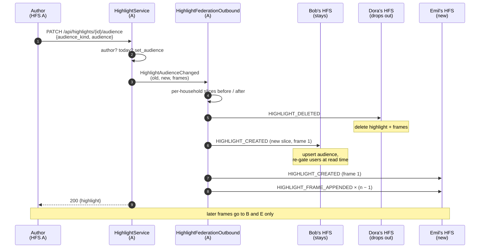
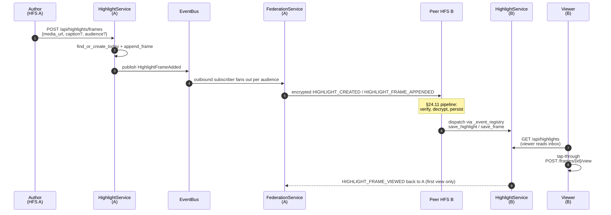

# Highlights

Personal "highlights" pillar — a WhatsApp/Instagram-style tap-through
sequence of images and short videos, posted to the author's confirmed
peer instances based on an author-controlled audience.

## Scope

- **HFS**: full participant. Authors post frames, peers receive them
  through the §24.11 inbound pipeline.
- **GFS**: uninvolved. Highlights are personal-scope, not space-scope.

## Event types

`HIGHLIGHT_CREATED`, `HIGHLIGHT_FRAME_APPENDED`, `HIGHLIGHT_FRAME_DELETED`,
`HIGHLIGHT_DELETED`, `HIGHLIGHT_FRAME_VIEWED`, `HIGHLIGHT_FRAME_REACTED`,
`HIGHLIGHT_FRAME_REACTION_REMOVED`.

Plaintext fields on every envelope: `event_type`, `from_instance`,
`to_instance`, `highlight_id`, and (where applicable) `frame_id`. Everything
else — `frame_type`, `sequence`, `media_url`, `caption_text`,
`caption_emoji`, `audience_kind`, `audience`, `expires_at`, viewer /
reactor user ids — rides inside the encrypted payload (§25.8.21).

## Audience kinds

| Kind         | Plaintext addressing                       | `audience` each household receives |
|--------------|--------------------------------------------|------------------------------------|
| `all_paired` | one envelope per `confirmed` peer instance | `[]`                               |
| `households` | one envelope per author-picked peer        | `[<that household>]`               |
| `users`      | one envelope per peer hosting any listed   | only the picked user ids homed on that household — receivers gate their local users on it before surfacing |

**A household learns only its own part of the audience.** The author's
household keeps the full list; `HIGHLIGHT_CREATED` and
`HIGHLIGHT_FRAME_APPENDED` carry a per-household copy trimmed as above
(`HighlightFederationOutbound._audience_per_target`), so no household
learns which other people or households were picked, nor the author's
housemates. Receivers read the list only to gate their own users
(`highlight_repo._IN_AUDIENCE_SQL`; `all_paired` / `households` ignore
it), so the trim needs no protocol version: an older receiver gets
exactly the ids it uses. `HIGHLIGHT_FRAME_DELETED` / `HIGHLIGHT_DELETED`
carry no audience. Release-blocker test:
`tests/protocol/test_highlight_audience_minimization.py`.

## Day model

`UNIQUE(author_user_id, highlight_date)` on the `highlights` table enforces
"one highlight per author per day". The first frame of the day creates the
row + emits `HIGHLIGHT_CREATED`; subsequent frames append + emit
`HIGHLIGHT_FRAME_APPENDED`. New day → new highlight row. The receiving instance
upserts the highlight by id, then appends the frame.

A day's frames share one audience — the highlight row's. The first frame
of the day sets it (the request's `audience_kind` / `audience`, else the
author's Settings default `highlights.default_audience` = `{kind, ids}` in
`preferences_json`; Settings › Privacy › Highlights saves the chosen
household / user ids with the kind, and the SPA composers start a new
day from it and send it explicitly). A later frame
that names an audience must name the same one (same kind, same ids in any
order); otherwise `POST /api/highlights/frames` refuses it with `409
HIGHLIGHT_AUDIENCE_MISMATCH` before anything is written, instead of
showing the frame to today's audience. A frame that names no audience
joins today's highlight; `audience` ids without an `audience_kind` are
refused with `422 VALIDATION_ERROR` (they would be ignored). Two first
frames of the day racing on `UNIQUE(author_user_id, highlight_date)`
don't fail: the loser reads the winner's row and appends (same audience)
or gets the 409. To change who sees the day, the author changes it for
every frame (see [Changing today's audience](#changing-todays-audience)).

The composers show today's audience as fixed once the author has posted
today, and **every frame names the audience the composer showed** —
never none. The day is the UTC date, so a frame that lands after UTC
midnight (a slow multi-frame upload, a tab left open overnight) starts a
new day: with the audience it was shown, that day is for the same
people; without one it would take the Settings default (all paired
households out of the box).

"The same people" is the audience. A later frame joins today's
highlight, so it also reaches whoever reads it through a share: a feed or
space post that shared the highlight (`?via_post=` readers see every
frame) and anyone holding its public link (the public stream lists the
frames at view time). The composer's note says so — it names the public
link when the author-only `GET /api/highlights/{id}/publish` reports one,
and "wherever you shared it" otherwise (whether it was shared to a feed or
space isn't on the author's highlight row, so the note doesn't claim
either way).

## Changing today's audience

The audience is set with the day's first frame and is the same for every
frame (one row per author per day). The composer shows it as locked once
the author has posted today: "Goes to: <audience> — you chose this at
08:12. New frames go to the same people." The one way to change it is
explicit — **Change for all of today…** (owner decision 1):
`PATCH /api/highlights/{id}/audience` `{audience_kind, audience}`, author
only, today's highlight only (`409 HIGHLIGHT_NOT_TODAY` otherwise). The
sheet says what changes for everyone, and that watching can't be undone:
people who already watched keep what they saw.

`HighlightService.change_audience` updates the row and publishes
`HighlightAudienceChanged` (old and new audience, the day's frames).
Locally, members outside the new audience lose it at once — every read
goes through `_IN_AUDIENCE_SQL` on the row. The outbound compares the
per-household slices before and after
(`HighlightFederationOutbound._audience_per_target`) and tells each
household only what changed for it, with the events every receiver already
applies:

| Household | Sent | Receiver does (any version since #158) |
|---|---|---|
| drops out | `HIGHLIGHT_DELETED` (no audience) | deletes the highlight, its frames, views and reactions (`_on_highlight_deleted`); no later frame is addressed to it |
| stays, slice changed (kind, or its own picked people) | `HIGHLIGHT_CREATED` re-sent: the row with its new trimmed slice, plus the first frame | upserts the audience (`save_highlight` `ON CONFLICT(id) DO UPDATE`), re-gates its users at read time; the frame upsert is a no-op |
| new | `HIGHLIGHT_CREATED` (first frame) + `HIGHLIGHT_FRAME_APPENDED` per later frame, in order | stores the day as if it had been there from the start |
| stays, slice unchanged | nothing | — |

Hidden authors (§Privacy) and guardian blocks (§CP.F2) gate every send as
for any frame. The per-household trim (#1173) holds for every envelope.
Only today's frames travel — never an earlier day.

**No protocol version.** These are the existing event types with their
existing payload shapes. Every receiver since the Highlights pillar (#158)
deletes on `HIGHLIGHT_DELETED` and upserts the audience on
`HIGHLIGHT_CREATED`, so an older peer applies a narrowing, a re-gate and a
widening exactly as a current one. No sync stream carries highlights, so
`SYNC_RECORD_LINES` is untouched.

**Cost per change** (once per author action, never on a timer): one small
envelope (~0.3 kB) per dropped or re-gated household, plus ≤ 30 frame
envelopes per newly added household. Worst realistic case: widening a
30-frame day from one household to 20 paired households = 19 × 30 = 570
envelopes (~0.5 kB each, ≈ 0.3 MB) — the cost of posting the day again,
once. Media isn't re-sent by this flow.

What a change can't reach: someone who reads it through a feed / space
share (`?via_post=`) or a public link — those follow the share, not the
audience. The composer's lock card says so when the highlight has a
public link ("wherever you shared it" otherwise).

`tests/protocol/test_highlight_audience_change.py`.

## Retention

The author's `preferences_json.highlights.retention_days` and `.max_count`
configure the local retention policy. The `HighlightRetentionScheduler`
runs hourly:

1. Drop rows where `expires_at < now()`.
2. Per author, drop the oldest highlights beyond `max_count`.

`feed_posts.linked_highlight_id` (and the space variant) are `ON DELETE SET
NULL`, so a `highlight_share` post survives the underlying highlight's
retention — the share-card renders a "Highlight has ended" placeholder.

## Mermaid sequence — author posts a frame

**One receipt per (frame, viewer).** `HighlightService.mark_frame_viewed`
announces a view — the `HighlightFrameViewed` bus event, and with it the
author's WS ping and, for a remote author, the `HIGHLIGHT_FRAME_VIEWED`
envelope — only when `highlight_frame_views` gets a new row; re-watching a
highlight sends nothing. The author's household applies the same rule to
an inbound receipt (an older viewer household still sends one per view).
Cost: a viewer who replays a 10-frame highlight 5 times used to send the
author's household 50 envelopes; now 10.

## Receiver rules

Highlights are sent straight from the author's home, never relayed. The
receiver drops the event with a WARNING when:

- `HIGHLIGHT_CREATED` / `HIGHLIGHT_FRAME_APPENDED` name a highlight id
  stored here with a different author, or a frame id stored here under
  a different highlight (the upserts are by id — the stored row decides);
- `HIGHLIGHT_FRAME_DELETED` names a frame not held here, or one whose
  highlight's author is not homed on the sender;
- `HIGHLIGHT_FRAME_VIEWED` / `_REACTED` / `_REACTION_REMOVED` come from a
  user not homed on the sender (unknown users included), or name a frame
  that is not part of that highlight here or not authored by one of our
  users — or come from someone the highlight never reached: the sender is
  not a household its audience resolves to, a `users` audience does not
  name this user, the author is hidden from that household (§Privacy), or
  a guardian block covers it (§CP.F2). The check is the outbound fan-out
  rule asked in reverse (`HighlightFederationOutbound.reaches`), so the two
  can't drift. The published author is the stored one, never the payload's.

A frame whose `media_url` is not a local media reference
(`api/media/<name>`, kept verbatim) is not stored: it would be an
`` / `<video>` source on a third party, leaking every viewer's IP.

`tests/protocol/test_highlight_scope.py`.

## Implementation pointers

- Schema: `socialhome/migrations/0001_initial.sql` — `highlights`,
  `highlight_frames`, `highlight_frame_views`, `highlight_frame_reactions`.
  ``highlights.author_user_id`` is plain text (no FK to ``users``) so
  remote-author rows from the inbound pipeline land alongside local
  rows; same convention as ``conversation_messages.sender_user_id``.
- Domain: `socialhome/domain/highlight.py`.
- Repo: `socialhome/repositories/highlight_repo.py` —
  ``list_visible_to`` filters by audience and personal block list,
  ``save_highlight`` / ``save_frame`` are upsert helpers used by the
  inbound handlers.
- Service: `socialhome/services/highlight_service.py`. `expire_due()`
  drives the scheduler. Local writes publish ``HighlightFrameAdded`` /
  ``HighlightFrameRemoved`` / ``HighlightRemoved`` on the bus.
- Outbound federation:
  ``socialhome/services/highlight_federation_outbound.py``. Subscribes to
  the three Highlight domain events; gates each on "is the author local
  on *this* instance?" (``user_repo.get_instance_for_user(author) ==
  own``) so the same events republished from the inbound path don't
  echo back to peers. Audience routing:
  - ``all_paired`` → ``federation_repo.list_instances(status='paired')``
  - ``households`` → use the listed instance ids verbatim
  - ``users``      → resolve each user_id to its home instance via
    ``user_repo.get_instance_for_user``.
- Inbound federation: handler block in
  ``socialhome/services/federation_inbound_service.py`` registered
  by ``attach_to`` for all seven ``HIGHLIGHT_*`` event types
  (``HIGHLIGHT_CREATED`` / ``HIGHLIGHT_FRAME_APPENDED`` /
  ``HIGHLIGHT_FRAME_DELETED`` / ``HIGHLIGHT_DELETED`` are author → audience;
  ``HIGHLIGHT_FRAME_VIEWED`` / ``HIGHLIGHT_FRAME_REACTED`` /
  ``HIGHLIGHT_FRAME_REACTION_REMOVED`` are viewer → author back-channel).
  Each persists via ``highlight_repo`` and republishes the matching
  domain event so :class:`RealtimeService` fans the WS frame to the
  right local audience. The back-channel handlers verify the
  envelope's signed sender is the *viewer's* / *reactor's* home
  instance — peers can't fabricate views or reactions on behalf of
  someone else.
- Realtime push: ``socialhome/services/realtime_service.py`` —
  subscribes to the five Highlight bus events. Author-side events
  (``HighlightFrameAdded`` / ``HighlightFrameRemoved`` / ``HighlightRemoved``)
  fan ``highlight.frame_added`` / ``highlight.frame_removed`` /
  ``highlight.removed`` WS frames to the whole household so the SPA
  refetches ``/api/highlights`` (audience-filtered server-side);
  ``HighlightAudienceChanged`` fans ``highlight.audience_changed`` the
  same way (it names neither audience).
  Back-channel events (``HighlightFrameViewed`` /
  ``HighlightFrameReactionChanged``) fan ``highlight.frame_viewed`` /
  ``highlight.frame_reaction_changed`` only to the *author's* WS
  sessions — unrelated household members don't need the noise.
- Notifications: ``NotificationService.on_highlight_reaction_changed``
  writes a local ``highlight_reacted`` row ("Anna reacted ❤️ to your
  highlight", linked to the viewer) for the author when a
  ``HighlightFrameReactionChanged`` lands on the author's household — a
  household member's reaction, or a paired household's
  ``HIGHLIGHT_FRAME_REACTED`` already on its way to the author's home.
  Nothing new crosses the wire; a cleared reaction, your own, a blocked
  reactor and an author on another household stay silent.
- Routes: `socialhome/routes/highlights.py`. The detail read carries the
  caller's own reaction per frame (`my_reaction`, read-time from
  `highlight_frame_reactions`) so the viewer's tray shows it.
- Private reply (owner decision 11): the SPA gets or creates the 1:1 DM
  with the author (`POST /api/conversations/dm`, idempotent), then calls
  `POST /api/highlights/frames/{id}/dm-reply`; the reply rides the normal
  DM path, with the frame snapshot frozen on the message.
- Retention scheduler:
  `socialhome/infrastructure/highlight_retention_scheduler.py` (copies the
  `_stop: asyncio.Event` template from `replay_cache_scheduler.py`).
- Frontend: `client/src/features/highlights/` (4 pages — inbox, viewer,
  composer, archive; the composer is the one way to post — every entry
  point opens `/highlights/new` — with the lock card and the "Change for
  all of today…" sheet), `client/src/components/HighlightShareCard.tsx`, and
  `client/src/components/HighlightPickerDialog.tsx` for sharing into a feed.
  The viewer's own Share (`viewerSheets.tsx`) asks first when the feed or
  space reaches more people than the highlight's audience
  (`shareReach.ts`): a share opens all of that day's frames to everyone
  who can read the post.

## Spec refs

- §24.11 inbound validation pipeline (encryption-first applies).
- §25.8.21 every field encrypted unless required for routing.
- §Highlights (this page) for the author retention + audience model.
