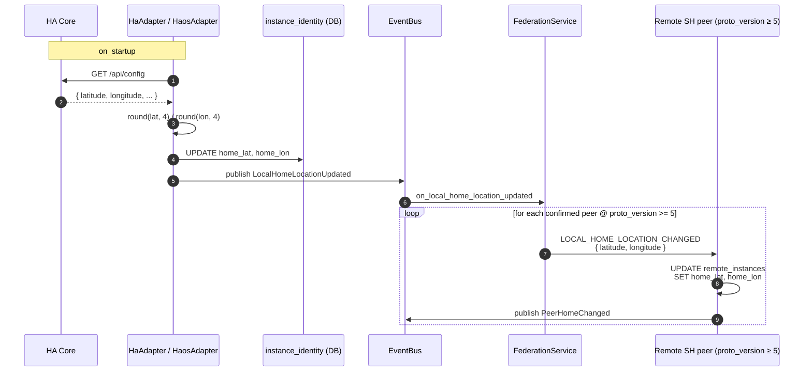
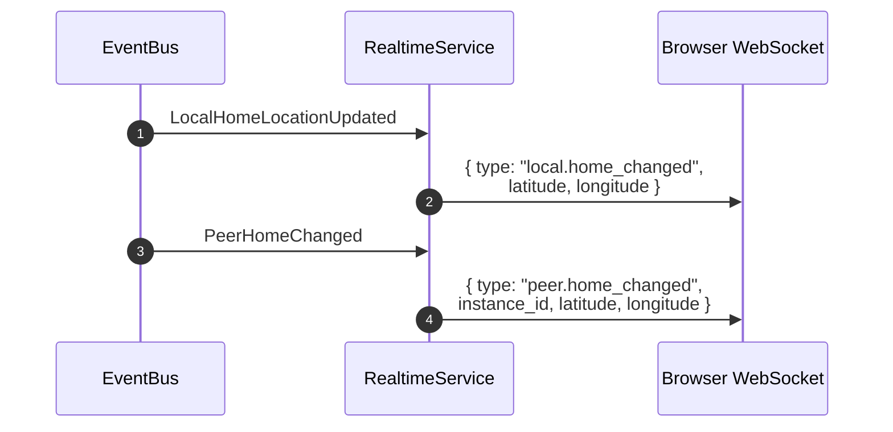

# Home location (federation map)

The home-location surface lets every household broadcast its physical
coordinates to confirmed peers so a map view can show where each paired
household sits in the world. Coordinates are coarse — truncated to 4
decimal places (~11 m) per §GPS-truncation, which is precise enough for
a city-level pin but not a street address.

## Scope

- **HFS**: both sides. HA / HAOS adapters read `latitude` / `longitude`
  from HA Core's `/api/config` on startup and push the value to peers.
  All HFS builds receive and render inbound location events.
- **GFS**: uninvolved. Home-location events never leave the pair mesh.

## Event types

`LOCAL_HOME_LOCATION_CHANGED`.

## Flow — initial location broadcast

Peers with `proto_version < 5` are silently skipped — they do not
receive the event and retain whatever coordinates were last stored
(or no coordinates if none were ever exchanged). When the peer
upgrades and the sender's next startup fires, the event is delivered
normally.

## Flow — realtime SPA update

Both `LocalHomeLocationUpdated` and `PeerHomeChanged` are also
consumed by `RealtimeService`, which fans the data straight to
every connected browser client:

The SPA's Connections page subscribes to both frames and updates
the Leaflet map pins in-place without a page reload.

## Location seeded at pairing time

The pairing code (QR / copy code) carries A's `home_lat` / `home_lon`, and
B's `PAIRING_PEER_ACCEPT` carries B's, only when that household's admin
shares its home with the other one — the per-pair switch, chosen on the
pairing dialog's start step and pre-set from the household setting
`share_home_default` (on by default); see
[`pairing.md`](./pairing.md#home-sharing-is-chosen-before-the-handshake).
Each side stores what it receives on the other's `remote_instances` row
immediately, so the Map tab shows the pin as soon as the pair is confirmed,
without waiting for a subsequent `LOCAL_HOME_LOCATION_CHANGED` broadcast.
The row it creates carries the same `share_home` switch, so the later
fan-out keeps honouring it.

## GPS precision

All latitude / longitude values are truncated to **4 decimal places**
before any storage or transmission — `round(float(val), 4)`. This
applies at three enforcement points:

1. **Adapter `on_startup`** — when the value is read from HA Core.
2. **Pairing coordinator** — when `home_lat` / `home_lon` go into or
   arrive in the pairing code or the `PAIRING_PEER_ACCEPT` body.
3. **Inbound handler** — when `LOCAL_HOME_LOCATION_CHANGED` is
   processed.

Raw device precision is never stored. See [`../principles.md`](../principles.md)
§ GPS truncation and [`../database.md`](../database.md) conventions.

## SPA — Connections Map tab

The Connections page exposes a **List | Map** tab toggle. The Map tab
renders an OpenStreetMap canvas (Leaflet) with:

- The own household's pin, using the `instance_identity.home_lat /
  home_lon` value from `GET /api/pairing/connections`.
- One pin per confirmed peer that has coordinates, marked with a
  transport-indicator badge (⚡ WebRTC DataChannel, ☁ HTTPS inbox).
- A distance and 8-point compass bearing popup when a pin is tapped.
- A "Not on map" footer listing peers whose coordinates are NULL (e.g.
  standalone instances without a configured location).

## Revoking access

An admin can stop sharing the household's home coordinates with a specific
peer via `PATCH /api/pairing/connections/{instance_id}` with
`{"share_home": false}`. The flip fires a one-shot
`LOCAL_HOME_LOCATION_CHANGED` envelope to that peer carrying
`{"latitude": null, "longitude": null}`. The peer's inbound handler treats
null coords as a revoke signal: it clears `remote_instances.home_lat` /
`home_lon` for the sender and publishes `PeerHomeChanged` with nulls so the
SPA drops the pin from the Connections → Map view.

Re-enabling (OFF → ON) immediately fires a `LOCAL_HOME_LOCATION_CHANGED`
with the current local coordinates, so the pin reappears on the peer's map
within seconds.

The toggle also gates the regular fan-out: `_on_local_home_location_updated`
skips peers whose `remote_instances.share_home = 0`, so HA Core location
changes never reach a revoked peer.

Defaults to ON (`share_home = 1`) for every newly paired peer. Operators can
flip it inside the pairing wizard's final "Configure sharing" step or at any
time afterwards from Connections → Manage → Home location.

No `proto_version` bump is needed — null coordinates inside the existing
v5 `LOCAL_HOME_LOCATION_CHANGED` event are forward-compatible. A pre-toggle
v5 peer running the federation-map release silently discards a null-coord
envelope (its inbound handler bails early on `None` values), which is
the correct degraded behaviour: the peer keeps its last-known pin rather
than receiving an explicit revoke signal, and the sender's `share_home = 0`
gate prevents further coord updates from reaching that peer anyway.

## Implementation pointers

- `socialhome/platform/ha/adapter.py` — `_persist_home_location_from_ha`
  writes coords on `HaAdapter.on_startup`.
- `socialhome/platform/haos/adapter.py` — same helper, same lifecycle
  hook.
- `socialhome/platform/ha_home_location.py` — shared helper that
  fetches `/api/config` and persists via `FederationRepo`.
- `socialhome/repositories/federation_repo.py` — `update_instance_home`
  updates `instance_identity`; `update_remote_instance_home` updates
  `remote_instances`.
- `socialhome/domain/events.py` — `LocalHomeLocationUpdated`,
  `PeerHomeChanged` (internal bus events).
- `socialhome/domain/federation.py` — `FederationEventType.LOCAL_HOME_LOCATION_CHANGED`,
  `FederationCapability.MIN_FOR_HOME_LOCATION_BROADCAST = 5`.
- `socialhome/domain/federation_capabilities.py` — `OURS = 5`,
  `FederationCapability.MIN_FOR_HOME_LOCATION_BROADCAST`.
- `socialhome/federation/federation_service.py` — subscribes to
  `LocalHomeLocationUpdated`, fans out to v5+ peers.
- `socialhome/services/federation_inbound/` — `_on_local_home_location_changed`
  inbound handler.
- `socialhome/services/realtime_service.py` — `_on_local_home_location_updated`
  and `_on_peer_home_changed` push WS frames.
- `socialhome/services/peer_home_sharing_service.py` — `PeerHomeSharingService.set_share_home`
  — idempotent toggle; fires the one-shot null-coord or current-coord envelope.
- `socialhome/routes/pairing.py` — `PATCH /api/pairing/connections/{instance_id}`
  accepts `{"share_home": bool}` (admin-only).
- `client/src/features/connections/ShareHomeToggle.tsx` — toggle component
  rendered in ConnectionDetail under "Home location".
- `client/src/features/connections/FederationMap.tsx` — Leaflet map
  component.
- `client/src/features/connections/_mapMath.ts` — distance + bearing
  helpers.

## Spec references

§25 (GPS precision rule), §11 (pairing bootstrap, `PAIRING_PEER_ACCEPT`
body), §4 (adapter on_startup lifecycle).
