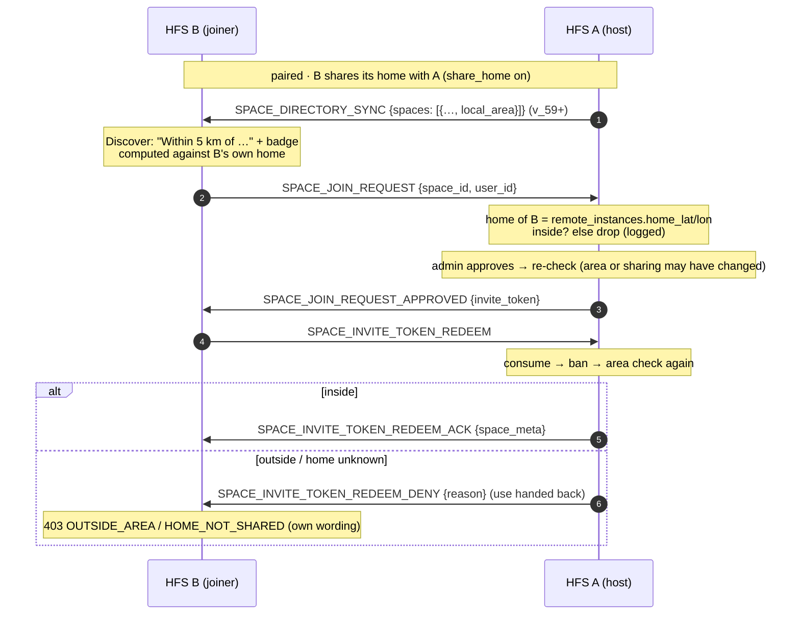

# Local communities

A **public** space can be bound to an area — a centre and a radius — and
become a *local community*: a neighbourhood, a village, a street. A
household holds a seat only while the home it **already shares with the
hosting household** lies inside the circle. The host decides, on every path
that grants a seat; nobody is ever asked to send a location to join.

## Scope

- **HFS (host)**: stores the area (`spaces.lat` / `lon` / `radius_km`,
  host-local), shows it to its own people, sends it to paired peers in its
  directory snapshot, and checks every seat against the joiner's shared home.
- **HFS (paired peer)**: keeps the area of each directory entry, shows it
  before joining ("Within 5 km of …" with a small map) and computes an
  *In your area* / *Outside your area* / *Share your home* badge against its
  **own** home. The badge is a convenience; the host's check is the rule.
- **GFS**: uninvolved. Only the `public` tier can be a local community, and a
  public space is never on a GFS. A household met through a GFS never shares
  a home with the host, so a local community's invite link never seats it.

## The rules

- **Public tier only.** Create / settings take `lat` / `lon` / `radius_km`
  (all three or none) only for a public space (`422 LOCAL_AREA_PUBLIC_ONLY`
  otherwise). Leaving the public tier drops the area. A pin stored before
  this feature (a centre without a radius) is no area.
- **Precision.** The centre is truncated to 4 dp (about 11 m) on write and
  again on receipt; the radius is 0.5–50 km, kept to one decimal. Peers
  re-validate a received area and drop a malformed one rather than guess.
- **Whose home.** A local user of the host → the host household's own home
  (`instance_identity.home_lat` / `home_lon`). A remote household → the home
  it shares with the host through pairing (`remote_instances.home_lat` /
  `home_lon`, from `PAIRING_PEER_ACCEPT` and `LOCAL_HOME_LOCATION_CHANGED`,
  cleared when that household turns `share_home` off toward the host). A
  household with no pairing row (met over the mesh, or through an invite
  link — `space_session`, which never receives a home) has none.
- **Unknown is refused.** No home → `403 HOME_NOT_SHARED`; outside →
  `403 OUTSIDE_AREA`. The rim counts as inside (haversine on a 6 371 km
  sphere, the same as the zone match).
- **Every seat path, no override.** Open join, a join request (when filed
  and again when approved), follow, an invite token / link redeem (local and
  §D2 / §D2b over the wire), a direct invite (when sent and again when the
  accept arrives), and an admin's direct add. An admin's explicit invite does
  **not** override the area (owner decision 2026-10-19).
- **Members stay.** Moving, shrinking or removing the area evicts nobody;
  the check runs when a seat is granted.
- **The host only.** A member household's stub never holds the area. For
  the same reason a local community never has *delegated admin authority*
  (`409 LOCAL_AREA_DELEGATED` either way round): a delegated admin's household
  would seat people itself, without the host's check. With delegation off a
  member household's admin invite is forwarded to the host, and invite links
  are always minted on the host (v_52), so every seat passes the host.
- **Host-local config.** Setting the area bumps no `config_sequence` and sends
  no `SPACE_CONFIG_CHANGED`; it re-sends the directory snapshot.

## Event types

No new event type. The feature rides on:

- `SPACE_DIRECTORY_SYNC` — an entry carries
  `local_area: {lat, lon, radius_km}` when the space is a local community
  (v_59, sender-gated: a peer below v_59 gets the entry without it).
- `SPACE_JOIN_REQUEST` — the host drops a request from a household that is
  outside or whose home it does not know (logged, like a banned applicant),
  so it never reaches the admins.
- `SPACE_INVITE_TOKEN_REDEEM_DENY` — two reasons besides the uniform
  `REDEEM_DENY_REASON`: `"home location not shared"` and
  `"home outside the local area"`. They are sent only after the token was
  consumed and the ban check passed (a dead or banned link still gets the
  uniform reason), the use is handed back, and the redeemer maps them to its
  own `HOME_NOT_SHARED` / `OUTSIDE_AREA` errors — the issuer's text is never
  rendered.
- `SPACE_PRIVATE_INVITE_ACCEPT` — re-checked on the host; refused → the
  invitation is declined and the household gets `SPACE_REMOTE_MEMBER_REMOVED`
  so its accepted stub goes away.

## Flow — a paired household asks to join

## Implementation

- `socialhome/domain/local_community.py` — the pure rules: `LocalArea`,
  `validate_local_area` (4 dp, bounds), `local_area_of` (public tier, whole
  area), `eligibility` (haversine), the wire shape.
- `socialhome/services/local_community.py` — `require_local_eligibility`,
  the one check every seat path calls (whose home, fail closed).
- `socialhome/services/space_service.py` — `create_space` /
  `set_local_area` / `require_local_seat` and the local seat paths
  (`request_join`, `approve_join_request`, `subscribe_to_space`,
  `add_member`, `invite_local_user`, `accept_local_invite`,
  `accept_invite_token`, `invite_remote_user`); `update_config` drops the
  area when the tier leaves public and refuses delegated authority with one.
- `socialhome/services/federation_inbound/space_invites.py` — inbound
  `SPACE_JOIN_REQUEST`.
- `socialhome/federation/invite_token_redeem.py` — the issuer-side check in
  `_consume_seat_and_build_ack`, the two DENY reasons and their redeemer-side
  mapping (§D2 and §D2b).
- `socialhome/federation/private_invite_handler.py` — the accept re-check.
- `socialhome/services/peer_directory_service.py` /
  `socialhome/federation/peer_directory_handler.py` — the v_59 directory
  field (sent gated, received re-validated) into
  `peer_space_directory.lat` / `lon` / `radius_km` (migration 0105).

## Spec references

§D1a (peer directory sync), §D2 / §D2b (join requests, invite redeem),
§11 (pairing — the home location it shares), §25.8.21 (the directory
snapshot travels encrypted to paired peers only), §2 GPS rule
([`../principles.md`](../principles.md#gps-truncation-4-dimension)).
