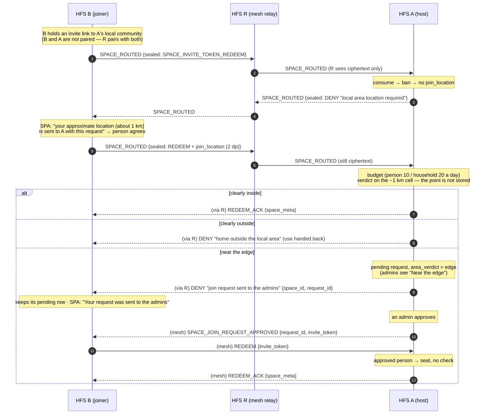

# Local communities

A **public** space can be bound to an area — a centre and a radius — and
become a *local community*: a neighbourhood, a village, a street. A
household takes a seat only while its home lies inside the circle. The host
decides, on every path that grants a seat, on **the household's home rounded
to about 1 km, which the join itself carries** — sent with the person's
consent, to the host only, sealed end to end, and never stored. The centre
never leaves the host (owner decisions 2026-10-19: people's locations are not
shared by design; "the joiner sends ~1 km with the join").

## Scope

- **HFS (host)**: stores the area (`spaces.lat` / `lon` / `radius_km`,
  host-local) and shows the centre on a map to its own people only. Paired
  peers' directory snapshots say "local community, within X km" — no centre,
  no verdict. Decides every seat on the point the join carries (its own
  people: its own home, rounded the same way).
- **HFS (joiner)**: shows "Local community · within 5 km of the host's chosen
  centre", asks the person before a join to it carries the household's
  approximate location ("To check you live in the area, your approximate
  location (about 1 km) is sent to *host* with this request"), and sends it
  only inside that join.
- **Mesh relays / GFS**: carry the join without being able to read the
  point — it rides inside the SPACE_ROUTED seal (mesh) or the §D2b sealed
  bootstrap body (GFS relay). A local community is never *listed* on a GFS
  (only the public tier can be one, and public is never on a GFS); a
  household met through a GFS reaches one only through an invite link.

## The rules

- **Public tier only.** Create / settings take `lat` / `lon` / `radius_km`
  (all three or none) only for a public space (`422 LOCAL_AREA_PUBLIC_ONLY`
  otherwise). Leaving the public tier drops the area. A pin stored before
  this feature (a centre without a radius) is no area.
- **Precision.** The centre is truncated to 4 dp (about 11 m) on write; the
  radius is 0.5–50 km, kept to one decimal. Peers re-validate a received
  radius and drop a malformed one rather than guess.
- **What the join carries.** `join_location: {lat, lon}` — the joining
  household's home (`instance_identity.home_lat` / `home_lon`) rounded to
  **2 decimals** (`JOIN_LOCATION_PRECISION_DP`, ~1.1 km of latitude: a part
  of town, never a house or a street). It is added only when the person
  agreed in the SPA (`share_location: true` on the HTTP call); the host rounds
  it again on receipt, so a sender that sent more is never read more
  precisely, and a malformed one counts as none. It travels inside the join's
  own encrypted payload (§25.8.21) and is never stored, logged or forwarded —
  the only trace is the verdict on a pending request (`area_verdict`). The
  per-pair `share_home` (pairing) is **not** used for joining.
- **The verdict** (`join_verdict`). The home lies somewhere in the cell ±half
  a unit of the last decimal around the point, so the host answers for the
  whole cell (haversine on a 6 371 km sphere, the rim counts as inside):
  - **clearly inside** — every corner of the cell inside → the seat proceeds
    as without an area (an open space seats; a request-mode space files the
    request);
  - **clearly outside** — the cell's nearest point beyond the rim →
    `403 OUTSIDE_AREA`;
  - **near the edge** — the cell straddles the rim → **never decided
    automatically**: the join becomes a **pending join request for the
    space's admins, even in `open` mode**, flagged `area_verdict: 'edge'`
    ("Near the edge" in the admins' queue). The person learns only that the
    request was sent — exactly what a request-mode space answers.
  - An automatic answer therefore reveals only which ~1 km cell is inside,
    outside or near the rim — never a distance: moving a home and asking again
    traces nothing finer than the cells.
- **No point → no decision.** A join from another household without
  `join_location` (no consent yet, or an older household) is refused
  `403 LOCATION_REQUIRED` (a link redeem: the SPA asks the person and redeems
  again; an inbound `SPACE_JOIN_REQUEST`: dropped). A household with no home
  set cannot send one (`403 HOME_NOT_SET` on the joiner's side; for the
  host's own people, on the host). Neither spends a check. The home comes
  from Home Assistant in `ha` / `haos` mode and is set by an admin in
  Admin › Settings › Our home location on a standalone household
  (`/api/admin/home-location`, [architecture](../architecture.md)).
- **Admins decide.** Approving a request — inside or near the edge — seats
  the person: nothing is re-checked (the point was never kept). An admin's own
  steps (a direct add, a local invite) use this household's home: refused
  clearly outside, allowed near the edge (the admin decided). Inviting a
  household on another instance checks nothing up front (the host knows no
  home of theirs); the invitee's accept carries the point.
- **Every person-started path, no override.**
  - *Open join / join request* (local): inside → seat (open) or request; edge
    → request (`{joined: false, request_id}`), any join mode.
  - *Follow, local invite accept, local invite-link redeem*: inside → seat;
    edge → a join request and `403 JOIN_REQUEST_SENT` ("Your request was sent
    to the admins"). Asking again while it waits answers the same request.
  - *Remote `SPACE_JOIN_REQUEST`*: inside and edge are filed alike (the
    applicant hears nothing until an admin answers); outside / no point →
    dropped.
  - *Remote invite-link redeem* (`SPACE_INVITE_TOKEN_REDEEM`, direct,
    mesh-routed or §D2b): after the consume + ban check; inside → ACK; edge →
    a host-side request and DENY `"join request sent to the admins"` naming
    `space_id` + `request_id` (the redeemer keeps its own pending row under
    that id); refusals hand the use back.
  - *Remote invite accept* (`SPACE_PRIVATE_INVITE_ACCEPT`): the invitation's
    `space_meta` carries `local_community: {radius_km}` so the invitee's SPA
    asks first; inside → seat; refused → declined +
    `SPACE_REMOTE_MEMBER_REMOVED`; edge → a host-side request, declined, and
    the REMOVED carries `join_request_id` so the invitee keeps its side.
  - *An approved person* (`has_approved_join_request`, within 7 days): their
    redeem — of the token the approval minted, or of the same link again when
    the approval could not be delivered — seats them with no check.
- **Checks are budgeted per person — spam control only.** No answer is
  exact, so the budget only stops retries and floods: **10** checks per
  person per community per UTC day (`MAX_LOCAL_AREA_CHECKS_PER_PERSON`) on
  every path a person starts, successful ones and edge reviews included; a
  remote household also has a backstop of **20**
  (`MAX_LOCAL_AREA_CHECKS_PER_HOUSEHOLD`) since its user ids are its own to
  choose. Past it: `429 LOCAL_AREA_RATE_LIMITED`, no verdict, until 00:00
  UTC. Admin steps are not counted; asking again while a request is pending
  is free. Kept across restarts in `local_area_attempts` (migration 0109), a
  person as `sha256(household \n user id)`, days before yesterday pruned.
- **Members stay.** Moving, shrinking or removing the area evicts nobody.
- **The host only.** A member household's stub never holds the area, and a
  local community never has *delegated admin authority* (`409
  LOCAL_AREA_DELEGATED`): a delegated admin's household would seat people
  itself. Invite links are always minted on the host (v_52).
- **Host-local config.** Setting the area bumps no `config_sequence` and sends
  no `SPACE_CONFIG_CHANGED`; it re-sends the directory snapshot.

## What a paired household learns

`local_community: true` and `radius_km` — "within X km". Nothing else: no
centre, no distance, no verdict. Whether *its* home is inside it learns only
by asking to join, on the coarse cell rules above.

## Event types

No new event type. The feature rides on:

- `SPACE_DIRECTORY_SYNC` — an entry carries `local_community: true` and
  `radius_km` (v_59, sender-gated). Redefined in place before release (drafts
  carried the centre, then a per-recipient `in_area` / `area_edge` verdict on
  the home shared through pairing).
- `SPACE_JOIN_REQUEST` — carries `join_location` (with consent). The host
  drops one that is outside or has none, or from a person past their budget;
  a repeat while pending is dropped without a check. A filed one keeps only
  `area_verdict`.
- `SPACE_INVITE_TOKEN_REDEEM` (and the §D2b sealed bootstrap body) — carries
  `join_location` once the person agreed. DENY reasons besides the uniform
  one: `"local area location required"`, `"home outside the local area"`,
  `"local area refusals rate-limited"`, `"join request sent to the admins"`
  (+ `space_id`, `request_id`). Sent only after the consume + ban check; the
  redeemer maps them to its own `LOCATION_REQUIRED` / `OUTSIDE_AREA` /
  `LOCAL_AREA_RATE_LIMITED` / `JOIN_REQUEST_SENT` — the issuer's text is
  never rendered.
- `SPACE_PRIVATE_INVITE` — `space_meta.local_community: {radius_km}`.
- `SPACE_PRIVATE_INVITE_ACCEPT` — carries `join_location` once the person
  agreed; refused → declined + `SPACE_REMOTE_MEMBER_REMOVED`; edge → the
  REMOVED carries `join_request_id`.
- `SPACE_JOIN_REQUEST_APPROVED` / `_DENIED` — sent with mesh fallback, so an
  applicant that reached the host over the mesh hears the answer.

## Flow — a household joins over the mesh

A paired household's "Ask to join" is the same decision with a direct
`SPACE_JOIN_REQUEST {…, join_location}`: inside and edge are filed (the
applicant hears nothing until an admin answers), outside is dropped. A
household met through a GFS redeems through the §D2b sealed bootstrap body;
the relay sees only the addressee and ciphertext.

## Implementation

- `socialhome/domain/local_community.py` — the pure rules: `LocalArea`,
  `validate_local_area` (4 dp, bounds), `local_area_of` (public tier, whole
  area), `JOIN_LOCATION_PRECISION_DP` / `coarse_join_point` /
  `parse_join_location` / `join_location_wire` (the 2 dp point),
  `join_verdict` (inside / outside / edge for the cell), the host-API shape
  (`local_area_wire`, with the centre) and the directory shape
  (`local_community_wire` / `parse_local_community_wire`, radius only).
- `socialhome/services/local_community.py` — `require_local_eligibility`,
  the one check every seat path calls; `own_home_point` / `join_location_for`
  (the joiner's side, consent-gated); `pending_join_request_id`,
  `file_remote_join_request`; `LocalAreaBudget`.
- `socialhome/repositories/local_area_attempt_repo.py` — the daily counters.
- `socialhome/repositories/space_repo.py` — `save_join_request(area_verdict=)`,
  `has_approved_join_request` (migration 0111).
- `socialhome/services/space_service.py` — the local seat paths
  (`request_join`, `subscribe_to_space`, `accept_local_invite`,
  `accept_invite_token`, `add_member`, `invite_local_user`,
  `approve_join_request`) and the joiner's side (`request_join_remote`,
  `redeem_invite_token`, `accept_remote_invite` with `share_location`); the
  invitation snapshot's `local_community`.
- `socialhome/services/federation_inbound/space_invites.py` — inbound
  `SPACE_JOIN_REQUEST`.
- `socialhome/federation/invite_token_redeem.py` — the issuer-side decision
  (`_local_area_refusal`), the DENY reasons and the redeemer-side mapping
  (§D2, mesh and §D2b).
- `socialhome/federation/private_invite_handler.py` — the accept decision
  and the joiner keeping its side of an edge review.
- `socialhome/services/peer_directory_service.py` /
  `socialhome/federation/peer_directory_handler.py` — the radius-only
  directory entry (migrations 0105, 0106, 0110).
- SPA: `client/src/components/localConsent.ts` (the consent prompt),
  `features/spaces/SpaceDiscover.tsx`, `SpacePublicDetailPage.tsx`,
  `JoinRequestModal.tsx`, `SpaceJoinByCodeDialog.tsx`,
  `components/RemoteInviteInboxBanner.tsx`, `components/JoinRequestList.tsx`
  ("Near the edge"), `utils/localArea.ts` (`joinVerdict`, the server's rule
  for our own communities).

## Spec references

§D1a (peer directory sync), §D2 / §D2b (join requests, invite redeem),
§D1b (private invites), §25.8.21 (every join's location rides inside its
encrypted payload; mesh hops via SPACE_ROUTED), §2 GPS rule
([`../principles.md`](../principles.md#gps-truncation-4-dimension),
[people's locations](../principles.md#peoples-locations-are-never-shared-by-design)).
