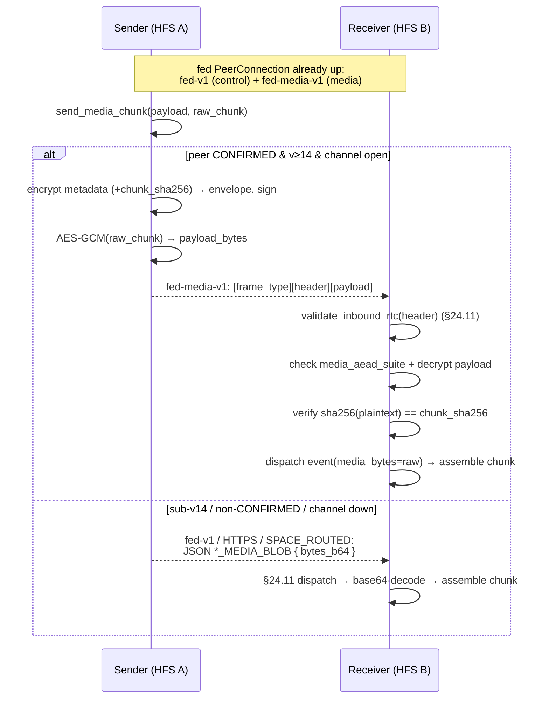
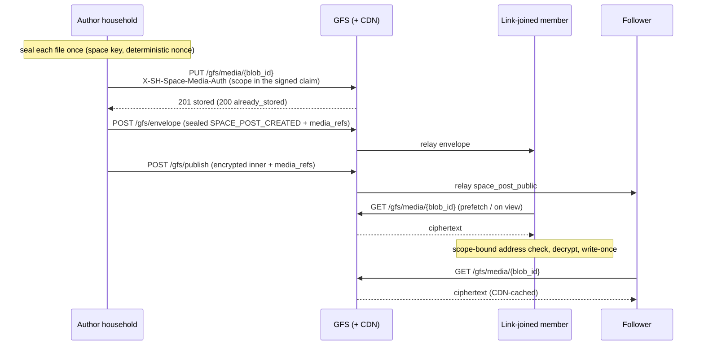

# Media transport — the binary `fed-media-v1` channel

## Summary

Cross-household media (DM attachments and space-post / gallery images)
is delivered as **chunks**. Two transports carry those chunks:

1. **JSON over `fed-v1`** (the original path) — each chunk is a
   base64 string inside the `DM_MEDIA_BLOB` / `SPACE_MEDIA_BLOB`
   federation envelope, AES-256-GCM-encrypted like any event and sent
   on the shared `fed-v1` control DataChannel (or HTTPS inbox /
   `SPACE_ROUTED` on fallback).
2. **Binary over `fed-media-v1`** (capability **v_14**) — a second
   DataChannel multiplexed on the *same* federation `PeerConnection`
   carries each chunk as a length-prefixed binary frame with the raw
   bytes encrypted directly (no base64).

The binary path exists because the JSON path inflates media ~1.77× on
the wire (base64 of the chunk, then base64 of the ciphertext) **and**
forces multi-hundred-KB media frames through the same ordered SCTP
stream as latency-sensitive control events (presence, typing,
reactions) — head-of-line blocking. A second SCTP DataChannel is an
independent stream, so big media no longer blocks control traffic, and
it rides the existing PeerConnection: no extra ICE / DTLS / TURN
handshake.

## Scope

- **Point-to-point only.** The binary channel exists between two
  **CONFIRMED direct peers**. A non-CONFIRMED or mesh-only space member
  (reachable only via a `SPACE_ROUTED` relay) never uses it — that
  member keeps receiving the JSON `SPACE_MEDIA_BLOB` over the mesh,
  in smaller 384 KiB chunks so the routed envelope fits the first hop's
  inbox (see [DM media → Chunking](dm-media.md#chunking)).
- **Capability-gated.** The sender uses the binary channel only when
  the peer advertises `proto_version ≥ 14`
  (`FederationCapability.MIN_FOR_MEDIA_CHANNEL`) **and** is CONFIRMED
  **and** the channel is currently open. Any miss falls back
  transparently to the JSON path.
- **Encryption-first (§25.8.21).** The raw chunk is AES-256-GCM
  encrypted under the directional session key; nothing media-bearing
  ever crosses the wire in cleartext.

## Frame format

Every frame on `fed-media-v1`:

```
[u8 frame_type][u32 header_len BE][header_bytes][u32 payload_len BE][payload_bytes]
```

- **`frame_type`** — `1` = `MEDIA_CHUNK` (v1). Forward-compatible: a
  receiver skips an unknown type rather than erroring, so future frame
  kinds (flow-control, resume) can share the channel without a new
  label.
- **`header_bytes`** — the signed federation **envelope JSON**,
  verbatim. It is the *same* shape `send_event` builds (`msg_id`,
  `event_type` = `dm_media_blob` / `space_media_blob`, `from_instance`,
  `to_instance`, `timestamp`, `space_id`, `proto_version`, `sig_suite`,
  `signatures`, `encrypted_payload`). The framing layer treats it as
  opaque so the exact signed bytes are re-parsed by the §24.11
  pipeline.
- **`payload_bytes`** — `nonce(12) ‖ AES-256-GCM(raw_chunk)`. Raw
  binary, never base64.

The envelope's `encrypted_payload` is the AES-256-GCM-encrypted **chunk
metadata** (the same fields the JSON `*_MEDIA_BLOB` payload carries —
`media_blob_id` / `message_id` / `filename` / `transfer_id` /
`chunk_index` / `chunk_count` / `final` / … — but **without**
`bytes_b64`), plus two media fields:

- `media_aead_suite` — `"aesgcm-256"`, validated against
  `SUPPORTED_MEDIA_AEAD_SUITES`; unknown suites are rejected with no
  default fallback (the project-wide crypto-suite rule).
- `chunk_sha256` — b64url SHA-256 of the **plaintext** chunk. This is
  the binding (see Security).

## Security model

The binary frame inherits every §24.11 guarantee unchanged, because the
header **is** a normal federation envelope and the receiver runs it
through the same validation pipeline (`validate_inbound_rtc`):

- **Origin authentication** — Ed25519 (suite-aware) signature over the
  envelope. The signed-byte reconstruction in `make_verify_signature` is
  untouched.
- **Replay** — the envelope's `msg_id` against the existing replay
  cache; each chunk is its own envelope with its own `msg_id`.
- **Timestamp / ban / idempotency / deprovisioned-author** — same
  pipeline steps; an `early_response` short-circuit skips assembly.
- **Confidentiality** — chunk + metadata both AES-256-GCM under the
  directional session key.

**Binding the binary payload to the signed envelope.** `chunk_sha256`
lives *inside* the AES-GCM-encrypted, signature-covered metadata. So:

- tampering with `payload_bytes` → the receiver's `sha256(plaintext)`
  check fails;
- tampering with `chunk_sha256` → the GCM tag (or the envelope
  signature) fails;
- swapping payloads between two valid frames → each frame's
  `chunk_sha256` commits to its own chunk, and re-delivering an
  identical frame is dropped by the replay cache.

The receiver verifies `sha256(plaintext) == chunk_sha256` **after** GCM
decryption (constant-time compare), so the hash binds the exact bytes
written to disk. Both the metadata AEAD and the chunk AEAD draw a fresh
random 96-bit nonce; the shared-key message count stays many orders of
magnitude below the GCM birthday bound for any realistic peer lifetime
(see [`../crypto.md`](../crypto.md)).

## Flow



Both paths converge on the same receiver assembly
(`_assemble_dm_chunk` / `_assemble_space_chunk`): the handlers prefer
`event.media_bytes` (binary path) and fall back to base64 `bytes_b64`
(JSON path), so chunking, part-file reassembly, and the
`dm.media_ready` WebSocket notify are identical regardless of transport.

## Receiver scope + write-once

Whatever the transport, the receiver writes a chunk only for what the
sending household was sent it for. Both blob types share
[`inbound_media_store.py`](../../socialhome/services/inbound_media_store.py):

- **Strict names.** The target name (`filename`, or the DM
  `message_id`) must be one safe path component — no separators, no
  leading dot, no NUL or whitespace. `chunk_index` / `chunk_count` must
  be in range.
- **Write-once.** Chunks assemble into a temp file that is moved into
  place with a hard link that fails on an existing name (check-then-
  replace on filesystems without hard links). A file already present —
  another space's picture, a DM attachment, the household's own upload,
  or an earlier copy of the same blob — is never replaced; a same-size
  re-delivery is a quiet no-op, anything else logs a WARNING.
- **One media directory, two namespaces.** Space files and DM
  attachments share `media_dir`. A received DM attachment is stored as
  `dm-<sha256("dm-media", from_instance, message_id)[:40]>.<ext>`
  (`dm_media_name`) — bound to the household that sent its chunks — and
  a `SPACE_MEDIA_BLOB` never writes a reserved name
  (`is_reserved_media_name`: the `dm-` / `gm-` prefixes, owned by DM
  attachments and GFS moment media, and the DM transients
  `*.preview.webp` / `*.part<N>` / `*.assembled`). So a space blob for a
  row not seen yet can never plant a DM's file, whichever arrives first,
  and only the DM sender's own household can fill its name. Before
  2026-11-06 the DM file was `<message_id>.<ext>` and a household that
  knew the id could plant it through a space blob for the DM to adopt.
- **Size caps.** A file must fit what the receiving path accepts, from
  the upload limits in `domain/media_constraints.py`: a space file at
  most `SPACE_MEDIA_MAX_BYTES` (`VIDEO_MAX_UPLOAD_BYTES`, 200 MiB — a
  space video is the biggest thing a space ships), a DM attachment per
  its declared type (`dm_media_max_bytes`, see
  [`dm-media.md`](./dm-media.md#chunking)). Every chunk checks the
  declared `file_size_bytes`, so the first one to land refuses an
  oversized file, and a chunk must fit its share of it (`(chunk_count −
  1) × len(chunk) < file_size_bytes`, true of every sender's equal split)
  — the parts on disk stay under twice the declared size. A refused
  chunk is dropped with a WARNING and nothing is written.
- **Sender-bound names (`SPACE_MEDIA_BLOB`).** A received space file
  never keeps the name its sender used. A file `F` that household `H`
  delivers is stored and referenced here as
  `sd-<sha256("space-direct", space_id, H, F)[:40]>.<ext>`
  (`space_direct_media_name`), where `H` is the household this one
  authenticated: the envelope's sender, a `SPACE_ROUTED` inner event's
  origin (`path[0]`, proven by `_origin_authenticated`), or the §25.6
  provider. Both sides use it:
  - a `SPACE_MEDIA_BLOB` from `H` for `filename` is assembled under `H`'s
    name for it;
  - a row `H` delivers has each of its files renamed the same way before
    it is stored (`SpaceMediaNamer`). That covers a post (media, pictures,
    file, link-preview image), a bazaar listing's photos, a gallery item,
    a calendar cover, a held moderation submission, and the §25.6 records
    of the same kinds.

  So a file name is never first come, first served. A member household
  that learned `F` from someone else's post and pushes bytes for it,
  correlated with that post or with a decoy row of its own that names
  `F`, only ever fills its own name. No row from another household points
  there. Before 2026-11-07 the first complete copy of a name was the one
  every row naming it showed, here and in what this household re-sealed
  for its link-joined readers through the GFS media cache.

  The name does not depend on the receiver, so every household that got
  `F` from `H` calls it the same. A row this household already holds
  keeps the file it has when the incoming name is that same file: the
  identical name (a relay of a file from the same origin), the sender's
  name mapped (the same household again), or this household's own upload
  as another household calls it (`space_direct_media_name(space, us, F)`).
  A collaborator's edit of an event that kept its cover therefore keeps
  it. A new cover in an update takes the updating household's name, since
  that household ships the bytes (`_ship_cover`). A moderation release
  names the item's files as the host holds them: the receiver aligns
  those names with its own copy of the item before comparing
  (`SpaceAuthorship._aligned_media`). The release then takes the host's
  names, and the host ships the bytes.

  Every household that relays a row ships the bytes under the name its
  own row holds. The paths that do this are: the author's live push, the
  §25.6 catch-up (`_enqueue_catchup_media`), the §4.4 resume / §319.6
  resync replay (`SpaceSyncResumeProvider`), the moderation submission
  (`_send_media`), and a released post or cover from the host. The wire
  is unchanged, so there is no protocol version.

  The resume / resync replay enqueues the replayed rows' files for the
  one household that asked, with these bounds:
  - at most `RESUME_MEDIA_MAX_FILES` (50) files and
    `RESUME_MEDIA_MAX_BYTES` (32 MiB) per request; a file past the budget,
    or one that isn't here, is skipped;
  - one `SPACE_SYNC_RESUME` per (household, space) per
    `RESUME_COOLDOWN_S` (30 min); a sooner request is dropped.

  The cost is at most 32 MiB to one household per space per 30 minutes,
  which is 64 MiB an hour even when a member asks with an old `since`. The
  rows themselves were already capped at `MAX_PER_RESOURCE`.

  A file whose sends ran out of attempts (`status='failed'` in
  `space_media_outbox`) is re-armed by the next enqueue of the same file
  for the same household, for example a catch-up or a replay. A row still
  queued or in flight is left to the scheduler.
- **The host fills a missing file.** Sometimes a known row shows a file
  under exactly the name `filename` and that file is not here, for
  example:
  - the author's push failed for good (the host holds the file as
    `sd(space, author, F)`, the same name the row shows, because names
    don't depend on the receiver);
  - a row stored before files were bound to their sender;
  - a GFS-first row without a descriptor.

  A household with content authority (the host, an admin or moderator
  household) may then store its bytes under that name (`_host_fills`). It
  writes once and never replaces a file. Content authority can rewrite
  the row anyway, so this widens nothing. A plain member never fills a
  name its own household doesn't own.
- **Moderation release to GFS followers.** The host holds a remote
  submitter's files under that household's names, while the author's
  signed inner names them as the author does. `approved_relay_for`
  compares the two through `same_file`: the identical name, or the
  author's name mapped for the inner's verified origin. The relay keeps
  the author's signed names and `media_refs`.
- **GFS relay path.** A post relayed through a GFS
  (`space_public_inbound`) never shows an `sd-` file that no descriptor
  renamed (`_without_direct_files`). Such a name is a file this household
  received from some other household, never the relayed author's.
- **Space scope (`SPACE_MEDIA_BLOB`).** The envelope must name one space
  (`resolve_space_id`: routing `space_id`, payload copy as fallback, a
  mismatch is a refusal) and a `correlation_id` (`post_id` on older
  senders). When that row is already known (a space post, the bazaar
  listing behind a bazaar post, a gallery item, or a space calendar
  event), two things are checked:
  - It must live in that space. If not, the blob is refused with a
    WARNING.
  - It must show the sender's name for `filename` (post `media_url` /
    `image_urls` / `file_meta.url` / link-preview image, listing
    `image_urls`, gallery `url` / `thumbnail_url`, event `cover_url`). If
    not, the blob is skipped at INFO. This is routine: another household
    delivered the row here, for example the host's catch-up of a post its
    author also pushed.

  Files of a submission held for moderation (a new event's cover, an
  edit's new cover or pictures) are correlated by the **moderation queue
  item id**, never the target row, whose current media an edit replaces.
  When the reviewer household holds that item, the item must be in that
  space and propose the file (`moderation_media_urls`). Files the target
  already has (its `current_snapshot`: an event's cover, a post's
  pictures) are not sent again.
- **Blob before its row.** The row's own event, the mesh, a held write
  or the §25.6 catch-up can deliver a blob before the post, listing or
  gallery item it belongs to. Such a blob is stored at once under the
  sender's name. When the same household's row lands, it points there.
  A row from another household points elsewhere, and the unreferenced
  file goes to the orphan sweep. There is no hold and no adoption step.
- **Per-sender assembly.** Part files live under
  `media_dir/.partial/<sha256(from_instance, transfer_id, chunk_count)>/`
  (DM: `transfer_id` = `dm:<message_id>`), so two households' chunks
  never mix into one file — nor two attempts of one transfer that were
  chunked differently (a retry is re-chunked for its tier: 240 KiB over
  an older channel, 512 KiB over HTTPS).
- **Any order.** Senders pipeline chunks, so the `final` chunk can land
  before the others. Every chunk handler calls `store_chunk`: the part is
  written to a temp name and renamed into place, one directory listing
  tells whether the set is complete, and whichever chunk completes it
  assembles — never "on `final`". Each assembly writes its own temp file
  inside the part directory, so two chunks completing at once never mix
  bytes, and only one publishes. The assembled file must be exactly the
  declared `file_size_bytes` (a multi-chunk blob without a positive one
  is dropped with a WARNING), else the parts are dropped and nothing is
  published. A chunk landing after the file exists drops any leftover
  parts. A set that never completes is removed by the media orphan
  sweep once its folder has been untouched for 3 days (far past the
  senders' retry horizon; every landing chunk refreshes it), at most 200
  folders per pass. Neither the sweep nor `drop_parts` follows a
  symlink: a symlinked `.partial` is skipped, an entry is aged by its own
  `lstat` and unlinked without touching its target, a part folder's
  contents are never descended into (a folder holding a sub-directory
  stays and is logged, not counted), and `store_chunk` refuses a
  `.partial` or part folder that is a symlink. DM rules (sender household, announced `media_blob_id`) are in
  [`dm-media.md`](./dm-media.md#chunking).

Residuals, by design:

- Bytes for a row come from the household that delivered that row
  here. The exception is content authority filling a missing file
  (above). A plain member's copy never fills it.
- A household reaching a member's post first through the GFS relay
  (`space_public_inbound`) keeps the post's own names. Described files
  take the reader names of the GFS cache. A file without a descriptor
  (over 8 MiB) then has no direct push to match.
- Rows stored before this change keep their names. A push for one of
  them still in flight lands under the new name and goes unreferenced.
- One file relayed through several households is stored once per
  delivering household. That costs bytes, not correctness.

`tests/protocol/test_media_blob_scope.py` pins these rules:
- the decoy post and the bazaar decoy;
- a cover race by another writer;
- a push before its row;
- the host's catch-up round trip;
- the host filling an author's failed push;
- the mesh.
`test_space_moderation_federated.py` covers a reviewed picture released
everywhere.

Residual: a household may start many transfers it never completes; each
is bounded (chunk count, size cap, twice-the-declared-size parts) and
swept after 3 days, but there is no per-sender quota on how many message
ids / transfers a household may open at once (each a part set, or a
never-adopted `dm-` file swept as an orphan) — candidate follow-up issue.

## Space media via the GFS cache (v_80)

**Who.** Two kinds of household read a space only through a GFS and so
never get the chunks above:

- a **member seated from an invite link** (`InstanceSource.SPACE_SESSION`,
  reached only through the GFS envelope relay, whose sealed cap of
  ~191 KiB refuses media chunks) at `proto_version ≥ 80`
  (`FederationCapability.MIN_FOR_SPACE_MEDIA_REFS`);
- a **follower of a global space**, which reads the relayed post inner —
  gated on the GFS's signed `space_media` capability
  ([`discovery.md`](./discovery.md#space-media-cache-on-a-gfs-capability-space_media)),
  not on a household version.

Paired and mesh members keep the `SPACE_MEDIA_BLOB` push above, unchanged.

**Descriptor.** The item carries, INSIDE its encrypted payload:

```json
"media_refs": {"<local filename>": {"blob_id": "<sm1 address>", "suite": "aesgcm-256-pad-det", "epoch": 3, "size": 1048604, "scope": "space", "addr_suite": "sm1"}}
```

one entry per file of the item. Which files an item has is ONE rule,
`record_media_urls` / `post_media_urls` (`domain/space_media_ref`): a post's
media, pictures, attached file and link-card thumbnail; an event's cover; a
gallery item's thumbnail and full file — the sender describes exactly these
and every receiver (live, follower, §25.6) allows exactly the files ITS
stored copy of the item shows. A receiver drops an entry for a file it
doesn't show and keeps the rest; a descriptor of more than 16 entries is
refused whole. A reserved name (`gm-` moment media, `dm-` chat files —
`is_reserved_media_name`) is never described, never kept and never fetched,
and a received space item drops such references altogether. `size` is the
sealed blob's byte count.
`blob_id` is the GFS's **scope-bound address** —
`sha256("sm1|" + scope + "|" + scope_id + "|" + blob)`
(`domain/gfs_space_media.space_media_address`, `addr_suite: "sm1"`) — and
`scope` says which kind (`space` / `channel`); the descriptor never names the
scope id: a reader re-derives the address with the id it knows itself (the
space id, or its own channel id). An unknown scope or address suite is
refused (WARNING), never defaulted. No GFS URL: every reader fetches from the
GFS it reaches the space through.
It rides:

| Item | Where |
|---|---|
| Space post | `SPACE_POST_CREATED` (per link-joined v_80 member), the `public_relay` inner (followers, through a seed holder's relay) and the v_49 member-publish inner — the last two **under the author's own signature** (`media_refs_sig`, suite `media_refs_sig_suite: "ed25519"`, domain `space-post-media-refs:v1:`, bound to the post, space and author; `services/space_public_author.py`). It is a separate signature, like the link card's, so a follower on an older build still verifies the post and shows it without GFS pictures. The signature also binds `item_type` and `edited_at`, so an older descriptor can't ride a newer edit. A follower takes the descriptor ONLY when that signature verifies: an unsigned one, or one a re-publisher swapped, is dropped. A copy stripped of its descriptor that wins the race heals add-only: a later copy or edit of the same author's post carrying a signed descriptor renames the stored post's files, but only while the post has no rows. Anyone holding the content key (a member with the writer group key) can re-wrap the author's inner, and the AAD's household proves nothing to a key holder. The post stands without those pictures; an unknown suite is refused. A post edit that can overtake its create carries the signed descriptor too |
| Calendar event | `SPACE_CALENDAR_EVENT_CREATED` / `_UPDATED`, only when the cover is new or changed |
| Gallery item | `SPACE_GALLERY_ITEM_CREATED` (thumbnail + full file) |
| §25.6 records | `posts` / `calendar` / `gallery` records streamed to a link-joined v_80 requester ([`sync.md`](./sync.md), sync line 80) |

Post edits carry no media, so no descriptor. Toward members the descriptor
is added per peer (the `per_peer` hook of `broadcast_to_space_members`),
only for link-joined v_80 members — never on the shared payload a paired
member gets.

**Sealing** ([`crypto.md`](../crypto.md#space-media-in-a-gfs-cache-aesgcm-256-pad-det)):
HKDF of the epoch's space content key, a **deterministic** nonce (the same
file sealed again is the byte-identical blob, so a re-upload matches the
descriptors readers hold), padded to the moment-media size buckets, at most
8 MiB of file. Larger files are skipped.

**Only the space's own files.** A member can name any local file in an
item (a private album's photo, another space's picture, a household post's
file). The sender describes — and, re-checked, uploads — a file only when
it is no reserved name and every row that references it is content of this
space (`MediaReferenceRepo.confined_to_space`: gallery items by their
album's space, every other source by its own space; household rows, DMs,
moments and household / private albums never count). So nothing outside
the space is ever sealed under its key, live or in a catch-up.

**Upload** (`SpaceMediaGfsUploader`). When an item with local media is
created in a space that has link-joined v_80 members or (for posts)
followers, the author's household plans the GFSs those readers use — each
link-joined member's `relay_via` connection, plus every GFS the space is
relayed to for followers — keeps the ones whose signed block proved
`space_media` (and whose `max_blob_bytes` the blob fits), seals each file
once, computes its scope-bound address and `PUT`s it once per GFS to the one
scope-free path `PUT /gfs/media/{blob_id}` — the scope rides only inside the
signed claim header (`scope`, `scope_id`, `addr_suite`), never in a URL. Authorization, strongest first: the
**space authority** signature (this household holds the space seed — host
or delegated admin), else the **writer group key** (strict mode), else our
household's **writer cert** (trusted mode — the one identified kind, never
sent to a listing target we are not registered on). A **private** space that
uses an opaque channel (v_51, `private_gfs` on) uploads under the GFS's
**channel scope** instead (the claim names the channel), only to a GFS whose
signed `space_media.scopes` lists `channel` — so the GFS learns the random
channel id, never the space; a channel takes media once ONE member household
holds a seat on it (the owner never subscribes): the **channel key** (a seed
holder whose seed derives the stored channel key), else the member's
**channel writer key** from its grant, else its **channel cert** (identified),
always with the grant's shifted channel epoch. The request never names
`from_instance`. Only a space the GFS holds `active` (approved) takes media:
a pending one answers 403 and the item goes without the picture there.
`200 already_stored` is success (coalescing; it does not refresh the
blob's expiry) and is remembered per (GFS, blob) until min(7 days, that
GFS's signed `ttl_s`) — after that the GFS may have dropped it, so a repeat
sends it again; a space this household holds no authorization for is warned
about once and nothing is sent; a refusal (403 / 413 / 422) is a WARNING and dropped; a
transport error, 408 (too slow), 429 (per-scope rate or per-prefix byte
budget), 503 (busy, or the cache switched off) or another 5xx is retried at
most 4 times (backoff 30 s, doubling). Because the address binds the scope,
uploading before the item goes out is not needed for safety; uploads are
still queued at once. The queue is in
memory and bounded (2048 uploads): a restart or a full queue loses pending
uploads (WARNING), and the reader then shows the item without that picture.

**Reader** (`SpaceMediaGfsFetcher`). **The file's name is the
reader's.** Any member can name any file name it has seen, and every member
holds the space key, so a bare file name proves nothing. Before the item is
saved, each file it shows and describes is renamed to this household's own
name for it, `gfs_space_media_name(space, delivering household, item, filename)`
(`sg-` + a hash), and the item's reference is rewritten to it — the
delivering household being the one the receiver authenticated (the
envelope's sender; for followers, the author household the signed inner
proves; for §25.6, the provider), never a descriptor field. A member naming
another item's file in its own item therefore only ever gets its own copy,
in either order; it can never take over the picture another item shows.
`sg-` is a reserved prefix: no received item and no `SPACE_MEDIA_BLOB` may
name it. The blob's AAD names the item and the delivering household, and
the fetch opens it with the row's values. A file the same item already has
here keeps the name it has (an update that re-sends the URL without a
descriptor, a second household re-describing it). The entries are kept as
`space_media_refs` rows ([`database.md`](../database.md)) once the item is
stored, written once — only the same item moves its row to a newer epoch
(its file sealed again after a key rotation). A §25.6 record's descriptor
counts only when the record creates the item here or comes from the host's
stream: a member household streaming an item held here can't attach its
blobs to it. A link card's thumbnail is cached per URL and backs posts in
other spaces and the feed; those references don't keep it from a space's
readers (`confined_to_space`). It prefetches pictures on arrival (3 at a
time, ≤ 200 waiting and ≤ 20 per space; a prefetch that finds the blob on
no GFS — the item usually outruns the author's upload — tries again after
10 s and 60 s, unless the space's last 5 prefetches all found nothing:
then it tries once until one lands); anything else — or a picture past the
backlog — is fetched when first viewed: `GET /api/media/{local_name}` checks who may open the file
first, then asks the fetcher; concurrent viewers share one fetch, each waits
at most 20 s, and a file no GFS held is not asked for again on a view for
5 minutes. At most 6 fetches run at once. A fetch tries this household's
connection to the GFS the link-joined pair relays through (`relay_via`),
then its other GFS connections (≤ 4 sources) — connections only, over the
**cookie-less, address-pinned session** (`anon_session`), so a fetch is not
linkable to the household and a URL it holds no connection to is never
fetched: `GET /gfs/media/{blob_id}` (anonymous), bounded by the
descriptor's `size`, checks that the blob sits
at its scope-bound address for the scope id this household knows,
decrypts with the epoch's media key and writes the file write-once under
its `sg-` name. An unknown suite, a
blob not at its address (or a channel scope with no channel id known here)
or a failed decrypt is refused with a WARNING and writes nothing.

**No byte push to them.** `SPACE_MEDIA_BLOB` is no longer queued to a
link-joined v_80 member (live posts / gallery / covers), nor to any
link-joined requester of a §25.6 catch-up — the relay refuses those bytes.



**Cost.** One upload per file per GFS — never per reader or per member.
The descriptor is ~150 B per file per item. A 700 KB photo in a space with
200 link-joined members: one upload (padded to the 1 MiB bucket) per GFS
those members use, plus 200 × ~150 B descriptors inside envelopes that go
out anyway; reads are served by the GFS and its CDN. A global space with
10 000 followers: still one upload per GFS; the CDN absorbs the reads.

**Privacy residuals.** The GFS sees ciphertext, its size bucket, the space
id on upload, the upload time and the uploader's address, and fetch times
at one-hour resolution; never who fetched. The `writer_cert` kind tells it
the uploader household's key (the trusted-mode trade-off of
`/gfs/member-publish`). The deterministic nonce reveals only "the same file
was sealed twice under the same key", which the content address shows
anyway.

**Deferred.** Files over 8 MiB (long videos) and re-uploading a blob the
cache evicted or expired — an on-demand, coalesced "media wanted" path
(next PR). Tracked follow-ups: **comment media** and **a seed holder's
relayed copy of an approved post** carry no descriptor yet. A private space whose owner left `private_gfs`
off has no channel: its link-joined members are reached through the space
scope only while the space is listed on that GFS.

## Implementation pointers

- Framing: [`socialhome/federation/media_framing.py`](../../socialhome/federation/media_framing.py)
- Channel lifecycle + `send_media`: [`socialhome/federation/transport.py`](../../socialhome/federation/transport.py) (`_RtcPeer`, `FederationTransport.send_media`)
- Send + receive + per-chunk crypto: [`socialhome/federation/federation_service.py`](../../socialhome/federation/federation_service.py) (`send_media_chunk`, `handle_inbound_media_frame`, `validate_inbound_rtc`)
- Raw-bytes AEAD: [`socialhome/federation/encoder.py`](../../socialhome/federation/encoder.py) (`encrypt_bytes` / `decrypt_bytes`)
- Senders: [`dm_media_sync_service.py`](../../socialhome/services/dm_media_sync_service.py), [`space_media_sync_service.py`](../../socialhome/services/space_media_sync_service.py)
- Receiver assembly: [`federation_inbound_service.py`](../../socialhome/services/federation_inbound_service.py)
- Capability: [`socialhome/domain/federation_capabilities.py`](../../socialhome/domain/federation_capabilities.py) (`MIN_FOR_MEDIA_CHANNEL`, `MIN_FOR_SPACE_MEDIA_REFS`)
- GFS media cache (v_80): [`space_media_seal.py`](../../socialhome/space_media_seal.py), [`domain/space_media_ref.py`](../../socialhome/domain/space_media_ref.py), [`space_media_gfs_uploader.py`](../../socialhome/services/space_media_gfs_uploader.py), [`space_media_gfs_fetcher.py`](../../socialhome/services/space_media_gfs_fetcher.py), [`space_media_refs.py`](../../socialhome/services/space_media_refs.py), [`sync/space/media_refs.py`](../../socialhome/federation/sync/space/media_refs.py)

## Spec refs

§24.11 (inbound validation pipeline), §24.12 (WebRTC transport),
§25.8.21 (encryption-first), capability versioning
([`capabilities.md`](./capabilities.md)), DM media
([`dm-media.md`](./dm-media.md)).
