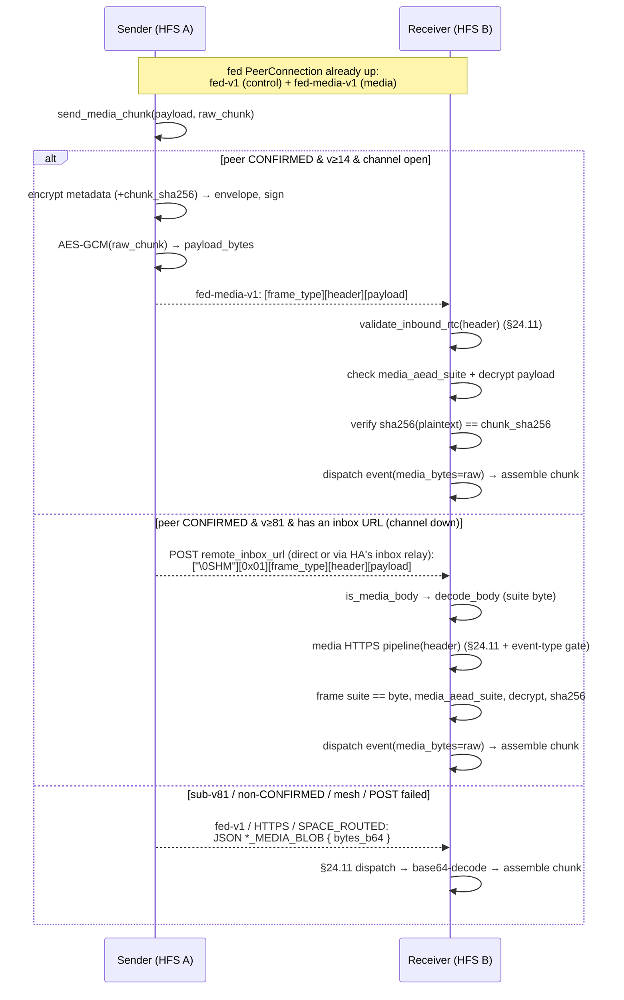
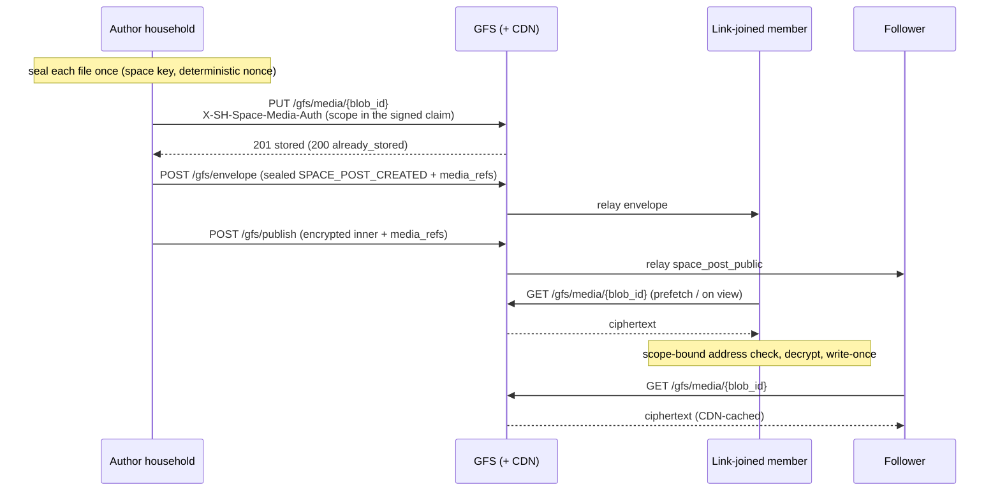
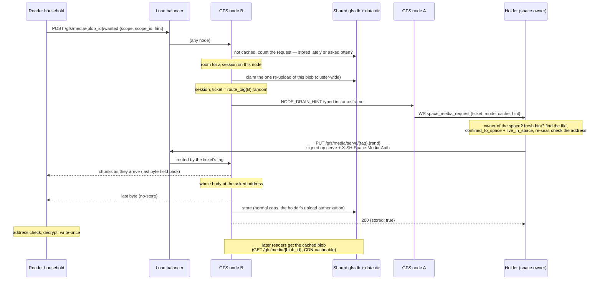
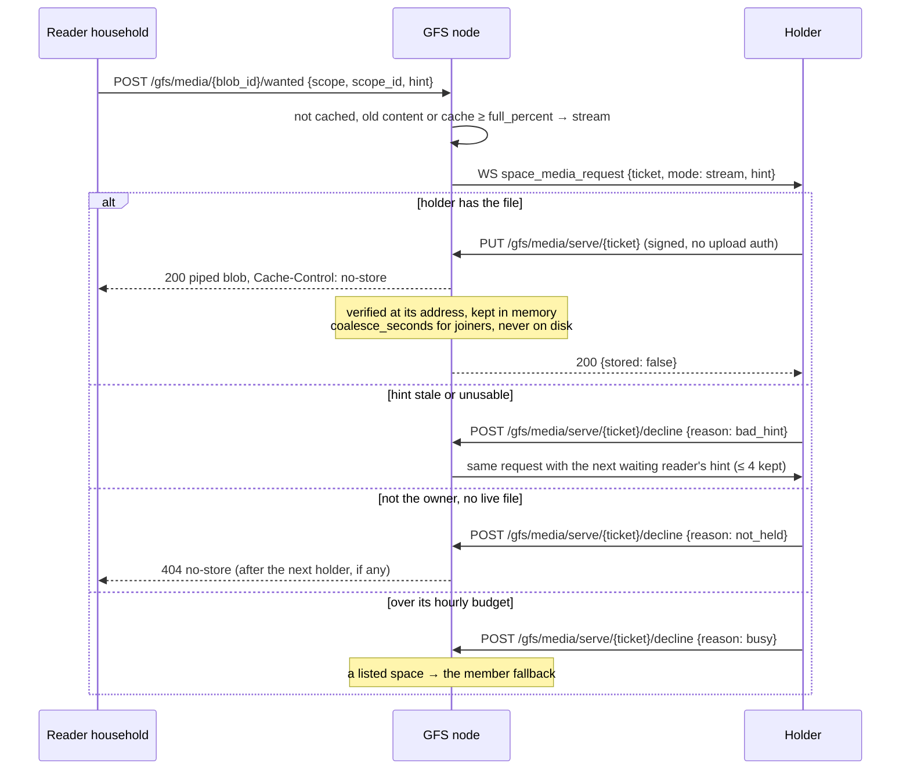
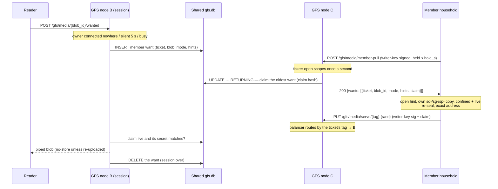

# Media transport — the binary `fed-media-v1` channel

## Summary

Cross-household media (DM attachments and space-post / gallery images)
is delivered as **chunks**. Three transports carry those chunks:

1. **JSON over `fed-v1`** (the original path) — each chunk is a
   base64 string inside the `DM_MEDIA_BLOB` / `SPACE_MEDIA_BLOB`
   federation envelope, AES-256-GCM-encrypted like any event and sent
   on the shared `fed-v1` control DataChannel (or HTTPS inbox /
   `SPACE_ROUTED` on fallback).
2. **Binary over `fed-media-v1`** (capability **v_14**) — a second
   DataChannel multiplexed on the *same* federation `PeerConnection`
   carries each chunk as a length-prefixed binary frame with the raw
   bytes encrypted directly (no base64).
3. **Binary over the HTTPS inbox** (capability **v_81**) — when no
   channel is open, the same frame is POSTed to the peer's own inbox URL
   behind a 4-byte magic and a suite byte; the inbox tells it from a
   JSON envelope by the body alone (see
   [Binary frames on the HTTPS inbox](#binary-frames-on-the-https-inbox-v_81)).

The binary path exists because the JSON path inflates media ~1.77× on
the wire (base64 of the chunk, then base64 of the ciphertext) **and**
forces multi-hundred-KB media frames through the same ordered SCTP
stream as latency-sensitive control events (presence, typing,
reactions) — head-of-line blocking. A second SCTP DataChannel is an
independent stream, so big media no longer blocks control traffic, and
it rides the existing PeerConnection: no extra ICE / DTLS / TURN
handshake.

## Scope

- **Point-to-point only.** The binary channel exists between two
  **CONFIRMED direct peers**. A non-CONFIRMED or mesh-only space member
  (reachable only via a `SPACE_ROUTED` relay) never uses it — that
  member keeps receiving the JSON `SPACE_MEDIA_BLOB` over the mesh,
  in smaller 384 KiB chunks so the routed envelope fits the first hop's
  inbox (see [DM media → Chunking](dm-media.md#chunking)).
- **The HTTPS leg (v_81)** follows the same rule: a CONFIRMED direct
  peer with an inbox URL (never a household seated from an invite link,
  which has none) advertising `proto_version ≥ 81`
  (`FederationCapability.MIN_FOR_MEDIA_HTTPS`). Mesh (`SPACE_ROUTED`) and
  GFS-relay targets stay JSON.
- **Capability-gated.** The sender uses the binary channel only when
  the peer advertises `proto_version ≥ 14`
  (`FederationCapability.MIN_FOR_MEDIA_CHANNEL`) **and** is CONFIRMED
  **and** the channel is currently open. Any miss falls back
  transparently to the JSON path.
- **Encryption-first (§25.8.21).** The raw chunk is AES-256-GCM
  encrypted under the directional session key; nothing media-bearing
  ever crosses the wire in cleartext.

## Frame format

Every frame on `fed-media-v1`:

```
[u8 frame_type][u32 header_len BE][header_bytes][u32 payload_len BE][payload_bytes]
```

- **`frame_type`** — `1` = `MEDIA_CHUNK` (v1). Forward-compatible: a
  receiver skips an unknown type rather than erroring, so future frame
  kinds (flow-control, resume) can share the channel without a new
  label.
- **`header_bytes`** — the signed federation **envelope JSON**,
  verbatim. It is the *same* shape `send_event` builds (`msg_id`,
  `event_type` = `dm_media_blob` / `space_media_blob`, `from_instance`,
  `to_instance`, `timestamp`, `space_id`, `proto_version`, `sig_suite`,
  `signatures`, `encrypted_payload`). The framing layer treats it as
  opaque so the exact signed bytes are re-parsed by the §24.11
  pipeline.
- **`payload_bytes`** — `nonce(12) ‖ AES-256-GCM(raw_chunk)`. Raw
  binary, never base64.

The envelope's `encrypted_payload` is the AES-256-GCM-encrypted **chunk
metadata** (the same fields the JSON `*_MEDIA_BLOB` payload carries —
`media_blob_id` / `message_id` / `filename` / `transfer_id` /
`chunk_index` / `chunk_count` / `final` / … — but **without**
`bytes_b64`), plus two media fields:

- `media_aead_suite` — `"aesgcm-256"`, validated against
  `SUPPORTED_MEDIA_AEAD_SUITES`; unknown suites are rejected with no
  default fallback (the project-wide crypto-suite rule).
- `chunk_sha256` — b64url SHA-256 of the **plaintext** chunk. This is
  the binding (see Security).
- `media_frame_suite` — `"fed-media-v1"` (v_81 on; a channel frame from
  an older sender has none and reads as v1), validated against
  `SUPPORTED_MEDIA_FRAME_SUITES`. Required on the HTTPS inbox, where it
  must equal the body's suite byte.

## Binary frames on the HTTPS inbox (v_81)

With no media channel open, a v_81 peer gets each chunk as one POST to
the inbox URL it advertised — `…/federation/inbox/{inbox_id}`, or Home
Assistant's `/api/socialhome/inbox/{inbox_id}` in ha / haos — instead
of the base64 JSON chunk:

```
[ "\0SHM" ][ u8 frame suite (0x01 = fed-media-v1) ][ one fed-media-v1 frame ]
```

The frame is exactly the channel's (`frame_type` 1, signed header,
sealed chunk); the body carries everything §24.11 needs, nothing rides in
a header. `"\0"` never starts a JSON text, so the inbox decides from the
body alone (`media_framing.is_media_body`) — Home Assistant's inbox
relay (the companion integration through socialhome-client
`forward_inbox_envelope`) forwards every body raw as
`application/octet-stream` and drops custom headers, so it carries both
shapes unchanged and needs no update; the peer's `proto_version` is all
a sender needs. An unknown suite byte is refused
(`UnsupportedMediaFrameSuite`, no default), as are trailing bytes, any
other frame type and any event but `SPACE_MEDIA_BLOB` /
`DM_MEDIA_BLOB` (an extra pipeline step, before any crypto). The header
runs the JSON inbox's §24.11 chain (lookup by inbox id), then the
channel's tail (suites, decrypt, `chunk_sha256`). The body cap is one
512 KiB chunk + 16 KiB (`HTTPS_MEDIA_MAX_BODY_BYTES`), checked against
`Content-Length` once the magic is read and while streaming; binary
bodies have their own per-IP bucket (600 / min). Any non-2xx answer
sends the JSON chunk instead, and the sender remembers it per peer
(`MediaHttpsBackoff`): a 429 skips the leg for its `Retry-After`, another
4xx for 10 min at once, 5xx / no answer for 10 min after 3 in a row, then
one chunk probes again — see [DM media](dm-media.md#binary-media-on-the-https-inbox-v_81).

Wire cost for a 512 KiB chunk: **525 323 B** binary vs **932 911 B**
JSON (−44 %); a 200 MiB video (400 chunks) 210.1 MB vs 373.2 MB per
receiving household.

## Security model

The binary frame inherits every §24.11 guarantee unchanged, because the
header **is** a normal federation envelope and the receiver runs it
through the same validation pipeline (`validate_inbound_rtc`):

- **Origin authentication** — Ed25519 (suite-aware) signature over the
  envelope. The signed-byte reconstruction in `make_verify_signature` is
  untouched.
- **Replay** — the envelope's `msg_id` against the existing replay
  cache; each chunk is its own envelope with its own `msg_id`.
- **Timestamp / ban / idempotency / deprovisioned-author** — same
  pipeline steps; an `early_response` short-circuit skips assembly.
- **Confidentiality** — chunk + metadata both AES-256-GCM under the
  directional session key.

**Binding the binary payload to the signed envelope.** `chunk_sha256`
lives *inside* the AES-GCM-encrypted, signature-covered metadata. So:

- tampering with `payload_bytes` → the receiver's `sha256(plaintext)`
  check fails;
- tampering with `chunk_sha256` → the GCM tag (or the envelope
  signature) fails;
- swapping payloads between two valid frames → each frame's
  `chunk_sha256` commits to its own chunk, and re-delivering an
  identical frame is dropped by the replay cache.

The receiver verifies `sha256(plaintext) == chunk_sha256` **after** GCM
decryption (constant-time compare), so the hash binds the exact bytes
written to disk. Both the metadata AEAD and the chunk AEAD draw a fresh
random 96-bit nonce; the shared-key message count stays many orders of
magnitude below the GCM birthday bound for any realistic peer lifetime
(see [`../crypto.md`](../crypto.md)).

## Flow



Both paths converge on the same receiver assembly
(`_assemble_dm_chunk` / `_assemble_space_chunk`): the handlers prefer
`event.media_bytes` (binary path) and fall back to base64 `bytes_b64`
(JSON path), so chunking, part-file reassembly, and the
`dm.media_ready` WebSocket notify are identical regardless of transport.

## Receiver scope + write-once

Whatever the transport, the receiver writes a chunk only for what the
sending household was sent it for. Both blob types share
[`inbound_media_store.py`](../../socialhome/services/inbound_media_store.py):

- **Strict names.** The target name (`filename`, or the DM
  `message_id`) must be one safe path component — no separators, no
  leading dot, no NUL or whitespace. `chunk_index` / `chunk_count` must
  be in range.
- **Write-once.** Chunks assemble into a temp file that is moved into
  place with a hard link that fails on an existing name (check-then-
  replace on filesystems without hard links). A file already present —
  another space's picture, a DM attachment, the household's own upload,
  or an earlier copy of the same blob — is never replaced; a same-size
  re-delivery is a quiet no-op, anything else logs a WARNING.
- **One media directory, two namespaces.** Space files and DM
  attachments share `media_dir`. A received DM attachment is stored as
  `dm-<sha256("dm-media", from_instance, message_id)[:40]>.<ext>`
  (`dm_media_name`) — bound to the household that sent its chunks — and
  a `SPACE_MEDIA_BLOB` never writes a reserved name
  (`is_reserved_media_name`: the `dm-` / `gm-` prefixes, owned by DM
  attachments and GFS moment media, and the DM transients
  `*.preview.webp` / `*.part<N>` / `*.assembled`). So a space blob for a
  row not seen yet can never plant a DM's file, whichever arrives first,
  and only the DM sender's own household can fill its name. Before
  2026-11-06 the DM file was `<message_id>.<ext>` and a household that
  knew the id could plant it through a space blob for the DM to adopt.
- **Size caps.** A file must fit what the receiving path accepts, from
  the upload limits in `domain/media_constraints.py`: a space file at
  most `SPACE_MEDIA_MAX_BYTES` (`VIDEO_MAX_UPLOAD_BYTES`, 200 MiB — a
  space video is the biggest thing a space ships), a DM attachment per
  its declared type (`dm_media_max_bytes`, see
  [`dm-media.md`](./dm-media.md#chunking)). Every chunk checks the
  declared `file_size_bytes`, so the first one to land refuses an
  oversized file, and a chunk must fit its share of it (`(chunk_count −
  1) × len(chunk) < file_size_bytes`, true of every sender's equal split)
  — the parts on disk stay under twice the declared size. A refused
  chunk is dropped with a WARNING and nothing is written.
- **Sender-bound names (`SPACE_MEDIA_BLOB`).** A received space file
  never keeps the name its sender used. A file `F` that household `H`
  delivers is stored and referenced here as
  `sd-<sha256("space-direct", space_id, H, F)[:40]>.<ext>`
  (`space_direct_media_name`), where `H` is the household this one
  authenticated: the envelope's sender, a `SPACE_ROUTED` inner event's
  origin (`path[0]`, proven by `_origin_authenticated`), or the §25.6
  provider. Both sides use it:
  - a `SPACE_MEDIA_BLOB` from `H` for `filename` is assembled under `H`'s
    name for it;
  - a row `H` delivers has each of its files renamed the same way before
    it is stored (`SpaceMediaNamer`). That covers a post (media, pictures,
    file, link-preview image), a bazaar listing's photos, a gallery item,
    a calendar cover, a held moderation submission, and the §25.6 records
    of the same kinds.
  - **Space pages are the exception (v_82).** Every household keeps the
    host's version of a page byte for byte (its hash is the version's
    identity), so a page keeps the names the **host** chose. On a member
    household those names never address the shared store: a page's file
    `N` is kept page-scoped as `sp-<sha256("space-page", space, N)>`
    (`space_page_media_name`, a reserved prefix) and the page routes map
    each name to that copy on read. Only the space's host ships a page's
    files to a member (correlated by the page); anyone else's push is
    refused. On the host, a file a member adds takes that household's
    `sd-` name (the body rewritten to it), and the member ships the bytes
    to the host alone. See [`pages.md`](./pages.md#files-v_82).

  So a file name is never first come, first served. A member household
  that learned `F` from someone else's post and pushes bytes for it,
  correlated with that post or with a decoy row of its own that names
  `F`, only ever fills its own name. No row from another household points
  there. Before 2026-11-07 the first complete copy of a name was the one
  every row naming it showed, here and in what this household re-sealed
  for its link-joined readers through the GFS media cache.

  The name does not depend on the receiver, so every household that got
  `F` from `H` calls it the same. A row this household already holds
  keeps the file it has when the incoming name is that same file: the
  identical name (a relay of a file from the same origin), the sender's
  name mapped (the same household again), or this household's own upload
  as another household calls it (`space_direct_media_name(space, us, F)`).
  A collaborator's edit of an event that kept its cover therefore keeps
  it. A new cover in an update takes the updating household's name, since
  that household ships the bytes (`_ship_cover`). A moderation release
  names the item's files as the host holds them: the receiver aligns
  those names with its own copy of the item before comparing
  (`SpaceAuthorship._aligned_media`). The release then takes the host's
  names, and the host ships the bytes.

  Every household that relays a row ships the bytes under the name its
  own row holds. The paths that do this are: the author's live push, the
  §25.6 catch-up (`_enqueue_catchup_media`), the §4.4 resume / §319.6
  resync replay (`SpaceSyncResumeProvider`), the moderation submission
  (`_send_media`), and a released post or cover from the host. The wire
  is unchanged, so there is no protocol version.

  The resume / resync replay enqueues the replayed rows' files for the
  one household that asked, with these bounds:
  - at most `RESUME_MEDIA_MAX_FILES` (50) files and
    `RESUME_MEDIA_MAX_BYTES` (32 MiB) per request; a file past the budget,
    or one that isn't here, is skipped;
  - one replay per (household, space) per `RESUME_COOLDOWN_S` (30 min);
    a sooner request is dropped. The window sits in the replay itself
    (`replay_space_to` / `replay_calendar_to`), so `SPACE_SYNC_RESUME`
    and a §319.6 `INSTANCE_RESYNC_REQUEST` share it. It is taken before
    the replay awaits anything, so concurrent requests can't all pass.

  The cost is at most 32 MiB to one household per space per 30 minutes,
  which is 64 MiB an hour even when a member asks with an old `since`. The
  rows themselves were already capped at `MAX_PER_RESOURCE`.

  A file whose sends ran out of attempts (`status='failed'` in
  `space_media_outbox`) is re-armed by the next enqueue of the same file
  for the same household, for example a catch-up or a replay. A row still
  queued or in flight is left to the scheduler. The re-arms are bounded
  by what enqueues them: a live post once, a §25.6 initial catch-up by
  the sync scheduler's session limits, and a replay by the window above.
- **The host fills a missing file.** Sometimes a known row shows a file
  under exactly the name `filename` and that file is not here, for
  example:
  - the author's push failed for good (the host holds the file as
    `sd(space, author, F)`, the same name the row shows, because names
    don't depend on the receiver);
  - a row stored before files were bound to their sender.

  The space's **owner household** (`owner_instance_id`, the roster
  authority every member's §25.6 catch-up comes from) may then store its
  bytes under that name (`_host_fills`). It writes once and never
  replaces a file.

  No other household may fill a name, not even one with content
  authority. An admin or moderator household, or a delegated admin
  acting for an offline owner, that learned a member's name could
  otherwise plant its bytes while that member's push to us is still
  queued, and write-once would then refuse the real copy. A delegated
  admin's own catch-up still ships its rows and files under its own,
  matching names.
- **Moderation release to GFS followers.** The host holds a remote
  submitter's files under that household's names, while the author's
  signed inner names them as the author does. `approved_relay_for`
  compares the two through `same_file`: the identical name, or the
  author's name mapped for the inner's verified origin. The relay keeps
  the author's signed names and `media_refs`.
- **GFS relay path.** A post relayed through a GFS
  (`space_public_inbound`) keeps only the file references its signed
  descriptor renamed to a reader name (`sg-`, `_only_described_files`).
  That is the only way the author's bytes reach a household on this path.

  Any other name is dropped: an `sd-` file received from some household,
  or a plain name that may be one of this household's own uploads, from
  another space even. A link card stays, with its picture only when
  described. A heal takes the files from the copy that carries them.
- **Space scope (`SPACE_MEDIA_BLOB`).** The envelope must name one space
  (`resolve_space_id`: routing `space_id`, payload copy as fallback, a
  mismatch is a refusal) and a `correlation_id` (`post_id` on older
  senders). When that row is already known (a space post, the bazaar
  listing behind a bazaar post, a gallery item, or a space calendar
  event), two things are checked:
  - It must live in that space. If not, the blob is refused with a
    WARNING.
  - It must show the sender's name for `filename` (post `media_url` /
    `image_urls` / `file_meta.url` / link-preview image, listing
    `image_urls`, gallery `url` / `thumbnail_url`, event `cover_url`). If
    not, the blob is skipped at INFO. This is routine: another household
    delivered the row here, for example the host's catch-up of a post its
    author also pushed.

  Files of a submission held for moderation (a new event's cover, an
  edit's new cover or pictures) are correlated by the **moderation queue
  item id**, never the target row, whose current media an edit replaces.
  When the reviewer household holds that item, the item must be in that
  space and propose the file (`moderation_media_urls`). Files the target
  already has (its `current_snapshot`: an event's cover, a post's
  pictures) are not sent again.
- **Blob before its row.** The row's own event, the mesh, a held write
  or the §25.6 catch-up can deliver a blob before the post, listing or
  gallery item it belongs to. Such a blob is stored at once under the
  sender's name. When the same household's row lands, it points there.
  A row from another household points elsewhere, and the unreferenced
  file goes to the orphan sweep. There is no hold and no adoption step.
- **Per-sender assembly.** Part files live under
  `media_dir/.partial/<sha256(from_instance, transfer_id, chunk_count)>/`
  (DM: `transfer_id` = `dm:<message_id>`), so two households' chunks
  never mix into one file — nor two attempts of one transfer that were
  chunked differently (a retry is re-chunked for its tier: 240 KiB over
  an older channel, 512 KiB over HTTPS).
- **Any order.** Senders pipeline chunks, so the `final` chunk can land
  before the others. Every chunk handler calls `store_chunk`: the part is
  written to a temp name and renamed into place, one directory listing
  tells whether the set is complete, and whichever chunk completes it
  assembles — never "on `final`". Each assembly writes its own temp file
  inside the part directory, so two chunks completing at once never mix
  bytes, and only one publishes. The assembled file must be exactly the
  declared `file_size_bytes` (a multi-chunk blob without a positive one
  is dropped with a WARNING), else the parts are dropped and nothing is
  published. A chunk landing after the file exists drops any leftover
  parts. A set that never completes is removed by the media orphan
  sweep once its folder has been untouched for 3 days (far past the
  senders' retry horizon; every landing chunk refreshes it), at most 200
  folders per pass. Neither the sweep nor `drop_parts` follows a
  symlink: a symlinked `.partial` is skipped, an entry is aged by its own
  `lstat` and unlinked without touching its target, a part folder's
  contents are never descended into (a folder holding a sub-directory
  stays and is logged, not counted), and `store_chunk` refuses a
  `.partial` or part folder that is a symlink. DM rules (sender household, announced `media_blob_id`) are in
  [`dm-media.md`](./dm-media.md#chunking).

Residuals, by design:

- Bytes for a row come from the household that delivered that row
  here. The exception is content authority filling a missing file
  (above). A plain member's copy never fills it.
- A household reaching a member's post first through the GFS relay
  shows only its described files. A file without a descriptor (over
  8 MiB) is not shown there; the row's reference to it is dropped.
- Rows stored before this change keep their names. A push for one of
  them still in flight lands under the new name and goes unreferenced.
- One file relayed through several households is stored once per
  delivering household. That costs bytes, not correctness.

`tests/protocol/test_media_blob_scope.py` pins these rules:
- the decoy post and the bazaar decoy;
- a cover race by another writer;
- a push before its row;
- the host's catch-up round trip;
- the host filling an author's failed push;
- the mesh.
`test_space_moderation_federated.py` covers a reviewed picture released
everywhere.

Residual: a household may start many transfers it never completes; each
is bounded (chunk count, size cap, twice-the-declared-size parts) and
swept after 3 days, but there is no per-sender quota on how many message
ids / transfers a household may open at once (each a part set, or a
never-adopted `dm-` file swept as an orphan) — candidate follow-up issue.

## Space media via the GFS cache (v_80)

**Who.** Two kinds of household read a space only through a GFS and so
never get the chunks above:

- a **member seated from an invite link** (`InstanceSource.SPACE_SESSION`,
  reached only through the GFS envelope relay, whose sealed cap of
  ~191 KiB refuses media chunks) at `proto_version ≥ 80`
  (`FederationCapability.MIN_FOR_SPACE_MEDIA_REFS`);
- a **follower of a global space**, which reads the relayed post inner —
  gated on the GFS's signed `space_media` capability
  ([`discovery.md`](./discovery.md#space-media-cache-on-a-gfs-capability-space_media)),
  not on a household version.

Paired and mesh members keep the `SPACE_MEDIA_BLOB` push above, unchanged.

**Descriptor.** The item carries, INSIDE its encrypted payload:

```json
"media_refs": {"<local filename>": {"blob_id": "<sm1 address>", "suite": "aesgcm-256-pad-det", "epoch": 3, "size": 1048604, "scope": "space", "addr_suite": "sm1"}}
```

one entry per file of the item. Which files an item has is ONE rule,
`record_media_urls` / `post_media_urls` (`domain/space_media_ref`): a post's
media, pictures, attached file and link-card thumbnail; an event's cover; a
gallery item's thumbnail and full file — the sender describes exactly these
and every receiver (live, follower, §25.6) allows exactly the files ITS
stored copy of the item shows. A receiver drops an entry for a file it
doesn't show and keeps the rest; a descriptor of more than 16 entries is
refused whole. A reserved name (`gm-` moment media, `dm-` chat files —
`is_reserved_media_name`) is never described, never kept and never fetched,
and a received space item drops such references altogether. `size` is the
sealed blob's byte count.
`blob_id` is the GFS's **scope-bound address** —
`sha256("sm1|" + scope + "|" + scope_id + "|" + blob)`
(`domain/gfs_space_media.space_media_address`, `addr_suite: "sm1"`) — and
`scope` says which kind (`space` / `channel`); the descriptor never names the
scope id: a reader re-derives the address with the id it knows itself (the
space id, or its own channel id). An unknown scope or address suite is
refused (WARNING), never defaulted. No GFS URL: every reader fetches from the
GFS it reaches the space through.
It rides:

| Item | Where |
|---|---|
| Space post | `SPACE_POST_CREATED` (per link-joined v_80 member), the `public_relay` inner (followers, through a seed holder's relay) and the v_49 member-publish inner — the last two **under the author's own signature** (`media_refs_sig`, suite `media_refs_sig_suite: "ed25519"`, domain `space-post-media-refs:v1:`, bound to the post, space and author; `services/space_public_author.py`). It is a separate signature, like the link card's, so a follower on an older build still verifies the post and shows it without GFS pictures. The signature also binds `item_type` and `edited_at`, so an older descriptor can't ride a newer edit. A follower takes the descriptor ONLY when that signature verifies: an unsigned one, or one a re-publisher swapped, is dropped. A copy stripped of its descriptor that wins the race heals add-only: a later copy or edit of the same author's post carrying a signed descriptor renames the stored post's files, but only while the post has no rows. Anyone holding the content key (a member with the writer group key) can re-wrap the author's inner, and the AAD's household proves nothing to a key holder. The post stands without those pictures; an unknown suite is refused. A post edit that can overtake its create carries the signed descriptor too |
| Calendar event | `SPACE_CALENDAR_EVENT_CREATED` / `_UPDATED`, only when the cover is new or changed |
| Gallery item | `SPACE_GALLERY_ITEM_CREATED` (thumbnail + full file) |
| Space page (v_82) | the host's `SPACE_PAGE_CREATED` / `_UPDATED`, to a link-joined **v_82** member: one descriptor for the whole version and its open sides (≤ `MAX_PAGE_DESCRIPTOR_ENTRIES`, 16 × 4). Kept page-scoped (`space_page_media_name`, never the name the page shows, the page itself unchanged), fetched only while that page or an open side shows the file (`localize_as_shown`) |
| §25.6 records | `posts` / `calendar` / `gallery` records streamed to a link-joined v_80 requester ([`sync.md`](./sync.md), sync line 80); `pages` records from the host to a link-joined v_82 one (sync line 82) |

Post edits carry no media, so no descriptor. Toward members the descriptor
is added per peer (the `per_peer` hook of `broadcast_to_space_members`),
only for link-joined v_80 members — never on the shared payload a paired
member gets.

**Sealing** ([`crypto.md`](../crypto.md#space-media-in-a-gfs-cache-aesgcm-256-pad-det)):
HKDF of the epoch's space content key, a **deterministic** nonce (the same
file sealed again is the byte-identical blob, so a re-upload matches the
descriptors readers hold), padded to the moment-media size buckets, at most
8 MiB of file. Larger files are skipped.

**Only the space's own files.** A member can name any local file in an
item (a private album's photo, another space's picture, a household post's
file). The sender describes — and, re-checked, uploads — a file only when
it is no reserved name and every row that references it is content of this
space (`MediaReferenceRepo.confined_to_space`: gallery items by their
album's space, every other source by its own space; household rows, DMs,
moments and household / private albums never count). So nothing outside
the space is ever sealed under its key, live or in a catch-up.

**Upload** (`SpaceMediaGfsUploader`). When an item with local media is
created in a space that has link-joined v_80 members or (for posts)
followers, the author's household plans the GFSs those readers use — each
link-joined member's `relay_via` connection, plus every GFS the space is
relayed to for followers — keeps the ones whose signed block proved
`space_media` (and whose `max_blob_bytes` the blob fits), seals each file
once, computes its scope-bound address and `PUT`s it once per GFS to the one
scope-free path `PUT /gfs/media/{blob_id}` — the scope rides only inside the
signed claim header (`scope`, `scope_id`, `addr_suite`), never in a URL. Authorization, strongest first: the
**space authority** signature (this household holds the space seed — host
or delegated admin), else the **writer group key** (strict mode), else our
household's **writer cert** (trusted mode — the one identified kind, never
sent to a listing target we are not registered on). A **private** space that
uses an opaque channel (v_51, `private_gfs` on) uploads under the GFS's
**channel scope** instead (the claim names the channel), only to a GFS whose
signed `space_media.scopes` lists `channel` — so the GFS learns the random
channel id, never the space; a channel takes media once ONE member household
holds a seat on it (the owner never subscribes): the **channel key** (a seed
holder whose seed derives the stored channel key), else the member's
**channel writer key** from its grant, else its **channel cert** (identified),
always with the grant's shifted channel epoch. The request never names
`from_instance`. Only a space the GFS holds `active` (approved) takes media:
a pending one answers 403 and the item goes without the picture there.
`200 already_stored` is success (coalescing; it does not refresh the
blob's expiry) and is remembered per (GFS, blob) until min(7 days, that
GFS's signed `ttl_s`) — after that the GFS may have dropped it, so a repeat
sends it again; a space this household holds no authorization for is warned
about once and nothing is sent; a refusal (403 / 413 / 422) is a WARNING and dropped; a
transport error, 408 (too slow), 429 (per-scope rate or per-prefix byte
budget), 503 (busy, or the cache switched off) or another 5xx is retried at
most 4 times (backoff 30 s, doubling). Because the address binds the scope,
uploading before the item goes out is not needed for safety; uploads are
still queued at once. The queue is in
memory and bounded (2048 uploads): a restart or a full queue loses pending
uploads (WARNING), and the reader then shows the item without that picture.

**Reader** (`SpaceMediaGfsFetcher`). **The file's name is the
reader's.** Any member can name any file name it has seen, and every member
holds the space key, so a bare file name proves nothing. Before the item is
saved, each file it shows and describes is renamed to this household's own
name for it, `gfs_space_media_name(space, delivering household, item, filename)`
(`sg-` + a hash), and the item's reference is rewritten to it — the
delivering household being the one the receiver authenticated (the
envelope's sender; for followers, the author household the signed inner
proves; for §25.6, the provider), never a descriptor field. A member naming
another item's file in its own item therefore only ever gets its own copy,
in either order; it can never take over the picture another item shows.
`sg-` is a reserved prefix: no received item and no `SPACE_MEDIA_BLOB` may
name it. The blob's AAD names the item and the delivering household, and
the fetch opens it with the row's values. A file the same item already has
here keeps the name it has (an update that re-sends the URL without a
descriptor, a second household re-describing it). The entries are kept as
`space_media_refs` rows ([`database.md`](../database.md)) once the item is
stored, written once — only the same item moves its row to a newer epoch
(its file sealed again after a key rotation). A §25.6 record's descriptor
counts only when the record creates the item here or comes from the host's
stream: a member household streaming an item held here can't attach its
blobs to it. A link card's thumbnail is cached per URL and backs posts in
other spaces and the feed; those references don't keep it from a space's
readers (`confined_to_space`). It prefetches pictures on arrival (3 at a
time, ≤ 200 waiting and ≤ 20 per space; a prefetch that finds the blob on
no GFS — the item usually outruns the author's upload — tries again after
10 s and 60 s, unless the space's last 5 prefetches all found nothing:
then it tries once until one lands); anything else — or a picture past the
backlog — is fetched when first viewed: `GET /api/media/{local_name}` checks who may open the file
first, then asks the fetcher; concurrent viewers share one fetch, each waits
at most 20 s, and a file no GFS held is not asked for again on a view for
5 minutes. At most 6 fetches run at once. A fetch tries this household's
connection to the GFS the link-joined pair relays through (`relay_via`),
then its other GFS connections (≤ 4 sources) — connections only, over the
**cookie-less, address-pinned session** (`anon_session`), so a fetch is not
linkable to the household and a URL it holds no connection to is never
fetched: `GET /gfs/media/{blob_id}` (anonymous), bounded by the
descriptor's `size`, checks that the blob sits
at its scope-bound address for the scope id this household knows,
decrypts with the epoch's media key and writes the file write-once under
its `sg-` name. An unknown suite, a
blob not at its address (or a channel scope with no channel id known here)
or a failed decrypt is refused with a WARNING and writes nothing.

**No byte push to them.** `SPACE_MEDIA_BLOB` is no longer queued to a
link-joined v_80 member (live posts / gallery / covers), nor to any
link-joined requester of a §25.6 catch-up — the relay refuses those bytes.



**Cost.** One upload per file per GFS — never per reader or per member.
The descriptor is ~150 B per file per item. A 700 KB photo in a space with
200 link-joined members: one upload (padded to the 1 MiB bucket) per GFS
those members use, plus 200 × ~150 B descriptors inside envelopes that go
out anyway; reads are served by the GFS and its CDN. A global space with
10 000 followers: still one upload per GFS; the CDN absorbs the reads.

**Privacy residuals.** The GFS sees ciphertext, its size bucket, the space
id on upload, the upload time and the uploader's address, and fetch times
at one-hour resolution; never who fetched. The `writer_cert` kind tells it
the uploader household's key (the trusted-mode trade-off of
`/gfs/member-publish`). The deterministic nonce reveals only "the same file
was sealed twice under the same key", which the content address shows
anyway.

**Deferred.** Files over 8 MiB (long videos). A blob the cache evicted or
expired comes back on view since v_83 (below). Tracked follow-ups: **comment media** and **a seed holder's
relayed copy of an approved post** carry no descriptor yet. A private space whose owner left `private_gfs`
off has no channel: its link-joined members are reached through the space
scope only while the space is listed on that GFS.

## Space media on demand (v_83)

**Why.** The GFS keeps a space blob only as a cache: a few days at most,
and the least recently fetched go first when it is full. Before v_83 a
reader that missed a blob — an older picture, one evicted from a busy
cache — never got it. Now a view asks for it, and a household that holds
the file sends it again. GFS side, routes, settings and bounds:
[`discovery.md`](./discovery.md#space-media-on-demand-v_83).

**Who.** The same readers as v_80 — link-joined members and followers of a
global space. Both ask the same way. Paired and mesh members never use it.

**Reader** (`SpaceMediaGfsFetcher`). Only a **view**
(`GET /api/media/{local_name}`) whose fetch found the blob on no GFS asks —
never a prefetch, so only a person looking at the item makes a household
send anything. It asks the first source whose signed `space_media`
capability carries `on_demand: {wait_s}`:
`POST /gfs/media/{blob_id}/wanted` with `{scope, scope_id, hint}` over the
same cookie-less, address-pinned session as the fetch. The **hint**
(`space_media_hint.py`, suite `smh1-aesgcm-256`) seals what the descriptor
says about the file — the item, the household that sealed it, the author's
file name, and when it was sealed (`t`) — under a key derived from the
epoch's space media key, with a random nonce and the scope, scope id, blob
and epoch in the AAD. The GFS can't open it; it names nothing about the
reader; a holder refuses one sealed more than 600 s ago
(`HINT_MAX_AGE_S`), so a GFS can't keep it and replay it later. The answer is checked and
stored exactly like a fetched blob (scope-bound address, decrypt,
write-once); a miss there is a miss, and the view's 5-minute miss cache
applies.

**Holder** (`SpaceMediaGfsResponder`). A household lists
`space_media_serve` in its GFS hello and answers the GFS's
`space_media_request {ticket, scope, scope_id, blob_id, mode, hint}` — but
only where the GFS may ask it: for a listed space only the **owner**
household (`owner_instance_id` is its own) and only for a space it LISTED on
that GFS; for a private channel a household holding a seat on that GFS.
Every other request — a space it doesn't own, didn't list there, or a
private space — is declined `not_held` before any key or crypto is touched,
so a GFS can't probe who is a member or which spaces a household owns.
(Other members answer only a want they pulled anonymously — the
[member fallback](#member-fallback-listed-spaces).) Otherwise it opens the hint (a stale or
unopenable one: `bad_hint`), finds the file under its own name for it (the
author's name, the `sd-` / `sg-` name it got the file under, or for a
page's file (v_82) its page-scoped `sp-` copy — never a
reserved `dm-` / `gm-` name), requires that only this space's content
references it (`confined_to_space`) and that a **live** row of the space
shows it (`live_in_space`: not a deleted post, comment, listing, event, page
or album item — a page's cover and every picture its body shows count, as
the page is now — never only a moderation queue, an edit history or an open
conflict side; a deleted item's picture never comes back), seals it again (deterministic, so
byte-identical) and checks that it sits at exactly the asked address (a
file held but at another address: `bad_hint`). A locator's
addresses are remembered for 10 minutes, so the same locator sent with
other blob ids is declined without a new reseal. Then it sends
`PUT /gfs/media/serve/{ticket}` over its AUTHENTICATED GFS session (never
the cookie-less one anonymous `wanted` requests and publishes ride, so the
GFS can't link them), signed by its household key over
`{instance_id, media_ticket, op: "serve", ts}` — with its normal upload
authorization for a `cache` request, at most once per (GFS, blob) per
10 minutes — or `POST …/decline` (`op: "decline"`, body
`{"reason": "bad_hint" | "not_held"}`). On `bad_hint` the GFS asks it again
with another waiting reader's hint; on `not_held` it moves on. Budgets are
per GFS **and** in all: at most 2 answers at once per GFS and 4 in all
(past either the frame is dropped before any work), at most 512 MiB an hour
per GFS and 1 GiB in all (past either: `not_held`) — charged BEFORE the
bytes go (a GFS that reads them and answers an error still spent the
budget), refunded only when no connection was made.

**Large videos are lazy.** A video whose blob is at least 1 MiB is
described but no longer uploaded at once — only when the uploading
household **owns** the listed space (the one household the GFS would ask
for it), to a GFS that proves `on_demand`, while every link-joined reader of
the space is at v_83 or above (an older one keeps the eager upload). It goes
only when someone plays it. A member's large video, and any large video of a
private space's channel, still goes at once, as before; so do pictures.

**Followers don't get pages.** Page files on demand (v_82 × v_83) reach
members only: followers of a global space never receive a space's pages, so
they never hold a page descriptor to ask with (see
[pages.md](./pages.md#scope)) — an allowed follower subset.

**Follower subset (written down per the "members equal" rule).** Followers
are not told apart by version, so a follower household below v_83 gets no
lazy video: it never asks, and the video is not in the cache until a v_83
reader plays it (after that, while it stays cached, it gets it like any
blob). Members are never in this subset: a link-joined member below v_83
keeps the eager upload, and paired / mesh members get the bytes from the
household.

**Cache or stream.** The GFS decides per request: content asked
`cache_after_requests` (3) times within the hour, or content it stored
within `fresh_seconds` (7 days) while the cache is below 95 % full, is
re-uploaded into the cache; anything else — old content, a one-off view, a
full cache — is streamed to the waiting reader(s) and not stored
(`Cache-Control: no-store`). Only one household is asked at a time: the
space's owner household for a listed space (then, if it is offline, slow or
busy, one anonymous member — the member fallback below), a seated member
household for a private space's channel (at most 3 in turn). Readers of one
blob arriving together share one decision and one session.

**Wanted → one re-upload** (a cluster: the reader's request lands on node B,
the owner's socket is on node A):



**Miss → stream** (old content or a full cache: nothing stored):



### Member fallback (listed spaces)

The owner household is the only household the GFS may ask **by name** for a
listed space — asking members by name would tell the GFS who they are. So
when the owner is **connected nowhere**, does not start within **5 s**
(`MEMBER_FALLBACK_OWNER_WINDOW_S`, instead of 10 s) or declines **`busy`**,
a GFS whose signed `on_demand` entry carries `member_pull` offers the want
to the space's members **anonymously**:

- The want goes into the shared table `gfs_space_media_member_wants` (GFS
  migration 0027): ticket, blob, mode, the readers' sealed hints verbatim,
  expiry. Nothing about any member — ever.
- Members long-poll `POST /gfs/media/member-pull`, signed by the space's
  per-epoch **writer GROUP key** — the key the GFS already pins for
  anonymous member publish (v_50 strict, v_57 trusted + public). Never the
  household key, never the writer cert, never `X-SH-Instance`; over the
  cookie-less session. Followers never hold the writer key, so they can't
  pull (and can't learn which pictures are read).
- One pull **claims** the oldest open want of the space with one
  conditional update on the shared database (exactly one member per want,
  whichever node the pull landed on) and gets `{ticket, blob_id, mode,
  hints, claim}` — `claim` is a fresh random secret; the GFS keeps only its
  hash. The claim lasts 10 s, then the want is offered again.
- The member opens a hint with the epoch's space media key, finds its OWN
  copy under the names it computes (`sd-` / `sg-` / `sp-`, its own name only
  when it sealed the file), with the owner path's rules — confined to the
  space, live in it, never a reserved name, on a member only a page's `sp-`
  copy — and re-seals it. Sealing is deterministic over (epoch key, space,
  epoch, item, origin, filename, plaintext) with the origin from the hint,
  so a byte-identical copy reproduces the owner's `sm1` address; any other
  copy fails the address check and the member declines.
- It serves (`PUT /gfs/media/serve/{ticket}`) or declines (`…/decline`)
  with the writer key over `space-media-member-serve:v1:{media_ticket,
  claim, op, scope, scope_id, epoch, ts}` in `X-SH-Writer-Epoch` /
  `X-SH-Timestamp` / `X-SH-Writer-Sig` / `X-SH-Writer-Sig-Suite` +
  `X-SH-Member-Claim`. Only the claim's secret feeds the ticket — another
  writer-key holder that learnt the ticket can't. A re-upload (cache mode)
  is stored only under an anonymous authorization (space authority or
  writer key); a writer cert would name the household, so it is streamed
  only.
- An owner `not_held` is final (the host deleted it, or it is not the
  space's): members are not asked. At most 3 member declines per want.

A space without a writer key pinned for an open epoch (a trusted space
nobody may follow) has no member fallback: owner only, as before.



**What the GFS learns.** "A writer-key holder of space S pulled at this
time from this address" and "a writer-key holder served blob B". No
household id, no key, nothing stored about pullers (the claim hash is a
random value). Residual: IP and timing correlation with the household's
authenticated socket — the puller starts 30–120 s after boot and uses the
cookie-less session, but the source address is the same. Members learn
which blob is wanted right now and its locator (they hold the descriptors
anyway) — never who reads it.

**Cost.** Idle: per space per node ≤ 2 held pulls (`member_pullers_per_scope`),
one request per 25 s hold each → ≤ 4.8 requests/min per space per node;
a node holds ≤ 256 pulls (≤ ~10 requests/s at the cap, each one Ed25519
verify) and runs one indexed query a second while anyone waits. A
household runs ≤ 4 pull loops (~2.4 small requests/min each). With the
owner offline, the 10 000-follower example above costs the same
≤ 360 MB, spread over the pulling members instead of the owner (each still
capped at 512 MiB/h per GFS, 1 GiB/h in all); one serve per want (atomic
claim). Refused pulls (no slot) back off 10–20 min.

**Cost.** Per trigger: the holder sends one blob (≤ 8 MiB; a typical
picture is a 64 KiB–1 MiB bucket) to the GFS; the GFS sends each waiting
reader one copy; in stream mode nothing is stored. The fully cached path is
unchanged (an immutable `GET`, served by the CDN).

- **A global space with 10 000 followers viewing 200 expired pictures**
  (~300 KiB each). Without on-demand they all miss for good. With it, each
  picture costs at most `cache_after_requests` (3) holder uploads before it
  is cached — stream, stream, re-upload — and on a cluster at most one
  stream per node per `coalesce_seconds` plus ONE re-upload cluster-wide:
  ≤ 200 × (3 + nodes − 1) × 300 KiB ≈ 200 × 6 × 300 KiB ≈ **360 MB from the
  owner household, once**. The 10 000 × 200 = 2 M reads (≈ 600 GB) are
  then served by the cache and the CDN — the same as if the pictures had
  never expired. Prefetch never asks, so only views cost. The owner's
  512 MiB / h per GFS (1 GiB / h in all) and the scope's 512 MiB / h stream
  budget cap any burst: past them, clean misses.
- **One hostile reader asking for every blob id it can see.** ≤ 60 `wanted`
  / min per IP and ≤ 240 holder requests an hour per /48 or /24
  (cluster-wide). The bytes those requests make holders send are capped
  per prefix at 1/8 of a scope's stream budget — **≤ 64 MiB / h per
  prefix, every scope together** at the defaults — and per scope at 512 MiB / h, and the holder
  sends at most 512 MiB / h to that GFS, so honest readers keep at least
  7/8 of the scope's budget. A repeat of a blob a holder said it doesn't
  hold asks nobody within `coalesce_seconds`; a junk or forged hint only
  makes the holder decline `bad_hint` — the GFS then tries an honest
  reader's hint, and the blob is not marked missing (the address must match
  a real descriptor); a replayed hint goes stale after 600 s. Waiting
  connections are ≤ 4 per client and ≤ 8 per prefix, and a reader that
  stops reading is cut off.

**Fallback.** A reader below v_83 never asks (a blob that left the cache
stays missing for it, as before). A holder below v_83 never listed
`space_media_serve` and is never asked. A link-joined reader below v_83
keeps eager video uploads; a follower below v_83 gets no lazy video (the
follower subset above). A GFS without `on_demand` is never asked. A GFS without `member_pull` never
offers wants to members (owner only); an older GFS reads an unknown decline
reason (`busy`) as `not_held`.

## Implementation pointers

- Framing: [`socialhome/federation/media_framing.py`](../../socialhome/federation/media_framing.py) (`encode` / `decode` for the channel; `encode_body` / `decode_body` / `is_media_body` for the inbox)
- Signed header + sealed chunk (both binary legs): [`socialhome/federation/media_envelope.py`](../../socialhome/federation/media_envelope.py)
- Inbox body sniffing: [`socialhome/routes/federation.py`](../../socialhome/routes/federation.py) (`FederationInboxView`); `FederationService.handle_inbound_media_https`, `FederationTransport.send_media_https`
- Channel lifecycle + `send_media`: [`socialhome/federation/transport.py`](../../socialhome/federation/transport.py) (`_RtcPeer`, `FederationTransport.send_media`)
- Send + receive + per-chunk crypto: [`socialhome/federation/federation_service.py`](../../socialhome/federation/federation_service.py) (`send_media_chunk`, `handle_inbound_media_frame`, `validate_inbound_rtc`)
- Raw-bytes AEAD: [`socialhome/federation/encoder.py`](../../socialhome/federation/encoder.py) (`encrypt_bytes` / `decrypt_bytes`)
- Senders: [`dm_media_sync_service.py`](../../socialhome/services/dm_media_sync_service.py), [`space_media_sync_service.py`](../../socialhome/services/space_media_sync_service.py)
- Receiver assembly: [`federation_inbound_service.py`](../../socialhome/services/federation_inbound_service.py)
- Capability: [`socialhome/domain/federation_capabilities.py`](../../socialhome/domain/federation_capabilities.py) (`MIN_FOR_MEDIA_CHANNEL`, `MIN_FOR_SPACE_MEDIA_REFS`, `MIN_FOR_PAGE_MEDIA`, `MIN_FOR_SPACE_MEDIA_ON_DEMAND`)
- Page files (v_82): [`page_federation_outbound.py`](../../socialhome/services/page_federation_outbound.py) (`_ship_files`), [`page_proposal_forwarder.py`](../../socialhome/services/page_proposal_forwarder.py) (`_ship_files`), [`federation_inbound/space_content.py`](../../socialhome/services/federation_inbound/space_content.py) (`_localized_proposal`, `_keep_page_media`), [`space_media_names.py`](../../socialhome/services/space_media_names.py) (`pages`)
- GFS media cache (v_80): [`space_media_seal.py`](../../socialhome/space_media_seal.py), [`domain/space_media_ref.py`](../../socialhome/domain/space_media_ref.py), [`space_media_gfs_uploader.py`](../../socialhome/services/space_media_gfs_uploader.py), [`space_media_gfs_fetcher.py`](../../socialhome/services/space_media_gfs_fetcher.py), [`space_media_refs.py`](../../socialhome/services/space_media_refs.py), [`sync/space/media_refs.py`](../../socialhome/federation/sync/space/media_refs.py)
- Space media on demand (v_83): [`space_media_hint.py`](../../socialhome/space_media_hint.py), [`domain/gfs_space_media_on_demand.py`](../../socialhome/domain/gfs_space_media_on_demand.py), [`space_media_gfs_responder.py`](../../socialhome/services/space_media_gfs_responder.py), [`space_media_gfs_fetcher.py`](../../socialhome/services/space_media_gfs_fetcher.py) (`_want`), [`gfs_connection_service.py`](../../socialhome/services/gfs_connection_service.py) (`want_space_media`, `serve_space_media`, `space_media_on_demand_wait`, `space_media_member_pull_hold`, `pull_space_media_wants`, `serve_space_media_as_member`), member fallback [`space_media_gfs_member_puller.py`](../../socialhome/services/space_media_gfs_member_puller.py), GFS [`space_media_on_demand.py`](../../socialhome/global_server/space_media_on_demand.py) + [`routes/space_media_on_demand.py`](../../socialhome/global_server/routes/space_media_on_demand.py)

## Spec refs

§24.11 (inbound validation pipeline), §24.12 (WebRTC transport),
§25.8.21 (encryption-first), capability versioning
([`capabilities.md`](./capabilities.md)), DM media
([`dm-media.md`](./dm-media.md)).
