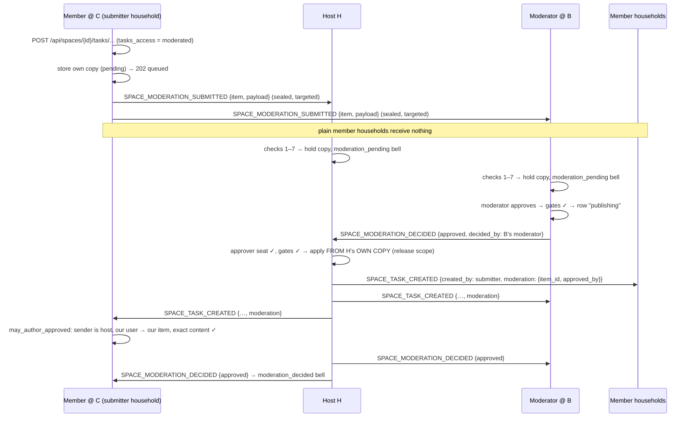
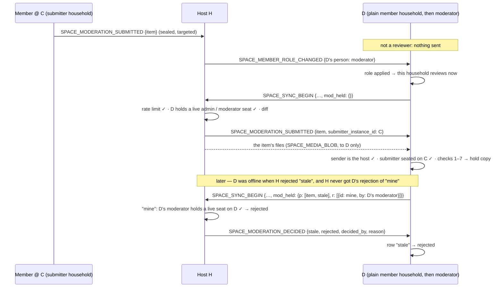
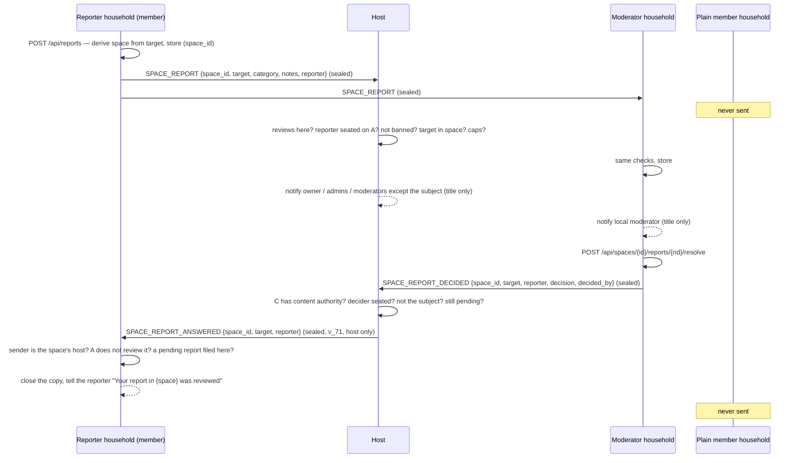

# Federated moderation

"Reviewed" (`moderated`, §4.3) across households. A plain member's new
item — and their edit / delete of somebody else's — waits in a moderation
queue until content authority (owner, admin or moderator) approves it.
Since v_43 that works in spaces whose members live on several households:
the item travels from the submitter's household to every household that
may review it, and any of them may approve or reject. The **host alone
applies** an approved item — from its own stored copy, still as the
submitter's — whichever household's moderator approved it.

What queues, the caps, expiry, resume and the REST surface are described in
[`spaces.md` — Moderation queue](./spaces.md#moderation-queue). This page is
the wire protocol.

## Scope

- **HFS**: full participant.
  - **Submitter household** — holds its own copy of the item (the author's
    `GET …/moderation/mine` pending strip) and sends it to the reviewers.
  - **Reviewer households** — the space's **host** and every household
    holding a **live `admin` or `moderator` seat** in `space_remote_members`.
    Each holds a copy (same id everywhere), shows it in the Moderation tab
    to its local content authority, and may decide it. A reviewer
    household's approval goes to the host, which applies the item; a
    rejection is decided where it is made.
  - **Plain member households** — never see a pending item. They receive the
    approved content like any other write.
- **GFS**: never sees a pending item. Submissions and decisions are pairwise,
  sealed sends (see *Confidentiality*); nothing about the queue is published
  to a connection server. Only the **outcome** reaches the followers of a
  public / global space with `allow_subscribers`, on the host relay and
  content-blind — see *Outcomes for GFS followers* below.

## Event types

- `SPACE_MODERATION_SUBMITTED` — submitter household → host + reviewer
  households. Classified as a space **write** (`SPACE_WRITE_EVENT_TYPES`):
  a Follower household may not send one and an archived space takes none.
- `SPACE_MODERATION_DECIDED` — two uses. An **approval** from a reviewer
  household goes to the **host only** (a request: publish this item); the
  host, once it applied the item, announces the approval to the reviewer
  households and the submitter's household. A **rejection** goes from the
  deciding household to the host, the reviewers and the submitter's
  household. Classified as a **reader** event
  (`SPACE_READER_EVENT_TYPES`): a decision is a verdict, not content, and a
  reject still lands in an archived space; its handler admits it only from
  content authority.

Both are in `SPACE_SESSION_ALLOWED_EVENT_TYPES` (a link-joined member
submits; a link-joined moderator decides).

There is no event for the approved content and no signed approval token:
the **host** applies the item from its own copy and emits it as the
ordinary `SPACE_*` write
(`SPACE_POST_CREATED`, `SPACE_TASK_CREATED`, `SPACE_STICKY_UPDATED`, …,
plus a post's `SPACE_POLL_CREATED` / `SPACE_SCHEDULE_CREATED` /
`BAZAAR_LISTING_CREATED`) through
`broadcast_to_space_members`, authored by the submitter, with an **approval
block** inside the sealed payload:

```json
{"actor_user_id": "<submitter>", "moderation": {"item_id": "…", "approved_by": "<approver>"}}
```

Expiry is local and deterministic (the same `expires_at` everywhere) — no
event.

### Bodies (all inside the encrypted payload)

| Event | Body |
|---|---|
| `SPACE_MODERATION_SUBMITTED` | `space_id`, `item_id`, `feature`, `action` (`create` / `edit` / `delete`), `target_id`, `submitted_by`, `payload` (the feature handler's item payload), `snapshot` (always `null`: receivers rebuild it), `submitted_at`, `expires_at`, `submitter_instance_id?` (only on the host's re-send of an item to a reviewer household that lacks it — see *Re-delivery and catch-up*), `public_relay?` (a post create in a public / global space with followers: the submitter's author-signed post inner, for GFS followers — see *Outcomes for GFS followers*) |
| `SPACE_MODERATION_DECIDED` | `space_id`, `item_id`, `decision` (`approved` / `rejected`), `decided_by`, `decided_at`, `reason?` |

Plaintext on the envelope: the routing `space_id` only (encryption-first,
§25.8.21). `space_id` is repeated inside the payload because a mesh-routed
envelope carries no routing field.

## Confidentiality

| Path | Guarantee |
|---|---|
| Submitter → reviewer (paired) | One `send_with_mesh_fallback` per target — never `broadcast_to_space_members` — sealed under the pairwise session key. Only the host and live admin / moderator seat households are targets — a reviewer household reached only over the mesh included (its version is the one it claimed as a space member, `space_member_supports`). |
| Submitter → reviewer (mesh) | The same send seals it end-to-end under `SPACE_ROUTED` for the target's ephemeral X25519 key: every relay sees ciphertext only. |
| Submitter → reviewer (link-joined, §D2b) | The pairwise session, carried by the connection-server relay as an opaque sealed envelope — the GFS can't read it. |
| Media of a pending post | `SpaceMediaSyncService.enqueue_for_post(…, target_instance_ids=<the reviewers>)` — the bytes go to the reviewer households only. |
| A plain member household | Never a target. A submission that reaches a household with no local content-authority member anyway (misdirected) is dropped and not stored. |
| Approved content | The ordinary write: `broadcast_to_space_members` to member households only. In a public / global space with followers, the host also relays an approved post to the GFS on its authority, encrypted and padded (see *Outcomes for GFS followers*). |
| Decisions | Pairwise, sealed: an approval request to the host only; the host's announcement and any rejection to the host, the reviewers and the submitter's household. |
| A large item to a household behind a GFS | One binary relay frame (v_87), sealed to that household's key-wrap key and padded to a size bucket: the GFS sees the recipient and a bucket, never the event type, the space or the content — exactly as for a media chunk. See *Large items behind a GFS*. |
| Catch-up (host → a reviewer household) | The host re-sends a pending item only in answer to the `mod_held` echo of a household holding a live admin / moderator seat — one `send_with_mesh_fallback` to that household, its files to that household only. Never in the §25.6 stream. See *Re-delivery and catch-up*. |
| Queued retries | The outbox re-checks a retried `SPACE_MODERATION_SUBMITTED` at send time and drops it when the target no longer reviews the space. |
| A household that stops reviewing | When it loses its last content-authority seat in the space, it expires the pending items of other households' members it holds and NULLs their content (its own members' items stay). |

A reviewer household's local content authority sees pending items through
the Moderation tab, the `space.moderation.*` frames and the title-only
`moderation_pending` bell — exactly as on the host.

## Outcomes for GFS followers

GFS followers of a public / global space with `allow_subscribers` hold no
seat and receive no `SPACE_*` event, so the host relay carries the two
outcomes they need, as `space_post_public` relays authority-signed with the
space seed (wire shape, checks and residuals:
[`discovery.md` — Moderation outcomes on the host relay](./discovery.md#moderation-outcomes-on-the-host-relay)):

- **An approved post.** In such a space the submitter's household adds the
  post's **author-signed** inner to `SPACE_MODERATION_SUBMITTED`, next to
  the payload, as `public_relay` (signed over the queued post,
  `created_at` = the submission time). A reviewer household keeps it in its
  queue row only when it verifies for this space, this post id and the
  submitter; the same key inside the payload is dropped. When the host
  applies the approved post, it relays that copy — only if it is exactly
  the post it publishes — marked `approved_post`, with the author
  household's writer cert (a plain member of a `MODERATED` space holds
  `comment` scope). Followers verify the author's own signature, so no
  seed holder can attribute a post. No copy (an older submitter) → members
  only, as before. Rejected and expired items, and anything still
  pending, never reach a connection server.
- **A removal.** Every post or comment delete a seed holder applies to an
  item it holds — a moderator's, an admin's or the author's, local or a
  federated `SPACE_POST_DELETED` / `SPACE_COMMENT_DELETED` from a moderator
  household — is relayed as a removal notice naming the item and its
  author. Followers soft-delete it, or leave a tombstone (only for an id
  owner-bound to that author in this space) if it has not reached them
  yet, so a late create never brings it back.

**Never on that path:** who approved or removed the item, a rejection
reason, the queue item, or anything that is still pending. The GFS sees the
same event type and size bucket as for any post, and none of the inner.

## Receiver rules

### `SPACE_MODERATION_SUBMITTED`

Checked in order; any failure is a WARNING and stores nothing.

1. This household is the host, or holds ≥1 **local** content-authority
   member of the space.
2. `submitted_by` holds a live writer seat on the **sending** household
   (`acts_for`) and is not banned. Only the space's **host** may name
   another household (`submitter_instance_id`, its re-send of an item it
   holds): the submitter must then hold a live writer seat **there**. From
   anybody else the field is ignored.
3. A create's `target_id` is owner-bound to `submitted_by` in this space
   (`owner_bound_id_refused`; a legacy unbound id is refused too).
4. The feature is on, its level **here** is `moderated`, and the space is
   not archived (the archived gate refuses the envelope first).
5. The feature's handler validates the payload with the live codecs and
   caps; media references must be local (`api/media/…`) — a remote URL
   is dropped, coordinates are cut to 4 decimals. The "before" snapshot is
   rebuilt from **this** household's copy of the target; the sender's is
   ignored.
6. Caps: 20 pending per (space, submitter), 50 per (space, sending
   household), 500 per space, 256 KiB per item; `expires_at` is clamped to
   at most 14 days ahead, `submitted_at` to at most 5 minutes ahead and at
   most 14 days before `expires_at`.
7. Stored once (`INSERT OR IGNORE`): a replay changes nothing — and a
   decision that overtook the submission left a contentless tombstone
   under that id, so the late submission is never stored as pending.

Local content authority gets the `moderation_pending` bell (title only).

### `SPACE_MODERATION_DECIDED`

The sender has content authority (`has_content_authority`) and `decided_by`
is a content-authority user seated on it (`moderates_as`, live seats; from
the host also one of our own users by our roster's role).

- **An approval from a non-host** is acted on by the **host** only: it
  checks the approver's live seat on the sender and runs every gate of a
  local approve for that approver — expiry, archived space, feature off,
  the feature's level (`admin_only` → an admin), the submitter still a
  writer — then applies the item **from its own stored payload** through
  the feature's normal persist path (`approved_by` = the approver) and
  announces the approval. Any other household ignores it.
- **An approval from the host**, or **a rejection** from any reviewer, is
  recorded on the held row. The first decision wins — **except that an
  approval may overturn a rejection when the approver's role is at least
  the rejecter's** (owner > admin > moderator). The host decides this from
  the seats it holds for both (a rejecter it can't place counts as a
  moderator): a moderator cannot overturn an owner's or admin's rejection —
  it stands everywhere — while an admin or owner may overturn a
  moderator's. Every copy then converges on what the host published (an
  approval the host announces also claims a rejected row). The submitter's
  household notifies the submitter (`moderation_decided`, title only).
- **No item held yet**: a contentless **tombstone** keeps the decision (at
  most 200 live per deciding household; beyond that the decision is
  dropped with a WARNING; tombstones older than 14 days are deleted by the
  hourly expiry sweep). A submission that arrives later fills in the
  tombstone's content and keeps its decided status. Approving a tombstone
  that never received its content answers 409 `ALREADY_DECIDED`.

Decided payloads are purged after the usual retention.

### Content with an approval block

`SpaceAuthorship.may_author_approved(event, space, author)` decides; it is
used in place of `may_author` for creates and in place of the `moderated`
rule in `access_admits` for edits / deletes:

- the event is a reviewable content write;
- the sender is the space's **host** — only the host applies a queue
  item, so only the host can release one (a moderator household cannot
  make one up);
- `approved_by` is a content-authority user (live seats — a demoted
  moderator fails); under `admin_only` the approver must be an admin;
- the author holds a live writer seat and is not banned;
- when the author is one of **our** users, we hold the item (defence in
  depth — the host is the roster authority already): same id, space and
  submitter, same feature / kind of write / target, status pending,
  approved or rejected, and **exactly** the item's content
  (`federation/moderation_approval.py`): a create carries the item's value
  in every field the receiver stores, and nothing the item never set (no
  recurrence, archive stamp, other creator, mirror origin); an edit
  carries the patch and every other content field equal to the row we
  hold (layout fields — a task's or sticky's position — are free). The
  check **fails closed**: every key the event carries is either routing /
  bookkeeping its event type may carry freely (ids, timestamps the
  receiver derives, layout) or content a rule compares — a key nobody
  classified, a new wire field or an alias the receiver also reads,
  refuses the release until it is. Any household holding the item checks
  it the same way.
- Accepted from the host, a release moves the held row to approved.

#### Space pages (v_48, host-sequenced)

Pages are sequenced by the space's host, and the host alone applies a
page queue item. An `edit` item (a patch, or `op: "resolve_conflict"`)
stores the `base_seq` the submitter saw.

- **Stale / force.** On approval, if the page's `seq` moved since the
  item was submitted, the host answers 409 `STALE` (an item without
  `base_seq`, from before v_48, falls back to `base_updated_at`).
  **Force** applies the item's patch as a **fast-forward** over the current
  version, never as a merge, so the approval stays bound to exactly that
  patch. A conflict never blocks an approved edit.
- **Resolutions.** The item carries `resolution` (`side` /
  `merged_content` / `mine` / `theirs`), `side` (the kept version's
  `sha256:` hash) and `sides` (the hashes the submitter saw). It also
  carries `merged_content`, and `side_content`, which is the kept side's
  body for the reviewer's preview only and never compared. `validate()`
  keeps exactly these fields and refuses a `side` resolution without a
  well-formed hash or a malformed `sides`. A resolution with no open
  conflict is refused at submit. On apply, sides that changed since the
  item was submitted give 409 `STALE` **even when forced**. A conflict
  resolved meanwhile gives 410 `TARGET_GONE`.
- **Release binding** (`_page_resolution`). A `side` resolution's wire
  `title` + `content` + `cover_image_url` must hash to exactly the item's
  `side`. A `merged_content` resolution carries the item's text under the
  held title and cover. `mine` / `theirs` (two-way, pre-v_48) leave the
  content uncompared.
- **Free keys.** The host-sequencing bookkeeping is free on
  `SPACE_PAGE_CREATED` / `SPACE_PAGE_UPDATED`: `seq`, `version_hash`,
  `conflict`, `sequenced`, `last_editor_user_id`, `cover_image_url`,
  `updated_at`. The rules still compare `cover_image_url` whenever the
  wire carries it. `ancestors` (an earlier v_48 draft) is no longer free.
- **Member check.** Members don't re-run the access level on a host
  version. When the moderation block is present they still run the
  release check against the item they hold.

A create's owner-bound id still binds to the author. A plain member's
create (or edit of someone else's row) without a valid block is refused
under `moderated` on every v_43 receiver — posts included, whatever
version the sender advertises.

## Sequence



## Re-delivery and catch-up

A reviewer household can lack an item, or hold one that is no longer
pending:

- its person was made admin / moderator **after** the item was submitted
  (the submission went to the reviewers of that moment);
- it **stopped reviewing** for a while: a demotion expires the other
  households' pending items it holds and NULLs their content
  (*Confidentiality*), and it was promoted again;
- it was offline past the submitter's retries, or its handler failed, when
  a `SPACE_MODERATION_SUBMITTED` was sent;
- it missed a `SPACE_MODERATION_DECIDED`. An approval still converges when
  the released content arrives (*Content with an approval block*: the
  release moves the held row to approved). What was left: a missed
  **rejection**, and an approval whose release was missed too (the content
  then arrives with the §25.6 stream, which carries no approval block) —
  the copy read "pending" until it expired, and a moderator there could
  approve it again, asking the host to overturn a rejection they never saw;
- the **host** missed a rejection made on a reviewer household: the item
  stayed pending on the host and on the other reviewers.

The **host** holds every pending item — a submission always goes to it —
so it is the one source, and the repair rides the §25.6 session the
reviewer household already opens with it. Nothing of the queue enters the
§25.6 stream (every member household gets that).

- **The echo.** A household that reviews a space (≥1 local content
  authority member, not the host) adds `mod_held` to its
  `SPACE_SYNC_BEGIN` **to the space's host**: every item it holds for the
  space whose review window is open, by state —

  ```json
  {"p": ["<id>", …], "x": ["<id>", …], "d": ["<id>", …],
   "r": [{"id": "<id>", "by": "<our moderator>", "reason": "…"}]}
  ```

  `p` pending · `x` expired or purged · `d` decided (approved, or rejected
  by somebody elsewhere) · `r` rejected by **one of the household's own
  people** (the decision itself). Empty lists are left out; `{}` holds
  nothing. Sealed like the rest of the BEGIN. A plain member household, a
  follower and a BEGIN to anybody but the host carry no such field.
- **When.** On the periodic BEGIN (every 30 minutes, paired, mesh or GFS
  relay alike), and at once when one of the household's own people is given
  a content-authority seat (`SpaceSyncScheduler.sync_with_host`): the
  household asks as soon as it has applied the promotion, so the answer can
  never arrive before it knows that it reviews. (A push from the host at the
  moment of promotion would leave before the role change itself and be
  dropped as misdirected.) A household seated as admin / moderator from the
  start (a moderator invite link) echoes on its first BEGIN.
- **The host's answer** (`SpaceModerationFederation.on_sync_begin`) is
  exactly the difference, to that one household:
  - a pending item the echo **lacks or names `x`** →
    `SPACE_MODERATION_SUBMITTED` again, from the host's own copy, with
    `submitter_instance_id` = the household the submitter holds a live seat
    on, and the item's files through
    `enqueue_for_post(…, target_instance_ids=[that household])`. Not
    re-sent: an item of the asking household's own member (it holds it), of
    an author who left, of a feature no longer `moderated` / switched off,
    of an archived space, or past its review window.
  - a pending item the echo names **`r`** → nothing is sent: the echo **is**
    the decision. The host applies it exactly like a
    `SPACE_MODERATION_DECIDED{rejected}` from that household — the sender
    has content authority, `by` holds a live content-authority seat **on
    it** — and its other reviewers hear it on their own echoes.
  - an item the host has since **approved or rejected** that the echo
    names `p` (or `r`, when the host approved: approve beats reject) →
    `SPACE_MODERATION_DECIDED` again, as first announced (same decider,
    time and reason) — when the decider still holds content authority (a
    receiver refuses a decision naming anybody else).
  - nothing for `d`, for an id the host does not hold, or one that expired
    on the host too.
- **Who is answered.** Only a household holding a **live `admin` or
  `moderator` seat** on the host's roster, for a space this household
  hosts. An echo from anybody else — a plain member household, a demoted
  one, a follower — is ignored: pending content never leaves the reviewers.
- **Bounds.** Checked in this order, the first before the host reads
  anything: one answer per (household, space) per 10 minutes
  (`CATCH_UP_INTERVAL_S`, spent when the echo made the host send
  something or apply an echoed rejection); the echo is
  at most 1000 ids, 100 of them own rejections (a longer or malformed one
  is ignored whole); one answer carries at most 1 MiB of item payloads
  (`CATCH_UP_MAX_BYTES`, at least one item, oldest first — the rest follows
  on the next sync, whose echo names what arrived); the **same** item or
  decision goes to the same household at most once per 24 hours
  (`RESEND_SAME_INTERVAL_S`), so a household that keeps refusing an item is
  not sent it on every sync — marked only when the transport took it, so
  a send that did not get out is tried again. A **role change** of that
  household's people on the host clears both limits: a promotion is
  answered at once and in full. So does, for the 24-hour marks, any other
  change of its reviewer seats — somebody who left and was seated again
  by a role-bearing invite link, with no role event: the host compares
  the seats (who, role, roster version) with the ones it last answered. The host compares the echo with one read of its own open items.
- **Receiver rules.** A re-sent item passes **every** check of
  `SPACE_MODERATION_SUBMITTED` above. Only check 2 reads the new field:
  `submitter_instance_id` is believed **only from the space's host**, and
  the submitter must then hold a live writer seat on the household it names
  (the per-household cap counts there, not against the host). From any
  other sender the field is ignored and the sender is the origin — a
  household can still only submit for its own members. Stored once under
  its id; **from the host**, a copy that *expired* here (purged while this
  household did not review) is pending again with the host's content — a
  decided copy is never reopened, and a replay from anybody else revives
  nothing. A re-sent decision is the ordinary decision from the host.



**Large items behind a GFS.** The size limit is the same for everybody
(256 KiB per item, as before). A JSON envelope on the GFS relay — the path
to a household seated from an invite link or a directory join — takes
about 191 KiB, so an item whose content is over 96 KiB (the bound media
chunks use: encrypt + base64, twice) does not fit one. The host then sends
it to that household as **one binary relay frame** (v_87, `\x00SHR`, up
to 528 KiB — what `SPACE_MEDIA_BLOB` chunks ride): the same
`SPACE_MODERATION_SUBMITTED` event, its small signed and sealed metadata
(ids, feature, action, submitter, times, `submitter_instance_id`) as the
frame's header payload and `{payload, public_relay?}` as the frame's
bytes, bound by the signed `chunk_sha256`. No new event and no new frame:
the relay pipeline's event-type gate takes this one event besides the
media chunks (`RELAY_FRAME_EVENT_TYPES`; the inbox's binary media route
and the media channel stay media-only), and the receiver runs every check
of *Receiver rules* on the reassembled payload. The host uses the frame
only in a catch-up answer — the household's echo proves it runs a revision
that reads it — so a large item reaches a moderator behind a GFS with its
next BEGIN to the host (at once on a promotion, else within 30 minutes);
a paired or mesh-reached moderator household gets it live, as the
ordinary event. Needs what media over the relay needs: the household at
v_87 and a GFS proving `envelope_media`; without them the item waits
(the send is tried again on later answers). The `snapshot` field is always
`null` on the wire — every receiver rebuilds the "before" values from its
own copy (`local_snapshot`) and never read the sender's — which halves an
edit or a delete.

**Cost.** The echo adds ≈ 35 B per held item to one BEGIN per reviewer
household every 30 minutes — ≈ 350 B for ten items, ≈ 35 KB at the
1000-id bound — and nothing for plain member households and followers. An
up-to-date household costs the host one seat lookup and one queue read and
gets **no** answer. A difference costs the missing items once (a typical
item is 0.5–2 KB, at most 256 KiB), to one household: no fan-out, so a
global space with 200 authors and 10 000 followers pays per **reviewer
household** only (five of them: ten echoes an hour). Worst case per
reviewer household: 1 MiB of items per 10 minutes plus the files of the
pending posts among them, and never the same item twice in a day. A
promotion costs one extra incremental BEGIN (answered by the sentinel when
nothing changed) and the pending items once.

**Compatibility — no version bump.** `mod_held` is an additive BEGIN
field: an older host ignores it (that household is caught up by nobody, as
before). The host re-sends only to a household that echoed, and only this
revision echoes — so no older household is ever sent an item naming
another household's submitter (it would refuse it: the submitter holds no
seat on the host). The §25.6 stream's records are unchanged.

## Reports (`SPACE_REPORT`, `SPACE_REPORT_DECIDED`)

A **report** about content inside a space — a post, comment, page, task,
sticky, calendar event or gallery item — or about a member's conduct in it,
is triaged by the space's **content authority** (owner, admins,
moderators), never by household admins: a household admin is not a seat in
the space, and a space's reports are as private as its content. A household
admin who holds no seat sees nothing of a space's reports (`403` on
`GET /api/spaces/{id}/reports`). Household-level reports (feed content, a
user outside any space, a space itself, highlights, moments) stay with
household admins (`/api/admin/reports`). A space report never gates the
reported user's household relay (`relay_policy` counts household-level
reports only).

The report's space is **derived from the target** on every household — the
reporter's household and each receiver look the item up themselves. A
client names a space only for a member report (`target_type: "user"`), and
the reported user must then hold a live seat in it. A report on an id this
household does not hold is refused exactly like one in a space the reporter
is not in (the same 404 body) and nothing is stored — no existence oracle.

### Event types

- `SPACE_REPORT` — reporter's household → host + reviewer households
  (v_45+). Reader event (`SPACE_READER_EVENT_TYPES`): a report is about
  content, not content.
- `SPACE_REPORT_DECIDED` — the deciding household → the other reviewer
  households (v_45+): `{space_id, target_type, target_id,
  reporter_user_id, decision: resolved|dismissed, decided_by,
  decided_at}`, all inside the sealed payload. Reader event; in
  `SPACE_SESSION_ALLOWED_EVENT_TYPES` (a link-joined moderator decides).
  The rows are matched on `(space, target, reporter)` — every household
  holds its own row id.
- `SPACE_REPORT_ANSWERED` — the **host** → the reporter's household only
  (v_71+): `{space_id, target_type, target_id, reporter_user_id}`, all
  inside the sealed payload — the key the reporter's household already
  holds, **no verdict, no decider**. Reader event; in
  `SPACE_SESSION_ALLOWED_EVENT_TYPES` (a link-joined reporter's household
  hears it too). See *Telling the reporter* below.

### Rules

- **Delivery.** `SPACE_REPORT` goes to the space's **host** and every
  household holding a **live `admin` or `moderator` seat** at **v_45 or
  above** — one targeted send each (`send_with_mesh_fallback`, sealed under
  `SPACE_ROUTED` across a relay). Plain member households, households below
  v_45 and the GFS never receive it. Nor does a household whose **only** live
  admin / moderator seats belong to the report's subject — a report about
  X never lands where only X could read it (the host always gets it). Plaintext on the envelope is the
  routing `space_id`; target, category, notes and reporter ride inside the
  encrypted payload (which repeats `space_id`).
- **Receiver rules for a report** (each refusal stores nothing; WARNING
  except the first): this household reviews the space (host, or ≥1 local
  content-authority member) — a misdirected report is dropped at INFO; a
  routing `space_id` that disagrees with the payload copy is dropped; the
  target resolves into that same space here (a cross-space or unknown id
  is dropped); the reporter holds a live seat on the **sending** household
  and is not banned; for a member report, the reported user holds a live
  seat in the space; caps — 20 pending per (space, sending household,
  reporter), 50 per (space, sending household), 500 per space; notes are
  cut at 1000 characters. One report per (reporter, target, space) — a
  replay is a no-op. A report **without** `space_id` (household-level)
  must name a reporter who is a user of the sending household.
- **Receiver rules for a decision:** the sender has content authority in
  the space (`has_content_authority`) and the named decider holds a
  content-authority seat on it (`moderates_as`); the decider is not the
  report's subject; the first decision wins — a replay or a later contrary
  verdict changes nothing.
- **No self-triage.** A report's *subject* — the reported member, or the
  reported item's author / creator — never sees it in the queue, cannot
  resolve it (404) and is not notified. Exception: the space **owner when
  the space has no other content authority anywhere** (no other local
  owner / admin / moderator, no remote admin / moderator seat). Otherwise
  that report could never be cleared, so the owner sees it with the
  reporter hidden (`anonymous`: no reporter id, household, name or
  **notes** — their own words could name them) and may only **dismiss** it
  (`dismiss_only`; resolving → 403) — the reporter cannot be retaliated
  against. Eligibility is **pinned when the report is filed**
  (`content_reports.sole_reviewer_user_id`): if anyone else held content
  authority then, the owner never gets the fallback — demoting everyone
  afterwards does not unlock it — and it must still hold at review time
  (a moderator promoted later takes the report over).
- **Resolution** uses the existing powers — a moderator deletes the post /
  comment / page through the ordinary delete, which federates as usual —
  then marks the report resolved or dismissed, which is synced with
  `SPACE_REPORT_DECIDED`.
- **Notification.** Each reviewing household tells its local content
  authority (except the reporter and the subject, per the rule above) with
  a title-only bell entry and push, `New report in {space_name}`, linking
  to the space's Moderation section (`/spaces/{id}/moderation`) — never the
  category, notes or reporter (§25.3).
- **Purge.** When this household stops reviewing a space (its last
  content-authority member demoted or gone) it deletes the reports other
  households filed there; a dissolved space's reports all go.
- **Re-delivery.** A household that reviews a space again (a temporary
  demotion purged its copies), or for the first time, gets the space's
  pending reports from the host over the same `SPACE_REPORT` path (v_45
  only; the receiver's dedupe makes a repeat a no-op). The host sends
  them when that household **asks**: its §25.6 `SPACE_SYNC_BEGIN` carries
  the reviewer echo (`mod_held`, *Re-delivery and catch-up* above) and is
  sent as soon as it has applied the promotion. The host answers the
  first such BEGIN after that household's reviewer seats changed — a role
  change, or somebody who left and was seated again (the seats' roster
  versions are compared) — and the first after its own restart, from a
  live admin / moderator seat only: once, not on every sync. A household
  reached only over the mesh counts by the version it claimed as a space
  member (`space_member_supports`), for the first fan-out, the
  re-delivery and `SPACE_REPORT_ANSWERED` alike. (It used to re-send from the role change's
  local event, which fires **before** the role change is sent: the report
  reached a household that did not review yet and was dropped.) The
  payload names the reporter's own household
  (`reporter_instance_id`, sealed); the receiver trusts it **only from the
  host** — the reporter must hold a live seat on that household, and the
  per-household caps and the stored `reporter_instance_id` key on it, so a
  relayed report never counts against the host. From any other sender the
  field is ignored and the sender is the origin (it may only send reports
  by its own members). A re-delivery skips a household whose only reviewer
  is the report's subject, too. Cost: ≤ 500 pending reports × ≈ 0.5 KB to
  one household per promotion (and per reviewer household once after a
  host restart).
- **GFS.** The automatic fraud forward fires for space content only when
  the space is `public` / `global`, and for a reported user (as their
  household) or a public / global space itself. What the GFS gets: the
  target, the category and this household's signed identity
  (`reporter_instance_id` + signature, which it needs to verify the report)
  — **never the reporter user or the notes**. Feed content and anything in
  a private / household space never reaches a connection server.



**Compatibility (v_45, `MIN_FOR_SPACE_REPORT_SCOPE`).** Gated, no
fallback: a reviewer household below v_45 is sent neither event — it would
file the report for its household admins. A pre-v_45 sender omits
`space_id` and fans a report out to every member household; a v_45
receiver derives the space from the target and drops it unless it reviews
the space.

### Telling the reporter (`SPACE_REPORT_ANSWERED`, v_71)

A reporter on the household that hosts the space, or on a reviewer
household, hears "Your report in {space_name} was reviewed"
(`report_answer`, About you) from their own household when the report is
decided there — never who reviewed it, what became of it or whom it was
about (§25.3). A reporter on a **plain member household** used to hear
nothing: their household keeps its own copy of the report (pending) but is
sent no decision.

- **Sender: the host alone.** When a space report filed on another
  household is resolved or dismissed on the host — by its own moderator, or
  by a reviewer household whose `SPACE_REPORT_DECIDED` the host applied —
  the host sends one `SPACE_REPORT_ANSWERED` to the household the report
  came from (`content_reports.reporter_instance_id`), and to nobody else.
  One sender whichever reviewer decided, so the reporter's household hears
  it once. Not to a household that reviews the space itself (it got the
  verdict with `SPACE_REPORT_DECIDED`), not for a local reporter (told by
  the host directly), not to a household below v_71. Delivered like a
  report: `send_with_mesh_fallback`, sealed under `SPACE_ROUTED` across a
  relay. Plaintext on the envelope is the routing `space_id`.
- **Payload**: the report's key — `space_id`, `target_type`, `target_id`,
  `reporter_user_id` — which the reporter's household already holds. No
  `decision`, no `decided_by`, no time, no category or notes.
- **Receiver rules** (each refusal changes nothing; WARNING unless noted):
  the space is known here and not dissolved; the **sender is the space's
  host** as this household stores it (`spaces.owner_instance_id`) —
  anyone else, including a reviewer household, is refused; this household
  does **not** review the space (INFO — the verdict is its own); the key
  names a report **a local member filed here** (`reporter_instance_id` is
  empty — a copy filed on another household is never answered here). A
  report no longer pending is a replay: nothing changes, nobody is told
  again.
- **Effect.** The reporter's household closes its copy as `resolved` —
  there it means "answered", not the verdict, which it never learns
  (`resolved_by` stays empty) — which also frees the reporter's pending
  per-space cap there; then `ReportResolved` gives the reporter the same
  translated, title-only `report_answer` row and push as a local reporter,
  naming nobody.
- **GFS**: never involved — host and reporter's household are space
  members; the answer is a pairwise sealed send.
- **Cost.** One sealed envelope (payload ≈ 150 B of JSON, ≲ 1 KB on the
  wire) to one household per decided report filed on another household —
  no fan-out. Worst case per space is bounded by the report caps: ≤ 500
  pending reports per space, ≤ 50 per sending household, 20 filings per
  reporter a day — clearing a full queue is ≤ 500 envelopes (≈ 0.5 MB)
  once, each to the one reporter's household. A global space with
  10 000 followers costs no more: followers who never reported get nothing.

**Compatibility (v_71, `MIN_FOR_REMOTE_REPORT_ANSWER`).** Gated, no
fallback: a reporter's household below v_71 is sent nothing, and its
reporter hears nothing, as before. An older host never sends it; a v_71
reporter's household then keeps its copy pending, as before. Not
space-scoped (a behind household only keeps its own reporters from hearing
back).

### Known residuals (reports)

- **N4 — a reviewer household's decision is trusted.** Any household with
  a live admin / moderator seat can resolve or dismiss a report for every
  reviewer (first decision wins). A rogue moderator household can clear
  reports about its own members or allies; the remedy is the owner demoting it (its
  copies are purged, later reports no longer reach it). Decisions are not
  re-checked against the content.
- **N5 — every reviewer household learns who reported.** The reporter's
  user id and notes ride (sealed) to the host and every admin / moderator
  household, and are stored there. A moderator on another household can
  therefore see who reported a member of theirs. Only the anonymous
  sole-owner fallback hides the reporter, and only from the subject.
- **N6 — the host's "reviewed" is trusted.** The reporter's household
  believes the space's host when it says a report was reviewed
  (`SPACE_REPORT_ANSWERED`); a rogue host can close the reporter's copy
  without anyone looking at it. It learns nothing by doing so (it already
  holds the report) and could equally drop the report unseen; the remedy is
  the same as for any rogue host — leave the space.

## Compatibility

- **v_43** (`MIN_FOR_FEDERATED_MODERATION`). Submissions skip a reviewer
  household below v_43. A host below v_43 makes a stub's submit fail
  **409 `HOST_TOO_OLD`** (nothing stored, nothing sent). Setting any feature
  to `moderated` while a member household is below v_43 answers 409
  `PEERS_TOO_OLD` until applied anyway (`force`). A v_42 receiver refuses a
  release from a non-host household (it never learnt the block) — content
  approved off the host reaches v_43 households only. A household below
  v_43 that takes a seat in a space keeping a non-post feature Reviewed
  gets the local admins the `moderation_unavailable` notice.
- A v_42 host's release (actor = approver, no block) is still admitted from
  the host (`release_ok`).

## Residuals

- **The host is trusted to publish what it holds.** Only the host releases
  items, and a plain member household — which holds no item — accepts the
  host's release on the host's word, as it accepts the host's relay of any
  member's row today. The submitter's own household and every reviewer
  household refuse a release that differs from their copy in any field.
  Because the host applies from its own copy, a submitter that sent
  different payloads to different reviewers gains nothing: only the host's
  copy is ever published.
- **Approval needs the host online.** A reviewer household's approval is a
  request to the host (queued in the outbox while the host is
  unreachable); the item reads "publishing" there until the host's
  announcement arrives. If the host refuses it (the item expired, the
  level changed), the row stays pending and the moderator may decide again.
- **The host is the one source of a catch-up.** A submission the
  **host** missed is not repaired by it: the item stays on the submitter's
  household and the reviewers that got it, and an approval there is
  refused by the host ("no such item"). A decision is re-sent only while
  its decider still holds content authority; one made by somebody demoted
  since, and an expiry, are not announced — that copy expires on its own
  `expires_at`. A catch-up waits for the reviewer household's next BEGIN
  to the host (at most 30 minutes; at once on a promotion). A role change
  the household itself missed (the mesh has no outbox) delays it the same
  way as it delays every other right of that role.
- **A large item from a submitter behind a GFS.** A household seated
  from an invite link cannot send an item over ~96 KiB to the host in one
  JSON relay envelope (the relay refuses it, as it refuses any other
  space write of that size from such a household — a general limit of the
  relay, not of moderation). The item stays on the submitter's household
  only. Sending it as a relay frame needs the submitter to know the host
  reads one, i.e. a protocol version gate — not part of this change.
- **An echoed rejection is the household's word**, like its
  `SPACE_MODERATION_DECIDED`: the host checks the named moderator's live
  seat on that household, not that the rejection happened earlier.
- **Concurrent edits.** A household holding an edit item whose target was
  changed meanwhile by another write refuses the release (its copy no
  longer matches); the host's §25.6 sync converges it.
- **Submission flooding.** A household can keep up to 50 pending items per
  space at each reviewer household (and each submitter 20), each kept at
  most 14 days; the caps bound storage, not the review burden.
- **An approved event does not RSVP its creator** when approved on a
  household that is not the creator's (the approver can't speak for them),
  and its feed card is not queued in their name there.
- **Report decisions reach v_45 households only.** A reviewer household
  below v_45 receives neither the report nor its decision.
- **A sole-authority owner may dismiss a report about themself** (the
  reporter hidden). The rule trades a self-dismiss for a report that would
  otherwise sit forever; members who want an outside view can leave or
  report the space itself to their household admin.
- **Clock skew around `expires_at`**: the approver checks its own copy's
  expiry; an author's household that already expired its copy refuses the
  release.

## Implementation

- `socialhome/services/space_moderation_federation.py` —
  `SpaceModerationFederation`: targets, sends, the two inbound handlers and
  their receiver checks; the catch-up (`held_echo`, `on_sync_begin`).
- `socialhome/federation/sync/space/scheduler.py` —
  `attach_moderation_echo` (the `mod_held` BEGIN field),
  `sync_with_host` (the BEGIN a newly reviewing household sends at once).
- `socialhome/services/space_moderation_service.py` — the queue: submit,
  approve (the host inside `release_scope`; elsewhere a release request),
  `release_remote`, reject, `store_received`, `apply_decision`,
  `note_release`, `record_early_decision`, `drop_held_for_others`.
- `socialhome/services/moderation_release.py` — the release scope and
  `with_release` used by every content outbound bridge.
- `socialhome/federation/moderation_approval.py` — which events carry a
  release, and the item ↔ wire content digest.
- `socialhome/federation/space_authorship.py` —
  `SpaceAuthorship.may_author_approved`, the approval path of
  `access_admits`.
- `socialhome/services/report_service.py` / `report_scope.py` — space-scoped
  reports: scope derivation, `SPACE_REPORT` targets and receiver checks,
  the content-authority triage.
- Tests: `tests/protocol/test_space_moderation_federated.py` (four real
  households), `tests/protocol/test_space_report_scope.py` (reports, four
  real households), `tests/services/test_space_moderation_federation.py`,
  `tests/federation/test_moderation_approval.py`.

## Spec refs

§4.3 (feature access levels, `moderated`), §24.11 (inbound pipeline and
authorship), §25.8.21 (encryption-first), §D2b (link-joined households).
