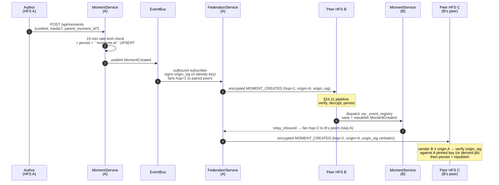

# Momentum

Household-broadcast posts pillar — a *moment* is a one-shot post
(text + optional image / ≤ 15-second video) that fans out to every
paired peer **and their paired peers, up to 3 hops**. Replies are
themselves moments and carry a ``parent_moment_id`` that pins them
to a thread root.

## Scope

- **HFS**: full participant. Authors post moments, peers receive and
  re-broadcast through a hop-counted relay (max 3 hops).
- **GFS**: uninvolved. Moments are personal-scope.

## Event types

`MOMENT_CREATED`, `MOMENT_DELETED`, `MOMENT_REACTED`,
`MOMENT_REACTION_REMOVED`.

Plaintext fields on every envelope: `event_type`, `from_instance`,
`to_instance`, `moment_id`, `origin_instance_id`, `hop_count`. Routing
data only — everything else (`content`, `media_url`, `media_type`,
`duration_ms`, `parent_moment_id`, `expires_at`, `author_user_id`,
`reactor_user_id`, `emoji`, and the v_35 origin signature
`origin_identity_pk` / `origin_sig` / `origin_sig_suite`) lives inside the
encrypted payload (§25.8.21).

## Retention

* **The author chooses how long followers keep their moments**
  (decision 6d, v_65): ``moments.follower_retention_days`` in
  ``users.preferences_json``, 1–30 days, **7 by default** (Settings ›
  Privacy › Momentum). It sets ``moments.expires_at = created_at + N days``
  on every new moment — top-level and replies — and ``expires_at`` travels
  under the origin signature (``_SIGNED_FIELDS``), so every household and
  GFS follower keeps the author's choice. A reply never outlives its
  thread: its ``expires_at`` is at most its root's. A change applies to new
  moments only.
* **Receivers clamp** (v_65): a received ``expires_at`` is kept at most
  ``created_at + 30 days`` (``MOMENT_MAX_LIFETIME_DAYS``) on both the
  household path (``occurred_at``) and the GFS path (sealed
  ``created_at``) — a signature proves who chose a value, not that it is
  reasonable. An in-range value is kept byte for byte, and a relay
  forwards the envelope unchanged (the clamp is local). A create whose
  clamped expiry has passed is refused and not relayed. An older (v_64)
  receiver keeps whatever the author signed.
* Visibility cap: **24 hours** for moments where the local viewer
  doesn't follow the author. ``moment_repo.list_visible_to`` collapses
  the author's window to 24 h unless the viewer follows the author —
  directly (``user_follows``) **or through a GFS**
  (``moment_public_follows``); both are a follow. The same rule drives the
  detail read, trending hashtags and reply counts.
* The retention scheduler runs hourly and deletes anything past its
  ``expires_at`` — others' moments and delete tombstones alike; reactions
  cascade.
* **Your own moments stay in your archive** (decision 6a). A moment
  written on this household (``received_via = 'self'``) that its author
  hasn't deleted is never pruned here: past ``expires_at`` it leaves every
  inbox and only its author can still open it
  (``GET /api/moments/archive?scope=own``, ``GET /api/moments/{id}``).
  Replies to it close at expiry (the households a reply would reach no
  longer hold the moment). This is **local only**: every other household
  prunes its copy at the signed ``expires_at`` as before, and nothing on
  the wire changes. An own tombstone still goes at expiry, and so does a
  public moment's share-link item key (``moment_public_shares``) — a
  share link never outlives the moment.
* **Household archive cap.** The admin sets a per-person cap on archived
  media (``PUT /api/admin/moments/archive-cap``, ``instance_config`` key
  ``moments.archive_cap_bytes``; default 2 GiB, ``0`` = no limit). The same
  hourly tick drops the oldest archived pictures and videos of anyone past
  it — at most 200 per tick: the text stays, ``media_url`` is cleared and
  the file is removed once no other row references it. A moment others can
  still see keeps its picture. Nobody is notified; the Yours tab says it
  up front.

## Hashtags

A moment's content is scanned at save time for ``#tag`` tokens: ``#``
followed by letters, marks, numbers or ``_`` in any script (Unicode
categories L, M, N — ``#Kürbisfest``, ``#Fußball``, ``#東京``), not
right after such a character (``issue#42`` is no tag). A run longer than
32 code points is no tag. Up to ten tags per post are stored NFC +
lowercased in ``moment_hashtags`` (composite PK ``(moment_id, tag)``);
``?tag=`` is normalised the same way. The same rule runs on the SPA
(``features/momentum/hashtags.tsx``) so the rendered chip and the
indexed row stay in lockstep. Tags are derived per household from the
content — nothing about them travels on the wire. Federated edits / relay
updates rewrite the row set on each ``save`` so the trending list is
always derived from the *current* content.

* ``GET /api/moments/archive?tag=<name>`` filters to a single tag.
* ``GET /api/moments/hashtags`` returns the trending tags inside the
  viewer's visibility window — block-aware and follow-aware via the
  same filter as ``list_visible_to`` so a blocked author's tag never
  surfaces.

## Rate limit

One **top-level** moment per author per 15 minutes.
``moment_repo.count_recent_for_author`` ignores rows where
``parent_moment_id IS NOT NULL`` so back-and-forth replies are
unconstrained. Reactions are exempt.

## 3-hop relay

```
              hop=1                 hop=2                 hop=3
A (author)  ────►  B (paired)  ────►  C (B's paired)  ────►  D (C's paired)
                                       (skips A)              (skips A and B)
```

* The author's instance fans the envelope with
  ``hop_count = 1`` and ``origin_instance_id = self``.
* Receivers persist the **first** copy and republish ``MomentCreated``
  on the local bus for the realtime layer. In a mesh one copy arrives
  per relaying neighbour; a later copy is neither stored nor announced
  again — it only lowers the stored ``hop_count`` when it comes from
  closer to the origin.
* The inbound handler then calls
  ``MomentFederationOutbound.relay_inbound``, which bumps
  ``hop_count`` and re-fans to every paired peer **except**
  ``origin_instance_id`` and the immediate ``from_instance``.
* **Once per moment.** The relay remembers, per (event type,
  ``moment_id``), the lowest hop it relayed at (in memory, 48 h,
  at most 20 000 entries). A later copy is relayed only when it arrives
  at a lower hop — relayed on, that one reaches further. Creates and
  deletes are tracked apart.
* **Creates relay for 48 h** (v_65). A ``MOMENT_CREATED`` whose signed
  ``occurred_at`` is more than 48 h ago (``MOMENT_RELAY_MAX_AGE_HOURS``),
  or missing, is still stored here but not passed on. Mesh copies travel
  in seconds and an outbox retries for well under a day; with moments that
  live up to a month, an old signed create is a replay that must not
  re-flood the mesh. The seen-map remembers for the same 48 h, so within
  that window no copy is relayed twice.
* **Deletes relay only when they changed something** (v_65). A
  ``MOMENT_DELETED`` travels on only when this household removed a live
  moment or recorded a new tombstone for one it never held; a delete for a
  tombstone it already holds (a replay — possible for the month a
  tombstone lives) goes no further, even after a restart wiped the
  seen-map. Deletes are not age-gated.
* **Deletes keep trying for 30 days** (v_66). An outbox gives an ordinary
  event 13 attempts over ~10 h, then drops it, so a ``MOMENT_DELETED`` to a
  household offline for a weekend never arrived and the moment stayed on
  its screen for up to a month. ``MOMENT_DELETED`` is now outbox
  ``LONG_LIVED`` (``domain/federation_retention.py``): past the ladder it
  keeps retrying on the 4 h ceiling until 30 days after it was queued, then
  the retention sweep ends it. It is still evictable under the per-peer
  cap (1 000 pending), unlike ``NEVER_DROP``. Every hop queues its own
  copy, so a delete crosses all three hops even when the households between
  were offline for weeks; a pure pass-through household relays it as
  before, only when it changed something there. **Cost:** per delete, the
  same ≤ 3-hop fan-out as before; a peer that stays offline costs at most
  ~180 extra delivery attempts over 30 days (one per 4 h, ±30 % jitter),
  each a re-signed envelope of < 1 KB. A household offline for 30 days with
  1 000 deletes queued for it is ~1 000 rows of < 1 KB. Older (v_65) relays
  give up after ~10 h as before; a delete reaching a public follower
  through a GFS is covered by the GFS's certificate log
  ([`momentum_public.md`](./momentum_public.md#late-deletes-delete-certificates-v_66)).
* When ``hop_count >= MOMENT_MAX_HOPS`` (3), the relay short-circuits.

**Cost.** In a fully-connected mesh of *n* households, re-relaying every
copy cost (n−1) + (n−1)(n−2) + (n−1)(n−2)(n−3) envelopes per moment
(25 260 for n = 31); relaying once costs (n−1) + (n−1)(n−2) (900).

## Per-user max-hops visibility (§Momentum-relay-policy)

The wire cap (3) governs how far a moment is *relayed*. **What each
user sees** is a separate, per-user knob: ``moments.max_hops`` in
``users.preferences_json`` (default 3, clamped to 1..3).

* ``max_hops = 1`` — only moments authored by direct paired peers.
* ``max_hops = 2`` — direct peers plus their peers.
* ``max_hops = 3`` — every relayed moment (default).

The recipient instance writes the inbound ``hop_count`` onto the
``moments`` row; ``list_visible_to`` adds ``AND m.hop_count <= ?``
against the viewer's preference so the inbox respects it.

### Pure pass-through

If **no local user** can see an inbound moment under their
``max_hops`` and per-viewer ``user_blocks``, the recipient instance
**skips the local persist** but **still relays** onward. This
keeps the household acting as a transparent forwarder when no one
locally subscribes — saves disk + retention work without breaking
the mesh. The check is ``moment_repo.has_visible_recipient(...)``.

### Flagged-relay block

The relay path is gated by :class:`RelayPolicy`. Two negative
signals stop both ingress and onward fan-out:

* The source instance is on the household's
  ``household_instance_bans`` table (set by the operator from the
  Settings → Federation page).
* There is at least one ``status='pending'`` row in
  ``content_reports`` against the moment id OR the author user id.
  Local moderation overrides federation fan-out — neither persist
  nor relay run while a report is open.

Per-user ``user_blocks`` are intentionally NOT consulted here.
Personal block lists stay private; tying them to the relay would
couple two trust models and leak block-list shape to peers.

## Authority

* **1-hop direct** (``from_instance == origin_instance_id``): the
  sending peer must be the author's home instance. Inbound rejects on
  mismatch.
* **2/3-hop relay** (``from_instance != origin_instance_id``): the
  moment must carry its **origin signature** (v_35, below), and the
  ``origin_instance_id`` must match the author's home instance lookup.
  Unknown authors (``USER_UPDATED`` envelope hasn't landed yet) are
  accepted on first sight once the signature verifies.
* **Never ours:** a moment whose claimed origin is this household, or
  whose author is one of our own users, is refused on every path — those
  only originate here.
* **Stored row wins:** a `MOMENT_CREATED` / `MOMENT_DELETED` naming a
  moment id this household holds is applied only when the stored author
  and origin match the payload. A delete tombstone (below) still binds
  its id to its author and origin.
* **Creator-bound id (v_36):** because the first household to name a
  moment id here decides whose it is (the stored row, or a delete's
  tombstone), a moment's id commits to its author
  (`federation/owner_bound_id.py`, the unscoped `moment` kind — no space
  component, the commitment covers the author alone). A `MOMENT_CREATED`
  or `MOMENT_DELETED` naming a bound id for any other author, or under an
  unknown suite nibble, is refused at WARNING before either binding could
  form: not stored, not tombstoned, not relayed — the public (GFS) inbound
  applies the same check. The author's own early delete still sticks. A
  legacy (uuid4) id keeps the first-come rule. See
  [`capabilities.md`](./capabilities.md) (v_36).
* **Reactions** (`MOMENT_REACTED` / `_REMOVED`) are honoured only for a
  moment authored here, from a reactor homed on the sending household;
  the published author is the stored one.
* Refused events are logged at WARNING and never relayed
  (`tests/protocol/test_moment_scope.py`).

### Origin signature (v_35)

Moments relayed by another household are checked against the household
that posted them. Every relay re-sends a moment under its own envelope
signature, so the §24.11 pipeline proves only the last hop; the origin
household therefore signs each `MOMENT_CREATED` / `MOMENT_DELETED` it
authors with its Ed25519 identity key
(`socialhome/moment_origin.py`, wire shape in
[`crypto.md`](../crypto.md)). The signature covers the event type, the
suite and every stored field — never `hop_count` — and relays forward it
verbatim.

* A receiver handed a moment by a household other than its claimed origin
  verifies the signature against the key it pins for that origin, or, for
  a friend-of-friend origin it never paired with, against the shipped
  `origin_identity_pk` provided `derive_instance_id(pk) ==
  origin_instance_id`.
* **Deletes** follow the same rule: a relayed `MOMENT_DELETED` removes a
  moment only when the origin signed it; the author's own household can
  still delete directly.
* **Refused** — unsigned relays naming a v_35+ origin or an origin with no
  `remote_instances` row, a signature that does not verify, a shipped key
  that disagrees with the pinned one or does not derive to the origin, and
  any unknown `origin_sig_suite`. Refused events are logged at WARNING and
  never relayed (`tests/protocol/test_moment_origin_signature.py`).
* **`no_relay`** (v_38) — a protected account's moments go to its
  household's directly paired households only. The origin marks them
  `no_relay: true` inside the origin signature (`moment-origin:v2:`
  domain), sends them only to households at v_38 or above (an older one
  might relay them), no household relays a marked moment, and a receiver
  refuses one that arrives from anyone but its origin
  (`tests/protocol/test_moment_no_relay.py`).
* **Legacy window** — an unsigned relay whose origin this household holds a
  row for at `proto_version` < 35 is accepted and logged at INFO; it closes
  as origins upgrade. See [`capabilities.md`](./capabilities.md) (v_35).

### Deletes stick

The origin signature proves who made a moment, not that it still exists:
a relay can hold a genuinely signed `MOMENT_CREATED` and re-send it after
the origin deleted the moment, and relays deliver out of order, so a
delete can arrive before its create. A verified delete is therefore never
forgotten until the moment could no longer be shown anyway:

* **Tombstone.** Every accepted `MOMENT_DELETED` — and a local delete by
  the author or an admin, and a GFS-relayed public delete — keeps the
  `moments` row with content, media, tags and reactions wiped and
  `deleted_at` set. The tombstone keeps the row's own `expires_at`.
* **Held delete.** A delete for a moment this household has not stored
  yet inserts the tombstone directly, expiring after the maximum moment
  lifetime (30 days from receipt, v_65 — no create for it can outlive
  that; 7 days on an older build). The delete still travels on, so
  households that do hold the moment apply it (pure pass-through
  households tombstone too, so they stop relaying a replay). A delete that
  finds the tombstone already there changed nothing and is not relayed
  again.
* **Refused create.** A `MOMENT_CREATED` for a tombstoned id is refused
  (INFO log): not stored, not relayed. The repo's upsert also never
  writes over a tombstone, so no path can bring one back.
* **Sweep.** The retention scheduler removes expired tombstones with the
  expired moments. A create that is itself past its `expires_at` (clamped
  to 30 days after `occurred_at`) is refused (INFO) and not relayed, so the
  sweep never re-opens the window.
* Tombstones live in SQLite and survive a restart
  (`tests/protocol/test_moment_delete_tombstone.py`; the lifetime clamp
  and relay rules: `tests/protocol/test_moment_lifetime.py`).

### Media references

A received moment keeps its `media_url` only when it is a local media
reference (`api/media/<name>`, kept verbatim —
`inbound_media_store.verbatim_local_media_ref`). Anything else (a
third-party URL, `javascript:`) is dropped with its `media_type`, so a
peer can't make every viewer's browser load a tracker; the text of the
moment still lands. The relay forwards the original payload unchanged.
The same rule applies to public moments received through the GFS.

## Mermaid sequence — local author posts a moment



## Notifications

``NotificationService`` subscribes to the moment + follow bus
events and writes a :class:`Notification` row to the recipient's
bell when:

| Event                          | Recipient                | Type                |
|--------------------------------|--------------------------|---------------------|
| ``MomentReactionChanged``      | The moment author        | ``moment_reacted``  |
| ``MomentCreated`` (with parent)| The parent moment author | ``moment_replied``  |
| ``UserFollowed``               | The followed user        | ``user_followed``   |

Cleared reactions (``emoji is None``) don't fire a new
notification — the original reaction was the signal. Self-
reactions, self-replies, and self-follows are silent. Recipients
who live on a peer instance get the notification on *their*
instance after the federation event lands, not on the actor's
instance.

## Block + report

* **Block.** The viewer's personal block list (``user_blocks``) is
  consulted by ``moment_repo.list_visible_to`` so a blocked author's
  moments never surface — same plumbing the Highlights pillar uses.
  A thread follows the same rule per reply: ``list_replies`` and the
  ``reply_count`` from ``count_engagement_for`` take the viewer and
  apply the inbox filter without its 24-hour window (personal block,
  guardian block both ways, ``max_hops``, no GFS replies for a
  protected account), so a hidden person's reply neither shows nor
  counts, and an older reply stays as long as its thread is readable.
* **Report.** ``POST /api/moments/{id}/report`` files a
  ``content_reports`` row with ``target_type='moment'``. The same
  table also accepts ``target_type='highlight'`` (filed via
  ``POST /api/highlights/{id}/report``) so admin triage runs through one
  queue at ``/api/admin/reports?status=pending``.

## Implementation pointers

- Schema: `socialhome/migrations/0001_initial.sql` — `moments`,
  `moment_reactions`, `user_follows`. ``moments.author_user_id`` is
  plain text (no FK) so federated remote-author rows live alongside
  local rows. `0057_moment_tombstone.sql` adds `moments.deleted_at`
  (delete tombstones).
- Domain: `socialhome/domain/moment.py` (caps + dataclasses);
  events at `socialhome/domain/events.py`.
- Repo: `socialhome/repositories/moment_repo.py`.
- Service: `socialhome/services/moment_service.py`.
- Outbound federation:
  ``socialhome/services/moment_federation_outbound.py``.
- Inbound federation: handler block in
  ``socialhome/services/federation_inbound_service.py`` (registered
  by ``attach_to`` for the four ``MOMENT_*`` event types). Calls
  ``moment_outbound.relay_inbound`` for the 3-hop relay step.
- Realtime push:
  ``socialhome/services/realtime_service.py`` — broadcasts
  ``moment.created`` / ``moment.deleted`` to the household and
  ``moment.reaction_changed`` only to the author's WS sessions.
- Routes: `socialhome/routes/moments.py`.
- Retention scheduler:
  `socialhome/infrastructure/moment_retention_scheduler.py`.
- Frontend: `client/src/features/momentum/`,
  `client/src/store/blocks.ts` (re-used).

## Spec refs

- §24.11 inbound validation pipeline (encryption-first applies).
- §25.8.21 every field encrypted unless required for routing.
- §Momentum (this page) for the retention + relay model.
