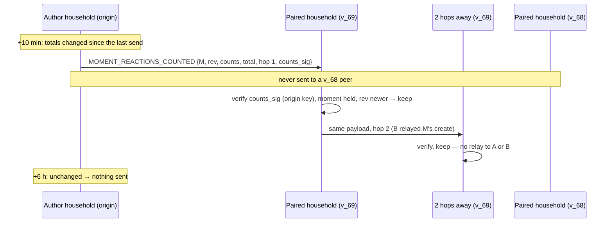
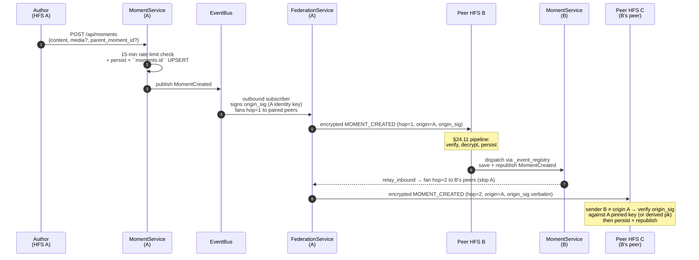

# Momentum

Household-broadcast posts pillar — a *moment* is a one-shot post
(text + optional image / ≤ 15-second video) that fans out to every
paired peer **and their paired peers, up to 3 hops**. Replies are
themselves moments and carry a ``parent_moment_id`` that pins them
to a thread root.

## Scope

- **HFS**: full participant. Authors post moments, peers receive and
  re-broadcast through a hop-counted relay (max 3 hops).
- **GFS**: uninvolved. Moments are personal-scope.

## Event types

`MOMENT_CREATED`, `MOMENT_DELETED`, `MOMENT_REACTED`,
`MOMENT_REACTION_REMOVED`, `MOMENT_REACTION_ROUTED` (v_67 — a reaction
carried back to an author further away, [below](#routed-reactions-v_67)),
`MOMENT_REACTIONS_COUNTED` (v_69 — the author household's reaction totals,
[below](#reaction-totals-v_69)).

Plaintext fields on every envelope: `event_type`, `from_instance`,
`to_instance`, `moment_id`, `origin_instance_id`, `hop_count`. Routing
data only — everything else (`content`, `media_url`, `media_type`,
`duration_ms`, `parent_moment_id`, `expires_at`, `author_user_id`,
`reactor_user_id`, `emoji`, the v_35 origin signature
`origin_identity_pk` / `origin_sig` / `origin_sig_suite`, and the v_67
`origin_keywrap_*` fields and return tokens `rt` / `rt_suite`) lives inside
the encrypted payload (§25.8.21). A `MOMENT_REACTION_ROUTED` carries only
`moment_id`, `origin_instance_id`, `rt`, `rt_suite` and an opaque `sealed`
reaction — who reacted and with what is sealed end to end to the origin
household; the relays between see neither. A `MOMENT_REACTIONS_COUNTED`
carries its per-emoji counts and total inside the encrypted payload too —
never who reacted.

## Retention

* **The author chooses how long followers keep their moments**
  (decision 6d, v_65): ``moments.follower_retention_days`` in
  ``users.preferences_json``, 1–30 days, **7 by default** (Settings ›
  Privacy › Momentum). It sets ``moments.expires_at = created_at + N days``
  on every new moment — top-level and replies — and ``expires_at`` travels
  under the origin signature (``_SIGNED_FIELDS``), so every household and
  GFS follower keeps the author's choice. A reply never outlives its
  thread: its ``expires_at`` is at most its root's. A change applies to new
  moments only.
* **Receivers clamp** (v_65): a received ``expires_at`` is kept at most
  ``created_at + 30 days`` (``MOMENT_MAX_LIFETIME_DAYS``) on both the
  household path (``occurred_at``) and the GFS path (sealed
  ``created_at``) — a signature proves who chose a value, not that it is
  reasonable. An in-range value is kept byte for byte, and a relay
  forwards the envelope unchanged (the clamp is local). A create whose
  clamped expiry has passed is refused and not relayed. An older (v_64)
  receiver keeps whatever the author signed.
* Visibility cap: **24 hours** for moments where the local viewer
  doesn't follow the author. ``moment_repo.list_visible_to`` collapses
  the author's window to 24 h unless the viewer follows the author —
  directly (``user_follows``) **or through a GFS**
  (``moment_public_follows``); both are a follow. The same rule drives the
  detail read, trending hashtags and reply counts.
* The retention scheduler runs hourly and deletes anything past its
  ``expires_at`` — others' moments and delete tombstones alike; reactions
  cascade.
* **Your own moments stay in your archive** (decision 6a). A moment
  written on this household (``received_via = 'self'``) that its author
  hasn't deleted is never pruned here: past ``expires_at`` it leaves every
  inbox and only its author can still open it
  (``GET /api/moments/archive?scope=own``, ``GET /api/moments/{id}``).
  Replies to it close at expiry (the households a reply would reach no
  longer hold the moment). This is **local only**: every other household
  prunes its copy at the signed ``expires_at`` as before, and nothing on
  the wire changes. An own tombstone still goes at expiry, and so does a
  public moment's share-link item key (``moment_public_shares``) — a
  share link never outlives the moment.
* **Household archive cap.** The admin sets a per-person cap on archived
  media (``PUT /api/admin/moments/archive-cap``, ``instance_config`` key
  ``moments.archive_cap_bytes``; default 2 GiB, ``0`` = no limit). The same
  hourly tick drops the oldest archived pictures and videos of anyone past
  it — at most 200 per tick: the text stays, ``media_url`` is cleared and
  the file is removed once no other row references it. A moment others can
  still see keeps its picture. Nobody is notified; the Yours tab says it
  up front. Saved moments count toward the saver's cap too (below).

## Archive & saves

Your own moments are archived (above). **Someone else's moment you keep by
saving it** (decision 6b, sign-offs 3 + 5, 2026-10-25): a saved moment stays
with you past its end until its author deletes it. Saves are **local
only** — nothing goes on the wire, no household or GFS learns who saved
what, and no protocol version changes.

* **Storage.** One ``moment_saves`` row per (person, moment) — migration
  ``0124``. While any save of a moment exists the retention prune and its
  media sweep skip the row; the file stays because the row still names it.
* **Who reads it.** The saver alone can open a saved moment past the 24 h
  window and past ``expires_at`` (``get_readable``); block, guardian-block,
  protected-account (§CP.R — only moments from its household and paired
  households, see [Protected accounts](#protected-accounts-cpr)) and
  ``max_hops`` filters still apply (a protected account's save made before
  protection was turned on stays hidden; saving a 2–3-hop moment is the
  unknown-id 404), so a blocked author's saved moment is
  hidden (and back on unblock). Replies still close at expiry.
* **Offered only where a delete can still reach the copy** — the server
  enforces it (``422 SAVE_UNAVAILABLE``) and returns ``can_save`` per item
  so the SPA hides the button otherwise:
  * a housemate's moment (a local delete tombstones it);
  * a mesh moment whose origin is a household **we are paired with**
    (a social peer, not a space-session seat) on **v_66+**
    (``MIN_FOR_LATE_MOMENT_DELETES``): it sends us its deletes and keeps
    them queued 30 days. A friend-of-friend origin (no pairing here) is not
    offered — its delete reaches us only through relays we can't vouch for;
  * a GFS-delivered moment whose GFS proved ``moment_delete_log``: it keeps
    the signed delete certificate 30 days for followers that reconnect.
  Your own moments are never "saved" (``422 OWN_MOMENT``) — they are already
  under Yours. A protected account's moments can be saved like any moment,
  and a protected viewer saves within the protected filters (sign-off 5).
* **Deletes remove saves.** A tombstone — any path: the author's
  ``MOMENT_DELETED`` over the mesh, a GFS delete certificate, a local
  author or admin delete, ``USER_REMOVED`` — drops every save of the
  moment in the same transaction (trigger
  ``trg_moment_saves_drop_on_tombstone``). A replayed create brings back
  neither the moment nor the save.
* **Unfollow and unpair drop saved copies** (sign-off 3). When a person's
  last follow of an author goes (``user_follows`` or
  ``moment_public_follows``; removing a GFS connection cascades its
  follows) their saves of that author's moments go — triggers in ``0124``.
  When this household unpairs a household — locally, by the peer's
  ``UNPAIR``, or as an unpair tombstone — every save of a moment that came
  from it (``received_via = 'household'`` and that ``origin_instance_id``)
  goes (``PeerUnpairService``). A moment records only its origin, not the
  relaying peer; since saving needs a paired origin, the origin is the
  household it came through.
* **Media cap.** Saved files count toward the saver's per-person archive
  cap (a file several people saved counts for each; a housemate's moment
  counts toward its author's archive instead). Past the cap one
  oldest-first order applies per person — an own moment by when it was
  written, a saved one by when it was saved — and a saved moment past its
  expiry loses its media like an own one (the text stays), only when no one
  else here saved it.
* **API.** ``PUT`` / ``DELETE /api/moments/{id}/save``,
  ``GET /api/moments/archive?scope=saved`` (newest save first, ``before`` =
  ``saved_at``); every moment item carries ``saved_by_me`` and
  ``can_save``. The SPA: a 🔖 Save / Saved toggle on inbox rows and the
  moment's page (``aria-pressed``), and Yours › Saved.
* Protocol test: ``tests/protocol/test_moment_saves.py`` (security).

## Hashtags

A moment's content is scanned at save time for ``#tag`` tokens: ``#``
followed by letters, marks, numbers or ``_`` in any script (Unicode
categories L, M, N — ``#Kürbisfest``, ``#Fußball``, ``#東京``), not
right after such a character (``issue#42`` is no tag). A run longer than
32 code points is no tag. Up to ten tags per post are stored NFC +
lowercased in ``moment_hashtags`` (composite PK ``(moment_id, tag)``);
``?tag=`` is normalised the same way. The same rule runs on the SPA
(``features/momentum/hashtags.tsx``) so the rendered chip and the
indexed row stay in lockstep. Tags are derived per household from the
content — nothing about them travels on the wire. Federated edits / relay
updates rewrite the row set on each ``save`` so the trending list is
always derived from the *current* content.

* ``GET /api/moments/archive?tag=<name>`` filters to a single tag.
* ``GET /api/moments/hashtags`` returns the trending tags inside the
  viewer's visibility window — block-aware and follow-aware via the
  same filter as ``list_visible_to`` so a blocked author's tag never
  surfaces.

## Rate limit

One **top-level** moment per author per 15 minutes.
``moment_repo.count_recent_for_author`` ignores rows where
``parent_moment_id IS NOT NULL`` so back-and-forth replies are
unconstrained. Reactions are exempt.

## 3-hop relay

```
              hop=1                 hop=2                 hop=3
A (author)  ────►  B (paired)  ────►  C (B's paired)  ────►  D (C's paired)
                                       (skips A)              (skips A and B)
```

* The author's instance fans the envelope with
  ``hop_count = 1`` and ``origin_instance_id = self``.
* Receivers persist the **first** copy and republish ``MomentCreated``
  on the local bus for the realtime layer. In a mesh one copy arrives
  per relaying neighbour; a later copy is neither stored nor announced
  again — it only lowers the stored ``hop_count`` when it comes from
  closer to the origin.
* The inbound handler then calls
  ``MomentFederationOutbound.relay_inbound``, which bumps
  ``hop_count`` and re-fans to every paired peer **except**
  ``origin_instance_id`` and the immediate ``from_instance``.
* **Once per moment.** The relay remembers, per (event type,
  ``moment_id``), the lowest hop it relayed at (in memory, 48 h,
  at most 20 000 entries). A later copy is relayed only when it arrives
  at a lower hop — relayed on, that one reaches further. Creates and
  deletes are tracked apart.
* **Creates relay for 48 h** (v_65). A ``MOMENT_CREATED`` whose signed
  ``occurred_at`` is more than 48 h ago (``MOMENT_RELAY_MAX_AGE_HOURS``),
  or missing, is still stored here but not passed on. Mesh copies travel
  in seconds and an outbox retries for well under a day; with moments that
  live up to a month, an old signed create is a replay that must not
  re-flood the mesh. The seen-map remembers for the same 48 h, so within
  that window no copy is relayed twice.
* **Deletes relay only when they changed something** (v_65). A
  ``MOMENT_DELETED`` travels on only when this household removed a live
  moment or recorded a new tombstone for one it never held; a delete for a
  tombstone it already holds (a replay — possible for the month a
  tombstone lives) goes no further, even after a restart wiped the
  seen-map. Deletes are not age-gated.
* **Deletes keep trying for 30 days** (v_66). An outbox gives an ordinary
  event 13 attempts over ~10 h, then drops it, so a ``MOMENT_DELETED`` to a
  household offline for a weekend never arrived and the moment stayed on
  its screen for up to a month. ``MOMENT_DELETED`` is now outbox
  ``LONG_LIVED`` (``domain/federation_retention.py``): past the ladder it
  keeps retrying on the 4 h ceiling until 30 days after it was queued, then
  the retention sweep ends it. It is still evictable under the per-peer
  cap (1 000 pending), unlike ``NEVER_DROP`` — and a delete we only relay
  is evicted before anything of our own. Every hop queues its own
  copy, so a delete crosses all three hops even when the households between
  were offline for weeks; a pure pass-through household relays it as
  before, only when it changed something there.
* **A relayed household's deletes are capped per origin** (adversarial
  review F2). A paired household can sign deletes for made-up ids under its
  own origin; each is new to us, so we relay it, and an offline peer used to
  get every one as a 30-day row. The outbox key of a queued delete says who
  signed it (``moment_delete_key``: ours, or relayed for origin X); a peer
  holds at most ``MAX_LONG_LIVED_RELAYED_PER_ORIGIN`` (100) long-lived
  deletes relayed for one origin — past that, a relayed delete is queued in
  the ordinary class (7 days, given up after ~10 h). Our own deletes are
  never capped. **Cost:** per delete, the same ≤ 3-hop fan-out as before; a
  peer that stays offline costs at most ~180 extra delivery attempts over
  30 days per queued delete (one per 4 h, ±30 % jitter), each a re-signed
  envelope of < 1 KB. A household offline for 30 days with 1 000 of our own
  deletes queued for it is ~1 000 rows of < 1 KB. Hostile worst case: one
  flooding origin, N households that each relay to the same offline peer —
  each relaying household queues its own copies, so the peer is owed
  N × 100 long-lived rows, N × 100 × ~180 ≈ N × 18 000 attempts over the
  month (before: N × 1 000 × ~180 ≈ N × 180 000, and each relaying household's
  own events evicted by the flood); the flood's remainder costs N × ≤ 13
  attempts per row over ~10 h and is evicted first at the cap. Older (v_65) relays
  give up after ~10 h as before; a delete reaching a public follower
  through a GFS is covered by the GFS's certificate log
  ([`momentum_public.md`](./momentum_public.md#late-deletes-delete-certificates-v_66)).
* When ``hop_count >= MOMENT_MAX_HOPS`` (3), the relay short-circuits.

**Cost.** In a fully-connected mesh of *n* households, re-relaying every
copy cost (n−1) + (n−1)(n−2) + (n−1)(n−2)(n−3) envelopes per moment
(25 260 for n = 31); relaying once costs (n−1) + (n−1)(n−2) (900).

## Per-user max-hops visibility (§Momentum-relay-policy)

The wire cap (3) governs how far a moment is *relayed*. **What each
user sees** is a separate, per-user knob: ``moments.max_hops`` in
``users.preferences_json`` (default 3, clamped to 1..3).

* ``max_hops = 1`` — only moments authored by direct paired peers.
* ``max_hops = 2`` — direct peers plus their peers.
* ``max_hops = 3`` — every relayed moment (default).

The recipient instance writes the inbound ``hop_count`` onto the
``moments`` row; ``list_visible_to`` adds ``AND m.hop_count <= ?``
against the viewer's preference so the inbox respects it.

``hop_count`` is outside the origin signature (each relay bumps it), so the
receiver never trusts a low one from a relay: a copy whose sender is not its
``origin_instance_id`` is stored at hop **≥ 2** whatever it claims (the
relay still forwards the payload as it came). Hop 1 therefore always means
"sent by its origin" — a moment written here (``received_via='self'``) or
by a member of a directly paired household.

### Protected accounts (§CP.R)

A protected (child) account sees moments from its **own household and its
directly paired households only** — the same circle its own ``no_relay``
moments reach (v_38; owner decision 14, 2026-10-25). Never one relayed from
2–3 hops away (``hop_count > 1``), never one that came through a GFS
(``received_via='gfs'``), whatever its ``max_hops``.

It is a read-time, per-viewer filter (``moment_repo._PROTECTED_CIRCLE_SQL``
— the row is household-wide, an adult housemate still sees it; no migration,
nothing on the wire changes), applied on every moment read: the inbox and
archive (``?tag=`` too), the detail read (the unknown-id 404 — so reacting
to or saving one is refused like an unknown id), a thread's replies and its
``reply_count``, trending tags, and the Saved list. The live
``moment.created`` and ``moment.reaction_changed`` frames skip a protected
account's sockets for such a moment (``MomentCreated`` /
``MomentReactionTotalsUpdated`` carry ``hop_count``), and a reply from
outside the circle never notifies a protected parent author. Enabling or
lifting protection takes effect on the next read.

### Pure pass-through

If **no local user** can see an inbound moment under their
``max_hops``, per-viewer ``user_blocks`` and child protection (a protected
account counts only for a hop-1 moment), the recipient instance
**skips the local persist** but **still relays** onward. This
keeps the household acting as a transparent forwarder when no one
locally subscribes — saves disk + retention work without breaking
the mesh. The check is ``moment_repo.has_visible_recipient(...)``.

### Flagged-relay block

The relay path is gated by :class:`RelayPolicy`. Two negative
signals stop both ingress and onward fan-out:

* The source instance is on the household's
  ``household_instance_bans`` table (set by the operator from the
  Settings → Federation page).
* There is at least one ``status='pending'`` row in
  ``content_reports`` against the moment id OR the author user id.
  Local moderation overrides federation fan-out — neither persist
  nor relay run while a report is open.

Per-user ``user_blocks`` are intentionally NOT consulted here.
Personal block lists stay private; tying them to the relay would
couple two trust models and leak block-list shape to peers.

## Authority

* **1-hop direct** (``from_instance == origin_instance_id``): the
  sending peer must be the author's home instance. Inbound rejects on
  mismatch.
* **2/3-hop relay** (``from_instance != origin_instance_id``): the
  moment must carry its **origin signature** (v_35, below), and the
  ``origin_instance_id`` must match the author's home instance lookup.
  Unknown authors (``USER_UPDATED`` envelope hasn't landed yet) are
  accepted on first sight once the signature verifies.
* **Never ours:** a moment whose claimed origin is this household, or
  whose author is one of our own users, is refused on every path — those
  only originate here.
* **Stored row wins:** a `MOMENT_CREATED` / `MOMENT_DELETED` naming a
  moment id this household holds is applied only when the stored author
  and origin match the payload. A delete tombstone (below) still binds
  its id to its author and origin.
* **Creator-bound id (v_36):** because the first household to name a
  moment id here decides whose it is (the stored row, or a delete's
  tombstone), a moment's id commits to its author
  (`federation/owner_bound_id.py`, the unscoped `moment` kind — no space
  component, the commitment covers the author alone). A `MOMENT_CREATED`
  or `MOMENT_DELETED` naming a bound id for any other author, or under an
  unknown suite nibble, is refused at WARNING before either binding could
  form: not stored, not tombstoned, not relayed — the public (GFS) inbound
  applies the same check. The author's own early delete still sticks. A
  legacy (uuid4) id keeps the first-come rule. See
  [`capabilities.md`](./capabilities.md) (v_36).
* **Reactions** (`MOMENT_REACTED` / `_REMOVED`) are honoured only for a
  moment authored here, from a reactor homed on the sending household;
  the published author is the stored one. A reaction is exactly one emoji
  of ≤ 32 bytes (`is_valid_moment_reaction`) — refused otherwise, here, on
  the route (`422 INVALID_REACTION`), in the service and inside a routed
  reaction.
* **Routed reactions** (`MOMENT_REACTION_ROUTED`, v_67) are honoured at the
  origin only when the seal opens with this household's key-wrap key; the
  reactor's household key derives to `reactor_instance_id` (and equals the
  pinned key when that household is paired here); its signature verifies
  under a known `reaction_sig_suite`;
  `derive_user_id(reactor_identity_pk, reactor_anchor) == reactor_user_id`;
  the moment is authored here, live and before its `expires_at`; the
  reactor is not one of ours, not blocked by the author, not separated by a
  guardian block and its household is not banned; the author is not a
  protected account (its moments are `no_relay`); the reaction is at most
  25 h old (5 min of clock skew ahead) and not a replay (a 25 h digest
  cache). A relay forwards one only when its own return token opens (this
  moment, handed back by the neighbour it was minted for, not expired) to a
  confirmed v_67 household. Everything else is refused at WARNING
  (`tests/protocol/test_moment_reaction_routed.py`) — except a second copy
  of a reaction already taken (its other route, #1178 F13, or a replay),
  which is dropped at DEBUG and charged to nobody. A reaction that came
  through a GFS (`moment_reaction` frame, v_68) gets the same checks plus:
  the household the GFS authenticated is the reactor's own, and the moment
  is public ([`momentum_public.md`](momentum_public.md#reactions-through-the-gfs-v_68),
  `tests/protocol/test_moment_reaction_gfs.py`).
* Refused events are logged at WARNING and never relayed
  (`tests/protocol/test_moment_scope.py`).

### Origin signature (v_35)

Moments relayed by another household are checked against the household
that posted them. Every relay re-sends a moment under its own envelope
signature, so the §24.11 pipeline proves only the last hop; the origin
household therefore signs each `MOMENT_CREATED` / `MOMENT_DELETED` it
authors with its Ed25519 identity key
(`socialhome/moment_origin.py`, wire shape in
[`crypto.md`](../crypto.md)). The signature covers the event type, the
suite and every stored field — never `hop_count` — and relays forward it
verbatim.

* A receiver handed a moment by a household other than its claimed origin
  verifies the signature against the key it pins for that origin, or, for
  a friend-of-friend origin it never paired with, against the shipped
  `origin_identity_pk` provided `derive_instance_id(pk) ==
  origin_instance_id`.
* **Deletes** follow the same rule: a relayed `MOMENT_DELETED` removes a
  moment only when the origin signed it; the author's own household can
  still delete directly.
* **Refused** — unsigned relays naming a v_35+ origin or an origin with no
  `remote_instances` row, a signature that does not verify, a shipped key
  that disagrees with the pinned one or does not derive to the origin, and
  any unknown `origin_sig_suite`. Refused events are logged at WARNING and
  never relayed (`tests/protocol/test_moment_origin_signature.py`).
* **`no_relay`** (v_38) — a protected account's moments go to its
  household's directly paired households only. The origin marks them
  `no_relay: true` inside the origin signature (`moment-origin:v2:`
  domain), sends them only to households at v_38 or above (an older one
  might relay them), no household relays a marked moment, and a receiver
  refuses one that arrives from anyone but its origin
  (`tests/protocol/test_moment_no_relay.py`).
* **Legacy window** — an unsigned relay whose origin this household holds a
  row for at `proto_version` < 35 is accepted and logged at INFO; it closes
  as origins upgrade. See [`capabilities.md`](./capabilities.md) (v_35).

### Deletes stick

The origin signature proves who made a moment, not that it still exists:
a relay can hold a genuinely signed `MOMENT_CREATED` and re-send it after
the origin deleted the moment, and relays deliver out of order, so a
delete can arrive before its create. A verified delete is therefore never
forgotten until the moment could no longer be shown anyway:

* **Tombstone.** Every accepted `MOMENT_DELETED` — and a local delete by
  the author or an admin, and a GFS-relayed public delete — keeps the
  `moments` row with content, media, tags and reactions wiped and
  `deleted_at` set. The tombstone keeps the row's own `expires_at`.
* **Held delete.** A delete for a moment this household has not stored
  yet inserts the tombstone directly, expiring after the maximum moment
  lifetime (30 days from receipt, v_65 — no create for it can outlive
  that; 7 days on an older build). The delete still travels on, so
  households that do hold the moment apply it (pure pass-through
  households tombstone too, so they stop relaying a replay). A delete that
  finds the tombstone already there changed nothing and is not relayed
  again.
* **Refused create.** A `MOMENT_CREATED` for a tombstoned id is refused
  (INFO log): not stored, not relayed. The repo's upsert also never
  writes over a tombstone, so no path can bring one back.
* **Sweep.** The retention scheduler removes expired tombstones with the
  expired moments. A create that is itself past its `expires_at` (clamped
  to 30 days after `occurred_at`) is refused (INFO) and not relayed, so the
  sweep never re-opens the window.
* Tombstones live in SQLite and survive a restart
  (`tests/protocol/test_moment_delete_tombstone.py`; the lifetime clamp
  and relay rules: `tests/protocol/test_moment_lifetime.py`).

### Media references

A received moment keeps its `media_url` only when it is a local media
reference (`api/media/<name>`, kept verbatim —
`inbound_media_store.verbatim_local_media_ref`). Anything else (a
third-party URL, `javascript:`) is dropped with its `media_type`, so a
peer can't make every viewer's browser load a tracker; the text of the
moment still lands. The relay forwards the original payload unchanged.
The same rule applies to public moments received through the GFS.

## Routed reactions (v_67)

Owner decision 9, sign-off 2 (2026-10-25). A moment reaches households up to
three hops from its author, but a reaction used to go back only to an
author's household **paired** with the reactor's (the household had to hold
the author in its roster); anyone further away reacted into the void. Now a
reaction goes back along the path the moment came.

* **The origin ships its key-wrap key.** Every `MOMENT_CREATED` an origin
  fans out (not a `no_relay` one) carries `origin_keywrap_pk` /
  `origin_keywrap_sig` / `origin_keywrap_suite` — its existing static
  X25519 key-wrap key, outside the origin signature, bound to its identity
  key (`verify_keywrap_binding`), ~200 B.
* **Each relay leaves a return token.** A v_67 relay forwarding a create to
  its peer X appends a token only it can open, naming the household it got
  the moment from, valid for that moment, from X, until the moment's
  expiry ([`crypto.md`](../crypto.md)). Only when every relay before it did
  (`len(rt) == hop − 1`); otherwise it strips the incomplete chain.
* **The receiver keeps up to two routes.** A household that stores a
  relayed moment keeps a route `{kw, via, rt, rt_suite}` in
  `moments.reaction_route` (migration 0125; a JSON list since #1178 F13,
  one object on rows written before) when the key-wrap key is bound and
  the chain is complete — from the first two copies through **distinct
  neighbours**, first come, first kept. A copy that claims fewer hops never
  displaces a kept route: `hop_count` is outside the origin signature, so
  a neighbour could claim a shorter hop than it is just to become the
  route and then drop what it should carry back. Saves, `mark_public` and
  re-saves keep the routes; a tombstone drops them (trigger).
* **A reaction goes back hop by hop.** When the author's household is this
  one or a paired one — found from the roster, **or the moment's
  `origin_instance_id` is a confirmed peer** (an author with no roster row
  yet, e.g. one first seen at hop 2) — the direct `MOMENT_REACTED` path is
  used as before, under the per-pair hide list: a person hidden from that
  household reaches it by neither path. Only an origin this household is
  not paired with is routed to. Otherwise, after a 3 s debounce (the latest state per moment and person;
  the outbox keeps one queued per peer), the reactor's household signs the
  reaction, pads it to 1 KB and seals it to the origin's key-wrap key once,
  and sends that same `MOMENT_REACTION_ROUTED` along **every** kept route
  (at most two) whose `via` neighbour `peer_supports` v_67 — so one
  neighbour that drops reactions no longer silences the reactor while an
  honest route exists. The origin takes the first copy and drops the
  other quietly (its replay digest; no WARNING, nothing charged). Each relay opens its own (last)
  token, pops it and forwards to the household it names (a confirmed v_67
  peer); when that is the origin, the origin gets it with no tokens left.
  Relays keep no state.
* **The origin applies it** after the checks under [Authority](#authority):
  adds and removals in `occurred_at` order, to the millisecond, against
  the stored `reacted_at` **and** the stored removal: a removal deletes the
  reaction row and keeps a watermark in `moment_reaction_removals`
  (migration 0125), so an add that is older — late, or a replay after a
  restart wiped the in-memory replay cache — never brings it back, and an
  identical replay of the newest change is a no-op. A reactor the origin doesn't know shows
  as "Someone" — no new column.
* **Through a GFS (v_68).** A moment that came through a GFS has no mesh
  route; its reactions take the same sealed reaction back through that GFS
  to the author's household instead (`POST
  /gfs/moments/users/{author}/react`, pushed as `moment_reaction`) — see
  [`momentum_public.md` § Reactions through the GFS](momentum_public.md#reactions-through-the-gfs-v_68).
* **Degraded.** No complete route (an older origin or relay on the path, a
  first neighbour below v_67), or a moment from a GFS that can't take it (an
  older GFS, an author household that named no key-wrap key): the
  reaction stays in the reactor's household, as before. Every API item
  carries `reactions_reach` — `author` or `household` — and the SPA keeps
  React on every card and says "Reactions here are seen in your household
  only" where they can't reach.
* **Rate limits** (#1178 F14: one misbehaving household behind a relay
  must not use up the room of everyone else behind it). A relay can't open
  what it forwards, so it limits by the one thing it can see — how many
  return tokens an envelope still carries:
  * **two tokens** — no relay sits beyond two, so the neighbour is the
    reactor's own household: ≤ 60 a minute, ≤ 10 a minute per moment (the
    *source* rate);
  * **one token** — the neighbour may be a relay carrying several
    households' reactions: ≤ 180 a minute, ≤ 30 per moment (3× the source
    rate), so one household behind it sending junk at the full source rate
    leaves the others room.

  The origin keeps three budgets. Before any crypto, per neighbour handing
  reactions over: ≤ 1200 seals opened a minute (the crypto backstop — each
  costs about what that neighbour's envelope already did in the §24.11
  pipeline), and ≤ 600 **failures** a minute — a reaction that doesn't
  open, verify or pass a check is charged to the neighbour's failure
  bucket, never to the room its good reactions have, so junk through relay
  R (≤ 180 a minute from any one household) doesn't stop R's honest
  reactions. After every check: ≤ 60 a minute per reactor household,
  charged only for a reaction that changed something, so a relay
  re-sending one genuine sealed reaction (a replay) cannot use up that
  household's budget.
* **Residual availability limits.** A reactor whose *every* kept route
  runs through a neighbour that drops reactions still reaches nobody (it
  can't tell — the UI says `author`); and four households behind one relay
  sending junk at the one-token rate (or ten at the source rate) can still
  fill that relay's failure budget at the origin for the minute. Both cost
  availability of reactions only — never their privacy or integrity.
* **Privacy residual (signed off 2026-10-25).** A relay learns that its
  direct neighbour — or that neighbour's part of the mesh — reacted to
  moment M: not who, not with what (the seal is one size), and not who else
  is beyond. No household learns any non-adjacent part of the pairing graph
  ([`principles.md`](../principles.md)). With two kept routes (#1178 F13)
  the relays on both paths learn this, and the origin sees the same sealed
  reaction arrive from up to two of its neighbours — the same kind of
  fact it had for one ("this reactor's household is in that neighbour's
  part of the mesh"), never which households are in between.

**Cost.** One reaction is at most 3 envelopes of ~1.6 KB per route
(hop-encrypted sealed reaction + up to two tokens) and goes along at most
two routes: ≤ 6 envelopes, ~10 KB — the same order as the create it
answers. Most reactions have one route (a moment usually reaches a
household through one neighbour first, and a second copy only adds a route
when it comes through another); the second at most doubles the cost. A
sparse mesh averaging 2 hops: 60 reactions to one popular moment ≈ 120–240
envelopes ≈ 200–400 KB in total, spread over the households on the paths;
coalescing caps a person who toggles at one per 3 s. A fully connected mesh
uses the direct path (one envelope). Every create grows by ~200 B (key-wrap
key + binding) plus ~110 B per relay token; each stored moment keeps ≤ 2
routes (≤ ~0.7 KB). Worst case per relay: 60 reactions a minute from each
neighbour that is a reactor's own household, 180 from one that may be a
relay — bounded, each one forwarded envelope, nothing stored. Worst case at
the origin: ≤ 1200 seal opens a minute per neighbour, about the crypto the
same envelopes already cost in the §24.11 pipeline.

```mermaid
sequenceDiagram
    autonumber
    participant A as Origin A<br/>(author)
    participant B as Relay B<br/>(paired with A, C)
    participant C as Reactor C<br/>(not paired with A)

    A->>B: MOMENT_CREATED hop=1, origin_sig,<br/>origin_keywrap_pk/sig/suite
    Note over B: store; relay on, appending<br/>rt_B = AESGCM(k_B, exp ‖ "A")<br/>AAD "moment-return:v1|M|C"
    B->>C: MOMENT_CREATED hop=2, rt=[rt_B]
    Note over C: verify origin_sig + key-wrap binding<br/>keep route {kw, via=B, rt=[rt_B]}
    Note over C: person reacts 👏 — 3 s debounce,<br/>sign with C's identity key,<br/>pad 1 KB, seal to A's key-wrap key
    C->>B: MOMENT_REACTION_ROUTED {M, origin=A, rt=[rt_B], sealed}
    Note over B: open rt_B (AAD names C, not expired)<br/>→ prev = A = origin; rate limits
    B->>A: MOMENT_REACTION_ROUTED {M, origin=A, rt=[], sealed}
    Note over A: open seal, verify C's key → id → user id,<br/>signature, moment live + authored here,<br/>not blocked / banned / no_relay, ≤ 25 h, not replayed
    A->>A: apply in occurred_at order<br/>publish MomentReactionChanged → author notified
```

## Reaction totals (v_69)

Owner decision 10 (2026-10-25): **everyone sees the full reaction count.**
Since v_67 / v_68 a reaction reaches the author's household from paired,
2–3-hop and GFS followers alike — so only that household holds a moment's
full count; every other household holds only its own people's reactions.
The author's household therefore re-broadcasts the **totals**: per-emoji
counts (the 8 most used) and the total over every emoji — **never who
reacted**.

**When — fixed checkpoints, only on change.** The author's household looks
at its own live moments once a minute
(`MomentReactionCounts.tick`) and sends a moment's totals at
**+10 min, +6 h and +3 days** after it was made — the last only while
followers still keep the moment (`expires_at` past it) — and **only when
they changed** since its last send on the mesh. A moment nobody reacted to
sends nothing. **Paced:** at most 8 mesh updates a tick (ticks ≥ 60 s
apart — under every receiver's 10-a-minute budget per origin, with room
for delivery jitter); more due at once wait for the next ticks, a
restart's catch-up after live checkpoints. A checkpoint counts as sent only
once handed to the outbox — a send that fails stays due and is tried again
next tick. What was last sent is kept in memory only; after a restart each
own live moment of the last 24 h that has reactions gets one checkpoint
(its latest due one), older ones wait for their next — so a restart costs
at most one update per moment of the last day, spread at 8 a minute (60
such moments: ~8 minutes). Public moments also go through their GFSs, on
their own checkpoints
([`momentum_public.md`](momentum_public.md#reaction-totals-through-the-gfs-v_69)).

**Wire.** New event `MOMENT_REACTIONS_COUNTED`, hop-encrypted like every
federation payload (§25.8.21 — the counts are content):

```
{moment_id, author_user_id, origin_instance_id, rev, counts: {emoji: n, …},
 total, hop_count, origin_identity_pk, counts_sig_suite: "ed25519",
 counts_sig [, no_relay: true]}
```

`rev` is the send time in Unix ms (it only ever grows). `counts_sig` is the
origin household's Ed25519 **identity** key over `b"moment-counts:v1:"` +
canonical JSON of every field but `hop_count` and `counts_sig`
([`crypto.md`](../crypto.md)). Sent with a
latest-only outbox key per (peer, moment): a newer update replaces one still
queued for an offline peer.

**Receiver.** Keeps the totals (`moments.reaction_summary`, migration 0127)
only when: the shape is exact (≤ 8 emoji, each one emoji of ≤ 32 bytes,
counts ≤ total); the origin is not this household and the author not one of
its people; the signature verifies against the key pinned for the origin, or
a shipped key that derives to it (§4.1.2) — an unknown suite is refused,
never defaulted; `rev` is at most 5 min ahead and at most 25 h old; the
moment is held here, live (not a tombstone, not expired), by that author
**and** that origin; and `rev` is newer than the one kept (read from the
database, so it holds across a restart). **Budgets come last:** a household
takes at most 10 new (moment, rev) a minute per origin and 4 per moment a
day (3 checkpoints + a restart), charged only for totals it actually kept
or relayed — once per rev, not per copy, and per signing origin (a
household naming another origin's moment id spends only its own budget).
Every refusal above happens before a budget is touched, so a neighbour
replaying genuine old, older-than-kept or unheld totals spends nobody's
budget. A delete's tombstone wipes the totals (trigger) and refuses new
ones. Realtime: the household's open
views get a `moment.reaction_changed` hint (no reactor), except anyone who
blocked the author.

**Relay.** Like a create (`relay_inbound`): every verified copy is offered,
the seen-map relays it once per **(moment, rev)** (or again from closer),
only when this household holds the moment from the mesh or relayed its
create — as **that origin's** moment (a household that never passed the
moment on has nobody downstream who holds it; totals signed by another
household for that moment id are refused outright) — only while `rev` is
under 25 h old and newer than the last one it passed on, never a `no_relay` one
(a protected account's moment — its totals go to paired households only and
a receiver refuses one relayed), only below hop 3, and **only to v_69 peers**
(`peer_supports(…, MIN_FOR_MOMENT_REACTION_COUNTS)`) under the same hide
list, guardian blocks and relay policy as the moment. A copy that came only
through a GFS is never relayed to the mesh.

**Who receives totals.** The author's household sends them to **every**
confirmed v_69 peer, and each relay to every v_69 peer of its own — the
same audience a create reaches, plus any household paired since the moment
was made. A household that neither holds the moment nor relayed its create
drops them (nothing kept, nothing relayed, no budget spent), but it can read
that one update: the moment's id, author and totals — never who reacted.
Narrowing the first hop to the households that got the create would not
narrow the relays, so it is not done.

**API.** For a moment from another household whose reactions reach the
author (`reactions_reach: "author"`) the API returns the author household's
totals once it sent any — `reaction_count`, `reaction_counts` and
`reaction_totals_at` (its `rev`) — **exactly**, and the caller's own
reaction (`my_reaction`, from the rows here) marked separately, never added
on top: **never over-counted, at most one checkpoint stale.** A reaction
row keeps only its latest emoji and time, so one changed or made after the
totals can't be told from one already in them — adding it counted a changed
emoji twice (and a `rev` skewed up to 5 min did the same, or added a ninth
emoji). The next checkpoint brings the caller's reaction into the numbers.
Everywhere else — this household's own moments (every reaction is here), a
moment whose reactions stay here (`reactions_reach: "household"` keeps its
note), or no totals yet — the reactions held here.



**Cost** (measured with the real encoders). A totals envelope is
**1.09 KB** (one emoji) to **1.21 KB** (eight, the cap); a text moment's
create ~1.6 KB.

* *31 households, fully paired:* the origin sends 30, each relays once to 28
  → **870 envelopes ≈ 0.95 MB per update**; the moment itself ≈ 1.4 MB. At
  most 3 updates a moment and only on change — typically 2 ≈ 1.9 MB ≈ 1.4
  moment-equivalents. Per-reaction relaying instead: 60 reactions × 870 ≈
  52 000 envelopes (≈ 57 MB).
* *Sparse mesh (degree ~4):* 4 + 12 + 36 = 52 (≤ ~100 with overlaps)
  envelopes ≈ **57–110 KB per update**.
* *Worst case per origin:* the receiver budgets cap what any origin can make
  a household take and relay — 10 new revs a minute, 4 per moment a day —
  and a relay replaying genuine old totals costs one signature check each,
  no budget and no relay.
* *Residual — a burst through an offline peer's outbox.* The author paces
  its sends, but a peer offline for a while gets every queued update
  (latest-only per moment) when it comes back, in one outbox drain. Past 10
  a minute from one origin the rest are refused there and wait for those
  moments' next checkpoint — stale, never wrong.

## Mermaid sequence — local author posts a moment



## Notifications

``NotificationService`` subscribes to the moment + follow bus
events and writes a :class:`Notification` row to the recipient's
bell when:

| Event                          | Recipient                | Type                |
|--------------------------------|--------------------------|---------------------|
| ``MomentReactionChanged``      | The moment author        | ``moment_reacted``  |
| ``MomentCreated`` (with parent)| The parent moment author | ``moment_replied``  |
| ``UserFollowed``               | The followed user        | ``user_followed``   |

A protected parent author is not notified of a reply from outside its
household and paired households (``hop_count > 1`` or through a GFS) — the
reply is hidden from it too. Cleared reactions (``emoji is None``) don't fire a new
notification — the original reaction was the signal. Self-
reactions, self-replies, and self-follows are silent. Recipients
who live on a peer instance get the notification on *their*
instance after the federation event lands, not on the actor's
instance.

A reply notification links to the moment it answers with the reply
picked out (``/momentum/{parent_id}?reply={reply_id}``): the moment page
scrolls to it. Opening a reply's own ``/momentum/{reply_id}`` goes there
too; when the moment is gone the page shows the reply alone, saying so.
``/momentum/{id}/reply`` is the moment page with its reply field focused —
the one place a reply is written.

## Block + report

* **Block.** The viewer's personal block list (``user_blocks``) is
  consulted by ``moment_repo.list_visible_to`` so a blocked author's
  moments never surface — same plumbing the Highlights pillar uses.
  A thread follows the same rule per reply: ``list_replies`` and the
  ``reply_count`` from ``count_engagement_for`` take the viewer and
  apply the inbox filter without its 24-hour window (personal block,
  guardian block both ways, ``max_hops``, only household and paired
  replies for a protected account), so a hidden person's reply neither shows nor
  counts, and an older reply stays as long as its thread is readable.
* **Report.** ``POST /api/moments/{id}/report`` files a
  ``content_reports`` row with ``target_type='moment'``. The same
  table also accepts ``target_type='highlight'`` (filed via
  ``POST /api/highlights/{id}/report``) so admin triage runs through one
  queue at ``/api/admin/reports?status=pending``.

## Implementation pointers

- Schema: `socialhome/migrations/0001_initial.sql` — `moments`,
  `moment_reactions`, `user_follows`. ``moments.author_user_id`` is
  plain text (no FK) so federated remote-author rows live alongside
  local rows. `0057_moment_tombstone.sql` adds `moments.deleted_at`
  (delete tombstones). `0124_moment_saves.sql` adds `moment_saves`
  (saved moments, decision 6b). `0125_moment_reaction_route.sql` adds
  `moments.reaction_route` (v_67). `0127_moment_reaction_summary.sql` adds
  `moments.reaction_summary` (v_69).
- Domain: `socialhome/domain/moment.py` (caps + dataclasses);
  events at `socialhome/domain/events.py`.
- Repo: `socialhome/repositories/moment_repo.py`.
- Service: `socialhome/services/moment_service.py`.
- Outbound federation:
  ``socialhome/services/moment_federation_outbound.py``.
- Reactions through a GFS (v_68): `services/moment_reaction_gfs.py`
  (follower side), `MomentReactionRouter.on_gfs_reaction` (author side) —
  see [`momentum_public.md`](momentum_public.md#reactions-through-the-gfs-v_68)
- Reaction totals (v_69): signature ``socialhome/moment_counts.py``;
  checkpoints, receiver and GFS hand-off
  ``socialhome/services/moment_reaction_counts.py`` (registers
  ``MOMENT_REACTIONS_COUNTED``); relay in
  ``MomentFederationOutbound.relay_inbound`` / ``fan_counts``.
- Routed reactions (v_67): wire + crypto
  ``socialhome/federation/moment_reaction_route.py``; reactor / relay /
  origin ``socialhome/services/moment_reaction_router.py``.
- Inbound federation: handler block in
  ``socialhome/services/federation_inbound_service.py`` (registered
  by ``attach_to`` for the four ``MOMENT_*`` event types;
  ``MOMENT_REACTION_ROUTED`` is registered by ``MomentReactionRouter``). Calls
  ``moment_outbound.relay_inbound`` for the 3-hop relay step.
- Realtime push:
  ``socialhome/services/realtime_service.py`` — broadcasts
  ``moment.created`` / ``moment.deleted`` to the household and
  ``moment.reaction_changed`` only to the author's WS sessions — and (v_69)
  a reactor-free ``moment.reaction_changed`` to the household when newer
  totals arrive for a moment held here.
- Routes: `socialhome/routes/moments.py`.
- Retention scheduler:
  `socialhome/infrastructure/moment_retention_scheduler.py`.
- Frontend: `client/src/features/momentum/`,
  `client/src/store/blocks.ts` (re-used).

## Spec refs

- §24.11 inbound validation pipeline (encryption-first applies).
- §25.8.21 every field encrypted unless required for routing.
- §Momentum (this page) for the retention + relay model.
