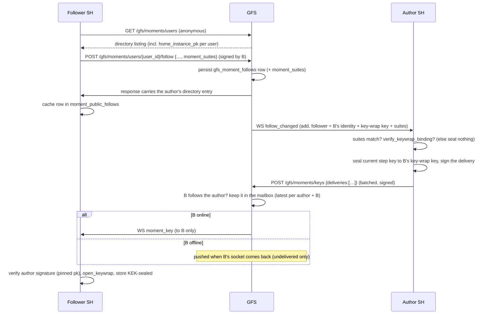
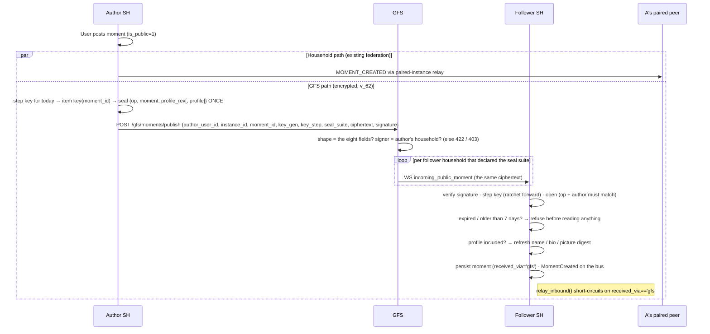
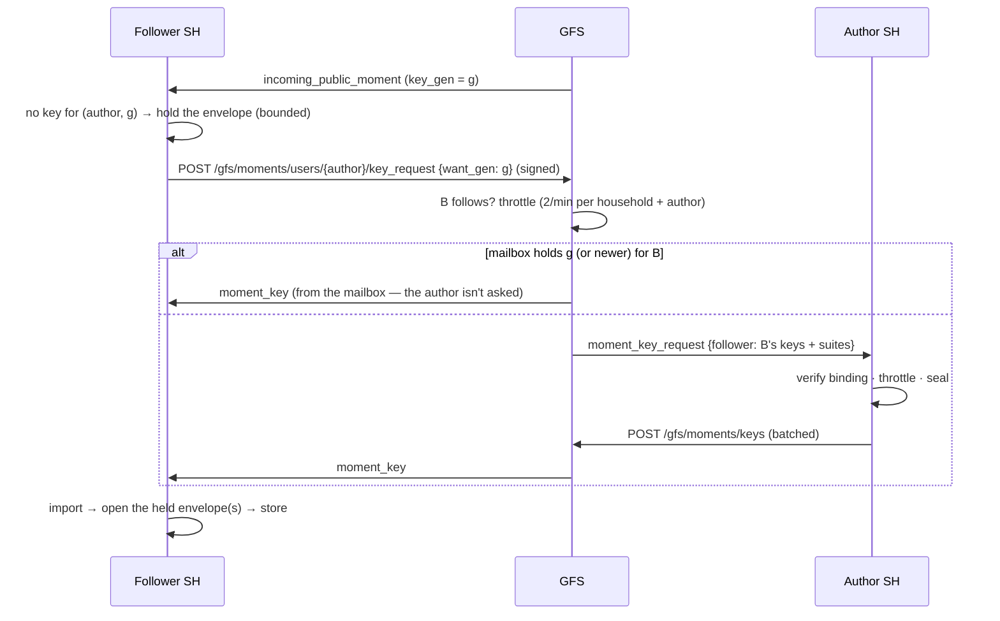
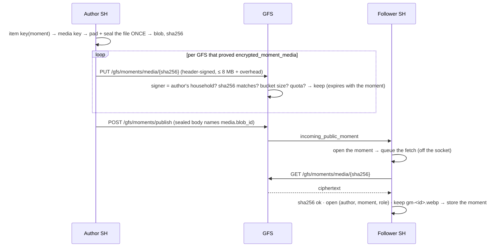
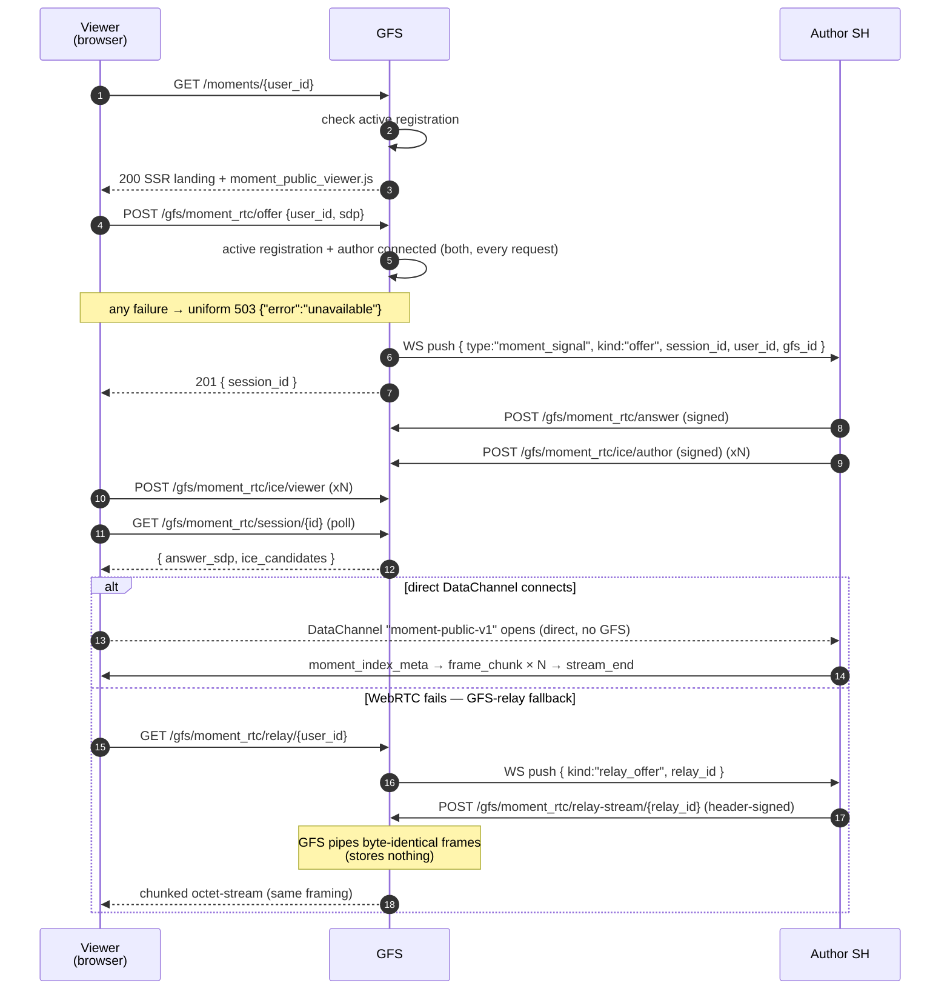

# Public Momentum (§Momentum-public)

Opt-in extension to the [Momentum](momentum.md) pillar that lets a
registered user fan their moments out beyond the household-paired
mesh, brokered by a GFS. Followers across the public internet
discover authors via the GFS directory, follow them explicitly, and
receive every subsequent moment over the same persistent SH↔GFS
WebSocket the rest of the public-pillar surface (Highlights) already
uses.

## Scope

* Per-user opt-in. The author of each moment chooses whether to fan
  it out via their registered GFSes; an opt-out checkbox at compose
  time overrides the per-user default.
* Multi-GFS publishing. One user can register on several GFSes at
  once. The fan-out posts to each in turn.
* Follower-side gate. The GFS only forwards a moment to households
  that have at least one follower of the author. Strangers see
  nothing.
* **No re-distribute rule.** A moment that arrived via a GFS
  fan-out is *not* relayed back into the recipient's paired
  household mesh. The federation outbound (`MomentFederationOutbound.relay_inbound`)
  reads `received_via='gfs'` on the inbound payload and skips relay.
* Replies fan out **both** through the GFS path and through the
  replier's paired households (normal moment federation). A follower
  that does not hold the parent drops a GFS-delivered reply (INFO) — it
  would be out of context, and its parent reference cannot be stored.
* Author-side moments still fan out to paired households via the
  existing federation alongside the GFS path. Recipients dedupe by
  `moment.id` (the `moments` PRIMARY KEY makes the second save a
  no-op).

## Encryption posture (v_62)

Per §25.8.21 (encryption-first) **the GFS never reads a public moment.**
It stays **content-blind — not blind**: it still holds the follow graph,
author and moment ids, key ids, timing and sizes, and the plaintext author
directory. Nothing more is claimed.

* **Keys.** Each author's household keeps one random 32-byte root per
  *generation* (`key_gen` = Unix seconds at mint, never repeats). Step keys
  ratchet forward once a day — `K(g, s+1) = HKDF(K(g, s),
  "sh-moment-ratchet:v1")` — and every household keeps only its newest step
  key (forward secrecy at rest, at zero delivery cost). Each moment is sealed
  under its own **item key** `HKDF(K(g, s), "sh-moment-item:v1|" +
  moment_id)`, so one moment's key (a share link, later) opens that moment
  and nothing else. See [Moment keys](#moment-keys-v_62).
* **Envelope.** Exactly `{author_user_id, instance_id, moment_id, key_gen,
  key_step, seal_suite, ciphertext, signature}`
  (`socialhome/moment_public_seal.py`). `seal_suite: "aesgcm-256"` —
  AES-256-GCM, fresh 96-bit nonce, associated data binding suite, author,
  generation, step and moment id. Inside: `op` (create / delete), text,
  media reference, duration, parent, origin, timestamps, `profile_rev`, and
  the author's profile only when it changed. The author's household signs
  the whole envelope (ciphertext + key id + moment id). The same signature
  authenticates the publish to the GFS and is forwarded intact.
* **One upload, one ciphertext.** A moment is sealed and signed once; the
  same bytes go to every registered GFS, and each GFS fans those bytes out
  to every follower household. Nothing is sealed per follower when a moment
  is published.
* **The GFS refuses anything else.** A publish or delete with any field
  beyond those eight is `422 encryption_required` and is never fanned out;
  only the household the author registered from may publish as them
  (`403 instance_mismatch`); ≤ 16 KB of ciphertext.
* **Only households that can open it.** A follow request declares (signed)
  what the follower household can open: `moment_suites: {kem, seal}`. The
  GFS fans a moment out only to households that declared the seal suite,
  and the author seals keys only to households that declared both the KEM
  suite of their key-wrap key and the seal suite. A household re-declares
  its suites on each (re)connect (`POST /gfs/moments/suites`), so follows
  made before it upgraded start receiving. An older household
  declared nothing: it is sent nothing, and the author's sharing settings
  count it ("can't read your public moments yet").
* **Keys reach each follower household sealed to it alone**, through the
  GFS, which keeps the latest one per (author, household) in a mailbox it
  can't open — see [Moment keys](#moment-keys-v_62).
* **Receivers** verify the signature against the author's
  `home_instance_pk` cached in `moment_public_follows` at follow time, then
  open the envelope with the step key for `(key_gen, key_step)`. A bad
  signature, an unknown suite, a wrong key, or a sealed `op` / author that
  doesn't match the frame drops it. A **plaintext envelope** (an older
  author household's) is refused, never stored. A create whose
  `expires_at` has passed or whose `created_at` is older than a moment can
  live (7 days) is refused **before** anything is read from it — a replayed
  old envelope can neither re-store an expired moment nor roll a profile
  back (review finding M7).

**What stays readable on purpose: the author directory.** An author opts into
a GFS's public directory — `display_name`, `username`, `bio`, avatar and
`home_instance_pk` (`gfs_user_registrations`, `gfs_user_pictures`). That is
the discovery surface strangers find someone to follow by, so the GFS serves
it to anyone. No moment content, caption or media reference is in it.

**No plaintext fallback.** A household publishes public moments only to a GFS
whose signed `/gfs/info` capability block proves `encrypted_moments`. Any
other GFS gets **no public moments at all** — one WARNING per server, and the
author's sharing settings show it (`GET /api/moments/public/registrations` →
`delivery: "unsupported_server"`).

**Owner decision 2026-10-20 — who learns what.** The author's household
learns which households follow it (it already got `follow_changed` with the
follower's instance id) and seals to each household's key-wrap key directly.
An opaque-handle alternative (the author never learning follower ids) was
weighed: without an identity the author can verify, a GFS could substitute
its own key-wrap key for every follower and read silently — strictly weaker.

**Residuals.**

* *Public means anyone may follow* — the GFS operator too, from a registered
  household; that follow is visible to the author. What the GFS cannot do is
  read moments *without* following.
* *Trust on first use of the author key* at follow time (unchanged).
* *Metadata* — the follow graph, which author posts when, moment ids, key
  ids, sizes, timing, when keys are delivered.
* *Media* (v_63) — the GFS stores each moment file as padded ciphertext it
  can't open: it learns a size bucket, the blob's address and who fetches
  it when. See [Encrypted media](#encrypted-media-v_63).
* *The live public-moments index* (`/moments/{user_id}`) still streams
  moments to guests — owner decision 2026-10-20: that page becomes profile +
  Follow only, and moments open through per-moment share links (follow-up).

## Event types

| Event type (federation) | Direction | Purpose |
|---|---|---|
| `MOMENT_PUBLIC_FOLLOW` | GFS → author | Follower count tick. |
| `MOMENT_PUBLIC_UNFOLLOW` | GFS → author | Follower count tick. |

The moment payload itself rides as a **WS frame**, not a federation
event — the GFS is the validated middlebox and the recipient
verifies the author's signature directly.

| WS frame type | Direction | Carries |
|---|---|---|
| `moment_public` | author SH → GFS (HTTP `POST /gfs/moments/publish`) | Signed, encrypted moment envelope. |
| `moment_public_delete` | author SH → GFS (HTTP `POST /gfs/moments/delete`) | Signed, encrypted tombstone. |
| `incoming_public_moment` | GFS → follower SH | Forwarded envelope, signature intact — only to households that declared the seal suite. |
| `incoming_public_moment_delete` | GFS → follower SH | Forwarded tombstone. |
| `follow_changed` | GFS → author SH | A follower came or went. `action: "add"` (v_62) carries `follower: {instance_id, identity_public_key, keywrap_public_key, kem_suite, keywrap_sig, moment_suites}`; `action: "remove"` carries `follower_instance_id` and `household_still_follows`. |
| `moment_key_request` | GFS → author SH (v_62) | A follower household lacks the key for `want_gen` and the mailbox had none: `{followed_user_id, want_gen, follower_user_ids, follower}`. Only for a household that follows; ≤ 2 a minute per (household, author). |
| `moment_key` | GFS → follower SH (v_62) | One sealed key `{author_user_id, instance_id, to, key_gen, key_step, key_suite, sealed: {kem_suite, eph_pk, ciphertext}, signature}`, pushed to the `to` household only — at once, or from the mailbox when it reconnects. |

## Wire endpoints

### GFS-side

| Method | Path | Purpose |
|---|---|---|
| POST   | `/gfs/moments/users/register` | Signed body — register a user. |
| POST   | `/gfs/moments/users/{user_id}/deregister` | Signed body — drop a registration. |
| POST   | `/gfs/moments/users/{user_id}/follow` | Signed body — record a follower; v_62 optional `moment_suites: {kem: [...], seal: [...]}` (≤ 8 names of ≤ 64 chars each; 422 otherwise). |
| POST   | `/gfs/moments/users/{user_id}/unfollow` | Signed body — drop a follower. |
| POST   | `/gfs/moments/users/{user_id}/picture` | Signed body — push avatar bytes. |
| POST   | `/gfs/moments/publish` | Signed, encrypted envelope — fan out. Anything but the eight envelope fields: `422 encryption_required`. |
| POST   | `/gfs/moments/delete` | Signed, encrypted tombstone — fan out the delete. Same shape rule. |
| PUT / GET | `/gfs/moments/media/{blob_id}` | v_63. `PUT` header-signed by the author's household: one encrypted, padded blob addressed by its SHA-256 (≤ 8 MB + overhead; 422 for a wrong address / size / expiry, 429 over the author's quota). `GET` anonymous, immutable, CORS `*`: the ciphertext. |
| POST   | `/gfs/moments/media/{blob_id}/delete` | v_63. Signed by the author's household: withdraw a blob (its moment was deleted). |
| POST   | `/gfs/moments/suites` | v_62. Signed by a follower household: `{instance_id, moment_suites: {kem, seal}}` — what it can open, recorded on every follow it holds here (a follow made before it upgraded declared nothing). Sent once per process per server on (re)connect, only when a local user follows someone there. Returns `{updated}`. |
| POST   | `/gfs/moments/keys` | v_62. Signed by the author's household: `{instance_id, deliveries: [≤ 100 sealed keys]}`. Each is kept (latest per author + household) and pushed to its `to` household only while it follows the author. |
| POST   | `/gfs/moments/users/{user_id}/key_request` | v_62. Signed by a follower household: `{instance_id, want_gen}`. Always `202`; answered from the mailbox, or forwarded to the author, only for a follower, throttled. |
| POST   | `/gfs/moments/users/{user_id}/follower_stats` | v_62. Signed by the author's household: `{followers, households, households_unable}` — counts only. |
| GET    | `/gfs/moments/users` | Public JSON directory. |
| GET    | `/gfs/moments/users/{user_id}` | Public JSON per-user detail. |
| GET    | `/gfs/moments/users/{user_id}/picture` | Public avatar bytes. |
| GET    | `/moments` | Public HTML directory. |
| GET    | `/moments/{user_id}` | Per-user public HTML landing; mounts the live public-moments index viewer (see "Public moments index"). |

### SH-side (auth-gated)

| Method | Path | Purpose |
|---|---|---|
| GET    | `/api/moments/public/registrations` | Caller's registrations, each with `delivery` (`"encrypted"` / `"unsupported_server"`) and `followers_unable` (follower households on an older Social Home, sent none; `null` when unknown). |
| POST   | `/api/moments/public/registrations` | Register on a GFS. |
| DELETE | `/api/moments/public/registrations/{gfs_id}` | Deregister. |
| PATCH  | `/api/moments/public/registrations/{gfs_id}` | Toggle `default_share`. |
| GET    | `/api/moments/public/follows` | Caller's GFS follows. |
| POST   | `/api/moments/public/follows` | Follow another author. |
| DELETE | `/api/moments/public/follows/{gfs_id}/{user_id}` | Unfollow. |
| GET    | `/api/gfs/{gfs_id}/moments/users` | Proxy the GFS directory. |

## Sequence: discover + follow (+ the key, v_62)



## Sequence: publish + fan-out



If A's paired-household mesh and B's mesh overlap (same household
pair), B receives the same ``moment_id`` twice — once via federation,
once via GFS. The recipient dedupes on the row's PRIMARY KEY; the
second save is a no-op.

## Moment keys (v_62)

* **Generation + ratchet.** `MomentPublicKeyOutbound.current_key` mints a
  generation root on first use (32 random bytes, KEK-sealed with `own |
  author | key_gen` as associated data) and ratchets the step key to today
  in place — the household keeps no older step. A generation older than
  400 steps starts a new one. Two generations are kept.
* **Delivery is targeted and kept.** A sealed key is `{author_user_id,
  instance_id, to, key_gen, key_step, key_suite, sealed, signature}`:
  `sealed` is `seal_to_keywrap` to the `to` household's key-wrap key (fresh
  ephemeral X25519 per seal, `kem_suite` tagged), its plaintext `{author_user_id,
  key_gen, key_step, to, key_suite, key}` repeats the routing fields so a
  sealed blob can't be lifted into another delivery, `key_suite` is the
  space content-key tag `aesgcm-256`, and the author's household signs the
  whole delivery. The GFS keeps the latest delivery per (author, follower
  household) in `gfs_moment_key_mailbox` — ciphertext it can't open — and
  pushes it at once or when that household reconnects (undelivered rows
  only, ≤ 500 per connect).
* **Anti-substitution.** The follower's key-wrap key comes from the GFS.
  The author seals only after `verify_keywrap_binding`: the instance id
  derives from the identity key, and the key-wrap key is self-signed by it.
* **The follower takes a key only** when a local user follows that author
  through that GFS, the delivery is signed by the author key that follow
  pinned and names the household that key derives from, `key_suite` is
  known, it opens with its own key-wrap key, the sealed plaintext matches
  the delivery, the author is not a local user, and it moves forward (a new
  generation, or a later step — never back, never a swap). Keys go when
  nobody here follows the author any more.
* **Three ways to get a key.** Pushed when the GFS names a new follower;
  kept in the GFS mailbox for a household that was offline; and pulled
  when a moment arrives under a generation the follower has no key for —
  the envelope is held (≤ 16 per author-generation, ≤ 256 in all, ≤ 10 min)
  and the follower asks (≤ 1 a minute per author); the GFS answers from the
  mailbox when it holds that generation, else forwards to the author (≤ 2
  a minute per household and author); the author seals at most once per
  household per key id per 30 s. Held envelopes open in order once the key
  lands.
* **Lazy rotation (a follower leaves, is blocked, a registration ends).**
  The key is per *household*, so a user unfollowing while another user of
  that household still follows changes nothing (the GFS's `follow_changed`
  `remove` says `household_still_follows`; an older GFS doesn't, and then
  none is assumed). Otherwise — and on a block by the author, or a
  deregistration — the author's current generation is only **marked**
  (`moment_public_keys.rotate_due`). The next **publish** starts a new
  generation, at most once per 6 h (`ROTATE_AT_MOST_EVERY_S`); sealing to a
  newcomer never rotates, and a mark with no new moment costs nothing
  (moments live a day). Many leaves between two publishes are one rotation.
  The remaining follower households then fetch the new key once each by the
  pull path (mailbox misses the new generation, so the author seals, ≤ 100
  per batch). What a household already holds stays readable to it; the
  next generation is not. The author also refuses to seal to a household
  whose following users (as the GFS names them) are all blocked. Routine
  forward secrecy needs no rotation: the daily ratchet is free.
* **Batched.** Sealed keys queue per GFS and go out in batches of ≤ 100
  half a second after the first — never one POST per follower, never
  blocking the GFS socket.

### Sequence: a follower without the key asks for it



### Traffic (worst realistic case: an author with 10,000 follower households)

Sizes: encrypted envelope ≈ 1.2 KB without the profile (≈ 1.5 KB with it),
sealed key delivery ≈ 0.7 KB, mailbox row ≈ 0.7 KB, key request ≈ 0.3 KB,
forwarded notice ≈ 0.6 KB.

| Trigger | Before (plaintext) | v_62 |
|---|---|---|
| A moment | 1 upload per GFS + 10,000 × ~1.2 KB ≈ 12 MB from the GFS | 1 upload per GFS + 10,000 × ~1.2 KB ≈ 12 MB — the same bytes to everyone; profile (+0.3 KB) only on change or once a day |
| A new follower | 1 notice | 1 notice (+0.6 KB keys) + 1 sealed key to that household ≈ 2 KB; 0.7 KB kept on the GFS |
| A follower reconnects | — | only its undelivered sealed keys (0 when nothing changed) |
| Every pre-v_62 follow | — | one `POST /gfs/moments/suites` per upgraded household per server (≈ 0.3 KB, once per process); then one key per household on its first encrypted moment (pull, ≈ 1.6 KB, ≤ 100 per batch from the author) — 10,000 × 1.9 KB ≈ 19 MB once, in 100 author POSTs. A household not yet upgraded is sent nothing |
| A follower without the key (lost mailbox, restore) | — | ≈ 1.6 KB, answered from the mailbox without the author when it can |
| GFS storage | — | ≤ 1 sealed key per (author, follower household): 10,000 × 0.7 KB ≈ 7 MB |
| Daily ratchet step | — | 0 bytes — every holder derives it |
| A household leaves / is blocked (lazy rotation) | — | 0 bytes at the leave; at the next publish ≥ 6 h later one new generation, then each remaining household pulls one key: 10,000 × ~1.6 KB ≈ 16 MB in 100 author POSTs — at most 4 rounds a day (≤ 64 MB/day worst case), however many households left. Re-sealing to every follower on every unfollow would be 10,000 × 1.6 KB per unfollow |

No trigger makes N households send to M: one follower is one sealed key, a
reconnect sends only what changed, and publishing seals nothing per
follower. Bounds, enforced by sender and receiver: envelope ≤ 16 KB
ciphertext; ≤ 100 deliveries / 128 KB per keys request; ≤ 1 KB per sealed
key; held envelopes ≤ 16 per author-generation, ≤ 256 total; ≤ 10,000
queued keys per GFS; ≤ 500 mailbox pushes per connect.

## Encrypted media (v_63)

Before v_63 a follower never got a public moment's photo or video: only the
author's `api/media/<name>` reference travelled, which names a file on the
author's household. Now the file itself travels — encrypted, once:

* **Seal once** (`socialhome/moment_public_media.py`,
  `MomentPublicMediaOutbound`). Key `HKDF(item_key, "sh-moment-media:v1|" +
  role)` — derived from the moment's item key, so whoever can open the
  moment can open its file and nobody else; `role` is `media` or `poster`
  (a video's still). Plaintext `u32 length ‖ file ‖ zeros` padded to the
  next bucket of 64 KB, 256 KB, 1 MB, 2 MB, 4 MB, 8 MB — the GFS learns a
  size bucket, not the size; files over **8 MB** are not sent (the moment
  goes without). AES-256-GCM, fresh nonce, AAD binding suite, author,
  moment id and role. `media_suite: "aesgcm-256-pad"` (unknown suites
  refused).
* **Address = SHA-256 of the blob.** The sealed moment names it:
  `media: {blob_id, media_suite, content_type, poster_blob_id?}`
  (`content_type` from an allow-list: WebP, JPEG, PNG, GIF, WebM, MP4). The
  author's own `media_url` no longer travels.
* **Upload once per GFS, before the moment.** `PUT
  /gfs/moments/media/{blob_id}`, header-signed by the author's household
  (`X-SH-Instance` / `-Author` / `-Expires` / `-Timestamp` / `-Signature` over
  `{instance_id, blob_id, author_user_id, expires_at, ts}`, ±300 s). Only to
  a GFS whose signed `/gfs/info` proves `encrypted_moment_media`. The GFS
  checks the signer is the author's registered household, the body's
  SHA-256 is the address, the size is a padded bucket, and the expiry is no
  later than 8 days out; it caps each author at 256 MB live and 60 blobs an
  hour, and drops blobs when they expire, when the author deletes the moment
  (`POST /gfs/moments/media/{id}/delete`, signed) or deregisters.
* **A video still transcoding** is held by the author's household until
  `MediaTranscodeReady` (or sent without its file on `MediaTranscodeFailed`).
* **Fetch off the socket** (`MomentPublicMediaInbound`). A follower that
  opens a moment naming a blob queues a fetch (≤ 64 waiting) from the GFS
  the moment came through (`GET /gfs/moments/media/{id}` — anonymous,
  immutable, CORS `*` for a future share-link viewer), checks the SHA-256,
  opens it (AEAD bound to author, moment and role), keeps it as
  `gm-<id>.<ext>` (a poster as `gm-<id>.webp`, the name a video's poster is
  derived by) and only then stores the moment. Anything that doesn't check
  out stores the moment **without** a file — never a broken or foreign one.
  A delete removes the kept file; retention sweeps it with the moment.



**Traffic (N = 10,000 follower households, a 2 MB photo → 2 MB bucket):**
the author's uplink carries **2 MB once per GFS** (before: nothing reached
followers at all; a "stream it from home" design would be N × 2 MB = 20 GB
from the household). The GFS serves N × 2 MB = 20 GB to followers that open
it — fetched once per household, not per user, and only by households that
can open it; it stores 2 MB until the moment expires. The moment frame
itself grows by ~0.2 KB. Worst case per author: 256 MB live on a GFS,
60 blobs/hour.

## Author profile: name, picture and bio

Followers met the author only through the GFS, so they hold no roster
row for them. The author's profile reaches them two ways — both carry
only what the author already published in the GFS public directory, so
the GFS learns nothing new:

* **At follow time** the `POST /gfs/moments/users/{user_id}/follow`
  response carries the directory entry: `display_name`, `bio` and
  `picture_digest` (plus `home_instance_pk`).
* **Inside moments, on change** (v_62): every sealed body names the
  author's `profile_rev` (a 16-hex digest of name, username, bio and
  picture digest); the `profile` itself — `display_name`, `username`, `bio`
  (only when it fits the directory's 280-character cap) and
  `picture_digest` — rides only the first moment after it changed, and at
  least once a day. `picture_digest` is the author's current picture hash
  only for a GFS whose `last_picture_digest` is that hash (that server
  mirrors exactly those bytes; otherwise `null`); a moment is sealed once
  per distinct digest — normally once for every GFS. All of it is inside
  the ciphertext and under the author's signature, so a GFS can neither
  read nor rename anyone.

The follower stores them on `moment_public_follows`
(`followed_display_name`, `followed_bio`, `followed_picture_digest`) —
refreshed only by a verified, live moment it has not seen, so a replayed
older envelope cannot roll a newer profile back. A moment without a
profile keeps the held values. Names are checked on the way in: blank,
overlong, or equal to the author's user id (the directory's fallback)
counts as no name, and the SPA shows "Someone" — never an id. A picture
digest must be 16 hex characters (the household's form) or the GFS's
64-hex SHA-256, which is shortened to the same 16.

`GET /api/moments`, `/archive` and `/{id}` name such an author from the
follow (`PersonSummaryService`, `gfs_via`): the name, a bio, and the
picture through the signed proxy `api/gfs/{gfs_id}/moments/users/{user_id}/picture`,
which fetches the bytes from the GFS the household is already connected
to — the browser never contacts the GFS. A guardian block (§CP.F2) still
withholds the picture and the bio. A protected (child) account never publishes
public moments, so it never reaches this path (§CP.R).

## Protected accounts never see them

A received public moment is one household-wide row. A protected (child)
account (§CP.R) never sees it — the per-viewer visibility rule
(`moment_repo._NOT_GFS_FOR_PROTECTED_SQL`, part of the inbox rule the detail
read shares) leaves it out of the inbox, the archive, trending tags, a
moment's replies and the detail read (the unknown-id 404), and the
`moment.created` WebSocket frame (`MomentCreated.received_via = "gfs"`)
skips protected accounts. Notifications: a GFS-delivered moment carries no
parent author, so it never notifies anyone.

## Creator-bound moment ids (v_36)

A moment's id commits to its author (`federation/owner_bound_id.py`,
unscoped `moment` kind). The public inbound refuses an
`incoming_public_moment` or `incoming_public_moment_delete` naming a
bound id for any other author — validly signed or not — before it is
stored or tombstoned, so nobody can pre-empt another author's moment
id. See [`momentum.md`](./momentum.md).

**Stored row wins** — as on the household path: a moment id this
household already holds (live, or a delete's tombstone) keeps its author
and origin, whatever the id's shape. A public create or delete naming
another author or origin for it is refused at WARNING — never upserted
over the held row, never tombstoned. A delete's origin is its
`origin_instance_id`, else the sending household's `instance_id`; a
delete for a moment not held yet leaves a tombstone under that origin,
so a later create stays refused (the "deletes stick" rule).

## Signature canonicalisation

Every signed wire body — register, follow, unfollow, publish, delete
— uses the same canonical-JSON shape:

```python
canonical = json.dumps(
    body, separators=(",", ":"), sort_keys=True
).encode("utf-8")
```

The Ed25519 signature is computed over those bytes, base64url-encoded
(no padding), and appended to the body under the ``signature`` key.
The ``signature`` field is **excluded** from the canonical bytes —
the verifier strips it back out before re-running ``json.dumps`` to
compare.

* **Algorithm**: Ed25519 (per §25.8 instance-key suite).
* **Key**: the sending instance's federation identity key (32-byte
  Ed25519 seed). For follower-side calls (``follow`` / ``unfollow``)
  the follower's *own* instance signs; for publish / delete the
  author's instance signs.
* **Public key encoding**: 64-character lowercase hex on every
  GFS-stored or wire-carried form (``client_instances.public_key``,
  ``gfs_user_registrations.home_instance_pk``,
  ``moment_public_follows.followed_instance_pk``). The choice of hex
  for keys + base64url for signatures matches the existing
  Highlights flow.
* **Nonce**: none. Replay protection is provided at the transport
  layer (the GFS only routes within an active WS), and the moment
  envelope's ``moment_id`` is unique per author.

The recipient's verification is in
``socialhome/services/moment_public_inbound.py:_verify`` — single
``json.dumps(..., separators=(",",":"), sort_keys=True)`` call,
identical bytes-for-bytes to the sender's canonical encoding.

## DB schema (this PR ships into `0001_initial.sql`)

* `gfs_user_registrations` (GFS) — directory of opted-in users.
  Carries `bio` (≤280 chars) and `picture_digest` so the public
  directory landing renders cards without joining
  `gfs_user_pictures`.
* `gfs_user_pictures` (GFS) — avatar bytes mirrored from the home
  instance so the anon `/moments` SPA + `/moments/{id}` detail page
  can serve `">` without round-
  tripping to the (often NAT-shielded) household.
* `gfs_moment_follows` (GFS) — follower graph keyed by
  `(follower_user_id, followed_user_id)`.
* `moment_public_registrations` (SH) — author-side opt-in per
  `(user_id, gfs_id)`, plus the `default_share` flag and
  `last_picture_digest` so the profile-sync flow skips redundant
  avatar uploads.
* `moment_public_follows` (SH) — follower-side cache, including the
  followed user's `home_instance_pk` for signature verification and
  (0112) their public `followed_bio` / `followed_picture_digest`.
* `moment_public_keys` (SH, 0118, v_62) — moment keys, KEK-sealed, one
  row per (author, role, generation) with the step key advanced in place:
  `is_own = 1` minted here for local authors, `is_own = 0` delivered by
  followed authors. Never backed up or exported.
* `gfs_moment_follows.moment_suites` (GFS 0021, v_62) — what the follower
  household declared it can open; `gfs_moment_key_mailbox` (GFS 0021) —
  the latest sealed key per (author, follower household), which the GFS
  can't open.
* `moments.is_public` / `moments.received_via` /
  `moments.received_via_gfs_id` — provenance on every row so the
  inbox UI can render a "via {gfs}" chip and so the federation
  outbound can enforce the no-redistribute rule.

## Public directory + profile sync

* **Anon landing** at `/moments` (SPA shell) and `/moments/{user_id}`
  (per-user detail) — both rendered by the GFS itself; the JS at
  `/static/users_directory.js` fetches `GET /gfs/moments/users` and
  renders cards with avatar + name + bio + handle.
* **Per-user detail JSON** at `GET /gfs/moments/users/{user_id}` —
  adds `follower_count` to the registration shape so the detail
  page can show social proof.
* **Server-side filter** `GET /gfs/moments/users?q=<substr>` matches
  `display_name` and `username` (`LIKE '%q%'`). Capped at 200
  rows; the SH-side proxy passes `q` through.
* **In-app Discover** at `/momentum/public/discover` — fetches
  `GET /api/gfs/{gfs_id}/moments/users` (SH proxy), rendering avatar
  via `GET /api/gfs/{gfs_id}/moments/users/{user_id}/picture` so the UI
  renders even when the home instance is NAT-shielded.
* **Profile sync** — `UserProfileUpdated` (published from
  `UserService.patch_profile` and `set_picture`) is consumed by
  `ProfileSyncService`, which calls
  `MomentPublicService.push_profile_to_gfs` once per active
  registration. Failures log + drop; reconcile happens on the
  next save.
* **Single identity** — there is no per-Momentum profile override
  in v1. What's in `users.{display_name, bio, picture_hash}` is
  what every paired GFS sees.

## Public moments index

A guest visiting `GET /moments/{user_id}` on the GFS sees the author's
**current public moments**, streamed live from the author's SH the same
way a public highlight is — a direct WebRTC DataChannel first, with the
GFS-relay fallback when WebRTC can't connect. The transport mechanism is
shared verbatim with Highlights; see
[highlights_public.md → GFS-relay fallback](highlights_public.md#gfs-relay-fallback)
for the bridge details rather than repeating them here.

Access is gated by the user's **active public-directory registration** —
no token. **Not encrypted from the GFS yet:** this page has no secret, so on
the relay fallback the GFS pipes the framed moments in the clear, and the GFS
can open the page like any guest. Owner decision 2026-10-20: this page becomes
the person's profile (name, picture, bio) and a Follow button only; a moment
opens through a share link carrying that one moment's item key in the URL
fragment (`#k=`), served by a pinned, hash-verified viewer — follow-ups. Until
then this is the one place public moment content can cross the GFS readable.

Only moments with `is_public = 1` that have not expired are
ever streamed; the filter is enforced in
`moment_repo.list_public_for` (the privacy invariant). The GFS stores
**zero** moment bytes — like the highlight relay, the bridge is a
transient in-memory pipe.

### Framing

The moments index reuses the highlights framing module
(`highlight_public_framing.py`) — same `[u32 header_len][header][u32
payload_len][payload]` shape, label `moment-public-v1`:

| `kind` | Direction | Header fields | Payload |
|---|---|---|---|
| `moment_index_meta` | author → viewer (first frame) | `moments` (manifest: `[{id, content, created_at, media_type, has_media, media_frame_id, byte_length?, content_type?}, …]`) | empty |
| `frame_chunk` | author → viewer | `frame_id`, `chunk_index`, `is_last_chunk`, `byte_length` | up to `CHUNK_SIZE` bytes — one stream per moment that has media |
| `stream_end` | author → viewer (terminator) | `kind` only | empty |

### Wire endpoints (GFS)

These mirror the public-highlight `/gfs/highlight_rtc/*` endpoints.

| Method | Path | Purpose |
|---|---|---|
| POST | `/gfs/moment_rtc/offer` | Anonymous. Body `{user_id, sdp}`. Every non-success state (unregistered / suspended user, author offline) gets the one uniform `503 {"error":"unavailable"}` (see "Not a presence oracle" below). Otherwise pushes a `moment_signal` WS frame (`kind:"offer"`, carrying `user_id` + `gfs_id`) to the author. Returns `201 {session_id}`. |
| GET | `/gfs/moment_rtc/session/{session_id}` | Anonymous poll for `answer_sdp` + author ICE. |
| POST | `/gfs/moment_rtc/ice/viewer` | Anonymous. Trickle the viewer's ICE candidate. |
| POST | `/gfs/moment_rtc/answer` | Author SH only (Ed25519-signed). Authority guard: `session.initiator_id` must match the signer. |
| POST | `/gfs/moment_rtc/ice/author` | Author SH only (signed). Same authority guard. |
| GET | `/gfs/moment_rtc/relay/{user_id}` | Anonymous chunked relay fallback (registration-gated). Every non-success state (unregistered, author offline, relay capacity, author never connects) gets the uniform `503 {"error":"unavailable"}`, sent at once (only the never-connects branch waits its 30 s budget). |
| POST | `/gfs/moment_rtc/relay-stream/{relay_id}` | Author SH only. Header-auth (`X-SH-Instance` + `X-SH-Signature` over canonical `{"instance_id","relay_id"}`) — same scheme as the highlight relay-stream. Body is the raw framed byte stream. |

The author SH handles a new `moment_signal` WS frame with `kind` ∈
`offer` / `ice` / `relay_offer`, dispatched in
`moment_public_signaling_handler.py`. The viewer DataChannel label is
`moment-public-v1`; the bundle is `moment_public_viewer.js` (built from
`client/gfs/public_moments.tsx`) and mounts into `#moments-root` on the
per-user landing page.

### Sequence: guest reads a user's public moments



Only `is_public = 1`, non-expired moments cross the wire — a stranger
visiting the page sees exactly the author's current public set, never a
private or expired moment, and the GFS never holds a copy.

### Not a presence oracle

The streaming routes must not tell an outsider whether the author's
household is connected
([`principles.md`](../principles.md#the-gfs-is-not-an-author-presence-oracle)).
`routes/moment_rtc.py:_servable_author` does the registration lookup and
the connection check on every request and folds both into one answer. Every
failure gets `global_server/public_unavailable.py`'s uniform
`503 {"error":"unavailable"}` + `Cache-Control: no-store`, so unknown,
deregistered and offline can't be told apart. Failures are answered at once, with no added delay. A delay would hide
nothing, because the matching offer already answers `201` or `503`
immediately, and it would let anonymous callers hold a socket open for
30 s. Only the relay's never-streams branch waits, for its 30 s connect
budget. The viewer shows
"This isn't available right now." in a `role="alert"` region and moves focus
to a *Try again* button. It retries on its own after 10 s, 30 s and 60 s,
then stops.

Whether a user is *registered* is public anyway (the directory lists them).
The **residual** is success: a `201` offer (answered or not) or a relay
that streams bytes shows that the author's household is online. Content served
live from that household can't hide this.

## Implementation pointers

* SH author orchestration:
  `socialhome/services/moment_public_service.py`,
  `socialhome/services/moment_public_outbound.py`.
* SH recipient:
  `socialhome/services/moment_public_inbound.py`.
* Wire crypto (envelope + sealed-key shapes, suites, signatures):
  `socialhome/moment_public_seal.py`.
* Encrypted media (v_63): `socialhome/moment_public_media.py` (seal, pad,
  address), `socialhome/services/moment_public_media_outbound.py` (author:
  seal once, upload per GFS, withdraw), `socialhome/services/moment_public_media_inbound.py`
  (follower: fetch, check, open, keep), `socialhome/global_server/moment_media.py`
  (GFS store, quotas, expiry).
* Moment content keys — author side (mint, seal to followers, batched
  delivery): `socialhome/services/moment_public_key_outbound.py`;
  follower side (import, ask): `socialhome/services/moment_public_key_inbound.py`;
  storage: `socialhome/repositories/moment_public_repo.py`
  (`SqliteMomentPublicKeyRepo`, migration `0118_moment_public_keys.sql`).
* GFS broker:
  `socialhome/global_server/moment_public_registry.py`.
* GFS routes:
  `socialhome/global_server/routes/moments_public.py`.
* SH routes:
  `socialhome/routes/moments_public.py`.
* Relay guard:
  `socialhome/services/moment_federation_outbound.py:relay_inbound`.
* Public moments index (author-side answerer / relay):
  `socialhome/services/moment_public_signaling_handler.py`.
* Public moments index (GFS RTC + relay routes):
  `socialhome/global_server/routes/moment_rtc.py`.
* Public moments index viewer bundle:
  `client/gfs/public_moments.tsx` → `moment_public_viewer.js`.
* Privacy filter:
  `socialhome/repositories/moment_repo.py:list_public_for`.

## Spec refs

* §Momentum (the underlying pillar; this page extends it).
* §24.7 GFS pairing handshake.
* §24.12 SH↔GFS WebSocket transport.
* §25.8.21 Encryption-first invariant.
