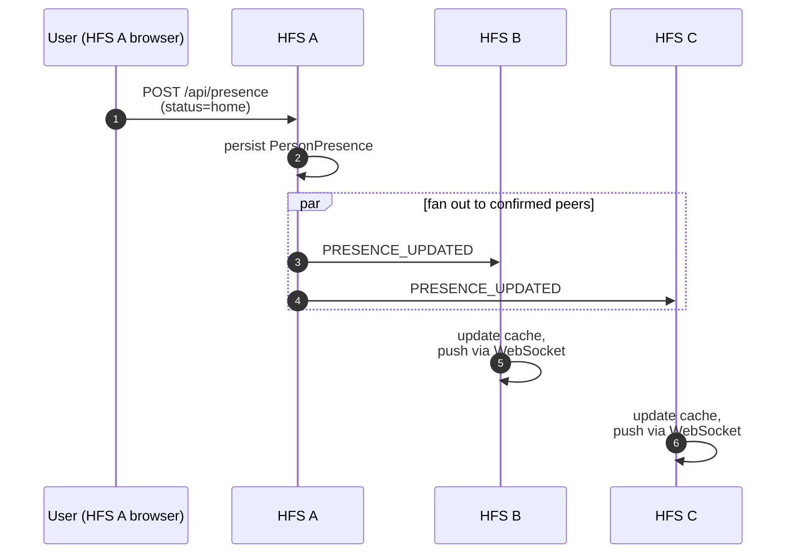

# Presence

Who is online, where they are, and what they're doing. Presence is
the lowest-latency, highest-volume federation event — every status
flicker or location update produces one envelope per paired peer.

## Scope

- **HFS**: both sides. Broadcasts the local user's presence to every
  confirmed peer; renders inbound presence for the UI.
- **GFS**: uninvolved. Presence never leaves the pair mesh.

## Event types

`PRESENCE_UPDATED`, `USER_UPDATED`, `USER_REMOVED`,
`USER_STATUS_UPDATED`, `USERS_SYNC`, `USER_ONLINE`, `USER_IDLE`,
`USER_OFFLINE`.

## Flow — status change



## GPS truncation (§25)

When a presence event carries a location, coordinates are truncated
to **4 decimal places** before persistence or federation. This is
~11 m of precision — enough for "at home / near home / away" UX
without exposing fine-grained movement.

`round(float(lat), 4)` and `round(float(lon), 4)` are applied at the
service boundary; the repository never sees full-precision values.

## Rate limiting

`POST /api/presence/location` is rate-limited to 10 updates per
minute per user. Above that, the latest update wins and the intermediate
ones are dropped. The federation layer batches location updates on a
short timer (currently 5 s) to keep the per-peer event rate bounded.

## Scoped visibility (§23.80)

A presence update may be restricted to specific spaces — e.g. "show
my location only to my family space, not the neighbourhood space."
The outbound service applies the per-space filter before selecting
which peers to broadcast to.

## Per-space presence is GPS-only (§23.8.6)

Two distinct fan-outs follow every household ``PresenceUpdated``:

1. **Household dashboard** — local `presence.updated` WS frame, includes
   `zone_name` (e.g. `"Office"`). HA-defined zone names are
   household-private data — they're consumed here and never propagate
   beyond.
2. **Per-space map** — for every space where the user has
   `location_share_enabled = 1` AND `feature_location = 1`,
   `SpaceLocationOutbound` emits:
   - a local WS frame `space_location_updated` to space members on
     this instance, payload `{space_id, user_id, lat, lon, accuracy_m,
     updated_at}`;
   - a sealed federation event `SPACE_LOCATION_UPDATED` to every
     remote member instance, encrypted payload `{user_id, lat, lon,
     accuracy_m, updated_at}`.

   On the receiving household the inbound handler stores the pin
   (coordinates truncated to 4 decimals, none at all for `zone_only`)
   and emits the same local `space_location_updated` frame to that
   space's local members, so remote pins move live. A pin whose mode
   differs from the receiving space's `location_mode` is stored but
   neither shown on the map nor sent as a frame. It is never
   re-federated.

   **Both space-bound payloads strip `zone_name`.** HA zones do not
   reach a space. To label a member's pin on the space map, each
   space carries its own zone catalogue (see "Per-space zones" below);
   the client matches GPS to zones at render time.

When `lat`/`lon` is `None` (accuracy gate fired upstream) we skip
both space fan-outs entirely. The household dashboard still receives
`zone_name`, so the member stays visible there.

## Household zones (local only)

The household keeps its own zone list — Home, School, Work… — in
`household_zones` (migration 0097), separate from the per-space
catalogues below.

- **Local, never federated.** No federation event carries a household
  zone, and the zone names stay in the household: the space-bound
  payloads above strip `zone_name` as before.
- **Server-side GPS matching.** `POST /api/presence/location` with
  neither a `zone_name` key nor a `state` (standalone mode, other
  clients) but with a usable GPS point — after the 500 m accuracy gate and the 4-decimal truncation —
  is matched against the household zones: the nearest zone centre
  whose haversine distance is within the zone's radius
  (`domain/zone_geo.py:match_zone`, the same helper the space
  `zone_only` mode uses). A stated zone is never replaced: the Home
  Assistant integration always sends the `zone_name` key
  (socialhome-client 2026.5.11 `client.py` `post_location`), `null` for
  HA's not_home / unknown / unavailable (ha-integration
  `custom_components/socialhome/presence.py`) — that `null` means "not in
  a zone" and stays `away`. An explicit `state` is kept too, and a point
  too inaccurate to store never guesses a zone.
- **The Home zone.** At most one zone is the Home zone (`is_home`; the
  DB allows one). A member inside it gets `zone_name: "home"` and state
  `home` whatever the zone is called; any other zone gives its name and
  state `zone`; no zone leaves state `away`. The Home zone is listed
  first and can't be deleted or un-marked — marking another zone as
  Home moves the flag.
- **Synced zones.** A row with `external_id` set (Home Assistant's
  `zone.home`, …) is owned by a platform sync
  (`HouseholdZoneService.mirror_external`) and read-only through
  `/api/household/zones` (`409 ZONE_READ_ONLY`). A synced Home is never
  taken over by a zone created in Social Home; when a synced Home
  arrives, a native Home stays as a plain zone (with the sync on — the
  default — Home Assistant is the source of truth for Home). If the
  sync later drops its Home, no zone is Home until an admin marks one.
  The mirror keeps every real platform zone: an invalid icon or colour
  is dropped and an out-of-range radius clamped into 25 m – 50 km (both
  logged at WARNING); only an unusable id, name or centre skips a zone.
- **Sync from Home Assistant.** On `ha` / `haos` (the adapter's
  `ZoneSource`, capability `zone_sync`) the household's zones follow
  Home Assistant's `zone.*` entities — an option, **on by default**,
  under Admin › Zones (`GET` / `PATCH /api/household/zones/sync`).
  While on, `HouseholdZoneSync` mirrors HA's zones at startup and every
  5 minutes: each carries its entity id as `external_id` (`zone.work`),
  is read-only here, keeps HA's `friendly_name`, centre and radius, gets
  an emoji for HA's `mdi:*` icon (📍 when unmapped) and no colour (HA
  stores none). Passive zones are left out; `zone.home` is the Home
  zone. Zones created in Social Home stay next to them. A sync that
  can't read HA — or gets an answer without `zone.home`, which HA always
  has once its zones are loaded — keeps the synced zones (a failed call
  is never "HA has no zones") and reports `last_error`. Turning the option off removes
  the synced zones once — the household's own zones stay — and the
  sync idles until it's turned back on, which pulls HA's zones at once.
  The zones still never leave the household.
- **Live updates.** Every change sends a content-free
  `household_zones_changed` WS frame to household members; clients
  refetch the list.

## Per-space zones (§23.8.7)

Each space owns a catalogue of named display circles (lat, lon,
radius_m). Live admin CRUD is replicated to remote member instances
via two sealed federation events under the space content key:

- `SPACE_ZONE_UPSERTED` — encrypted payload
  `{zone_id, space_id, name, latitude, longitude, radius_m, color,
  icon, created_by, updated_at}`. Inbound handler upserts into the local
  `space_zones` table. `icon` (a single emoji or `null`) is optional; a
  receiver keeps its stored icon when the key is absent (older senders),
  and an explicit `null` clears it. No protocol-version bump: an older
  receiver ignores the extra key.
- `SPACE_ZONE_DELETED` — encrypted payload
  `{zone_id, space_id, deleted_by}`. Inbound handler deletes the
  matching row.

A remote member instance joining a space mid-life picks up the full
catalogue via the chunked `SPACE_SYNC_BEGIN/CHUNK` flow — the
`space_zones` resource rides between `polls` and the sentinel.

**Validation.** Every zone write — local REST, `SPACE_ZONE_UPSERTED`
and the `space_zones` sync resource — passes the same checks
(`domain/space.py:validate_zone_name` / `validate_zone_color` /
`validate_zone_icon` / `validate_zone_coord` / `validate_zone_radius`):
`name` is stripped, non-empty, at most 64 characters and free of
control characters (Unicode `Cc`, `Zl`, `Zp`); `color` is `#RRGGBB` or
`null`, stored lower-cased; `icon` is exactly one emoji or `null`
(`domain/emoji.py:is_single_emoji`); `latitude` / `longitude` are finite numbers
within ±90 / ±180, stored truncated to 4 decimals; `radius_m` is a whole
number of metres between 25 and 50 000. An inbound event or sync record that fails
is dropped (the rest of a sync chunk still applies) with a WARNING
naming the sender and space — never the name. HTML escaping is the
client's job at render (Leaflet popups / tooltips take HTML strings).

Local admin CRUD also fires a `space_zone_changed` WS frame to space
members on this instance so the admin UI redraws without polling.
The frame shape is `{type: "space_zone_changed", data: {space_id,
action: "upsert"|"delete", zone_id, zone: SpaceZone | null}}`.

## User status (`USER_STATUS_UPDATED`)

A member's status is an emoji plus one line of text with an optional
deadline, set through `PATCH /api/me`. Every change (set, cleared, or
cleared by the expiry sweep at its deadline) goes to each confirmed
social peer the user is visible to, pairwise-encrypted, as
`{user_id, emoji, text, expires_at}` or `{user_id, status_cleared: true}`.
Only users homed on the sending household are sent; a status received
from a peer is never echoed back into the mesh. The receiver applies
the same caps as the local route (text ≤ 80 characters on one line, a
single emoji) and refuses an envelope that breaks them, caches the
status on the user's `remote_users.status_json` row (a clear sets it
`NULL`) so `GET /api/friends` shows it after a reload, then fans a
`user.status_changed` frame to its household. There is no expiry sweep
for cached remote statuses: readers drop one whose `expires_at` has
passed.

**Guardian blocks (§CP.F2).** A protected account's `USER_STATUS_UPDATED`
and `USER_ONLINE` / `USER_IDLE` / `USER_OFFLINE` never go to a household
where someone its guardian blocked is homed, and a `USERS_SYNC` snapshot
to such a household carries `status: null` for it — the block never leaves the
protected account's household, so the receiver can't filter it and the
sender is the only place it holds. Adding the block (or turning protection
back on over blocks kept from before) sends that household one ordinary
`{user_id, status_cleared: true}` (when the account has a status) and one
`USER_OFFLINE` (when it is online), so nothing set before the block stays
there; after that it hears nothing — not even repeated clears, which a real
sender never sends and which would time-stamp each change. A block on a
remote person this household has no `remote_users` row for yet places them
nowhere, so it covers no household until that row lands (a status live at
that moment isn't cleared there). Once the block is lifted or protection is
off, the next change goes out as usual. On the protected account's own
household, `user.status_changed` frames (and the profile / presence /
online frames) are withheld from everyone a guardian block separates from
the subject, either way round, matching `GET /api/friends` and
`GET /api/presence`.

## USERS_SYNC

`USERS_SYNC` is a snapshot of the sending household's (visible) users —
display names, bios, avatars, handles and each user's current status
(`{emoji, text, expires_at}`, or `null` when unset or expired). It lets
a freshly paired peer populate its directory, statuses included,
without waiting for each user to tick over organically. It is sent
once, when a pairing is confirmed; see
[pairing.md](./pairing.md#roster-catch-up-on-pair-confirm--users_sync)
for the payload and receiver rules (an entry without `status` leaves
the cached one as is; `null` clears it).

## Receiver rules

A household speaks only for the users homed on it (the user's home is
the household their `user_id` is cached under, or this household for its
own members). The receiver drops the event with a WARNING when:

- `USER_UPDATED` / a `USERS_SYNC` entry names a user already known here
  and homed elsewhere — a local member or another household's user.
  Nothing is written, not even the profile picture. The repository
  upsert also never moves a cached user onto another household.
- `USER_REMOVED`, `USER_STATUS_UPDATED`, `USER_ONLINE` / `USER_IDLE` /
  `USER_OFFLINE` and `DM_CONTACT_REQUEST` name a user whose home is not
  the sending household, or a user this household does not know.
- `PRESENCE_UPDATED` is keyed on `from_instance` by construction.

A user seen for the first time is taken only when its `user_id`
re-derives from the sender's pinned identity key —
`derive_user_id(sender_pk, identity_anchor or username)`, the construction
every household mints its users with — so a household can introduce only
its own users and never pre-claim another household's id. Senders ship the
bare `identity_anchor` on every user publication (inside the identity
binding when the peer supports it, on its own otherwise). Legacy window: a
peer still on an older build sends no anchor before capabilities are
exchanged, so its anchor-derived users land on the first later publication
that carries the anchor (a profile update or re-pair). User-visible
effect in that window (and for a user the sender hides from this
household): their DMs are held for a while and then dropped, and their
calendar and app invites are not shown. `tests/protocol/test_user_sync_scope.py`.

## Implementation

- `socialhome/services/presence_service.py` — local state +
  scheduler.
- `socialhome/services/space_location_outbound.py` — space-bound
  GPS-only fan-out (§23.8.6).
- `socialhome/services/space_zone_service.py` — admin CRUD for the
  per-space zone catalogue (§23.8.7).
- `socialhome/services/space_zone_outbound.py` — federation
  fan-out for `SPACE_ZONE_UPSERTED` / `SPACE_ZONE_DELETED`.
- `socialhome/services/federation_inbound/space_content.py` —
  inbound zone handlers (mirror upserts/deletes into the local
  `space_zones` table).
- `socialhome/services/realtime_service.py` — local
  `space_zone_changed` WS broadcast.
- `socialhome/federation/sync/space/exporters/zones.py` — zones
  ride the chunked sync for late-joining remote members.
- `socialhome/repositories/space_zone_repo.py`.
- `socialhome/routes/space_zones.py` — REST CRUD.
- `socialhome/services/household_zone_service.py`,
  `socialhome/repositories/household_zone_repo.py`,
  `socialhome/routes/household_zones.py` — household zones (local
  only): admin CRUD, the platform mirror and the GPS match.
- `socialhome/domain/zone_geo.py` — the one haversine
  nearest-zone-within-radius helper (household + space zones).
- `socialhome/routes/spaces.py` —
  `PATCH /api/spaces/{id}/members/me/location-sharing` (§23.8.8).

## Online status (session presence)

Two presence signals coexist and stay independent: the **physical**
state above (`home`/`away`/`zone`/`not_home`) tracks where the user
*is*, and **session presence** below tracks whether the user has the
app *open* on any device. A user can be `home + offline` (HA reports
them at the house but the SH tab is closed) or `away + online`
(commuting, browsing on a phone). The frontend renders the two cues
side-by-side — never collapsed into a single field.

Mechanics:

- `WebSocketManager.register()` / `unregister()` track open WS
  sessions per user (the manager doesn't know what they mean — that's
  this layer's job).
- `OnlineStatusService` watches first/last-session transitions and
  publishes the four events:
  - `UserCameOnline` — first session opened.
  - `UserResumedActive` — was idle, became active again.
  - `UserWentIdle` — every session has been silent ≥ 5 minutes.
  - `UserWentOffline` — last session closed.
- Activity is reset on **any** inbound WS frame (typing, ping, etc.)
  — protocol-level heartbeats don't reach the message loop and
  therefore don't update the timer.
- Idle is computed across **all** sessions: a user with one active
  tab + one idle tab is *online*, not *idle*.
- `users.last_seen_at` is persisted on the *last* session closing,
  debounced to one write per 30 s per user — so a flaky-Wi-Fi
  reconnect storm doesn't turn into a write storm.

WS frames (sit in the `user.*` namespace, deliberately *not* `presence.*`,
so clients can't accidentally lump session presence and physical
presence into the same handler):

```json
{ "type": "user.online" | "user.idle" | "user.offline",
  "user_id": "u-anna",
  "last_seen_at": "ISO-8601 | null" }
```

`last_seen_at` is non-null only on `user.offline`. The fan-out targets
every other household member except the subject themselves
(self-frame suppression — the user's own UI hydrates `is_online: true`
from the `/api/presence` payload that loads on page mount).

Federation: every transition fans out to every confirmed peer as a
`USER_ONLINE` / `USER_IDLE` / `USER_OFFLINE` event. Encrypted payload
carries `{user_id, last_seen_at?}` (encryption-first per §25.8.21 —
only `event_type` and routing fields ride in plaintext). Peers apply
inbound events to an in-memory remote-state cache and republish a
local `UserCameOnline` / `UserWentIdle` / `UserWentOffline` so
`RealtimeService` fans the change to local viewers' WS sessions in
the same render tick a household-local change would land. The cache
is ephemeral on purpose — a peer restart re-emits the full set on
their side, so we never need to persist remote online state.

Implementation pointers:

- `socialhome/services/online_status_service.py` — first/last-session
  gate, idle scheduler, persistence debounce.
- `socialhome/services/realtime_service.py` — `_on_user_came_online`,
  `_on_user_resumed_active`, `_on_user_went_idle`,
  `_on_user_went_offline` translate domain events to WS frames.
- `socialhome/routes/ws.py` — `user_session_opened` /
  `user_session_closed` / `touch` hooks on the WS message loop.
- `socialhome/routes/presence.py` — `is_online` / `is_idle` /
  `last_seen_at` ride on every `GET /api/presence` row.
- `socialhome/routes/spaces.py` — same triple on every
  `GET /api/spaces/{id}/members` row.
- `client/src/components/Avatar.tsx` — `online` prop renders the
  green / amber dot.
- `client/src/store/presence.ts` — extends `PresenceEntry` and wires
  the three new WS handlers.

## Spec references

§23.21 (presence UX),
§25 (GPS truncation),
§23.80 (per-space visibility),
§23.8.6 (Space Member Map — GPS-only invariant),
§23.8.7 (Space Zones Admin),
§23.8.8 (Sharing visibility & opt-out),
§25.10.1 (federation events table).
