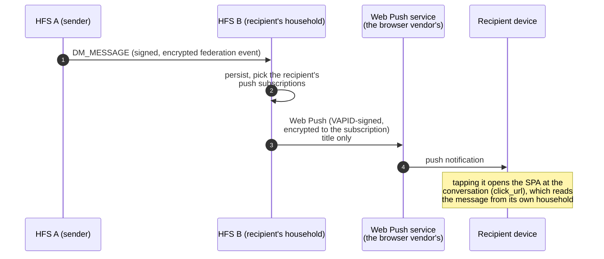
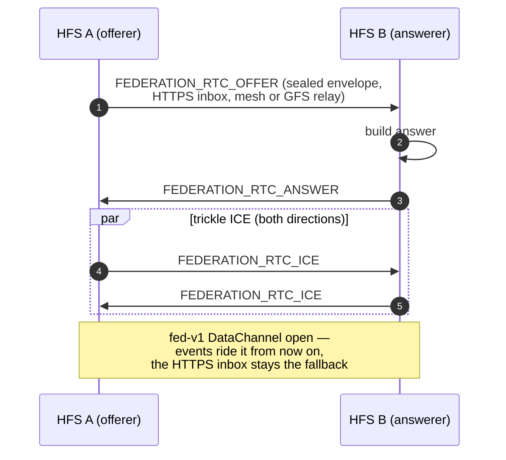

# Push notifications & WebRTC signalling (no GFS)

Two things this page used to describe as GFS services are not, and never
shipped that way:

1. **Push notifications** are sent by the recipient's **own household**,
   straight to the push service of the person's device (Web Push) or to
   their Home Assistant Companion app. No GFS takes part, and no other
   household does: a household notifies only its own people, about events
   it already received.
2. **WebRTC signalling** for the household-to-household DataChannel
   (`fed-v1`) travels as signed federation events between the two paired
   households (`FEDERATION_RTC_OFFER` / `_ANSWER` / `_ICE`), inside their
   sealed federation envelopes like any other event: over the HTTPS inbox,
   the mesh, or the GFS relay tier (`/gfs/envelope`, the fallback for paired
   households), where a GFS carries it only as ciphertext and can't tell it
   from any other envelope. The GFS rendezvous routes that
   once existed (`/gfs/rtc/*`) were removed without any release calling
   them (`socialhome/global_server/routes/rtc.py`). The only WebRTC the GFS
   brokers is a public highlight's anonymous viewer
   ([highlights_public.md](./highlights_public.md)).

## Scope

- **HFS**: stores its people's push subscriptions, sends their
  notifications, and signals the federation DataChannel to each paired
  household.
- **GFS**: no push, and no signalling of its own between households. It
  may carry a household's sealed envelopes on its relay tier, signalling
  included, only as ciphertext. What the GFS does is listed in
  [discovery.md](./discovery.md): the public-space directory, the
  encrypted relay of public / global space content to followers, sealed
  household-to-household envelopes (§D2b invite links, and the relay
  fallback for paired households), and public moments and highlights.

## Event types

RTC signalling (household to household, inside sealed envelopes):
`FEDERATION_RTC_OFFER`, `FEDERATION_RTC_ANSWER`, `FEDERATION_RTC_ICE`.

Push has no event type of its own. A household turns an event it received
(a DM, a post, a mention…) into a local notification for its own people.

## Flow — push to a DM recipient

In `ha` / `haos` mode the platform's push provider
(`platform/ha/providers.py` `HaPushProvider`) delivers through the
person's configured HA `notify.*` service instead (their Companion app).

## Flow — federation DataChannel bootstrap

The ICE candidates are sent only after the OFFER is queued, so a candidate
never overtakes its offer (`federation/transport.py`). TURN credentials
are the household's own (`webrtc_turn_*`, see `docs/operations/turn.md`).

## Push privacy (§25.3)

A notification carries the title only. The body is omitted for DMs,
location messages and any other user-generated content.

**A push says who and where, nothing else** (owner decision D11). It may
name people, spaces and chats — these are labels. It never carries message
text, post or comment text, a task title, an event name, a moment caption
or a reaction emoji. So the lock screen shows "Anna in Weekend plans",
"Ahmed assigned you a task in Familie Alpha", "Chloé changed an event
you're going to" or "Ben reacted to your moment". An invite can come from
a household the person never paired with, so its push never names the
space ("Zoë invited you to a space"); the app shows which one.

Every notification type decides in one place what its push says
(`socialhome/services/notification_service.py`): `_PUSH_AS_IS` lists the
types whose title already names only people, spaces and chats, and
`_PUSH_TITLES` gives every other type a who-and-where title, most specific
variant first (with the space, with the person, neither). A type in
neither table pushes a generic "New notification". A test fails when a new
type is in neither table.

Every title, in the app and on the push, is written in the recipient's
own language from the backend catalog (`socialhome/i18n/messages/`; en,
de, nl, fr, es). The in-app notification keeps the full text (for example
"You were assigned: Steuererklärung"). The content is read when the person
opens the notification, from their own household, over an authenticated
request.

Each in-app notification sends one push per device. The Web Push payload
is `{title, click_url?, tag?}`:

- `click_url` is the notification's in-app link. The service worker
  (`client/public/sw.js`) resolves it against its own scope (the HA
  ingress prefix under `haos`, `/` otherwise) and never outside it, then
  focuses an open Social Home window and moves it there, or opens one.
- `tag` is `<type>:<link>` (or `<type>:<notification id>` without a link).
  A repeat on the same item, such as a burst of messages in one chat,
  replaces the notification on the device without alerting again;
  different items never replace each other.

The household sends Web Push on a worker thread, a few devices at a time,
so a slow push service never stalls the server.

## Subscription lifecycle

- `GET /api/push/vapid_public_key`: this household's VAPID public key, for
  the browser's `pushManager.subscribe`. The key pair is generated on first
  start under the data directory.
- `POST /api/push/subscribe`: the device registers its subscription
  (endpoint and keys) with its own household.
- `DELETE /api/push/subscribe/{sub_id}`, `GET /api/push/subscriptions`:
  remove and list the person's devices.

## Implementation

- `socialhome/services/push_service.py`: Web Push sends (VAPID, via the
  optional `pywebpush`) and subscription bookkeeping.
- `socialhome/platform/adapter.py` (`PushProvider`) and
  `socialhome/platform/ha/providers.py` (`HaPushProvider`): the platform
  push path.
- `socialhome/federation/transport.py`: the `fed-v1` DataChannel and its
  `FEDERATION_RTC_*` signalling.
- `socialhome/global_server/routes/rtc.py`: what is left on the GFS side,
  the Ed25519 check of signed household → GFS requests (no signalling
  rendezvous).

## Spec references

§24.12.5 (federation-level WebRTC signalling),
§25.3 (push privacy),
§25.8.21 (encryption-first rule).
