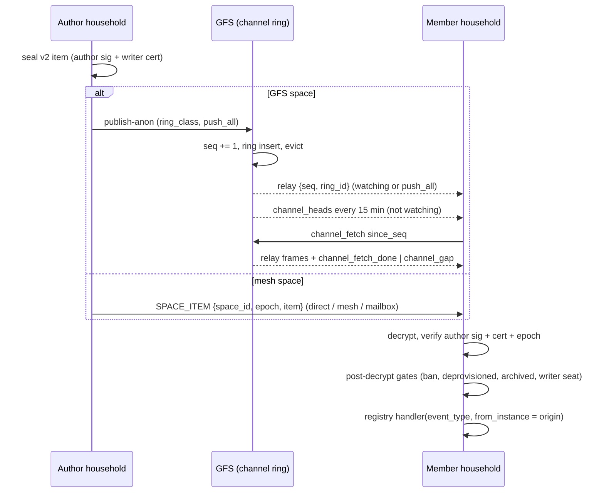

# Space items: one delivery path for all space content (v_97)

Every change to a space — a post, a chat message, a task, a calendar event,
a location pin, a roster change — travels as one **space item**: the same
sealed bytes, checked the same way, whichever transport carries it. A
**GFS space** carries its items only on its opaque channel at the GFS; a
**mesh space** carries them in the new `SPACE_ITEM` federation event over
direct and mesh paths. On the GFS each channel keeps one **ring** of recent
items: households **watching** a channel (a person has the space open) get
items pushed live, everyone else gets a tiny head ping every 15 minutes and
pulls what they missed when the space is opened.

Owner decisions 2026-11-27 (design `channel-items-design`, Q1–Q8 and F1–F8):
the numbers and rules below are the owner's.

## Scope

- **HFS**: seals, signs and publishes every space item it authors (the
  `SpaceItemPublisher`), receives items from the channel ring and from
  `SPACE_ITEM` through ONE receiver (`SpaceItemDispatch`) that runs the very
  gates a federation event gets, keeps a cursor per channel ring and pulls
  from it, and asks the person to connect to a GFS before joining a GFS
  space.
- **GFS**: keeps one ring per channel (count, byte and age bounds), pushes
  live items to watching seats and authority items to every seat, pings
  heads, answers fetches and gaps. It still sees only ciphertext of a
  channel it knows by a random id.

## Two kinds of space

| | **GFS space** | **mesh space** |
|---|---|---|
| Which spaces | a GLOBAL space with a channel; a PRIVATE space with `private_gfs` ON | every other space (household, public, private with `private_gfs` OFF) |
| Items travel | only on the channel, to every listed GFS the author reaches | `SPACE_ITEM` via `broadcast_to_space_members` (direct, mesh, mailbox) |
| Host hop for content | none | none (origin fans out, as before) |
| Joining needs | a GFS registration on ≥ 1 listed GFS (consent dialog) | nothing new |

A follower is a member with the read-only role on both (owner 2026-11-26):
it receives every item a member receives, on the same path, and is never
singled out for delivery. No rule in this page depends on a role.

## The item

A space item is the sealed plaintext every channel item already uses:

```
{ "item_type": <type>, "inner": <inner>, "_pad": "000…" }
```

encrypted under the space content key at the current epoch (AES-256-GCM,
`SpaceContentEncryption`), padded to a size bucket (`ITEM_SIZE_BUCKETS`,
which since v_97 starts with **1 KiB, 2 KiB**, then 4, 16, 64, 128 KiB).

### Event-shaped inner (v2, person actions)

Since v_97 `item_type` may be any value of the federation event type it
replaces (`space_chat_message_created`, `space_task_updated`, …) — the
registry `domain/space_item.py::ITEM_SPECS` names which. The inner is

```
{ "item_type", "item_id", "space_id", "origin_instance_id", "author_pk",
  "ts", "body", "author_sig_suite", "author_sig", "writer_cert" }
```

- `body` is the existing event payload, byte for byte what the legacy event
  carried (so one handler applies both);
- `author_pk` is the ORIGIN household's identity key and
  `origin_instance_id` must derive from it (self-certifying ids);
- `item_id` is 128 random bits (hex) — the dedupe key across transports and
  GFSs;
- `ts` is the author's tz-aware ISO time, at most 300 s ahead (LWW where a
  handler orders by it);
- `author_sig` (suite `author_sig_suite`, today `"ed25519"`; unknown suites
  are refused) signs canonical JSON of every field above except the
  signature and the cert, under the domain prefix `space-item-author:v2:`
  — a v1 post or generic item signature can never verify as v2, nor the
  reverse;
- `writer_cert` is the household's writer cert for this space and epoch
  (`writer_cert.py`), checked against the pinned space key with the scope
  `ITEM_SPECS` names.

The v1 shapes (`post`, `post_edit`, `comment`, … — `POST_SHAPED_ITEM_TYPES`,
`GENERIC_ITEM_TYPES`) stay on the channel during the v_97 window for the
types they already carry, so a v_96 seat keeps reading them; v_98 moves them
to v2.

### Authority inner (`space_event`, host statements)

A statement only the space authority makes — join / leave / ban / unban /
role change / config / age gate / dissolve / moderation decided / proposal
updated — rides a GFS space's channel as the existing channel authority
item (`item_type: "authority"`), with a new `authority_kind: "space_event"`.
Its inner is **signed twice**:

1. it is the event-shaped v2 inner above (`item_type` = the statement's
   event type, `body` = its payload), signed by the household that made
   the statement — so its **origin is proven**: a delegated admin holding
   the seed can never pose as the owner, and an owner-only rule (owner-only
   config pins, …) is judged on that origin by the event's own handler;
2. the whole inner (with `authority_kind`) and the sealing epoch are signed
   by the space authority (`authority_sig` / `authority_sig_suite`, event
   `space_channel_authority`, as every channel authority item) — so only a
   seed holder speaks.

The receiver also requires the origin to act as the space's host here
(`host_equivalence.acts_as_host`: the owner, or the delegated admin that
invited it while delegation is on). In a mesh space the host keeps sending
its statements as events to its members directly.

Authority items are **pushed to every seat** (watching or not, `push_all`)
and also go into the ring (owner F4). Any writer could set `push_all`, so
the GFS allows 6 a minute per channel and downgrades the rest (kept, not
pushed to all) — never refused, so no writer can crowd the host out.

## Registry: `ITEM_SPECS`

One entry per item type (`domain/space_item.py`):

| field | meaning |
|---|---|
| `event_type` | the federation event type the item replaces |
| `scope` | writer-cert scope the receiver requires (`write` / `comment`) |
| `ring_class` | `durable` (24 h in the ring) or `ephemeral` (15 min — live location) |
| `authority` | a host statement (authority inner) rather than a person action |
| `idempotency` | the per-type stamp audit — how a copy is harmless: `id` (insert-once), `lww` (a stamp / version the handler compares: post and comment edits, post reactions, poll votes, pages, timetables), `tombstone` (a delete leaves a tombstone), `advance` (a state that only moves forward), `latest` (only the newest counts: a location pin), `state` (a host statement whose repeat converges), `arrival` (applied in arrival order — see below) |
| `reader_as` | the v1 type a follower's `reader` cert is judged as (comments, own comment deletes, post reactions); none → a reader cert never carries it |
| `budget` | sender priority class: `authority` > `content` > `chat` > `location` |

**The `arrival` residual.** Tasks, task lists, stickies, calendar events,
gallery albums and items, bazaar listings and FAQs, app tables, zones, chat
edits and chat reactions (with RSVPs and schedule answers, as before) are
applied in arrival order: their handlers keep no stamp. Two copies that
cross (two GFSs, a live push and a fetch) can leave the older value standing
until the 30-minute incremental sync corrects it ([sync › Not on the rule
yet](./sync.md#merge-rule-one-rule-for-a-change-to-an-existing-item-v_94)).
Moving them onto `item_merge` is a follow-up.

Targeted secrets never become items: rekeys, key shares, writer grants,
roster snapshots, invites and joins, moderation submissions (to the host),
reports, DMs, bazaar threads and offers, app sessions, sync streams and
media blobs keep their per-recipient events.

## One receiver: `SpaceItemDispatch`



Both transports end in `SpacePublicInbound.handle_channel_item(space_id, epoch, ciphertext)`, which decrypts and hands an event-shaped item to `SpaceItemDispatch.apply(space, epoch, item_type, inner)`:

1. decrypt at the item's epoch (a missing key holds the item, as today);
2. parse; a v1 shape goes to the existing v1 path unchanged;
3. a v2 inner: drop our own echo; the type must be in `ITEM_SPECS` and not
   `authority`; the signed `space_id` must be this space; `origin` derives
   from `author_pk`; the author signature verifies; a seen `item_id` is
   dropped here (an item reaches us from several GFSs and from the ring
   after a live push); the writer cert verifies
   for this space, the item's epoch (fresh: newest or previous within the
   grace), `author_pk` and the spec's scope; `ts` is no more than 300 s
   ahead;
4. an authority `space_event`: the authority signature verifies against
   the pinned space key; `origin` must act as host
   (`host_equivalence.acts_as_host`) at the time of applying;
5. a `FederationEvent(event_type, from_instance=origin, space_id, payload=body)`
   is built and run through **the same post-decrypt gates** a federation
   envelope gets (`FederationService.space_write_gates()`: ban, deprovisioned
   author, archived space, writer seat with hold-for-seat), then dispatched
   to **the same registry handler**. The roster authorizes the user a body
   names (Q1 A): the handlers bind authors to live seats of `origin` as they
   do for a direct envelope.

So an item can never do more than the legacy event from its origin could:
the authorization is the same code, with the origin proven by the author
signature instead of the envelope signature (tested both ways in
`tests/protocol/test_space_item_equivalence.py`).

## The channel ring (GFS capability `channel_ring`)

A GFS proving `channel_ring` in its signed `/gfs/info` block keeps, per
channel, ONE ring of recent items (`gfs_channel_ring`, GFS migration 0034):

| bound (owner F1) | value |
|---|---|
| bytes per channel | 64 MiB |
| items per channel | 32 768 |
| age, durable | 24 h |
| age, ephemeral | 15 min |
| whole server | 8 GiB (fair eviction: the biggest ring loses its oldest first) |

`seq` is per channel, gap-free across cluster nodes (one SQLite transaction
increments `gfs_channels.head_seq` and inserts the row); `ring_id` (64
random bits, hex) names one life of the ring and changes when the channel
is registered afresh, so a cursor from an earlier life reads as a gap.

### Socket protocol (household → GFS frames on `/gfs/ws`)

A household opts in per socket with `accepts: ["channel_ring"]` in its
hello. Such a socket may send (each refused silently unless the household
holds a live seat on that channel at an open epoch):

- `{"type": "channel_watch", "watch": [channel_id…], "unwatch": [channel_id…]}`
  — in memory per socket, ≤ 256 channels; a dropped socket watches nothing.
- `{"type": "channel_fetch", "channel_id", "since_seq", "ring_id", "req"}`
  — answered with `relay` frames (each with `seq` and `ring_id`), at most
  500 items / 4 MiB per page, then
  `{"type": "channel_fetch_done", "channel_id", "req", "head_seq", "ring_id", "more"}`,
  or `{"type": "channel_gap", "channel_id", "req", "head_seq", "ring_id", "oldest_seq"}`
  when `ring_id` differs, `since_seq` fell off the ring, or it is ahead of
  the head. At most 60 fetches per socket per minute.

The GFS sends:

- live `relay` frames (`seq`, `ring_id` added) to sockets **watching** the
  channel, and to **every** seat's socket for an item published with
  `push_all` (authority items);
- `{"type": "channel_heads", "heads": [{"channel_id", "head_seq", "ring_id"}]}`
  right after the hello (every seated channel) and then every **15 min**
  (owner F2), naming only channels whose head moved since the last ping to
  that socket — nothing when nothing moved.

A socket WITHOUT `channel_ring` keeps the v_96 behaviour (every item pushed,
offline copies queued) for the release window; a seat whose household
said `channel_ring` in a hello gets no offline copies (it pulls).

### Publish

`ChannelPublishAnonRequest` gains two optional signed fields, sent only to a
GFS proving `channel_ring`: `ring_class` (`durable` | `ephemeral`) and
`push_all` (bool). They are inside the writer-key signature. The publish
per-address limit gets a per-node floor of 8/min (Q5 B, ~32/min on 4 nodes).

## The household side

- **Watching.** The SPA sends `space.viewing {space_id}` over its WebSocket
  while a person has the space open (every 60 s); the household watches the
  space's channel on each ring-capable GFS it reads it on, and unwatches 2
  min after the last view. The **host always watches** its spaces' channels
  (owner F5; effective once the owner holds a seat). The GFS forgets a
  socket's watches when it drops, so they go again on every connect.
- **Cursors** per `(gfs_id, channel_id)`: `(ring_id, seq)`, kept in
  `instance_config` (coalesced, every 10 s). A new seat starts at the head;
  history comes from the join catch-up (owner F8).
- **Only channels it reads there.** Ring frames for a channel that is not a
  space's channel on that very GFS connection are ignored: no GFS can grow
  the household's state, raise badges or force catch-ups for a channel it
  does not serve it. Answers (`channel_fetch_done`, `channel_gap`, fetched
  items — tagged `fetch: <req>` by the GFS) count only for the household's
  own outstanding request.
- **Badge.** A head above the cursor raises the space's badge
  (`space.activity`, only on the change to "something new") and at most
  once an hour per space one contentless notification row, "New activity in
  {space}" (owner F6). The host and a space being viewed fetch instead.
- **Fetching.** A fetched page moves the cursor over its holes (expired
  location pins; a missing durable item is a `channel_gap`). A live item
  moves it only in order; a hole before one is a badge for a non-viewer
  (a `push_all` item never pulls a backlog by itself) and a fetch for a
  viewer. An item the inbound path dropped (over its budget) keeps the
  cursor before it and ends that page. Pages follow each other at most
  every 35 s, so a backlog never outruns the 960 / min per-channel inbound
  budget.
- **Gaps.** `channel_gap`, a new `ring_id`, or more than 2 000 items behind
  → the cursor moves to the recent window (the last 200 items, fetched
  where someone looks: current pins, the last chat) and the household runs
  the §25.6 catch-up (`SpaceSyncScheduler.sync_now`: the acting hosts,
  incremental) — at most once per 10 minutes per space, a later one
  deferred, never dropped.
- **Several GFSs.** Each GFS has its own ring, seq and ring_id; a GFS where
  the household has no cursor while another GFS of the channel has one
  starts 2 000 back (failover); `item_id` dedupes.
- **Mentions.** An item that @-mentions people in other households also
  goes, as `SPACE_MENTION_NOTE {space_id, epoch, item}`, to each mentioned
  household (≤ 20 per item) through its normal path (direct, mesh or GFS
  mailbox), so it notifies at once. `@here` / `@everyone` notify watchers
  live and everyone else by badge (owner F7) — no notes.

## Sender budgets and location

Per household and space: authority > content > chat > location.
Chat ≤ 20 items/min (the rest wait for the next minute); location ≤ 1 per
person per 60 s, latest only (a newer pin replaces a waiting one). A person
sharing location republishes the latest pin every 15 min as a keepalive
(owner F3); receivers show a pin older than 45 min as stale. Location items
are `ephemeral` in the ring.

## GFS spaces: joining and switching

- **Join preflight.** Joining a GFS space (from local discovery, an invite
  or the GFS directory) first checks that this household is registered on
  ≥ 1 of the space's listed GFSs. If not, the SPA shows the consent dialog
  ("This space uses a connection server…") with **Connect and join** for an
  admin (Q7 A) and **Ask an admin** otherwise; **Cancel** sends nothing.
- **Private ON/OFF.** Turning `private_gfs` ON makes the space a GFS space;
  OFF is refused while households reachable only through a GFS remain
  (`409 PRIVATE_GFS_LINK_MEMBERS`, unchanged).
- **Global → public** is refused while households reachable only through a
  GFS remain (`409 GLOBAL_GFS_MEMBERS`): a public space has no GFS path.
- **The 14-day window** (Q6 A). For 14 days after a space became a GFS space
  on this household, its items also go as legacy events to every member
  household (receivers dedupe); afterwards only to households below v_97.
  A v_97 household in a GFS space with no GFS connection shows a Connect
  prompt.
- **Owner seat.** In a GFS space the owner household takes a seat like
  every member (it used to publish only).

## Versioning

- Household **v_97** (`FederationCapability.MIN_FOR_SPACE_ITEMS`):
  `SPACE_ITEM`, `SPACE_MENTION_NOTE`, v2 and `space_event` inners. Below
  v_97 a member gets the legacy event (mesh: per peer; GFS space: by
  federation, `broadcast_to_space_members` with `below_version`).
- GFS capability **`channel_ring`**: households use the ring and the new
  publish fields only on a GFS that proves it; on another GFS the v_96
  channel behaviour holds.
- No household migration. One additive GFS migration (0034).
- v_98 (a later release, after one window) deletes the legacy fan-out and
  moves the v1 channel shapes to v2.

## Cost

Busy global space: 200 member + 10 000 follower households, 2 % watching,
20 location sharers at 1/min, chat 30/min, ≈ 56 items/min.

- Watchers live: 204 sockets × 56 items × ~2.6 KiB ≈ 30 MB/min ≈ 43 GB/day
  at peak hours (≈ 50 GB/day busy-day average incl. fetches).
- Heads pings: 10 201 sockets × 4 per hour × ~120 B ≈ 120 MB/day.
- Authority items to all seats (owner F4): ~100/day × 10 201 × 2.6 KiB ≈
  2.5 GB/day.
- Fetch on open: one page of what was missed per open.
- Ring storage: ≈ 56 × 60 × 24 × 2.6 KiB ≈ 210 MB per busy channel
  (bounded at 64 MiB / 32 768 items, so the ring holds ≈ 10 h of a busy
  channel); ≈ 2.8 GB per server.
- Quiet space (50 seats, 20 items/day): ≈ 0.3 GB/day across the server.

v1 (push every item to every seat): ≈ 0.7 TB/day busy.

## Privacy (owner sign-offs 1–7, 2026-11-27)

See [principles](../principles.md#sign-off-space-items-on-the-channel-ring-v_97-owner-approved-2026-11-27).

## Implementation

- `socialhome/domain/space_item.py` — `ITEM_SPECS`, buckets.
- `socialhome/services/space_item_author.py` — v2 sign / verify.
- `socialhome/federation/space_item_dispatch.py` — `SpaceItemDispatch`.
- `socialhome/services/gfs_member_publish_service.py`
  (`seal_event_item`) and `FederationService.broadcast_to_space_members`
  (`_broadcast_as_item`) — sealing and routing (`SPACE_ITEM` / legacy).
- `socialhome/services/channel_ring_client.py` — watch, cursors, fetch.
- `socialhome/global_server/channel_ring.py` — the GFS ring.

## Spec references

§24.11 (inbound pipeline), §25.6 (catch-up), §25.8.21 (encryption-first),
[discovery](./discovery.md#opaque-channels-private-and-global),
[gfs-relay](./gfs-relay.md), [capabilities](./capabilities.md).
