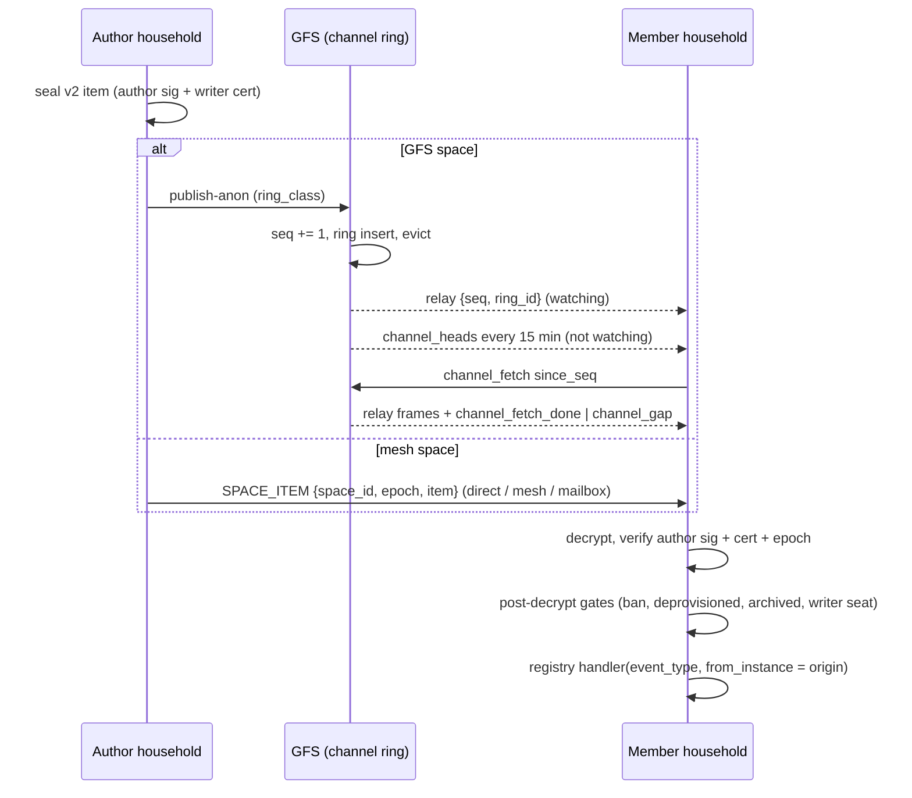

# Space items: one delivery path for all space content (v_97)

## Two kinds of space, two kinds of message (owner-approved 2026-11-27)

- A space is either a **mesh space** (no GFS: direct + mesh paths) or a
  **GFS space** (a global space, or a private one with `private_gfs` on:
  its GFS channel only, no mesh).
- **Content** — posts, comments, reactions, chat, location, zones, polls,
  calendar, tasks, pages, gallery, … — is one signed **space item**: it
  rides the space's channel in a GFS space and `SPACE_ITEM` in a mesh
  space, through one receiver path (`SpaceItemDispatch`).
- **Control** — bans, role changes, dissolve, config, roster, keys,
  invites / joins, reports — never rides the channel. It stays on the
  per-household guaranteed path (direct / mailbox, NEVER_DROP) by design:
  that path gives every household durable, in-order delivery, which a
  channel ring does not.

Every change to a space's content — a post, a chat message, a task, a
calendar event, a location pin — travels as one **space item**: the same
sealed bytes, checked the same way, whichever transport carries it. A
**GFS space** carries its items only on its opaque channel at the GFS; a
**mesh space** carries them in the new `SPACE_ITEM` federation event over
direct and mesh paths. On the GFS each channel keeps one **ring** of recent
items: households **watching** a channel (a person has the space open) get
items pushed live, everyone else gets a tiny head ping every 15 minutes and
pulls what they missed when the space is opened.

Owner decisions 2026-11-27 (design `channel-items-design`, Q1–Q8 and F1–F8):
the numbers and rules below are the owner's.

## Scope

- **HFS**: seals, signs and publishes every space item it authors (the
  `SpaceItemPublisher`), receives items from the channel ring and from
  `SPACE_ITEM` through ONE receiver (`SpaceItemDispatch`) that runs the very
  gates a federation event gets, keeps a cursor per channel ring and pulls
  from it, and asks the person to connect to a GFS before joining a GFS
  space.
- **GFS**: keeps one ring per channel (count, byte and age bounds), pushes
  live items to watching seats, pings
  heads, answers fetches and gaps. It still sees only ciphertext of a
  channel it knows by a random id.

## Event types

- `SPACE_ITEM` — `{space_id, epoch, item}`: one sealed space item to a v_97
  member household (a mesh space).
- `SPACE_MENTION_NOTE` — the same shape, to a mentioned v_97 household only
  (≤ 20 per item, only for a new message or item, never an edit).

## Two kinds of space

| | **GFS space** | **mesh space** |
|---|---|---|
| Which spaces | a GLOBAL space with a channel; a PRIVATE space with `private_gfs` ON | every other space (household, public, private with `private_gfs` OFF) |
| Items travel | only on the channel, to every listed GFS the author reaches | `SPACE_ITEM` via `broadcast_to_space_members` (direct, mesh, mailbox); latest-only state (a pin, a poll selection) keeps its event, so the outbox still holds one row per (peer, key) |
| Host hop for content | none | none (origin fans out, as before) |
| Joining needs | a GFS registration on ≥ 1 listed GFS (consent dialog) | nothing new |

A follower is a member with the read-only role on both (owner 2026-11-26):
it receives every item a member receives, on the same path, and is never
singled out for delivery. No rule in this page depends on a role.

## The item

A space item is the sealed plaintext every channel item already uses:

```
{ "item_type": <type>, "inner": <inner>, "_pad": "000…" }
```

encrypted under the space content key at the current epoch (AES-256-GCM,
`SpaceContentEncryption`), padded to a size bucket: an event-shaped item to `EVENT_ITEM_SIZE_BUCKETS`
(**1, 2**, 4, 16, 64, 128 KiB — the 2 KiB step keeps a chat message or a
pin from doubling to 4 KiB); v1 and channel authority items keep
`ITEM_SIZE_BUCKETS` (1, 4, 16, 64, 128 KiB).

### Event-shaped inner (v2, person actions)

Since v_97 `item_type` may be any value of the federation event type it
replaces (`space_chat_message_created`, `space_task_updated`, …) — the
registry `domain/space_item.py::ITEM_SPECS` names which. The inner is

```
{ "item_type", "item_id", "space_id", "origin_instance_id", "author_pk",
  "ts", "body", "author_sig_suite", "author_sig", "writer_cert" }
```

- `body` is the existing event payload, byte for byte what the legacy event
  carried (so one handler applies both);
- `author_pk` is the ORIGIN household's identity key and
  `origin_instance_id` must derive from it (self-certifying ids);
- `item_id` is 128 random bits (hex) — the dedupe key across transports and
  GFSs;
- `ts` is the author's tz-aware ISO time, at most 300 s ahead (LWW where a
  handler orders by it);
- `author_sig` (suite `author_sig_suite`, today `"ed25519"`; unknown suites
  are refused) signs canonical JSON of every field above except the
  signature and the cert, under the domain prefix `space-item-author:v2:`
  — a v1 post or generic item signature can never verify as v2, nor the
  reverse;
- `writer_cert` is the household's writer cert for this space and epoch
  (`writer_cert.py`), checked against the pinned space key with the scope
  `ITEM_SPECS` names.

**Posts and comments too (owner 2026-11-27).** In a GFS space a post,
its edits, deletes and reactions, and comments are v2 items like every
other change: sealed, stored in the durable queue, one delivery path for
all content. A household no longer puts the v1 shapes (`post`, `post_edit`,
`comment`, … — `POST_SHAPED_ITEM_TYPES`, `GENERIC_ITEM_TYPES`) on a GFS
space's channel from memory; a v_96 seat gets the legacy event instead (the
same rule as every item: households below v_97 and the 14-day window). The
v1 receive path stays for items from v_96 authors; v_98 removes it. A
follower's `reader` cert is checked before sealing (the space's follower
switches, `reader_cert_permits`): what receivers would refuse is shown to
its author, never sent. The v_60 author profile still rides the v1 path.

### Host statements stay on the guaranteed path

Space content rides the channel; host statements stay on the per-household
guaranteed path by design (owner 2026-11-27). A statement only the space
authority makes — join / leave / ban / unban / role change / config / age
gate / dissolve / moderation decided / proposal updated — is no space item.
It keeps its event, queued NEVER_DROP in the outbox, to every member
household on its own path (paired, mesh, mailbox / GFS relay), in a GFS
space too: the outbox gives it durability and in-order delivery per
household, which a ring of a channel does not. Nothing on a channel carries
one, and a receiver applies none that arrives as an item or as a channel
authority item.

## Registry: `ITEM_SPECS`

One entry per item type (`domain/space_item.py`):

| field | meaning |
|---|---|
| `event_type` | the federation event type the item replaces |
| `scope` | writer-cert scope the receiver requires: `write` only for the post-shaped types (posts, and the poll, schedule and Bazaar listing that ride a post, with their authors' follow-ups) — a household holds `write` only where the `posts` access level lets its people post directly; `comment` for every other type, whose own feature's access level the receiver's handler judges exactly as for the legacy event (so a member under moderated posts still chats, votes, RSVPs and shares a pin in a GFS space) |
| `ring_class` | `durable` (24 h in the ring) or `ephemeral` (15 min — live location) |
| `idempotency` | the per-type stamp audit — how a copy is harmless: `id` (insert-once), `lww` (a stamp / version the handler compares: post and comment edits, post reactions, poll votes, pages, timetables), `tombstone` (a delete leaves a tombstone), `advance` (a state that only moves forward), `latest` (only the newest counts: a location pin), `arrival` (applied in arrival order — see below) |
| `reader_as` | the v1 type a follower's `reader` cert is judged as (comments, own comment deletes, post reactions); none → a reader cert never carries it |
| `budget` | sender priority class: `content` > `chat` > `location` |

**The `arrival` residual.** Tasks, task lists, stickies, calendar events,
gallery albums and items, bazaar listings and FAQs, app tables, zones, chat
edits and chat reactions (with RSVPs and schedule answers, as before) are
applied in arrival order: their handlers keep no stamp. Two copies that
cross (two GFSs, a live push and a fetch) can leave the older value standing
until the 30-minute incremental sync corrects it ([sync › Not on the rule
yet](./sync.md#merge-rule-one-rule-for-a-change-to-an-existing-item-v_94)).
Moving them onto `item_merge` is a follow-up.

Targeted secrets never become items: rekeys, key shares, writer grants,
roster snapshots, invites and joins, moderation submissions (to the host),
reports, DMs, bazaar threads and offers, app sessions and sync streams keep
their per-recipient events. **Files**: in a mesh space they keep the
per-household push (`SPACE_MEDIA_BLOB`); in a GFS space new content —
read by many households — is taken from the GFS space media cache: the
item carries the `media_refs` descriptor on its one shared payload, the
author's uploads wait in the durable queue (rows of kind
`space_media_upload`), files over 8 MiB go in proven 8 MiB pieces. A file
only one reader wants — a catch-up's old file, a newcomer's gallery, the
host archive's scan, a view the cache missed — comes **directly** from a
household that holds it (owner 2026-11-28: over a direct WebRTC link, one
opened on demand between households met through the GFS too), then the
cache if it still holds it, a view last through v_83 on demand, which
streams old content without storing it
([media.md](./media.md#gfs-spaces-every-household-from-the-cache-v_97),
"Media routing"). The targeted paths that carry files describe them the
same way for a household that reads the space from the cache — a page
proposal, a moderation submission (to that reviewer household's copy), the
§25.6 catch-up and a `SPACE_SYNC_RESUME` replay — so such a household is
never pushed a file unasked; it asks a holder directly only for one it
reads alone. A file the
author named elsewhere too gets a copy of its own in the space when the
item is created.

## One receiver: `SpaceItemDispatch`



Both transports end in `SpacePublicInbound.handle_channel_item(space_id, epoch, ciphertext)`, which decrypts and hands an event-shaped item to `SpaceItemDispatch.apply(space, epoch, item_type, inner)`:

1. decrypt at the item's epoch (a missing key holds the item, as today);
2. parse; a v1 shape goes to the existing v1 path unchanged;
3. a v2 inner: drop our own echo; the type must be in `ITEM_SPECS` (no
   host statement is); the signed `space_id` must be this space; `origin` derives
   from `author_pk`; a `SPACE_ITEM` must come from its origin (nobody
   forwards another household's item); the author signature verifies; a
   seen `item_id` is dropped (an item reaches us from several GFSs and from
   the ring after a live push). No budget of its own: a channel item spent
   the channel's inbound budget (refused there, it is not taken and comes
   again on the next fetch), a `SPACE_ITEM` its envelope's — the origin's;
   the writer cert verifies
   for this space, the item's epoch, `author_pk` and the spec's scope; a
   channel item's epoch must be fresh (newest, or the previous one within
   the grace) — a `SPACE_ITEM` its origin sent itself through the durable
   per-household outbox may be older (the outbox can hold it past a rekey
   while a member is offline; the cert still binds household and epoch, and
   the roster still decides; a GFS space's items, a mention note included,
   stay fresh-only); `ts` is no more than 300 s ahead;
4. a `FederationEvent(event_type, from_instance=origin, space_id, payload=body)`
   is built and run through **the same post-decrypt gates** a federation
   envelope gets (`FederationService.space_write_gates()`: ban, deprovisioned
   author, archived space, writer seat with hold-for-seat), then dispatched
   to **the same registry handler**. The roster authorizes the user a body
   names (Q1 A): the handlers bind authors to live seats of `origin` as they
   do for a direct envelope.

So an item can never do more than the legacy event from its origin could:
the authorization is the same code, with the origin proven by the author
signature instead of the envelope signature (tested both ways in
`tests/protocol/test_space_item_equivalence.py`).

## The channel ring (GFS capability `channel_ring`)

A GFS proving `channel_ring` in its signed `/gfs/info` block keeps, per
channel, ONE ring of recent items (`gfs_channel_ring`, GFS migration 0034):

| bound (`[channel_ring]` key) | default (active 10 000-seat sizing) |
|---|---|
| bytes per channel (`max_bytes`) | 256 MiB |
| items per channel (`max_items`) | 131 072 |
| age, durable (`durable_ttl_seconds`) | 24 h (300 s – 24 h) |
| age, ephemeral (`ephemeral_ttl_seconds`) | 15 min (60 s – 15 min, ≤ durable) |
| whole server (`server_max_bytes`) | 8 GiB (fair eviction: the biggest ring loses its oldest first) |

The operator sets them in the GFS's TOML (`[channel_ring]`, env
`GFS_CHANNEL_RING_<KEY>`; out-of-bounds values refuse to start), and the
signed `/gfs/info` block carries the effective values:
`"channel_ring": {max_bytes, max_items, durable_ttl_seconds,
ephemeral_ttl_seconds, server_max_bytes}` (a non-empty block proves the
capability). The ages stop at what a household still takes from a ring.

`seq` is per channel, gap-free across cluster nodes (one SQLite transaction
increments `gfs_channels.head_seq` and inserts the row); `ring_id` (64
random bits, hex) names one life of the ring and changes when the channel
is registered afresh, so a cursor from an earlier life reads as a gap.

### Socket protocol (household → GFS frames on `/gfs/ws`)

A household opts in per socket with `accepts: ["channel_ring"]` in its
hello. Such a socket may send (each refused silently unless the household
holds a live seat on that channel at an open epoch):

- `{"type": "channel_watch", "watch": [channel_id…], "unwatch": [channel_id…]}`
  — in memory per socket, ≤ 256 channels; a dropped socket watches nothing.
- `{"type": "channel_fetch", "channel_id", "since_seq", "ring_id", "req"}`
  — answered with `relay` frames (each with `seq` and `ring_id`), at most
  500 items / 4 MiB per page, then
  `{"type": "channel_fetch_done", "channel_id", "req", "head_seq", "ring_id", "more"}`,
  or `{"type": "channel_gap", "channel_id", "req", "head_seq", "ring_id", "oldest_seq"}`
  when `ring_id` differs, `since_seq` fell off the ring, or it is ahead of
  the head. At most 60 fetches per socket per minute.

The GFS sends:

- live `relay` frames (`seq`, `ring_id` added) to sockets **watching** the
  channel (no item bypasses the watch filter);
- `{"type": "channel_heads", "heads": [{"channel_id", "head_seq", "ring_id"}]}`
  right after the hello (every seated channel) and then every **15 min**
  (owner F2), naming only channels whose head moved since the last ping to
  that socket — nothing when nothing moved.

A socket WITHOUT `channel_ring` keeps the v_96 behaviour (every item pushed,
offline copies queued) for the release window; a seat whose household
said `channel_ring` in a hello gets no offline copies (it pulls).

### Publish

`ChannelPublishAnonRequest` gains one optional signed field, sent only to a
GFS proving `channel_ring`: `ring_class` (`durable` | `ephemeral`), inside
the writer-key signature. Any other key (a `push_all` asking to reach every
seat included) is refused. The publish
per-address limit gets a per-node floor of 60/min (Q5 B); see the limits
table below.

## The household side

- **Watching.** The SPA sends `space.viewing {space_id}` over its WebSocket
  while a person has the space open (every 60 s); the household watches the
  space's channel on each ring-capable GFS it reads it on, and unwatches 2
  min after the last view. The **host always watches** its spaces' channels
  (owner F5; effective once the owner holds a seat). The GFS forgets a
  socket's watches when it drops, so they go again on every connect.
- **Cursors** per `(gfs_id, channel_id)`: `(ring_id, seq)`, kept in
  `instance_config` (coalesced, every 10 s). A new seat starts at the head;
  history comes from the join catch-up (owner F8).
- **Only channels it reads there.** Ring frames for a channel that is not a
  space's channel on that very GFS connection are ignored: no GFS can grow
  the household's state, raise badges or force catch-ups for a channel it
  does not serve it. Answers (`channel_fetch_done`, `channel_gap`, fetched
  items — tagged `fetch: <req>` by the GFS) count only for the household's
  own outstanding request.
- **Badge.** A head above the cursor raises the space's badge
  (`space.activity`, only on the change to "something new") and at most
  once an hour per space one contentless notification row, "New activity in
  {space}" (owner F6). The host and a space being viewed fetch instead.
- **Fetching.** A fetched page moves the cursor over its holes (expired
  location pins; a missing durable item is a `channel_gap`). A live item
  moves it only in order; a hole before one is a badge for a non-viewer
  (a live item never pulls a backlog by itself) and a fetch for a
  viewer. An item the inbound path dropped (over its budget) keeps the
  cursor before it and ends that page. Pages follow each other at most
  every 20 s (500 items each), so a backlog never outruns the 1 500 / min
  per-channel inbound budget.
- **Gaps.** `channel_gap`, a new `ring_id`, or more than 2 000 items behind
  → the cursor moves to the recent window (the last 200 items, fetched
  where someone looks: current pins, the last chat) and the household runs
  the §25.6 catch-up (`SpaceSyncScheduler.sync_now`: the acting hosts,
  incremental) — at most once per 10 minutes per space, a later one
  deferred, never dropped, and only where someone looks or on a household
  acting as host: a gap nobody looks at is owed and runs when a person
  opens the space (the periodic incremental sync covers it meanwhile).
  Why (final review I1): a non-watcher's cursor moves only on a fetch, so
  in a busy space (300 items/min) it is 4 500 behind after one 15-minute
  heads ping — catching up at every ping would make ~9 500 of 10 000
  households send a BEGIN to the hosts every 15 minutes (≈ 10/s), and one
  follower publishing 240/min could keep that going. Owed instead: one
  catch-up per household that opens the space.
- **Several GFSs.** Each GFS has its own ring, seq and ring_id; a GFS where
  the household has no cursor while another GFS of the channel has one
  starts 2 000 back (failover); `item_id` dedupes.
- **Mentions.** An item that @-mentions people in other households also
  goes, as `SPACE_MENTION_NOTE {space_id, epoch, item}`, to each mentioned
  household (≤ 20 per item) through its normal path (direct, mesh or GFS
  mailbox), so it notifies at once. `@here` / `@everyone` notify watchers
  live and everyone else by badge (owner F7) — no notes.

## The durable item queue (GFS spaces)

Owner 2026-11-27: a GFS space's content is never handed to the legacy
per-household fan-out (that path is only for households below v_97 and the
14-day window); it waits in a **durable retry queue** until every GFS it is
planned for accepted it (`space_item_outbox`, household migration 0158;
`services/space_item_outbox.py`).

- **At seal time** the item is sealed, checked against the largest payload
  a GFS takes (704 KiB of ciphertext, `MEMBER_PUBLISH_MAX_PAYLOAD_CHARS`:
  the largest live event any space allows — a page up to ~504 KiB — sealed,
  ~679 KiB; the GFS takes a publish body up to 720 KiB. Larger is refused
  there and then, the author told), and stored as one row per planned GFS (the owner's signed
  list ∩ the grant; none yet, e.g. no grant: one row planned when due). It
  survives a restart.
- **Per GFS, until accepted.** A transient answer (down, timeout, 5xx, 429)
  backs off 5 s, 15 s, 1 min, 5 min, then every 10 min — never giving up —
  honouring a 429's `Retry-After` (≤ 15 min), and holds that GFS's other
  rows until then (they would get the same answer). A reconnect to that GFS
  makes everything due at once. GFSs never wait on each other; one GFS's
  rows go in order.
- **Permanent errors reach the author.** A GFS refusing for good (a 4xx:
  not seated, unknown channel), a too-large item, a full queue, or a
  sealing failure (a bug, logged at WARNING — no legacy fallback either) is
  kept as a `failed` row; the author's space screen shows "Couldn't send to
  {space}" with **Try again** / **Discard** (`/api/spaces/{id}/unsent`, the
  `space.unsent` frame). A GFS that no longer serves the space (dropped
  from the owner's list) just loses its copy.
- **Files** (v_97): the space's file uploads wait in the same table — one
  row per blob (or 8 MiB piece) per GFS, a small locator (the bytes are
  sealed again when the row goes), a whole file stored in one go — in their
  own lane: their own loop, their own bound (1 000 rows per space) and
  backoff, so an 8 MiB upload never holds the space's chat back and a busy
  answer to an upload never parks the items. A file that waited past 12 h
  keeps its locator (Retry seals it again).
- **Bounded per space**: 2 000 rows / 32 MiB. Past it a new item is refused
  and the author sees "too much is already waiting to go out". Items still
  waiting count in the space's `waiting_to_send`.

## Sender budgets and location

Per person and space (sized for an active 10 000-seat space, see the
limits table): chat a burst of 10, then 1 a second; location ≤ 1 pin per
10 s, latest only (a newer pin replaces one still waiting in the queue);
content never waits. The budget only sets when an item is first due — the
item waits for its slot in the durable queue, never in memory. In a GFS
space a person sharing location has the pin republished every 15 min as a
keepalive (owner F3), since the ring keeps a location item only 15 min
(`ephemeral`). Each pin goes again on its own schedule — 15 min after it
last went, less up to the 1-minute tick so the ring never drops it first —
so a household's pins stay spread the way they first went, never all at
one tick (no random delay). Each keepalive is rebuilt from what is true
then — still a member, still sharing, location on, a live position, the
space not archived, still inside a zone for `zone_only` — and otherwise the
pin is forgotten and never repeated. A mesh space's households keep the
last pin, so nothing repeats there.

## GFS spaces: joining and switching

- **Join preflight — and a firm refusal** (owner 2026-11-27: "firm +
  Connect prompt now"). Joining, asking to join or following a GFS space
  needs an active GFS connection that proves `channel_ring` **to one of the
  GFSs the space is listed on**. The household decides what the space is
  from what it knows (`SpaceService.gfs_join_readiness`), never from the
  client: a GFS directory listing (only a global space is ever listed on a
  GFS) is a GFS space, its GFSs the connections whose directory lists it
  (`PublicSpaceDiscoveryService.listed_on`, in memory, filled by the poll
  at start); a row here (a follower stepping up) is one when its content
  rides a channel (global, or private with `private_gfs`) and another
  household hosts it, its GFSs our connections on the owner's signed list.
  Both can hold — a directory listing beside a row a tier change has not
  reached yet — and then the GFSs of both count. No list known (an owner
  before v_57, an empty list, an active GFS whose directory has not
  answered since the start, or a connection change until the next poll):
  any `channel_ring` connection counts. A space hosted here, a paired
  household's public space or an unknown id is none. (Any GFS of ours can
  list a space id it likes and so make a join of it need a GFS — a refusal,
  never a way in.)
  - `GET /api/public_spaces/{id}/join-preflight` answers `{gfs_space,
    connected, may_connect}`; the SPA then shows the consent dialog ("This
    space uses a GFS…"): **Connect and join** for an admin (Q7 A — it
    connects the household to its default GFS, then joins), **Ask an
    admin** for anyone else; **Cancel** sends nothing. A preflight that
    fails is no "yes": the SPA sends nothing and says so (fail closed).
  - The join itself is refused the same way: `409 GFS_CONNECTION_REQUIRED`,
    nothing sent. Every remote join, request and follow passes through
    `request_join_remote` (paired, or sealed through the GFS, v_84), which
    checks first; a sealed ask through the GFS needs a `channel_ring`
    connection even when the directory row is gone (the join-contact pin
    outlives it — only a global space is asked that way). Entry points: the
    Discover list (join / follow / ask), the space's About page, the ask
    dialog, a by-name invitation and an invite code.
  - **A by-name invitation** (`accept_remote_invite`) reads the tier from
    the host's snapshot the invitation carries, before anything is seated
    or sent: a GFS space needs any `channel_ring` connection (the owner's
    list is applied only once seated, after its signature check; a
    household on none of its GFSs then gets the Connect prompt).
  - **A GFS invite link** exists only for a GFS space (global, or private
    with `private_gfs`; a grandfathered link turns it on), so its redeem
    needs a `channel_ring` connection to the link's own GFS. A body that
    leaves the GFS URL out has no GFS leg at all.
  - **A code from a paired or mesh-reachable issuer** names the space but
    not its tier: checked when the space is known here (its listing, a
    row); otherwise the tier arrives only with the redeem's answer, after
    the issuer seated the household, and the Connect prompt covers it.
    Refusing then would leave the seat on the issuer; a check on the issuer
    would need the redeemer to tell it which GFSs it uses — left out.
  - The v_84 approval's seat (the coordinator's redeem) goes through the
    same GFS link check: a household that lost its GFS between the ask and
    the approval is seated once it connects again, within the token's life.
  - A space hosted here needs nothing: its people join on the host.
- **Private ON/OFF.** Turning `private_gfs` ON makes the space a GFS space;
  OFF is refused while households reachable only through a GFS remain
  (`409 PRIVATE_GFS_LINK_MEMBERS`, unchanged).
- **Global → public** (or household) is refused while households reachable
  only through a GFS remain (`409 GLOBAL_GFS_MEMBERS`, naming them — when
  the tier change is proposed, and again when it is enacted): a public
  space has no GFS path.
- **The 14-day window** (Q6 A). For 14 days after a space became a GFS space
  on this household, its items also go as legacy events to every member
  household; afterwards only to households below v_97. A v_97 member's
  legacy copy names the item (`_space_item_id`, inside the encrypted
  payload): the receiver claims that item's replay key with it (the origin
  is the envelope's proven sender, so nobody claims another household's
  item) and applies whichever of the two comes first; the field is
  stripped before any handler. The claim is the last of the shared write
  gates — on every door (the inbox, a DataChannel, a `SPACE_ROUTED` unwrap,
  a held event's replay) and only once every gate passed, so a copy held
  for a seat never turns its item into a "copy". An envelope `msg_id` in a
  replay namespace claimed outside the pipeline (`space-item:`,
  `gfs-join:`, `invite-bootstrap:`) is refused at parse: nobody can claim
  another household's item. A v_96 member's legacy event is unchanged.
  A v_97 household in a GFS space with no GFS connection to one of its
  GFSs gets the **Connect prompt** in the space (`GET /api/spaces/{id}`
  `gfs_connect_needed`): one row per listed GFS it isn't on (or one row
  pointing at Connections when none can be named), never dismissible;
  "Connect" for a household admin (the Connections page's GFS flow), "Ask
  a household admin" for anyone else. It goes once a connection carries
  the space's channel.
- **v_96 sockets.** A GFS marks the fan-out frame of an item a v_97
  household published (it signed a `ring_class`) with `ring_class`; a
  socket without `channel_ring` in its hello is not pushed such a frame —
  its household gets that publisher's legacy event instead (it could only
  drop the v2 item) — and such a frame is never queued for an offline
  seat (a ring household fetches it from the ring). A v_96 publisher's
  items reach it as before.
- **Owner seat.** In a GFS space the owner household takes a seat like
  every member (it used to publish only).

## Versioning

- Household **v_97** (`FederationCapability.MIN_FOR_SPACE_ITEMS`):
  `SPACE_ITEM`, `SPACE_MENTION_NOTE` and the v2 inner. Below
  v_97 a member gets the legacy event (`broadcast_to_space_members` splits
  the audience by `space_member_supports(MIN_FOR_SPACE_ITEMS)`; an unknown
  version counts as older). A GFS space's item that no listed GFS can take
  right now waits in the durable queue; one that can't be sealed is shown
  to its author — never the legacy event to everyone.
- GFS capability **`channel_ring`**: households use the ring and the new
  publish fields only on a GFS that proves it; on another GFS the v_96
  channel behaviour holds.
- Household migration 0158 (`space_item_outbox`, the durable queue — its
  `replans` / `delivered` columns were added in place before any release).
  One additive GFS migration (0034). The GFS's space media cache needs no
  migration for pieces (`pieces` in its signed `space_media` block).
- v_98 (a later release, after one window) deletes the legacy fan-out and
  the v1 receive path.

## Cost

Busy global space: 200 member + 10 000 follower households, 2 % watching,
20 location sharers at 1/min, chat 30/min, ≈ 56 items/min.

- Watchers live: 204 sockets × 56 items × ~2.6 KiB ≈ 30 MB/min ≈ 43 GB/day
  at peak hours (≈ 50 GB/day busy-day average incl. fetches).
- Heads pings: 10 201 sockets × 4 per hour × ~120 B ≈ 120 MB/day.
- Host statements: unchanged from v_96 (their legacy events, NEVER_DROP,
  to every member household on its own path).
- Fetch on open: one page of what was missed per open.
- Ring storage: ≈ 56 × 60 × 24 × 2.6 KiB ≈ 210 MB per busy channel
  (bounded at 256 MiB / 131 072 items, so the ring holds the whole day of
  this channel); ≈ 2.8 GB per server.
- Quiet space (50 seats, 20 items/day): ≈ 0.3 GB/day across the server.

v1 (push every item to every seat): ≈ 0.7 TB/day busy.

## Limits for an ACTIVE 10 000-seat space

Owner 2026-11-27: "channels should be able to manage a group of 10 000
without an issue — even if they are active". Assumptions: 10 000 seat
households, 5 % watching at peak (500 sockets), a busy 300 items/min and
the cap 1 200/min, ~2.9 KB per item on the wire (2 KiB bucket, base64,
frame).

| limit | value | where |
|---|---|---|
| publishes per channel | 1 200 / min (20 / s); a publish WITHOUT a ring class (a v_96 publisher, pushed or queued per seat) 120 / min and 1 MiB / min while the channel still has a seat that does not read the ring — a ring publish is never slowed by such a seat (final review I2) | GFS `CHANNEL_PUBLISH_MAX_PER_MINUTE` (`_LEGACY`) |
| publishes per writer key (epoch) | 1 200 / min | GFS |
| publishes per client address, per channel | 240 / min (a fifth), per-node floor 60 | GFS |
| bytes per channel | 4 MiB / min | GFS |
| bytes per client address, per channel | 1 MiB / min (a quarter) | GFS |
| any `/gfs/channels/*` route per IP | 600 / min | GFS, before signature work |
| ring per channel | 256 MiB / 131 072 items (configurable) | GFS `[channel_ring]` |
| rings per server | 8 GiB, fair eviction (configurable) | GFS `[channel_ring]` |
| fan-out backlog | 64 items per channel, 256 per worker | GFS |
| seats resolved per channel | once per 5 s (not per item) | GFS |
| channel frames in, per channel | 3 000 / min (live 1 200 + fetch 1 500, with room) | household, before decrypt |
| channel frames in, all channels | 6 000 / min | household |
| fetch page / interval | 500 items / 20 s | household |
| chat per person | burst 10, then 1 / s | household sender budget |
| location per person | 1 / 10 s, latest only | household sender budget |
| durable item queue per space | 2 000 rows / 32 MiB waiting; 200 failed rows / 8 MiB kept for Retry (more only count) | household |

The math:

- **Watcher push.** Busy: 500 × 300 × 2.9 KB ≈ 435 MB/min (≈ 58 Mbit/s
  of GFS egress); at the cap 500 × 1 200 × 2.9 KB ≈ 1.7 GB/min
  (≈ 230 Mbit/s); the 4 MiB/min byte cap bounds large items to the same
  order. One watching household takes at most 1 200 × 2.9 KB ≈ 3.5 MB/min
  (≈ 0.5 Mbit/s).
- **GFS work per item**: no database read per item — the seats are read
  once per 5 s per channel (a seat taken or dropped refreshes them; a
  re-subscribe that changes nothing does not, so no seat can force a
  read per item) — and each node walks the 10 000 seats with set lookups
  (≈ 2 ms) and schedules a send only for the sockets it holds that watch
  (≈ 125 per node of 4). At 20 items/s that is a few % of a core per node.
- **Rollout.** A v_96 seat reads no ring: it gets every item pushed (or
  queued while offline). While a channel has one, the v_96 caps hold
  (120 items, 1 MiB a minute), so 10 000 such seats are never driven at
  the ring sizing.
- **Heads pings**: 10 000 × 4 / h × ~120 B ≈ 115 MB/day.
- **Ring**: busy, 300 × 2.9 KB ≈ 0.9 MB/min → ~4.9 h in 256 MiB; at the
  caps ≥ 64 min (bytes) / ≥ 109 min (items) — always more than four heads
  intervals, so no writer can roll the ring past a household between two
  pings. 8 GiB holds 32 full rings; quiet rings are never evicted for a
  busy one.
- **Fetch on open**: ≤ 2 000 items behind ≈ 5.8 MB in four pages
  (≈ 60 s); further behind → the last 200 items + the §25.6 catch-up.
- **Abuse bounds.** One household (one address) gets ≤ 20 % of a
  channel's items (on up to 4 nodes; the per-node floor of 60 lets it
  reach 40 % on 8 nodes and half the channel from 10) and ≤ 25 % of its
  bytes: filling a channel takes five addresses (IPv6 per /64), and even
  then the channel cap bounds the GFS work and every watcher's bandwidth.
  The address's own limits are checked before the channel's, and a busy
  (503) answer spends none, so a request refused to one address never
  spends what every writer shares. A GFS can push at most 3 000 frames /
  min per channel and 6 000 in all into one household before any decrypt
  (≈ 100 / s of AES-GCM + Ed25519 — far below one core).
- **Sender side**: a person sends ≤ 70 chat items in their first minute,
  60 / min after; four people of a household chatting at that steady pace
  (240 / min) stay inside the per-address 240 — their first-minute bursts
  together (280) go past it, and the 429 lands those in the durable
  queue a few seconds later.
- **Queue rows.** A row waiting past half of what receivers take (12 h;
  7.5 min for a location pin) is never sent: receivers would drop it. Its
  author sees "waited too long" (a location pin just drops — the keepalive
  sends a fresh one). Two GFSs going away together never drop an item's
  last copy (one transaction), a GFS down a while never uses up the
  replans, and a copy of an item another GFS already took only drops.

Mesh space: one `SPACE_ITEM` per v_97 member household per change — the
same count of envelopes the legacy event took (members × changes), each
padded to the 1/2 KiB buckets instead of the event's own size; no keepalive
(households keep the last pin), so a mesh space with 10 member households
and 5 sharers sends no more than before. A mention adds ≤ 20 notes per new
item, only to mentioned v_97 households.

## Privacy (owner sign-offs 1–7, 2026-11-27)

See [principles](../principles.md#sign-off-space-items-on-the-channel-ring-v_97-owner-approved-2026-11-27).

## Implementation

- `socialhome/domain/space_item.py` — `ITEM_SPECS`, buckets.
- `socialhome/services/space_item_author.py` — v2 sign / verify.
- `socialhome/federation/space_item_dispatch.py` — `SpaceItemDispatch`.
- `socialhome/services/gfs_member_publish_service.py`
  (`seal_event_item`) and `FederationService.broadcast_to_space_members`
  (`_broadcast_as_item`) — sealing and routing (`SPACE_ITEM` / legacy).
- `socialhome/services/channel_ring_client.py` — watch, cursors, fetch.
- `socialhome/global_server/channel_ring.py` — the GFS ring.

## Spec references

§24.11 (inbound pipeline), §25.6 (catch-up), §25.8.21 (encryption-first),
[discovery](./discovery.md#opaque-channels-private-and-global),
[gfs-relay](./gfs-relay.md), [capabilities](./capabilities.md).
