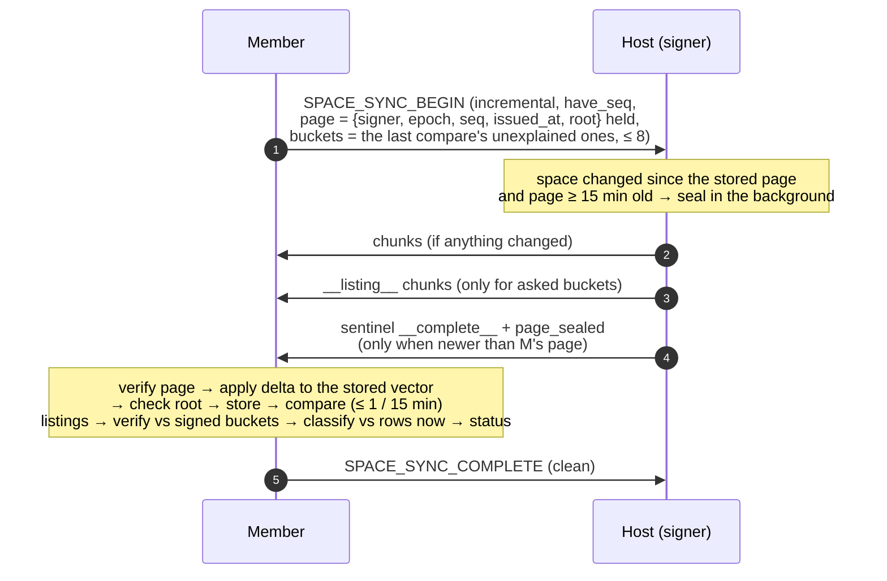

# Sync pages (signed state pages)

**Status: Phase 2 (signed pages, the "behind?" check) and Phase 3
(verified fetch from any member) are implemented at v_95 — see [Phase 2
as built](#phase-2-as-built-v_95) and [Phase 3 as
built](#phase-3-as-built-v_95). The anti-entropy part of Phase 3
(`page_match`) is not built yet.** It builds on [sync.md](./sync.md), the
§25.6 space sync.

The space authority signs a small **page** now and then: a commitment to
the space's current content, split into 256 **buckets**. A member keeps
only the newest page and its bucket vector. With them a member can tell
whether it is behind, even while the host is offline. It can also take
**anyone's** rows from **any** member household, because each row is
checked against the signed page, not against who delivered it.

## Recommendation

1. **Commit to state, not to a log (option B).** A page header is
   `{space_id, epoch, signer, seq, issued_at, cutoff, rows, root,
   prev_root, page_suite}`, signed with the space authority key. `root`
   is the hash of 256 bucket hashes. A bucket hash covers the sorted leaf
   hashes of the rows in that bucket. A leaf is the SHA-256 of a row's
   canonical **commit form** (§2).
2. **Store almost nothing.** The host keeps its newest page, the bucket
   vector and the delta from the previous page: ≤ 17 KB per space. A
   member keeps the newest page and its vector: ≈ 9 KB per space. There
   is no per-row data and no history. Leaves are recomputed on demand.
   Hashing costs ≈ 3.3 µs per record (measured), so a 50 000-row space
   takes 0.17 s of hashing, or an estimated 2–4 s on a Pi with the
   database reads.
3. **No new message in Phase 2.** The page rides the sentinel of the
   periodic BEGIN that already runs every 30 min, sealed under the space
   content key, and only when it is newer than the one the requester
   holds. Next to it travels the **delta** of the bucket vector (the
   changed buckets only), or the full vector when the requester is more
   than one page behind. The host seals lazily: when a BEGIN finds the
   space changed since the stored page, at most once every 15 min. There
   is no timer, no push and no fan-out.
4. **Phase 3 reuses the §25.6 session.** A member sends `SPACE_SYNC_BEGIN`
   carrying `buckets` to **any** member household. That household
   streams, for each requested bucket it still holds unchanged, the bucket
   listing and the rows. The receiver accepts a row only if its leaf is in
   a listing that hashes to the signed vector. The same round replaces the
   host's daily full anti-entropy stream with a bucket diff.
5. **Few new parts:** one suite tag (`PAGE_SUITE_SHA256_B256`), one
   authority event type (`space_sync_page`, under the existing
   `authority_sig_suite`), one version gate (`MIN_FOR_SYNC_PAGES` = 95) and
   one additive migration.

## Scope

- **HFS**: every household that has a space member.
  - The **signer** holds the space authority seed and acts as host: the
    owner, or a delegated admin while delegation is on.
  - Every member household verifies the page and stores the newest one.
    From Phase 3 it also delivers rows and checks the rows it receives.
- **GFS**: not involved. Pages travel only inside §25.6 sync sessions
  (paired, mesh `SPACE_ROUTED`, or the household path of a GFS mailbox
  seat). They are sealed end to end, so a relay sees no content.
  Followers get no pages.
- **Not covered**: media bytes (already content-addressed,
  `SPACE_MEDIA_WANTED`), space config (`SPACE_CONFIG_CATCH_UP`), the
  moderation queue, and the *host-only* resources in §2.

## Event types

No new `FederationEventType`. The new fields are additive, so an older
household ignores them.

- `SPACE_SYNC_CHUNK` sentinel (`__complete__`): `page_sealed` (Phase 2).
- `SPACE_SYNC_BEGIN`: `page` (a reference to the requester's newest page)
  and `buckets` (≤ 8: the listings the stream should end with; Phase 2 on
  the incremental BEGIN to an acting host). Phase 3 as built adds `rows:
  true` and `have` (8-byte prefixes of the leaves the requester holds in
  those buckets) on an ordinary incremental BEGIN to any member household
  while no host answers. `page_match` is not built.
- New in-stream resource, carried in ordinary chunks right before the
  sentinel: `__listing__` (one bucket's rows — identity, leaf, change
  time; Phase 2) and `__rows__` (one row record of a listed bucket;
  Phase 3).

## 1. Log or state? (decision)

The numbers below compare a **big** space (50 000 committed rows, 2 000
changes a day, 200 member households) with a **small** one (2 000 rows,
50 changes a day, 5 households). They were measured with Python `json`
(the `canonical_json` encoder) and `hashlib` on synthetic 577-byte
records, and with a real SQLite file (`WITHOUT ROWID`, after `VACUUM`).

| | A. change log + Merkle pages | **B. state commitment, 256 buckets** | C. B + per-row leaf cache |
|---|---|---|---|
| Host storage, big | 114 B × 2 000 × 30 days ≈ **6.8 MB** (grows with activity, cliff at 30 days) | page + vector + delta ≤ **17 KB** | + 56 B × 50 000 ≈ **2.8 MB** |
| Host storage, small | ≈ 170 KB | ≤ 17 KB | ≈ 130 KB |
| Member storage | header, plus the entry lists of recent pages if it is to prove rows while the host is offline | header + vector ≈ **9 KB** | ≈ 9 KB |
| Host CPU per seal | O(changes) | O(rows): 0.17 s of hashing at 50 k rows, an estimated 2–4 s with DB reads on a Pi | O(changes) |
| Seals per day, worst case | 1 per 256 changes or 5 min | ≤ 96 (lazy, ≥ 15 min apart, only when a BEGIN asks) | as B |
| Member offline > 30 days | full stream from the host | no special case (no history to expire) | as B |
| Two signers (owner + delegated admin, or a restored backup) | the chains fork, and someone must merge one log | each page stands alone as a signed snapshot of its signer's state | as B |
| Proof for a catch-up | entry lists of every missing page (~20 KiB each) | listings of the differing buckets only (6.2 KiB raw per bucket at 50 k rows) | as B |
| Replaces the daily full anti-entropy stream | no (a log says nothing about rows older than its window) | **yes**: compare roots, then buckets | yes |

**Why B.** Catch-up only needs the **latest version of each row**. A log
keeps every superseded version and needs a retention window with a cliff.
It also forks as soon as two households sign: the owner and a delegated
admin, or a host restored from a backup that reuses counter values. A
state commitment answers exactly one question: is this row, in this
version, part of the space now? It has no history. Two signers' pages
simply describe two states, and the existing merge rules (last writer
wins, stamps) already reconcile rows from either.

**Why the vector travels and is stored.** While the host is offline,
someone other than the signer has to prove rows. A deliverer can prove
bucket *i* only if it knows the signed bucket hash. With the 8 KB vector
it can compare that hash to its own recomputed bucket, so no per-row data
is replicated. A log needs entry lists (≈ 80 B per change) replicated the
same way.

**Why no leaf cache (C) yet.** Storage comes first, and the lazy seal
bounds the CPU: ≤ 96 recomputes a day for a space that changes all day,
and none for a quiet one. If profiling on a Pi shows that seals hurt in
very big spaces, C can be added later without a wire change (see
[Decisions](#decisions-owner-2026-11-21)).

### Shape

```
rkey   = SHA-256("sh-sync-rkey:v1:" ‖ resource ‖ 0x00 ‖ row_id)
bucket = rkey[0]                                              (0 … 255)
leaf   = SHA-256("sh-sync-leaf:v1:" ‖ canonical_bytes(commit_form(resource, record)))
bucket_hash[i] = SHA-256("sh-sync-bucket:v1:" ‖ i ‖ concat(sorted leaves of bucket i))
root   = SHA-256("sh-sync-root:v1:" ‖ concat(bucket_hash[0 … 255]))
```

A row's bucket depends only on its identity, so the row stays in the same
bucket across versions while its leaf changes with every version. The
domain prefixes keep each kind of hash apart. The commit form puts
`resource` and the row id inside the hashed object, so every leaf names
its row.

**What is committed:** the set of records that a full §25.6 stream from
the signer to a current, paired member household would send. Only the
*committed resources* (§2) count, and the page's `cutoff` decides the
retention window. Every household that evaluates the commitment uses the
page's `cutoff`, never its own clock, so the sets agree.

**Bucket granularity.** A deliverer can prove a bucket only while that
bucket is unchanged on its side since the page. With *k* changes after
the page, the share of buckets it can no longer prove is
1 − e^(−k/256). That is 18 % at k = 50 (a small space's whole day, or
about 35 min of a busy one) and 32 % at k = 100. A delegated admin keeps
sealing while the owner is offline, which keeps *k* small. The rest
falls back to today's helper path.

## 2. Canonical commit form per resource

`commit_form(resource, record)` = `{"r": resource, "v": projection}`.
`projection` keeps only an **allow-list** of the record's fields for each
resource (`COMMIT_FIELDS`, one table in one module), normalised as
follows:

- **Files by content hash.** Every file reference (`image_urls`,
  `file_meta.url`, covers, page body pictures) is replaced by the file's
  SHA-256 from the record's `files` map (v_85). Local names (`sc-`, `sg-`,
  upload names) never enter a hash. If the signer has no hash for a file
  in a record, that row is left out of the commitment (*host-only*).
- **Per-requester fields dropped**: `media_refs` (for link-joined members
  only) and version-gated legacy shapes. The commit form always uses the
  newest shape, because only households at ≥ `MIN_FOR_SYNC_PAGES` take
  part.
- **Receipt-local fields dropped**: anything a receiver writes with its own
  clock or ids (listed per resource below).
- **Order and numbers fixed**: set-like lists are sorted, lists whose
  order means something keep it, and there are no floats. Coordinates
  (already 4 dp) are hashed as their decimal strings, typed apart from a
  string (see "Phase 2 as built").
- The bytes come from `canonical_bytes` in `socialhome/canonical_json.py`
  (sorted keys, compact, ASCII).

It is an allow-list, not a deny-list: a field that a later release adds
to a record is **not** hashed until the commit form is revised, so a new
field never silently breaks every page. A revised commit form is a new
page suite (§3).

**Three rules that come out of the audit** (the exporters, the
`receive_*.py` receivers and the live inbound handlers, checked at the
`feat/sync-pages` base):

1. **Item state is never committed.** Reactions and their stamps, poll
   votes and counts, RSVPs, schedule answers and bazaar bids are merged
   per household under last-writer-wins. On top of that, their lists are
   cut by local data (`MAX_SYNCED_REACTION_STAMPS`, 1 000 votes, 200 bids)
   and the receiver re-stamps them (`receive_calendar.py:242`,
   `receive_bazaar.py:194`). They keep healing from the host's stream as
   today. A page commits to the **item**, not to who reacted to it.
2. **Receipt-local and counted fields are dropped:** `joined_at`,
   `banned_at`, `updated_at` (stickies, tasks, zones, timetables, albums),
   `comment_count`, `item_count`, `rsvps_at` / `responses_at` (export
   time), `actor_user_id` on tombstones (often empty on the live path),
   and `calendar_deleted.created_at` (`calendar_repo.py:805`, local clock).
3. **A mismatch never makes a wrong row pass.** If a deliverer's copy of
   a row differs (for example a file it holds only under a GFS `sg-`
   name, so it cannot compute the content hash), its bucket hash differs
   from the page's. It then reports the bucket as `not_held` and the
   requester asks someone else. An unstable field therefore costs
   availability, never safety. That is why only the resources that would
   *always* mismatch are kept out.

| Resource | Commit form (allow-list) | Verdict |
|---|---|---|
| `posts` | `id, space_id, author, type, content, created_at, edited_at, hidden_from_feed`, files as hashes (`image_urls`, `file_meta` without `url`, link-card thumbnail) | stable after normalisation. Leave out `location`, `bot_id`, `linked_highlight_id`, `linked_event_id`, `no_link_preview`, `pinned`, `moderated`: the sync receiver never stores them (`receive_posts.py:738-775`) |
| `posts_deleted`, `comments_deleted` | `id, post_id / comment_id, author, created_at` | stable (no `deleted_at` on the wire) |
| `comments` | all fields, with `media_url` replaced by its hash | stable after normalisation |
| `task_lists`, `tasks`, `tasks_archived` | all fields except `updated_at` (`domain/task.py:491`) | stable after normalisation |
| `*_deleted` for lists, tasks, pages, stickies, zones, timetables, gallery | identity fields + `created_at`, without `actor_user_id` (and without `created_at` for `calendar_deleted`) | stable after normalisation |
| `pages` | `id, title, content, cover_image_url, created_by, seq, version_hash, conflict` (`sp-` names are the same everywhere); locks and delete requests are local workflow | stable after normalisation |
| `stickies`, `space_zones`, `timetables` | all fields except `updated_at`; floats (`position_*`, coordinates) as decimal strings | stable after normalisation |
| `calendar` | the series row (never expanded) without `rsvps`, `rsvps_at`, `rsvps_partial`; `cover_url` as a hash | stable after normalisation |
| `gallery` | non-system albums without `item_count`, `updated_at`; items with `url` / `thumbnail_url` as hashes | stable after normalisation (system albums have local ids and are left out, as in the stream) |
| `polls`, `schedules` | definition only: `meta`, options `(id, text)`; schedule `title, deadline, slots, finalized_slot_id` | stable after normalisation |
| `bazaar` | listing without `bids`, images as hashes; check the `sold_at` format (whole seconds, `space_content.py:3550`) in the tests | stable after normalisation |
| `bans`, `members` | could be committed as `(user_id, role, …)` without `joined_at` / `banned_at` / `picture_hash` | **host-only for now.** The roster has its own `roster_digest` repair, and removals have no tombstone, so a member holding a removed seat would mismatch until that repair |
| `member_pictures` | none | **host-only**: every receiver re-encodes the image (`receive_members.py:69`) |
| `chat_messages`, `chat_messages_deleted` | none | **host-only**: each household prunes its own chat, and `created_at` is capped at the receiver's clock and `reply_to_id` nulled (`space_chat.py:346-366`) |

**Files.** Since v_92 a receiver stores every hashed file under its
content name (`sc-<sha256>`), so any household can derive the hash from
the name. The host computes the hash from its own copy, as v_85 does for
`files`. A row whose file the deliverer does not know by content (a
pre-v_92 legacy name or a GFS `sg-` copy) falls under rule 3. The `files`
map in the stream is capped at 200 records per stream; the commit form
does not read it, it computes the hashes from the stored names.

**Required tests (Phase 2 gate):** for every committed resource, stream a
row from host to member through the real receiver, re-export it on the
member, and compare the leaves. Do the same after a live event instead of
a stream. Golden vectors pin the bytes.

## 3. Signing, epochs and suites

**Signed body** (`authority_sig.sign_authority_event`, event type
`space_sync_page`, which reuses `authority_sig_suite`):

| Field | Meaning |
|---|---|
| `space_id`, `epoch` | the space, and the `authority_key_epoch` of the signing key |
| `signer` | instance id of the sealing household (owner or delegated admin) |
| `seq` | the signer's `sync_seq` snapshot, read before the export (the same counter its watermarks use) |
| `issued_at` | unix ms; refused if more than 300 s ahead of the receiver's clock |
| `cutoff` | the retention cutoff the commitment used (`null` = keep forever) |
| `rows` | leaf count (only for status, e.g. "≈ 3 % differs") |
| `root`, `prev_root` | this page's root, and the root of this signer's previous page (`null` for the first) |
| `page_suite` | `PAGE_SUITE_SHA256_B256 = "sha256-b256-c1"`: hash, bucket count and commit-form revision |

**Who signs.** Only a household that holds the seed
(`space_repo.get_space_seed`) **and** acts as host
(`host_equivalence.acting_hosts`) seals. That means the owner, or a
delegated admin while `delegated_admin_authority` is on. A plain member
never signs. With delegation off and the owner offline, no new pages are
sealed. The last one still proves everything the owner held when it went
offline, which is the content a catch-up needs most.

**Verification** (pure, in a `socialhome/sync_page.py` next to
`space_owner_statement.py`):

1. `page_suite` must be in `SUPPORTED_PAGE_SUITES`, or
   `UnsupportedPageSuite(ValueError)` is raised. The page is refused and
   never defaulted, and the receiver keeps what it had.
2. `epoch` must equal the epoch this household pins. A lower epoch is a
   retired key and is refused. A higher epoch is refused too; the
   existing authority-epoch echo (v_46) fetches the rotation, and the
   page comes again on the next round.
3. `verify_authority_event` must pass against the pinned space public key.
4. `issued_at` must not be more than 300 s in the future. The order key
   is `(epoch, issued_at, seq)`, and only a newer page replaces the
   stored one.
5. The vector must hash to `root`. For a delta, the receiver applies it
   to its stored vector, which must match `prev_root` and the stored
   page's `signer`. Otherwise it asks for the full vector.

**Epoch rotation.** When a member applies `SPACE_AUTHORITY_ROTATED`, it
drops its stored page together with the baseline reset it already does.
The owner seals a new page at the next BEGIN (an old-epoch page is always
stale). A revoked admin who still holds the old seed can sign old-epoch
pages only until a member applies the rotation. That is the same
residual window every authority event has today (see the rotation
service docstring). It gives the revoked admin no new power: as an acting
host it was already trusted whole (`_acts_as_host`).

**Suite rule (CLAUDE.md).**
- `PAGE_SUITE_SHA256_B256`, `SUPPORTED_PAGE_SUITES` and
  `UnsupportedPageSuite` carry the commitment scheme.
- The signature keeps its own `authority_sig_suite`, so the PQ path
  (`ed25519+mldsa65`) follows `authority_sig` with no page change.
- A new commit-form revision, a different bucket count or another hash is
  a sibling suite, sealed only when every member household at
  `MIN_FOR_…` of that suite supports it. During a transition the host may
  seal both suites.
- A member whose suite is unknown keeps today's behaviour (host-only).

**Equivocation.** Two valid pages with the same `(epoch, signer, seq)`
but different roots are a conflict, and so is a page whose `prev_root`
breaks the chain the receiver holds.

- Causes: a host restored from a backup that reuses counter values
  (benign), or a misbehaving seed holder.
- What the receiver does:
  - keeps the newer `issued_at`;
  - logs WARNING with both page hashes;
  - sets `page_conflict` in the sync status;
  - in Phase 3, a deliverer also compares the page sent in the BEGIN with
    its own.
- The space is not halted. Seed holders are already trusted to sign
  config and roster, and the two signed pages are evidence the owner can
  act on (demote, which rotates the key).

## 4. Wire

### Phase 2: the page on the sentinel



- **`page` in BEGIN**: `{signer, epoch, seq, root}`, about 120 B, inside
  the encrypted payload. With it the provider can skip a page the
  requester already has, and can choose between a delta and the full
  vector.
- **`page_sealed` on the sentinel**: AES-256-GCM under the space content
  key, through the same helper and AAD as chunks
  (`encrypt_chunk`, `space_id:epoch:sync_id`). The sentinel itself stays
  plaintext-signed, so the page, its counts and its hashes must not ride
  in the clear (encryption-first rule). The plaintext is
  `{page, delta | vector}`:
  - `delta`: `[[i, bucket_hash_b64], …]`, the buckets that changed since
    `prev_root`, sent when the requester's page is that previous page;
  - `vector`: all 256 bucket hashes (8 KiB raw), sent otherwise.
- **Any provider relays**: a non-signing provider (a member household
  that streams its writers' rows) attaches the newest page it holds in
  the same way. This is the member-to-member relay. It needs no new
  message, and the authority signature means a relay can only withhold a
  page, never forge one.
- **Lazy seal.** When the provider is a signer and is about to build a
  sentinel, it seals a page if all of these hold:
  - the space changed since `page.seq` (the `is_quiet` probe with
    `since = page.seq`);
  - the stored page is ≥ `PAGE_MIN_INTERVAL_S` (900 s) old, or belongs to
    an older epoch, cutoff day or suite.

  The seal runs as a background task, one per space under a lock. The
  export is read in keyset pages (async DB) and the hashing runs through
  `asyncio.to_thread`. The sentinel carries the stored page (the next
  round gets the new one), so a BEGIN never waits on a seal.
- **Version gate.** Pages go only to requesters where
  `peer_supports(…, MIN_FOR_SYNC_PAGES)` holds. An older requester gets
  today's sentinel. An older provider sends no page, and the requester's
  status falls back to Phase 1 rules. No `SYNC_RECORD_LINES` entry is
  needed: no record changes shape and no receiver takes a different
  field, so no household needs a full stream to cross v_95.

### Phase 3: verified fetch from any member

*The design as reviewed; what shipped is in [Phase 3 as
built](#phase-3-as-built-v_95): the fetch rides an ordinary incremental
BEGIN (`buckets` + `rows` + `have`), no `page_match` yet.*

```mermaid
sequenceDiagram
    autonumber
    participant R as Requester
    participant D as Any member household
    Note over R: host silent (HostContact) or daily anti-entropy;<br/>recompute own vector V_R; S = { i : V_R[i] ≠ V_P[i] }
    R->>D: SPACE_SYNC_BEGIN (sync_mode = buckets,<br/>page = full signed P, buckets = S)
    Note over D: verify P; recompute V_D;<br/>serve S ∩ { i : V_D[i] = V_P[i] }
    loop per served bucket (≤ 8 KB chunks)
        D->>R: __listing__ i (sorted leaves)
        D->>R: rows of bucket i that R lacks or holds older
    end
    D->>R: sentinel (served, not_held = remaining buckets)
    Note over R: listing hashes to V_P[i]? each row's leaf ∈ listing?<br/>→ apply as if from the host (same merge rules)
    R->>D: SPACE_SYNC_COMPLETE
    Note over R: not_held → ask the next member (helper rotation)
```

- **Request**: the full signed page P (so D needs no stored state to
  check it) and up to 256 bucket indices. The `may_receive` writer gate
  and the per-(requester, space) budget apply as for today's helpers.
  The request rotates through member households with the same stable
  offset as `trusted_helpers.py`, but any member household at ≥ v_95
  qualifies, not only admins and moderators.
- **Proof**: per bucket, one `__listing__` record (the sorted 32-byte
  leaves) and then the rows. The receiver:
  1. hashes the listing (with `i`) and compares it to the stored
     `V_P[i]`;
  2. hashes each row's commit form and checks the leaf is in the
     listing;
  3. applies the row through the normal receiver with `verified=True`,
     which passes where `_acts_as_host` passes today, and nowhere else.

  A listing also tells R exactly which leaves it still lacks, so a
  partial delivery is harmless: R asks the next member for the rest.
- **D sends only rows R lacks**: R puts its own leaves for S in the BEGIN
  as `vector_hint`. That is a compact list of 8-byte leaf prefixes, about
  8 B × the rows in S, which is ≤ 16 KiB for 10 buckets in a big space.
  D skips rows whose leaf R already holds.
- **Anti-entropy**: the host's daily full stream becomes the same flow
  against the host:
  1. R recomputes V_R against the newest page and finds S.
  2. An empty S → the next BEGIN carries `page_match: {seq, root}`, and the
     host refreshes `full_at` without streaming.
  3. Otherwise R sends a `buckets` session to the host for S.

  A false `page_match` only harms the household that sends it.
- **Bounds**: page ≤ 1 KiB; delta ≤ 256 entries; vector exactly 256 × 32
  B; ≤ 256 buckets per request; listing ≤ 4 096 leaves (128 KiB, spread
  over chunks). That caps the b256 suite at about 1 M rows per space;
  bigger spaces would need a sibling suite with more buckets.
- **Encryption-first**: in the BEGIN, the page, the bucket list and the
  hints are all inside the per-pair encrypted payload. Listings and rows
  are chunk records under the content key. Only `space_id`, `sync_id`,
  `resource` and chunk counters stay in the clear, as today.

## 5. Cost

| Trigger | Recipients × items × bytes | Big space, worst case per day | Small space |
|---|---|---|---|
| Phase 2, page on the sentinel | only members whose BEGIN shows an older page; ≤ 1 page per member per 30-min round | 200 × 48 × (0.7 KiB page + ~2 KiB delta, ~40 changed buckets) ≈ **26 MB**; a member > 1 page behind gets the 11 KiB vector once | ≈ 0, a few KB |
| Phase 2, seal | 1 export + hash, ≤ 1 / 15 min, only when asked and changed | ≤ 96 × 2–4 s CPU on a Pi (est.) | ≤ 96 × 0.1 s |
| Phase 2, member root check | 1 recompute per new page, debounced ≤ 1 / h, `to_thread` | ≤ 24 × 2–4 s per member (est.) | trivial |
| Phase 3, catch-up while the host is silent | 1 requester → 1 member per round, cooldown as for helpers | listings 6.2 KiB raw per differing bucket + the rows R lacks (rows it would have had from the host anyway) | |
| Phase 3, anti-entropy | replaces a full stream per member per day | today ≈ 200 × 50 k × ~0.6 KB ≈ **6 GB/day** of host upload → **≈ 0** when roots match, otherwise only the differing buckets | |

- **Live traffic, for scale**: 2 000 changes × 200 households × ~1.5 KB
  ≈ 600 MB/day.
- **Net effect**: Phase 2 adds about 4 % on top of the live traffic in
  the busiest case and nothing to a quiet space. Phase 3 removes the
  biggest recurring cost a space has.
- **Amplification**: nothing fans out. One requester talks to one
  provider per session, and one member's action never triggers N × M
  work.
- **The 30-min quiet BEGIN stays.** It is the host-liveness probe
  (`HostContact`) and the watermark exchange, and the page cannot skip it.
  The page only makes it more useful: a quiet round now also says "your
  copy matches the host as of 14:05". Phase 3's `page_match` is what
  makes the daily full pass skippable.

## 6. Security

| Threat | Outcome |
|---|---|
| Forged row from a deliverer | Its leaf is not in a listing that hashes to the signed vector, so the row is refused and logged. The test is a demo step. |
| Stale row version | An old version's leaf is not in the current listing, so it is refused. A version that is valid but older than one held is resolved by the existing merge rules (last writer wins on `edited_at`, stamps), so a newer local copy stays. |
| Withheld page | A relay can only drop the page. The host's own sentinel and any other member's sentinel carry it, and status shows the page's age ("as of 2 h ago"). |
| Replayed old page | It is older by `(epoch, issued_at, seq)`, so it is ignored. Rows proven by it are refused once a newer page is stored. |
| Removed admin (epoch rotation) | The old-epoch page is refused after the member applies the rotation; the residual window is unchanged (§3). |
| Equivocation | Detected per `(epoch, signer, seq)` and through the `prev_root` chain, then reported (§3). |
| Withholding rows | A listing names every leaf, so R knows what is still missing and asks the next member. |
| Oversized proof | The bounds in §4 apply; anything larger is refused before it is parsed further. |
| Privacy | Pages, vectors and listings are encrypted under the space content key and go only to member households (§4). Hashes of low-entropy records (tombstones) could be guessed only by someone who already holds the key, which means a member who can read the content anyway. Non-members on a mesh path see `SPACE_ROUTED` ciphertext. The GFS sees nothing, because no sync traffic goes through it. A page reveals no person's location; zones are content and are encrypted with the rest. |

## 7. Phase plan

**Phase 2: pages and the "behind?" check** (one PR on `feat/sync-pages`,
protocol v_95, with adversarial review).
1. `socialhome/sync_page.py`: commit form, `COMMIT_FIELDS`, hashing,
   sign / verify, suites.
   - Tests: golden vectors per resource.
   - Tests: host versus member export of the same row hashes the same, a
     property test over each receiver (stream a row, re-export it,
     compare the leaf).
   - Tests: unknown suite refused, epoch checks, future skew, ordering,
     delta apply, a broken chain flagged as a conflict.
2. Additive migration with the audit:
   - `space_instances` gains nothing;
   - one table `space_sync_pages(space_id PK, page_json, vector BLOB,
     delta BLOB)` holds the newest page per space, the same row on host
     and member;
   - the PR shows why no existing column fits.
3. Lazy seal in `provider.py`, plus `page` in BEGIN (`scheduler.py`) and
   `page_sealed` on the sentinel (`exporter.build_sentinel`).
4. Member side: verify, store, debounced root check, status.
   - Phase 1's `SpaceSyncStatus` gains `page: {at, signer_role, match,
     differing_buckets, conflict}`.
   - With `match` the state is `up_to_date` ("matches the host as of …"),
     even while the host is offline.
   - A mismatch while the host is silent is `behind`.
   - A mismatch while the host is reachable is `catching_up`.
5. `MIN_FOR_SYNC_PAGES = 95`, capabilities.md row, the federation-demo
   assertion that the version round-trips, and docs (this page, sync.md,
   database.md).
   - Demo: after a post, member b's status shows the page and `match`.
     Stop the host a and post on c, and b's status shows `behind`, not
     `never`.

**Phase 3: verified fetch from any member** (one PR, same v_95 if it
ships in the same release, otherwise v_96).
1. `buckets` on a BEGIN to any member household (the Phase 2 listing
   rides that round), with listings, hints and `not_held`.
2. The receiver's `verified` path, which replaces the own-rows-only limit
   of `resume.py` / `trusted_helpers.py` wherever a page covers a bucket.
   Rows created after the page keep today's helper replay.
3. Anti-entropy: `page_match` in BEGIN, and `since_for` refreshes
   `full_at` on a match.
4. Tests: a tampered row refused, a stale version refused, a forged
   listing refused, a partial delivery followed by the next member, and
   merge rules kept.
5. Demo:
   - The host goes down. Member b catches up a bucket of others' posts
     and pages from member c and verifies it.
   - A deliberately tampered row is refused (`verify: ok` twice).
   - Show `pytest tests/protocol/ -m security -n 4` green.

## Decisions (owner, 2026-11-21)

1. **A state checksum (option B), not a change log.** The page keeps its
   name and the `prev_root` chain.
2. **Any member household may deliver verified rows in Phase 3.** The
   proof makes trust in the deliverer unnecessary. Admins and moderators
   get no priority; the request rotates with the stable offset from
   `trusted_helpers.py`.
3. **256 buckets now** (`sha256-b256-c1`). If big spaces need more, that
   comes later as a sibling suite.
4. **No leaf cache (C).** Measure a real seal on a Pi first, in the
   Phase 2 PR, and decide on C from that number.
5. **Timings:** a seal at most every 15 min (`PAGE_MIN_INTERVAL_S`). A
   member compares its copy on each newer page, at most once per 15 min per
   space; a mismatch resolves through the bucket listing (revised by the
   owner on 2026-11-21: it replaced the hourly root check).
6. **`members` / `bans` stay host-only for now.** Committing them is a
   later step, after Phase 3. It needs a removal tombstone, or the roster
   digest folded into the page.
7. **Post fields the sync receiver drops stay uncommitted.** These are
   `location`, `bot_id`, `linked_highlight_id`, `linked_event_id`,
   `no_link_preview`, `pinned` and `moderated` (§2). This is a known limit,
   with no receiver change.

## Phase 2 as built (v_95)

What shipped, where it is more exact than the design above:

- **Commit form** (`socialhome/sync_page.py`, `COMMIT_SPECS`). Every
  committed field is always present (an absent field hashes as `null`).
  Timestamps in the allow-list are normalised to UTC ISO 8601 with
  microseconds (the stored forms differ between households). Every
  string value is committed as `"s:" + value` and every float as
  `"f:" + repr(value)` (ints, booleans and `null` stay JSON), so a string
  never commits like a number or another string's float spelling (Phase 3
  re-review N4: one leaf must mean one applied value). Lists whose order
  means something commit **in order**: a post's and a bazaar listing's
  `image_urls`, poll options, schedule slots, timetable entries
  (`CommitSpec.ordered`); every other list is set-like and sorted —
  strings by code point, anything else by its canonical JSON. A file
  reference commits as its content SHA-256 plus the extension it is served
  with (`<sha256>.webp`, `content_media_ext` — the one extension rule of
  a content name, so every household derives the same; re-review R2). A
  fetched row is applied in that committed spelling (`fetched_record`:
  every committed field, an absent one as `null`; one stamp form; set-like
  lists sorted). Per resource, beyond the §2 table:
  - A calendar event's **feed card** (a post with `linked_event_id`) is
    never committed: every household mints its own (own id, own words).
  - **Suite.** The Phase 3 reviews changed the commit form (typed strings
    and floats, ordered lists, file extensions) under the same
    `sh-sync-leaf:v1:` prefix and `PAGE_SUITE_SHA256_B256`: v_95 was never
    released or deployed (the owner confirmed nothing from
    `feat/sync-pages` runs anywhere), so no page under the earlier form
    exists and no sibling suite is needed. Any change after release is a
    new page suite (§3).
  - `posts` also commits `media_url` (as a hash); `file_meta` keeps
    `url` (as a hash), `mime_type`, `original_name`, `size_bytes`; the
    link card keeps `url`, `title`, `description`, `site_name`,
    `thumbnail_url` (as a hash). Nested dicts are allow-listed too.
  - `comments` leaves `edited_at` out: the sync receiver does not keep it
    (a streamed edit lands without its stamp). The edited content is
    committed.
  - `polls` `meta` keeps `post_id, question, closes_at, closed,
    allow_multiple`; schedule slots keep `id, slot_date, start_time,
    end_time, position`.
  - Tombstones commit their identity fields and `created_at`, except
    `calendar_deleted` (receiver's clock) and `task_lists_deleted` /
    `tasks_deleted` (their records carry none).
  - File hashes come from the bytes this household stores
    (`MediaFileHasher`, cached by name, size and mtime), on the host and on
    a member alike; a file it cannot hash keeps the row out.
  - Tested: for every item type of the §25.6 coverage table, the host's
    export and the member's re-export after the real receiver hash the
    same (`tests/federation/sync/space/test_page_state.py`), plus rows with
    pictures, files, a link card, a cover and a sold listing. A golden leaf
    pins the bytes (`tests/test_sync_page.py`). The same comparison after a
    *live* event (instead of a stream) is not covered yet.
- **Wire.** BEGIN `page` = `{signer, epoch, seq, issued_at, root}`
  (`issued_at` is needed for the order key). Hashes are base64url without
  padding; the vector is one base64url string. `page_sealed` =
  `{epoch, payload}` from `encrypt_chunk` (content key, AAD
  `space_id:epoch:sync_id`), ≤ 24 KiB. Sent only to a requester at
  `MIN_FOR_SYNC_PAGES` whose `page` is absent or older by
  `(epoch, issued_at, seq)`; a delta only when its `page` is the stored
  page's `prev_root` from the same signer and epoch. BEGIN `page` goes only
  to a provider at v_95 (`space_member_supports`), on every BEGIN path
  (paired, mesh catch-up / incremental, relay re-BEGIN).
- **Receiver.** A delta that does not fit the held page is refused and the
  held page kept (never dropped: that would let a relay roll a member back
  by then offering an older page). The next BEGIN names the held page, so
  the provider sends the full vector. A household that signs the space
  itself never stores another signer's page over its own. A page that does
  not open (wrong key, tag) is a one-line WARNING.
- **Equivocation** is flagged for two pages of one signer and epoch with
  the same `seq` and different roots, or two different pages with the same
  non-null `prev_root`. The flag is kept in memory (WARNING log with both
  page hashes is the durable evidence).
- **Rotation.** A trigger on `spaces` drops the page in the same statement
  that moves `authority_key_epoch` or `identity_public_key` (every path:
  rotate, adopt, re-pin). A held page of another epoch is ignored anyway.
- **Lazy seal.** As in §4, plus: a signer that holds another signer's page
  younger than 15 min does not seal on top of it. Accepted exception: when
  the retention cutoff rolls over to a new day, a changed space re-seals
  even if its page is younger than 15 min — at most once a day. The seal reads the
  `sync_seq` snapshot before the export, exports with the window cutoff of
  now (stored in the page) and hashes page by page in a worker thread.
- **Compare (owner decisions 2026-11-21).** A member compares its own
  bucket vector with the page's when a **newer** page is stored — never on
  a repeat — at most once per 15 min per space (a page arriving sooner
  waits out the rest once; the compare then takes the newest page). Never
  for a page we signed. Hashing runs in `asyncio.to_thread`. Verdicts are
  memory only, so a held page with none (after a restart) is compared on
  the next sentinel or the next read of the sync status, whichever comes
  first — once; a judged page never again.
  1. **Explain locally, no wire cost.** A differing bucket in which we hold
     a row whose change time (the newest of `created_at`, `edited_at`,
     `updated_at`, `last_edited_at`, `archived_at`, `sold_at`, `deleted_at`
     the record carries) is after the page's `issued_at` is explained: we
     are ahead there (live events between pages). Not fetched, not counted.
     A change time later than now + 300 s (the page skew) explains
     nothing, here or in step 3: one writer stamping rows far in the
     future must not make every member read "up to date".
  2. **Listings only for unexplained buckets**, at most
     `MAX_LISTING_BUCKETS` = 8 per compare; the rest stay unresolved until
     the next page. They are asked of ONE household acting as host (the
     signer if it is one, else the first) on the **next round's** BEGIN to
     it — see *Bucket listings* below. Never a BEGIN of its own.
  3. **Classify**, on that round's sentinel and against our rows read
     then (the round's own rows applied — a row the same stream delivered
     is not missing), each listed row: listed
     and absent here → **missing**, unless we hold its tombstone or its
     archived copy, or its post is deleted (gone after the page → ahead);
     listed with another leaf → **missing** unless our change time is newer
     than the listed one (→ ahead); a row of ours not listed was created
     after the page → ahead.
  4. Only a **proven missing** row makes `match: false` (state
     `behind`). No extra BEGIN: the rounds go on anyway, and a row lost
     below the provider's watermark would not come back on an incremental
     stream either — the daily full anti-entropy stream (or Phase 3's
     verified fetch) heals it. The next compare comes only with the next
     page — no loop.
- **Bucket listings — the general shape (Phase 3 reuses it).** A listing
  rides the normal §25.6 round: the member's incremental `SPACE_SYNC_BEGIN`
  to the acting host (periodic, or Sync now) carries `buckets` (≤ 8
  indices) next to `page`, both in the encrypted payload, only to a
  household at v_95 (`SpaceSyncScheduler._page_fields_for`; also on the
  mesh BEGIN and the relay re-BEGIN after an ICE timeout). The provider
  streams the round as usual and appends one `__listing__` chunk per ≤ 8 KB
  of listing records right before the sentinel, under the space content
  key (the chunk AAD), counted in the sentinel's `chunk_count`
  (`SpaceSyncService._listing_chunks`); only to a member household (a
  writer seat) — as is the page itself on the sentinel: its vector covers
  member-only resources (zones), so a follower gets neither. No session kind, budget or session-cap rule of its own:
  the round's admission rules apply. Each record is `{i, held: true,
  rows: [[resource, row_id, leaf, change_time], …]}` or `{i, held:
  false}`: a provider lists a bucket as of the page only when its own rows
  of it still hash to the requester's page (the same page it holds). A
  bucket changed since the page cannot be proven (no leaf cache); a
  provider that acts as the space's host then lists it **as it is now** —
  `{i, held: false, current: true, rows}` — which the requester classifies
  without the page check: it asked an acting host, whose stream it takes
  unchecked anyway. Any other provider (Phase 3) answers `{i, held:
  false}` and the bucket stays unresolved. A delete on the host shows in
  its tombstone's bucket, not in a current listing, so a delete we missed
  is not counted missing there (the 30-min sync heals it). The requester
  asks only on a BEGIN that names the page the ask is for (a newer page
  held while its compare waits out the spacing carries no `buckets` — the
  host would export for listings we drop). It
  takes listings only from the household its BEGIN asked, for a space it
  asked about, and only for the page that BEGIN asked about (its
  pending-request record keeps the `page` it carried): a round that
  carried an older ask, while a newer page's compare replaced it, brings
  listings made for the older page — they are dropped, never checked
  against the newer one. A listing must hash to the page's signed bucket
  (unless `current`), name only rows of that bucket and committed
  resources, each row once, and stay within 4 096 rows — otherwise the
  whole answer is refused (WARNING) and those buckets stay unresolved.
  The change times in a listing are the provider's word: Phase 2 asks
  only an acting host, whose stream it trusts anyway; a provider that is
  not (Phase 3, any member) must not be trusted on them — its listing
  proves the leaves, not which version is newer. A round that brings no listing (an
  older host) keeps them asked for the next round. After a restart the
  lost verdict is rebuilt: the held page is compared again and the next
  round asks. Phase 3 adds: the same `buckets` on a BEGIN to any member
  household, and the rows themselves.
- **Accepted gap.** A missing row that shares a bucket with a row we
  changed after the page stays hidden (the bucket is explained) until a
  later page or the 30-min sync heals it. Change times come from the
  authors' clocks, so a clock far ahead can hide a bucket the same way.
- **A verdict waits for the next allowed round.** The listing rides a
  normal round, so it is gated by the host's limit of 5 sync BEGINs per
  hour per requester and space (`SYNC_BEGIN_RATE_LIMIT_PER_HOUR`, no
  exemption). After heavy use — a restart or two, "Sync now" pressed 3
  times — the round that would carry `buckets` is refused (`rate_limited`)
  and the verdict waits for the next round the limit allows, up to about
  an hour. Until then `match` stays `null` and the status shows the
  Phase 1 state (answers, stream outcomes); nothing reads "needs sync"
  because of it.
- **Cost.** Normally ≈ 0 on the wire: every differing bucket of a busy
  member is explained locally. Otherwise the listing adds ≤ 8 × ~6 KB
  (50 000 rows: ≈ 195 rows per bucket × ~32 B, base64 and JSON; ≤ 50 KB)
  to a round that runs anyway — no extra round trip, no extra BEGIN; at
  most one compare per 15 min per member and space, and only on a
  mismatch. The provider pays one full-space export for a BEGIN that
  carries `buckets` (as a seal or a full stream: ~5.8 s at 50 000 rows
  today, see *Measured*; much less once the exporters' keyset query is
  fixed), at most 5 / h per member and space — the round's own budget, as
  for a full stream.
- **Status** (`GET /api/spaces/{id}` `sync.page`, also in the
  `space.sync_state` frame). Rules
  (`domain/space_sync_page.state_with_page`): a running stream stays
  **catching up**; `match: true` (nothing missing: no unexplained
  bucket, or every listing showed none) → **up to date**, also while the
  host is offline; `match: false` (a listing proved a row missing) →
  **behind**; `match: null` (not compared yet, a listing pending or a
  bucket unresolved) → the Phase-1 state. The field is `{seq, at,
  signer_role, match, missing, differing_buckets, conflict}`: `missing` —
  rows proven missing (`0` with a match); `differing_buckets` — buckets
  that differ at all, being ahead included. (SPA copy for these is a
  separate UX step.) No page (an older host): the answer-based status,
  unchanged.
  `signer_role` is `owner` when `signer` names the owner; it is a label any
  seed holder could set.
- **Measured** (x86 dev machine, real SQLite with every migration, the
  real exporters, 50 001 committed rows: 40 000 posts with ~400-char text,
  6 000 comments, 4 000 tasks): a full seal takes **5.8 s**, and a member's
  compare is the same recompute (**5.8 s**); of that the hashing is
  **0.37 s** (7.4 µs per row). The rest is the existing `posts`
  exporter: its keyset query (`ORDER BY rowid DESC` with the
  `(space_id, created_at)` index) sorts the whole space for every page of
  200 rows, ~25 ms per page — O(n²), and the same cost every full §25.6
  stream pays today. Fixing that query (an index or a rowid-ordered plan)
  is a separate change; with it a seal would be well under a second here.
  A Pi will be several times slower. No leaf cache (decision 4).
- **Storage** (tested): a signer row ≤ 17 KB (page ≈ 0.5 KB + vector
  8 KiB + a full delta 8.25 KiB), a member row ≤ 9 KB.
- **Not in Phase 2:** verified fetch from any member, `sync_mode:
  "buckets"`, listings, `page_match` (all Phase 3); SPA text for the page
  ("as of page N"), the API field is there.

## Phase 3 as built (v_95)

**Goal (owner):** sync even when neither the host nor a delegated admin is
available. A member that is behind catches up from **any** member household
that holds the content, and checks every row against the newest signed page
it holds, so the deliverer needs no trust. Same version as Phase 2
(`MIN_FOR_SYNC_PAGES` = 95, still unreleased): no new event type, no new
field an older household must understand, no `SYNC_RECORD_LINES` entry.

```mermaid
sequenceDiagram
    autonumber
    participant R as Member behind
    participant H as Host (and delegated admin) — offline
    participant D as Member household (any seat but a follower's)
    R->>H: SPACE_SYNC_BEGIN (periodic tick)
    Note over R,H: no answer within HOST_ANSWER_WAIT_S (120 s) → silent
    Note over R: compare held page P with own rows → buckets to fetch (todo)<br/>(at once, or kept from the last compare)
    R->>D: SPACE_SYNC_BEGIN (an ordinary incremental one), page=ref(P),<br/>buckets ≤ 8, rows=true, have=8-byte leaf prefixes R holds
    Note over D: holds P? its own rows of each bucket hash to P's bucket?
    D->>R: its usual incremental chunks (its writers' rows)
    D->>R: __listing__ per bucket (held: rows+leaves | held: false)
    D->>R: __rows__ (rows of held buckets R lacks, ≤ 256 rows, ≤ 512 KiB)
    D->>R: sentinel
    Note over R: listing → signed bucket hash? row's committed part → listed leaf<br/>of a row R lacks? → apply as the host's row (that row only)
    R->>D: SPACE_SYNC_COMPLETE
    Note over R: buckets still to fetch → next member of the round (≤ 3)<br/>host heard again → stop; status: match → up to date
```

**Trigger — only while the host is silent.** The scheduler's trigger 10
already waits `HOST_ANSWER_WAIT_S` for an answer from the households acting
as the space's host; when none comes it marks the space silent
(`HostContact.went_silent`) and now also calls `SyncPageService.host_silent`
(`SpaceSyncScheduler.attach_host_silent`). A compare that finds unexplained
buckets while the host is silent asks a member instead of the host. **One
path**: the compare decides what is missing (`todo`, the unexplained
buckets not yet proven complete) and keeps ONE ask (`_Wanted`) that rides
the next incremental BEGIN to the household it is meant for — the acting
host (Phase 2: `buckets`, listings before the sentinel) or, while no host
answers, a member household (Phase 3: the same `buckets` plus `rows` and
`have`). A member's answer narrows `todo`; what is left goes to the
round's next member. No member is ever asked
while a host answers (`HostContact.is_silent`), and a host heard again in
the middle of a round stops it before the next ask. The one exception is
the owner itself, which has no host above it (see "The owner back from a
long absence" below).

**Picking deliverers** (`trusted_helpers.member_deliverers`, the helper
picker with other roles): every household with a live **member seat**
(owner, admin, moderator, member) in our roster mirror at v_95, never
a follower-only household, never us, never a household acting as host;
sorted, rotated from the stable per-household offset (`helper_offset`, never
random) plus one step per round, at most `MAX_FETCH_ASKS` = 3 asked one
after another per round — the next one only when an answer leaves
buckets to fetch; an unanswered ask holds the round until it is given up
(`FETCH_ANSWER_WAIT_S`, 5 min), and the next silent round asks the next
member; an answer with no listing at all counts as an answer (the next
member is asked at once), and a newer page's compare that replaces the ask
frees the round for its own ask at once. Admins and moderators get no priority (owner
decision 2). The window of buckets asked also rotates per round, so a
bucket nobody can prove never blocks the others.

**Request** — no session kind, budget or cap exemption of its own: the
ordinary incremental BEGIN to that member (`SpaceSyncScheduler.sync_with`,
the BEGIN a tick sends a paired co-member; over the mesh for a mesh-only
one), carrying Phase 2's `page` and `buckets` plus `rows: true` and
`have` (`SyncPageService.have_for`, through `_page_fields_for`) — the
first 8 bytes of every leaf the requester holds in the asked buckets
(base64url, ≤ `MAX_HINT_LEAVES` = 2 048 prefixes; buckets are dropped
from the ask until the hint fits, the first always goes). All inside the
per-pair encrypted payload. It obeys every rule of a BEGIN: never over a
running sync of the space from that household (the ask then rides the
next one), the provider's 5 / h stream budget and session cap; a relay
retry after an ICE timeout carries the same `rows` / `have`
(`PendingSyncRequest.fetch_have`). A malformed hint asks for listings
only (`parse_fetch_request`), never every row. The only difference from
Phase 2's ask: the member is not an acting host, so it never sends a
`current` listing and its answer is checked row by row.

**Deliverer** (`SyncPageService.fetch_records`, any member household): it
serves only a requester holding a member seat in its roster mirror (the
provider's member gate — a follower gets the bare sentinel) and only for
the page it holds itself (the same root). Per asked bucket it recomputes its
own rows: when they hash to the page's signed bucket, it sends the listing
and then the rows the hint does not name, as `__rows__` records
(`{i, r, row}`, the full exporter record plus the content hashes of its
files, `files`); otherwise `held: false` and no row of that bucket — it
never sends a row it cannot prove. The listings and rows end its normal
incremental stream, right before the sentinel (`_listing_chunks`).
Bounded per answer: `MAX_FETCH_ROWS` = 256 rows and `MAX_FETCH_BYTES` =
512 KiB, a record over the GFS frame cap of a relay-seated requester is
left out. One export of the space per ask (the same cost as a listing);
its hashing, the proofs and the answer's sizing run in worker threads
(`rows_in`, `_fetch_answer`; Phase 2's `_host_listings` too), the database
reads stay async. A scan memo per page root is not kept: the rows change
between asks, and a stale memo would prove nothing.

**Receiver** (`SyncPageService._fetch_done`, `SpaceSyncReceiver
.apply_verified`):

1. Only an answer to the ask our BEGIN carried, from the household we
   asked, for the page it asked about (the pending-request record); at
   most 256 rows / 512 KiB are kept from it, the rest dropped on receipt.
   Classified at the sentinel, after the round's own rows applied.
2. Each listing must parse, be of an asked bucket, appear once and hash to
   the signed bucket of the held page — or the **whole answer** is refused
   (one WARNING), as in Phase 2. A `current` listing (a host's rows as
   they are now, which Phase 2 takes from an acting host) proves nothing
   from a member: that bucket counts as not held, and a deliverer never
   sends one with rows.
3. Only the listing's **leaves** count: its labels (resource, row id) and
   change times are not signed, so they play no part in what is applied. A
   delivered row counts only if its own committed part hashes to a leaf of
   its bucket's verified listing, and whether we lack it is decided from
   the row's own identity (the leaf commits to it) against **our** rows: we
   hold no row of that identity (and it is not deleted / archived here
   since), or hold another version that we did not change after the page's
   signed `issued_at` (and before now plus the page skew — a far-future
   stamp of ours never counts as newer) — so a deliverer cannot roll a
   newer local edit back to the page's version. One stored row under two
   identities counts as held under either (`COUNTERPARTS`: `tasks:T` live,
   `tasks_archived:T` archived — re-review N2), judged by the same rules;
   a tombstone is no counterpart, **delete wins** (a held `*_deleted`
   tombstone settles the live row, and a verified tombstone may remove a
   live row even when it was edited offline). **Completeness is judged by
   leaves only, never by labels, on our rows as they are after the
   apply:** the requester re-reads the asked buckets once the rows are
   handed to the receiver (the hashes of files just named come from the
   applied rows, their bytes may still be on the way), and a listed leaf
   is accounted for when we now hold it, or a delivered row with that leaf
   verified and its own identity shows we do not need it (ours is newer,
   it is deleted here, the owner holds it); every other listed leaf is
   missing — a row the receiver refused without saying so (an id held in
   another space, an unbound tombstone id, the newer words of a post
   kept) stays missing (re-review N1). A deliverer that withholds a row and relabels its leaf with the
   id of a row we hold as deleted therefore leaves the bucket incomplete —
   the space never reads "up to date" on its word (security review, with a
   regression test).
4. The row is cut down to its **committed part** (`sync_page.fetched_record`:
   the commit form's allow-list, nested and shaped fields by their committed
   keys, ordered lists in the order delivered) plus the file hashes of its
   committed file references; that part must hash to the listed leaf. Every
   file reference must already be in the canonical local shape
   (`api/media/<name>`, not a name another receiving path owns —
   `space_media_ref(url) == url`): the leaf commits a file's content, not
   its name, so a rewritten URL would keep the leaf while the receiver
   drops the file (re-review N1). Anything else in the delivered record
   (reactions, votes, bids, a pin, a moderation flag, `updated_at`, a GFS
   descriptor, …) is never applied; those uncommitted fields come from
   **our own** copy of the row when we hold one (re-review N3: a pin, a
   moderation mark, reactions and their stamps, local stamps are kept, not
   reset), minus our file hashes and GFS descriptors. Every **committed**
   field is applied, an absent one as `null` — the leaf commits it so, and
   a receiver reads an absent key as "keep what is held", so a deliverer
   dropping a field the signer cleared (a task's due date, its
   description) would otherwise apply a row nobody signed (re-review R1).
   A verified file always takes its **content name** (`sc-…` from the
   committed hash and extension), never a name our copy of the row already
   shows: a deliverer naming the new cover after our old file would
   otherwise keep the old picture (re-review R2). Every refused row of an
   answer is counted in one WARNING.
5. Verified rows apply in stream order (lists before tasks, posts before
   comments and polls) through the normal receiver (`_apply`), one row at a
   time, with `VERIFIED_ROW` set to `(space, deliverer)`: the row passes
   where a host's record passes (`_acts_as_host`, and a page's host
   version by `seq`), for that space, that deliverer and that row only —
   the same merge rules (last writer wins, a deleted row stays deleted,
   tombstones), the same archive refusal and owner-bound id checks.
6. The verdict narrows: a bucket whose missing rows all landed is complete;
   rows still missing keep `match: false` (behind); the rest stays
   unresolved. With nothing left the space reads **up to date** through the
   status's one `_request_recheck` path, also while the host is offline.
   Buckets still to fetch go to the round's next member. A bucket whose
   every missing row was delivered, verified and then refused by our own
   receiver's rules (an id held here in another space, newer words kept)
   would come back the same from every member: it is remembered for that
   page (memory only, at most 256 spaces, dropped when our bucket changes
   or a newer page comes) and not asked of members again; it stays
   **missing** in the status (re-review R3). The host's stream, or the
   next page, settles it.

**The owner back from a long absence is a requester too.** While the owner
household was offline a seed-holding delegated admin may have sealed newer
pages (§3). The owner takes such a page over its own older one — same
epoch, verified, newer by `(epoch, issued_at, seq)`; a delegated admin
still never stores another signer's page over its own — compares its copy
with it and, having no host above it, goes straight to member households
(the admin's included; never itself as "the host") for what the page proves
it lacks, content whose author household is offline now included. It takes
only rows it LACKS — an identity it holds no version of, tombstones
included — and never replaces a version it holds: the admin's page may
predate the owner's own offline edits, and what the owner applies it then
spreads as the host (security review; tested with tasks and stickies, which
are taken whole). A row it holds in another version counts as settled — and
so does a row it holds under its counterpart identity: a task the owner
un-archived and edited offline stays live although the admin's page has it
archived (re-review N2). **Delete wins**, as everywhere in sync: a
`*_deleted` tombstone is an identity the owner lacks, so a delete the
admin's page commits removes the owner's live row even if the owner edited
it offline — the same outcome the live delete event and the host's stream
would have had. Its sync
status, otherwise always up to date, follows that compare (`behind` while
rows are proven missing). Its next own page starts a new chain (`prev_root`
null, the full vector), which is no conflict. Limits: the owner is the wiki
pages' sequencer (v_48), so it never takes a page *version* from a stream —
a verified wiki page row is ignored there and the admin's page edits reach
it the existing way (proposals). **Boundary:** content created while **no**
seed holder sealed a page (no delegated admin, or none online) is in no
page; it reaches the owner — and everyone else — the existing way: each
author's household delivers its own rows (live events, the outbox, the
§25.6 stream and `SPACE_SYNC_RESUME`).

**Archive wins over a member fetch (a known gap).** A task we hold
archived (`tasks_archived:T`) settles a page's live `tasks:T`, as a
tombstone settles a live row (`is_superseded`). So a member that missed
an un-archive while the host is offline counts that leaf as settled and
reads **up to date** while it still holds the task archived — until the
host's stream (or the author's live event) brings the un-archive. Kept:
un-archiving is rare, the outcome is a stale archive flag, never a row
nobody signed, and judging an archive against an un-archive by change
times would need the archive time committed.

**Partial answers are fine.** A deliverer that changed a bucket since the
page, holds the page under another root, or is behind itself answers
`held: false` for it; the round asks the next member for what is left.

**Older households degrade.** A household below v_95 is never picked (no
pages, no fetch); with no deliverer at v_95 the member waits for the host
(logged once per round). A deliverer at v_95 that does not know `rows`
(none exist: same unreleased version) would answer listings only, which
classify but deliver nothing.

**What stays out** — still only from the host's §25.6 stream:

- item state and host-only resources (§2): reactions and their stamps, poll
  votes, RSVPs, schedule answers, bazaar bids, the chat, `member_pictures`,
  `members` / `bans` (the roster has its own repair);
- the uncommitted fields of committed rows: a post's location, pin,
  moderation, bot, linked highlight, link-card opt-out; `updated_at` /
  `created_at` where the commit form leaves them out; counters
  (`comment_count`, `item_count`) — kept as our own copy has them, or the
  receiver's local default for a row new here, until the host's stream;
- a calendar event's **feed card** (a post with `linked_event_id`): not
  committed (Phase 2 — every household mints its own), and never applied
  from a member either;
- rows created after the newest page (the helper resume below still covers
  the helpers' own people's rows, unchanged);
- media bytes: a verified row's files are named by their content hash; the
  bytes come when someone opens them (`SPACE_MEDIA_WANTED`: the host, or a
  trusted helper while the host is silent).

The v_92 trusted-helper resume stays as it was (rows newer than the page,
own people's only); Phase 3 runs next to it and covers everything the page
commits, from anyone.

**Not built from the Phase 3 design:** `page_match` in BEGIN and the
bucket-diff anti-entropy that would replace the daily full stream; the
deliverer checking the full signed page sent in the BEGIN (it must hold the
same page — members converge on the newest page through the sentinel
relay, and a deliverer with another page answers `held: false`).

**Cost** (recipients × items × bytes per trigger; nothing fans out — one
requester asks one member at a time):

| Per ask | Small space (2 000 rows, ~8 per bucket) | Big space (50 000 rows, ~195 per bucket) |
|---|---|---|
| BEGIN (8 buckets, `have`) | ≈ 0.6 KiB | ≈ 12.5 KiB raw, ≈ 17 KB encoded |
| Listings (8 buckets) | ≈ 2 KB | ≈ 50 KB |
| Rows | only rows the requester lacks, ≤ 256 / 512 KiB | same |
| CPU | one export on each side | one export on each side (≈ 6 s on x86 per the Phase 2 measurement; several times that on a Pi) |

- **Per round**: ≤ 3 asks per behind member per silent space, one round per
  30-min tick (plus one when a newer page arrives while the host is silent),
  and none once nothing is left to fetch (`todo` empty) — a caught-up
  member costs nothing while the host stays offline.
- **Worst realistic case**: a global space with 200 member households and
  50 000 rows, the host offline for a day, every member missing the host's
  last ~2 h (≈ 170 changes at 2 000 a day). 170 rows fall into ≈ 125
  buckets (1 − e^(−170/256) ≈ 49 %), i.e. 16 asks of 8 buckets — 6 rounds
  (3 h) at 3 asks per round. Per member: 125 listings × 6 KB ≈ 750 KB +
  hints 125 × 1.6 KB ≈ 200 KB + rows 170 × ~0.6 KB ≈ 100 KB ≈ **1.1 MB**;
  all 200 members ≈ **210 MB**, once (the host's stream would have been
  ≈ 20 MB — the price of proof is the listings). Load per deliverer: 200 ×
  3 asks spread by the offsets over 199 member households ≈ 3 asks (3
  exports) per deliverer per round, each on a BEGIN within the provider's
  usual 5 / h per (requester, space). After the catch-up: 0.
- **Upper bound** per member and silent space: 48 rounds × 3 asks × (17 KB
  + 50 KB + 512 KiB) ≈ 84 MB a day — reached only by a member that keeps
  missing ≥ 256 rows per ask, i.e. one that really lacks that much.
- **Storage**: none. The ask is memory only (one per space, as Phase 2's;
  5 min until an unanswered one is given up); so are the buckets our
  receiver refused (R3: ≤ 256 spaces × ≤ 256 buckets × ~100 B).
- **Rows our receiver refuses** (R3): one ask brings them, after that 0 —
  without it, up to 3 asks with a full export each, every 30-min round,
  until the host returned.

**Security** (beyond §6):

| Threat | Outcome |
|---|---|
| Forged or truncated listing | does not hash to the signed bucket → the whole answer refused (WARNING), the buckets stay to fetch |
| Tampered row | its committed part does not hash to the listed leaf → refused (WARNING); the rest of the answer is kept |
| A file reference rewritten (full URL, reserved `dm-` / `sg-` name, a `?query`) while the hash map keeps the leaf | refused: every file reference must be in the canonical local shape (re-review N1) |
| A field the signer cleared, dropped from the row (absent reads as "keep") | applied as cleared: every committed field is applied, absent as `null` (re-review R1) |
| A new file named after the one our copy already shows, or served under another extension | the content name of the committed hash is used, never a held name; the extension is committed with the hash (re-review R2) |
| A row our receiver refuses, asked for again and again | remembered per page, not asked again; still missing in the status (re-review R3) |
| A row the receiver refuses without an error (id held in another space, unbound tombstone id, newer words kept) | still missing: completeness is re-read from our rows after the apply (re-review N1) |
| The page's archived copy of a task we hold live and edited since (or, as the owner, at all) | not applied: the live counterpart is the same row (re-review N2); a delete still wins |
| Uncommitted fields (pin, moderation, reactions) | never the deliverer's; ours are carried onto the verified version (re-review N3) |
| One leaf, two applied values (stamp spelling, `1.0` vs `"1.0"`, list order) | strings and floats are typed in the commit form, ordered lists commit in order, and the committed spelling is what is applied (re-review N4) |
| A household removed from the space since our roster mirror last heard (accepted, re-review N6) | it may still be asked until the roster catches up; it learns only the `have` leaf prefixes and which buckets we lack — no content — and cannot inject: everything it sends must verify against the signed page |
| Extra fields in a row (reactions, pins, `updated_at`, `linked_event_id`, …) | never applied — only the committed part is (`fetched_record`); a feed card is left out |
| Inflated change time in a listing, to roll back a newer local row | a row changed here after the page's signed `issued_at` is ahead; otherwise the page's version is the signer's own, applied under the host's rules exactly as the host's stream would |
| A row of another space / bucket, a non-committed resource | refused at parse (`parse_fetched_row`) |
| Withholding (`held: false`, rows left out) | the listing shows what is missing; the next member is asked |
| Unasked answer, or one from another household | dropped |
| A follower asking | the deliverer's member gate sends nothing; a follower is never asked |
| Oversized answer | ≤ 256 rows / 512 KiB kept, the rest dropped |
| Privacy | the hint (leaf prefixes), listings and rows travel only inside the encrypted BEGIN and chunks under the content key, between member households; the GFS sees none of it (relay mode carries sealed frames) |

## Implementation pointers

- Phase 2 (built): `socialhome/sync_page.py` (commit form, hashing, page
  sign / verify, suites), `federation/sync/space/page_state.py` (the
  vector from the local exporters), `federation/sync/space/pages.py`
  (`SyncPageService`: seal, sentinel, receive, root check, status),
  `exporter.py` (`build_sentinel(page_sealed=…)`), `provider.py`
  (`_sentinel_page`), `receiver.py` (sentinel path), `scheduler.py`
  (`page` in BEGIN), `sync_manager.py` / `federation_service.py` (`page`
  through every BEGIN path), `window.py` (`pinned_cutoff`),
  `authority_sig.py` (`space_sync_page`), migration `0151`
  (`space_sync_pages` + the rotation trigger), `domain/space_sync_page.py`
  and `services/space_sync_status.py` (status), `MIN_FOR_SYNC_PAGES`.
- Phase 3 (built): `sync_page.py` (`fetched_record`, the `have` hint,
  `__rows__` records, `parse_fetch_request`), `page_state.py`
  (`rows_in(keep_records=True)`), `pages.py` (`have_for`,
  `fetch_records`, `host_silent`, `_fetch_round` / `_fetch_next` /
  `_fetch_done`, the owner's page), `trusted_helpers.py`
  (`member_deliverers`), `provider.py` (`__rows__` after the listings),
  `receiver.py` (`__rows__` → the page service, `apply_verified`),
  `receiver_base.py` (`VERIFIED_ROW` in `_acts_as_host`),
  `receive_pages.py` (a verified page is the host's version),
  `scheduler.py` (`sync_with`, `rows` / `have` in `_page_fields_for`,
  `attach_host_silent`), `federation_service.py` / `sync_manager.py` /
  `sync_rtc.py` (`rows` / `have` on BEGIN, the mesh BEGIN and the relay
  retry), `space_sync_status.py` (the owner's status); demo step
  `members-page-catchup`.
- Phase 3 (planned, not built): `watermark.py` (`page_match` → `full_at`).

## Spec references

§25.6 (space sync), §24.11 (inbound pipeline), §25.8.21
(encryption-first), §4.4.1 (outbox retention). Related:
[sync.md](./sync.md) ("Host offline: trusted helpers", "Incremental
sessions", "Coverage"), [capabilities.md](./capabilities.md),
[../crypto.md](../crypto.md).
