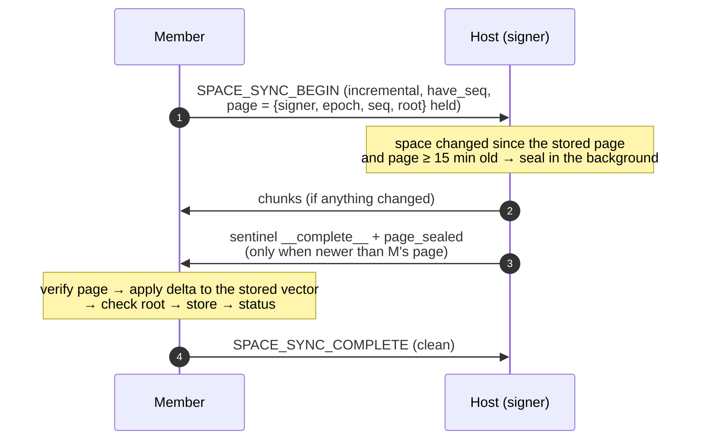

# Sync pages (signed state pages)

**Status: design for Phase 2 and Phase 3 of the sync-pages plan. Nothing
here ships yet.** It builds on [sync.md](./sync.md), the §25.6 space sync.

The space authority signs a small **page** now and then: a commitment to
the space's current content, split into 256 **buckets**. A member keeps
only the newest page and its bucket vector. With them a member can tell
whether it is behind, even while the host is offline. It can also take
**anyone's** rows from **any** member household, because each row is
checked against the signed page, not against who delivered it.

## Recommendation

1. **Commit to state, not to a log (option B).** A page header is
   `{space_id, epoch, signer, seq, issued_at, cutoff, rows, root,
   prev_root, page_suite}`, signed with the space authority key. `root`
   is the hash of 256 bucket hashes. A bucket hash covers the sorted leaf
   hashes of the rows in that bucket. A leaf is the SHA-256 of a row's
   canonical **commit form** (§2).
2. **Store almost nothing.** The host keeps its newest page, the bucket
   vector and the delta from the previous page: ≤ 17 KB per space. A
   member keeps the newest page and its vector: ≈ 9 KB per space. There
   is no per-row data and no history. Leaves are recomputed on demand.
   Hashing costs ≈ 3.3 µs per record (measured), so a 50 000-row space
   takes 0.17 s of hashing, or an estimated 2–4 s on a Pi with the
   database reads.
3. **No new message in Phase 2.** The page rides the sentinel of the
   periodic BEGIN that already runs every 30 min, sealed under the space
   content key, and only when it is newer than the one the requester
   holds. Next to it travels the **delta** of the bucket vector (the
   changed buckets only), or the full vector when the requester is more
   than one page behind. The host seals lazily: when a BEGIN finds the
   space changed since the stored page, at most once every 15 min. There
   is no timer, no push and no fan-out.
4. **Phase 3 reuses the §25.6 session.** A member sends `SPACE_SYNC_BEGIN`
   with `sync_mode: "buckets"` to **any** member household. That household
   streams, for each requested bucket it still holds unchanged, the bucket
   listing and the rows. The receiver accepts a row only if its leaf is in
   a listing that hashes to the signed vector. The same mode replaces the
   host's daily full anti-entropy stream with a bucket diff.
5. **Few new parts:** one suite tag (`PAGE_SUITE_SHA256_B256`), one
   authority event type (`space_sync_page`, under the existing
   `authority_sig_suite`), one version gate (`MIN_FOR_SYNC_PAGES` = 95) and
   one additive migration.

## Scope

- **HFS**: every household that has a space member.
  - The **signer** holds the space authority seed and acts as host: the
    owner, or a delegated admin while delegation is on.
  - Every member household verifies the page and stores the newest one.
    From Phase 3 it also delivers rows and checks the rows it receives.
- **GFS**: not involved. Pages travel only inside §25.6 sync sessions
  (paired, mesh `SPACE_ROUTED`, or the household path of a GFS mailbox
  seat). They are sealed end to end, so a relay sees no content.
  Followers get no pages.
- **Not covered**: media bytes (already content-addressed,
  `SPACE_MEDIA_WANTED`), space config (`SPACE_CONFIG_CATCH_UP`), the
  moderation queue, and the *host-only* resources in §2.

## Event types

No new `FederationEventType`. The new fields are additive, so an older
household ignores them.

- `SPACE_SYNC_CHUNK` sentinel (`__complete__`): `page_sealed` (Phase 2).
- `SPACE_SYNC_BEGIN`: `page` (a reference to the requester's newest page,
  Phase 2); `sync_mode: "buckets"` with `buckets` and `vector_hint`, and
  `page_match` (Phase 3).
- New in-stream resources (Phase 3), carried in ordinary chunks:
  `__listing__` (the leaves of one bucket).

## 1. Log or state? (decision)

The numbers below compare a **big** space (50 000 committed rows, 2 000
changes a day, 200 member households) with a **small** one (2 000 rows,
50 changes a day, 5 households). They were measured with Python `json`
(the `canonical_json` encoder) and `hashlib` on synthetic 577-byte
records, and with a real SQLite file (`WITHOUT ROWID`, after `VACUUM`).

| | A. change log + Merkle pages | **B. state commitment, 256 buckets** | C. B + per-row leaf cache |
|---|---|---|---|
| Host storage, big | 114 B × 2 000 × 30 days ≈ **6.8 MB** (grows with activity, cliff at 30 days) | page + vector + delta ≤ **17 KB** | + 56 B × 50 000 ≈ **2.8 MB** |
| Host storage, small | ≈ 170 KB | ≤ 17 KB | ≈ 130 KB |
| Member storage | header, plus the entry lists of recent pages if it is to prove rows while the host is offline | header + vector ≈ **9 KB** | ≈ 9 KB |
| Host CPU per seal | O(changes) | O(rows): 0.17 s of hashing at 50 k rows, an estimated 2–4 s with DB reads on a Pi | O(changes) |
| Seals per day, worst case | 1 per 256 changes or 5 min | ≤ 96 (lazy, ≥ 15 min apart, only when a BEGIN asks) | as B |
| Member offline > 30 days | full stream from the host | no special case (no history to expire) | as B |
| Two signers (owner + delegated admin, or a restored backup) | the chains fork, and someone must merge one log | each page stands alone as a signed snapshot of its signer's state | as B |
| Proof for a catch-up | entry lists of every missing page (~20 KiB each) | listings of the differing buckets only (6.2 KiB raw per bucket at 50 k rows) | as B |
| Replaces the daily full anti-entropy stream | no (a log says nothing about rows older than its window) | **yes**: compare roots, then buckets | yes |

**Why B.** Catch-up only needs the **latest version of each row**. A log
keeps every superseded version and needs a retention window with a cliff.
It also forks as soon as two households sign: the owner and a delegated
admin, or a host restored from a backup that reuses counter values. A
state commitment answers exactly one question: is this row, in this
version, part of the space now? It has no history. Two signers' pages
simply describe two states, and the existing merge rules (last writer
wins, stamps) already reconcile rows from either.

**Why the vector travels and is stored.** While the host is offline,
someone other than the signer has to prove rows. A deliverer can prove
bucket *i* only if it knows the signed bucket hash. With the 8 KB vector
it can compare that hash to its own recomputed bucket, so no per-row data
is replicated. A log needs entry lists (≈ 80 B per change) replicated the
same way.

**Why no leaf cache (C) yet.** Storage comes first, and the lazy seal
bounds the CPU: ≤ 96 recomputes a day for a space that changes all day,
and none for a quiet one. If profiling on a Pi shows that seals hurt in
very big spaces, C can be added later without a wire change (see
[Decisions](#decisions-owner-2026-11-21)).

### Shape

```
rkey   = SHA-256("sh-sync-rkey:v1:" ‖ resource ‖ 0x00 ‖ row_id)
bucket = rkey[0]                                              (0 … 255)
leaf   = SHA-256("sh-sync-leaf:v1:" ‖ canonical_bytes(commit_form(resource, record)))
bucket_hash[i] = SHA-256("sh-sync-bucket:v1:" ‖ i ‖ concat(sorted leaves of bucket i))
root   = SHA-256("sh-sync-root:v1:" ‖ concat(bucket_hash[0 … 255]))
```

A row's bucket depends only on its identity, so the row stays in the same
bucket across versions while its leaf changes with every version. The
domain prefixes keep each kind of hash apart. The commit form puts
`resource` and the row id inside the hashed object, so every leaf names
its row.

**What is committed:** the set of records that a full §25.6 stream from
the signer to a current, paired member household would send. Only the
*committed resources* (§2) count, and the page's `cutoff` decides the
retention window. Every household that evaluates the commitment uses the
page's `cutoff`, never its own clock, so the sets agree.

**Bucket granularity.** A deliverer can prove a bucket only while that
bucket is unchanged on its side since the page. With *k* changes after
the page, the share of buckets it can no longer prove is
1 − e^(−k/256). That is 18 % at k = 50 (a small space's whole day, or
about 35 min of a busy one) and 32 % at k = 100. A delegated admin keeps
sealing while the owner is offline, which keeps *k* small. The rest
falls back to today's helper path.

## 2. Canonical commit form per resource

`commit_form(resource, record)` = `{"r": resource, "v": projection}`.
`projection` keeps only an **allow-list** of the record's fields for each
resource (`COMMIT_FIELDS`, one table in one module), normalised as
follows:

- **Files by content hash.** Every file reference (`image_urls`,
  `file_meta.url`, covers, page body pictures) is replaced by the file's
  SHA-256 from the record's `files` map (v_85). Local names (`sc-`, `sg-`,
  upload names) never enter a hash. If the signer has no hash for a file
  in a record, that row is left out of the commitment (*host-only*).
- **Per-requester fields dropped**: `media_refs` (for link-joined members
  only) and version-gated legacy shapes. The commit form always uses the
  newest shape, because only households at ≥ `MIN_FOR_SYNC_PAGES` take
  part.
- **Receipt-local fields dropped**: anything a receiver writes with its own
  clock or ids (listed per resource below).
- **Order and numbers fixed**: lists are sorted, sets become sorted lists,
  and there are no floats. Coordinates (already 4 dp) are hashed as their
  decimal strings.
- The bytes come from `canonical_bytes` in `socialhome/canonical_json.py`
  (sorted keys, compact, ASCII).

It is an allow-list, not a deny-list: a field that a later release adds
to a record is **not** hashed until the commit form is revised, so a new
field never silently breaks every page. A revised commit form is a new
page suite (§3).

**Three rules that come out of the audit** (the exporters, the
`receive_*.py` receivers and the live inbound handlers, checked at the
`feat/sync-pages` base):

1. **Item state is never committed.** Reactions and their stamps, poll
   votes and counts, RSVPs, schedule answers and bazaar bids are merged
   per household under last-writer-wins. On top of that, their lists are
   cut by local data (`MAX_SYNCED_REACTION_STAMPS`, 1 000 votes, 200 bids)
   and the receiver re-stamps them (`receive_calendar.py:242`,
   `receive_bazaar.py:194`). They keep healing from the host's stream as
   today. A page commits to the **item**, not to who reacted to it.
2. **Receipt-local and counted fields are dropped:** `joined_at`,
   `banned_at`, `updated_at` (stickies, tasks, zones, timetables, albums),
   `comment_count`, `item_count`, `rsvps_at` / `responses_at` (export
   time), `actor_user_id` on tombstones (often empty on the live path),
   and `calendar_deleted.created_at` (`calendar_repo.py:805`, local clock).
3. **A mismatch never makes a wrong row pass.** If a deliverer's copy of
   a row differs (for example a file it holds only under a GFS `sg-`
   name, so it cannot compute the content hash), its bucket hash differs
   from the page's. It then reports the bucket as `not_held` and the
   requester asks someone else. An unstable field therefore costs
   availability, never safety. That is why only the resources that would
   *always* mismatch are kept out.

| Resource | Commit form (allow-list) | Verdict |
|---|---|---|
| `posts` | `id, space_id, author, type, content, created_at, edited_at, hidden_from_feed`, files as hashes (`image_urls`, `file_meta` without `url`, link-card thumbnail) | stable after normalisation. Leave out `location`, `bot_id`, `linked_highlight_id`, `linked_event_id`, `no_link_preview`, `pinned`, `moderated`: the sync receiver never stores them (`receive_posts.py:738-775`) |
| `posts_deleted`, `comments_deleted` | `id, post_id / comment_id, author, created_at` | stable (no `deleted_at` on the wire) |
| `comments` | all fields, with `media_url` replaced by its hash | stable after normalisation |
| `task_lists`, `tasks`, `tasks_archived` | all fields except `updated_at` (`domain/task.py:491`) | stable after normalisation |
| `*_deleted` for lists, tasks, pages, stickies, zones, timetables, gallery | identity fields + `created_at`, without `actor_user_id` (and without `created_at` for `calendar_deleted`) | stable after normalisation |
| `pages` | `id, title, content, cover_image_url, created_by, seq, version_hash, conflict` (`sp-` names are the same everywhere); locks and delete requests are local workflow | stable after normalisation |
| `stickies`, `space_zones`, `timetables` | all fields except `updated_at`; floats (`position_*`, coordinates) as decimal strings | stable after normalisation |
| `calendar` | the series row (never expanded) without `rsvps`, `rsvps_at`, `rsvps_partial`; `cover_url` as a hash | stable after normalisation |
| `gallery` | non-system albums without `item_count`, `updated_at`; items with `url` / `thumbnail_url` as hashes | stable after normalisation (system albums have local ids and are left out, as in the stream) |
| `polls`, `schedules` | definition only: `meta`, options `(id, text)`; schedule `title, deadline, slots, finalized_slot_id` | stable after normalisation |
| `bazaar` | listing without `bids`, images as hashes; check the `sold_at` format (whole seconds, `space_content.py:3550`) in the tests | stable after normalisation |
| `bans`, `members` | could be committed as `(user_id, role, …)` without `joined_at` / `banned_at` / `picture_hash` | **host-only for now.** The roster has its own `roster_digest` repair, and removals have no tombstone, so a member holding a removed seat would mismatch until that repair |
| `member_pictures` | none | **host-only**: every receiver re-encodes the image (`receive_members.py:69`) |
| `chat_messages`, `chat_messages_deleted` | none | **host-only**: each household prunes its own chat, and `created_at` is capped at the receiver's clock and `reply_to_id` nulled (`space_chat.py:346-366`) |

**Files.** Since v_92 a receiver stores every hashed file under its
content name (`sc-<sha256>`), so any household can derive the hash from
the name. The host computes the hash from its own copy, as v_85 does for
`files`. A row whose file the deliverer does not know by content (a
pre-v_92 legacy name or a GFS `sg-` copy) falls under rule 3. The `files`
map in the stream is capped at 200 records per stream; the commit form
does not read it, it computes the hashes from the stored names.

**Required tests (Phase 2 gate):** for every committed resource, stream a
row from host to member through the real receiver, re-export it on the
member, and compare the leaves. Do the same after a live event instead of
a stream. Golden vectors pin the bytes.

## 3. Signing, epochs and suites

**Signed body** (`authority_sig.sign_authority_event`, event type
`space_sync_page`, which reuses `authority_sig_suite`):

| Field | Meaning |
|---|---|
| `space_id`, `epoch` | the space, and the `authority_key_epoch` of the signing key |
| `signer` | instance id of the sealing household (owner or delegated admin) |
| `seq` | the signer's `sync_seq` snapshot, read before the export (the same counter its watermarks use) |
| `issued_at` | unix ms; refused if more than 300 s ahead of the receiver's clock |
| `cutoff` | the retention cutoff the commitment used (`null` = keep forever) |
| `rows` | leaf count (only for status, e.g. "≈ 3 % differs") |
| `root`, `prev_root` | this page's root, and the root of this signer's previous page (`null` for the first) |
| `page_suite` | `PAGE_SUITE_SHA256_B256 = "sha256-b256-c1"`: hash, bucket count and commit-form revision |

**Who signs.** Only a household that holds the seed
(`space_repo.get_space_seed`) **and** acts as host
(`host_equivalence.acting_hosts`) seals. That means the owner, or a
delegated admin while `delegated_admin_authority` is on. A plain member
never signs. With delegation off and the owner offline, no new pages are
sealed. The last one still proves everything the owner held when it went
offline, which is the content a catch-up needs most.

**Verification** (pure, in a `socialhome/sync_page.py` next to
`space_owner_statement.py`):

1. `page_suite` must be in `SUPPORTED_PAGE_SUITES`, or
   `UnsupportedPageSuite(ValueError)` is raised. The page is refused and
   never defaulted, and the receiver keeps what it had.
2. `epoch` must equal the epoch this household pins. A lower epoch is a
   retired key and is refused. A higher epoch is refused too; the
   existing authority-epoch echo (v_46) fetches the rotation, and the
   page comes again on the next round.
3. `verify_authority_event` must pass against the pinned space public key.
4. `issued_at` must not be more than 300 s in the future. The order key
   is `(epoch, issued_at, seq)`, and only a newer page replaces the
   stored one.
5. The vector must hash to `root`. For a delta, the receiver applies it
   to its stored vector, which must match `prev_root` and the stored
   page's `signer`. Otherwise it asks for the full vector.

**Epoch rotation.** When a member applies `SPACE_AUTHORITY_ROTATED`, it
drops its stored page together with the baseline reset it already does.
The owner seals a new page at the next BEGIN (an old-epoch page is always
stale). A revoked admin who still holds the old seed can sign old-epoch
pages only until a member applies the rotation. That is the same
residual window every authority event has today (see the rotation
service docstring). It gives the revoked admin no new power: as an acting
host it was already trusted whole (`_acts_as_host`).

**Suite rule (CLAUDE.md).**
- `PAGE_SUITE_SHA256_B256`, `SUPPORTED_PAGE_SUITES` and
  `UnsupportedPageSuite` carry the commitment scheme.
- The signature keeps its own `authority_sig_suite`, so the PQ path
  (`ed25519+mldsa65`) follows `authority_sig` with no page change.
- A new commit-form revision, a different bucket count or another hash is
  a sibling suite, sealed only when every member household at
  `MIN_FOR_…` of that suite supports it. During a transition the host may
  seal both suites.
- A member whose suite is unknown keeps today's behaviour (host-only).

**Equivocation.** Two valid pages with the same `(epoch, signer, seq)`
but different roots are a conflict, and so is a page whose `prev_root`
breaks the chain the receiver holds.

- Causes: a host restored from a backup that reuses counter values
  (benign), or a misbehaving seed holder.
- What the receiver does:
  - keeps the newer `issued_at`;
  - logs WARNING with both page hashes;
  - sets `page_conflict` in the sync status;
  - in Phase 3, a deliverer also compares the page sent in the BEGIN with
    its own.
- The space is not halted. Seed holders are already trusted to sign
  config and roster, and the two signed pages are evidence the owner can
  act on (demote, which rotates the key).

## 4. Wire

### Phase 2: the page on the sentinel



- **`page` in BEGIN**: `{signer, epoch, seq, root}`, about 120 B, inside
  the encrypted payload. With it the provider can skip a page the
  requester already has, and can choose between a delta and the full
  vector.
- **`page_sealed` on the sentinel**: AES-256-GCM under the space content
  key, through the same helper and AAD as chunks
  (`encrypt_chunk`, `space_id:epoch:sync_id`). The sentinel itself stays
  plaintext-signed, so the page, its counts and its hashes must not ride
  in the clear (encryption-first rule). The plaintext is
  `{page, delta | vector}`:
  - `delta`: `[[i, bucket_hash_b64], …]`, the buckets that changed since
    `prev_root`, sent when the requester's page is that previous page;
  - `vector`: all 256 bucket hashes (8 KiB raw), sent otherwise.
- **Any provider relays**: a non-signing provider (a member household
  that streams its writers' rows) attaches the newest page it holds in
  the same way. This is the member-to-member relay. It needs no new
  message, and the authority signature means a relay can only withhold a
  page, never forge one.
- **Lazy seal.** When the provider is a signer and is about to build a
  sentinel, it seals a page if all of these hold:
  - the space changed since `page.seq` (the `is_quiet` probe with
    `since = page.seq`);
  - the stored page is ≥ `PAGE_MIN_INTERVAL_S` (900 s) old, or belongs to
    an older epoch, cutoff day or suite.

  The seal runs as a background task, one per space under a lock. The
  export is read in keyset pages (async DB) and the hashing runs through
  `asyncio.to_thread`. The sentinel carries the stored page (the next
  round gets the new one), so a BEGIN never waits on a seal.
- **Version gate.** Pages go only to requesters where
  `peer_supports(…, MIN_FOR_SYNC_PAGES)` holds. An older requester gets
  today's sentinel. An older provider sends no page, and the requester's
  status falls back to Phase 1 rules. No `SYNC_RECORD_LINES` entry is
  needed: no record changes shape and no receiver takes a different
  field, so no household needs a full stream to cross v_95.

### Phase 3: verified fetch from any member

```mermaid
sequenceDiagram
    autonumber
    participant R as Requester
    participant D as Any member household
    Note over R: host silent (HostContact) or daily anti-entropy;<br/>recompute own vector V_R; S = { i : V_R[i] ≠ V_P[i] }
    R->>D: SPACE_SYNC_BEGIN (sync_mode = buckets,<br/>page = full signed P, buckets = S)
    Note over D: verify P; recompute V_D;<br/>serve S ∩ { i : V_D[i] = V_P[i] }
    loop per served bucket (≤ 8 KB chunks)
        D->>R: __listing__ i (sorted leaves)
        D->>R: rows of bucket i that R lacks or holds older
    end
    D->>R: sentinel (served, not_held = remaining buckets)
    Note over R: listing hashes to V_P[i]? each row's leaf ∈ listing?<br/>→ apply as if from the host (same merge rules)
    R->>D: SPACE_SYNC_COMPLETE
    Note over R: not_held → ask the next member (helper rotation)
```

- **Request**: the full signed page P (so D needs no stored state to
  check it) and up to 256 bucket indices. The `may_receive` writer gate
  and the per-(requester, space) budget apply as for today's helpers.
  The request rotates through member households with the same stable
  offset as `trusted_helpers.py`, but any member household at ≥ v_95
  qualifies, not only admins and moderators.
- **Proof**: per bucket, one `__listing__` record (the sorted 32-byte
  leaves) and then the rows. The receiver:
  1. hashes the listing (with `i`) and compares it to the stored
     `V_P[i]`;
  2. hashes each row's commit form and checks the leaf is in the
     listing;
  3. applies the row through the normal receiver with `verified=True`,
     which passes where `_acts_as_host` passes today, and nowhere else.

  A listing also tells R exactly which leaves it still lacks, so a
  partial delivery is harmless: R asks the next member for the rest.
- **D sends only rows R lacks**: R puts its own leaves for S in the BEGIN
  as `vector_hint`. That is a compact list of 8-byte leaf prefixes, about
  8 B × the rows in S, which is ≤ 16 KiB for 10 buckets in a big space.
  D skips rows whose leaf R already holds.
- **Anti-entropy**: the host's daily full stream becomes the same flow
  against the host:
  1. R recomputes V_R against the newest page and finds S.
  2. An empty S → the next BEGIN carries `page_match: {seq, root}`, and the
     host refreshes `full_at` without streaming.
  3. Otherwise R sends a `buckets` session to the host for S.

  A false `page_match` only harms the household that sends it.
- **Bounds**: page ≤ 1 KiB; delta ≤ 256 entries; vector exactly 256 × 32
  B; ≤ 256 buckets per request; listing ≤ 4 096 leaves (128 KiB, spread
  over chunks). That caps the b256 suite at about 1 M rows per space;
  bigger spaces would need a sibling suite with more buckets.
- **Encryption-first**: in the BEGIN, the page, the bucket list and the
  hints are all inside the per-pair encrypted payload. Listings and rows
  are chunk records under the content key. Only `space_id`, `sync_id`,
  `resource` and chunk counters stay in the clear, as today.

## 5. Cost

| Trigger | Recipients × items × bytes | Big space, worst case per day | Small space |
|---|---|---|---|
| Phase 2, page on the sentinel | only members whose BEGIN shows an older page; ≤ 1 page per member per 30-min round | 200 × 48 × (0.7 KiB page + ~2 KiB delta, ~40 changed buckets) ≈ **26 MB**; a member > 1 page behind gets the 11 KiB vector once | ≈ 0, a few KB |
| Phase 2, seal | 1 export + hash, ≤ 1 / 15 min, only when asked and changed | ≤ 96 × 2–4 s CPU on a Pi (est.) | ≤ 96 × 0.1 s |
| Phase 2, member root check | 1 recompute per new page, debounced ≤ 1 / h, `to_thread` | ≤ 24 × 2–4 s per member (est.) | trivial |
| Phase 3, catch-up while the host is silent | 1 requester → 1 member per round, cooldown as for helpers | listings 6.2 KiB raw per differing bucket + the rows R lacks (rows it would have had from the host anyway) | |
| Phase 3, anti-entropy | replaces a full stream per member per day | today ≈ 200 × 50 k × ~0.6 KB ≈ **6 GB/day** of host upload → **≈ 0** when roots match, otherwise only the differing buckets | |

- **Live traffic, for scale**: 2 000 changes × 200 households × ~1.5 KB
  ≈ 600 MB/day.
- **Net effect**: Phase 2 adds about 4 % on top of the live traffic in
  the busiest case and nothing to a quiet space. Phase 3 removes the
  biggest recurring cost a space has.
- **Amplification**: nothing fans out. One requester talks to one
  provider per session, and one member's action never triggers N × M
  work.
- **The 30-min quiet BEGIN stays.** It is the host-liveness probe
  (`HostContact`) and the watermark exchange, and the page cannot skip it.
  The page only makes it more useful: a quiet round now also says "your
  copy matches the host as of 14:05". Phase 3's `page_match` is what
  makes the daily full pass skippable.

## 6. Security

| Threat | Outcome |
|---|---|
| Forged row from a deliverer | Its leaf is not in a listing that hashes to the signed vector, so the row is refused and logged. The test is a demo step. |
| Stale row version | An old version's leaf is not in the current listing, so it is refused. A version that is valid but older than one held is resolved by the existing merge rules (last writer wins on `edited_at`, stamps), so a newer local copy stays. |
| Withheld page | A relay can only drop the page. The host's own sentinel and any other member's sentinel carry it, and status shows the page's age ("as of 2 h ago"). |
| Replayed old page | It is older by `(epoch, issued_at, seq)`, so it is ignored. Rows proven by it are refused once a newer page is stored. |
| Removed admin (epoch rotation) | The old-epoch page is refused after the member applies the rotation; the residual window is unchanged (§3). |
| Equivocation | Detected per `(epoch, signer, seq)` and through the `prev_root` chain, then reported (§3). |
| Withholding rows | A listing names every leaf, so R knows what is still missing and asks the next member. |
| Oversized proof | The bounds in §4 apply; anything larger is refused before it is parsed further. |
| Privacy | Pages, vectors and listings are encrypted under the space content key and go only to member households (§4). Hashes of low-entropy records (tombstones) could be guessed only by someone who already holds the key, which means a member who can read the content anyway. Non-members on a mesh path see `SPACE_ROUTED` ciphertext. The GFS sees nothing, because no sync traffic goes through it. A page reveals no person's location; zones are content and are encrypted with the rest. |

## 7. Phase plan

**Phase 2: pages and the "behind?" check** (one PR on `feat/sync-pages`,
protocol v_95, with adversarial review).
1. `socialhome/sync_page.py`: commit form, `COMMIT_FIELDS`, hashing,
   sign / verify, suites.
   - Tests: golden vectors per resource.
   - Tests: host versus member export of the same row hashes the same, a
     property test over each receiver (stream a row, re-export it,
     compare the leaf).
   - Tests: unknown suite refused, epoch checks, future skew, ordering,
     delta apply, a broken chain flagged as a conflict.
2. Additive migration with the audit:
   - `space_instances` gains nothing;
   - one table `space_sync_pages(space_id PK, page_json, vector BLOB,
     delta BLOB)` holds the newest page per space, the same row on host
     and member;
   - the PR shows why no existing column fits.
3. Lazy seal in `provider.py`, plus `page` in BEGIN (`scheduler.py`) and
   `page_sealed` on the sentinel (`exporter.build_sentinel`).
4. Member side: verify, store, debounced root check, status.
   - Phase 1's `SpaceSyncStatus` gains `page: {at, signer_role, match,
     differing_buckets, conflict}`.
   - With `match` the state is `up_to_date` ("matches the host as of …"),
     even while the host is offline.
   - A mismatch while the host is silent is `behind`.
   - A mismatch while the host is reachable is `catching_up`.
5. `MIN_FOR_SYNC_PAGES = 95`, capabilities.md row, the federation-demo
   assertion that the version round-trips, and docs (this page, sync.md,
   database.md).
   - Demo: after a post, member b's status shows the page and `match`.
     Stop the host a and post on c, and b's status shows `behind`, not
     `never`.

**Phase 3: verified fetch from any member** (one PR, same v_95 if it
ships in the same release, otherwise v_96).
1. `sync_mode: "buckets"` on the provider (any member household), with
   listings, hints and `not_held`.
2. The receiver's `verified` path, which replaces the own-rows-only limit
   of `resume.py` / `trusted_helpers.py` wherever a page covers a bucket.
   Rows created after the page keep today's helper replay.
3. Anti-entropy: `page_match` in BEGIN, and `since_for` refreshes
   `full_at` on a match.
4. Tests: a tampered row refused, a stale version refused, a forged
   listing refused, a partial delivery followed by the next member, and
   merge rules kept.
5. Demo:
   - The host goes down. Member b catches up a bucket of others' posts
     and pages from member c and verifies it.
   - A deliberately tampered row is refused (`verify: ok` twice).
   - Show `pytest tests/protocol/ -m security -n 4` green.

## Decisions (owner, 2026-11-21)

1. **A state checksum (option B), not a change log.** The page keeps its
   name and the `prev_root` chain.
2. **Any member household may deliver verified rows in Phase 3.** The
   proof makes trust in the deliverer unnecessary. Admins and moderators
   get no priority; the request rotates with the stable offset from
   `trusted_helpers.py`.
3. **256 buckets now** (`sha256-b256-c1`). If big spaces need more, that
   comes later as a sibling suite.
4. **No leaf cache (C).** Measure a real seal on a Pi first, in the
   Phase 2 PR, and decide on C from that number.
5. **Timings:** a seal at most every 15 min (`PAGE_MIN_INTERVAL_S`), and a
   member root check at most once an hour.
6. **`members` / `bans` stay host-only for now.** Committing them is a
   later step, after Phase 3. It needs a removal tombstone, or the roster
   digest folded into the page.
7. **Post fields the sync receiver drops stay uncommitted.** These are
   `location`, `bot_id`, `linked_highlight_id`, `linked_event_id`,
   `no_link_preview`, `pinned` and `moderated` (§2). This is a known limit,
   with no receiver change.

## Implementation pointers (planned)

- `socialhome/sync_page.py` (new): commit form, hashing, page sign and
  verify, suites.
- `socialhome/federation/sync/space/exporter.py` (`build_sentinel`),
  `provider.py` (lazy seal, `buckets` mode), `scheduler.py` (`page` in
  BEGIN, Phase 3 rotation), `receiver_base.py` (`verified` next to
  `_acts_as_host`), `watermark.py` (`page_match` → `full_at`).
- `socialhome/authority_sig.py` (event type `space_sync_page`),
  `services/space_authority_rotation_service.py` (drop the page on
  rotation), `domain/federation_capabilities.py` (`MIN_FOR_SYNC_PAGES`).

## Spec references

§25.6 (space sync), §24.11 (inbound pipeline), §25.8.21
(encryption-first), §4.4.1 (outbox retention). Related:
[sync.md](./sync.md) ("Host offline: trusted helpers", "Incremental
sessions", "Coverage"), [capabilities.md](./capabilities.md),
[../crypto.md](../crypto.md).
