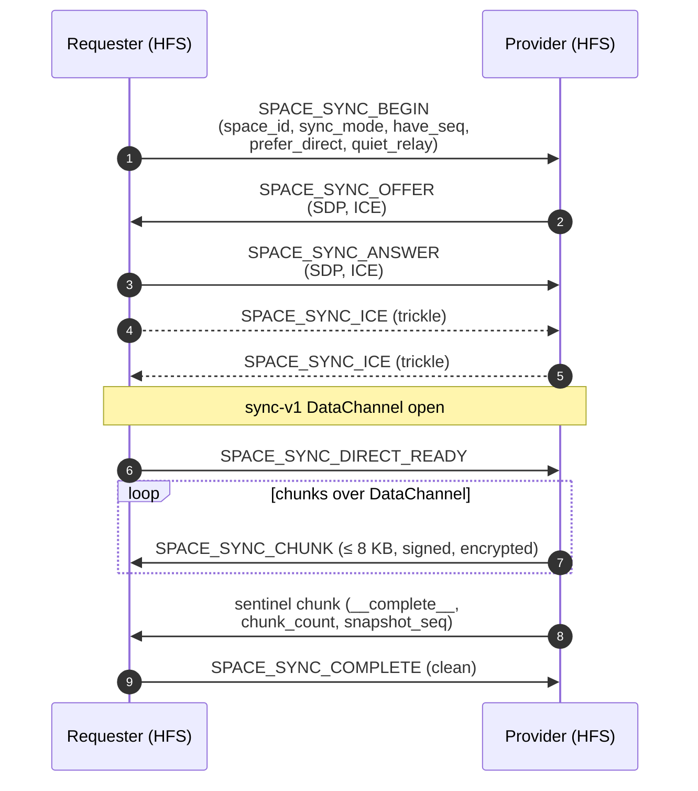
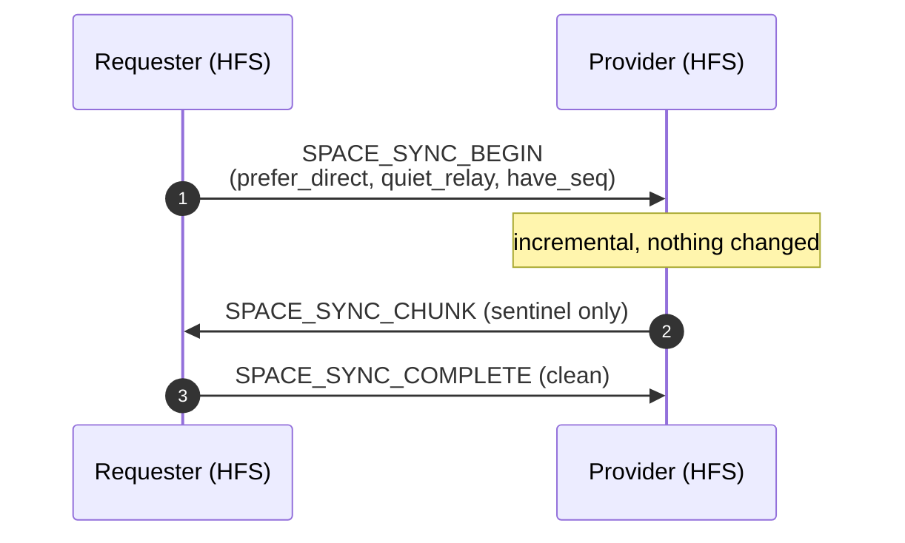
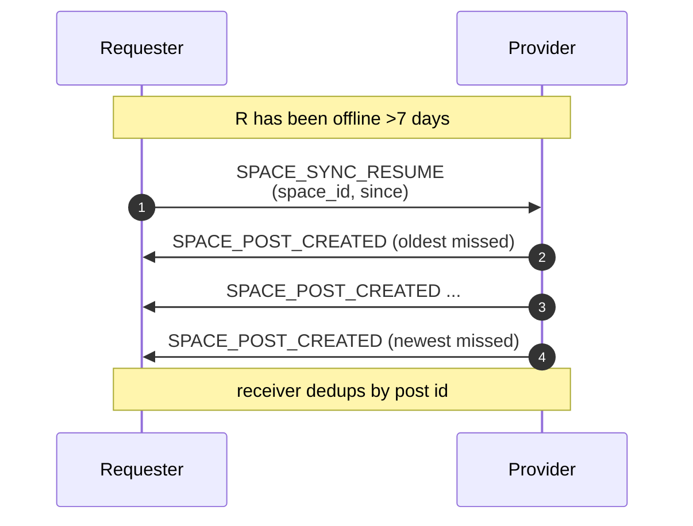
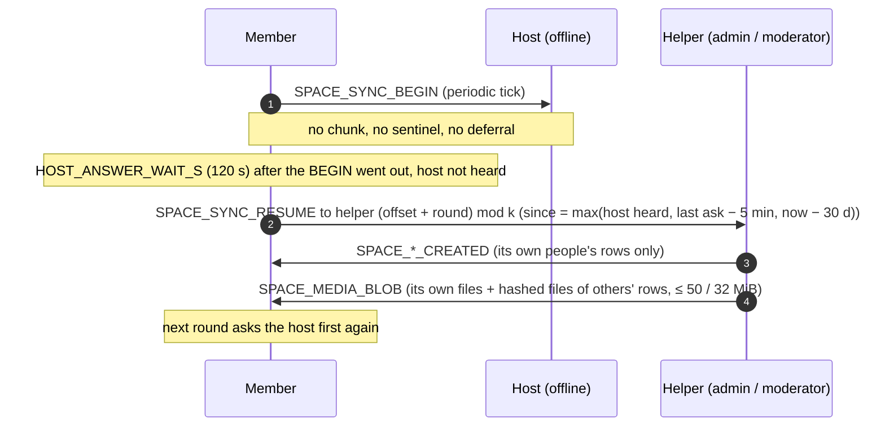

# Sync

When a new peer joins an existing space, it needs the historical
content the space already has — posts, comments, pages, tasks,
calendar events, stickies. That one-time bulk catch-up is the **sync
protocol**. Ongoing live updates afterwards are covered by
[feeds](./feeds.md) and the other content pages.

## Scope

- **HFS**: both sides. Requester asks for a snapshot; provider exports
  + streams chunks; requester acks and commits.
- **GFS**: uninvolved. Sync is strictly peer-to-peer. Preferred
  transport is the `sync-v1` WebRTC DataChannel; falls back to
  chunked inbox.

## Event types

`SPACE_SYNC_BEGIN`, `SPACE_SYNC_CHUNK`, `SPACE_SYNC_CHUNK_ACK`,
`SPACE_SYNC_RESUME`, `SPACE_SYNC_COMPLETE`,
`SPACE_SYNC_OFFER`, `SPACE_SYNC_ANSWER`, `SPACE_SYNC_ICE`,
`SPACE_SYNC_DIRECT_READY`, `SPACE_SYNC_DIRECT_FAILED`,
`SPACE_SYNC_REQUEST_MORE`. `SPACE_SYNC_CHUNK_ACK` is defined but no
release sends it: a stream is confirmed once, by the requester's
`SPACE_SYNC_COMPLETE {clean}` after the sentinel (see "Backpressure").

Healing one missing file on view, not a stream: `SPACE_MEDIA_WANTED`
(v_92, [media.md](./media.md#older-files-on-view--space_media_wanted-v_92)).

## Tiered transport

- **Tier 2 — HTTPS inbox.** The bootstrap path. Always available; used
  until the dedicated sync DataChannel is up. Chunks are POSTed one by
  one to the provider's inbox.
- **Tier 3 — DataChannel (`sync-v1`).** Separate from the `fed-v1`
  routine channel so a large sync doesn't block live events. Once the
  DataChannel is negotiated the requester sends
  `SPACE_SYNC_DIRECT_READY` and subsequent chunks flow over it.

## Flow — happy path, upgrades to DataChannel

## Flow — quiet periodic session (no WebRTC)

Most periodic sessions have nothing to stream: no covered row changed
since the requester's watermark, and the roster is the one it confirmed
(see "Incremental sessions"). Such a session is its signed sentinel
alone, so negotiating a DataChannel for it (OFFER, ANSWER, ICE both ways,
DTLS, DIRECT_READY) cost more than the session. A requester that takes a
quiet stream over the relay says so in its BEGIN (`quiet_relay: true`,
`scheduler.py`); the provider then checks before it builds an OFFER
(`SpaceSyncService.is_quiet`: plans the session and reads up to the first
record of each resource) and, when nothing would stream, sends just the
sentinel as a `SPACE_SYNC_CHUNK` event over the household-to-household
path. The requester's chunk handler opens the HTTPS receive session for it,
but only for a sync id it issued and only for the household it asked
(`FederationService._open_quiet_relay_session` → `pending_sync_request`).
The sentinel is checked exactly like one sent over the DataChannel, and
`SPACE_SYNC_COMPLETE` advances the watermark as usual.

`quiet_relay` is additive: an older provider ignores it and negotiates
WebRTC as before, and a provider never streams over the relay to a
requester that did not send it. An older requester has no session for a
chunk that arrives before an OFFER and would drop it. No protocol bump.
A session with anything to stream, a full session, a mesh-only requester
(already relay) and a provider without watermarks are unchanged.

## Flow — long-offline catch-up

A household that was offline past the 7-day outbox retention (spec §4.4.1)
catches up through the ordinary §25.6 sync above: the periodic tick (and a
pairing, or "Sync now") asks each provider for every shared space, and an
incremental session with no confirmed watermark streams in full.

`SPACE_SYNC_RESUME` is a second, narrower replay that answers with a
**burst of individual federation events** — `SPACE_POST_CREATED`,
`SPACE_TASK_CREATED`, etc. — that the receiver's existing inbound handlers
apply by primary key (re-deliveries are idempotent). The full replay is
reached through an operator's `INSTANCE_RESYNC_REQUEST` (scope `space` /
`calendar`, from the admin federation route), whose handler runs
`replay_space_to` / `replay_calendar_to`. A single file that never
arrived is not a replay's business: a member asks for it on view with
`SPACE_MEDIA_WANTED` (v_92, see
[media.md](./media.md#older-files-on-view--space_media_wanted-v_92)),
which replaced the never-released v_87 `refill` field of this request.
Every `since` comparison runs through `datetime()` on both sides, so a
naive stored stamp and a tz-aware `since` compare as times.

Implemented by `socialhome/federation/sync/space/resume.py`
(`SpaceSyncResumeProvider`). Today's cut replays:

- `SPACE_POST_CREATED` — posts (`space_post_repo.list_since`)
- `SPACE_COMMENT_CREATED` — comments on those posts
  (`space_post_repo.list_comments_since`, JOIN through `space_posts`)
- `SPACE_TASK_CREATED` — tasks (`space_task_repo.list_since`)
- `SPACE_PAGE_CREATED` — pages (`page_repo.list_since`)
- `SPACE_STICKY_CREATED` — stickies (`sticky_repo.list_since`)
- `SPACE_CALENDAR_EVENT_CREATED` — calendar events
  (`space_calendar_repo.list_events_since`, RRULEs included)
- `SPACE_GALLERY_ITEM_CREATED` — gallery items, joined via
  `gallery_items.album_id` → `gallery_albums.space_id`. The albums go
  out first (v_33; never the system "Posts" album): the album deletes
  recorded since `since` as `SPACE_GALLERY_ALBUM_DELETED`, every album of
  the space as `SPACE_GALLERY_ALBUM_CREATED` (a no-op for one the receiver
  holds) and those edited since `since` as `SPACE_GALLERY_ALBUM_UPDATED`
  — the receiver files an item only into an album it already holds, and an
  album made, edited or deleted while it was offline is state it lacks
  whether or not anything was uploaded since. Live, albums push their own
  `SPACE_GALLERY_ALBUM_*` lifecycle events (see
  [`spaces.md`](./spaces.md)). Wire payload is the §S-9 thumbnail projection **plus
  the full `url`** (`GalleryItem.to_federation_dict`): the on-demand
  full-file fetch S-9 describes was never built, the sender pushes both
  files over the media outbox, and the receiver's row must name the full
  file or the `SPACE_MEDIA_BLOB` scope check refuses it. Both rows record the owning /
  uploading `user_id` with **no** foreign key, because that user lives
  on the originating household — the same reason `space_posts.author`
  carries none. Before migration 0046 those columns referenced the local
  `users` table, so a synced album or item could not be inserted at all
  and a member household received the image bytes and no rows (#650).

Each resource is capped at `MAX_PER_RESOURCE = 500` events per request.
Nothing re-issues a request past that cap: a space with more than 500
rows of one kind missed since `since` gets the 500 oldest; the rest
arrives through the §25.6 sync. Since v_92 a replay reaches back at most
`RESUME_MAX_AGE_S` (30 days) whatever `since` asks — the catch-up is
bounded on every path; an older file arrives on view
(`SPACE_MEDIA_WANTED`). The replayed rows' files — posts, **comments**,
covers, gallery items, the host's pages — ship from the replaying household
within `RESUME_MEDIA_MAX_FILES` (50) / `RESUME_MEDIA_MAX_BYTES` (32 MiB)
through the v_86 file gate.

### Host offline: trusted helpers (v_92)

Every member heals from its host first. While the host is offline nothing
used to heal: the §25.6 sync and the resume both came from it. Now the
periodic tick (`scheduler.SpaceSyncScheduler`, trigger 10) — which asks the
host first every round, as before — notes when this round's BEGIN to the
household acting as a space's host (the owner, or the delegated admin that
invited us) actually goes out: not when it is queued, and never for a BEGIN
that waits for a free slot (trigger 8) or is skipped because the host's row
is gone — no answer is due for a BEGIN that was not sent. The receiver
marks the space **heard** whenever that household answers: any signed
chunk of the space it verifies from it, including the bare `__complete__` sentinel an up-to-date incremental session
sends back (a quiet space must count, or it would always fall back), and the
scheduler counts a host's capacity deferral too (`SpaceSyncDeferred` with
`reason="capacity"`: the host refused with `too_many_sessions` or
`node_capacity`, so it is online; an `interrupted` stream does not count)
(`federation/sync/space/host_contact.py`, in memory; a restart forgets it). If
`HOST_ANSWER_WAIT_S` (120 s, fixed — never random) after that BEGIN the host
has not answered, the member sends `SPACE_SYNC_RESUME` to **one** trusted
helper — a household holding a live `admin` or `moderator` seat in the
roster mirror at v_92 (`space_member_supports`: an older helper would
replay everyone's rows), never us or the host, sorted
(`federation/sync/space/trusted_helpers.py`, the one picker
`SPACE_MEDIA_WANTED` uses too); each household starts at its
own stable offset (`sha256(own instance id ‖ space id) mod k`, never random)
so a space's members spread over its k helpers instead of all asking the
first, then one step further each silent round — with `since` = the newest
of: when the host was last heard, the previous helper ask for the space
minus a fixed 5-minute overlap (`HELPER_OVERLAP_S`; remembered in memory per
space, bounded like the heard marks), and 30 days ago. So while the host
stays silent each round replays only what is new since the last ask; a file
the member still lacks arrives when someone opens it (`SPACE_MEDIA_WANTED`).
No helper at v_92 → nothing: the member waits for the host (logged once
per round). A space we host, or hold the roster authority of, never falls
back.

Every member is equal here: a host reached only over the mesh gets the same
small incremental BEGIN every periodic tick as a paired host (trigger 2) —
once its full mesh catch-up completed, and also once that full catch-up hit
its attempt cap (`MAX_MESH_CATCHUP_ATTEMPTS`, which bounds only the FULL
catch-up). An up-to-date host answers it with only the signed sentinel; a
BEGIN that found no route is never answered either, so the same 120 s wait
reaches a helper. One incremental BEGIN per 30-min tick stays under the
host's 5 / h per (household, space).

Rights do not grow. A household that is not the space's roster authority
(the predicate the file gate uses) replays **only its own people's rows**
(tombstones by its own people's deletes) — every receiver takes other
people's rows only from the household acting as host (`_acts_as_host`) —
but it still ships the **hashed** files of every replayed row through the
v_86 gate, so a member that holds a row from the host gets its picture,
verified against the hash its row carries. Album deletes are replayed as
before (they name no deleter; the receiver judges them by
`may_mutate(settings=True)`). The request goes with
`send_with_mesh_fallback`, so a helper reached by mesh or a GFS mailbox seat
gets it: paired, mesh and GFS-only members fall back alike.

**Cost.** Per silent space and round (the 30-minute tick): each of the M
member households sends its host one BEGIN (as before) and, 120 s after it
went out, one resume request (< 1 KiB) to ONE helper. The per-household
offsets spread the M requests over the k helpers — about M/k each, never M
on one. A helper serves at most one replay per (requester, space) per 30 min
(`RESUME_COOLDOWN_S`), each ≤ 500 rows per resource of its own people plus
≤ 50 files / 32 MiB. Worst case per helper and round: (M/k) × (≤ 500 rows
per resource + ≤ 50 files / 32 MiB) on the **first** round of an outage;
after that `since` advances to the previous ask (minus the 5-minute overlap,
deduped by id), so each later round carries only the rows written since and
their files — a quiet space's replays are near empty. Global space, 200
member households, 2 helpers, host offline: ~100 requests per helper per
round; the first round is bounded by 100 × 32 MiB ≈ 3.2 GiB of files per
helper (only if each requester lacked 50 recent files; the files are the
hashed pictures the member does not hold yet), every later round only the
new rows' bytes — 200 × 48 = 9 600 small requests a day in all, ~4 800 per
helper. Nothing fans out: one requester, one helper, one space per round.
The first round after a boot reaches back to the host's last answer
(≤ 30 days) once, since the helper-ask mark is in memory.

## What a sync streams

The provider walks `RESOURCE_ORDER` (`federation/sync/space/exporter.py`)
— roster first (`bans`, `members`, `member_pictures`), then content, each
live resource preceded by its tombstones:

`posts_deleted`, `posts`, `comments_deleted`, `comments`, `task_lists`,
`task_lists_deleted`, `tasks_deleted`, `tasks`, `tasks_archived`,
`pages_deleted`, `pages`, `stickies_deleted`, `stickies`,
`calendar_deleted`, `calendar`, `gallery_albums_deleted`, `gallery`,
`gallery_items_deleted`, `polls`, `schedules`, `space_zones_deleted`,
`space_zones`, `bazaar`, `timetables_deleted` (v_92), `timetables`,
`chat_messages_deleted`, `chat_messages`.

(Comment tombstones follow the posts, and gallery-item tombstones the
gallery, because a host stub for an id never held needs its parent — the
post, the album — held here first. The receiver does not rely on that
order: a chunk applied out of order — relayed chunks are separate inbound
events — whose item stub, or item, names an album not held here yet holds
the stream back from `clean` (see [`clean`](#incremental-sessions-change-stamps--per-household-watermark)),
so the next periodic session streams it again.)

A receiver drops a resource it does not know (DEBUG), so a new resource
needs no capability gate: an older receiver ignores it, and a newer
receiver simply gets nothing from an older provider.

**No fixed size limit — the space's retention window.** What streams is
what the space's retention keeps (`federation/sync/space/window.py`):

- `retention_days` set → live posts (and the comments, polls, schedules
  and bazaar listings that hang on them) and chat messages created at or
  after `now − retention_days`; post types in `retention_exempt_json` at
  any age, as the retention sweep keeps them. The chat's deletions use the
  same window (every household prunes its own chat).
- no retention (keep forever) → **everything**.
- **always in full**, whatever the retention:
  - **gallery** items — nothing prunes them (the retention sweep touches
    posts and chat only), so a window would hide from a joiner photos the
    host still shows. The system ("Posts") album's items and their
    tombstones never stream: they mirror posts, every household rebuilds
    its own from the posts — a post a sync stores included
    (`SpacePostSynced`, which only the system-album bridge follows: no
    notification, no fan-out, no live gallery frame per photo; a deleted
    or moderated post mirrors nothing) — and each household's system album
    has its own id (a receiver refuses an item naming another household's
    system album by rule — an older provider's stream). A post mirrored by
    the live event and by a sync at once stores each file once (migration
    0091's unique index);
  - **calendar** events — every live event **as its stored row**, whatever
    its date: a recurring event once, carrying its `rrule` (the receiver
    expands its occurrences on read, as the host does), never one record
    per occurrence. Nothing prunes calendar events either. (Until shape 3
    the exporter read a ±10-year window around the provider's clock and
    expanded each series into `<id>@<start>` records — a member stored
    every occurrence as a one-off event and the series row lost its rule,
    and events drifted across the window's edge so a full and an
    incremental session disagreed. A receiver skips an `<id>@<start>`
    record whose suffix is its own start, from an older provider: it is a
    view of a series, never a row — and migration 0089 removed the ones
    already stored, with their RSVPs and reminders, and refuses the shape
    at insert.) **v_56-gated**: a requester below v_56 reads no `rrule`
    from a record and its upsert would turn each series it holds into a
    one-off event, so it is still streamed the old record set
    (`ExpandedCalendarExporter`: `<id>@<start>` occurrences, ±10 years) —
    the first occurrence too, which the expansion yields as the stored
    series row: it goes out under `<id>@<start>` like the others, never
    under the series' own id (such a receiver would upsert the series
    without its rule). It stores the occurrences as one-off events, as it
    always did; its series row (delivered live) keeps its rule. Its
    version is part of the session shape, so an upgrade brings one full
    stream;
  - the **post and comment tombstones** — only the host runs the post
    sweep, which soft-deletes expired posts without telling anyone; a
    member household never sweeps, so these tombstones are how a
    retention expiry (or any old delete) reaches it;
  - pages, task lists and tasks (and their tombstones) — not governed by
    retention;
  - the sticky, calendar-event, gallery and zone tombstones (migration
    0085) — none of these types is swept by retention.

**Bounded memory.** Exporters read their repo in keyset pages of
`SYNC_PAGE_SIZE` (200) rows — on the row id, or `(deleted_at, id)` for
the page / task tombstones — so a page never repeats or skips a row, and
`ChunkBuilder` turns each page into ≤ 8 KB chunks (halving a page until a
chunk fits) before the next page is read. `seq_start` / `seq_end` run on
across pages. No export holds a whole resource in memory, however big the
space, so there is no safety ceiling on the count of rows.

**Catch-up media is bounded (v_92).** After a full (`initial`) stream the
provider queues the files of the space's **recent** items only: the live
posts (images, attachment, link-card thumbnail), **comments**, space-album
items, bazaar listings and calendar covers created in the last
`CATCHUP_MEDIA_MAX_AGE_S` (30 days), newest first across every kind, at most
`CATCHUP_MEDIA_MAX_FILES` (200) files per stream after the v_86 file gate
(`provider._enqueue_catchup_media`, one bounded read:
`media_reference_repo.recent_item_files`). An older file arrives when a
member opens it (`SPACE_MEDIA_WANTED`, [media.md](./media.md#older-files-on-view--space_media_wanted-v_92)).
Page files keep their own bound (below). **Cost:** a newcomer's catch-up is
≤ 200 files ≈ 60 MB at ~300 KB a picture, per (newcomer, space); for a
member behind a GFS mostly served from its GFS cache while a file is ≤ 3
days old (the outbox drops the push then).

**Order is storage order.** Keyset paging orders by the row id: posts and
the post tombstones newest-stored first; comments, their tombstones and
the chat (messages and deletions) **oldest-stored first** — a reply is
stored after what it answers, so it streams after it (before paging the
chat streamed by `created_at`, which can differ for a message relayed
late).

**Periodic re-syncs ship no media.** The scheduler re-syncs every
(confirmed peer × shared space) every 30 minutes — household, public,
private and **global** spaces alike (a global space only where one of our
own people holds a non-follower seat: a household that only follows it
never contacts its host; before v_92's helpers it was left out entirely,
so a global space's members never caught up and never fell back to a
helper). Those BEGINs carry
`sync_mode: "incremental"`; the provider then re-streams the rows but
skips the catch-up media walk — the live media outbox already delivered
every blob created since, and re-enqueueing every post / gallery /
listing blob of the space per peer per tick re-shipped the whole space's
bytes. Pairing, an authority echo, mesh catch-up and "Sync now" stay
`"initial"` and enqueue the media; a deferred retry asks for the mode
that was refused (a periodic sync stays `"incremental"`). An older provider
treats `"incremental"` as it always did (a full stream with media).
Periodic sessions also stream **only what changed** since the last sync
the household confirmed — see [Incremental sessions](#incremental-sessions-change-stamps--per-household-watermark).

**Members seated from an invite link get descriptors too (v_80).**
A link-joined requester (`InstanceSource.SPACE_SESSION`) is reached through
the GFS. Since v_92 it gets the same bounded catch-up pushes as a paired or
mesh member (every member is equal on any path); whether a push goes is
decided at send time — the media outbox drops it while the reader's GFS
cache holds the file (`SpaceMediaGfsUploader.reads_from_gfs`). Toward a
link-joined requester at
v_80 (`FederationCapability.MIN_FOR_SPACE_MEDIA_REFS`), every `posts`,
`calendar` and `gallery` record that shows files carries `media_refs` — the
files' addresses in a GFS media cache, computed from the provider's own copy
(the deterministic seal gives the same address every time) — and the blobs
are queued for upload to that requester's GFS (`_WithMediaRefs` in
`provider._exporter_for`; at most 500 records per resource per stream,
newest first, the rest without). The receiver keeps them as
`space_media_refs` rows and fetches the pictures
(`SpaceSyncReceiver.attach_gfs_media`; [`media.md`](./media.md#space-media-via-the-gfs-cache-v_80)).
It is a version gate in `_exporter_for`, so **sync line 80**
(`SYNC_RECORD_LINES`): a household crossing v_80 gets one full stream, and
with it the pictures of content it was sent while older. Cost: ~150 B of descriptor per
file per record; one upload per file to the requester's GFS (`200
already_stored` when it is there already).

**Page files come from the host (v_82).** A page keeps the names the host's
version shows on every household (its hash is the version's identity); a
member household keeps the files page-scoped (`sp-`) and takes them from the
host only. So only the host's catch-up ships them: every live page's files
— its version, every version in its history, its open sides — to a paired
or mesh requester at v_82 (`provider._enqueue_page_media`, the space's own
files only), and the `pages` records carry `media_refs` toward a link-joined
v_82 requester, kept page-scoped (`SpaceMediaGfsFetcher.localize_as_shown`),
never rewritten. Both are version gates, so **sync line 82**
(`SYNC_RECORD_LINES`): a household crossing v_82 gets one full stream, and
with it the pictures of pages it was sent while older. The §4.4 resume /
§319.6 resync replay of a page from the host ships its files too, within
the replay's file and byte budget. See [`pages.md`](./pages.md#files-v_82).

**Item state a lost event leaves behind (v_92).** Since v_92 the host's
stream also carries the state that only live events used to set, so a
household that missed them (offline past the outbox, a mesh drop) converges
on the host's next stream. Each is taken **from the space's host (or an
acting host) only** — `receiver._authored_record` refuses a member
household's `polls` / `timetables_deleted`, and the persist paths apply the
rest only `from_host` — and never replaces **this household's own people's**
votes, answers, RSVPs, reactions or bids (they are authored here; the host
may not have heard one yet). The one exception is what the live rule lets
another household change of theirs: the organiser settling an RSVP request
(→ going / waitlist, or gone), a waitlisted seat promoted to going while the
occurrence has room (`_rsvp_allowed`), and the seller's accept / decline of
a bid:

| Record | Field | Receiver |
|---|---|---|
| `polls` | `votes`: `{option_id, voter_user_id}` (every member household sees each vote live), the most recent `MAX_VOTES_PER_POLL` (1000) voters' first, never half a voter; `votes_partial` when cut | creates the poll and its options when missing (the live `SPACE_POLL_CREATED` never carried options), takes the host's question / deadline, closes a closed poll (never reopens), and replaces everybody's votes but its own people's — of a cut list only the voters it names (`apply_synced_poll`) |
| `schedules` | `responses`: `{slot_id, user_id, availability, responded_at}`, the newest `MAX_RESPONSES_PER_SCHEDULE` (1000); `responses_partial` when cut; `responses_at` (when the host read them); `finalized_slot_id` | everybody's answers but its own people's, **last writer wins on `responded_at`**: a held answer is replaced only by a newer one, and dropped only when the list is whole and the held one is not newer than `responses_at`; the pick (never reverts) (`apply_synced_schedule_state`) |
| `calendar` | `rsvps`: `{user_id, occurrence_at, status, updated_at}`, the latest `MAX_RSVPS_PER_EVENT` (500) occurrences' worth; `rsvps_partial` when cut; `rsvps_at` (when the host read them) | everybody's RSVPs but its own people's (bar the organiser transitions above), **last writer wins on `updated_at`**: a held RSVP is replaced only by a newer one, and dropped only when the list is whole and the held one is not newer than `rsvps_at` — an RSVP that reached this household live after the host read its list stays |
| `posts` | `reaction_stamps`: `{"user\0emoji": [stamp, added]}`, the newest `MAX_SYNCED_REACTION_STAMPS` (1024) | each stamp passes the live rules first — no more than 300 s ahead of the receiver's clock (`stored_stamp`; a stamp years ahead would win every later removal) and the live emoji rule (`reaction_emoji_ok`: NFC, ≤ 32 chars) — or is dropped; then merged last writer wins per user and emoji into a post it holds (a reaction or a removal it missed lands, a newer one it holds stays); what no stamp orders any more (older than the 48 h tombstone horizon) follows the host's reaction sets (`merge_reaction_stamps`); its own people's reactions are never touched |
| `comments` | (`edited_at`, unchanged) | a comment held here takes the host's edit when newer (last writer wins on `edited_at`, like `SPACE_COMMENT_UPDATED`) — before, a held comment was skipped |
| `bazaar` | `bids`: `{id, bidder_user_id, amount, message, accepted, rejected, withdrawn, created_at}`, the newest `MAX_BIDS_PER_LISTING` (200) — never the seller's decline reason (the bidder's alone) | a bid it lacks is added (without a reason, stamped with its arrival here like the live bid — never the host's `created_at`), a held one only ever turns accepted / declined / withdrawn on; its own people's bids are never added or withdrawn from the stream, only accepted / declined (`apply_synced_bids`) |
| `timetables_deleted` | new resource: `{id, created_by, created_at}` | tombstones a held timetable; an id never held gets a stub only when owner-bound to `created_by` in this space |

All of it is gated on the requester's version
(`FederationCapability.MIN_FOR_SYNC_ITEM_STATE`, `provider._without_item_state`):
a requester below v_92 gets the older record shapes and no
`timetables_deleted`, so it is **sync line 92** (`SYNC_RECORD_LINES`, no
`SYNC_SHAPE_VERSION` bump: a household crossing v_92 gets one full stream;
no older one does).

**One record, one chunk.** `ChunkBuilder` halves a page until a chunk fits
its 8 KB target but never splits a record, so a record's lists are capped
by what the tightest hop takes: the 1 MiB inbox body
(`INBOX_MAX_BODY_BYTES`, the HTTPS / mesh tier), with the record JSON
base64'd twice on the way (the chunk's encrypted payload inside the
event's), ~1.8× — so one record stays well under ~550 KB. Each capped list
is sized to ≤ ~150 KB typical (user and option ids are 32 chars):

| List | Per entry | Cap | Record growth |
|---|---|---|---|
| `polls.votes` | ~100 B | 1000 | ≤ ~100 KB |
| `schedules.responses` | ~150 B | 1000 | ≤ ~150 KB |
| `calendar.rsvps` | ~160 B | 500 | ≤ ~80 KB |
| `posts.reaction_stamps` | ~85 B (≤ ~205 B with a 32-char emoji) | 1024 (the repo keeps up to 4096 per post — ~350 KB, ~840 KB worst, too big for a record) | ≤ ~90 KB, ≤ ~210 KB worst |
| `bazaar.bids` | ~150 B + the message (≤ 280 chars) | 200 | ≤ ~90 KB, ≤ ~260 KB with every message full |

A cut list is marked (`votes_partial`, `responses_partial`,
`rsvps_partial`) and the receiver then deletes nothing it could not see; a
cut stamp map loses only stamps older than the 1024 newest, which the
reaction sets settle anyway. Votes and picks also re-stamp their post, so
they ride incremental sessions; answers, RSVPs and bids stamp nothing (no
migration — see the table below) and so heal on the host's daily full
stream.

**Known limits.** Synced item state publishes no bus event (only a comment
edit does), so an open view shows a healed vote, answer, RSVP, reaction or
bid on its next load, not live. The receiver reads per item (one query per
poll, event or listing) — bounded by the stream's page size, not batched.

### Coverage — every space item type

What a household that missed a live event gets back, and from where. "Full"
= the host's daily full stream (`FULL_RESYNC_INTERVAL_S`), "incremental" =
every periodic session (30 min); "Resume" = the `SPACE_SYNC_RESUME` replay
(creates only — also what a v_92 helper replays while the host is silent).
Each type the stream carries has a heal test in
`tests/federation/sync/space/test_sync_coverage.py` (chat messages up to
the chat sink, whose live create / delete rule has its own tests); each type
out of the stream, a test pinning that.

| Item type | Live events | Stream resource | Resume (§4.4) | Deletes heal | Notes |
|---|---|---|---|---|---|
| Roster: members, roles, bans | `SPACE_MEMBER_*`, `SPACE_ROSTER_SNAPSHOT` | `members`, `bans` (host only) | — | removals / unbans via `SPACE_ROSTER_SNAPSHOT` | member households never stream the roster |
| Member pictures | `SPACE_MEMBER_PROFILE_UPDATED` | `member_pictures` | — | reset via `members` (v_58) | re-encoded on receipt |
| Posts (create, edit) | `SPACE_POST_CREATED` / `_UPDATED` | `posts` (incremental) | yes | `posts_deleted` | |
| Post reactions | `SPACE_POST_REACTION_*` | `posts.reaction_stamps` (v_92, incremental) | — | removals as stamps (48 h), then the host's sets | before v_92 a held post kept its own reactions |
| Comments (create) | `SPACE_COMMENT_CREATED` | `comments` (incremental) | yes | `comments_deleted` | |
| Comment edits | `SPACE_COMMENT_UPDATED` | `comments` (v_92 receiver, incremental) | — | — | last writer wins on `edited_at` |
| Polls (poll, options) | inline with the post (no options on the wire) | `polls` (v_92 receiver) | — | with the post | the stream is the only path that carries options |
| Poll votes, closure | `SPACE_POLL_VOTE_CAST`, `SPACE_POLL_CLOSED` | `polls.votes` / `meta.closed` (v_92, incremental) | — | a retracted vote is absent from the host's list | |
| Schedule polls (slots) | `SPACE_SCHEDULE_CREATED` | `schedules` | — | with the post | |
| Schedule answers, pick | `SPACE_SCHEDULE_RESPONSE_UPDATED`, `_FINALIZED` | `schedules.responses` / `finalized_slot_id` (v_92) | — | a retraction is absent from the host's list | answers: full stream only (stamp nothing) |
| Calendar events | `SPACE_CALENDAR_EVENT_*` | `calendar` (incremental) | yes | `calendar_deleted` | |
| Calendar RSVPs | `SPACE_RSVP_UPDATED` / `_DELETED` | `calendar.rsvps` (v_92) | — | dropped when absent (unless `rsvps_partial`) | full stream only (stamp nothing) |
| Task lists, tasks | `SPACE_TASK_*` | `task_lists`, `tasks`, `tasks_archived` (incremental) | yes | `task_lists_deleted`, `tasks_deleted` | |
| Pages | `SPACE_PAGE_*` | `pages` (incremental) | yes | `pages_deleted` | v_48 host versions |
| Stickies | `SPACE_STICKY_*` | `stickies` (incremental) | yes | `stickies_deleted` | |
| Gallery albums, items | `SPACE_GALLERY_*` | `gallery` (incremental) | yes | `gallery_albums_deleted`, `gallery_items_deleted` | |
| Zones | `SPACE_ZONE_*` | `space_zones` (member households only) | — | `space_zones_deleted` | never to a follower |
| Timetables | `SPACE_TIMETABLE_UPSERTED` / `_DELETED` | `timetables` (incremental) | — | `timetables_deleted` (v_92, host only) | the tombstone names no moderator, so only the host's counts |
| Bazaar listings, FAQ | `BAZAAR_LISTING_*`, `BAZAAR_FAQ_*` | `bazaar` (incremental) | — | with the post | |
| Bazaar bids | `BAZAAR_BID_PLACED`, `BAZAAR_OFFER_ACCEPTED` / `_UPDATED` | `bazaar.bids` (v_92) | — | a withdrawal / decline only ever turns on | full stream only (stamp nothing); the decline reason never streams |
| Bazaar offers, offer answers, Ask-the-seller threads | `BAZAAR_OFFER_*`, `BAZAAR_THREAD_MESSAGE` | **never streamed** | — | — | between the seller's and the buyer's households only ([bazaar.md](./bazaar.md)) — not space-wide state |
| Space chat messages | `SPACE_CHAT_MESSAGE_*` | `chat_messages` (writer households, v_55) | — | `chat_messages_deleted` | |
| Space chat reactions | `SPACE_CHAT_REACTION` | **not streamed** | — | — | out of scope (see below) |
| Space config | `SPACE_CONFIG_*` | `SPACE_CONFIG_CATCH_UP` (not §25.6) | — | — | |
| Moderation queue | — | **never streamed** | — | — | pending posts wait on the host; member households never hold them |

Out of scope, with the reason:

- **Space chat reactions** carry no order stamp (`conversation_messages`
  keeps a plain reaction map, shared with DMs): a host snapshot could only
  overwrite a newer relayed reaction. Healing them needs a per-reaction
  stamp — a migration on the DM table too — which fails the "smallest
  change" bar for a retention-windowed, chat-only surface.

**Long streams are not reaped mid-way.** A session's `last_activity` is
stamped on every chunk (the provider on each shipped chunk, the requester
on each received one); `SyncSessionManager.reap_stale` closes sessions
**idle** for `STALE_SESSION_TTL_SECONDS` (30 min) rather than ones that
began that long ago, so a big stream outliving the TTL keeps going instead
of being torn down and restarted from scratch.

### Incremental sessions (change stamps + per-household watermark)

A periodic (`"incremental"`) session streams the rows that changed since
the last stream the requesting household **confirmed**, so the
steady-state cost follows the space's changes, not its size. Every other
session (pairing, an echo, mesh catch-up, "Sync now",
Tier 3 `"full"`) streams the whole window, as before.

**Change stamp — `sync_seq` (migration 0086).** Each covered table has a
`sync_seq INTEGER` column that SQLite **triggers** set from a single
per-household counter (`sync_seq_counter`, one row) on every insert and
on every update that changes a synced column. Nothing in Python writes
it, so no write path can forget it — a repo, a federation handler, a
retention sweep, a moderation, a FK-less "touch" from a child table or one
of the 0085 tombstone triggers all stamp the row by construction. A
monotonic counter rather than a wall clock: no clock skew, no mixed
naive / tz-aware timestamp forms, no two changes in one second sharing a
stamp. The update trigger fires only when a synced column actually
changes (`(NEW.a, NEW.b, …) IS NOT (OLD.a, OLD.b, …)`), so an idempotent
re-apply of a streamed row — the receiver upserting what it already
holds — stamps nothing. Without that, two households would bounce every
changed row back and forth every tick. Columns that are local
bookkeeping are left out of the comparison: `updated_at` (an edit always
changes a content column too — on every stamped table, tasks, pages and
timetables included), `calendar.notified_at` (local reminder),
`conversation_messages.media_sync_status` (local download state),
`gallery_albums.audience` and `gallery_items.content_sha256` (household
gallery only, migration 0139: a space album is always "everyone", and the
upload digest never leaves the household).

Covered — streamed row by row when changed:

| Resource(s) | Stamped table | Also stamped by |
|---|---|---|
| `posts`, `posts_deleted`, `polls`, `schedules`, `bazaar` | `space_posts` | reactions (a column), moderation / soft-delete (an update), and a change to the post's `space_polls` / `space_poll_options` / `space_poll_votes` / `space_schedule_poll_meta` / `space_schedule_slots` / `bazaar_listings` / `bazaar_listing_faq` rows (insert, update, delete), which **touches** the post (`sync_seq = NULL`, re-stamped by the post's trigger). A schedule answer (`space_schedule_responses`) is in the v_92 `schedules` record but stamps nothing — a missed one heals on the host's daily full stream |
| `comments`, `comments_deleted` | `space_post_comments` | |
| `chat_messages`, `chat_messages_deleted` | `conversation_messages` | |
| `gallery`, `gallery_albums_deleted`, `gallery_items_deleted` | `gallery_albums`, `gallery_items` | the 0085 album trigger that tombstones an album's items |
| `calendar`, `calendar_deleted` | `space_calendar_events` | the 0085 trigger dropping a tombstoned event's RSVPs needs nothing: the tombstone carries the delete. An RSVP (part of the v_92 record) stamps nothing — a missed one heals on the host's daily full stream |
| `stickies`, `stickies_deleted` | `stickies` | |
| `space_zones`, `space_zones_deleted` | `space_zones` | an `icon` change (0096 recreates the update trigger with the column); a record without an `icon` key (an older provider) keeps the receiver's stored icon, an explicit `null` clears it |
| `task_lists`, `task_lists_deleted` | `space_task_lists` (0088) | |
| `tasks`, `tasks_archived`, `tasks_deleted` | `space_tasks` (0088) | an edit, a status / position change, a move to another list, archive and unarchive (`archived_at`), a delete; the 0069 / 0071 list-tombstone trigger tombstones — and so stamps — the list's tasks |
| `pages`, `pages_deleted` | `space_pages` (0088) | a change to the page's draft base (`side='base'`) or open conflict sides (`conflict=1`) — rows of `space_page_snapshots`, part of the page's record — **touches** the page (insert, update, delete; household snapshots touch nothing). `page_edit_history` is in no record and stamps nothing |
| `timetables`, `timetables_deleted` (v_92) | `space_timetables` (0088) | a delete stamps the row; since v_92 the tombstone streams as `timetables_deleted` |

The tombstone resources keep their existing keyset (`(deleted_at, id)`
for tasks / lists / pages, the row id for the 0085 types) and are filtered
by the stamp on top; no new paging. The receiver applies every one of
these by id and never reads "absent from the stream" as a delete, so a
stream of only the changed rows is safe — a delete always arrives as its
tombstone.

Kept **full** (streamed whole, never as a delta): the **roster** — `bans`
and `members`. One row per seat, and what every other resource is admitted
against: a receiver checks each content record's author against the roster
it holds, so a roster stream is always the complete roster, not just its
changes. They carry no change stamp, so an **incremental** session sends
them **only when they changed** (#2(c), `provider.py` `_UnlessUnchanged`):
the provider keeps, in memory, a digest of the records it last streamed to
each household, noted once that household confirmed the stream clean
(`SPACE_SYNC_COMPLETE`, the same rule that advances its watermark). A
session skips the resource when the records digest the same (row order
does not count) and the session's `since` still covers that stream. A
household restored from a backup echoes an older `have_seq`, so its `since`
falls below it and it gets the roster again; a provider that restarted
holds no digests and streams each roster once; a full session always
streams it. The session shape keeps both resources, so a skip changes no
watermark, and no wire field is added. `member_pictures` is **incremental**
(migration 0122, `SYNC_SHAPE_VERSION` 5): a picture is stamped when it is
set or replaced — never when a receiver re-applies one it holds — and a
periodic session streams only the pictures stamped after the watermark,
of members who still use a per-space picture (a picture removal travels as
the member's `picture_hash` → `null` and the live
`SPACE_MEMBER_PROFILE_UPDATED`, as before). Nothing else is kept full.
Only the **host's** roster is taken, though: from any other provider the
receiver refuses `members` and `bans` outright and keeps only the
`member_pictures` of members seated on that household, and its content
rows only add what the receiver lacks (`receiver.py` `_admit`). So a
household that may not speak for the roster — neither the space's owner
nor a seed-holding delegated admin (a possible trusted inviter, see
`host_equivalence`) — **does not stream `bans` at all**, and streams
`members` and `member_pictures` for **its own people only**
(`SpaceSyncService.attach_roster_authority`): its `space_members` also
mirrors the host's members (a host stream lands there), whose rows and
pictures every receiver refuses from it. Its own people's `members` rows
still go because they carry the picture resets only their household may
make (see "Receiver side" below). The session shape changes with the
resource set, so the first session after the upgrade is a full one.

Its **content** goes the same way (step 16, `provider._OWN_CONTENT_OWNERS`):
it mirrors the whole space, but every receiver adds a row from it only
when it speaks for the row's maker (`receiver._admit`: `acts_for`). So it
streams only its own people's rows: posts and comments by `author`, task
lists, tasks, pages and calendar events by `created_by`, stickies by
`author` / `created_by`, gallery albums by owner and items by uploader,
and bazaar listings by seller. A record that names no maker is kept, and
the receiver judges it as before. Removals (`*_deleted`), zones,
timetables, schedules and the chat are not narrowed, because their own
rules (a moderator household may remove anyone's row, zones are an admin
household's) are the receiver's to apply. The host and a seed-holding
delegated admin still stream every row. No record shape changes, so the
watermark shape is unchanged.

A `member_pictures` record's bytes are never stored as sent: the receiver
re-encodes them (`media/profile_picture.py:reencode_peer_picture` — decode,
bound to 384 px, encode WebP, off the event loop) exactly like the live
`USER_UPDATED` / `USERS_SYNC` / `SPACE_MEMBER_PROFILE_UPDATED` handlers, so a
provider cannot plant arbitrary bytes (an SVG, HTML, a polyglot) in the
blob table. A source over 40 MP (`PROFILE_PICTURE_MAX_SOURCE_PIXELS`, read
from the header before any pixel is decoded) is refused. Bytes that do not
decode as an image — unopenable, truncated or corrupt, or over that cap —
drop only that record (WARNING naming provider, space and member — never
the bytes); the rest of the chunk still lands and the stream stays clean,
so one bad picture cannot fail every catch-up. The record's
`picture_hash` is ignored: the receiver stores its own `compute_picture_hash`
of the re-encoded bytes, so a provider can never plant a hash of its choosing
(it ends up in picture URLs), and points the seat's
`space_members.picture_hash` at it so the picture renders for a fresh
joiner. A record naming one of the receiver's own people is skipped — their
per-space picture is authored on their household, never taken from a copy.

A `members` record never *sets* `space_members.picture_hash`: that column is
owned by the per-space picture paths above (and the member's own edit), and
`save_member` keeps a held hash when a roster upsert carries none — so a
catch-up no longer wipes a member's per-space avatar. The record's other
columns (`role`, `history_visible_from`, `location_share_enabled`,
`space_display_name`) are all carried and converge to the provider's roster.

The one thing a `members` record's `picture_hash` does say is **"no
picture"** (v_58, `FederationCapability.MIN_FOR_MEMBER_PICTURE_RESET_SYNC`).
A member who reset their per-space picture while this household was offline
leaves nothing in `member_pictures` (it skips seats with no picture), so
without it the stale copy stayed forever.

**Provider side.** `MembersExporter` ships `picture_hash: null` only for a
seat it holds **no** picture blob for (`space_member_profile_pictures`).
A seat with no hash but a blob — an old wipe whose blob hash could not be
repaired — leaves the key out ("says nothing"), so a provider never claims a
reset it did not see. Every reset path deletes the blob along with the hash
(the member's own reset, the live inbound `SPACE_MEMBER_PROFILE_UPDATED`
with no picture, and this sync reset), and migration `0099` re-pointed the
local members' seats that the pre-#910 roster-upsert wipe (or `0098`'s
repair) had left NULL next to their blob. A remote member's NULL seat with a
blob is ambiguous (before v_58 the live reset kept the blob), so it is left
to the member's own household's catch-up. "No hash" therefore means "no picture".

**Receiver side.** When the key is present and `null`, the receiver clears
the seat's hash and deletes the held blob. This runs **before roster
admission**, on every provider's `members` chunk, because the §25.6
scheduler streams from every co-member household and the reset is the
member's own household's to make. The roster itself (seats, roles) is still
taken from the host alone. The reset applies only when all of these hold:

- the provider holds the member's seat (their own household —
  `SpaceAuthorship.acts_for(..., any_role=True)`), the same rule as the live
  `SPACE_MEMBER_PROFILE_UPDATED`. The owner speaks for its own people only:
  its view of another household's member is second-hand (a missed fan-out
  leaves it NULL), and that `null` is no reset;
- the provider is at v_58 or later (`FederationService.space_member_version`
  — its `remote_instances` row, else its mesh version claim). Before v_58 a
  provider's own roster upsert could wipe a seat's hash (fixed in #910), so
  an older provider's `null` may be damage, not a reset. An older or unknown
  provider is never trusted with one: the stale picture waits for the
  member's next live `SPACE_MEMBER_PROFILE_UPDATED`, as before;
- the member is not one of the receiver's own people (their picture is
  authored here).

A non-null provider hash is never taken: it is untrusted, and the receiver
only stores its own digest of bytes it re-encoded. A record without the key
(an older shape) says nothing. A picture that *changed* while offline carries
a non-null hash, so this step does nothing, and the `member_pictures` record
that streams right after `members` in the same session replaces it. A member
who left is not in the roster stream at all and is not touched by this.
There is one known ordering race between the snapshot and a live event. A
`members` chunk is the provider's snapshot from when the session started. If
the member sets a new picture after that snapshot, and its live
`SPACE_MEMBER_PROFILE_UPDATED` reaches us before the chunk does, the chunk's
stale `null` drops the new picture. It heals at the next session: that
`members` record carries the non-null hash (a no-op), and `member_pictures`
ships the bytes again.

**Local clients are told live; nothing is echoed.** When a catch-up changes
a seat's picture — a `member_pictures` record re-pointing the seat at a new
hash, or a `members` reset clearing it — the receiver publishes
`SpaceMemberProfileUpdated` with `origin_instance_id` set to the provider,
the event the live path publishes. The realtime service frames it as
`space.member.profile_updated` to the space's local members (`picture_hash`
/ `picture_url` `null` after a reset), so an open member list, feed or chat
swaps the avatar without a reload. `SpaceMemberProfileFederationOutbound`
skips any event with an origin, so a change applied from another household
is never fanned back out (the live inbound `SPACE_MEMBER_PROFILE_UPDATED`
handler sets the origin too — before, its republish was re-sent to every
member household, where the seat binding dropped it). The nudge fires only
when the seat's hash actually changed: a catch-up re-ships every picture,
and an unchanged one (same bytes, same hash), a repeated record, or a member
not seated here publishes nothing. The space map's member markers read their
picture from the presence poll, so they follow on its next tick.

(History: 0086 covered posts, comments, chat, gallery, calendar and the
0085 tombstones; 0088 added task lists, tasks, pages, timetables and moved
the live stickies / zones over — they already carried a stamp, and with
their tombstones streaming nothing depends on seeing the whole board.
`SYNC_SHAPE_VERSION` went to 2 with it, so every watermark from before —
taken while those rows could change without a stamp — falls back to one
full stream. Shape 3: `calendar` streams its stored rows (a series once,
with its rule) instead of a ±10-year expansion, and a held album takes the
host's edits and recounts its items — one full stream heals the copies the
old shape left wrong. Shape 4: a `space_zones` record carries `icon`
(migration 0096).)

**Per-household watermark — on the provider.** `space_instances` (the
provider's row for each (space, member household), which a BEGIN already
requires) carries `synced_seq`, `synced_shape` and `synced_full_at`. At
session start the provider reads the counter (the **snapshot**) and
decides:

- the session is `"incremental"`, the household has a watermark, its
  `synced_shape` equals this session's shape, its last full stream is
  under `FULL_RESYNC_INTERVAL_S` (24 h) old (checked by the host only, see
  "daily anti-entropy" below) and its BEGIN carries a valid
  `have_seq` (below) → stream rows with
  `sync_seq > min(synced_seq, have_seq)` (the window still applies on top);
- otherwise → the whole window (a full stream).

The watermark advances to the **snapshot** — never further — and only
when the stream is confirmed: every chunk shipped (`ok`), the sentinel
shipped, and the requester's `SPACE_SYNC_COMPLETE` arrived from the
household the stream went to (the existing end-of-stream event; a
forged one from anyone else is ignored as before) **with `clean: true`**.
A row changed while the stream runs gets a stamp above the snapshot, so it
streams next time whether or not the keyset paging happened to catch it
this time. A full stream also stamps `synced_full_at`.

**`clean` — the requester applied everything.** Shipping is not storing:
a chunk can be lost on the way (a relay that could not open it never hands
it to the receiver), fail its signature, fail to decrypt or parse, raise
while persisting (a missing parent, a lock), or still wait for its epoch
key when the stream ends. The signed sentinel carries `chunk_count` —
how many chunks the provider put on the wire before it — and the receiver
(`SpaceSyncReceiver`, `StreamHealth`) counts the chunks that arrived with
a valid signature and notes any that failed. The stream is clean only when
the counts match, nothing failed and nothing is still stashed;
`SpaceSyncComplete.clean` carries the verdict and the requester sends it
as `SPACE_SYNC_COMPLETE {sync_id, space_id, clean}`. The provider confirms
only `clean: true`; `false` or a missing field (an older requester) leaves
the watermark where it was, so the next periodic session — 30 minutes,
not the daily full pass — re-streams what the household did not store.

A chunk counts once its records are **stored**, never on arrival: relayed
chunks are separate inbound events, so the sentinel can be handled while
an earlier chunk is still persisting — a verdict taken then reports that
chunk missing (unclean), never applied. A chunk that finishes after its
sentinel changes nothing (the verdict was given). From a v_56 provider to
a v_56 requester each chunk carries `chunk_index` — its position in the
stream, inside the encrypted (so signed) payload — and the requester
counts **distinct** indices against `chunk_count`: a chunk delivered twice
(a relay retry) cannot stand in for one that was lost. Once a stream
carries an index, only indices count (an unnumbered chunk in it cannot make
up the count), and a chunk of a resource the requester does not know is
decrypted too, so its index counts like any other — one it cannot even
open (a newer provider's scheme) is dropped by rule and counted as one
chunk with no index, filling no slot but its own. Every chunk of a session
takes its index from the session's one counter — a REQUEST_MORE slice that
runs alongside the stream included, and the sentinel's `chunk_count` is
every index the session handed out — so no index is ever reused. An older provider sends no index
and its chunks are counted as before; an older requester is sent none. The
provider reads the requester's version once per session; the record sets,
the shape and the numbering all follow that one reading.

A record the receiver *refuses* by rule (held already, deleted here, an
author known but not seated on the provider, another space's id) is not a
failure: it would be refused again. A record refused **only for now** is
(`HeldBack`): it names a user this space has no record of at all yet —
the roster gossip seating a member household's new member trails its
stream, the race the live path holds a write for (a member household's
`members` resource is never taken, so its stream cannot seat them); a
streamed chat message the live rule held for its author's seat (an
in-memory hold that expires); a gallery item or item stub whose album is
not held here yet; or a persist that failed. Such a chunk does not count
as clean, the stream is unclean, and the next periodic session streams
the record again — by then the seat (or album) is in. Counting it clean
let the watermark skip it until the daily full pass. "Held already" is
always decided first (a row this household holds, by an author it no
longer knows, is a refusal, not a hold), and a held chat message is left
for the next stream — it takes no slot of the live seat buffer.

**Bounded.** A record that can never land (a parent this household will
never hold, an author it will never learn) must not keep every session
unclean — the provider would never confirm, and past the daily interval
every 30-minute session would be a full stream. So the requester counts,
per (space, provider), consecutive streams that were unclean **only**
because of held-back records (`HeldBackStreaks`, in memory); the
`HELD_BACK_LIMIT`-th (3) is reported clean, with one WARNING, and the
count starts over; any other unclean stream breaks the run (the count
starts over too). A lost, failed or still-stashed chunk is never
forgiven. A row that fails to persist where its caller logs rather than
raises (a gallery album or item write) is not a hold: it has its own,
higher bound (`PERSIST_FAILURE_LIMIT`, 10 streams in a row, WARNING once),
so a passing lock is retried but a row the database refuses for good
cannot force a full re-stream on every session forever. Both fields are additive and plain routing metadata (a count
and a boolean, no content): an older receiver ignores `chunk_count`, an
older provider ignores `clean`.

**An archive changed mid-stream records no echo.** The requester notes
the space's archive flag when a stream's first chunk lands; if it differs
at the sentinel (an unarchive raced the stream), the stream's snapshot is
not stored as `applied_seq` — the unarchive cleared it so the next session
is full, and writing it back would undo that.

**A held album follows the host.** A `gallery` album record from the
host for an album held here (same space, same owner) applies the host's
name, description and cover — the album row was insert-only, so a
member that missed a rename kept the old name for ever, the daily full
pass included. The album's `item_count` is recounted from the items held
here after every `gallery` chunk that landed an album or item: a synced
item lands without a bump, and the provider's figure counts the
provider's rows — so the count no longer depends on the order the album
record, its items and their tombstones are applied in. Re-applying an
unchanged album stamps nothing (no echo).

**A held item follows the host (v_79).** A space photo's caption, day
taken and album change in place from v_79 (`SPACE_GALLERY_ITEM_UPDATED`,
[`spaces.md`](./spaces.md)). The `gallery` item record
always carried the three fields, but an item record was insert-only; now
an item record from the **host** for an item held here in this space
applies the host's caption, day and album (a move only into a user album
of the same space held here), under the live event's limits — a value the
local rules refuse is skipped. An item id held here for another space or
the household gallery is refused at WARNING. A member household's item
record still only adds. The edit stamps the row (the 0086 trigger covers
`caption`, `taken_at`, `album_id`), so an incremental stream carries it;
a household below v_79 is sent no live event, and **sync line 79**
(`SYNC_RECORD_LINES`) gives it one full stream when it crosses v_79, so
the edits it missed reach it.

**`have_seq` — the requester's echo, in the requester's database
(migration 0087).** The provider's watermark says what the household
*confirmed*, not what it still *holds*: a household restored from an older
file snapshot under the same identity (a Home Assistant backup) no longer
has the rows it applied after that snapshot, while every provider's
watermark still claims them. So the requester keeps its own record:

1. The signed sentinel also carries `snapshot_seq` — the provider's
   counter snapshot the stream covers (routing metadata, a counter value
   like `chunk_count`; an older receiver ignores it).
2. When the stream is clean (the same verdict it sends as
   `SPACE_SYNC_COMPLETE {clean: true}`), the requester stores that
   snapshot on **its own** `space_instances` row for the (space, provider
   household): `applied_seq`. It is written after every row of the
   stream, in the same database — so a restore rolls it back together with
   the rows it describes. A sentinel without a valid `snapshot_seq` (an
   older provider) stores nothing.
3. A periodic BEGIN echoes it: `SPACE_SYNC_BEGIN {…, sync_mode:
   "incremental", have_seq}` (absent when nothing is stored — the first
   periodic session after a join, an upgrade or a dropped seat).
4. The provider streams since `min(synced_seq, have_seq)`. A rolled-back
   requester's lower `have_seq` re-streams the gap on its next periodic
   session — no "Sync now", no waiting for the daily full pass. A
   `have_seq` above the watermark (forged, or the provider's own database
   rolled back — its watermark rolls back with its counter) is **clamped**:
   it can never make the provider skip a row its own watermark says the
   household did not confirm. A BEGIN **without** a valid `have_seq`
   (absent, negative, not an integer, or above `2^63 - 1` — no SQLite
   `INTEGER` holds it) streams the whole window. The same range check
   guards the sentinel's `snapshot_seq` before the requester stores it: an
   out-of-range value stores nothing, and never reaches the database
   writer (where binding it would raise and fail the whole write batch).
5. The requester keeps the mode and echo with the request it recorded for
   the BEGIN, so when the direct path times out (15 s ICE) the relay
   re-BEGIN (`trigger_relay_sync`, `prefer_direct: false`) asks for the
   same incremental stream with the same `have_seq` — a periodic sync
   behind a NAT stays incremental instead of becoming a full stream.

Both fields are additive and no protocol bump is needed: an older provider
ignores `have_seq` and keeps streaming from its own watermark (the #866
behaviour, healed by its daily full pass); an older requester sends no
`have_seq` and gets the whole window. That costs nothing only because no
released requester ever confirmed `clean`: #863–#866 (the `clean` /
`chunk_count` fields and the watermark) are unreleased as of the latest
tag (2026.10.8.1), so **`have_seq` must ship in the same release as
#866**. Shipped separately, a requester that confirms `clean` but sends
no `have_seq` would get a full stream on every periodic session — still
correct (fail-safe toward more data), just costlier. Rule chosen over "trust the
watermark when `have_seq` is missing": once a requester can echo, a BEGIN
without the echo is exactly the case where the provider cannot tell what
the household holds, and fail-safe toward more data is the section's rule.

**A resource that is off is not in the plan.** The space chat
(`chat_messages`) streams only while the space's chat is on; while it is
off the provider leaves it out of the session's plan
(`ConditionalExporter.is_active`), so it is not part of the shape — turning
the chat back on changes the shape and the next periodic session streams in
full, carrying what was said meanwhile.

Fail-safe toward more data, never less:

- **no watermark** (a first sync, a household that left and rejoined —
  its `space_instances` row was deleted —, a requester that never sends
  `SPACE_SYNC_COMPLETE`, a stream that failed or was abandoned) → full;
- **shape changed** → full. The shape is the provider's record-shape
  version (`SYNC_SHAPE_VERSION`, bumped when an exporter's record gains a
  field), the household's protocol version, the space's retention days
  and exempt types, and the resources this household gets (the v_55 chat
  gate, a resource added by an upgrade). A household that upgrades, gains
  a writer seat, or a space that keeps more history, so gets the rows it
  could not take before. The protocol version counts only where it
  changes a stream (#2(e), `watermark.sync_version_bucket`): every version
  up to v_64 (`SYNC_VERSION_HISTORY_THROUGH`) is still its own shape, and
  above it only the versions listed in `SYNC_RECORD_LINES` (a new
  resource, a record field a receiver now stores, a version gate in
  `provider._exporter_for` — a tripwire test checks the gates). Any other
  `OURS` bump keeps every watermark, where it used to make the next session
  of every household in every space a full stream;
- **no `have_seq`** in the BEGIN → full (see above);
- **archive lifted here** → full. While a space is archived on the
  requester its member households' records are refused by rule (the
  snapshot is read-only) and the stream stays clean — refusing them on
  every stream must not make every session full for the whole archive.
  When the archive is lifted (any path: a local unarchive, the host's
  config, a refreshed snapshot) the `spaces_unarchive_drops_applied_seq`
  trigger (migration 0090) clears the space's `applied_seq`, so the next
  periodic BEGIN carries no `have_seq` and streams the whole window;
- **daily anti-entropy** — a full stream at least every 24 h per
  household, a backstop for anything a stamp could not express. **Only
  the host runs it** (#2(f), the roster authority:
  `SyncWatermarks.since_for(anti_entropy=...)`). Every receiver takes the
  roster, the bans and every household's rows from the host, so the host's
  pass converges the space. A plain member household's provider streams
  in full once (no `full_at` yet) and then incrementally, past the day,
  while its other full rules (shape, `have_seq`, no watermark, archive)
  still hold. A chunk
  that did not arrive, decrypt or store, one still waiting for its key,
  and a record refused only for now (see `clean` above) re-stream on the
  next periodic session, and an archive lifted here forces a full one.
  What does wait for it: a record still held back after
  `HELD_BACK_LIMIT` streams in a row (or a row still failing to persist
  after `PERSIST_FAILURE_LIMIT`), taken as refused then, whose parent or
  author turns up (or which stores) later — the daily full stream offers
  it again. (A requester whose database was rolled back to an older file
  snapshot under the same identity does not wait for it: its `have_seq`
  rolled back too. A restore from the app's backup re-pairs under a new
  identity, which has no watermark, so it syncs in full anyway.)

**Edits outside the window.** The retention window applies to
`created_at`, as on a full stream: an edit to a row older than the window
is not streamed by any session (the receiver's own copy ages out the same
way). Tombstones are not windowed (except the chat's), so a delete of any
age streams once, when it happens.

**Versioning.** The incremental session itself needs no bump: the
chunks are the same records, a receiver applies them by primary key as
always; the wire additions are routing metadata — `chunk_count` /
`snapshot_seq` on the signed sentinel, `clean` on `SPACE_SYNC_COMPLETE`,
`have_seq` on the BEGIN — each ignored by an older peer. The calendar
series rows and `chunk_index` are gated on v_56
(`FederationCapability.MIN_FOR_SYNC_SERIES_ROWS`, see
[`capabilities.md`](./capabilities.md)). The provider's watermark never travels; the provider's
snapshot goes only to the requester it streamed to and comes back only
from it (a counter value: it reveals how much changed, nothing of what).
An older requester that does not send `SPACE_SYNC_COMPLETE` / `have_seq`
keeps receiving full streams; an older provider keeps streaming from its
own watermark.

Tripwire: `tests/protocol/test_space_sync_incremental.py` (§27.9) — two
households: after a full sync a periodic session streams only the changed
rows, converges edits / reactions / moderation / deletes / poll votes,
streams nothing for a quiet space in either direction (no echo), and falls
back to a full stream without a watermark, with a changed shape or an
older requester, and re-streams a chunk that failed to apply or never
arrived; a requester rolled back to an older database re-streams the gap
on its next periodic session, an inflated `have_seq` is clamped to the
watermark, and a BEGIN without a valid one streams in full; an edited
task, an archived task, an edited page and a deleted page each stream on
the next periodic session and converge while the untouched ones do not;
a recurring event streams as one row and keeps its rule, events of any age
stream (and so do their edits), an older provider's `<id>@<start>`
occurrence record is not stored; a held album follows the host's rename and
item count whatever order its chunks apply in, and an item tombstone
applied before its album streams again; a member household's record whose
author's seat has not reached the receiver streams again once seated,
while a record refused by rule does not hold the stream.
`tests/db/test_migration_0088_space_sync_productivity_stamps.py` (run
against the head schema, covering every 0086 and 0088 table) fails if a
covered table gains a column its update trigger does not compare, and `tests/federation/sync/space/test_watermark.py` pins every
covered exporter's record keys to `SYNC_SHAPE_VERSION` — a record-shape
change that does not bump it fails.

### Post and comment tombstones

A post or comment delete keeps the row (`deleted = 1`, content cleared):
the same soft-deleted row a member-published delete that overtook its
create leaves (v_49). `posts_deleted` streams `{id, post_id, author,
type, created_at, moderated}` — plus `actor_user_id`, the moderator, for
a moderator removal (`space_posts.moderated_by`, migration 0084) — and
`comments_deleted` `{id, comment_id, post_id, author, created_at}`; never
content. Before them, a household that missed a
`SPACE_POST_DELETED` / `SPACE_COMMENT_DELETED` kept the row forever and,
as a catch-up provider, re-spread it to every joiner. On the receiver
(`SpaceSyncReceiver._persist_post_tombstones` /
`_persist_comment_tombstones`):

- a row held live **in this space** is soft-deleted (a comment also
  lowers its post's count) and `PostDeleted` / `CommentDeleted` is
  published with the provider as origin, so nothing is re-broadcast;
- a **member** household's record is admitted only under the live
  delete rule: the held row's author's household or one with content
  authority (`may_mutate`), and for a post the space's `posts` level for
  the user who made it — exactly the live event's `actor_user_id` check:
  a moderator removal names its moderator, who must be seated on the
  provider and pass `moderates_as` (`admin_as` under `ADMIN_ONLY`); the
  author's own delete names nobody and counts as the author's when the
  provider speaks for the author. A removal recorded before 0084 names
  nobody and passes a restricted level only from the host;
- from the **host**, an id never held gets the soft-deleted row — only
  for an id owner-bound to the record's `author` in **this** space (and,
  for a comment, on a post held here), so a stale copy streamed later
  cannot create it and no space's id can be squatted. A post stub keeps
  the record's `type` (so a retention-exempt type stays exempt) and its
  moderator. A member household's record never stubs.

A live `SPACE_POST_DELETED` whose `actor_user_id` is not the author records
that moderator too, so the household can name them when it relays the
delete later.

A comment record carrying `deleted: true` from an older provider (which
streamed deleted comments as plain records) is never stored as a live
empty comment: from the host it is applied as a `comments_deleted`
tombstone, from anyone else it is dropped.

Tripwire: `tests/protocol/test_space_post_tombstones.py` (§27.9).

### Sticky, calendar-event, gallery and zone tombstones

A space sticky, calendar event, gallery album / item or zone delete keeps
its row (migration 0085): `deleted_at` / `deleted_by` set, content blanked
(a sticky's text, an event's summary / times / location / cover, an
album's name, an item's files and caption, a zone's name and circle). An
event's RSVPs and reminders go with it, and an album's items are
tombstoned in place (both by trigger). Every read skips a tombstone, every
upsert refuses one, so an id never comes back. Household stickies and
albums never federate and are still deleted outright.

Each type streams its tombstones as its own resource
(`exporters/{stickies_deleted,calendar_deleted,gallery_deleted,zones_deleted}.py`,
shared shape in `row_tombstones.py`), keyset-paged on the row id, never
windowed. A record is identity only: `{id, <owner>, created_at}` — the
owner under the live record's key (`author` / `created_by` /
`owner_user_id` / `uploaded_by` / `created_by`), plus `album_id` for an
item and `actor_user_id` (the tombstone's `deleted_by`) when one is
recorded; never content, never a coordinate. On the receiver
(`SpaceSyncReceiver._persist_{sticky,calendar,album,item,zone}_tombstones`):

- a row held live **in this space** is tombstoned exactly as the live
  `*_DELETED` does — an event publishes `CalendarEventDeleted` (the feed
  bridge removes its announcement post), an album / item publishes
  `GalleryAlbumDeleted` / `GalleryItemDeleted` with the provider as origin
  and unlinks the files no other row still names;
- a **member** household's record is admitted only under the type's live
  delete rule, reused, not forked: stickies / calendar events — a writer
  household, the space's `stickies` / `calendar` level for the
  `actor_user_id` it names, who must be seated on it
  (`_writer_delete_admits`, shared with tasks, task lists and pages); an
  item — its uploader's household or content authority (`may_mutate`); an
  album — its owner's household or settings authority (host / admin, not a
  moderator); a zone — an admin household;
- from the **host**, an id never held gets a content-free stub — only for
  an id owner-bound to the record's owner in **this** space (an item also
  only under an album held live here), so a stale copy streamed later
  cannot create it and no space's id can be squatted. Zone ids are not
  owner-bound (`z_<random>`): a zone is never stubbed — a stale copy an
  admin household streams to a joiner lands, and the host's next stream
  tombstones it. A member household's record never stubs.

A live `SPACE_GALLERY_ALBUM_DELETED` for an album not held here yet (the
delete overtook the create) from the owner's household or an admin
household leaves the same durable tombstone — but only for an id
owner-bound to the payload's `owner_user_id` in this space. A **legacy**
(unbound) id, or an **owner-less** v_33 delete from an admin household,
proves no space, and a durable row for it could squat another space's
album id for good; those are kept in a bounded, restart-scoped in-memory
record instead (`services/legacy_album_deletes.py`, the pre-0085
`GalleryAlbumTombstones` semantics), which the live create path and the
`gallery` sync resource consult — the create that follows is refused as
before. The resume replay re-sends album deletes since `since` from the
tombstone rows, with the owner.

The album / item / zone delete rules name no actor, so a member household's
record naming one is not refused for it — but `deleted_by` keeps the
`actor_user_id` only when the provider speaks for that user, else NULL.

**A deleted post holds no poll.** Soft-deleting a space post (by its
author, a moderator, the retention sweep, a live `SPACE_POST_DELETED` or a
`posts_deleted` tombstone) drops its reply poll (options, votes) and
schedule poll (meta, slots, responses) by trigger, and a deleted post
takes no new one — a `schedules` record streamed for it is refused.

No protocol bump: an older receiver drops the unknown resources (and keeps
the gap these close).

Tripwire: `tests/protocol/test_space_more_tombstones.py` (§27.9).

## Backpressure

There is no application-level acknowledgement per chunk. Before each
chunk the provider checks the DataChannel's buffered amount
(`sync_rtc.SEND_HWM_BYTES`, 1 MiB). Over it, the chunk counts as not sent:
a strike, and after a few in a row the stream is abandoned
(`provider._send`). An abandoned or unclean stream advances no watermark,
so the next periodic session streams the same rows again. The requester
counts the distinct chunks it applied against the sentinel's
`chunk_count` (v_56) and answers `SPACE_SYNC_COMPLETE {clean}` once.

`SPACE_SYNC_REQUEST_MORE` asks the provider for one resource slice again
(clamped, S-12). The provider streams it on the same session with the
same chunk numbering.

## DataChannel failure (HTTPS fallback)

A space sync session has two transports:

- **DataChannel** — `session.transport_mode = "rtc"`. The requester
  fires `SPACE_SYNC_BEGIN {prefer_direct: true}`; the provider sends
  `SPACE_SYNC_OFFER`; ICE trickles via `SPACE_SYNC_ICE`; chunks ride
  the `sync-v1` channel.
- **HTTPS inbox** — `session.transport_mode = "https"`. The requester
  fires `SPACE_SYNC_BEGIN {prefer_direct: false}`; the provider skips
  the SDP / ICE dance and ships `SPACE_SYNC_CHUNK` federation events
  straight into the inbox. Slower per chunk but always reachable.

The requester chooses RTC first. After it dispatches the `ANSWER` it
spawns a 15-second `wait_ready` watcher (`SyncRtcSession.wait_ready`):

- DataChannel opens → emit `SPACE_SYNC_DIRECT_READY` and start
  consuming chunks off the channel.
- Timeout / channel never opens → the requester's ICE watcher emits
  `SPACE_SYNC_DIRECT_FAILED {reason: "ice_timeout"}` to the provider so it
  releases its half-session (its RTC handle), and the
  **requester** — not the provider — re-issues the BEGIN via
  `trigger_relay_sync` (`SPACE_SYNC_BEGIN {prefer_direct: false}`). The
  provider must not mint a BEGIN of its own here: a bounced BEGIN would land
  back at the requester as an event it doesn't expect. Which side retries is
  decided by the originating direction of DIRECT_FAILED (see
  `_handle_space_sync_direct_failed`); the provider only owns the retry when
  it was the one that sent DIRECT_FAILED (e.g. rate-limited).
- A provider that refuses a BEGIN from a household seated from an invite
  link sends it **no** `SPACE_SYNC_DIRECT_FAILED` — whatever the reason:
  that household refuses every direct-sync signalling event by design
  (`SPACE_SESSION_ALLOWED_EVENT_TYPES`), so the event was always dropped on
  arrival. Behaviour-neutral: the requester never acted on it and asks
  again on its next sync; only the bounced envelope (and its WARNING) is
  gone.

**Freeing the session.** When the end-of-stream sentinel lands, the
requester sends `SPACE_SYNC_COMPLETE {sync_id, space_id, clean}` to the provider
(`send_with_mesh_fallback`) and closes its own session. The provider then
frees its slot, but only when the sender is the household the stream went
to. Before this, nothing sent that event. The provider held every finished
stream's session until the 30-minute stale reaper, so after three syncs a
household could not be served by that provider for half an hour. Older
providers already close on `SPACE_SYNC_COMPLETE`, so there is no
capability gate.

**A provider with no free slot.** The provider admits at most 3
concurrent syncs per household (S-6) and caps its signalling sessions
overall (S-8). A BEGIN refused for lack of a slot is answered
`SPACE_SYNC_DIRECT_FAILED {reason: "too_many_sessions" | "node_capacity"}`.
That refusal spends **none** of the requester's 5 / h budget for the space:
the provider checks capacity before it charges the hourly bucket. No
session was made, so nothing is relayed. The requester forgets the
request and publishes `SpaceSyncDeferred` carrying the refused request's
`sync_mode` and `sync_id`. `SpaceSyncScheduler` then asks again after
20 s, 40 s, 60 s and so on, up to 6 times, until that (space, provider)
sync completes — **in the same mode**: a refused periodic sync is asked
again as `"incremental"`. (It used to come back as `"initial"`: a full
stream plus every media blob of the space, every 30 minutes for each
space past the third shared with one host.) A `rate_limited` refusal is
not retried; the periodic tick covers it.

**A stream cut before its sentinel.** The provider restarts (or crashes,
or abandons the stream after `MAX_CONSECUTIVE_CHUNK_FAILURES`) while its
chunks are on the DataChannel: the channel closes under the requester
before the end-of-stream sentinel. Nothing of that stream is confirmed —
the provider moved no watermark, the requester recorded no `applied_seq`
— so the next stream is full again; the question is only when it comes.
The requester's chunk drain used to read any close as the normal end of a
stream: the session stayed open until the stale reaper and the space was
asked for again only at the next periodic tick, up to 30 minutes later. A
household whose **first** sync of a space was cut that way held none of
what had not arrived yet. In the share-sheet live test (#1283) that was
the space's album: the host restarted mid-stream, and a photo shared into
the album afterwards was refused on the new member's side ("gallery album
… is not in space"), while an album created after the join federated
fine. Now a channel that closes (or fails) before the sentinel landed
(`SyncSessionRecord.sentinel_landed`, set when `SpaceSyncComplete`
fires) closes the requester's session and publishes `SpaceSyncDeferred
{reason: "interrupted"}` with the cut stream's `sync_mode` — the same
bounded retry as a capacity refusal above (20 s, 40 s, … at most 6 times
until that space completes). A close after the sentinel is the normal end
and asks nothing. (`SyncRtcSession.recv_chunk` reports the library's
`ConnectionClosedError` as `ConnectionError`, as documented.) No wire
change, no protocol bump.

Cost: one more stream per cut, in the mode that was cut — a periodic
session stays incremental, so only a first (or full) sync re-streams the
space, as it would have at the next tick anyway; at most 6 per (space,
provider) between completions. A relay-mode (`SPACE_SYNC_CHUNK` over the
inbox) stream cut by a provider restart gives the requester no close
signal; it still heals at the next periodic tick.

**Joining a paired household's space asks for it at once.** The invitee's
accept (`accept_remote_invite`) kicks the catch-up itself only for a host
reachable over the mesh (`begin_mesh_catchup_sync`, a no-op for a paired
host). A household joining a space its paired host runs had to wait for its
own next periodic tick — up to 30 minutes of an empty space. Now
`SpaceSyncScheduler` reacts to `SpaceInviteAnswered {accepted}`: for the
space's owner (and an inviting admin household that acts as host), when it
is a confirmed peer and no stream from it has applied cleanly here yet
(`applied_seq` is `NULL`, migration 0087), it sends an `"initial"` BEGIN —
one full stream plus the catch-up media, which the first periodic session
would have sent anyway. A second person of a household already in the space
costs nothing. A BEGIN that overtakes the accept is refused `not_seated`,
which is not terminal; the periodic tick asks again.

**The requester stays inside that cap.** `SpaceSyncScheduler` counts the
BEGINs it has sent each provider that have not ended — `SpaceSyncComplete`
for that `sync_id`, a deferral, or 120 s (`INFLIGHT_BEGIN_TTL_S`, the
backstop for an end that never reaches us). With 3 held, a further sync
for that provider waits instead of being sent: one entry per space (the
mode that streams more and the more urgent priority win) and goes, most
urgent first, as a slot frees. So the periodic tick over 10 spaces shared
with one host sends 3 BEGINs, then one more per completed session, and
the host refuses none. A deferral frees its slot for its own retry but
pulls nothing else in: the host has just said it is full.

**Direct-only vs mesh-capable legs.** `SPACE_SYNC_OFFER`, `SPACE_SYNC_ANSWER`,
`SPACE_SYNC_ICE` and `SPACE_SYNC_DIRECT_READY` only make sense on the direct
path — ICE cannot traverse a relay, so the provider never offers a mesh-only
requester (it forces HTTPS mode), and the requester ignores an `OFFER` from,
or skips `DIRECT_READY` toward, a provider it holds no CONFIRMED row for (debug
log, no send). Every other leg — `SPACE_SYNC_BEGIN` (including the relay
re-BEGIN), `SPACE_SYNC_DIRECT_FAILED`, `SPACE_SYNC_REJECTED`, `SPACE_SYNC_CHUNK`
— goes through `send_with_mesh_fallback`, which is plain `send_event` for a
paired peer and a `SPACE_ROUTED` envelope for a mesh-only one. A bare
`send_event` toward an unpaired household is an un-queued `unknown_instance`
drop, so no sync helper uses one for a possibly-unpaired counterpart.

**Rejecting a non-member BEGIN** (S-1, `make_sync_reject_reason`).
`SPACE_SYNC_REJECTED` carries a `reason`: `dissolved` (the space row is gone)
and `removed` (the requester held a seat that is gone — only tombstoned seat
rows, none live; carries the newest tombstone's `removed_at`, and a requester
whose own current join is newer keeps its copy) are terminal and archive the
requester's copy; `not_seated`
(migration 0093 — no record at all, e.g. a household a delegated admin invited
before the host's roster learned of it, a restore from an older backup, or a
join still in flight: a live seat whose household row has not landed, or a
merely accepted invitation) is NOT terminal. For a space the host owns with
delegated admins it carries the owner's current signed `owner_statement`,
which the requester uses to end a stale inviting-admin trust (see
discovery.md); otherwise the host drops silently. Each stream's sentinel also
carries the owner statement for spaces with delegated admins (no config edit).
Older receivers drop an unknown reason.

A delegated admin's sentinel also carries its `inviter_proof` (migration
0093): its signature, with the space's authority seed, over `{space_id,
owner_instance_id, inviter_instance_id, authority_key_epoch, authority_pk}`
for the key it holds now. A household that admin invited
(`spaces.invited_by_instance`) whose inviting-admin trust paused at a key
rotation resumes it only on such a proof — naming the sender, for the pinned
key and epoch (`apply_inviter_reproof`); an admin the rotation revoked cannot
make one. A proof that names another household, an older key, or a key
we do not pin is ignored. The stream whose sentinel resumed the trust was
applied under the member rules (the trust came back only at its end), so,
like a held-back stream, it is not reported clean and its snapshot is not
recorded — the next session re-streams under the restored trust. Owners and
pre-0093 senders send no `inviter_proof`; receivers ignore its absence.

The HTTPS chunk handler (`_handle_space_sync_chunk`) validates that the
envelope's `from_instance` matches the session's recorded provider and
then forwards the inner payload to `SpaceSyncReceiver.on_chunk` — the
same pipeline RTC chunks go through. The receiver verifies the
per-chunk signature, decrypts, persists. Tier 3 (`sync_mode="full"`)
still aborts on `DIRECT_FAILED` per §25.8.18.

A space that is **archived here** is a read-only snapshot to sync as well:
`SpaceSyncReceiver._admit` drops every content resource (anything but the
roster — `members`, `bans`, `member_pictures`) unless the provider is the
host of a *reversibly* archived space; a terminated copy (`archived_reason`
set) takes content from nobody. Removals still land: the tombstone resources
(`REMOVAL_RESOURCES` — `posts_deleted`, `comments_deleted`,
`task_lists_deleted`, `tasks_deleted`, `pages_deleted`,
`stickies_deleted`, `calendar_deleted`, `gallery_albums_deleted`,
`gallery_items_deleted`, `space_zones_deleted`,
`chat_messages_deleted`) pass the archive gate as live `*_DELETED`
events do. The resume replay above is a burst of live
events, so the §24.11 `check_space_archived` gate refuses it the same way.
See [`spaces.md`](./spaces.md#an-archived-space-is-read-only-to-peers-too).

## Mesh-only host catch-up

### Authenticating a chunk from an unpaired host

Every chunk carries a per-resource signature the receiver verifies against
the **sender's** Ed25519 identity key. For a directly-paired host that key
comes from the `remote_instances` row — but a mesh-joined member has no
such row for the host, so the receiver found no key and dropped every
chunk (silently, at DEBUG: *"sync chunk from unknown instance"*). That was
the last layer of #648, and the reason the symptom looked like a content
bug: the stub, the content key and the media bytes all arrive.

The fallback key is `spaces.host_identity_pk` on the local stub
(migration 0045), which:

- arrives in the **sealed** `SPACE_PRIVATE_INVITE` payload (§25.8.21 — it
  is not envelope plaintext);
- is stored only when `derive_instance_id(pk)` equals the envelope's
  authenticated sender, so a sender can only ever assert its own real key
  (an instance id *is* the hash of its identity key — the same binding
  v_21 uses for `target_eph_pk`);
- is accepted only when the stub names that same household as the space's
  host, so one household cannot sign another's space content;
- authorises exactly one thing: signatures on content for that space. It
  grants no pairing and is not consulted by the §24.11 inbound pipeline.

An older host that ships no key leaves the column `NULL` and the previous
behaviour stands (fine for a paired host, no sync for a mesh one).

A household that joined a space over the **mesh** — no direct pair with
the host — is invisible to both of `SpaceSyncScheduler`'s usual
triggers, because `PairingConfirmed` and the periodic sweep each walk
CONFIRMED peers. Historically that meant such a member's only catch-up
was the single `begin_mesh_catchup_sync` fired from
`accept_remote_invite`; if that stream failed, nothing ever retried and
the space stayed permanently empty (#648).

Two additions close it:

- **Trigger** — a startup sweep (~45 s after boot, once the
  capabilities exchange has settled) plus every periodic tick walk the
  local spaces whose `owner_instance_id` is neither us nor a confirmed
  peer **and in which we hold a local seat other than a follower
  (`subscriber`) one**, and call `begin_mesh_catchup_sync` for each. A
  PUBLIC space we only follow over a GFS (or merely mirror from a
  listing, with no seat) is skipped: contacting its host would tell it we
  exist and are interested, and the GFS shields followers from hosts. The
  same filter governs the mesh version announcement (see
  [`spaces.md`](spaces.md#writer-certificates-v_49)). That path — unlike
  `enqueue_sync_for_space` — registers the requester-side receive
  session the routed `SPACE_SYNC_CHUNK` replies need. Attempts are
  capped (`MAX_MESH_CATCHUP_ATTEMPTS`) so an unreachable host can't burn
  the host-side 5/h `(requester, space)` BEGIN budget.
- **Watermark** — "already caught up" is the protocol's own
  end-of-stream signal, never a content check: the provider emits the
  `__complete__` sentinel unconditionally (even for a space with zero
  rows), the receiver publishes `SpaceSyncComplete`, and the scheduler
  records `(space_id, host)`. A legitimately empty space therefore
  completes on the first attempt and is never re-BEGUN — a
  "has no posts" heuristic would loop on it forever.

Since a requester restart loses its in-memory `sync_id` as well as its
ephemeral privates, re-issuing BEGIN with a **fresh** `sync_id` is the
only way to recover it; a chunk arriving for the old session is dropped
as an unknown `sync_id`. The host side of the same fix is in
[`spaces.md` → "Cache lifetimes are ordered, not
equal"](spaces.md#cache-lifetimes-are-ordered-not-equal).

A host whose chunks keep failing gives up after
`MAX_CONSECUTIVE_CHUNK_FAILURES` rather than pushing a whole space's
metadata into a path that is not working — each mesh attempt costs a BFS
plus a 3-hop signed round. The requester's next BEGIN is the recovery.

One failure reason is exempt from that budget. After a route flood that
found nothing, `RouteDiscoveryService` arms a `ROUTE_NEGATIVE_COOLDOWN_S`
(30 s) negative cooldown during which `discover_route` returns "no route"
*immediately, without probing* — anti-flood, so a per-chunk loop can't
re-flood every mesh-capable peer once per chunk. The chunk loop has no
delay between chunks, so a single missed discovery window used to fail
`MAX_CONSECUTIVE_CHUNK_FAILURES` chunks within milliseconds and abandon
the whole stream, turning a two-second race into a permanent loss.
`send_with_mesh_fallback` therefore reports that case as the distinct
`route_cooldown` delivery error (with the remaining window in
`retry_after_s`), and the provider waits it out and retries the *same*
chunk instead of spending a strike — bounded by `MAX_ROUTE_COOLDOWN_WAITS`
per stream and `MAX_ROUTE_COOLDOWN_WAIT_S` per wait, so a household that
is genuinely unreachable still terminates the stream. At most one flood
per cooldown period per stream still reaches the wire.

## No GFS on the sync path

The OFFER, ANSWER and every `SPACE_SYNC_ICE` candidate travel between the
two households as signed federation events (`send_event` for a paired peer,
`SPACE_ROUTED` over the mesh) — the GFS never carries sync signalling and
is never told that a sync is happening. The OFFER payload is exactly
`{sync_id, sdp_offer, ice_servers}`.

Earlier builds (spec §24.10.7, "round-robin signaling-node selection") had
the provider call `POST /cluster/signaling-session` on its GFS before every
direct sync and `POST /cluster/signaling-session/release` on
`SPACE_SYNC_DIRECT_READY` / `SPACE_SYNC_DIRECT_FAILED`. Both bodies carried
`from_instance`, a random `sync_id` and a household Ed25519 signature, so the
GFS learned **which household** began a direct sync, **when**, and **how long**
the ICE phase lasted — per sync. The returned `signaling_node` URL was put in
the OFFER, but no requester ever read it: ICE never went to a GFS node. The
round trip bought no load spreading and leaked activity metadata, so it is
gone:

- households never call `/cluster/signaling-session` or its `/release`;
- the provider's OFFER no longer carries `signaling_node`;
- a requester ignores `signaling_node` in an OFFER from an older provider
  and answers over federation as always;
- the GFS keeps answering both endpoints so older households still sync
  (legacy only — no current household path reaches them).

Cluster nodes still share load over `NODE_HEARTBEAT`: the legacy
signaling counters, plus each node's live connected-client count
(GFS↔SH WebSocket sessions), which peers mirror in memory so the admin
portal's Cluster tab shows per-node load across the whole cluster. That
count is ephemeral (never persisted) and fail-soft — a heartbeat that
omits it leaves the last-known value untouched, so an older peer never
clobbers it to zero. A heartbeat also carries `url`, the sender's advertised
cluster URL (`[cluster] advertise_url`, else `base_url`): a shared-seed
sibling's row URL follows it (as it does the sibling's `NODE_HELLO`), so a
redeployed alloc on a new port is reached there within one heartbeat
interval. A heartbeat always names its recipient (`to`), so replaying it to
another node cannot roll a row back; an approved node's URL never moves, a
sibling announcing the receiver's own URL is refused (WARNING), and an older
peer that omits `url` leaves the row unchanged.

Tripwire: `tests/protocol/test_gfs_no_sync_signaling.py` (§27.9) — no
household module may name the endpoint or put `signaling_node` on the wire,
and the sync handlers make no HTTP request.

## Implementation

- `socialhome/federation/sync/space/exporter.py` — provider
  streams chunks, resume support.
- `socialhome/federation/sync_rtc.py` — `sync-v1` DataChannel
  lifecycle (offer/answer/ICE/backpressure).
- `socialhome/services/federation_inbound/space_content.py` —
  chunk application on the requester side.
- `socialhome/federation/sync/space/provider.py` —
  `serialise_chunk()` and per-space authoritative snapshot.
- `socialhome/federation/sync/space/window.py` — the retention window
  (`SyncWindow`, `SyncWindows`) and keyset paging (`SYNC_PAGE_SIZE`,
  `iter_pages`, `iter_tombstone_pages`).
- `socialhome/federation/sync/space/exporters/{posts_deleted,comments_deleted}.py`
  and `receiver.py` (`_persist_post_tombstones`,
  `_persist_comment_tombstones`) — post / comment tombstones.
- `socialhome/federation/sync/space/exporters/{row_tombstones,stickies_deleted,calendar_deleted,gallery_deleted,zones_deleted}.py`
  and `receiver.py` (`_persist_{sticky,calendar,album,item,zone}_tombstones`,
  `_writer_delete_admits`) — the migration-0085 tombstones.
- `socialhome/federation/sync/space/watermark.py` (`SyncWatermarks`,
  `session_shape`, `FULL_RESYNC_INTERVAL_S`),
  `socialhome/repositories/space_sync_watermark_repo.py`,
  `SpaceSyncService._plan` / `confirm_complete` (`provider.py`), the
  `iter_changed` of each covered exporter (`IncrementalExporter`,
  `record_batches(…, since=)` in `exporter.py`) and migration
  `0086_space_sync_change_stamps.sql` — incremental sessions.
- `socialhome/federation/sync/space/host_contact.py` (`HostContact`),
  `receiver.py` (`attach_host_contact`), `scheduler.py` (trigger 10,
  `HOST_ANSWER_WAIT_S`) and `resume.py` (`attach_row_scope`,
  `RESUME_MAX_AGE_S`) — trusted helpers while the host is offline (v_92);
  `provider.py` (`CATCHUP_MEDIA_MAX_AGE_S`, `CATCHUP_MEDIA_MAX_FILES`) and
  `media_reference_repo.recent_item_files` — the bounded catch-up media.

## Spec references

§4.2.3 (Tier 2 / Tier 3 sync),
§24.12.3 (DataChannel sync details),
§25.6.2 (sync rate limits).
